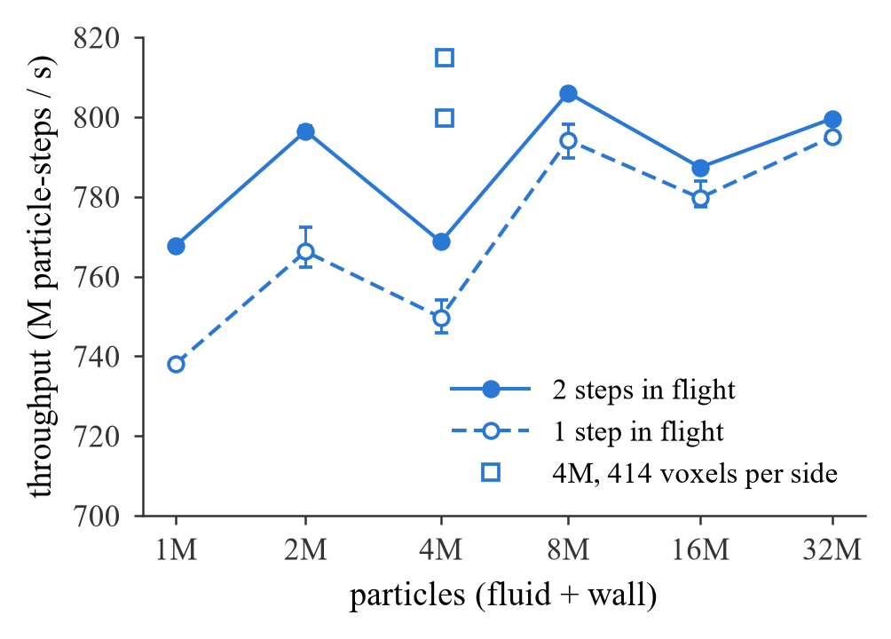

# E9 报告：prefix defrag 进树（v7-rc4 / v7-single-rc4）与 3-D 批次重跑（N56 hp_5090，2026-10-27 起）

> E8 的目录、数据与报告（`claude/e8_3d_report.md`，`docs/cluster_v6/data/e8/`）原样保留；E9 的数据在 `docs/cluster_v6/data/e9/`，作业脚本在 `docs/cluster_v6/e9_jobs/`，本报告按你 10-27 的清单逐项写。E8 7.18 的结论是起点：默认的 atomicAdd defrag 把 pid 块按到达序摆放，8M 的 slab 每粒子多付 12 %，64M 多付 2 %；prefix 序消掉这项代价。

## 0. 概要（随作业完成更新）

- 代码（第 1 节）：host 端 exclusive scan 成为 `experiment/v7` 的 defrag 正式路径并默认开启；v7_single 用同一份 scan；核函数与 SPIR-V 不变。
- 本机验证（第 2 节）：第 4–6 项**全部通过**。K = 1 的每粒子成本与 7.18 的 prefix 结果相差 −0.16 % / −0.03 %（8M / 64M），每次 defrag 后的 pid 序审计 0 次块间倒序；K = 2（同一张卡）内建检查全过、seam OK、第 300 步场与 K = 1 的差在阶段 1 的噪声水平；defrag 间隔 100 的运行三次周期 defrag 后步长无跳变。**2-D 敏感性：1M -0.82 %，8M -5.46 %**——8M 超过 0.5 % 的门槛；你决定 E7 不重跑，2-D 数据保持现状（第 2.3 节）。
- 第 7 项（第 3 节）：表 2 重测完成——2-D 8M 步长 10502 → 9969 µs（-5.1 %），3-D 9.1M 61060 → 58414 µs（-4.3 %），两个 sweep 核 −4 ~ −6 %，其余核不变；fig:baseline 的 2M–32M 点已按测量 A 重测并重画（S d2 +1.2 ~ +5.0 %），1M 不受影响。
- 第 8–11 项（集群）：见第 4 节，随进度补。

## 1. 代码改动（分支 `e8-3d` → 标签 `v7-rc4`；分支 `v7-single` → 标签 `v7-single-rc4`；提交号见第 5 节）

| 文件 | 改动 |
|---|---|
| `experiment/v7/utils/defrag_prefix.py`（新） | host 端的生产者：`upload_defrag_prefix(sim)` 在每次 defrag 提交前读回 `inside_particle_count`，只对 **own 列 voxel**（`is_own_voxel` 的范围：leading ghost 之后到 trailing ghost 之前，ghost 列计 0）按 voxel 编号做 exclusive scan，上传 `voxel_base_offset`，并把 own 粒子总数写进 `defrag_scratch_counter`；`audit_pid_order(sim)` = 诊断（`V7_DEFRAG_AUDIT=1`），读回 `position_voxel_id` 检查 pid 序。|
| `experiment/v7/utils/simulator_v7.py` | `submit_defrag_and_wait`：prefix 时先 scan 再提交（启动 defrag 与周期 defrag 都走这里，restart 也是）；`_record_defrag_cmd`：prefix 时不再把计数器填 0（host 写入的总数经原有第 6 步拷进 `alive_particle_count`，第 7 步的 install tail 复位不变，departed 区不碰）；init 行打印 `defrag_order=`。|
| `experiment/v7/utils/case_v7.py` | `use_prefix_sum_defrag` 默认 `True`（spec constant 46 的来源不变）。|
| `experiment/v7/utils/case_loader_v7.py` | 新键 `numerics.defrag_order: prefix | atomic`，默认 prefix；**旧键 `use_prefix_sum_defrag` 忽略并打印一行提示**——库里全部 100 个 case.yaml 都由生成器写了 `use_prefix_sum_defrag: false`（没有人选过它），集群共享算例库里的 yaml 也是旧的，不忽略它开关的默认值就不会生效。A/B 对照用 `defrag_order: atomic`。|
| `utils/geometry/_demo_cavity_case{,_3d,_aligned}.py` | 生成器改写 `defrag_order: prefix`。已入库的 case.yaml 不动（算例库比对要求逐字节相同）。|
| `docs/cluster_v6/scripts/run_chain_v6.py` | `[e30-config]` 行加 `defrag_order=`。|
| `experiment/v7/shaders/**` | **不动**：`defrag.comp` 的 prefix 分支本来就在，46 是特化常量，`defrag.comp.spv` 等全部 SPIR-V 与 E8 逐字节相同（部署脚本逐个 `cmp`）。|

v7-single 分支：同一份 `defrag_prefix.py` 复制进它的 `experiment/v7/utils/`，它的 rc1 版 `case_v7.py` / `case_loader_v7.py` / `simulator_v7.py` 做同样三处改动（host 端 python，SPIR-V 目录不动，MANIFEST 校验照旧），`experiment/v7_single/utils/simulator_single.py`：`record_defrag` prefix 时不填计数器、`submit_defrag_and_wait` 排空 → scan → 提交、`submit_step(with_defrag=True)`（不排空的合并提交）在 prefix 下改为"步 → 排空 → scan → defrag"（scan 要的是 defrag 前那一步的 voxel 计数）。K = 1 用到的 SPIR-V 仍与链路逐字节相同。

diff 规模（e8-3d，experiment/v7 + 生成器 + harness 行）： 7 files changed, 50 insertions(+), 11 deletions(-)。

## 2. 本机验证（GPU 1 = 无显示的 5090，575 W，e8 工作树的 E9 代码；脚本 `docs/cluster_v6/scripts/e9_local/`，数据 `docs/cluster_v6/data/e9/local/`，日志镜像 `logs/e8_local/e9_local_20261027/`）


##### item 4: K = 1, 300 steps (window 100-299), pid-order audit after the bootstrap defrag

| run | defrag order | step (ms) | ns / particle | corr+dens (ms) | force (ms) | 7.18 prefix step (ms) | diff | audit (bootstrap defrag) | drift |
|---|---|---|---|---|---|---|---|---|---|
| e9_8m_k1_audit | prefix | 46.250 | 5.781 | 23.040 | 22.147 | 46.325 | -0.16 % | 125,000 blocks = 125,000 voxels, 0 descents, 0 without voxel -> EXACT | 0 |
| e9_64m_k1_audit | prefix | 375.400 | 5.866 | 183.729 | 183.092 | 375.500 | -0.03 % | 1,000,000 blocks = 1,000,000 voxels, 0 descents, 0 without voxel -> EXACT | 0 |
| e9_8m_k1 | prefix | 46.400 | 5.800 | 23.107 | 22.230 | 46.325 | +0.16 % | - | 0 |
| e9_64m_k1 | prefix | 375.300 | 5.864 | 183.632 | 183.042 | 375.500 | -0.05 % | - | 0 |

##### item 5: K = 2 on one card (8M cube, --device-map 1,1), 300 steps

- `e9_8m_k2_trace`: 55.500 ms/step (18.02 fps, two slabs on one card), drift 0, overflow_total 0, seam check OK; audits (bootstrap defrag, both slabs, then the end-of-run defrag): EXACT (4,000,000 pids, 0 descents), EXACT (4,000,000 pids, 0 descents), EXACT (4,000,000 pids, 0 descents), EXACT (4,000,000 pids, 0 descents)
  - [chain_v7] seam 0 (col 26): L_overshoot=-0.19dx R_overshoot=-0.46dx dup=0 OK

field comparison K = 2 vs K = 1 at step 300 (`e8_field_compare.py`, phase-1 format):

K = 2 (cuts [26], devices [1, 1]) vs K = 1 at step 300: 7,077,888 fluid particles compared (ids missing in the test 0, in the reference 0); max |dv|/U = 3.943e-05, rms 2.480e-06; max |drho|/rho0 = 1.831e-07, rms 2.052e-08; max |dx| 1.156e-05 m

| distance to the seam (columns) | particles | max dv/U | rms dv/U | max drho/rho0 | rms drho/rho0 | max dx (m) |
|---|---|---|---|---|---|---|
| 0 | 294,912 | 1.941e-05 | 4.317e-06 | 1.221e-07 | 2.693e-08 | 2.772e-06 |
| 1 | 294,912 | 1.840e-05 | 4.174e-06 | 1.221e-07 | 2.757e-08 | 2.625e-06 |
| 2 | 294,912 | 1.873e-05 | 3.511e-06 | 1.221e-07 | 2.490e-08 | 2.594e-06 |
| 3 | 294,912 | 1.648e-05 | 2.767e-06 | 1.221e-07 | 2.228e-08 | 2.209e-06 |
| 4 | 294,912 | 1.665e-05 | 2.290e-06 | 1.221e-07 | 2.069e-08 | 2.623e-06 |
| 5 | 294,912 | 1.408e-05 | 2.092e-06 | 1.221e-07 | 2.016e-08 | 2.385e-06 |
| 6 | 294,912 | 1.276e-05 | 1.967e-06 | 1.831e-07 | 1.970e-08 | 2.297e-06 |
| 7 | 294,912 | 1.755e-05 | 1.856e-06 | 1.221e-07 | 1.933e-08 | 3.398e-06 |
| 8 | 294,912 | 2.032e-05 | 1.851e-06 | 1.221e-07 | 1.913e-08 | 3.249e-06 |
| 9 | 294,912 | 2.013e-05 | 1.762e-06 | 1.221e-07 | 1.895e-08 | 3.428e-06 |
| 10 | 294,912 | 2.054e-05 | 1.744e-06 | 1.831e-07 | 1.909e-08 | 2.777e-06 |
| 11 | 294,912 | 1.438e-05 | 1.706e-06 | 1.831e-07 | 1.923e-08 | 4.831e-06 |
| 12 | 294,912 | 2.348e-05 | 1.762e-06 | 1.221e-07 | 1.910e-08 | 4.503e-06 |
| 13 | 294,912 | 2.563e-05 | 1.825e-06 | 1.221e-07 | 1.884e-08 | 4.232e-06 |
| 14 | 294,912 | 2.349e-05 | 1.990e-06 | 1.221e-07 | 1.894e-08 | 4.984e-06 |
| 15 | 294,912 | 3.288e-05 | 2.165e-06 | 1.831e-07 | 1.937e-08 | 5.254e-06 |
| interior | 2,359,296 | 3.943e-05 | 2.426e-06 | 1.831e-07 | 1.934e-08 | 1.156e-05 |

| slab | device | particles | max dv/U | rms dv/U | max drho/rho0 | rms drho/rho0 |
|---|---|---|---|---|---|---|
| 0 | 1 | 3,538,944 | 2.269e-05 | 2.127e-06 | 1.831e-07 | 1.839e-08 |
| 1 | 1 | 3,538,944 | 3.943e-05 | 2.789e-06 | 1.831e-07 | 2.245e-08 |

- `e9_8m_k2_cad100` (defrag cadence 100, periodic defrags at frames 100 and 200 inside the run): step 70.450 ms, drift 0, seam check OK, defrag events [('100', '1088.521'), ('200', '1082.605'), ('300', '1081.697')] (frame, wall ms); audits ['EXACT', 'EXACT', 'EXACT', 'EXACT', 'EXACT', 'EXACT', 'EXACT', 'EXACT', 'EXACT', 'EXACT']

| window (steps) | median step period (ms) |
|---|---|
| 50-99 | 54.799 |
| 101-149 | 55.067 |
| 150-199 | 54.818 |
| 201-249 | 54.378 |
| 250-299 | 55.109 |
| first step after each defrag | f100+1: 54.866, f200+1: 54.916, f300+1: - |
- before the first periodic defrag (50-99) 54.799 ms, after the second (201-249) 54.378 ms: -0.77 % -> no jump

##### item 6: 2-D sensitivity, K = 1, 1300 steps (window 300-1299, one periodic defrag at 1000 inside; fps = steady_fps_nodefrag)

| case | particles | atomic (ms/step) | prefix (ms/step) | prefix - atomic | atomic audit | prefix audit |
|---|---|---|---|---|---|---|
| cavity2d_n1000 (1M) | 1,044,484 | 1.3621 | 1.3509 | **-0.82 %** | 642 descents | 0 descents |
| cavity2d_n2840 (8M) | 8,191,044 | 10.8929 | 10.2980 | **-5.46 %** | 5,015 descents | 0 descents |

### 2.1 第 4 项判读

两个立方体的每粒子成本与 7.18 的 prefix monkeypatch 结果一致（8M 46.25 对 46.33 ms，64M 375.4 对 375.5 ms，差 ≤ 0.16 %），说明进树的路径就是 7.18 量过的那条；每次 defrag 后 pid 序严格等于 voxel 序（0 次块间倒序，块数 = 非空 voxel 数）。host scan 本身：8M 约 4 ms、64M 约 27 ms（启动一次 + 每 1000 帧一次，不在计时窗口内）；日志里 defrag 事件的墙钟 1.08 s 是 `V7_DEFRAG_AUDIT=1` 的读回（每 slab 0.5 s），生产运行不开。

### 2.2 第 5 项判读

K = 2 两个 slab 在同一张卡上（`--device-map 1,1`）：内建检查全过（drift 0、overflow 0、seam 0 (col 26) dup=0 OK、两个 slab 每次 defrag 后都是精确 voxel 序，含三次周期 defrag）；第 300 步场对 K = 1：max |dv|/U 3.9e-5、|dρ|/ρ0 1.8e-7（阶段 1 两张卡上的 K = 2 是 5.7e-5 / 1.8e-7），逐列分布同样平坦，seam 列不突出。defrag 间隔 100：步长周期在 f100、f200 前后 54.4–55.1 ms，defrag 后第一步 54.9 ms，无跳变（−0.77 % 在逐窗口的散布内）。

### 2.3 第 6 项判读：2-D 敏感性

| 算例 | atomic (ms/步) | prefix (ms/步) | 差 | atomic 的 pid 序 |
|---|---|---|---|---|
| cavity2d_n1000（1M，1,044,484 粒子） | 1.3621 | 1.3509 | **-0.82 %** | 642 / 42,436 块倒序 |
| cavity2d_n2840（8M，8,191,044 粒子） | 10.8929 | 10.2980 | **-5.46 %** | 5,015 / 329,476 块倒序 |

（各一次，1300 步取 300–1299，窗口含第 1000 步的周期 defrag，fps 用 nodefrag 值。）1M 在门槛内，**8M 不在：prefix 快 5.5 %**。按你的规则"小于 0.5 % 就不重跑 E7"，8M 的 2-D 点超过门槛——你 10-27 15:00 决定：**E7 不重跑，2-D 数据保持现状**（"2d数据没什么问题"）。机制与 3-D 相同：2-D 8M 的 defrag 派发 2,574 个工作组，第一波覆盖大半网格。

## 3. 第 7 项：Section 3 基线重测（工作站 600 W，v7_single，1 在飞，逐核时间戳；`tab:kernelcost` 的原协议）

**协议**：`experiment/v7_single/_run_section3_campaign.py run`（= 2026-10-10 做表 2 时的同一脚本：`_run_kernel_breakdown.py --solver v7_single --interleave 0`，预热 1000 步后第 1001–3000 步全部计时，每步一次提交 + fence，生产录制里的 tick 写 BOTTOM_OF_PIPE 时间戳，defrag 帧剔除；2-D 8M `lid_driven_cavity_2d_8m`（8,128,201 粒子）与 3-D 9.1M `cavity3d_8m_b4`（9,129,329）各 3 次独立运行，其余尺寸各 1 次；CPU 端候选数 / 邻居数统计同样重做）。GPU 1 功率上限恢复为 600 W（你点的 UAC），v7-single 提交 ffd1a2f（= rc4.1 的 solver，外加 kernel-breakdown 驱动的 scan 调用——它自己提交 defrag 命令，第一次跑在 voxel 列表一致性检查上失败，修后重跑）。结果 `docs/cluster_v6/data/e9/section3/`（v7-single 分支镜像 `docs/seam_audit/v7_single/section3_rc4_*`）。

#### Section 3 Table 2 (tab:kernelcost): old (atomic defrag order, 2026-10-10, commit f06af58) vs new (prefix order, v7-single-rc4 + ffd1a2f, 2026-10-27), 600 W, 3 runs each, frames 1001-3000, 1 in flight, defrag frames excluded

| case | kernel | old us/step (std) | new us/step (std) | change | > 0.5 %? | old ns/particle | new ns/particle | old % | new % |
|---|---|---|---|---|---|---|---|---|---|
| 2-D 8M (8,128,201) | predict | 497 (0) | 497 (0) | **+0.02 %** | no | 0.06 | 0.06 | 4.7 | 5.0 |
| 2-D 8M (8,128,201) | update_voxel | 331 (0) | 331 (0) | **+0.01 %** | no | 0.04 | 0.04 | 3.2 | 3.3 |
| 2-D 8M (8,128,201) | correction_density | 4530 (9) | 4267 (12) | **-5.81 %** | yes | 0.56 | 0.52 | 43.1 | 42.8 |
| 2-D 8M (8,128,201) | density_copy | 82 (0) | 82 (0) | **+0.06 %** | no | 0.01 | 0.01 | 0.8 | 0.8 |
| 2-D 8M (8,128,201) | force | 5062 (6) | 4792 (11) | **-5.34 %** | yes | 0.62 | 0.59 | 48.2 | 48.1 |
| 2-D 8M (8,128,201) | step total | 10502 (15) | 9969 (23) | **-5.08 %** | yes | 1.29 | 1.23 | 100.0 | 100.0 |
| 2-D 8M (8,128,201) | GPU throughput (M particle-steps/s) | 773.9 | 815.4 | **+5.35 %** | | ps/candidate (step) 5.76 | 5.47 | | |
| 3-D 8M (9,129,329) | predict | 500 (0) | 504 (0) | **+0.98 %** | yes | 0.05 | 0.06 | 0.8 | 0.9 |
| 3-D 8M (9,129,329) | update_voxel | 316 (0) | 313 (0) | **-0.84 %** | yes | 0.03 | 0.03 | 0.5 | 0.5 |
| 3-D 8M (9,129,329) | correction_density | 30354 (20) | 28934 (20) | **-4.68 %** | yes | 3.32 | 3.17 | 49.7 | 49.5 |
| 3-D 8M (9,129,329) | density_copy | 78 (0) | 93 (0) | **+19.00 %** | yes | 0.01 | 0.01 | 0.1 | 0.2 |
| 3-D 8M (9,129,329) | force | 29813 (23) | 28569 (25) | **-4.17 %** | yes | 3.27 | 3.13 | 48.8 | 48.9 |
| 3-D 8M (9,129,329) | step total | 61060 (43) | 58414 (44) | **-4.33 %** | yes | 6.69 | 6.40 | 100.0 | 100.0 |
| 3-D 8M (9,129,329) | GPU throughput (M particle-steps/s) | 149.5 | 156.3 | **+4.53 %** | | ps/candidate (step) 4.06 | 3.88 | | |

#### per-size GPU step of the single runs (frames 1001-3000, defrag frames excluded): fig:baseline's affected points

| size | particles | old GPU step (us) | new (us) | change | affected (> 0.5 %)? | new SM MHz / W / PCIe |
|---|---|---|---|---|---|---|
| 1m | 1,046,529 | 1314 | 1318 | **+0.27 %** | no | 2846.0 / 596.4749999999999 / Gen 4 x4 |
| 2m | 2,064,969 | 2599 | 2493 | **-4.08 %** | yes | 2803.5 / 599.4733333333334 / Gen 4 x4 |
| 4m | 4,182,025 | 5664 | 5364 | **-5.29 %** | yes | 2799.818181818182 / 599.8981818181818 / Gen 4 x4 |
| 4m_gen | 4,182,025 | 5662 | 5360 | **-5.34 %** | yes | 2789.8333333333335 / 600.27 / Gen 4 x4 |
| 8m | 8,128,201 | 10502 | 9969 | **-5.08 %** | yes | 2794.9 / 599.515 / Gen 4 x4 |
| 16m | 16,184,529 | 20962 | 20379 | **-2.78 %** | yes | 2779.7073170731705 / 599.1578048780489 / Gen 4 x4 |
| 32m | 32,251,041 | 40655 | 40062 | **-1.46 %** | yes | 2769.246913580247 / 598.9523456790123 / Gen 4 x4 |
| 3d_8m | 9,129,329 | 61060 | 58414 | **-4.33 %** | yes | 2808.051282051282 / 599.9686324786325 / Gen 4 x4 |

**判读**：
- 两个 sweep 核各快 4–6 %，predict / update_voxel / density_copy 的绝对值不变（3-D 的 density_copy +15 µs、predict +4 µs 是 1 µs 量级的散布放大成的百分比，按 0.5 % 规则列为"更新"但不改变任何结论）。2-D 8M 的整步 −5.1 %，与本机第 6 项的 −5.5 %（575 W，链路代码）一致；3-D 9.1M −4.3 %。
- 每候选对的皮秒数随之下降（2-D 5.76 → 5.47，3-D 4.06 → 3.88）：候选数、邻居数、占用体素完全不变（同一物理），少掉的是 atomicAdd 排列带来的访存代价。
- 1M 不动（+0.3 %）：42k 个 voxel 只有 331 个 defrag 工作组，第一波乱序的代价在 1M 上本来就小（本机第 6 项 −0.8 %）。
- 4M 凹陷仍在：4M gen 的每候选皮秒数对 2M / 8M 均值 +5.2 %（旧 +6.1 %），prefix 序不是它的原因。

**tab:kernelcost 的新行**（表 2 全表见 `section3_rc4_table2.md`；LaTeX 行如下，与旧表相差 > 0.5 % 的项都在其中）：

```latex
% columns: kernel & dispatch & 8M $\mu$s/step & ns/particle & \% & 3-D 8M $\mu$s/step & ns/particle & \% \\
% 8M: 8,128,201 particles (8,003,241 fluid), h/dx = 4.99, 224 candidates and 71.0 neighbours per particle; 3-D 8M: 9,129,329 particles (8,120,601 fluid), h/dx = 4, 1649 candidates and 259.4 neighbours per particle
% 8M: 3 runs, step spread 0.23 %; 3-D 8M: 3 runs, step spread 0.08 %
predict & per particle & 497 & 0.06 & 5.0 & 504 & 0.06 & 0.9 \\
update\_voxel & per voxel & 331 & 0.04 & 3.3 & 313 & 0.03 & 0.5 \\
correction + density (fused) & per particle & 4267 & 0.52 & 42.8 & 28934 & 3.17 & 49.5 \\
density (scratch$\to$primary copy) & buffer copy & 82 & 0.01 & 0.8 & 93 & 0.01 & 0.2 \\
force & per particle & 4792 & 0.59 & 48.1 & 28569 & 3.13 & 48.9 \\
\midrule
\textbf{step total} &  & 9969 & 1.23 & 100.0 & 58414 & 6.40 & 100.0 \\
% ps per candidate: 8M correction_density 2.34, force 2.63; 3-D 8M correction_density 1.92, force 1.90
```

### 3.1 fig:baseline 受影响的点

各尺寸 GPU 步长超过 0.5 % 的是 2M、4M、8M、16M、32M 与 3-D 8M；1M 不受影响。fig:baseline 是 2-D 曲线（v7_single 的 S 系列），所以按测量 A 的协议重测了 2M、4M gen、8M、16M、32M（`_run_single_baseline_campaign.py --sizes 2m,4m_gen,8m,16m,32m --configs v7_single:1,v7_single:2,v7_chain:2 --trials 3 --warmup 1000`，窗口 6000 / 4000 / 2000 / 2000 / 2000 步，600 W，45 次运行全部 drift 0），并入 r3 为 `throughput_rc4_merged`（1M、旧 4M、3-D 8M 与 V / Vx 列保留旧值——V / Vx 是 atomic 序的旧运行，它们与新 S 的比值已无意义，图不用它们）。图 `manuscripts/fig/single_gpu_throughput.{pdf,png}` 已重画（v7-single 工作树与 vulkan-demo 主库各一份），旧图改名 `single_gpu_throughput_e8_atomic.*`。

**吞吐（fps，均值 ± 标准差，3 次）**

| size | particles | S d1 | S d2 | V d1 | V d2 | Vx d1 | Vx d2 | C d2 |
|---|---|---|---|---|---|---|---|---|
| 1m | 1,046,529 | 705.24 ± 0.20 (n=3) | 734.60 ± 0.08 (n=3) | 698.86 ± 1.10 (n=3) | 733.32 ± 0.31 (n=3) | 699.89 ± 1.71 (n=3) | 732.97 ± 0.35 (n=3) | 723.94 ± 0.78 (n=3) |
| 2m | 2,064,969 | 371.08 ± 2.58 (n=3) | 385.72 ± 0.52 (n=3) | 361.66 ± 0.16 (n=3) | 371.69 ± 0.20 (n=3) | 361.11 ± 0.32 (n=3) | 371.45 ± 0.32 (n=3) | 382.05 ± 0.29 (n=3) |
| 4m | 4,182,025 | 172.56 ± 0.02 (n=3) | 174.97 ± 0.18 (n=3) | 172.37 ± 0.09 (n=3) | 175.36 ± 0.03 (n=3) | 172.40 ± 0.09 (n=3) | 175.25 ± 0.08 (n=3) | 174.86 ± 0.13 (n=3) |
| 4m_gen | 4,182,025 | 179.28 ± 1.01 (n=3) | 183.81 ± 0.18 (n=3) | n/a | n/a | n/a | n/a | 183.27 ± 0.12 (n=3) |
| 8m | 8,128,201 | 97.71 ± 0.52 (n=3) | 99.17 ± 0.08 (n=3) | 93.53 ± 0.06 (n=3) | 94.57 ± 0.07 (n=3) | 93.59 ± 0.05 (n=3) | 94.54 ± 0.05 (n=3) | 99.07 ± 0.05 (n=3) |
| 16m | 16,184,529 | 48.18 ± 0.23 (n=3) | 48.65 ± 0.03 (n=3) | 47.29 ± 0.01 (n=3) | 47.58 ± 0.02 (n=3) | 47.28 ± 0.01 (n=3) | 47.57 ± 0.01 (n=3) | 48.67 ± 0.05 (n=3) |
| 32m | 32,251,041 | 24.65 ± 0.01 (n=3) | 24.79 ± 0.01 (n=3) | 24.40 ± 0.00 (n=3) | 24.50 ± 0.01 (n=3) | 24.41 ± 0.00 (n=3) | 24.49 ± 0.00 (n=3) | 24.78 ± 0.00 (n=3) |
| 3d_8m | 9,129,329 | 16.30 ± 0.02 (n=3) | 16.34 ± 0.01 (n=3) | 16.28 ± 0.01 (n=3) | 16.33 ± 0.04 (n=3) | 16.28 ± 0.02 (n=3) | 16.34 ± 0.02 (n=3) | 16.32 ± 0.03 (n=3) |

S d2 的变化：2M 371.9 → 385.7（+3.7 %），4M gen 175.1 → 183.8（+5.0 %），8M 94.4 → 99.2（+5.0 %），16M 47.5 → 48.7（+2.5 %），32M 24.5 → 24.8（+1.2 %）；C/S（链路 K = 1 对单卡）在重测点上仍是 0.99–1.00。3-D 8M 的吞吐行没有重测（图里没有它；表 2 的 3-D 值已重测）。



**协变量**：这次 nvidia-smi 报 GPU 1 的 PCIe 为 Gen 4 x4（10-10 为 Gen 5 x8）——你热插拔换 7900 XTX 再换回来后链路重新协商的结果。单卡核时间不依赖它（1M 点与旧值一致），本节的数字不受影响；本机的传输类测量在重启前不要做。

## 4. 集群（第 8–11 项）

### 4.1 部署

- 包：`vd_e9_cb3c9f5c….tar.gz`（342 文件，`git archive v7-rc4`，内容 = E8 的清单 + `docs/cluster_v6/e9_jobs`）与 `vd_v7single_….tar.gz`（v7-single 的 `experiment/{v7,v7_single}` + materials）。
- `~/run/vulkan-demo-e9`（11:53–13:31 CST，5921 s：JuiceFS 今天建文件慢，280 个文件拷了 1002 s）：MANIFEST / SCRIPTS 校验、experiment/v7 树 37f99f2b、defrag 默认 prefix、五个 SPIR-V 与 E8 部署逐字节相同、py_compile、`_test_chain_cuts` ALL PASS、11 个算例生成器核对、五个作业脚本的语法与空跑（e9_A 46 次链路运行 / e9_D 30 次 / e9_p1 3 次完整空跑通过；e9_B、e9_C 的空跑被部署脚本 15 分钟上限截断——登录节点上仅启动检查就 14 分钟——不是失败，链结束后用 90 分钟上限重跑中），`sbatch --test-only` 接受。
- `~/run/vulkan-demo-v7single-rc4`：第一次部署的是 969823a（v7-single-rc4，有第 1 节说的死锁），在 e9_p1 结束、队列为空后用 **786e2d4（v7-single-rc4.1）`UPDATE=1` 重新部署**（树 4a8fc71f，SPIR-V 与 e9 逐字节相同）。正式批次在它 OK 之后才提交。

### 4.2 第 8 项：两卡短作业 e9_p1 = SLURM 1741843（13:33:58–13:40:58 CST，wqd10nbj02g1，GPU 16:00.0 / 27:00.0，两卡 575 W，驱动 580.82.07，7 min）

镜像 `C:/Users/cchen/PycharmProjects/vulkan-demo/logs/n56/2026-10-27/01_e9_p1_1741843/`（README / jobs.csv 已加行），数据 `docs/cluster_v6/data/e9/p1/`。PROVENANCE：harness cb3c9f5、experiment/v7 树 37f99f2b，作业末尾 PROVENANCE_END unchanged。bring-up（2-D 1M K1 675 fps、K2 898 fps）通过。

**运行（RESULT 行）**

| label | status | K | steps | steady fps | wall s | build s | alive start→end | drift / overflow / far / stamps / clamp | seam / NaN | own columns | own particles | device-local + scratch MiB | VRAM peak MiB per card | SM MHz (median / min) | W median | °C max | ns / particle-step |
|---|---|---|---|---|---|---|---|---|---|---|---|---|---|---|---|---|---|
| 8m_K1 | pass (rc 0) | 1 | 300 | 22.5 | 24.2 | 9.10 | 8000000→8000000 | 0 / 0 / 0 / 0+0 / 0 | - / None | [52] | [8000000] | 2,641 | 0:2,698 | 2827/180 / 2820/172 | 575/17 | 51/24 | 5.56 |
| 8m_K2_trace | pass (rc 0) | 2 | 300 | 42.8 | 26.4 | 11.90 | 8000000→8000000 | 0 / 0 / 0 / 0+0 / 0 | {'seam': 0, 'column': 26, 'left_overshoot_dx': -0.19, 'right_overshoot_dx': -0.46, 'duplicates': 0, 'ok': True} / False | [26, 26] | [4000000, 4000000] | 1,512/1,512 | 0:1,569/1:1,553 | 2835/2865 / 2835/2850 | 569/530 | 52/46 | 5.84 |
| 64m_K2 | pass (rc 0) | 2 | 300 | 5.5 | 146.4 | 54.90 | 64000000→64000000 | 0 / 0 / 0 / 0+0 / 0 | {'seam': 0, 'column': 51, 'left_overshoot_dx': -0.02, 'right_overshoot_dx': -0.49, 'duplicates': 0, 'ok': True} / False | [51, 51] | [32000000, 32000000] | 11,454/11,454 | 0:11,511/1:11,495 | 2775/2827 / 2745/2797 | 575/575 | 63/64 | 5.68 |

- 每粒子成本 8M K1：**5.56 ns**（E8 阶段 1 同样两卡协议 6.28 ns，−11.5 %；本机 575 W 5.78 ns）；8M K2 trace 42.8 fps（E8 38.99，+9.8 %）；64M K2 5.5 fps（E8 5.29，+4 %）。三次运行的 defrag 审计（8M K1、8M K2 两 slab、启动与结束各一次）全部 EXACT voxel order，`defrag_order=prefix` 出现在每个 sim 的 init 行。
- seam：K2 的 seam 0（col 26 / col 51）dup=0 OK；drift / overflow / far_migration / stamps / clamp 全 0。

**显存：实测峰值对模型**

| run | card | slab own columns | model device-local + scratch MiB | measured | model VRAM | measured peak | diff |
|---|---|---|---|---|---|---|---|
| 8m_K1 | 0 | 52 | 2,616 | 2,641 | 2,666 | 2,698 | +1.2 % |
| 8m_K2_trace | 0 | 26 | 1,512 | 1,512 | 1,562 | 1,569 | +0.4 % |
| 8m_K2_trace | 1 | 26 | 1,512 | 1,512 | 1,562 | 1,553 | -0.6 % |
| 64m_K2 | 0 | 51 | 11,459 | 11,454 | 11,509 | 11,511 | +0.0 % |
| 64m_K2 | 1 | 51 | 11,459 | 11,454 | 11,509 | 11,495 | -0.1 % |

**场比较 K = 2 对 K = 1（第 300 步，dump_state 按全局粒子 id 对齐，格式同阶段 1）**：

K = 2 (cuts [26], devices [0, 1]) vs K = 1 at step 300: 7,077,888 fluid particles compared (ids missing in the test 0, in the reference 0); max |dv|/U = 4.517e-05, rms 2.457e-06; max |drho|/rho0 = 1.831e-07, rms 2.046e-08; max |dx| 1.003e-05 m

| distance to the seam (columns) | particles | max dv/U | rms dv/U | max drho/rho0 | rms drho/rho0 | max dx (m) |
|---|---|---|---|---|---|---|
| 0 | 294,912 | 1.896e-05 | 4.353e-06 | 1.221e-07 | 2.723e-08 | 3.576e-06 |
| 1 | 294,912 | 2.064e-05 | 4.283e-06 | 1.221e-07 | 2.787e-08 | 2.980e-06 |
| 2 | 294,912 | 2.021e-05 | 3.547e-06 | 1.831e-07 | 2.508e-08 | 2.801e-06 |
| 3 | 294,912 | 1.804e-05 | 2.779e-06 | 1.221e-07 | 2.230e-08 | 2.742e-06 |
| 4 | 294,912 | 1.736e-05 | 2.293e-06 | 1.221e-07 | 2.075e-08 | 3.368e-06 |
| 5 | 294,912 | 1.496e-05 | 2.122e-06 | 1.221e-07 | 2.034e-08 | 3.219e-06 |
| 6 | 294,912 | 1.366e-05 | 2.010e-06 | 1.221e-07 | 2.002e-08 | 2.593e-06 |
| 7 | 294,912 | 2.003e-05 | 1.875e-06 | 1.221e-07 | 1.944e-08 | 3.399e-06 |
| 8 | 294,912 | 1.635e-05 | 1.902e-06 | 1.221e-07 | 1.943e-08 | 3.101e-06 |
| 9 | 294,912 | 1.799e-05 | 1.849e-06 | 1.221e-07 | 1.930e-08 | 3.368e-06 |
| 10 | 294,912 | 1.503e-05 | 1.812e-06 | 1.221e-07 | 1.943e-08 | 2.833e-06 |
| 11 | 294,912 | 1.431e-05 | 1.768e-06 | 1.831e-07 | 1.922e-08 | 3.726e-06 |
| 12 | 294,912 | 2.452e-05 | 1.815e-06 | 1.221e-07 | 1.931e-08 | 3.938e-06 |
| 13 | 294,912 | 2.720e-05 | 1.829e-06 | 1.221e-07 | 1.913e-08 | 4.387e-06 |
| 14 | 294,912 | 3.031e-05 | 1.914e-06 | 1.221e-07 | 1.891e-08 | 4.584e-06 |
| 15 | 294,912 | 3.327e-05 | 2.010e-06 | 1.221e-07 | 1.874e-08 | 5.467e-06 |
| interior | 2,359,296 | 4.517e-05 | 2.296e-06 | 1.221e-07 | 1.884e-08 | 1.003e-05 |

| slab | device | particles | max dv/U | rms dv/U | max drho/rho0 | rms drho/rho0 |
|---|---|---|---|---|---|---|
| 0 | 0 | 3,538,944 | 2.064e-05 | 2.151e-06 | 1.831e-07 | 1.845e-08 |
| 1 | 1 | 3,538,944 | 4.517e-05 | 2.729e-06 | 1.831e-07 | 2.230e-08 |

（E8 阶段 1 两卡：max |dv|/U 5.7e-5、|dρ|/ρ0 1.8e-7。）**短作业全部检查通过，提交正式批次。**

### 4.3 正式批次：提交（2026-10-27 14:15 CST；你的话："部署好了就直接提交四个作业，报我作业号，然后持续监控"）

| 作业 | SLURM | 内容 | 时限 | 估算 |
|---|---|---|---|---|
| e9_B | **1741917** | B 线：4M / 8M（5 次）、16M / 32M / 64M（3 次）K = 8 + 同步 K = 1 参考，4M / 8M 的 dump K1a / K1b / K8 + 比较，五个立方体的 K = 1 trace，弱 8 × 8M K8，v7-single-rc4.1 对照（Sec. 5.1 cadence 协议，3 对） | 8 h | 3.1 node-h |
| e9_A | **1741918** | A 线：64M K2 / K4、弱 2 / 4（各 3 次，trace 紧跟） | 7 h | 2.6 node-h |
| e9_C | **1741921** | C 线：128M K8，四对同步 K = 2 参考，K8 + 一对 K2 trace | 5 h | 1.5 node-h |
| e9_D（e9_BD） | **1741924** | D 线：76M K8（13 列/卡），K8 + K1 trace | 4 h | 1.3 node-h |

提交参数：`--export=ALL,E30_EXPECT_COMMIT=cb3c9f5cab75,E7_EXPECTED_TREE=37f99f2b…,E30_REPO=$HOME/run/vulkan-demo-e9`；整节点 `--exclusive --mem=0`，575 W，`--exclude=wqd10nbm13g5,wqd10nah09g1,wqd10nbj04g3,wqd10nbj04g5`；E7_RAW / E7_TRACE_DETAIL=full / E7_PARTITION_RECORD / E7_CONTINUE_ON_FAILURE 同 E8。提交时四个都 PENDING（Priority，无空闲整节点；backfill 预估 11-01 是悲观值）。监控：队列状态、运行中输出、丢卡信号（出现则取消 + 排除，不重提）。各作业结束后：打包 → 拉回 → 镜像 `logs/n56/2026-10-27/<seq>_e9_<job>_<id>` + README / jobs.csv → `e8_p2_summary.py --out-dir docs/cluster_v6/data/e9/phase2` → E8 对 E9 的 η 对照（`e9_compare_eta.py`）→ 本报告续写。

### 4.4 结果

四个作业排了 27 h 29 min（分区 36 个节点全部 8/8 被占，别人的作业对我们不可见），2026-10-28 17:37 / 17:38 CST e9_B、e9_A 同时拿到整节点 wqd10nbj04g4 / g2；e9_C、e9_D 因账号并发 GPU 上限（AssocGrpGRES，16 张）等 A / B 结束后自动接上。镜像 `C:/Users/cchen/PycharmProjects/vulkan-demo/logs/n56/2026-10-28/<seq>_e9_<job>_<id>/`（README / jobs.csv 已加行），后处理 = E8 的 `e8_p2_summary.py`（10 个工具）输出到 `docs/cluster_v6/data/e9/phase2/`，E8-vs-E9 的 η 对照 `eta_e8_vs_e9.md/json`（`e9_compare_eta.py`）。下面按作业结束顺序补。

#### 4.4.1 A 线：e9_A = SLURM 1741918（wqd10nbj04g2，17:38:38–19:58:47 CST，2 h 20 min；E8 的 e8_A 2 h 18 min）

- PROVENANCE harness cb3c9f5 / experiment/v7 树 37f99f2b，PROVENANCE_END unchanged；8 卡 575 W；bring-up 2-D 1M K1 677 fps / K2 882 fps 通过；52 次运行 + bring-up 全部 pass，drift 0，trace 运行的 fields=OK；协议与 E8 逐项相同（64M K2 / K4 各 3 次 + 同时 K = 1 参考 + trace；weak 2 × 8M K2、4 × 8M K4）。
- 镜像 `logs/n56/2026-10-28/01_e9_e9A_1741918/`（291 文件，npz 不拉）。

| 点 | E8 η（min–max） | E9 η（min–max） | E9 − E8 | η_min E8 / E9 | fps_K E8 / E9 | 参考 fps E8 / E9（整域等效） |
|---|---|---|---|---|---|---|
| 64M K = 2 | 0.968 (0.966–0.970) | **0.987** (0.986–0.987) | **+0.018** | 0.971 / 0.989 | 4.95 / 5.17 (+4.5 %) | 2.56 / 2.62 (+2.6 %) |
| 64M K = 4 | 0.901 (0.898–0.904) | **0.951** (0.948–0.954) | **+0.051** | 0.912 / 0.961 | 9.19 / 9.94 (+8.2 %) | 2.55 / 2.61 (+2.4 %) |
| weak 2 × 8M K = 2 | 0.984 (0.981–0.986) | **0.986** (0.983–0.988) | **+0.002** | 0.986 / 0.987 | 18.46 / 21.09 (+14.2 %) | 9.38 / 10.69 (+13.9 %) |
| weak 4 × 8M K = 4 | 0.981 (0.978–0.986) | **0.992** (0.991–0.992) | **+0.011** | 0.993 / 1.002 | 18.39 / 21.15 (+15.0 %) | 4.69 / 5.33 (+13.7 %) |

**判读**
- 64M K = 4 的 η 从 0.901 升到 **0.951**（+0.05），K = 2 从 0.968 到 **0.987**（+0.02）；weak 点基本不动（+0.002 / +0.011，本来就在 0.98–0.99）。
- 原因就是 7.18 的机制：atomicAdd 序只打乱 defrag 第一波的 ~16M 粒子，所以 K = 1 的 64M 参考只付 ~2 %（2.55 → 2.62 fps，+2.7 %），而 K = 4 的 16M slab 整块被打乱、付的更多（9.19 → 9.94 fps，+8.2 %），K = 2 的 32M slab 居中（4.95 → 5.17，+4.4 %）；prefix 序把这个随 slab 大小变化的代价抹平，η 就上来了。weak 点的 8M 每卡参考和 8M slab 一起快了 ~14 %（每卡 K = 1 18.8 → 21.4 fps），比值不变。
- 分割：K2 终切 [51]（E8 [50]；标定两轮在 50 / 51 之间摆），K4 [26, 51, 75]（与 E8 相同）；weak K2 [50]，K4 [50, 98, 145]。
- 协变量：busy 中位 SM 时钟 2685–2715 MHz（参考运行 2662–2707），温度 ≤ 71 °C，卡功率峰 582–588 W（575 W 上限的 nvidia-smi 瞬时值），主机 cgroup 峰 39.0 GiB；e8_A 为 2670–2722 MHz / ≤ 75 °C / 35.4 GiB。
- tab:phases 块（T_A / T_B / T_C）、loss sources、hops、bytes check、migration stats 都已生成在 `data/e9/phase2/`；"ideal chain" 行要等 B 线的 K = 1 trace 到齐后重跑整批再填。

## 5. 数据与复现

- 代码：提交号与标签见本节末尾的更新。
- 本机：`docs/cluster_v6/scripts/e9_local/run_k.sh`（一次 K 槽链路运行）、`local_batch.sh`（第 4–6 项的序列）、`local_summary.py` → `docs/cluster_v6/data/e9/local/local_validation.{md,json}`、`compare/compare_8m.{md,json}`；`make_atomic_case.py`（A/B 的 atomic 变体 yaml）；树的改动由 `patch_tree_prefix.py` / `patch_tree_audit.py` 施加（两个工作树同一份），`patch_plan_e9.py`（修订 18–20），`make_deploy_scripts.py`（E9 部署脚本）。
