# `wall_boundary: crossing`（穿壁比例壁面）实现与验收报告

- 分支 `v7-wall-crossing`，基点 `origin/bootstrap-density-fix`（eda5b90）。2026-11-19 按用户的任务书推送到 `origin/v7-wall-crossing`（到 `d94c26c`），并打了带说明的标签 `crossing-boundary`（指向 `d94c26c`，第 20 节）；之后的提交（第 20 节的监视、第 21 节的网格原点、第 22–24 节）只在本地。没有合并。
- 工作树 `C:\Users\cchen\PycharmProjects\vulkan-demo-wall-crossing`。
- 本文由 `experiment/wall_crossing/report_tables.py` 从 `claude/wall_crossing/report_source.md` 和各工具写出的表格拼成；表里的数字都是工具从结果文件读出来的，没有手抄。
- 每个数字后面的 `wc-…` 是 `logs/wall_crossing/runs.jsonl` 里的记录号。`logs/` 不入库，所以记录文件另存了一份在 `claude/wall_crossing/runs.jsonl`（本机）和 `claude/wall_crossing/runs_DESKTOP-9IN3NPD.jsonl`（第二台机器）。

> **本报告的状态（2026-11-17 22:35 之后）**：这是一份没有收尾的草稿。用户在 22:35 要求停掉所有长运行，只做第 6 节的机理确认实验，并且不继续原任务里没做完的项目；11-18 又先后要求做第 7 节和第 8 节的诊断，再要求改一个缺省值并重新验证（第 9 节），最后给了一份新的任务书：速度的二阶延拓（第 10 节）；都不继续原任务。因此：
> - 第 6 到 18 节是完整的；第 19 节（2026-11-19，长时间验证）完成：第 2 节（短检查）、第 3 节的全部长运行（1000² 完整方案、3-D 三种模式，其中 adami 触发停止条件、远端 adami）和总结都已写入。最新的是第 19 节，它之前是第 18 节（2026-11-19，完整方案设为 crossing 的缺省）、第 17 节（2026-11-19，250² 完整方案 + 约束续跑到 t = 200）、第 16 节（2026-11-18，ψ_min、速度极值和涡心的后处理检验，没有新运行）、第 15 节（2026-11-18，封闭域的流体总体积约束；完整方案 + 约束的 250² 和 500²）、第 14 节（完整方案：逐对几何 + 完整向量 + 两个反射）、第 13 节（反射版和“逐对几何 + 完整向量”跑到 t = 100）、第 12 节（逐对几何和压力、密度在壁面处的反射）、第 10 节（速度的二阶延拓）和第 11 节（旧缺省与一阶的场之差）；第 7 节更正了第 6 节结论里的一句话。第 10 节起“一阶”指第 9 节改过之后的现缺省（`normal`），“旧缺省”指 `full`。
> - **第 20 节（2026-11-19）**：按用户的任务书把分支推送到 GitHub 并打标签 `crossing-boundary`（A），然后加了一个逐步只读的监视，查 3-D 双卡丢粒子（B）：三次运行和两个我加的对照都已做完，按要求停在这里等用户看，没有修。
> - **第 21 节（2026-11-19）改了网格原点的取法**（从 `3792010` 起，`case_loader_v7.py`）：某个方向上有初始粒子离体素边界不到 0.25 dx 时，原点在这个方向上往负方向挪 δ（≤ 0.5 dx）。2-D 方腔 250² / 500² / 1000² 的 x、y 都挪了 0.4 dx，48³ 静水盒三个方向挪 0.5 dx，1M 3-D 方腔没挪。**第 1 到 20 节的结果都是旧网格上的。**
> - **第 22 节（2026-11-19）把网格偏移的门槛降到 0.05 dx**（`73e3137`，`numerics.grid_boundary_clearance_minimum`）：2-D 方腔回到原来的网格（与第 21 节以前逐位相同），48³ 静水盒仍挪 0.5 dx。另加了两个缺省关闭的开关（`numerics.wall_crossing.split_dispatch`、`numerics.volume_constraint.gpu_mean_volume`）。
> - **第 23 节（2026-11-19）**：查分开计算的效率和 3-D 平均密度下降。第 22 节的分核计时偏慢（两次调度之间的时间戳），第 22 节对方式 1 / 方式 2 的比较也受它影响；双卡分界带方式 1 的舍入差别是近壁 force 版本读了没更新的 A_f⁻¹，已修（只改 `force_wall_crossing_near_wall`）；3-D 密度下降来自连续性壁面项里的切向速度差，float32 存储把它掩盖了约四成。第 22 节里与此相反的推测作废。
> - **第 24 节（2026-11-20）**：总体积修正加了积分项（缺省关闭），3-D 的密度偏移归零；3-D 方腔对 Albensoeder & Kuhlmann (2005) 基准：完整速度差（极值偏差 ≤ 2.6 %）比只取法向（弱 4–7 %）更近，simple 弱约 15 %。
> - **第 9 节改了一个缺省值**：`numerics.wall_crossing.continuity_wall_component` 从 `full` 改成 `normal`。第 1 到 8 节里 crossing 的全部结果都是改之前（`full`）的；各表里标着"旧缺省"或 `full` 的就是它。
> - **第 18 节改了四个缺省值**（从提交 `3cba19f` 起）：`geometry` → `pairwise`、`continuity_wall_component` → `full`、`pressure_wall` → `reflection`、`delta_wall` → `reflection`（完整方案）；约束仍默认关闭。第 1 到 17 节里 crossing 的结果都是改之前的缺省；第 9 到 17 节说的“现缺省”“一阶”指 2026-11-18 的缺省（nearest_wall + normal + extension + extension）。
> - 第 1–4 节是停止之前写的。其中标着"**未完成**"的地方没有再补：结论摘要、6.4 的文字结论和 1000² 一档、3-D 方腔的互比、3-D 计时、K = 2 吞吐、各阶段的"未验证"清单、下一步建议。
> - 6.4 的表停在 250² 和 500² 两档（500² 的 wall_velocity 在 t = 34.9 失败，表里还没有这一行；1000² 的各次运行都没有跑完）。

## 0. 结论

（**未完成**：这一部分（`summary_text.md`）在长运行按用户要求停止时还没有写或没有数据，之后没有继续；见第 6 节。）

## 1. 通用事项

### 1.1 提交

| 提交 | 标题 |
|---|---|
| `052cfb9` | wall_boundary crossing (stage 1 implementation): crossing-fraction walls of an axis-aligned box, one GPU, fused pass |
| `029313a` | wall_boundary crossing: run tools (cavity launcher, kernel timing, pipeline statistics, logged runs) |
| `5ee25b1` | wall_boundary crossing: validation tools (tables, hydrostatic box, bit-identity, pipeline recipes) + hydrostatic cases |
| `a2149ed` | wall_boundary crossing: slabs with a peer (stage 3 enablement), pipelined drivers, 3-D cavity cases |
| `465d328` | wall_boundary crossing: K = 2 comparison tools (bit comparison + voxel-list probe, seam audit driver), table diagnostics |
| `fac95ac` | wall_boundary crossing: tilted 3-D hydrostatic cases get 64 incoming slots (a lattice in uniform free fall enters a voxel through three faces in one step: 48 arrivals overflowed 32 slots and predict killed the excess); hydrostatic.py names the overflow in a failure |
| `dba0f27` | wall_boundary crossing: single_step judges acceleration and shift against their summed pair terms |
| `ae5f41e` | wall_boundary crossing: report tools (figures, tables with run records, report assembly), outcome classes for longer bit windows |
| `96c9da1` | wall_boundary crossing: K = 2 throughput tool, run records in the cavity tables, a stale file name in a docstring |
| `0e38558` | wall_boundary crossing: report tables (3-D cavity comparison, combined seam audit table, commits, copies of tool summaries and run records) |
| `6a1bada` | wall_boundary crossing: cavity tables list the repeat run and name the convergence quantities without pipe characters |
| `81ae0d9` | wall_boundary crossing: diagnostic switch numerics.wall_crossing.delta_wall (extension / rest_density) |
| `d10e144` | wall_boundary crossing: delta_wall mechanism test (tables, figure) and the report draft with its section 6 |
| `d62e005` | wall_boundary crossing: diagnostic delta_wall gains body_force (wall pair term rho_i g . (r_j - r_i) / c^2) |
| `21b700a` | wall_boundary crossing: hydrostatic.py records the mean density, the pressure level and the level-free pressure error at every sample |
| `e24d16e` | wall_boundary crossing: delta_wall_experiment.py gains the body_force run and the hydrostatic comparison (extension against body_force) |
| `e643008` | wall_boundary crossing: second delta_wall test (body_force) - tables, figures and section 7 of the report |
| `1932d2b` | wall_boundary crossing: density budget diagnostic (V7_DENSITY_BUDGET=1) and diagnostic continuity_wall_component |
| `7b443b7` | wall_boundary crossing: the density budget also records what the stored float32 density actually changed by |
| `0dd6338` | wall_boundary crossing: the density budget in a neighbour traversal of its own for both builds, twelve regions |
| `f25c696` | wall_boundary crossing: density budget tables (repeats, outcome classes), density_rounding.py, the two controls in the drift table |
| `2ed2d09` | wall_boundary crossing: regenerated drift table with the two controls (interim, before the report section) |
| `2351a4d` | wall_boundary crossing: density budget of the 250^2 cavity (tables, figures, section 8 of the report) |
| `44e4e6f` | wall_boundary crossing: continuity_wall_component defaults to normal (was full) |
| `6c8a55a` | wall_crossing reference: simple / adami keep the whole wall velocity difference in the budget comparison |
| `bb7e173` | wall_boundary crossing: analysis of the default change (normal_default.py), earlier tables relabelled |
| `048be28` | wall_boundary crossing: section 9 of the report, first half (default change, regression checks, short runs) |
| `19a0b90` | wall_boundary crossing: section 9 of the report complete (cavity statistics at 250^2 and 500^2, long-run histories) |
| `398f70a` | wall_boundary crossing: report rebuilt (commit table) |
| `b10c5ea` | wall_crossing tools: cavity_run --initial-density-offset (a run can start from a uniformly shifted fluid density; control experiment for the pressure branch) |
| `db3d609` | wall_boundary crossing: second-order continuation of the velocity (switches, both linear by default) |
| `263381b` | wall_crossing tools: numpy exactness study of the second-order continuation (quadratic_accuracy.py); the cavity runner hook reads the second-order states every 20,000 steps (a readback costs 20 / 75 ms at 250^2 / 500^2); single_step: floored criterion for the budget build's diagnostics |
| `a352556` | wall_crossing tools: section-10 tables (quadratic_extension.py tables), cavity table modes of the second-order runs and the control, normal_default.cavity parameterised |
| `449bd10` | wall_crossing tools: single_step --determinant-threshold (a test that puts half of the particles on the fallback of the second-order continuation); wall-layer distance statistics, figure fixes |
| `6296d80` | wall_crossing tools: cavity table label of the second pressure-branch control |
| `a70b805` | wall_boundary crossing: section 10 of the report (second-order continuation of the velocity: regression, numpy exactness, single step, screening, hydrostatic boxes, cavity at 250^2 and 500^2, pressure-branch controls, wall-layer distances, cost, K = 2) |
| `b18597b` | wall_boundary crossing: report rebuilt (commit table) |
| `1edf4ee` | wall_boundary crossing: section 11 of the report (old default minus first order: time-mean velocity and pressure fields of the stored 250^2 snapshots, shares by region, the dropped tangential term; no new run) |
| `282f598` | wall_boundary crossing: report rebuilt (commit table) |
| `bd9fec1` | wall_boundary crossing: pairwise geometry and reflection of pressure and density at the wall (switches, defaults unchanged) |
| `8748bcd` | wall_crossing tools: the three cases that locate a failed screening of the reflection configuration (pairwise geometry alone, with the pressure reflection only, with the density reflection only); numpy check of the pairwise geometry |
| `89441e9` | wall_boundary crossing: section 12 of the report (pairwise geometry and reflection of pressure and density at the wall: regression, numpy check, single step, hydrostatic boxes, the cavity screening and the three locating runs; the screening fails on the interior continuity term with the pairwise geometry alone, no run to t = 100) |
| `8075b88` | wall_boundary crossing: report rebuilt (commit table) |
| `a414a93` | wall_crossing tools: the case of the pairwise geometry with the whole vector in the continuity equation (pairwise_full); cavity_watch.py (stops a cavity run when the fluid leaves the box or exceeds a speed limit) |
| `2b2e3e2` | wall_boundary crossing: section 13 of the report (the reflection configuration and pairwise geometry + whole vector run to t = 100 at 250^2: cavity metrics beside the existing rows, histories of density, pressure and pressure noise, the interior continuity term, kinetic energy and the centre-line estimate of psi_min at t = 18, first-layer distances; section 12's sample-interval note corrected) |
| `8f2902d` | wall_boundary crossing: report rebuilt (commit table) |
| `3176d57` | wall_crossing tools: the case of the complete scheme (pairwise geometry, whole vector in the continuity equation, pressure and density reflection: reflection_full) and its table modes |
| `c9b17ff` | wall_boundary crossing: section 14 of the report (the complete scheme, pairwise geometry + whole vector + both reflections, run to t = 100 at 250^2 from rho0 and from rho0 + 0.3: cavity metrics beside the existing rows, mean density at fixed instants and its rate, mean pressure, negative share, fluctuation; the old default's pressure fluctuation from its snapshots) |
| `2186032` | wall_boundary crossing: report rebuilt (commit table) |
| `b0a2791` | volume constraint for closed domains (numerics.volume_constraint, off by default, wall_boundary crossing only) |
| `5f27286` | volume constraint: the log path's environment variable is SPH_VOLUME_CONSTRAINT_LOG (the cavity runner refuses any V7_* variable outside the release set of switches) |
| `e09cd4e` | wall_boundary crossing: section 15 of the report, first version (the volume constraint: regression, single step, short run, the 250^2 cavity to t = 100, hydrostatic boxes; the 500^2 run is still going) |
| `501a56e` | wall_boundary crossing: section 15 of the report completed (the 500^2 cavity with the complete scheme and the volume constraint: metrics beside the old default and adami, two-point order, histories, time per step) |
| `9435f56` | wall_boundary crossing: report rebuilt (commit table) |
| `cfb8cbf` | wall_boundary crossing: section 15, the range of the 500^2 mean density corrected (rho0 + 0.001 to + 0.004) |
| `e4e86af` | wall_boundary crossing: section 16 of the report (the post-processing behind psi_min, the velocity extrema and the vortex centre: how it works, a test on an analytic divergence-free field at 250^2 and 500^2, psi_min of eight runs by four integration paths, the vortex centres; stored snapshots only) and its tool stream_function_check.py |
| `088e967` | wall_boundary crossing: report rebuilt (commit table) |
| `faebf7a` | wall_crossing tools: snapshots in extra time windows (cavity_run.py --extra-snapshot-windows, cavity_runner_entry.py item 5: written from the runner's own sample reads to <run>/snapshots_extra), the record names t_end; table mode of the 250^2 complete scheme + constraint continued to t = 200 |
| `4758ceb` | wall_boundary crossing: section 17 of the report (the 250^2 complete scheme + volume constraint continued to t = 200 from its t = 90.72 checkpoint in a copy of the run directory: psi_min (box-face normalisation), velocity extrema and vortex centre in the windows 80-100, 130-150, 180-200, kinetic energy from t = 80 to 200, the constraint's target and the mean density across the restart) and its tool continuation_check.py; stream_function_check.py: the grid of a list of snapshot files as a function of its own |
| `48d370f` | wall_boundary crossing: report rebuilt (commit table) |
| `3cba19f` | wall_boundary crossing: the complete scheme is the default (geometry pairwise, continuity_wall_component full, pressure_wall reflection, delta_wall reflection) |
| `8a7f02d` | wall_boundary crossing: the refusals of the new defaults name only the keys still missing; default_change.py (checks 5 and 6 of the default change and the tables of its report section) |
| `380ea90` | default_change.py: the single-step table of the default change (criterion, reflection terms relative to their quantities) |
| `4038e64` | wall_boundary crossing: section 18 of the report (the complete scheme as the default of crossing, from 3cba19f: change list, decisions, checks 1-6, the case files, the defaults by period and the runs.jsonl records under each); default_change.py tables (both commits of checks 1-3, single step, refusals, tests, cases grouped by change) |
| `d6fd7e5` | wall_boundary crossing: report rebuilt (commit table) |
| `f2c318a` | wall_boundary crossing: the 34 diagnostic cases written out with the defaults in force when each was made (their meaning before 3cba19f); outcome_classes.py --reference-repo (reference runs from another checkout) |
| `0a1eb0a` | wall_crossing tools: box_run.py checkpoints, resume, heartbeat and stop conditions; chain_runner.py restart; box_run_supervised.py (watchdog + resume, for the 3-D long runs) |
| `acd0c43` | wall_crossing tools: cavity_run.py writes launcher.pid and does not resume a run cavity_watch stopped; cavity_watch.py --follow-launcher (watches every resumed segment) |
| `f6ee476` | volume constraint: the target is taken when the simulation starts (bootstrap_init / restart_init), not in the constructor |
| `08e6b83` | box_run.py: a resumed segment is numbered after every segment that left a trace (a killed segment writes no segments.jsonl line; found by the kill test of the 3-D trial) |
| `9308a18` | box_run.py --depth (frames in flight of the pipelined chain; default 2 as before) |
| `9ca97df` | wall_boundary crossing: section 19 of the report, first update (the long validation: the short checks of its section 2 done, the long runs started at 03:02 with their estimated ends); long_validation.py tables (restored cases, K = 1 / K = 2 and its locating replicates, seam audits, 3-D K = 2 canonical dumps, 3-D hydrostatic boxes, 3-D trial) and the analysis of the long runs |
| `afbaad0` | cavity_tables.py: label of the 1000^2 long run of section 19 (complete_volume) |
| `2e77e0e` | long_validation.py: the 3-D step rate between samples (box_run stores the average since the segment start) |
| `1ce7ea7` | report section 19, second update: the 3-D cavity crossing run (t = 45) - stable, 15.3 ms per step, centre-line profiles and histories |
| `055343a` | report section 19, third update: the remote 1000^2 adami run (t = 100, window 80-100) - psi_min +0.24 % mid frame / +0.14 % wall frame, stable |
| `c93e27a` | report section 19, fourth update: the 3-D cavity simple run (t = 45) - stable, 10.8 ms per step; crossing's main vortex about 15 % stronger than simple's |
| `7e444b8` | report section 19, fifth update: the 3-D adami run stopped at t = 6.72 (one fluid particle at 1.065 x the lid speed) - located on the edge where the lid meets the downstream wall |
| `6fa853a` | Long validation, sixth update: the 1000^2 complete-scheme run, convergence readings, summary |
| `d94c26c` | Report section 19: commit hash of the sixth update in the change table |
| `2c49ec0` | particle watch: a read-only per-step monitor of a chain run (canonical_dump.py --watch, off by default) and its report tool |
| `1c0cbeb` | particle watch: per-step log of the largest fluid displacement since the previous step, shift and acceleration (id, position, x - x_cut); history figure titles |
| `94eccdd` | Report section 20: push + tag crossing-boundary (A); the particle watch on 3-D K = 2 (B): runs, switch check, findings |
| `3792010` | case_loader_v7: grid origin moved off the particle layers (per axis, when an initial particle lies within 0.25 dx of a voxel boundary) |
| `a120aef` | Report section 21: grid origin off the particle layers - clearances and shifts, the 48^3 K = 2 watch run (no event; old grid: event at step 657), 2-D substitute check |
| `73e3137` | grid origin: clearance threshold 0.25 -> 0.05 particle spacings, as case.yaml numerics.grid_boundary_clearance_minimum (default 0.05); cavity_fields.py takes the origin from the job's case loader |
| `b8eaed5` | wall_boundary crossing: numerics.wall_crossing.split_dispatch (off by default) - the interior particles in a build without the mode's code, the near-wall particles in the mode's build |
| `606d2f5` | wall_boundary crossing: numerics.volume_constraint.gpu_mean_volume (off by default) |
| `d050f8a` | wall_boundary crossing: 3-D density budget regions, the 3-D density drop without the volume constraint, timing tools |
| `b0d479f` | report section 22: grid threshold 0.05 dx, split dispatch, GPU mean-volume constraint, 3-D density drop, timing |
| `ad3a760` | wall_boundary crossing: diagnostics for the split dispatch's timing and the density drop (report section 23) |
| `79f2ee5` | wall_boundary crossing: split_dispatch band mode 1 read a stale A_f^-1 in the force band's outer column (fix) |
| `61c490d` | report section 23: why the split dispatch fell short, the band mode 1 difference, the 3-D density drop |
| `2f16c8c` | volume constraint: integral term (numerics.volume_constraint.integral, off by default); split_order as a case key |
| `f71642b` | 3-D cavity benchmark data (Albensoeder & Kuhlmann 2005, Tables 5 and 6) and the comparison tools (report section 24) |

（加入本报告的那个提交排在这些之后。）

求解器文件（`experiment/v7`、`experiment/validation`、`materials`）在 052cfb9、029313a、5ee25b1 三个提交之间完全相同（`git diff --stat` 为空）；5ee25b1 之后只有 a2149ed 改了 `simulator_v7.py`（放开有 peer 的 slab，单卡路径不变）和一处文档串。所以本报告里在这几个提交上跑的单卡结果用的是同一份求解器代码，可以并列。

### 1.2 机器与 GPU

| 机器 | GPU | Vulkan deviceUUID | 用途 |
|---|---|---|---|
| 本机 DESKTOP-LDQTHT7 | RTX 5090（接显示器，v7 设备 0） | fb83f0dafd9e1d38dc05e7ae643e22a8 | crossing 的 1000² 方腔、双卡的一半、短算例 |
| 本机 DESKTOP-LDQTHT7 | RTX 5090（无显示器，v7 设备 1） | ae137c668a40f5acaab90a83f7cda175 | 计时与寄存器、crossing 的 250² / 500² 方腔、3-D 算例 |
| 第二台 DESKTOP-9IN3NPD（10.147.20.1） | RTX 5090，驱动 610.88 | a85cce699d0fb7294c33d0a5981a4666 | simple / adami 对照组的方腔 |

第二台机器上只动了自己建的 `D:\vulkan-demo-wall-crossing`（代码用 tar 包经 SFTP 传过去，依赖装在该目录的 `.venv`，结果用 SFTP 取回 `logs/wall_crossing/cavity/` 和 `logs/wall_crossing/remote/`）。没有改任何系统设置；机器上另一位用户的进程没有碰。

### 1.3 运行方式

所有命令从工作树根目录用 `C:\Users\cchen\PycharmProjects\vulkan-demo\.venv\Scripts\python.exe` 运行，环境变量 `VK_LOADER_LAYERS_DISABLE=VK_LAYER_KHRONOS_validation`、`OPENBLAS_NUM_THREADS=1`。工具都在 `experiment/wall_crossing/`，各自的文档串里有命令行；附录 A 列出每个工具对应哪项验收。

## 2. 阶段 1：2-D 盒体，单卡

### 2.1 改动清单

**着色器（`experiment/v7/shaders`）**

| 文件 | 改动 |
|---|---|
| `wall_boundary.glsl` | 末尾新增一节（`#ifdef WALL_CROSSING`）：`WALL_BOUNDARY_CROSSING = 2`；spec const 120–127；瞬态缓冲的声明；几何函数 `wall_crossing_distance_to_wall`（φ）、`wall_crossing_depth_behind_wall`（d）、带下限的 φ、系数 1 + d/φ；A_f 的正则化求逆（与修正矩阵同一流程，失败返回 false）；对称矩阵的解包。换一般几何时只替换前两个函数。 |
| `correction_density.comp` | `#ifdef WALL_CROSSING` 内：壁粒子自身提前返回（单位矩阵、零梯度、零核和，scratch 写 ρ0 的存储值和 0 压力）；流体粒子的 φ_i、`fluid_correction_matrix`、只含流体邻居的密度梯度 g_f、壁邻居漂移项的系数、壁邻居扩散项的向量累加；循环后求 A_f⁻¹ 并写入瞬态缓冲、回退计数、密度变化率里的壁面扩散项。 |
| `force.comp` | `#ifdef WALL_CROSSING` 内：`wall_kernel_gradient_sum`、`fluid_pressure_gradient_sum`；壁邻居不做逐对压力项；壁邻居的粘性速度差乘 1 + d/φ；循环后的壁面压力项。 |
| `common.glsl` | 只改注释和一个字段名：状态块第 39 个字段原名 `status_reserved_7`（此前没有任何 kernel 写），改名 `wall_crossing_gradient_fallback_count`。SPIR-V 不带名字，所有旧模块字节不变。 |
| `compile_shaders_v7.py` | `SHADER_VARIANTS` 增加两个变体：`correction_density_wall_crossing`、`force_wall_crossing`（同一源文件加 `-DWALL_CROSSING`）。 |
| `spv/` | 新增 `correction_density_wall_crossing.comp.spv`、`force_wall_crossing.comp.spv`；原有 23 个 `.spv` 重新编译后字节相同；`MANIFEST.txt` 重新生成（25 个文件）。 |
| `README.md` | spec const 表、文件清单。 |

**新增的 spec const**（只编进两个 crossing 变体）

| 编号 | 名字 | 含义 |
|---|---|---|
| 100 | `WALL_BOUNDARY` | 原有；新增取值 2 = crossing |
| 120 | `WALL_CROSSING_CONTINUITY` | 连续性方程里壁邻居的速度差：0 = extrapolate，1 = wall_velocity |
| 121 | `WALL_CROSSING_DISTANCE_FLOOR` | φ_i 的下限，单位米（下限系数 × 粒子间距） |
| 122–124 | `WALL_CROSSING_BOX_LOWER_X/Y/Z` | 盒的下角 |
| 125–127 | `WALL_CROSSING_BOX_UPPER_X/Y/Z` | 盒的上角 |

**新增的缓冲**

`wall_crossing_fluid_inverse`：set 0 binding 12，每粒子 2 个 vec4（32 字节）：`[2 i] = (m00, m11, m22, m01)`，`[2 i + 1] = (m02, m12, 0, 有效标志)`。只在 crossing 的 slab 上创建；同一步内遍历 1 写、遍历 2 读；不在 defrag 和传输的搬运列表里。simple / adami 的缓冲清单不变（见 6.1 的管线配方比较）。

**主机端（`experiment/v7/utils`）**

| 文件 | 改动 |
|---|---|
| `wall_crossing_v7.py`（新） | `WallCrossingSettings`；`numerics.wall_crossing` 的解析；φ、d 的 numpy 版本；缺省盒的推导和加载时的检查；诊断量。 |
| `case_v7.py` | `WALL_BOUNDARY_CHOICES` 增加 `crossing`；`NumericsConstants.wall_crossing`。 |
| `case_loader_v7.py` | 读 `numerics.wall_crossing`；`use_kcg_correction` 关闭或出现流体、壁以外的材料 kind 时报 `ValueError`；确定并打印盒。 |
| `simulator_v7.py` | crossing 时：spec const 100 = 2 并追加 120–127；加载两个变体模块；建瞬态缓冲；不建 wall pipeline；deep-wall skip 解析为关闭；`_check_wall_crossing_supported()` 对不支持的路径报 `ValueError`（非融合路径、未解析的设置；有 peer 时见阶段 3）。 |
| `_test_seam_layout.py` | 把两个新 `.spv` 加进"新增文件"的排除表，把 `wall_crossing` 加进 v7 独有字段表。 |

**算例（都引用基础算例的 OBJ，不复制）**

- `cases/lid_driven_cavity_2d_n{250,500,1000}_xi0p001_eps0p0025_crossing`、`…_crossing_wall_velocity`、`…n250…_crossing_floor0p5`。
- `cases/wall_crossing/hydrostatic_2d_n250_{gy,g30}_{simple,adami,crossing,crossing_wall_velocity}`（由 `hydrostatic.py make-cases` 生成）。

**工具**：`experiment/wall_crossing/`（附录 A）。

### 2.2 与任务文件不一致的代码事实

| 任务文件的说法 | 实际看到的 | 我的调整 |
|---|---|---|
| 仓库里若有 `claude/wall_crossing/`（设计文档、`check.py`、`check2.py`）先读 | 基点上没有这个目录，全库也没有这两个脚本 | numpy 参考实现按任务文件第 2、5 节自己写（`experiment/wall_crossing/reference.py`） |
| SPIR-V 新鲜度检查（`_test_seam_layout.py`）要通过 | 这个测试在基点 eda5b90 上本身就有 858 项失败（都是"钉住的命令流"和分区数值两类，没有一项是 SPIR-V 过期）；SPIR-V 新鲜度那一段是通过的 | 标准改为"失败清单与基点完全相同，且新鲜度段通过"。当前提交上重跑：858 项，与基点逐条相同（wc-20261117-190213-0536；清单在 `claude/wall_crossing/tests/`） |
| 6.1：在两个提交上各跑若干千步，最终状态逐位相同 | 这个求解器同一个构建跑两次，超过一定步数后自己都不逐位相同（体素表按线程到达顺序追加，`canonical_dump.py` 文档串里写明）。250² 上 simple 约到 999 步、adami 约到 200 步之内可以稳定复现 | 分三层回答，见 6.1：canonical 窗口内逐位相同；更长窗口用"结果类"比较；管线配方（模块、spec const、缓冲）逐项相同 |
| 6.7：沿用 E9 的轻量等价检查 | 本分支的树里没有找到这个名字的脚本或文档 | 用 `_run_v7_equivalence.py`（包络检查）、canonical 逐位比较和接缝审计三项代替 |
| 已占用的 spec const：…100–115 附近 | 实际占用到 115，116–127 标为保留 | 用 120–127，116–119 仍空着；已记进 `shaders/README.md` 和 `common.glsl` 的表 |
| 6.5：用 `_run_kernel_breakdown.py` 或现有单卡 bench | `_run_kernel_breakdown.py` 是给 V0 / V5 的 | 用 v7 自带的 `BenchTimer` 写了 `kernel_timing.py`（各配置交替、多轮） |
| A_f⁻¹ 缓冲：对称，6 个浮点 | std430 下 6 个浮点要按 vec4 对齐，而且遍历 2 需要知道遍历 1 是否回退 | 每粒子 2 个 vec4：6 个分量 + 1 个有效标志 + 1 个空位 |

其余"代码事实"（每步顺序、融合 pass 的做法、符号约定、`wall_dummy_velocity` 的先例、`density_gradient_kernel_sum.xyz` 无人读取、寄存器数 2-D 56 / 3-D 64）与代码一致。

### 2.3 我做的决定

1. **用编译变体而不是 spec const 分支。** 任务文件要求新代码放在 `WALL_BOUNDARY == 2` 的分支里。我把新代码放在 `#ifdef WALL_CROSSING` 里，编成两个单独的 `.spv`，其中每条语句再受 `WALL_BOUNDARY == 2` 约束。理由：这样 simple / adami 运行的 SPIR-V 文件与基点字节相同（MANIFEST 可核对），"逐位不变"由构建保证，不依赖驱动对死分支的优化。代价是多两个 `.spv`。
2. **spec const 编号 120–127，缓冲 binding 12。** 全库 grep 确认未用。
3. **回退计数放在状态块的保留字段 [39]。** 不改状态块大小，不动别的字段。
4. **缺省盒 = 流体粒子包围盒各向外扩一个粒子半径**（任务文件的规定），加载时打印。方腔的流体格点正好铺满 [−0.5, 0.5]，所以 250² 的盒是 ±0.502：壁面在最外一排流体和最里一排壁粒子的正中间。这使 crossing 的方腔边长是 1 + dx，而已发表的表格（simple）取的是 1 + 2 dx（最里一排壁粒子的中心线）。6.4 的表两种取法（wall 帧、mid 帧）都给。
5. **加载时检查**：流体粒子有一个在盒外、或壁粒子有一个在盒内，就报 `ValueError` 并写出个数和最坏的距离。
6. **壁粒子自身**在遍历 1 里往 scratch 写 (ρ0 的存储值, 0)，这样它的密度一直是 ρ0、压力一直是 0，流体读到的壁邻居体积是 m_j / ρ0。
7. **deep-wall skip** 在 crossing 下解析为关闭：壁粒子本来就提前返回，不需要它；这样也不会走到它的记录和检查逻辑。
8. **A_f 求逆回退**时写有效标志 0，遍历 2 看到 0 就不加 (A_f⁻¹ − L) g_f 这一项（等价于 G = 0），遍历 1 的壁面扩散项同样取 0；回退次数累计在状态字段里。
9. **下限**用米为单位的 spec const 传给着色器（系数 × 2 × 粒子半径）。
10. **不支持的情况一律在主机端报 `ValueError`**：`use_kcg_correction` 关闭；非融合路径（`V7_FUSED_CORRECTION_DENSITY=0`，或融合被别的开关关掉）；算例里有流体和壁以外的材料 kind；设置没有经加载器解析。
11. **单步对照的判据。** 密度变化率用"超出 ρ 的 1 ulp 的部分"判：GPU 给的是更新后的密度（float32），ρ ≈ 1000 时 1 ulp 是 6.1e-5，一步的变化量经常只有几个 ulp，直接比变化率的相对误差量的是存储的量化。加速度和位移修正用"误差 ÷ 逐对项绝对值之和"判（要求小于容差的十分之一）：这两个量是大量相消的和，个别粒子的结果比它的项小几个数量级，相对误差没有意义。两种相对误差仍然都列在表里。L、A_f⁻¹、核和、g_f 直接用相对误差。
12. **方腔运行的启动器。** `cavity_run.py` 包了一层 `experiment/validation/cavity_runner`（协议、定常判据、平均窗口都是它的），加了看门狗、断点续跑和 runs.jsonl 记录；`cavity_runner_entry.py` 在不改 `cavity_runner.py` 的前提下补两件事：没有 `.git` 时（第二台机器上是 tar 包）从 `COMMIT` 文件取提交号，以及 crossing 运行每 20 000 步记一次回退计数和 φ 的最小值。
13. **长运行用冻结的工作树。** 开发还在继续的时候，长时间的方腔运行从 `vulkan-demo-wall-crossing-run`（5ee25b1 的分离检出）启动，结果仍写回本工作树的 `logs/`。
14. **静水盒和 3-D 算例走流水线路径。** 单卡的逐步提交路径在与别的作业共用 GPU 时只有约 170 步/秒；`chain_runner.py` 用生产用的链路径（K = 1 的链，深度 2）驱动，共用时约 1200–1800 步/秒。物理上是同一个求解器。
15. **第二台机器不配密钥登录。** 配密钥要写 `C:\ProgramData\ssh\administrators_authorized_keys`，在专用工作目录之外，属于 1.2 的边界；所以一直用密码，密码只经环境变量传给本机的 paramiko 脚本，没有写进任何文件、提交、日志或本报告。
16. **对照组放在第二台机器上跑**（simple / adami 的 250²、500²、1000²），crossing 在本机跑。三张卡都是 RTX 5090，求解器代码相同，驱动版本不一定相同；没有做"同一算例在两台机器上各跑一次"的比较。

### 2.4 验收

#### 6.1 simple 和 adami 逐位不变

三层证据：

**(a) 运行的是同一份东西。** 两个新 `.spv` 之外的 23 个 SPIR-V 文件字节相同。`pipeline_statistics.py` 在基点工作树和本分支上各建一次真实的 K = 1 模拟器，逐条比较每个管线的模块 sha256、spec const 条目、缓冲清单和驱动给出的编译统计：250² 和 1000² 的 simple / adami（28 / 30 个管线、24 个缓冲）、3-D 1M 的 simple / adami（30 / 32 个管线、26 个缓冲）全部相同。

**(b) canonical 窗口内逐位相同**（`canonical_dump.py --canonical-lists`，250²；每个版本跑两次，先确认各自能复现自己，再比两个版本）：

| 比较（算例、步数窗口、K、两侧） | 结论 | 比较时本分支的提交 | 记录 |
|---|---|---|---|
| adami_n250_canonical K=1 base_self | BIT-IDENTICAL | 029313a | wc-20261117-171905-2971 |
| adami_n250_canonical K=1 base_vs_this | BIT-IDENTICAL | 029313a | wc-20261117-171905-88f1 |
| adami_n250_canonical K=1 this_self | BIT-IDENTICAL | 029313a | wc-20261117-171905-aed3 |
| adami_n250_canonical K=2 base_self | BIT-IDENTICAL | a2149ed+dirty | wc-20261117-182512-b196 |
| adami_n250_canonical K=2 base_vs_this | BIT-IDENTICAL | a2149ed+dirty | wc-20261117-182512-6148 |
| adami_n250_canonical K=2 this_self | BIT-IDENTICAL | a2149ed+dirty | wc-20261117-182512-aa71 |
| adami_n250_nodefrag_3000 K=1 base_self | NOT bit-identical | 029313a | wc-20261117-172007-7816 |
| adami_n250_nodefrag_3000 K=1 base_vs_this | NOT bit-identical | 029313a | wc-20261117-172007-4fb0 |
| adami_n250_nodefrag_3000 K=1 this_self | NOT bit-identical | 029313a | wc-20261117-172007-1fb8 |
| adami_n250_plain K=1 base_self | NOT bit-identical | 029313a | wc-20261117-171921-d234 |
| adami_n250_plain K=1 base_vs_this | NOT bit-identical | 029313a | wc-20261117-171921-e91f |
| adami_n250_plain K=1 this_self | NOT bit-identical | 029313a | wc-20261117-171921-a87f |
| crossing 700 steps: V7_DENSITY_BUDGET=1 vs 0 | ok | 7b443b7+dirty | wc-20261118-025100-3e6e |
| crossing 999 steps: V7_DENSITY_BUDGET=1 vs 0 | failed: exit code 1 | 7b443b7+dirty | wc-20261118-025101-2207 |
| crossing 999 steps: no budget, two runs | ok | 7b443b7+dirty | wc-20261118-025101-62c7 |
| crossing default: build before the diagnostic switch (a2149ed) vs the build with body_force, K=1 700 steps | ok | d10e144+dirty | wc-20261118-013443-f377 |
| crossing default: build before the diagnostic switch (a2149ed) vs with it, K=1 700 steps | ok | 6a1bada+dirty | wc-20261117-224106-e5d5 |
| crossing default: build before the diagnostic switches (a2149ed) vs the build with the budget variants, K=1 700 steps | ok | e643008+dirty | wc-20261118-021600-3d5c |
| crossing: V7_DENSITY_BUDGET=1 (final build) vs 0, K=1 700 steps | ok | 1932d2b+dirty | wc-20261118-023325-37e2 |
| crossing: V7_DENSITY_BUDGET=1 (twelve regions) vs 0, K=1 700 steps | failed: exit code 1 | 7b443b7+dirty | wc-20261118-024510-f644 |
| crossing: V7_DENSITY_BUDGET=1 vs 0, K=1 700 steps | ok | e643008+dirty | wc-20261118-021637-39a4 |
| simple 700 steps: V7_DENSITY_BUDGET=1 vs 0 | ok | 7b443b7+dirty | wc-20261118-025100-0dc7 |
| simple 999 steps: V7_DENSITY_BUDGET=1 vs 0 | ok | 7b443b7+dirty | wc-20261118-025101-70a2 |
| simple: V7_DENSITY_BUDGET=1 (final build) vs 0, K=1 700 steps | ok | 1932d2b+dirty | wc-20261118-023326-206f |
| simple: V7_DENSITY_BUDGET=1 (own traversal) vs 0, K=1 700 steps | ok | e643008+dirty | wc-20261118-022244-28f8 |
| simple: V7_DENSITY_BUDGET=1 (twelve regions) vs 0, K=1 700 steps | ok | 7b443b7+dirty | wc-20261118-024510-e1ca |
| simple: V7_DENSITY_BUDGET=1 vs 0, K=1 700 steps | failed: exit code 1 | e643008+dirty | wc-20261118-021638-da5d |
| simple_n250_canonical K=1 base_self | BIT-IDENTICAL | 029313a | wc-20261117-171901-3467 |
| simple_n250_canonical K=1 base_vs_this | BIT-IDENTICAL | 029313a | wc-20261117-171901-11cd |
| simple_n250_canonical K=1 this_self | BIT-IDENTICAL | 029313a | wc-20261117-171901-d36c |
| simple_n250_canonical K=2 base_self | BIT-IDENTICAL | a2149ed+dirty | wc-20261117-182501-3690 |
| simple_n250_canonical K=2 base_vs_this | BIT-IDENTICAL | a2149ed+dirty | wc-20261117-182501-0600 |
| simple_n250_canonical K=2 this_self | BIT-IDENTICAL | a2149ed+dirty | wc-20261117-182501-75b2 |
| simple_n250_nodefrag_3000 K=1 base_self | BIT-IDENTICAL | 029313a | wc-20261117-171958-091b |
| simple_n250_nodefrag_3000 K=1 base_vs_this | NOT bit-identical | 029313a | wc-20261117-171959-e3c8 |
| simple_n250_nodefrag_3000 K=1 this_self | NOT bit-identical | 029313a | wc-20261117-171959-0f65 |
| simple_n250_nodefrag_8000 K=1 base_self | NOT bit-identical | 029313a | wc-20261117-172019-d629 |
| simple_n250_nodefrag_8000 K=1 base_vs_this | NOT bit-identical | 029313a | wc-20261117-172020-54c2 |
| simple_n250_nodefrag_8000 K=1 this_self | NOT bit-identical | 029313a | wc-20261117-172019-e756 |
| simple_n250_plain K=1 base_self | NOT bit-identical | 029313a | wc-20261117-171913-01a2 |
| simple_n250_plain K=1 base_vs_this | NOT bit-identical | 029313a | wc-20261117-171913-ad2d |
| simple_n250_plain K=1 this_self | NOT bit-identical | 029313a | wc-20261117-171913-57f0 |

`canonical` 的四组（simple 999 步、adami 200 步，K = 1 和 K = 2）三项比较全部 BIT-IDENTICAL。K = 2 的 simple 即任务 6.7 要求的那一项。`plain`（4000 步，经过 defrag）和 `nodefrag`（3000、8000 步）几组，基点自己跑两次就不相同，所以这些窗口上"两个版本是否相同"单靠一对运行回答不了。

**(c) 更长的窗口：结果类。** 每个版本各跑 6 次，把 12 个最终状态按"逐位相同"分类。同一个版本可能落进不同的类（体素表的到达顺序不同）；只要两个版本落进过同一个类，就说明两者的算术在这个窗口上相同：

| 算例 | K | 步数 | 体素表 | 每个版本的运行次数 | 结果类（base 次数 / 本分支次数） | 两个版本共有的结果类 | 记录 |
|---|---|---|---|---|---|---|---|
| simple_n250_nodefrag_1500 | 1 | 1500 | canonical | 6 | 6 / 6 | 1（共 1 类） | wc-20261117-185159-bde1 … wc-20261117-185223-e50e |
| simple_n250_nodefrag_3000 | 1 | 3000 | canonical | 6 | 1 / 0，1 / 1，0 / 1，1 / 0，1 / 2，2 / 1，0 / 1 | 3（共 7 类） | wc-20261117-185223-6d1a … wc-20261117-185306-1913 |
| adami_n250_nodefrag_400 | 1 | 400 | canonical | 6 | 5 / 5，1 / 1 | 2（共 2 类） | wc-20261117-185306-c1bd … wc-20261117-185325-02fa |
| adami_n250_nodefrag_1000 | 1 | 1000 | canonical | 6 | 1 / 1，3 / 4，1 / 1，1 / 0 | 3（共 4 类） | wc-20261117-185325-bff4 … wc-20261117-185348-615e |

simple 1500 步：12 次全部相同。simple 3000 步、adami 400 和 1000 步：出现多个类，但每一组里基点和本分支都有共同的类（3000 步的 simple 有 3 个共同类）。也就是说，到 3000 步（simple）和 1000 步（adami）为止，本分支能算出与基点逐位相同的状态；不同的运行之间的差别来自求解器本身的到达顺序，两个版本都有。

**(d) 计时与寄存器，前后对比**（1000²，独占无显示器的那张卡；寄存器数来自 `VK_KHR_pipeline_executable_properties`）：

| 算例 | 代码 | 壁面 | 第一遍 correction_density：寄存器（二进制大小） | 第二遍 force | 壁面遍 wall_extrapolate | 记录 |
|---|---|---|---|---|---|---|
| 2-D 方腔 1000² | 基线 eda5b90 | simple | 56（6,144 B） | 63（5,504 B） | — | wc-20261117-170506-4364 |
| 2-D 方腔 1000² | 基线 eda5b90 | adami | 56（6,144 B） | 64（5,888 B） | 34（3,840 B） | wc-20261117-170508-6b03 |
| 2-D 方腔 1000² | 本分支 | simple | 56（6,144 B） | 63（5,504 B） | — | wc-20261117-170502-8279 |
| 2-D 方腔 1000² | 本分支 | adami | 56（6,144 B） | 64（5,888 B） | 34（3,840 B） | wc-20261117-170503-ad67 |
| 2-D 方腔 1000² | 本分支 | crossing | 72（8,960 B） | 78（7,424 B） | — | wc-20261117-170504-1ffc |
| 2-D 方腔 1000² | 本分支 | crossing（wall_velocity） | 68（8,192 B） | 78（7,424 B） | — | wc-20261117-185218-d99e |
| 3-D 方腔 1M | 基线 eda5b90 | simple | 64（7,552 B） | 64（6,016 B） | — | wc-20261117-185211-1c25 |
| 3-D 方腔 1M | 基线 eda5b90 | adami | 64（7,680 B） | 64（6,528 B） | 38（3,968 B） | wc-20261117-185215-0faa |
| 3-D 方腔 1M | 本分支 | simple | 64（7,552 B） | 64（6,016 B） | — | wc-20261117-183313-16f7 |
| 3-D 方腔 1M | 本分支 | adami | 64（7,680 B） | 64（6,528 B） | 38（3,968 B） | wc-20261117-183315-9986 |
| 3-D 方腔 1M | 本分支 | crossing | 80（10,880 B） | 72（8,192 B） | — | wc-20261117-183318-5675 |
| 3-D 方腔 1M | 本分支 | crossing（wall_velocity） | 77（10,112 B） | 72（8,192 B） | — | wc-20261117-183321-1af9 |

每步 GPU 时间（µs）：3 轮交替测量的中位数（最小–最大）；每次 8000 步，前 3000 步不计；设备 ae137c668a40f5acaab90a83f7cda175。“相对 simple” = 整步时间相对本分支 simple。

| 配置 | predict | update_voxel | correction_density | density_copy | wall_extrapolate | force | 整步 | 相对 simple | 记录 |
|---|---|---|---|---|---|---|---|---|---|
| base_simple | 27.7（27.7–27.7） | 20.4（20.4–20.4） | 608.9（606.9–609.1） | 8.2（8.2–8.2） | — | 673.4（670.0–673.9） | 1338.7（1333.2–1339.2） | -0.1 % | wc-20261117-170547-4b82 … a669 |
| branch_simple | 27.7（27.7–27.7） | 20.4（20.3–20.4） | 609.3（607.3–611.0） | 8.2（8.2–8.2） | — | 674.2（671.3–674.8） | 1339.7（1334.9–1342.0） | +0.0 % | wc-20261117-170600-2a3e … e46b |
| base_adami | 28.0（28.0–28.0） | 19.6（19.5–19.6） | 592.3（591.9–593.6） | 8.2（8.2–8.2） | 67.7（67.7–68.0） | 770.8（770.5–771.6） | 1487.4（1486.2–1487.9） | +11.0 % | wc-20261117-170613-d7ef … 2728 |
| branch_adami | 28.0（28.0–28.0） | 19.6（19.6–19.6） | 593.0（592.5–593.4） | 8.2（8.2–8.2） | 68.2（67.8–68.3） | 770.5（770.5–772.7） | 1487.9（1487.1–1489.2） | +11.1 % | wc-20261117-170628-2d8a … c3a8 |
| branch_crossing | 34.1（34.1–34.1） | 20.4（20.4–20.4） | 790.3（790.2–791.1） | 8.2（8.2–8.2） | — | 933.0（933.0–934.4） | 1786.0（1785.8–1788.1） | +33.3 % | wc-20261117-170642-7826 … 4877 |
| branch_crossing_wall_velocity | 34.1（34.1–34.1） | 20.4（20.3–20.4） | 758.5（758.3–758.7） | 8.2（8.2–8.2） | — | 928.9（928.6–929.3） | 1749.9（1749.7–1750.7） | +30.6 % | wc-20261117-170700-26ea … 9f84 |

simple 和 adami 的寄存器数、二进制大小前后相同；整步时间前后差 0.1 % 以内（simple 1338.7 → 1339.7 µs，adami 1487.4 → 1487.9 µs），在各自三轮的最小–最大范围之内。

#### 6.2 单步对照

`experiment/wall_crossing/reference.py` 是任务文件第 5 节公式的 numpy（float64）实现，2-D / 3-D 通用；`single_step.py` 生成一个小盒算例（2-D：50 × 40 个流体粒子，壁 1224 个；3-D：24 × 20 × 16，壁 18 840 个），把位置、速度、密度设成给定的场，让 GPU 走一步，再逐粒子比较。"光滑场"是任务要求的那一项（非平凡的光滑速度和密度场，粒子位置加了扰动，使一部分粒子低于距离下限）；Couette 和静水两种配置是我加的，用来单独看粘性项和压力项。

| 配置 | 流体 / 壁粒子 | A_f 回退（GPU = 参考） | 新密度误差（ulp，最大） | 密度变化率：超出 1 ulp 的相对误差 | 加速度：最大相对误差 / 误差 ÷ 对项绝对值之和 | 位移修正：同左 | L | A_f⁻¹ | 核和 | g_f | 推导恒等式（仅参考解）：压力 / 壁面密度扩散 | 判据值 | 结论 | 记录 |
|---|---|---|---|---|---|---|---|---|---|---|---|---|---|---|
| 2-D 光滑场，extrapolate | 2,000 / 1,224（近壁 731，低于下限 8） | 0 = 0；截断 0 | 1.13 | 7.7e-08 | 5.2e-06 / 4.5e-07 | 8.9e-05 / 1.7e-07 | 7.9e-06 | 3.5e-06 | 5.2e-07 | 5.1e-07 | 3.6e-15 / 1.0e-04 | 7.9e-06（容差 1e-04） | 通过 | wc-20261118-100028-c659 |
| 2-D 光滑场，wall_velocity | 2,000 / 1,224（近壁 731，低于下限 8） | 0 = 0；截断 0 | 1.03 | 1.8e-07 | 6.9e-06 / 4.5e-07 | 9.0e-05 / 1.7e-07 | 8.9e-06 | 3.5e-06 | 5.2e-07 | 5.1e-07 | 3.6e-15 / 4.3e-04 | 8.9e-06（容差 1e-04） | 通过 | wc-20261118-100029-72f0 |
| 2-D Couette，extrapolate | 2,000 / 1,224（近壁 729，低于下限 0） | 0 = 0；截断 0 | 1.18 | 2.7e-07 | 8.0e-07 / 5.5e-07 | 8.0e+00 / 1.3e-07 | 7.5e-06 | 2.9e-06 | 4.3e-07 | 0 | 0 / 0 | 7.5e-06（容差 1e-04） | 通过 | wc-20261118-100030-920e |
| 2-D Couette，wall_velocity | 2,000 / 1,224（近壁 729，低于下限 0） | 0 = 0；截断 0 | 0.54 | 0 | 8.0e-07 / 5.5e-07 | 6.2e+00 / 1.4e-07 | 7.5e-06 | 2.9e-06 | 4.9e-07 | 0 | 0 / 0 | 7.5e-06（容差 1e-04） | 通过 | wc-20261118-100031-c24f |
| 2-D 静水（p > 0），extrapolate | 2,000 / 1,224（近壁 729，低于下限 0） | 0 = 0；截断 0 | 0.00 | 0 | 2.7e-02 / 1.7e-07 | 8.0e+00 / 1.4e-07 | 7.5e-06 | 2.9e-06 | 4.3e-07 | 0 | 3.4e-14 / 0 | 7.5e-06（容差 1e-04） | 通过 | wc-20261118-100032-8b75 |
| 2-D 静水（p < 0），extrapolate | 2,000 / 1,224（近壁 729，低于下限 0） | 0 = 0；截断 0 | 0.00 | 0 | 6.3e-04 / 2.5e-07 | 8.0e+00 / 1.3e-07 | 7.5e-06 | 2.9e-06 | 4.3e-07 | 0 | 1.5e-15 / 0 | 7.5e-06（容差 1e-04） | 通过 | wc-20261118-100033-b0d7 |
| 3-D 光滑场，extrapolate | 7,680 / 18,840（近壁 5,702，低于下限 8） | 0 = 0；截断 2 | 1.76 | 2.2e-06 | 5.6e-06 / 4.9e-07 | 5.4e-05 / 2.9e-07 | 1.1e-05 | 4.7e-06 | 1.1e-06 | 1.1e-06 | 4.8e-03 / 3.3e-04 | 1.1e-05（容差 1e-04） | 通过 | wc-20261118-100034-2751 |
| 3-D 光滑场，wall_velocity | 7,680 / 18,840（近壁 5,702，低于下限 8） | 0 = 0；截断 2 | 1.19 | 6.1e-07 | 6.3e-06 / 5.1e-07 | 3.8e-05 / 2.5e-07 | 1.3e-05 | 5.9e-06 | 1.1e-06 | 1.1e-06 | 4.8e-03 / 9.2e-04 | 1.3e-05（容差 1e-04） | 通过 | wc-20261118-100037-88c2 |
| 3-D Couette，extrapolate | 7,680 / 18,840（近壁 5,691，低于下限 0） | 0 = 0；截断 0 | 1.07 | 1.5e-07 | 1.7e-06 / 1.0e-06 | 1.1e+01 / 1.8e-07 | 1.0e-05 | 6.0e-06 | 1.8e-06 | 0 | 0 / 0 | 1.0e-05（容差 1e-04） | 通过 | wc-20261118-100040-8e4a |
| 3-D Couette，wall_velocity | 7,680 / 18,840（近壁 5,691，低于下限 0） | 0 = 0；截断 0 | 0.62 | 0 | 1.6e-06 / 1.1e-06 | 1.1e+01 / 1.9e-07 | 9.3e-06 | 5.9e-06 | 1.9e-06 | 0 | 0 / 0 | 1.1e-05（容差 1e-04） | 通过 | wc-20261118-100043-f022 |
| 3-D 静水（p > 0），extrapolate | 7,680 / 18,840（近壁 5,691，低于下限 0） | 0 = 0；截断 0 | 0.00 | 0 | 3.5e-02 / 2.7e-07 | 1.2e+01 / 1.6e-07 | 9.3e-06 | 6.0e-06 | 1.9e-06 | 0 | 8.7e-14 / 0 | 9.3e-06（容差 1e-04） | 通过 | wc-20261118-100046-3ba9 |
| 3-D 静水（p < 0），extrapolate | 7,680 / 18,840（近壁 5,691，低于下限 0） | 0 = 0；截断 0 | 0.00 | 0 | 1.3e-03 / 4.8e-07 | 1.2e+01 / 1.8e-07 | 1.1e-05 | 6.4e-06 | 1.8e-06 | 0 | 2.2e-15 / 0 | 1.1e-05（容差 1e-04） | 通过 | wc-20261118-100048-ff57 |

- 两种连续性开关、2-D 和 3-D，全部通过；判据值最大 1.3e-5（容差 1e-4）。
- GPU 的 A_f 回退计数与参考解逐一相同（都是 0）。3-D 光滑场里有 2 个粒子的 A_f⁻¹ 触到 Frobenius 上限，GPU 与参考解一致。
- "推导恒等式"一列只用参考解：把壁邻居的值逐对写出来求和，与任务文件 5.4 化简后的式子比较。压力项在 2-D 里相差 3.6e-15（因为 A_f 对称，化简是恒等的）；3-D 光滑场里相差场的 4.8e-3，来自那 2 个被 Frobenius 上限截断的粒子（截断后 L A ≠ I）。壁面密度扩散项相差场的 1e-4 到 4e-4，是 L A ≈ I 这一步近似的大小。

各壁面模式一步之后的物理残差（同一个盒、同一个场）：

| 维度 | 配置与量 | 壁面 | 全部流体：最大 | 近壁（h 内）：均方根 | 内部：最大 | 记录 |
|---|---|---|---|---|---|---|
| 2-D | Couette：粘性加速度残差 ÷ (ν · 剪切率 / h) | crossing（extrapolate） | 1.3e-05 | 7.8e-06 | — | wc-20261118-100030-920e |
| 2-D | Couette：粘性加速度残差 ÷ (ν · 剪切率 / h) | crossing（wall_velocity） | 1.3e-05 | 7.8e-06 | — | wc-20261118-100031-c24f |
| 2-D | 静水（p > 0）：加速度大小 ÷ 重力大小 | crossing（extrapolate） | 4.3e-03 | 1.2e-03 | 9.3e-04 | wc-20261118-100032-8b75 |
| 2-D | 静水（p < 0）：加速度大小 ÷ 重力大小 | crossing（extrapolate） | 4.3e-03 | 1.2e-03 | 8.9e-04 | wc-20261118-100033-b0d7 |
| 3-D | Couette：粘性加速度残差 ÷ (ν · 剪切率 / h) | crossing（extrapolate） | 1.1e-05 | 4.9e-06 | — | wc-20261118-100040-8e4a |
| 3-D | Couette：粘性加速度残差 ÷ (ν · 剪切率 / h) | crossing（wall_velocity） | 1.1e-05 | 4.9e-06 | — | wc-20261118-100043-f022 |
| 3-D | 静水（p > 0）：加速度大小 ÷ 重力大小 | crossing（extrapolate） | 5.6e-03 | 1.3e-03 | 9.8e-04 | wc-20261118-100046-3ba9 |
| 3-D | 静水（p < 0）：加速度大小 ÷ 重力大小 | crossing（extrapolate） | 5.6e-03 | 1.3e-03 | 9.2e-04 | wc-20261118-100048-ff57 |

- Couette（线性速度剖面，上下板速度相反）：crossing 的粘性加速度残差是 1e-5 量级（舍入水平），即对线性场精确；simple 是 2.1 / 1.8（单位 ν·剪切率/h），adami 是 0.33 / 0.16。
- 静水（线性压力场）：crossing 最大 4.3e-3 g（2-D）、5.6e-3 g（3-D），出现在近壁；内部都是 9e-4 g。内部这 9e-4 是算例本身的量（g H / c0² = 1e-3 的密度分层），三种模式相同。crossing 近壁比 adami（1.0e-3）大，原因是 A_f 求逆时加的正则化 ξ：近壁粒子的 A_f 只有一侧邻居，条件数差，ξ 的影响比对 L 大。simple 是 35 g / 24 g：它的壁粒子压力恒为 0，不承重。

#### 6.3 静水盒（2-D）

250² 方腔的几何，盖子换成静止壁，|g| = 10，H ≈ 1，c0 = 100（g H / c0² = 1e-3），初始静止、密度均匀，跑到 t = 10（334 000 步）。速度以 √(gH) 为单位，压力以 ρ0 g H 为单位。

静水盒：速度以 √(|g| H) 为单位，压力以 ρ₀ |g| H 为单位（H = 盒沿重力方向的尺寸）。“去电平” = 减去全场平均偏差后的误差。

| 运行 | 壁面 | t | \|v\| 最大 / √(gH)（末 1/5 段） | \|v\| rms / √(gH)（末 1/5 段） | 末态 \|v\| 最大 | 压力 rms 误差（去电平） | 压力最大误差（去电平） | 中心电平 | 拟合梯度误差 | 近壁第 1 层 \|v\| rms | 第 2 层 | 第 3 层 | 内部（≥5 dx） | A_f 回退 | φ_min/dx | 记录 |
|---|---|---|---|---|---|---|---|---|---|---|---|---|---|---|---|---|
| 2d_n250_g30_adami | adami | 10.0 | 3.00e-01 | 2.77e-02 | 2.99e-01 | 0.900 % | 49.408 % | -5.057 % | 2.259 % | 1.64e-02 | 1.11e-02 | 1.38e-02 | 2.91e-02 | 0 | -12.492 | wc-20261117-182852-7025 |
| 2d_n250_g30_crossing | crossing (extrapolate) | 10.0 | 3.88e-03 | 3.28e-04 | 3.76e-03 | 0.034 % | 0.839 % | -1.295 % | 0.106 % | 2.50e-04 | 2.96e-04 | 2.81e-04 | 2.85e-04 | 0 | 0.383 | wc-20261117-175922-f0ee |
| 2d_n250_g30_crossing_wall_velocity | crossing (wall_velocity) | 10.0 | 4.20e-03 | 2.84e-04 | 3.97e-03 | 0.020 % | 0.491 % | -18.060 % | 0.066 % | 2.91e-04 | 2.32e-04 | 1.51e-04 | 2.62e-04 | 0 | 0.378 | wc-20261117-180233-27aa |
| 2d_n250_g30_simple（失败：t = 0.18 时粒子数 74,528 / 74,529，以下为该时刻的值） | simple | 0.2 | 3.93e-01 | 4.80e-02 | 3.93e-01 | 2.462 % | 54.928 % | +0.026 % | 5.983 % | 7.12e-02 | 3.31e-02 | 4.49e-02 | 4.76e-02 | 0 | -13.496 | wc-20261117-182848-f4fd |
| 2d_n250_gy_adami | adami | 10.0 | 6.42e-02 | 2.56e-02 | 5.82e-02 | 0.613 % | 4.857 % | -4.898 % | 1.674 % | 1.39e-02 | 1.04e-02 | 1.33e-02 | 2.70e-02 | 0 | 0.186 | wc-20261117-175522-2dd0 |
| 2d_n250_gy_crossing | crossing (extrapolate) | 10.0 | 5.85e-03 | 1.82e-04 | 5.85e-03 | 0.043 % | 1.042 % | +0.053 % | 0.108 % | 5.17e-04 | 4.93e-04 | 3.82e-04 | 1.44e-04 | 0 | 0.349 | wc-20261117-174907-dc68 |
| 2d_n250_gy_crossing_wall_velocity | crossing (wall_velocity) | 10.0 | 7.77e-03 | 4.25e-04 | 5.07e-03 | 0.025 % | 0.590 % | -19.633 % | 0.068 % | 3.77e-04 | 2.83e-04 | 2.06e-04 | 4.02e-04 | 0 | 0.389 | wc-20261117-175216-7233 |
| 2d_n250_gy_simple（失败：t = 0.30 时粒子数 74,521 / 74,529，以下为该时刻的值） | simple | 0.3 | 3.76e-01 | 5.63e-02 | 3.76e-01 | 3.160 % | 56.725 % | -0.617 % | 5.391 % | 8.61e-02 | 3.40e-02 | 5.03e-02 | 5.67e-02 | 0 | -13.906 | wc-20261117-182842-9f65 |
| 3d_n48_gtilt_adami | adami | 10.0 | 2.43e-01 | 1.94e-02 | 2.34e-01 | 0.257 % | 6.301 % | -0.892 % | 0.805 % | 1.18e-02 | 1.29e-02 | 1.53e-02 | 2.32e-02 | 0 | -0.067 | wc-20261117-184428-d0a7 |
| 3d_n48_gtilt_crossing | crossing (extrapolate) | 10.0 | 1.42e-02 | 6.17e-04 | 1.30e-02 | 0.026 % | 0.758 % | -20.958 % | 0.056 % | 8.79e-04 | 8.28e-04 | 7.12e-04 | 4.26e-04 | 0 | 0.301 | wc-20261117-183244-5118 |
| 3d_n48_gtilt_crossing_wall_velocity | crossing (wall_velocity) | 10.0 | 2.60e-02 | 3.50e-04 | 2.43e-02 | 0.010 % | 0.371 % | -33.164 % | 0.037 % | 7.90e-04 | 6.40e-04 | 2.40e-04 | 1.11e-04 | 0 | 0.300 | wc-20261117-183836-ae5e |
| 3d_n48_gtilt_simple（失败：t = 0.12 时粒子数 195,111 / 195,112，以下为该时刻的值） | simple | 0.1 | 7.81e-01 | 6.34e-02 | 7.81e-01 | 2.778 % | 72.733 % | +0.228 % | 4.043 % | 8.00e-02 | 5.98e-02 | 7.35e-02 | 5.72e-02 | 0 | -4.818 | wc-20261117-185013-3fec |
| 3d_n48_gy_adami | adami | 10.0 | 8.52e-02 | 2.29e-02 | 8.07e-02 | 0.335 % | 3.169 % | -0.966 % | 0.587 % | 1.38e-02 | 1.68e-02 | 2.10e-02 | 2.54e-02 | 0 | 0.257 | wc-20261117-181912-de87 |
| 3d_n48_gy_crossing | crossing (extrapolate) | 10.0 | 5.80e-03 | 4.84e-04 | 5.42e-03 | 0.023 % | 0.371 % | -37.904 % | 0.054 % | 6.89e-04 | 6.36e-04 | 5.08e-04 | 3.19e-04 | 0 | 0.300 | wc-20261117-180509-4674 |
| 3d_n48_gy_crossing_wall_velocity | crossing (wall_velocity) | 10.0 | 5.73e-01 | 2.75e-02 | 5.47e-01 | 2.942 % | 21.941 % | +388.327 % | 2.058 % | 1.18e-01 | 7.65e-02 | 3.00e-02 | 1.32e-02 | 0 | 0.199 | wc-20261117-181345-ef11 |
| 3d_n48_gy_simple（失败：t = 0.25 时粒子数 195,108 / 195,112，以下为该时刻的值） | simple | 0.2 | 8.30e-01 | 8.78e-02 | 8.30e-01 | 4.151 % | 63.429 % | -0.450 % | 2.764 % | 1.12e-01 | 8.61e-02 | 1.00e-01 | 7.79e-02 | 0 | -5.671 | wc-20261117-182436-15b7 |

（这张表也包含阶段 2 的 3-D 算例，名字以 `3d_` 开头。`φ_min/dx` 一列对所有模式都是"流体粒子到盒面的最小距离"，负数表示有粒子在盒面之外。）

2-D 的结论：

- **crossing（extrapolate）**：两个重力方向下，末段最大速度 5.9e-3 和 3.9e-3 √(gH)，均方根 1.8e-4 和 3.3e-4；去掉电平后的压力均方根误差 0.04 % 和 0.03 %；近壁三层的速度均方根 2.5e-4 到 5.2e-4，内部 1.4e-4 到 2.9e-4。最大速度不随时间衰减到零，停在 4e-3 到 6e-3（图上的平台）；动能在 t > 1.5 之后持平或缓慢下降。
- **crossing（wall_velocity）**：速度和压力形状与 extrapolate 相当，但压力电平在 10 个时间单位里掉了 18–20 %（ρ0 g H），即平均密度在持续下降（见 2.5）。
- **adami**：重力沿 −y 时最大速度 6e-2、均方根 2.6e-2，动能在缓慢上升；重力偏 30° 时这次运行有一个粒子穿出了壁（`φ_min/dx` = −12.5，最大速度 0.30），同一算例前一次运行在 t = 1.62 丢失一个粒子而停止（wc-20261117-180539-888c）。
- **simple**：两个方向都在 t = 0.2–0.3 丢失粒子而停止（壁不承重，粒子穿壁）。

被同名的后一次运行替换掉的运行（记录仍在 runs.jsonl 里）：

| 运行名 | 提交 | 状态 | 记录 |
|---|---|---|---|
| 2d_n250_g30_adami | a2149ed | failed: RuntimeError: step 54000: alive 74528 of 74529, or a non-finite velocity | wc-20261117-180539-888c |
| 2d_n250_g30_simple | a2149ed | failed: RuntimeError: step 6000: alive 74528 of 74529, or a non-finite velocity | wc-20261117-180617-65ba |
| 2d_n250_gy_crossing | 029313a+dirty | ok | wc-20261117-172406-8cdf |
| 2d_n250_gy_crossing_wall_velocity | 029313a+dirty | ok | wc-20261117-172553-d563 |
| 2d_n250_gy_simple | 5ee25b1+dirty | failed: RuntimeError: step 10000: alive 74522 of 74529, or a non-finite velocity | wc-20261117-175915-69d3 |
| 3d_n48_gtilt_adami | a2149ed+dirty | ok | wc-20261117-182501-c605 |
| 3d_n48_gtilt_crossing | a2149ed+dirty | failed: step 1000: alive 194646 of 195112, or a non-finite velocity | wc-20261117-182446-abe2 |
| 3d_n48_gtilt_crossing_wall_velocity | a2149ed+dirty | failed: step 1000: alive 193983 of 195112, or a non-finite velocity | wc-20261117-182454-b164 |
| 3d_n48_gtilt_simple | fac95ac+dirty | failed: step 1000: alive 195111 of 195112 with no voxel-list overflow (particles left through a wall) | wc-20261117-183031-654d |

其中 `2d_n250_gy_crossing`、`…_wall_velocity` 的前一次是同一算例用单卡逐步提交路径跑的（后来统一改用流水线路径重跑）；`gy_crossing` 那一次的结果相近：最大速度 3.6e-3、均方根 2.3e-4 √(gH)，压力均方根误差 0.041 %。3-D 倾斜算例的前一次失败是算例的体素表容量问题，见阶段 2。

#### 6.4 2-D 方腔 Re = 1000

`cavity_runner --solver v7`，K = 1，跑到统计定常，取最后 20 个时间单位平均，与 Marchi 等 2021 比较。simple / adami 的对照组在第二台机器上用同一份求解器代码重跑（仓库里没有同一提交下的数据）。

数据：`logs/wall_crossing/cavity/<run 目录>`；分析 = experiment/validation/cavity_analysis.analyse_run，最后 20 个时间单位平均。帧的定义见 experiment/wall_crossing/cavity_tables.py 文档串。

**极值与 ψ_min（括号内为相对 Marchi 2021 的偏差，负 = 偏弱）**

参考值：ψ_min -0.11894，u_min -0.38857，v_max 0.37694，v_min -0.52708。

| 运行 | run 目录 | 平均窗口 t | 定常 t_s | ψ_min（wall 帧） | ψ_min（mid 帧） | u_min | v_max | v_min |
|---|---|---|---|---|---|---|---|---|
| 250² simple | n250_simple | 80.0–100.0 | 70.6 | -0.10867 (-8.64 %) | -0.10910 (-8.27 %) | -0.35468 (-8.72 %) | 0.34184 (-9.31 %) | -0.48407 (-8.16 %) |
| 500² simple | n500_simple | 80.0–99.8 | 69.6 | -0.11228 (-5.59 %) | -0.11251 (-5.40 %) | -0.36711 (-5.52 %) | 0.35500 (-5.82 %) | -0.49956 (-5.22 %) |
| 250² adami | n250_adami | 80.6–100.6 | 80.6 | -0.12336 (+3.72 %) | -0.12386 (+4.14 %) | -0.40476 (+4.17 %) | 0.39438 (+4.63 %) | -0.54703 (+3.79 %) |
| 500² adami | n500_adami | 80.0–99.8 | 79.6 | -0.12059 (+1.39 %) | -0.12083 (+1.59 %) | -0.39554 (+1.79 %) | 0.38474 (+2.07 %) | -0.53603 (+1.70 %) |
| 1000² adami | n1000_adami | 80.0–99.8 | 79.4 | -0.11910 (+0.14 %) | -0.11922 (+0.24 %) | -0.39042 (+0.48 %) | 0.37928 (+0.62 %) | -0.52946 (+0.45 %) |
| 250² crossing，一阶（连续性壁项 normal；2026-11-18 到 11-19 的缺省） | n250_crossing_normal | 80.0–100.0 | 70.6 | -0.11407 (-4.09 %) | -0.11452 (-3.71 %) | -0.37533 (-3.41 %) | 0.36344 (-3.58 %) | -0.50979 (-3.28 %) |
| 500² crossing，一阶（连续性壁项 normal；2026-11-18 到 11-19 的缺省） | n500_crossing_normal | 80.0–99.8 | 69.6 | -0.11631 (-2.21 %) | -0.11654 (-2.01 %) | -0.38167 (-1.78 %) | 0.37010 (-1.82 %) | -0.51838 (-1.65 %) |
| 250² crossing，反射版（逐对几何 + 压力反射 + 密度反射） | n250_reflection | 80.6–100.6 | 80.6 | -0.11340 (-4.66 %) | -0.11385 (-4.28 %) | -0.37239 (-4.16 %) | 0.36030 (-4.42 %) | -0.50735 (-3.74 %) |
| 250² crossing，逐对几何 + 连续性取完整向量（旧缺省换成逐对几何） | n250_pairwise_full | 80.0–100.0 | 70.6 | -0.11696 (-1.66 %) | -0.11743 (-1.27 %) | -0.38477 (-0.98 %) | 0.37297 (-1.06 %) | -0.52204 (-0.96 %) |
| 250² crossing，完整方案（逐对几何 + 完整向量 + 两个反射） | n250_reflection_full | 80.6–100.6 | 80.6 | -0.11728 (-1.39 %) | -0.11775 (-1.00 %) | -0.38565 (-0.75 %) | 0.37390 (-0.81 %) | -0.52314 (-0.75 %) |
| 250² crossing，完整方案，初始密度 ρ0 + 0.3 | n250_reflection_full_rho_plus_0p3 | 80.0–100.0 | 70.6 | -0.11727 (-1.40 %) | -0.11774 (-1.01 %) | -0.38572 (-0.73 %) | 0.37393 (-0.80 %) | -0.52313 (-0.75 %) |
| 250² crossing，完整方案 + 体积约束 | n250_reflection_full_volume | 80.0–100.0 | 70.6 | -0.11724 (-1.42 %) | -0.11771 (-1.03 %) | -0.38558 (-0.77 %) | 0.37390 (-0.81 %) | -0.52295 (-0.78 %) |
| 500² crossing，完整方案 + 体积约束 | n500_reflection_full_volume | 80.0–99.8 | 79.6 | -0.11803 (-0.76 %) | -0.11827 (-0.56 %) | -0.38732 (-0.32 %) | 0.37581 (-0.30 %) | -0.52560 (-0.28 %) |
| 250² crossing，完整方案 + 体积约束，续跑到 t = 200（从 t = 90.72 的检查点） | n250_reflection_full_volume_to200 | 180.0–199.9 | 70.6 | -0.11730 (-1.38 %) | -0.11777 (-0.98 %) | -0.38557 (-0.77 %) | 0.37391 (-0.80 %) | -0.52305 (-0.76 %) |
| 1000² crossing，新缺省（完整方案）+ 体积约束（第 19 节的长运行） | n1000_complete_volume | 80.0–99.8 | 79.4 | -0.11843 (-0.43 %) | -0.11855 (-0.33 %) | -0.38825 (-0.08 %) | 0.37675 (-0.05 %) | -0.52676 (-0.06 %) |
| 250² crossing，二阶粘性（viscous_extension quadratic） | n250_quadratic_viscous | 80.6–100.6 | 80.6 | -0.11426 (-3.93 %) | -0.11472 (-3.55 %) | -0.37593 (-3.25 %) | 0.36411 (-3.40 %) | -0.51073 (-3.10 %) |
| 500² crossing，二阶粘性（viscous_extension quadratic） | n500_quadratic_viscous | 80.0–99.8 | 79.6 | -0.11636 (-2.16 %) | -0.11660 (-1.97 %) | -0.38181 (-1.74 %) | 0.37028 (-1.77 %) | -0.51864 (-1.60 %) |
| 250² crossing，二阶粘性，第一次运行（诊断读回每 1000 步一次） | n250_crossing_quadratic_viscous | 80.6–100.6 | 80.6 | -0.11427 (-3.92 %) | -0.11473 (-3.54 %) | -0.37595 (-3.25 %) | 0.36415 (-3.40 %) | -0.51064 (-3.12 %) |
| 250² crossing（normal），初始密度调低 0.1 kg/m³（对照） | n250_crossing_normal_rho_minus | 80.0–100.0 | 70.6 | -0.11409 (-4.08 %) | -0.11454 (-3.70 %) | -0.37541 (-3.39 %) | 0.36352 (-3.56 %) | -0.50995 (-3.25 %) |
| 250² crossing（normal），初始密度调低 0.45 kg/m³（对照） | n250_crossing_normal_rho_minus_0p45 | 80.0–100.0 | 70.6 | -0.11424 (-3.94 %) | -0.11470 (-3.56 %) | -0.37606 (-3.22 %) | 0.36402 (-3.43 %) | -0.51052 (-3.14 %) |
| 250² crossing (extrapolate；连续性壁项 full，旧缺省) | n250_crossing | 80.6–100.6 | 80.6 | -0.11703 (-1.60 %) | -0.11750 (-1.21 %) | -0.38493 (-0.94 %) | 0.37314 (-1.01 %) | -0.52217 (-0.93 %) |
| 500² crossing (extrapolate；连续性壁项 full，旧缺省) | n500_crossing | 80.0–99.8 | 79.6 | -0.11799 (-0.80 %) | -0.11823 (-0.60 %) | -0.38727 (-0.33 %) | 0.37574 (-0.32 %) | -0.52550 (-0.30 %) |
| 250² crossing (extrapolate；full)，第二次运行 | n250_crossing_r2 | 80.6–100.6 | 80.6 | -0.11703 (-1.61 %) | -0.11749 (-1.21 %) | -0.38490 (-0.94 %) | 0.37315 (-1.01 %) | -0.52216 (-0.93 %) |
| 250² crossing (floor 0.5) | n250_crossing_floor0p5 | 80.0–100.0 | 70.6 | -0.11690 (-1.71 %) | -0.11737 (-1.32 %) | -0.38443 (-1.07 %) | 0.37264 (-1.14 %) | -0.52158 (-1.04 %) |

**中线剖面误差（28 个 Marchi 点；速度以盖速为单位）**

| 运行 | u L2 (wall) | u L∞ (wall) | v L2 (wall) | v L∞ (wall) | u 相对 L2 (wall) | v 相对 L2 (wall) | u L2 (mid) | u L∞ (mid) | v L2 (mid) | v L∞ (mid) | u 相对 L2 (mid) | v 相对 L2 (mid) |
|---|---|---|---|---|---|---|---|---|---|---|---|---|
| 250² simple | 0.0230 | 0.0351 | 0.0271 | 0.0430 | 7.24 % | 8.54 % | 0.0264 | 0.0496 | 0.0262 | 0.0438 | 8.32 % | 8.25 % |
| 500² simple | 0.0150 | 0.0224 | 0.0175 | 0.0275 | 4.72 % | 5.50 % | 0.0167 | 0.0295 | 0.0169 | 0.0278 | 5.26 % | 5.30 % |
| 250² adami | 0.0109 | 0.0227 | 0.0122 | 0.0193 | 3.45 % | 3.83 % | 0.0097 | 0.0219 | 0.0149 | 0.0271 | 3.06 % | 4.69 % |
| 500² adami | 0.0050 | 0.0108 | 0.0055 | 0.0104 | 1.59 % | 1.74 % | 0.0050 | 0.0123 | 0.0074 | 0.0151 | 1.59 % | 2.33 % |
| 1000² adami | 0.0022 | 0.0054 | 0.0022 | 0.0052 | 0.68 % | 0.70 % | 0.0028 | 0.0063 | 0.0035 | 0.0078 | 0.88 % | 1.10 % |
| 250² crossing，一阶（连续性壁项 normal；2026-11-18 到 11-19 的缺省） | 0.0087 | 0.0162 | 0.0136 | 0.0235 | 2.74 % | 4.29 % | 0.0083 | 0.0134 | 0.0110 | 0.0173 | 2.62 % | 3.45 % |
| 500² crossing，一阶（连续性壁项 normal；2026-11-18 到 11-19 的缺省） | 0.0042 | 0.0073 | 0.0066 | 0.0097 | 1.33 % | 2.08 % | 0.0049 | 0.0076 | 0.0057 | 0.0096 | 1.55 % | 1.79 % |
| 250² crossing，反射版（逐对几何 + 压力反射 + 密度反射） | 0.0099 | 0.0162 | 0.0154 | 0.0251 | 3.12 % | 4.84 % | 0.0099 | 0.0163 | 0.0129 | 0.0197 | 3.12 % | 4.05 % |
| 250² crossing，逐对几何 + 连续性取完整向量（旧缺省换成逐对几何） | 0.0050 | 0.0174 | 0.0057 | 0.0125 | 1.57 % | 1.81 % | 0.0037 | 0.0062 | 0.0039 | 0.0080 | 1.16 % | 1.22 % |
| 250² crossing，完整方案（逐对几何 + 完整向量 + 两个反射） | 0.0048 | 0.0176 | 0.0051 | 0.0119 | 1.51 % | 1.59 % | 0.0035 | 0.0061 | 0.0035 | 0.0072 | 1.09 % | 1.09 % |
| 250² crossing，完整方案，初始密度 ρ0 + 0.3 | 0.0048 | 0.0177 | 0.0050 | 0.0116 | 1.52 % | 1.58 % | 0.0034 | 0.0061 | 0.0035 | 0.0073 | 1.08 % | 1.10 % |
| 250² crossing，完整方案 + 体积约束 | 0.0048 | 0.0176 | 0.0052 | 0.0121 | 1.52 % | 1.63 % | 0.0034 | 0.0061 | 0.0034 | 0.0072 | 1.09 % | 1.08 % |
| 500² crossing，完整方案 + 体积约束 | 0.0021 | 0.0066 | 0.0020 | 0.0042 | 0.66 % | 0.62 % | 0.0029 | 0.0053 | 0.0027 | 0.0052 | 0.91 % | 0.85 % |
| 250² crossing，完整方案 + 体积约束，续跑到 t = 200（从 t = 90.72 的检查点） | 0.0048 | 0.0177 | 0.0050 | 0.0118 | 1.52 % | 1.59 % | 0.0034 | 0.0060 | 0.0035 | 0.0073 | 1.07 % | 1.09 % |
| 1000² crossing，新缺省（完整方案）+ 体积约束（第 19 节的长运行） | 0.0017 | 0.0033 | 0.0015 | 0.0034 | 0.54 % | 0.47 % | 0.0026 | 0.0048 | 0.0026 | 0.0052 | 0.83 % | 0.82 % |
| 250² crossing，二阶粘性（viscous_extension quadratic） | 0.0085 | 0.0174 | 0.0129 | 0.0220 | 2.67 % | 4.07 % | 0.0078 | 0.0129 | 0.0104 | 0.0165 | 2.45 % | 3.27 % |
| 500² crossing，二阶粘性（viscous_extension quadratic） | 0.0041 | 0.0072 | 0.0064 | 0.0093 | 1.31 % | 2.03 % | 0.0048 | 0.0075 | 0.0056 | 0.0095 | 1.51 % | 1.75 % |
| 250² crossing，二阶粘性，第一次运行（诊断读回每 1000 步一次） | 0.0085 | 0.0173 | 0.0129 | 0.0220 | 2.67 % | 4.07 % | 0.0078 | 0.0128 | 0.0104 | 0.0165 | 2.45 % | 3.26 % |
| 250² crossing（normal），初始密度调低 0.1 kg/m³（对照） | 0.0087 | 0.0162 | 0.0136 | 0.0233 | 2.73 % | 4.27 % | 0.0083 | 0.0133 | 0.0109 | 0.0172 | 2.61 % | 3.44 % |
| 250² crossing（normal），初始密度调低 0.45 kg/m³（对照） | 0.0085 | 0.0165 | 0.0132 | 0.0228 | 2.67 % | 4.16 % | 0.0079 | 0.0125 | 0.0105 | 0.0166 | 2.50 % | 3.31 % |
| 250² crossing (extrapolate；连续性壁项 full，旧缺省) | 0.0050 | 0.0175 | 0.0056 | 0.0124 | 1.56 % | 1.77 % | 0.0036 | 0.0062 | 0.0038 | 0.0079 | 1.15 % | 1.20 % |
| 500² crossing (extrapolate；连续性壁项 full，旧缺省) | 0.0021 | 0.0066 | 0.0020 | 0.0042 | 0.67 % | 0.64 % | 0.0029 | 0.0054 | 0.0027 | 0.0053 | 0.91 % | 0.86 % |
| 250² crossing (extrapolate；full)，第二次运行 | 0.0049 | 0.0174 | 0.0056 | 0.0123 | 1.55 % | 1.77 % | 0.0037 | 0.0063 | 0.0038 | 0.0078 | 1.16 % | 1.20 % |
| 250² crossing (floor 0.5) | 0.0047 | 0.0160 | 0.0060 | 0.0126 | 1.49 % | 1.88 % | 0.0041 | 0.0074 | 0.0041 | 0.0084 | 1.31 % | 1.29 % |

**极值位置（wall 帧 / mid 帧；括号内为 mid 帧位置减参考位置）**

参考位置：y(u_min) 0.1717，x(v_max) 0.1578，x(v_min) 0.9092，ψ_min (0.5308, 0.5652)。

| 运行 | y(u_min) | x(v_max) | x(v_min) | ψ_min 位置 |
|---|---|---|---|---|
| 250² simple | 0.1735 / 0.1722 (+0.0005) | 0.1618 / 0.1605 (+0.0026) | 0.9094 / 0.9110 (+0.0017) | (0.5334, 0.5643) / (0.5336, 0.5646) |
| 500² simple | 0.1726 / 0.1720 (+0.0003) | 0.1596 / 0.1589 (+0.0010) | 0.9092 / 0.9100 (+0.0008) | (0.5321, 0.5649) / (0.5322, 0.5650) |
| 250² adami | 0.1679 / 0.1665 (-0.0052) | 0.1559 / 0.1545 (-0.0033) | 0.9102 / 0.9119 (+0.0026) | (0.5300, 0.5646) / (0.5301, 0.5649) |
| 500² adami | 0.1684 / 0.1677 (-0.0040) | 0.1559 / 0.1552 (-0.0026) | 0.9104 / 0.9112 (+0.0019) | (0.5302, 0.5644) / (0.5302, 0.5645) |
| 1000² adami | 0.1692 / 0.1688 (-0.0029) | 0.1563 / 0.1559 (-0.0019) | 0.9102 / 0.9106 (+0.0014) | (0.5304, 0.5645) / (0.5305, 0.5646) |
| 250² crossing，一阶（连续性壁项 normal；2026-11-18 到 11-19 的缺省） | 0.1725 / 0.1712 (-0.0005) | 0.1591 / 0.1577 (-0.0001) | 0.9078 / 0.9094 (+0.0001) | (0.5309, 0.5641) / (0.5310, 0.5644) |
| 500² crossing，一阶（连续性壁项 normal；2026-11-18 到 11-19 的缺省） | 0.1708 / 0.1702 (-0.0015) | 0.1576 / 0.1570 (-0.0009) | 0.9090 / 0.9098 (+0.0006) | (0.5306, 0.5643) / (0.5307, 0.5644) |
| 250² crossing，反射版（逐对几何 + 压力反射 + 密度反射） | 0.1724 / 0.1711 (-0.0006) | 0.1591 / 0.1577 (-0.0001) | 0.9076 / 0.9092 (+0.0000) | (0.5312, 0.5643) / (0.5313, 0.5645) |
| 250² crossing，逐对几何 + 连续性取完整向量（旧缺省换成逐对几何） | 0.1710 / 0.1697 (-0.0020) | 0.1583 / 0.1569 (-0.0009) | 0.9087 / 0.9104 (+0.0011) | (0.5307, 0.5639) / (0.5308, 0.5642) |
| 250² crossing，完整方案（逐对几何 + 完整向量 + 两个反射） | 0.1707 / 0.1694 (-0.0023) | 0.1581 / 0.1568 (-0.0010) | 0.9088 / 0.9104 (+0.0012) | (0.5306, 0.5640) / (0.5308, 0.5642) |
| 250² crossing，完整方案，初始密度 ρ0 + 0.3 | 0.1708 / 0.1695 (-0.0022) | 0.1582 / 0.1568 (-0.0010) | 0.9088 / 0.9104 (+0.0012) | (0.5307, 0.5640) / (0.5308, 0.5642) |
| 250² crossing，完整方案 + 体积约束 | 0.1708 / 0.1695 (-0.0022) | 0.1582 / 0.1568 (-0.0010) | 0.9087 / 0.9104 (+0.0011) | (0.5306, 0.5640) / (0.5307, 0.5642) |
| 500² crossing，完整方案 + 体积约束 | 0.1699 / 0.1693 (-0.0024) | 0.1571 / 0.1564 (-0.0014) | 0.9096 / 0.9104 (+0.0012) | (0.5305, 0.5642) / (0.5306, 0.5643) |
| 250² crossing，完整方案 + 体积约束，续跑到 t = 200（从 t = 90.72 的检查点） | 0.1709 / 0.1696 (-0.0021) | 0.1581 / 0.1568 (-0.0010) | 0.9088 / 0.9104 (+0.0012) | (0.5306, 0.5640) / (0.5307, 0.5643) |
| 1000² crossing，新缺省（完整方案）+ 体积约束（第 19 节的长运行） | 0.1696 / 0.1693 (-0.0024) | 0.1568 / 0.1564 (-0.0014) | 0.9100 / 0.9104 (+0.0012) | (0.5305, 0.5643) / (0.5305, 0.5643) |
| 250² crossing，二阶粘性（viscous_extension quadratic） | 0.1723 / 0.1710 (-0.0007) | 0.1591 / 0.1577 (-0.0001) | 0.9079 / 0.9095 (+0.0003) | (0.5309, 0.5640) / (0.5310, 0.5643) |
| 500² crossing，二阶粘性（viscous_extension quadratic） | 0.1708 / 0.1702 (-0.0015) | 0.1576 / 0.1569 (-0.0009) | 0.9091 / 0.9099 (+0.0006) | (0.5307, 0.5643) / (0.5307, 0.5644) |
| 250² crossing，二阶粘性，第一次运行（诊断读回每 1000 步一次） | 0.1723 / 0.1710 (-0.0007) | 0.1590 / 0.1577 (-0.0002) | 0.9079 / 0.9095 (+0.0002) | (0.5309, 0.5640) / (0.5310, 0.5643) |
| 250² crossing（normal），初始密度调低 0.1 kg/m³（对照） | 0.1725 / 0.1712 (-0.0005) | 0.1591 / 0.1578 (-0.0001) | 0.9078 / 0.9094 (+0.0002) | (0.5309, 0.5641) / (0.5310, 0.5644) |
| 250² crossing（normal），初始密度调低 0.45 kg/m³（对照） | 0.1728 / 0.1715 (-0.0002) | 0.1594 / 0.1580 (+0.0002) | 0.9078 / 0.9094 (+0.0002) | (0.5310, 0.5641) / (0.5311, 0.5643) |
| 250² crossing (extrapolate；连续性壁项 full，旧缺省) | 0.1709 / 0.1696 (-0.0021) | 0.1583 / 0.1569 (-0.0009) | 0.9087 / 0.9104 (+0.0011) | (0.5307, 0.5639) / (0.5308, 0.5642) |
| 500² crossing (extrapolate；连续性壁项 full，旧缺省) | 0.1699 / 0.1693 (-0.0024) | 0.1572 / 0.1565 (-0.0013) | 0.9096 / 0.9104 (+0.0012) | (0.5305, 0.5641) / (0.5306, 0.5643) |
| 250² crossing (extrapolate；full)，第二次运行 | 0.1710 / 0.1696 (-0.0020) | 0.1583 / 0.1569 (-0.0009) | 0.9087 / 0.9104 (+0.0011) | (0.5307, 0.5639) / (0.5308, 0.5642) |
| 250² crossing (floor 0.5) | 0.1709 / 0.1696 (-0.0021) | 0.1583 / 0.1570 (-0.0009) | 0.9087 / 0.9104 (+0.0011) | (0.5308, 0.5640) / (0.5309, 0.5642) |

**观测收敛阶（p = ln(e₁/e₂)/ln(dx₁/dx₂)；三点时另给最小二乘拟合）**

| 壁面 | 量 | 误差（分辨率由低到高） | 相邻两档的阶 | 拟合阶 |
|---|---|---|---|---|
| simple | u L2 (wall) | 0.02298 → 0.01499 | 0.62 | — |
| simple | u Linf (wall) | 0.03510 → 0.02239 | 0.65 | — |
| simple | v L2 (wall) | 0.02714 → 0.01746 | 0.64 | — |
| simple | v Linf (wall) | 0.04300 → 0.02747 | 0.65 | — |
| simple | u L2 (mid) | 0.02640 → 0.01668 | 0.66 | — |
| simple | u Linf (mid) | 0.04957 → 0.02952 | 0.75 | — |
| simple | v L2 (mid) | 0.02621 → 0.01685 | 0.64 | — |
| simple | v Linf (mid) | 0.04381 → 0.02785 | 0.65 | — |
| simple | u_min 偏差（绝对值） | 0.03389 → 0.02146 | 0.66 | — |
| simple | v_max 偏差（绝对值） | 0.03511 → 0.02195 | 0.68 | — |
| simple | v_min 偏差（绝对值） | 0.04301 → 0.02751 | 0.64 | — |
| simple | ψ_min 偏差（绝对值，wall 帧） | 0.01027 → 0.00665 | 0.63 | — |
| simple | ψ_min 偏差（绝对值，mid 帧） | 0.00984 → 0.00643 | 0.61 | — |
| adami | u L2 (wall) | 0.01094 → 0.00504 → 0.00216 | 1.12, 1.22 | 1.17 |
| adami | u Linf (wall) | 0.02275 → 0.01076 → 0.00540 | 1.08, 0.99 | 1.04 |
| adami | v L2 (wall) | 0.01218 → 0.00554 → 0.00223 | 1.14, 1.31 | 1.23 |
| adami | v Linf (wall) | 0.01933 → 0.01044 → 0.00516 | 0.89, 1.02 | 0.95 |
| adami | u L2 (mid) | 0.00971 → 0.00503 → 0.00278 | 0.95, 0.86 | 0.90 |
| adami | u Linf (mid) | 0.02193 → 0.01232 → 0.00631 | 0.83, 0.96 | 0.90 |
| adami | v L2 (mid) | 0.01489 → 0.00739 → 0.00348 | 1.01, 1.08 | 1.05 |
| adami | v Linf (mid) | 0.02709 → 0.01506 → 0.00783 | 0.85, 0.94 | 0.90 |
| adami | u_min 偏差（绝对值） | 0.01619 → 0.00697 → 0.00185 | 1.22, 1.91 | 1.56 |
| adami | v_max 偏差（绝对值） | 0.01744 → 0.00779 → 0.00234 | 1.16, 1.74 | 1.45 |
| adami | v_min 偏差（绝对值） | 0.01996 → 0.00895 → 0.00238 | 1.16, 1.91 | 1.53 |
| adami | ψ_min 偏差（绝对值，wall 帧） | 0.00443 → 0.00165 → 0.00016 | 1.42, 3.36 | 2.39 |
| adami | ψ_min 偏差（绝对值，mid 帧） | 0.00492 → 0.00189 → 0.00028 | 1.38, 2.76 | 2.07 |
| crossing，一阶（连续性壁项 normal；2026-11-18 到 11-19 的缺省） | u L2 (wall) | 0.00869 → 0.00424 | 1.04 | — |
| crossing，一阶（连续性壁项 normal；2026-11-18 到 11-19 的缺省） | u Linf (wall) | 0.01620 → 0.00730 | 1.15 | — |
| crossing，一阶（连续性壁项 normal；2026-11-18 到 11-19 的缺省） | v L2 (wall) | 0.01364 → 0.00662 | 1.04 | — |
| crossing，一阶（连续性壁项 normal；2026-11-18 到 11-19 的缺省） | v Linf (wall) | 0.02348 → 0.00967 | 1.28 | — |
| crossing，一阶（连续性壁项 normal；2026-11-18 到 11-19 的缺省） | u L2 (mid) | 0.00831 → 0.00491 | 0.76 | — |
| crossing，一阶（连续性壁项 normal；2026-11-18 到 11-19 的缺省） | u Linf (mid) | 0.01336 → 0.00763 | 0.81 | — |
| crossing，一阶（连续性壁项 normal；2026-11-18 到 11-19 的缺省） | v L2 (mid) | 0.01098 → 0.00570 | 0.95 | — |
| crossing，一阶（连续性壁项 normal；2026-11-18 到 11-19 的缺省） | v Linf (mid) | 0.01734 → 0.00962 | 0.85 | — |
| crossing，一阶（连续性壁项 normal；2026-11-18 到 11-19 的缺省） | u_min 偏差（绝对值） | 0.01324 → 0.00690 | 0.94 | — |
| crossing，一阶（连续性壁项 normal；2026-11-18 到 11-19 的缺省） | v_max 偏差（绝对值） | 0.01350 → 0.00684 | 0.98 | — |
| crossing，一阶（连续性壁项 normal；2026-11-18 到 11-19 的缺省） | v_min 偏差（绝对值） | 0.01729 → 0.00870 | 0.99 | — |
| crossing，一阶（连续性壁项 normal；2026-11-18 到 11-19 的缺省） | ψ_min 偏差（绝对值，wall 帧） | 0.00487 → 0.00263 | 0.89 | — |
| crossing，一阶（连续性壁项 normal；2026-11-18 到 11-19 的缺省） | ψ_min 偏差（绝对值，mid 帧） | 0.00441 → 0.00239 | 0.88 | — |
| crossing，完整方案 + 体积约束 | u L2 (wall) | 0.00482 → 0.00211 | 1.19 | — |
| crossing，完整方案 + 体积约束 | u Linf (wall) | 0.01762 → 0.00659 | 1.42 | — |
| crossing，完整方案 + 体积约束 | v L2 (wall) | 0.00518 → 0.00198 | 1.39 | — |
| crossing，完整方案 + 体积约束 | v Linf (wall) | 0.01212 → 0.00417 | 1.54 | — |
| crossing，完整方案 + 体积约束 | u L2 (mid) | 0.00344 → 0.00288 | 0.26 | — |
| crossing，完整方案 + 体积约束 | u Linf (mid) | 0.00611 → 0.00531 | 0.20 | — |
| crossing，完整方案 + 体积约束 | v L2 (mid) | 0.00344 → 0.00270 | 0.35 | — |
| crossing，完整方案 + 体积约束 | v Linf (mid) | 0.00719 → 0.00520 | 0.47 | — |
| crossing，完整方案 + 体积约束 | u_min 偏差（绝对值） | 0.00299 → 0.00125 | 1.26 | — |
| crossing，完整方案 + 体积约束 | v_max 偏差（绝对值） | 0.00305 → 0.00113 | 1.43 | — |
| crossing，完整方案 + 体积约束 | v_min 偏差（绝对值） | 0.00413 → 0.00148 | 1.48 | — |
| crossing，完整方案 + 体积约束 | ψ_min 偏差（绝对值，wall 帧） | 0.00169 → 0.00091 | 0.90 | — |
| crossing，完整方案 + 体积约束 | ψ_min 偏差（绝对值，mid 帧） | 0.00123 → 0.00067 | 0.87 | — |
| crossing，二阶粘性（viscous_extension quadratic） | u L2 (wall) | 0.00846 → 0.00415 | 1.03 | — |
| crossing，二阶粘性（viscous_extension quadratic） | u Linf (wall) | 0.01738 → 0.00717 | 1.28 | — |
| crossing，二阶粘性（viscous_extension quadratic） | v L2 (wall) | 0.01293 → 0.00644 | 1.01 | — |
| crossing，二阶粘性（viscous_extension quadratic） | v Linf (wall) | 0.02199 → 0.00929 | 1.24 | — |
| crossing，二阶粘性（viscous_extension quadratic） | u L2 (mid) | 0.00778 → 0.00478 | 0.70 | — |
| crossing，二阶粘性（viscous_extension quadratic） | u Linf (mid) | 0.01287 → 0.00750 | 0.78 | — |
| crossing，二阶粘性（viscous_extension quadratic） | v L2 (mid) | 0.01037 → 0.00557 | 0.90 | — |
| crossing，二阶粘性（viscous_extension quadratic） | v Linf (mid) | 0.01647 → 0.00955 | 0.79 | — |
| crossing，二阶粘性（viscous_extension quadratic） | u_min 偏差（绝对值） | 0.01264 → 0.00676 | 0.90 | — |
| crossing，二阶粘性（viscous_extension quadratic） | v_max 偏差（绝对值） | 0.01283 → 0.00667 | 0.94 | — |
| crossing，二阶粘性（viscous_extension quadratic） | v_min 偏差（绝对值） | 0.01635 → 0.00844 | 0.95 | — |
| crossing，二阶粘性（viscous_extension quadratic） | ψ_min 偏差（绝对值，wall 帧） | 0.00467 → 0.00257 | 0.86 | — |
| crossing，二阶粘性（viscous_extension quadratic） | ψ_min 偏差（绝对值，mid 帧） | 0.00422 → 0.00234 | 0.85 | — |
| crossing (extrapolate；连续性壁项 full，旧缺省) | u L2 (wall) | 0.00496 → 0.00212 | 1.22 | — |
| crossing (extrapolate；连续性壁项 full，旧缺省) | u Linf (wall) | 0.01755 → 0.00658 | 1.41 | — |
| crossing (extrapolate；连续性壁项 full，旧缺省) | v L2 (wall) | 0.00563 → 0.00203 | 1.47 | — |
| crossing (extrapolate；连续性壁项 full，旧缺省) | v Linf (wall) | 0.01241 → 0.00420 | 1.56 | — |
| crossing (extrapolate；连续性壁项 full，旧缺省) | u L2 (mid) | 0.00364 → 0.00290 | 0.33 | — |
| crossing (extrapolate；连续性壁项 full，旧缺省) | u Linf (mid) | 0.00615 → 0.00536 | 0.20 | — |
| crossing (extrapolate；连续性壁项 full，旧缺省) | v L2 (mid) | 0.00381 → 0.00273 | 0.48 | — |
| crossing (extrapolate；连续性壁项 full，旧缺省) | v Linf (mid) | 0.00787 → 0.00529 | 0.57 | — |
| crossing (extrapolate；连续性壁项 full，旧缺省) | u_min 偏差（绝对值） | 0.00364 → 0.00130 | 1.49 | — |
| crossing (extrapolate；连续性壁项 full，旧缺省) | v_max 偏差（绝对值） | 0.00381 → 0.00120 | 1.66 | — |
| crossing (extrapolate；连续性壁项 full，旧缺省) | v_min 偏差（绝对值） | 0.00490 → 0.00157 | 1.64 | — |
| crossing (extrapolate；连续性壁项 full，旧缺省) | ψ_min 偏差（绝对值，wall 帧） | 0.00190 → 0.00095 | 1.01 | — |
| crossing (extrapolate；连续性壁项 full，旧缺省) | ψ_min 偏差（绝对值，mid 帧） | 0.00144 → 0.00071 | 1.02 | — |

**密度与壁面诊断（整个运行）**

密度范围取自采样时刻的流体粒子；“中值漂移率” = 运行后半段 (ρ_min + ρ_max) / 2 对时间的线性拟合斜率；“压力电平” = 末样本的 c₀² (ρ_mid − ρ₀) / (ρ₀ U²)；A_f 回退 = 整个运行的累计次数，φ_min 与越界计数来自每 20 000 步一次的位置回读（只有 crossing 运行有这两项；n250_crossing 在加入该记录之前启动，没有）。

| 运行 | 末时刻 t | ρ 范围（首样本） | ρ 范围（末样本） | 中值漂移率 kg/m³ 每时间单位 | 最大密度偏差（kg/m³） | 压力电平 / ρU² | 最大速度 | A_f 回退 | φ_min / dx | 低于下限 / 越出盒（最大粒子数） |
|---|---|---|---|---|---|---|---|---|---|---|
| 250² simple | 100.0 | 999.048 … 1001.227 | 998.935 … 1001.037 | -0.00004 | 1.397 | -0.14 | 0.939 | — | — | — |
| 500² simple | 99.8 | 998.799 … 1001.143 | 998.966 … 1001.118 | -0.00062 | 1.494 | +0.42 | 0.969 | — | — | — |
| 250² adami | 100.6 | 999.637 … 1000.397 | 999.815 … 1000.294 | +0.00001 | 0.508 | +0.55 | 0.982 | — | — | — |
| 500² adami | 99.8 | 999.656 … 1000.422 | 999.580 … 1000.437 | -0.00058 | 0.640 | +0.08 | 0.990 | — | — | — |
| 1000² adami | 99.8 | 999.353 … 1000.779 | 999.484 … 1000.798 | +0.00040 | 0.823 | +1.41 | 0.995 | — | — | — |
| 250² crossing，一阶（连续性壁项 normal；2026-11-18 到 11-19 的缺省） | 100.0 | 999.979 … 1000.080 | 1000.006 … 1000.131 | +0.00001 | 0.151 | +0.68 | 0.978 | 0 | 0.295 | 0 / 0 |
| 500² crossing，一阶（连续性壁项 normal；2026-11-18 到 11-19 的缺省） | 99.8 | 999.959 … 1000.119 | 999.986 … 1000.176 | +0.00004 | 0.183 | +0.81 | 0.989 | 0 | 0.287 | 0 / 0 |
| 250² crossing，反射版（逐对几何 + 压力反射 + 密度反射） | 100.6 | 999.968 … 1000.124 | 1000.073 … 1000.242 | +0.00019 | 0.876 | +1.57 | 0.980 | 0 | 0.308 | 0 / 0 |
| 250² crossing，逐对几何 + 连续性取完整向量（旧缺省换成逐对几何） | 100.0 | 999.931 … 1000.158 | 999.747 … 999.958 | -0.00248 | 0.264 | -1.47 | 0.978 | 0 | 0.276 | 0 / 0 |
| 250² crossing，完整方案（逐对几何 + 完整向量 + 两个反射） | 100.6 | 999.789 … 1000.244 | 999.607 … 1000.062 | -0.00302 | 0.455 | -1.66 | 0.978 | 0 | 0.292 | 0 / 0 |
| 250² crossing，完整方案，初始密度 ρ0 + 0.3 | 100.0 | 1000.108 … 1000.556 | 999.569 … 999.979 | -0.00305 | 0.556 | -2.26 | 0.978 | 0 | 0.296 | 0 / 0 |
| 250² crossing，完整方案 + 体积约束 | 100.0 | 999.812 … 1000.227 | 999.829 … 1000.312 | -0.00006 | 0.358 | +0.70 | 0.979 | 0 | 0.298 | 0 / 0 |
| 500² crossing，完整方案 + 体积约束 | 99.8 | 999.714 … 1000.434 | 999.714 … 1000.357 | +0.00016 | 0.558 | +0.35 | 0.989 | 0 | 0.285 | 0 / 0 |
| 250² crossing，完整方案 + 体积约束，续跑到 t = 200（从 t = 90.72 的检查点） | 199.9 | 999.812 … 1000.227 | 999.834 … 1000.230 | +0.00000 | 0.358 | +0.32 | 0.979 | 0 | 0.298 | 0 / 0 |
| 1000² crossing，新缺省（完整方案）+ 体积约束（第 19 节的长运行） | 99.8 | 999.446 … 1000.799 | 999.536 … 1000.615 | -0.00021 | 0.859 | +0.76 | 0.994 | 0 | 0.290 | 0 / 0 |
| 250² crossing，二阶粘性（viscous_extension quadratic） | 100.6 | 999.972 … 1000.082 | 1000.004 … 1000.134 | +0.00001 | 0.171 | +0.69 | 0.979 | 0 | 0.283 | 0 / 0 |
| 500² crossing，二阶粘性（viscous_extension quadratic） | 99.8 | 999.952 … 1000.138 | 999.976 … 1000.185 | +0.00003 | 0.193 | +0.80 | 0.989 | 0 | 0.295 | 0 / 0 |
| 250² crossing，二阶粘性，第一次运行（诊断读回每 1000 步一次） | 100.6 | 999.970 … 1000.075 | 1000.000 … 1000.132 | -0.00005 | 0.158 | +0.66 | 0.979 | 0 | 0.287 | 0 / 0 |
| 250² crossing（normal），初始密度调低 0.1 kg/m³（对照） | 100.0 | 999.875 … 1000.000 | 1000.001 … 1000.128 | -0.00002 | 0.150 | +0.65 | 0.979 | 0 | 0.275 | 0 / 0 |
| 250² crossing（normal），初始密度调低 0.45 kg/m³（对照） | 100.0 | 999.520 … 999.628 | 999.847 … 999.970 | +0.00312 | 0.480 | -0.91 | 0.978 | 0 | 0.293 | 0 / 0 |
| 250² crossing (extrapolate；连续性壁项 full，旧缺省) | 100.6 | 999.909 … 1000.095 | 998.481 … 998.700 | -0.01419 | 1.520 | -14.09 | 0.978 | — | — | — |
| 500² crossing (extrapolate；连续性壁项 full，旧缺省) | 99.8 | 999.858 … 1000.176 | 999.643 … 1000.038 | -0.00176 | 0.372 | -1.60 | 0.989 | 0 | 0.287 | 0 / 0 |
| 250² crossing (extrapolate；full)，第二次运行 | 100.6 | 999.928 … 1000.120 | 998.484 … 998.710 | -0.01465 | 1.521 | -14.03 | 0.978 | 0 | 0.286 | 0 / 0 |
| 250² crossing (wall_velocity)（失败） | 8.6 | 999.166 … 1000.091 | 437.379 … 1000.752 | -18.52841 | 562.621 | -2809.34 | 3.117 | 83206 | -13.787 | 79 / 47 |
| 250² crossing (floor 0.5) | 100.0 | 999.914 … 1000.090 | 998.354 … 998.552 | -0.01542 | 1.646 | -15.47 | 0.976 | 0 | 0.298 | 742 / 0 |

**失败的运行（不变量被破坏，runner 退出码 3）**

| 运行 | run 目录 | 最后样本 t | 错误 | 提交 | GPU UUID | 记录 |
|---|---|---|---|---|---|---|
| 250² crossing (wall_velocity)（失败） | n250_crossing_wall_velocity | 8.61 | InvariantViolation('drift at step 294000: alive 74504 != expected 74529') | 029313a | ae137c668a40f5acaab90a83f7cda175 | wc-20261117-172611-98f0 |

**运行信息**

| 运行 | run 目录 | 提交 | GPU UUID | 墙钟 h | 窗口内样本数 | 窗口平均动能 | 记录 |
|---|---|---|---|---|---|---|---|
| 250² simple | n250_simple | 029313a | a85cce699d0fb7294c33d0a5981a4666 | 0.22 | 96 | 42.9049 | wc-20261117-171621-8135 |
| 500² simple | n500_simple | 029313a | a85cce699d0fb7294c33d0a5981a4666 | 0.87 | 103 | 45.5336 | wc-20261117-174552-849c |
| 250² adami | n250_adami | 029313a | a85cce699d0fb7294c33d0a5981a4666 | 0.28 | 96 | 53.7693 | wc-20261117-172917-37e9 |
| 500² adami | n500_adami | 029313a | a85cce699d0fb7294c33d0a5981a4666 | 1.05 | 103 | 51.7032 | wc-20261117-183802-cfcb |
| 1000² adami | n1000_adami | 029313a | a85cce699d0fb7294c33d0a5981a4666 | 3.72 | 99 | 50.5809 | wc-20261117-223709-65e7, wc-20261119-030203-0e76 |
| 250² crossing，一阶（连续性壁项 normal；2026-11-18 到 11-19 的缺省） | n250_crossing_normal | 6c8a55a | fb83f0dafd9e1d38dc05e7ae643e22a8 | 0.28 | 96 | 47.8440 | wc-20261118-100324-097b |
| 500² crossing，一阶（连续性壁项 normal；2026-11-18 到 11-19 的缺省） | n500_crossing_normal | 6c8a55a | ae137c668a40f5acaab90a83f7cda175 | 1.21 | 103 | 48.9382 | wc-20261118-100324-974f |
| 250² crossing，反射版（逐对几何 + 压力反射 + 密度反射） | n250_reflection | bd9fec1 | ae137c668a40f5acaab90a83f7cda175 | 0.27 | 96 | 47.3527 | wc-20261118-165529-7df1, wc-20261118-172400-694d |
| 250² crossing，逐对几何 + 连续性取完整向量（旧缺省换成逐对几何） | n250_pairwise_full | a414a93 | fb83f0dafd9e1d38dc05e7ae643e22a8 | 0.26 | 96 | 49.6637 | wc-20261118-172401-8ba7 |
| 250² crossing，完整方案（逐对几何 + 完整向量 + 两个反射） | n250_reflection_full | 3176d57 | ae137c668a40f5acaab90a83f7cda175 | 0.28 | 96 | 49.8390 | wc-20261118-180207-570c |
| 250² crossing，完整方案，初始密度 ρ0 + 0.3 | n250_reflection_full_rho_plus_0p3 | 3176d57 | fb83f0dafd9e1d38dc05e7ae643e22a8 | 0.28 | 96 | 49.8402 | wc-20261118-180207-3a53 |
| 250² crossing，完整方案 + 体积约束 | n250_reflection_full_volume | 5f27286 | fb83f0dafd9e1d38dc05e7ae643e22a8 | 0.29 | 96 | 49.8225 | wc-20261118-184757-91d3 |
| 500² crossing，完整方案 + 体积约束 | n500_reflection_full_volume | 5f27286 | ae137c668a40f5acaab90a83f7cda175 | 1.26 | 103 | 50.0265 | wc-20261118-184008-2fa4, wc-20261118-184757-0730 |
| 250² crossing，完整方案 + 体积约束，续跑到 t = 200（从 t = 90.72 的检查点） | n250_reflection_full_volume_to200 | 5f27286 | fb83f0dafd9e1d38dc05e7ae643e22a8 | 0.60 | 96 | 49.8357 | wc-20261118-234425-2208 |
| 1000² crossing，新缺省（完整方案）+ 体积约束（第 19 节的长运行） | n1000_complete_volume | 08e6b83 | fb83f0dafd9e1d38dc05e7ae643e22a8 | 8.16 | 99 | 50.1228 | wc-20261119-030151-00c6 |
| 250² crossing，二阶粘性（viscous_extension quadratic） | n250_quadratic_viscous | 263381b | fb83f0dafd9e1d38dc05e7ae643e22a8 | 0.28 | 96 | 48.0193 | wc-20261118-140016-fdbb |
| 500² crossing，二阶粘性（viscous_extension quadratic） | n500_quadratic_viscous | 263381b | ae137c668a40f5acaab90a83f7cda175 | 1.41 | 103 | 48.9830 | wc-20261118-134547-634a |
| 250² crossing，二阶粘性，第一次运行（诊断读回每 1000 步一次） | n250_crossing_quadratic_viscous | db3d609 | fb83f0dafd9e1d38dc05e7ae643e22a8 | 0.31 | 96 | 48.0203 | wc-20261118-134031-a056 |
| 250² crossing（normal），初始密度调低 0.1 kg/m³（对照） | n250_crossing_normal_rho_minus | b10c5ea | ae137c668a40f5acaab90a83f7cda175 | 0.27 | 96 | 47.8552 | wc-20261118-131828-80f0 |
| 250² crossing（normal），初始密度调低 0.45 kg/m³（对照） | n250_crossing_normal_rho_minus_0p45 | a352556 | fb83f0dafd9e1d38dc05e7ae643e22a8 | 0.27 | 96 | 47.9675 | wc-20261118-142028-b7bc |
| 250² crossing (extrapolate；连续性壁项 full，旧缺省) | n250_crossing | 052cfb9 | ae137c668a40f5acaab90a83f7cda175 | 0.26 | 96 | 49.6894 | wc-20261117-171048-8697 |
| 500² crossing (extrapolate；连续性壁项 full，旧缺省) | n500_crossing | 5ee25b1 | ae137c668a40f5acaab90a83f7cda175 | 3.22 | 103 | 50.0152 | wc-20261117-172636-cd05 |
| 250² crossing (extrapolate；full)，第二次运行 | n250_crossing_r2 | 5ee25b1 | ae137c668a40f5acaab90a83f7cda175 | 0.84 | 96 | 49.6867 | wc-20261117-185949-0cdb |
| 250² crossing (floor 0.5) | n250_crossing_floor0p5 | 5ee25b1 | ae137c668a40f5acaab90a83f7cda175 | 0.69 | 96 | 49.5424 | wc-20261117-172829-368f |

（**未完成**：这一部分（`cavity_text.md`）在长运行按用户要求停止时还没有写或没有数据，之后没有继续；见第 6 节。）

#### 6.5 计时（1000²）

数据见 6.1 (d) 的两张表。

- 整步：crossing 1786 µs，比 simple（1340 µs）多 33 %，比 adami（1488 µs）多 20 %；wall_velocity 开关下 1750 µs（+31 %）。
- 第一遍（修正 + 密度融合）：790 µs，simple 609 µs（+30 %）。第二遍（力）：933 µs，simple 674 µs（+38 %），adami 771 µs（+21 %）。predict 从 28 增到 34 µs（原因没有查，predict 的着色器没有改；可能是多了一个缓冲之后的布局效应）。
- 寄存器数：融合 pass 56 → 72，force 63 → 78。
- crossing 没有 adami 那一遍壁面外推（68 µs），但两遍主循环里各多了一次材料查询、一个 3 × 3 累加器和循环后的一次求逆，寄存器数上去了。这是目前实现的代价，没有做任何优化（任务不要求）。

### 2.5 方案本身的性质（如实记录，没有为它调参数）

**(1) 平均密度随时间缓慢下降。**

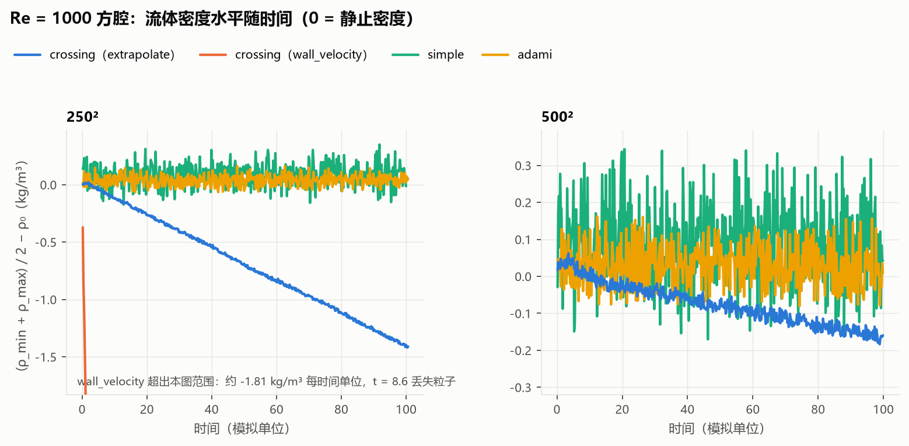

| 运行 | 到达的 t | 状态 | 平均密度漂移率（后半段，kg/m³ 每时间单位） | 最大密度偏差（kg/m³） | φ_min / dx | 低于下限 / 越出盒（最大粒子数） | A_f 回退 | 体素表溢出 | 步 / 秒（与别的作业共用 GPU） | 提交 | 记录 |
|---|---|---|---|---|---|---|---|---|---|---|---|
| diag_n250_adami | 6.00 | ok | -0.00029 | 0.482 | 0.244 | 0 / 0 | 0 | 0 | 1043 | 5ee25b1+dirty | wc-20261117-175719-b080 |
| diag_n250_crossing | 6.00 | ok | -0.01579 | 0.169 | 0.281 | 0 / 0 | 0 | 0 | 1205 | 5ee25b1+dirty | wc-20261117-174907-ff46 |
| diag_n250_crossing_floor0p1 | 6.00 | ok | -0.01495 | 0.164 | 0.310 | 0 / 0 | 0 | 0 | 1064 | 5ee25b1+dirty | wc-20261117-180331-abf6 |
| diag_n250_crossing_floor0p5 | 6.00 | ok | -0.01486 | 0.185 | 0.304 | 725 / 0 | 0 | 0 | 929 | a2149ed | wc-20261117-180641-16e7 |
| diag_n250_crossing_no_diffusion | 6.00 | ok | -0.03738 | 21.413 | 0.310 | 0 / 0 | 0 | 0 | 1221 | 5ee25b1+dirty | wc-20261117-175202-5ece |
| diag_n250_crossing_no_pst | — | failed: RuntimeError: step 7000: alive 74523 of 74529, or a non-finite velocity | — | — | — | — | — | — | — | 5ee25b1+dirty | wc-20261117-175155-aeea |
| diag_n250_crossing_wall_velocity | 6.00 | ok | -1.86539 | 11.783 | 0.145 | 1 / 0 | 0 | 0 | 1224 | 5ee25b1+dirty | wc-20261117-180032-8e37 |
| diag_n250_crossing_wall_velocity_no_pst | — | failed: RuntimeError: step 7000: alive 11631 of 74529, or a non-finite velocity | — | — | — | — | — | — | — | 5ee25b1+dirty | wc-20261117-180317-9781 |
| diag_n250_simple | 6.00 | ok | -0.00018 | 1.343 | 0.314 | 0 / 0 | 0 | 0 | 1340 | 5ee25b1+dirty | wc-20261117-175448-8989 |
| diag_n250_simple_no_pst | — | failed: RuntimeError: step 7000: alive 74512 of 74529, or a non-finite velocity | — | — | — | — | — | — | — | 5ee25b1+dirty | wc-20261117-180324-4898 |

（上表是 250² 上为定位这件事做的一组 t = 6 的短运行，`no_diffusion` 关掉密度扩散，`floor0p1 / 0p5` 改下限系数，`no_pst` 关掉粒子位移修正。）

- crossing（extrapolate）的方腔里，流体密度的水平以恒定的速率下降：250² 约 −0.014 kg/m³ 每时间单位，到 t = 100 累计 −1.4 kg/m³，折合压力电平约 −14 ρU²。simple 和 adami 没有这个漂移（−0.0002 到 −0.0003）。
- 这不是实现错误：单步对照里连续性方程的每一项都与参考解一致。原因是壁粒子不带状态，没有任何东西把压力电平钉住；连续性方程里壁邻居那部分的离散散度有一个很小的净偏差，逐步累加。
- 关掉密度扩散漂移更快（−0.037），下限系数 0.1 / 0.5 基本不影响（−0.015）。关掉 PST 的三次运行（crossing、wall_velocity、simple）都在 7000 步内丢失粒子，simple 也一样，所以这一组不能说明什么。
- 对结果的影响：电平掉到负值以后，全场压力为负，`force.comp` 里 TIC 的分支全部走"减号"一支（任务文件 5.4 里 s = 0）。也就是说，250² crossing 的定常统计是在"全场负压"的状态下取得的。主涡强度等指标是否因此受影响，本次没有分离出来（未验证）。
- **更正（见第 6 节的测量）**：负压不是 crossing 独有的状态。同一算例在 t = 5 时，simple 和 adami 也有约 98 % 的流体粒子压力为负（98.6 % 和 98.0 %），只是幅度小（平均压力 −0.015 和 −0.048 ρ0U²）；crossing 是 −0.74 ρ0U² 并且继续下降。所以上一条里"TIC 走减号一支"对三种模式的绝大多数粒子都成立，crossing 的不同在于电平的幅度和漂移。
- 漂移的原因在第 6 节做了确认实验。
- extrapolate 开关下的所有运行：A_f 回退计数为 0，φ 的最小值 0.28–0.38 dx，没有流体粒子越出盒（各表中 `低于下限 / 越出盒` 的第二个数）。

**(2) wall_velocity 开关不稳定。**

- 方腔 250²：密度以约 −1.9 kg/m³ 每时间单位下降（是 extrapolate 的 130 倍），t = 8.6 丢失粒子，运行失败（见 6.4 的失败表）。
- 静水盒：2-D 两个方向和 3-D 倾斜方向速度场正常，但电平掉 18–33 %；3-D 重力沿 −y 的一次在 t ≈ 6 之后失稳（最大速度 0.55 √(gH)）。
- 方腔 500²：密度约以 −1.1 kg/m³ 每时间单位下降，第 2 327 000 步（t = 34.9）丢失 4 个粒子，运行失败（wc-20261117-203935-d31a）。1000² 在 t = 4.44 时按用户要求停止（wc-20261117-223709-a251），没有结论。

**(3) 静水盒里最大速度不归零**，停在 4e-3 到 6e-3 √(gH)。动能在下降，均方根速度在 2e-4 到 5e-4。没有进一步查是哪些粒子（未验证）；单步对照显示近壁有 4e-3 g 量级的残余加速度（6.2），量级上对得上。

### 2.6 阶段 1 里没有验证的

（**未完成**：这一部分（`unverified_stage1.md`）在长运行按用户要求停止时还没有写或没有数据，之后没有继续；见第 6 节。）

## 3. 阶段 2：3-D 盒体，单卡

### 3.1 改动清单

阶段 1 的着色器和主机端代码从一开始就按 `DIMENSION` 写成通用的，阶段 2 没有改求解器。新增：

- 算例 `cases/cavity3d_1m_{adami,crossing,crossing_wall_velocity}`（引用 `cases/cavity3d_1m` 的 OBJ）；`cases/wall_crossing/hydrostatic_3d_n48_{gy,gtilt}_{simple,adami,crossing,crossing_wall_velocity}`。
- 工具 `box_run.py`（任意盒算例的历史和中线剖面）、`chain_runner.py`。

### 3.2 与任务文件不一致的代码事实

- 仓库里没有 3-D 方腔的参考数据（`docs/validation/data` 只有 2-D 的 Marchi / Ghia），所以 3-D 方腔只做模式之间的互比。
- 3-D 的寄存器数：融合 pass 64（与任务文件一致），force 64。

### 3.3 我做的决定

1. **3-D 方腔用 `cavity3d_1m`**（103 万流体粒子，现有算例里最小的一个），跑到 t = 20，每 2.5 个时间单位存一次中线剖面。剖面用流体粒子的 Shepard 平均（Wendland C4，半径 h），三种模式用同一种取法。
2. **3-D 静水盒 48³**（流体 110 592 个粒子，含壁 195 112 个），|g| = 10；倾斜方向取 (−3.995, −7.990, 4.494)（同时偏离 x、y、z 三个轴）。
3. **倾斜的 3-D 静水算例把 `max_incoming` 从 32 改成 64。** 初始是整齐的格点，在均匀重力下整体自由下落，一步之内一整面粒子（h/dx = 4 时每个体素面 16 个）同时进入相邻体素；重力偏离两个轴时三个面同时进入，一步 48 个，超过 32 个 incoming 槽位，predict 把多出来的粒子杀掉了（第一次运行在第 1000 步少了 466 个粒子，溢出计数 466）。这是算例容量，不是壁面模式的问题，四种模式的倾斜算例一起改了。重力沿 −y 的算例没有这个问题，保持 32。

### 3.4 验收（6.6）

**单步对照（3-D）**：见 6.2 的两张表里 3-D 的各行，全部通过。

**3-D 静水盒**（数据在 6.3 的表里，`3d_` 开头的各行）：

- **crossing（extrapolate）**：重力沿 −y 时末段最大速度 5.8e-3、均方根 4.8e-4 √(gH)，压力均方根误差 0.023 %；倾斜方向 1.4e-2、6.2e-4，0.026 %。两个方向的压力电平在 10 个时间单位里分别掉了 38 % 和 21 %（ρ0 g H），比 2-D 明显（2-D 是 +0.05 % 和 −1.3 %）。电平下降的原因与 2.5 (1) 相同。
- **crossing（wall_velocity）**：倾斜方向正常（电平 −33 %）；重力沿 −y 的一次在 t ≈ 6 之后失稳。
- **adami**：两个方向都稳定，但最大速度 0.09 和 0.24、均方根 0.02，比 crossing 高一到两个量级。
- **simple**：两个方向都在 t ≤ 0.25 丢失粒子而停止。

**3-D 方腔**（`cavity3d_1m`，到同一时刻）：

| 运行 | 到达的 t | 状态 | 平均密度漂移率（后半段，kg/m³ 每时间单位） | 最大密度偏差（kg/m³） | φ_min / dx | 低于下限 / 越出盒（最大粒子数） | A_f 回退 | 体素表溢出 | 步 / 秒（与别的作业共用 GPU） | 提交 | 记录 |
|---|---|---|---|---|---|---|---|---|---|---|---|
| cavity3d_1m_adami | — | not started: 用户要求停止（排队中，未启动） | — | — | — | — | — | — | — | 6a1bada+dirty | wc-20261117-223709-adb7 |
| cavity3d_1m_crossing | 20.04 | ok | -0.01848 | 0.545 | 0.240 | 2 / 0 | 0 | 0 | 33 | fac95ac+dirty | wc-20261117-183039-caaf |
| cavity3d_1m_crossing_wall_velocity | — | not started: 用户要求停止（排队中，未启动） | — | — | — | — | — | — | — | 6a1bada+dirty | wc-20261117-223709-00bf |
| cavity3d_1m_simple | 13.50 | stopped: 用户要求停止 | -0.00004 | — | — | — | — | — | — | 6a1bada+dirty | wc-20261117-223709-99d2 |

| 壁面 | 剖面时刻 t | 该时刻动能 | u 最小值（竖直中线） | v 最大值（水平中线） | v 最小值（水平中线） | 运行到达的 t | 状态 | 记录 |
|---|---|---|---|---|---|---|---|---|
| simple | 12.60 | 18.2730 | -0.2241（y = 0.23） | 0.1750（x = 0.23） | -0.3482（x = 0.90） | 13.50 | stopped: 用户要求停止 | wc-20261117-223709-99d2 |
| crossing | 12.60 | 23.9217 | -0.2613（y = 0.21） | 0.2136（x = 0.21） | -0.4036（x = 0.90） | 20.04 | ok | wc-20261117-183039-caaf |

| 两种壁面 | u(y) 差的均方根 | u(y) 差的最大值 | v(x) 差的均方根 | v(x) 差的最大值 |
|---|---|---|---|---|
| simple − crossing | 0.0284 | 0.1066 | 0.0244 | 0.0554 |

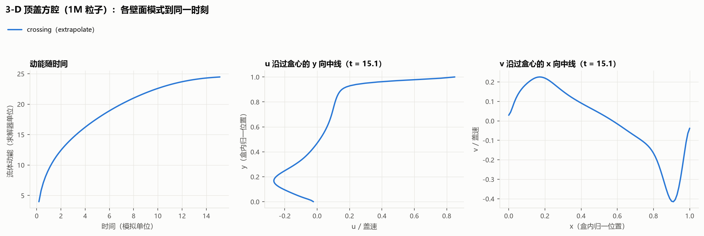

（**未完成**：这一部分（`cavity3d_text.md`）在长运行按用户要求停止时还没有写或没有数据，之后没有继续；见第 6 节。）

**3-D 计时与寄存器**：

（**未完成**：这一部分（`tables/timing_cavity3d_1m.md`）在长运行按用户要求停止时还没有写或没有数据，之后没有继续；见第 6 节。）

寄存器数见 6.1 (d) 的寄存器表里 3-D 的各行：融合 pass 64 → 80（wall_velocity 开关下 77），force 64 → 72。基点和本分支在 3-D 的 simple / adami 上寄存器数相同、管线配方相同。

（**未完成**：这一部分（`timing3d_text.md`）在长运行按用户要求停止时还没有写或没有数据，之后没有继续；见第 6 节。）

### 3.5 阶段 2 里没有验证的

（**未完成**：这一部分（`unverified_stage2.md`）在长运行按用户要求停止时还没有写或没有数据，之后没有继续；见第 6 节。）

## 4. 阶段 3：双卡（K = 2）

### 4.1 改动清单

只改了 `simulator_v7.py` 里的前提检查（a2149ed）：原来 crossing 遇到有 peer 的 slab 一律报 `ValueError`，现在在发布配置的接缝下放行，其余情况仍然报错并写明原因：

- ghost 层数必须 ≥ 2（发布配置；`V7_GHOST_LAYERS=1` 报错）；
- band 遍历必须是体素分派（`V7_BAND_VOXEL_DISPATCH=1`，`V7_BAND_COMPACT_DISPATCH=0`）；
- 内侧 ghost 列必须由接收方按 self 重算（`V7_DIAG_GHOST_SELF` 含 correction 和 density）。

**没有改传输记录、SoA 布局、ghost 记录格式或 ghost 层数**，没有碰阶段 3 的边界。不需要改的原因：

- 流体粒子穿过壁面延拓的是它自己的场，壁邻居只被读位置、规定速度、ρ0 和材料 kind，这些都在现有的 ghost 记录里；
- A_f⁻¹ 是每个粒子自己在同一步里写、自己读的，不跨卡；
- band 里的粒子在遍历 2 读 ghost 流体邻居的本步压力，这由现有的"内侧 ghost 列按 self 重算"提供，与 simple 相同；
- crossing 没有壁 pass，不需要 adami 那样的第三层 ghost。

新增工具：`k2_equivalence.py`、`voxel_list_probe.py`、`seam_audit_run.py`、`throughput.py`。

### 4.2 与任务文件不一致的代码事实

- "E9 的轻量等价检查"在本分支的树里没有找到（见 2.2）。
- 仓库的接缝审计（`experiment/seam_audit`）给的是比值，不是通过 / 不通过的判定（它的 README 里写明 `seam_excess` 是"一个标题数字，不是 PASS/FAIL"）。所以我对 simple 在同一提交上做了同样的审计当对照，按"crossing 的比值是否落在 simple 的范围里"来读。

### 4.3 我做的决定

1. **等价性用三种办法查**：(a) `_run_v7_equivalence.py` 的包络检查（K = 1 两次、K = 2、K = 3）；(b) canonical 逐位比较，并在出现差异时用二分找到第一步、再比较两种布局的体素表，把原因定位到具体粒子；(c) 仓库的接缝审计，同时给 simple 的对照。
2. **吞吐只报步/秒和 crossing 对 simple 的比值**，不报并行效率。效率需要所有参与的卡同时跑 K = 1 作参考，这不在任务要求里。

### 4.4 验收（6.7）

**(a) 包络检查**：`_run_v7_equivalence.py --configs 1,1,2,3 --steps 2000`，250² crossing，动能、动量、平均密度、最大速度、质心、粒子数全部 PASS（wc-20261117-180150-b0ac）。其中包含 K = 3 的一次。

**(b) 逐位比较**（250²，canonical 体素表；单卡在设备 1，链在设备 0、1）：

算例 `cases/lid_driven_cavity_2d_n250_xi0p001_eps0p0025/case.yaml`，999 步，canonical 体素表；单卡设备 1，链设备 0,1。

- 单卡两次运行逐位相同：是
- 链对单卡逐位相同（体素号除外）：是；切口列 [28]，过切口 {'migration_install_count': [0, 3], 'peak_migration_count': [0, 3], 'peak_departed_count': [1, 0]}

记录：wc-20261117-181232-7d5b … wc-20261117-181235-01f5（共 3 条）

算例 `cases/wall_crossing/hydrostatic_2d_n250_g30_crossing/case.yaml`，999 步，canonical 体素表；单卡设备 1，链设备 0,1。

- 单卡两次运行逐位相同：是
- 链对单卡逐位相同（体素号除外）：是；切口列 [28]，过切口 {'migration_install_count': [0, 0], 'peak_migration_count': [0, 0], 'peak_departed_count': [0, 0]}

记录：wc-20261117-181218-829f … wc-20261117-181223-bd65（共 3 条）

算例 `cases/lid_driven_cavity_2d_n250_xi0p001_eps0p0025_crossing/case.yaml`，700 步，canonical 体素表；单卡设备 1，链设备 0,1。

- 单卡两次运行逐位相同：是
- 链对单卡逐位相同（体素号除外）：否；切口列 [28]，过切口 {'migration_install_count': [0, 2], 'peak_migration_count': [0, 2], 'peak_departed_count': [1, 0]}

**第一处差异：第 520 步（第 519 步仍逐位相同）**

- 不同的行：66，位置 x ∈ [0.4277, 0.4596]，y ∈ [0.4678, 0.5000]；correction_inverse 44 行（最大相对差 3.0e-07）；density_gradient_kernel_sum 26 行（最大相对差 1.2e-07）；density_pressure_scratch 1 行（最大相对差 6.1e-08）；density_pressure 1 行（最大相对差 6.1e-08）；acceleration 50 行（最大相对差 2.8e-07）；shift 58 行（最大相对差 7.0e-04）
- 该步链上过切口计数：{'migration_install_count': [0, 1], 'peak_migration_count': [0, 1], 'peak_departed_count': [1, 0]}
- 体素表（3 × 3 邻域内各体素，单卡 对 链）：(49,52) 成员不同 {"only_single": [], "only_chain": [59482]}；(50,52) 成员不同 {"only_single": [59482], "only_chain": []}
- 粒子 59482（x = 0.443599969, y = 0.48386851，两种布局位置逐位相同）：单卡的体素表把它列在体素 (50,52)，链的体素表列在 (49,52)。它的 (x − origin_x) / h 的精确值距体素列边界 -3.725e-07 个体素，而 x 的 1 ulp 是 1.490e-06 个体素：落在舍入范围内，两种布局各自从自己的 float32 网格原点装箱（numpy 的 float32 复算：单卡商 50，链商 24 + 列偏移；GPU 的除法舍入不必与 numpy 相同）

记录：wc-20261117-181109-d83d … wc-20261117-181213-3eb7（共 24 条）

- simple 的方腔：K = 2 与 K = 1 逐位相同到 999 步（期间 3 个粒子过切口）。
- crossing 的静水盒（没有粒子过切口）：K = 2 与 K = 1 逐位相同到 999 步。
- crossing 的方腔：到第 519 步逐位相同（包括第一次粒子过切口），第 520 步出现第一处差异，66 行，相对差 1e-7 量级，位置在 x ≈ 0.44、y ≈ 0.48，离切口（第 28 列）很远。原因查到了具体粒子：粒子 59482 的 x 坐标离体素列边界只有 3.7e-7 个体素（x 的 1 ulp 是 1.5e-6 个体素），单卡和链各自从自己的 float32 网格原点装箱，把它放进了相邻的两个体素。它因此出现在邻居循环的不同位置，求和顺序变了，结果差在最后一位。位置本身两种布局逐位相同。
- 这是现有的分区方式的性质，与壁面模式无关：simple 在 999 步内只是没有碰到这样的粒子。它不是接缝处的错误。
- 999 步的那一组里，crossing 的单卡自己跑两次也不相同了（见 `tables/k2_n250_crossing_999.md`），所以用 700 步的一组作结论。

**(c) 接缝审计**（`dump_state` + `analyze`，按全局编号配对；比值 = rms|链 − 单卡| ÷ rms|单卡两次之差|，d = 到切口的体素列数）：

| 算例 | 步数 N | 配对粒子 | 加速度 d = 0：(B1, A1) / (B2, A2) / 链自身 (B1, B2) | 密度 d = 0：同左 | 位移修正 d = 0：同左 | 远区最坏（加速度 / 密度 / 位移修正） | 四个运行的不变量（漂移、编号、戳、溢出） | 记录 |
|---|---|---|---|---|---|---|---|---|
| cavity3d_1m_crossing | 300 | 1,030,301 | 0.97 / 1.00 / 0.98 | 0.97 / 0.98 / 0.98 | 1.05 / 1.07 / 1.04 | 1.02 / 1.02 / 1.08 | 全部为 0 | wc-20261117-184806-2f35 … cad4 |
| cavity3d_1m_crossing | 1000 | 1,030,301 | 1.04 / 1.06 / 0.89 | 1.32 / 0.83 / 1.35 | 1.06 / 1.04 / 1.01 | 1.06 / 1.05 / 1.01 | 全部为 0 | wc-20261117-184806-2f35 … cad4 |
| cavity3d_1m_simple | 300 | 1,030,301 | 1.00 / 1.01 / 1.01 | 0.99 / 1.00 / 1.01 | 1.07 / 1.01 / 0.99 | 1.02 / 1.02 / 1.02 | 全部为 0 | wc-20261117-185054-e6db … 8a0f |
| cavity3d_1m_simple | 1000 | 1,030,301 | 1.01 / 0.99 / 0.94 | 1.02 / 1.02 / 0.99 | 0.97 / 0.99 / 0.99 | 1.04 / 1.02 / 1.04 | 全部为 0 | wc-20261117-185054-e6db … 8a0f |
| n250_crossing | 300 | 63,001 | 1.08 / 1.07 / 1.05 | 1.18 / 1.08 / 1.24 | 1.09 / 0.96 / 0.98 | 1.01 / 1.05 / 1.07 | 全部为 0 | wc-20261117-182623-ae49 … 90c8 |
| n250_crossing | 2000 | 63,001 | 0.89 / 0.88 / 1.01 | 0.94 / 0.76 / 0.93 | 1.12 / 1.42 / 1.25 | 1.03 / 1.11 / 1.31 | 全部为 0 | wc-20261117-182623-ae49 … 90c8 |
| n250_simple | 300 | 63,001 | 1.29 / 1.17 / 1.29 | 1.20 / 1.08 / 1.22 | 0.87 / 0.77 / 0.76 | 1.30 / 1.18 / 1.07 | 全部为 0 | wc-20261117-184723-7c77 … 9092 |
| n250_simple | 2000 | 63,001 | 0.96 / 1.02 / 0.92 | 0.95 / 1.04 / 0.93 | 1.19 / 1.17 / 1.11 | 1.03 / 1.04 / 1.34 | 全部为 0 | wc-20261117-184723-7c77 … 9092 |

- 四个算例、每个算例四次运行的不变量全部为 0：粒子数漂移 0，没有丢失或重复的编号，没有戳错误，没有溢出。
- crossing 的比值在 0.76–1.42 之间，simple 对照在 0.76–1.34 之间，范围相同。
- 最大的一项是 3-D crossing 在 N = 1000 时切口处的密度：第一对 (B1, A1) 1.32，第二对 (B2, A2) 0.83，链自己两次之间 1.35。两对一高一低，说明不是系统性的接缝偏差；绝对值是 1.3e-4 kg/m³，约等于 ρ 的 2 个 ulp。2-D simple 在 N = 300 也有同样的形态（1.20 / 1.08 / 1.22）。

**(d) K = 2 的 simple 逐位不变**：见 6.1 (b) 表里 `K=2` 的各行，BIT-IDENTICAL。

**(e) K = 2 吞吐**：

（**未完成**：这一部分（`tables/throughput.md`）在长运行按用户要求停止时还没有写或没有数据，之后没有继续；见第 6 节。）

（**未完成**：这一部分（`throughput_text.md`）在长运行按用户要求停止时还没有写或没有数据，之后没有继续；见第 6 节。）

### 4.5 阶段 3 里没有验证的

（**未完成**：这一部分（`unverified_stage3.md`）在长运行按用户要求停止时还没有写或没有数据，之后没有继续；见第 6 节。）

## 5. 下一步建议

（**未完成**：这一部分（`next_steps.md`）在长运行按用户要求停止时还没有写或没有数据，之后没有继续；见第 6 节。）

## 6. 追加：停止长运行；密度漂移的机理确认实验（2026-11-17 22:35 起）

按用户的追加指令做的三件事：停掉所有长运行；加一个诊断开关做对比实验；顺带一个短跑。本节里的每次运行都在 3 分钟以内，没有再启动长运行。

### 6.1 停掉的运行

| 运行 | 机器 | 状态 | 停止时的进度 | 保留的数据 | 记录 |
|---|---|---|---|---|---|
| n1000_crossing | DESKTOP-LDQTHT7 | 运行中被停止 | t = 63.17 / 100（8,423,000 步） | 样本、快照、日志；最后的检查点 c0007938000.npz (t = 59.535) | wc-20261117-223709-94f6 |
| n1000_crossing_wall_velocity | DESKTOP-LDQTHT7 | 运行中被停止 | t = 4.44 / 100（592,000 步） | 样本、快照、日志；还没有检查点（每 10 个时间单位一个） | wc-20261117-223709-a251 |
| cavity3d_1m_simple | DESKTOP-LDQTHT7 | 运行中被停止 | t = 13.50 / 20（225,000 步） | series.csv 到 t = 13.5（75 个样本），profiles.json 到 t = 12.6；没有 final.npz 和 summary.json | wc-20261117-223709-99d2 |
| cavity3d_1m_adami | DESKTOP-LDQTHT7 | 排队中，未启动 | — | — | wc-20261117-223709-adb7 |
| cavity3d_1m_crossing_wall_velocity | DESKTOP-LDQTHT7 | 排队中，未启动 | — | — | wc-20261117-223709-00bf |
| n1000_adami | DESKTOP-9IN3NPD | 运行中被停止 | t = 47.98 / 100（6,397,000 步） | 最后的检查点 c0005292000.npz (t = 39.69)；留在第二台机器上（D:/vulkan-demo-wall-crossing/logs/wall_crossing/cavity/n1000_adami），没有取回 | wc-20261117-223709-65e7 |
| n1000_simple | DESKTOP-9IN3NPD | 排队中，未启动 | — | — | wc-20261117-223709-1b8b |

- 本机的四个后台任务（1000² crossing、wall_velocity 的队列、3-D 方腔的队列、一个等待用的监视脚本）在 22:35 停止；停止后确认本机没有残留的求解器进程。
- 第二台机器上只结束了我自己启动的那一棵进程树（队列脚本和它的 Python 子进程），别的进程没有动；队列的日志里记了一行停止说明。
- 已产生的数据和检查点都留在原处，没有删除任何东西。启动器是被直接结束的，自己没有写记录，所以上表的 7 条记录是事后补进 `runs.jsonl` 的，状态写的是"用户要求停止"。
- 此前已经跑完的运行不受影响（250² 和 500² 的各次方腔、3-D 方腔的 crossing 一次、全部静水盒）。

### 6.2 假设与诊断开关

**假设**：simple 和 adami 的壁粒子以 ρ0 参与密度扩散项（δ 项），这一项把近壁流体的密度拉向 ρ0，起了压力电平的锚的作用；crossing 的壁贡献是梯度延拓，式子里没有 ρ0，所以平均密度会漂。

**开关**：`numerics.wall_crossing.delta_wall: extension | rest_density`，缺省 `extension`（就是原来的行为）。代码里各处都注明是诊断项。

- `extension`：壁邻居的密度差取 G_i·(r_j − r_i)，循环后加 δ 系数 × G_i·(L_i × 壁向量)（任务文件 5.3 的写法）。
- `rest_density`：壁邻居的 δ 项改回逐对计算，密度差取 ρ0 − ρ_i（壁粒子存的密度就是 ρ0，与 simple 是同一个表达式），循环后的那一项不加。
- 连续性方程的漂移项（extrapolate）、压力延拓、粘性都不变。
- 实现：spec const 116 `WALL_CROSSING_DELTA_WALL`，只编进 crossing 的两个变体；主机端在 `WallCrossingSettings.delta_wall`。提交 81ae0d9，本地，没有 push。

**确认没有影响别的东西**

- simple 和 adami 运行的 23 个 SPIR-V 文件与基点的 MANIFEST 逐个相同；`_test_seam_layout.py` 的失败清单仍与基点相同（858 项，wc-20261117-224035-e6dd）。
- crossing 用缺省值时与加开关之前的构建逐位相同：250²，K = 1，canonical 体素表，700 步，全部字段相同（wc-20261117-224103-51d7 对 wc-20261117-181109-d83d，比较 wc-20261117-224106-e5d5）。
- `rest_density` 的 GPU 结果对 numpy 参考解（`reference.py` 加了同一个选项）：2-D 和 3-D、两种连续性开关全部通过，判据值最大 1.2e-5（wc-20261117-224232-6279、wc-20261117-224233-ad4f、wc-20261117-224234-0a9c、wc-20261117-224238-a7c7）。在这个测试场里两种写法的壁面扩散项相差 8.5 倍（2-D）和 8.9 倍（3-D），所以"通过"说明 GPU 确实走了新的分支。

### 6.3 结果

（表里 `body_force` 一行和图里对应的曲线是第 7 节加的，见 7.2。）

250² 方腔，从静止开始到 t = 5.01（167 000 步）；每个 defrag 边界采样一次（每 1000 步 = 0.03 个时间单位，共 168 个样本，含 t = 0）。平均密度和平均压力是对存活的流体粒子（不含壁）在主机端用 float64 求的平均；密度按存储值加存储偏移换算成真实密度（本配置下偏移为 0，存的就是 ρ）。漂移率 = 平均密度对 t ∈ [1.02, 5.01] 的线性拟合斜率（134 个样本）。压力、负压比例、动能取最后一个样本（t = 5.01）。除标明“新缺省”的行以外，crossing 各行的连续性壁项都是 full（2026-11-18 改缺省之前的缺省值）。

| 运行 | 漂移率（kg/m³ 每时间单位） | t = 5 的平均压力 | 负压粒子比例 | t = 5 的平均密度 − ρ0（kg/m³） | t = 5 的动能 | 备注 | 记录（提交） |
|---|---|---|---|---|---|---|---|
| crossing，delta_wall = extension（连续性壁项 full，旧缺省） | -0.01359 | -741.8 Pa（-0.742 ρ0U²） | 99.99 % | -0.07428 | 21.754 | 任务文件第 5 节的写法；连续性壁项取完整的速度差（full），2026-11-18 之前的缺省 | wc-20261117-224501-32f5（81ae0d9） |
| **crossing，新缺省（连续性壁项 normal），第 1 次** | +0.00330 | +249.9 Pa（+0.250 ρ0U²） | 0.00 % | +0.02487 | 21.144 | 2026-11-18 起的缺省：连续性壁项只取法向分量，其余同上一行 | wc-20261118-102022-0e74（6c8a55a） |
| **crossing，新缺省（连续性壁项 normal），第 2 次** | +0.00377 | +243.7 Pa（+0.244 ρ0U²） | 0.00 % | +0.02425 | 21.147 | 同上，重复 | wc-20261118-102303-1f2b（6c8a55a） |
| crossing，delta_wall = rest_density（诊断） | -0.00028 | -21.2 Pa（-0.021 ρ0U²） | 98.73 % | -0.00221 | 21.685 | 壁邻居的 δ 项逐对取 ρ0 − ρ_i，去掉循环后的 G_i·(L_i × 壁向量) 一项；其余不变 | wc-20261117-224550-a5c0（81ae0d9） |
| crossing，delta_wall = body_force（诊断） | -0.02027 | -1063.8 Pa（-1.064 ρ0U²） | 100.00 % | -0.10650 | 21.752 | 壁邻居的 δ 项逐对取 ρ_i (g − a_wall)·(r_j − r_i) / c²，去掉循环后的一项；方腔没有重力，所以壁邻居对 δ 项的贡献为零；其余不变 | wc-20261118-013702-5995（d62e005） |
| crossing，连续性的壁项只取法向分量（改缺省之前用开关跑的） | +0.00338 | +224.2 Pa（+0.224 ρ0U²） | 0.00 % | +0.02230 | 21.146 | 壁邻居的速度差先投影到壁面法向（壁粒子到盒面最近点的方向），再乘 (1 + d_j/φ_i)，只用在连续性方程里；其余不变。与新缺省是同一种设置 | wc-20261118-022650-256e（1932d2b） |
| crossing，关掉粒子位移修正（`use_pst: false`） | — | — | — | — | — | 不稳定，没有跑到拟合窗口。粒子数守恒的最后一个样本是 t = 0.06（2,000 步）：平均密度 − ρ0 = -0.0029，平均压力 -28.4 Pa，A_f 回退累计 1,182 次，越出盒的流体粒子 5 个。t = 0.03 时最小密度已经是 577 kg/m³、最大速度 1.61。下一个样本 t = 0.09 时存活粒子 11,599 / 74,529（壁粒子 11,528 个都在，流体只剩 71 个） | wc-20261118-022648-e1e9（1932d2b），状态 failed |
| simple | -0.00022 | -15.3 Pa（-0.015 ρ0U²） | 98.55 % | -0.00163 | 18.589 | 对照 | wc-20261117-224639-a58b（81ae0d9） |
| adami | -0.00033 | -47.5 Pa（-0.048 ρ0U²） | 98.00 % | -0.00484 | 23.403 | 对照 | wc-20261117-224722-a4ce（81ae0d9） |

- 基准（extension）的漂移率是 −0.0136 kg/m³ 每时间单位，与此前长运行里量到的 −0.014 一致。
- 改成 `rest_density` 后漂移率是 −0.0003，约为基准的 1/49，与 simple（−0.0002）和 adami（−0.0003）在同一水平。t = 5 的平均压力从 −742 Pa 变成 −21 Pa，也落在 simple（−15 Pa）和 adami（−48 Pa）之间。
- 两次 crossing 运行在 t = 5 的动能是 21.754 和 21.685，相差 0.3 %，流动状态可比。
- 负压粒子比例：adami 98.0 %、simple 98.6 %、rest_density 98.7 %、extension 99.99 %。也就是说 simple 和 adami 在这个时刻同样是绝大多数粒子压力为负，只是幅度小。这一点更正了 2.5 (1) 里的说法。
- 采样间隔说明：指令要求每 0.1 个时间单位采一次。流水线路径只能在 defrag 边界读状态（每 1000 步 = 0.03 个时间单位），0.1 不是它的整数倍，所以改成每个 defrag 边界都采（0.03），比要求的更密；"t = 5"取的是 t = 5.01 的样本。
- 没有做的：只有 250²、只到 t = 5，没有跑定常统计，所以 `rest_density` 对方腔精度指标（ψ_min、速度极值）的影响没有数据。

### 6.4 顺带的短跑：rest_density 加 continuity = wall_velocity

| 量 | crossing，continuity = wall_velocity，delta_wall = rest_density，250² |
|---|---|
| 到达的时刻 | t = 15.00（500,000 步），粒子数 74,529 / 74,529 |
| 最大密度偏差（整个运行） | 0.424 kg/m³ |
| 越出盒的流体粒子（各样本的最大值） | 0 |
| φ 的最小值 | 0.211 dx |
| A_f 回退（累计） | 0 |
| 最大速度（整个运行，盖速 = 1） | 1.315 |
| 漂移率 | t ∈ [1, 5]：-0.00023；t ∈ [1, 15]：-0.00021 kg/m³ 每时间单位 |
| 平均压力 | t = 5：-44.7 Pa；t = 15：-61.3 Pa |
| 负压粒子比例 | t = 5：98.93 %；t = 15：97.30 % |
| 记录（提交） | wc-20261117-224827-978a（81ae0d9），状态 ok |

- 这次跑过了 t = 8.6（原来丢粒子的时刻），一直到 t = 15，粒子数守恒，没有粒子越出盒；最大密度偏差 0.42 kg/m³（原来的 wall_velocity 到 t = 6 时已经是 11.8）；漂移率 −0.0002。
- 但速度不正常：流体的最大速度在 501 个样本中有 480 个超过盖速，最大 1.315，整个运行维持在 1.2–1.3。t ≤ 5 的另外四次运行（extension、rest_density、simple、adami）的最大速度在 0.94 到 0.98 之间，没有一个样本超过盖速。所以这个组合虽然不再丢粒子，流场本身是否正确没有得到确认。

### 6.5 结论

**假设成立**：给壁邻居的 δ 项加上 ρ0 参考（`rest_density`）之后，250² 方腔在 t ∈ [1, 5] 的平均密度漂移率从 −0.0136 降到 −0.0003 kg/m³ 每时间单位，与 simple 和 adami 相同；crossing 的密度漂移来自 δ 项的壁贡献里没有 ρ0 参考。这个结论的范围是 250²、t ≤ 5 的密度水平，不包括它对方腔精度指标的影响。

> **第 7 节之后的更正**：上面"漂移来自 δ 项的壁贡献里没有 ρ0 参考"这句话说过头了。第 6 节的实验只说明了有 ρ0 参考时漂移不出现；第 7 节把壁邻居的 δ 贡献整个拿掉，漂移还在而且更大，所以漂移不是壁邻居的 δ 项（延拓项）产生的。准确的说法是：漂移产生在别处，ρ0 参考的壁项把它压住了，延拓项压不住。

## 7. 追加（二）：漂移的源头是不是延拓项（2026-11-18）

按用户的第二份追加指令：给诊断开关加第三个取值 `body_force`，跑一次 250² 方腔（t = 0 到 5）和两个 2-D 静水盒。本节的每次运行都在 2 分钟以内。

### 7.1 改动

**开关**：`numerics.wall_crossing.delta_wall: extension | rest_density | body_force`，缺省仍是 `extension`。

- `body_force`：壁邻居的 δ 项逐对计算，密度差取 ρ_i (g − a_wall)·(r_j − r_i) / c²；循环后的 G_i·(L_i × 壁向量) 一项不加。没有重力时壁邻居对 δ 项没有贡献。
- g 是算例的重力向量。a_wall 取 0：求解器里没有"壁的加速度"这个量，壁要么静止，要么匀速（方腔的盖），adami 的壁压力外推（`wall_extrapolate.comp`）也是这样取的。
- **c² 的取法（我定的）**：取状态方程在 ρ_i 处的导数，c² = dp/dρ = γB/ρ0 · (ρ_i/ρ0)^(γ−1) = c0² (ρ_i/ρ0)^(γ−1)，不是常数 c0²。理由是这样得到的密度差与静水压力差 ρ_i g·(r_j − r_i) 按求解器自己的状态方程对应。两种取法在 ρ_i = ρ0 时相同；γ = 7 时相差 6 (ρ_i − ρ0)/ρ0，本节的静水盒里 |ρ_i − ρ0| 不超过 0.75 kg/m³，即两种取法相差不到 0.5 %。方腔没有重力，这一项恒为零，与取法无关。
- 连续性方程的漂移项（extrapolate）、压力延拓、粘性都不变。
- 实现：spec const 116 取 2；每个流体粒子在循环前算一次 ρ_i g / c²，壁邻居逐对加进去。提交 d62e005（开关、参考解、算例）、21b700a（静水盒工具每个样本多记平均密度和电平），表格脚本和本节在其后的提交里。都在本地，没有 push。

**确认没有影响别的东西**

- 重新编译后只有 `correction_density_wall_crossing.comp.spv` 一个文件变了；simple 和 adami 运行的 23 个 SPIR-V 文件与基点的 MANIFEST 逐个相同。`_test_seam_layout.py` 的失败清单仍是 858 项，与基点相同（wc-20261118-013412-be5b）。
- crossing 用缺省值时与加开关之前的构建逐位相同：250²，K = 1，canonical 体素表，700 步，10 个字段全部相同（wc-20261118-013442-432b 对 wc-20261117-181109-d83d，比较 wc-20261118-013443-f377）。
- numpy 单步参考解（`reference.py`）加了同一个取值，2-D 和 3-D、两种连续性开关全部通过，判据值最大 8.9e-6（2-D）和 1.25e-5（3-D）（wc-20261118-013452-add9、wc-20261118-013453-e145、wc-20261118-013458-383e、wc-20261118-013501-c70e）。
  - 光滑场配置原来没有重力，`body_force` 在上面恒为零，比较说明不了什么。所以只在这个取值下，光滑场配置加了一个与各壁都不平行的重力（2-D 是 (3.5, −8, 0)，3-D 是 (3.5, −8, 4.5)）。
  - 这样壁邻居的扩散项最大是 299（2-D）和 316（3-D）kg/m³ 每秒，与流体邻居的扩散项（485 和 653）同量级。如果 c² 取成 c0²，这一项会差到 45（约 15 %），远大于容差，所以"通过"说明 GPU 走的是新分支，而且 c² 用的是状态方程的导数。
  - 单步的两个静水配置里密度是均匀的 ρ0（与静水压力不对应），`body_force` 在这种状态下给出非零的密度变化率（最大 25.9 和 27.4 kg/m³ 每秒），GPU 与参考解一致（新密度相差 0.5 ulp 以内）。这是这个配置本身不自洽造成的，记在这里备查。
- 以上三项检查是在提交 d62e005 之前的工作树上跑的，记录里的提交号是 `d10e144+dirty`；被检查的文件此后没有再改，与 d62e005 里的相同。

### 7.2 第 1 项：250² 方腔，`body_force`

（下表就是 6.3 的那张表，多了 `body_force` 一行；测量方法、采样间隔和拟合窗口与第 6 节完全相同。）

250² 方腔，从静止开始到 t = 5.01（167 000 步）；每个 defrag 边界采样一次（每 1000 步 = 0.03 个时间单位，共 168 个样本，含 t = 0）。平均密度和平均压力是对存活的流体粒子（不含壁）在主机端用 float64 求的平均；密度按存储值加存储偏移换算成真实密度（本配置下偏移为 0，存的就是 ρ）。漂移率 = 平均密度对 t ∈ [1.02, 5.01] 的线性拟合斜率（134 个样本）。压力、负压比例、动能取最后一个样本（t = 5.01）。除标明“新缺省”的行以外，crossing 各行的连续性壁项都是 full（2026-11-18 改缺省之前的缺省值）。

| 运行 | 漂移率（kg/m³ 每时间单位） | t = 5 的平均压力 | 负压粒子比例 | t = 5 的平均密度 − ρ0（kg/m³） | t = 5 的动能 | 备注 | 记录（提交） |
|---|---|---|---|---|---|---|---|
| crossing，delta_wall = extension（连续性壁项 full，旧缺省） | -0.01359 | -741.8 Pa（-0.742 ρ0U²） | 99.99 % | -0.07428 | 21.754 | 任务文件第 5 节的写法；连续性壁项取完整的速度差（full），2026-11-18 之前的缺省 | wc-20261117-224501-32f5（81ae0d9） |
| **crossing，新缺省（连续性壁项 normal），第 1 次** | +0.00330 | +249.9 Pa（+0.250 ρ0U²） | 0.00 % | +0.02487 | 21.144 | 2026-11-18 起的缺省：连续性壁项只取法向分量，其余同上一行 | wc-20261118-102022-0e74（6c8a55a） |
| **crossing，新缺省（连续性壁项 normal），第 2 次** | +0.00377 | +243.7 Pa（+0.244 ρ0U²） | 0.00 % | +0.02425 | 21.147 | 同上，重复 | wc-20261118-102303-1f2b（6c8a55a） |
| crossing，delta_wall = rest_density（诊断） | -0.00028 | -21.2 Pa（-0.021 ρ0U²） | 98.73 % | -0.00221 | 21.685 | 壁邻居的 δ 项逐对取 ρ0 − ρ_i，去掉循环后的 G_i·(L_i × 壁向量) 一项；其余不变 | wc-20261117-224550-a5c0（81ae0d9） |
| crossing，delta_wall = body_force（诊断） | -0.02027 | -1063.8 Pa（-1.064 ρ0U²） | 100.00 % | -0.10650 | 21.752 | 壁邻居的 δ 项逐对取 ρ_i (g − a_wall)·(r_j − r_i) / c²，去掉循环后的一项；方腔没有重力，所以壁邻居对 δ 项的贡献为零；其余不变 | wc-20261118-013702-5995（d62e005） |
| crossing，连续性的壁项只取法向分量（改缺省之前用开关跑的） | +0.00338 | +224.2 Pa（+0.224 ρ0U²） | 0.00 % | +0.02230 | 21.146 | 壁邻居的速度差先投影到壁面法向（壁粒子到盒面最近点的方向），再乘 (1 + d_j/φ_i)，只用在连续性方程里；其余不变。与新缺省是同一种设置 | wc-20261118-022650-256e（1932d2b） |
| crossing，关掉粒子位移修正（`use_pst: false`） | — | — | — | — | — | 不稳定，没有跑到拟合窗口。粒子数守恒的最后一个样本是 t = 0.06（2,000 步）：平均密度 − ρ0 = -0.0029，平均压力 -28.4 Pa，A_f 回退累计 1,182 次，越出盒的流体粒子 5 个。t = 0.03 时最小密度已经是 577 kg/m³、最大速度 1.61。下一个样本 t = 0.09 时存活粒子 11,599 / 74,529（壁粒子 11,528 个都在，流体只剩 71 个） | wc-20261118-022648-e1e9（1932d2b），状态 failed |
| simple | -0.00022 | -15.3 Pa（-0.015 ρ0U²） | 98.55 % | -0.00163 | 18.589 | 对照 | wc-20261117-224639-a58b（81ae0d9） |
| adami | -0.00033 | -47.5 Pa（-0.048 ρ0U²） | 98.00 % | -0.00484 | 23.403 | 对照 | wc-20261117-224722-a4ce（81ae0d9） |

- `body_force` 的漂移率是 −0.0203 kg/m³ 每时间单位，绝对值是 `extension`（−0.0136）的 1.5 倍。t = 5 的平均压力 −1064 Pa（`extension` 是 −742 Pa），负压粒子比例 100.00 %。
- 流动状态与 `extension` 相同：t = 5 的动能 21.752 对 21.754，整个运行的最大速度 0.977 对 0.976，粒子数守恒，没有粒子越出盒，A_f 回退 0 次。
- 方腔没有重力，`body_force` 下壁邻居对 δ 项的贡献恒为零。也就是说，把延拓项整个拿掉之后漂移没有消失，反而变大了。

把 δ 项的各部分逐个打开，漂移率依次是：

| 流体邻居的 δ 项 | 壁邻居的 δ 项 | 漂移率，t ∈ [1, 5]（kg/m³ 每时间单位） | 来源 | 记录（提交） |
|---|---|---|---|---|
| 无（`use_density_diffusion: false`） | 无 | -0.03428 | 阶段 1 的诊断运行，已有数据；窗口内 19 个样本（每 0.21 个时间单位一个） | wc-20261117-175202-5ece（5ee25b1+dirty） |
| 有 | 无（`body_force`，方腔没有重力） | -0.02027 | 本节 | wc-20261118-013702-5995（d62e005） |
| 有 | 延拓 G_i·(r_j − r_i)（`extension`） | -0.01359 | 第 6 节 | wc-20261117-224501-32f5（81ae0d9） |
| 有 | ρ0 − ρ_i（`rest_density`） | -0.00028 | 第 6 节 | wc-20261117-224550-a5c0（81ae0d9） |

- 第一行不是新跑的，是阶段 1 的诊断运行（2.5 节的 `no_diffusion`），这里按同一个窗口 [1, 5] 重新拟合；它每 0.21 个时间单位才有一个样本，其余三行每 0.03 一个。
- δ 项全关时漂移最大；加上流体邻居的 δ 项减小约四成；再加上延拓项又减小约三分之一；只有 ρ0 参考的壁项把它降到 simple 和 adami 的水平。每一行只有一次运行。

### 7.3 第 2 项：两个 2-D 静水盒，`body_force` 对 `extension`

指令要的是 `body_force` 的两次运行（下表的"第 1 次"），与此前 `extension` 的结果比较。两次都跑到了与此前相同的 t = 10.02，所以直接比末态。

我另外多跑了四次（每次约 90 秒）：两种写法各重复一次，并让工具在每个样本记下平均密度和电平。原因有两个：

- 只有一次运行时，分不清两种写法之间的差别和同一写法两次运行之间的差别。
- 末态的压力电平差得很多，需要看它随时间怎么变；此前的 `extension` 运行没有记电平的历史。

2-D 静水盒（250² 方腔的几何，盖静止，|g| = 10，c0 = 100，从均匀密度、零速度开始，到 t = 10.02）。速度以 √(|g| H) 为单位，压力以 ρ0 |g| H 为单位（H = 盒沿重力方向的尺寸）。“去电平” = 减去全场平均偏差后的误差；“电平” = 压力减去 ρ0 g·(r − r_中心) 之后对全部流体粒子的平均。每种写法各有两次运行：两次之间的差别就是单次运行的可重复程度。带历史的两次在每个样本都记了平均密度和电平（工具在 21b700a 加的列）。这张表的四次运行都是连续性壁项 full（2026-11-18 改缺省之前）。

**重力沿 −y**

| 量 | extension，此前的运行 | extension，重复（带历史） | body_force，第 1 次 | body_force，第 2 次（带历史） |
|---|---|---|---|---|
| 到达的时刻 | t = 10.02，粒子数守恒 | t = 10.02，粒子数守恒 | t = 10.02，粒子数守恒 | t = 10.02，粒子数守恒 |
| 速度 rms / √(gH)，末 1/5 段平均 | 1.82e-04 | 2.03e-04 | 2.09e-04 | 2.54e-04 |
| 速度最大 / √(gH)，末 1/5 段的最大 | 5.85e-03 | 4.89e-03 | 4.44e-03 | 5.93e-03 |
| 速度 rms / √(gH)，近壁第 1 层（φ < dx），末态 | 5.17e-04 | 4.64e-04 | 5.13e-04 | 4.80e-04 |
| 速度 rms / √(gH)，第 2 层，末态 | 4.93e-04 | 5.33e-04 | 4.88e-04 | 5.26e-04 |
| 速度 rms / √(gH)，第 3 层，末态 | 3.82e-04 | 3.98e-04 | 4.47e-04 | 4.21e-04 |
| 速度 rms / √(gH)，内部（φ ≥ 5 dx），末态 | 1.44e-04 | 1.48e-04 | 1.55e-04 | 2.00e-04 |
| 压力 rms 误差（去电平），末态 | 0.0427 % | 0.0420 % | 0.0438 % | 0.0479 % |
| 压力最大误差（去电平），末态 | 1.042 % | 0.947 % | 0.902 % | 0.979 % |
| 拟合压力梯度的误差 / ρ0 g，末态 | 0.1078 % | 0.1091 % | 0.1157 % | 0.1277 % |
| 盒中心的压力电平，末态 | +0.053 % | +0.173 % | +6.154 % | +6.662 % |
| 压力 rms 误差（不去电平），末态 | 0.068 % | 0.178 % | 6.154 % | 6.662 % |
| 电平在 t = 2.5、5、7.5、10 | —（没有记） | -0.390 % / -0.314 % / -0.080 % / +0.173 % | —（没有记） | +4.815 % / +5.527 % / +6.194 % / +6.662 % |
| 电平的变化率，t ∈ [3, 10]（每时间单位） | —（没有记） | +0.0964 % | —（没有记） | +0.2460 % |
| 平均密度的漂移率，t ∈ [3, 10]（kg/m³ 每时间单位） | —（没有记） | +0.00097 | —（没有记） | +0.00247 |
| 平均密度 − ρ0，末态（kg/m³） | —（没有记） | +0.00138 | —（没有记） | +0.06650 |
| 由密度范围的中点估计的电平（粗略），t = 2.5、5、7.5、10 | -0.09 % / +0.03 % / +0.12 % / +0.03 % | -0.45 % / -0.32 % / -0.07 % / +0.18 % | +3.76 % / +4.44 % / +5.17 % / +6.12 % | +4.81 % / +5.51 % / +6.18 % / +6.69 % |
| 密度范围 − ρ0，末态（kg/m³） | -0.501 … +0.502 | -0.500 … +0.504 | -0.440 … +0.563 | -0.435 … +0.569 |
| φ 的最小值（整个运行） | 0.349 dx | 0.369 dx | 0.384 dx | 0.376 dx |
| A_f 回退（累计） | 0 | 0 | 0 | 0 |
| 记录（提交） | wc-20261117-174907-dc68（5ee25b1+dirty） | wc-20261118-014250-db8f（e24d16e） | wc-20261118-013826-9f27（d62e005） | wc-20261118-014420-5d89（e24d16e+dirty） |

**重力偏离 −y 30°**

| 量 | extension，此前的运行 | extension，重复（带历史） | body_force，第 1 次 | body_force，第 2 次（带历史） |
|---|---|---|---|---|
| 到达的时刻 | t = 10.02，粒子数守恒 | t = 10.02，粒子数守恒 | t = 10.02，粒子数守恒 | t = 10.02，粒子数守恒 |
| 速度 rms / √(gH)，末 1/5 段平均 | 3.28e-04 | 2.78e-04 | 3.55e-04 | 3.89e-04 |
| 速度最大 / √(gH)，末 1/5 段的最大 | 3.88e-03 | 5.21e-03 | 4.34e-03 | 5.88e-03 |
| 速度 rms / √(gH)，近壁第 1 层（φ < dx），末态 | 2.50e-04 | 3.19e-04 | 1.90e-04 | 1.88e-04 |
| 速度 rms / √(gH)，第 2 层，末态 | 2.96e-04 | 4.00e-04 | 3.00e-04 | 2.47e-04 |
| 速度 rms / √(gH)，第 3 层，末态 | 2.81e-04 | 2.95e-04 | 2.56e-04 | 2.69e-04 |
| 速度 rms / √(gH)，内部（φ ≥ 5 dx），末态 | 2.85e-04 | 2.34e-04 | 2.88e-04 | 3.25e-04 |
| 压力 rms 误差（去电平），末态 | 0.0343 % | 0.0339 % | 0.0369 % | 0.0342 % |
| 压力最大误差（去电平），末态 | 0.839 % | 0.637 % | 0.720 % | 0.766 % |
| 拟合压力梯度的误差 / ρ0 g，末态 | 0.1061 % | 0.1069 % | 0.1154 % | 0.1071 % |
| 盒中心的压力电平，末态 | -1.295 % | -0.985 % | +2.815 % | -0.323 % |
| 压力 rms 误差（不去电平），末态 | 1.295 % | 0.986 % | 2.815 % | 0.325 % |
| 电平在 t = 2.5、5、7.5、10 | —（没有记） | -0.289 % / -0.622 % / -0.777 % / -0.985 % | —（没有记） | -0.715 % / -0.722 % / -0.705 % / -0.323 % |
| 电平的变化率，t ∈ [3, 10]（每时间单位） | —（没有记） | -0.0779 % | —（没有记） | +0.0470 % |
| 平均密度的漂移率，t ∈ [3, 10]（kg/m³ 每时间单位） | —（没有记） | -0.00107 | —（没有记） | +0.00064 |
| 平均密度 − ρ0，末态（kg/m³） | —（没有记） | -0.01387 | —（没有记） | -0.00478 |
| 由密度范围的中点估计的电平（粗略），t = 2.5、5、7.5、10 | -1.67 % / -1.94 % / -1.82 % / -1.32 % | -0.44 % / -0.79 % / -0.95 % / -1.15 % | +0.68 % / +1.48 % / +2.16 % / +2.81 % | -0.95 % / -0.95 % / -0.95 % / -0.35 % |
| 密度范围 − ρ0，末态（kg/m³） | -0.703 … +0.667 | -0.699 … +0.667 | -0.646 … +0.724 | -0.690 … +0.680 |
| φ 的最小值（整个运行） | 0.383 dx | 0.380 dx | 0.364 dx | 0.362 dx |
| A_f 回退（累计） | 0 | 0 | 0 | 0 |
| 记录（提交） | wc-20261117-175922-f0ee（5ee25b1+dirty） | wc-20261118-014549-c5ff（e24d16e+dirty） | wc-20261118-013956-820e（d62e005+dirty） | wc-20261118-014719-f185（e24d16e+dirty） |

- **残余速度：同一量级，`body_force` 略高。** 末 1/5 段的速度 rms，重力沿 −y 是 2.09e-4、2.54e-4 对 1.82e-4、2.03e-4；倾斜 30° 是 3.55e-4、3.89e-4 对 3.28e-4、2.78e-4。两次的平均高约 20 %，而同一写法两次运行之间就相差 10–22 %。最大速度和近壁三层的速度看不出系统的差别；内部（φ ≥ 5 dx）`body_force` 略高，与整体的 rms 一致。
- **去电平的压力误差：没有差别。** rms 是 0.034–0.048 % 对 0.034–0.043 %，最大误差 0.72–0.98 % 对 0.64–1.04 %，拟合压力梯度的误差都在 0.11–0.13 %。
- **压力电平：不同，`body_force` 的电平不稳。**
  - 重力沿 −y：`body_force` 在开始的沉降阶段（t < 2）就升到 +4.6 %，之后以每时间单位约 +0.25 % 继续上升，t = 10 时两次是 +6.15 % 和 +6.66 %。`extension` 带历史的那次整个运行在 −0.4 % 到 +0.2 % 之间；两次的末态是 +0.05 % 和 +0.17 %。
  - 倾斜 30°：`body_force` 的两次运行末态是 +2.81 % 和 −0.32 %，相差 3.1 个百分点。带历史的那次，电平从 t = 1.8 到 7.2 停在 −0.73 %，之后开始上升；另一次没有记电平，按密度范围中点的估计（表里"粗略"的一行），它从一开始就在升。`extension` 的两次是 −1.29 % 和 −0.99 %。
  - 因此不去电平的压力 rms 误差：−y 一例是 6.2 %、6.7 % 对 0.07 %、0.18 %；30° 一例是 2.8 %、0.33 % 对 1.30 %、0.99 %。
- `extension` 的电平自己也在缓慢变化：−y 一例每时间单位 +0.10 %，30° 一例 −0.08 %（t ∈ [3, 10]，各一次带历史的运行），折合平均密度每时间单位约 ±0.001 kg/m³。`body_force` 在 −y 一例里是 +0.25 %（平均密度 +0.0025），另有沉降阶段的 +4.6 %。
- 粒子数都守恒，A_f 回退都是 0，φ 的最小值在 0.35–0.38 dx。
- 关于记录里的提交号：标 `+dirty` 的几次运行时，工作树里没提交的只有表格脚本 `delta_wall_experiment.py` 和报告源文件；求解器、着色器和静水盒工具与所标的提交相同。此前的两次 `extension` 运行是 11-17 在加诊断开关之前跑的，缺省行为此后逐位不变（7.1）。

### 7.4 条件步骤：没有执行

指令的条件是第 1 项的漂移率绝对值不超过 5e-4。实测是 0.0203，约为这个界的 40 倍，所以 250² 到 t = 100 的那次运行没有跑，也就没有 `body_force` 的 ψ_min 偏差可以与 −1.60 % 并列。

### 7.5 结论

**漂移的源头不是延拓项**：250² 方腔里把壁邻居的 δ 贡献整个拿掉（`body_force`，无重力）之后，平均密度的漂移率是 −0.0203 kg/m³ 每时间单位，比带延拓项时的 −0.0136 更大；延拓项减小了漂移，没有产生漂移。范围同第 6 节：250²、t ≤ 5、每种写法一次运行。

## 8. 追加（三）：密度漂移的收支诊断（2026-11-18）

按用户的第三份追加指令：只诊断，不修。把 250² 方腔里流体平均密度的变化率按项、按区域拆开，crossing 和 simple 各做一份；另跑两个对照。本节的每次运行都在 2 分钟以内。

### 8.1 做法

**收支诊断**（我选的实现方式：GPU 上的诊断累加器）

- 开关是环境变量 `V7_DENSITY_BUDGET=1`，缺省关。打开后，融合的 correction + density 一遍换成它的 `DENSITY_BUDGET` 构建：对每个流体粒子、每一步，把密度变化率的四项各乘 dt 累加进一个缓冲，同时累加"这一步实际写进去的密度变化"。主机在每个样本把缓冲对全部槽位求和（float64）。
- 所以收支是对每一步的时间积分，不是快照平均，本身没有采样误差。表里的"±"是把窗口切成 8 段、各段平均值的标准误，反映的是这个量在窗口内的变化（流动还在发展）。
- 四项是在单独的一遍邻居遍历里重算的，主循环一行没有改。第一版把累加放在主循环里，结果 simple 的状态在第 400 到 500 步之间开始出现舍入量级的差别（700 步的比较 wc-20261118-021638-da5d）：驱动对主循环里乘加的合并方式变了。
- 缓冲按区域分 12 格：盖带、左带、右带、底带、四个角各一格，内部按到最近壁面的距离分四层。表里合并成指令要的四类，另外给出角和内部各层的细分。"一个核半径"指 h = 5 dx = 0.02。
- 新增两个 SPIR-V 文件，只在打开开关时加载；其余文件不变。工具：`box_run.py --density-budget`、`density_budget.py`。

**连续性壁项只取法向分量**：`numerics.wall_crossing.continuity_wall_component: full | normal`（spec const 117），缺省 `full`，代码里注明是诊断项。`normal` 时壁邻居的速度差先投影到壁面法向，再乘 (1 + d_j/φ_i)；法向取壁粒子到盒面最近点的方向。粘性项不动。

`body_force` 保留为诊断项，本节没有再用。提交 1932d2b、7b443b7、0dd6338、f25c696，都在本地，没有 push。

### 8.2 先查诊断本身

**第一版的四项之和对不上实测**：crossing 是 −0.0205 对 −0.0147，simple 是 +0.0044 对 −0.0002（这一版的结果文件已被后面的重跑覆盖，数字取自当时的输出，记录 wc-20261118-022438-60e0、wc-20261118-022539-e7bb）。按指令先查诊断：

- 四项本身没有错。GPU 累加的四项逐粒子对 numpy 参考解：crossing（两种连续性开关、`normal`、`rest_density`、`body_force`）和 simple，2-D 和 3-D 共 24 个配置全部通过，判据值最大 7.2e-6（2-D）和 1.3e-5（3-D）；四项之和与这一遍存进去的变化率相差不超过一个 ulp（记录在 `logs/wall_crossing/single_step/summary_*_budget.json`，例如 wc-20261118-025539-c065、wc-20261118-025553-f618）。
- **差额来自 float32 存储舍入。** 密度存成 float32，在 1000 kg/m³ 附近的网格是 6.1e-5 kg/m³。每一步写进去的是 float32(ρ + dt × 变化率)；变化率小于 1.02 kg/m³ 每秒时，增量不到半格，这一步密度不变。

收支运行的末态（t = 5.01）上，用 numpy 参考解算出每个流体粒子的密度变化率，在主机上仿照求解器的更新 ρ ← float32(ρ + dt × 变化率)。只是一个时刻，全场平均值随声波起伏；舍入在时间上的累计效果以收支表里的“float32 存储舍入”一行为准。

| 量 | crossing（缺省） | simple |
|---|---|---|
| float32 密度在 1000 kg/m³ 处的网格（kg/m³） | 6.104e-05 | 6.104e-05 |
| 对应半格的变化率 = 网格 / (2 dt)（kg/m³ 每秒） | 1.017 | 1.017 |
| 流体粒子密度变化率的 rms（kg/m³ 每秒） | 0.754 | 0.593 |
| 流体粒子密度变化率绝对值的中位数 | 0.603 | 0.333 |
| 单步增量不到半格（这一步密度不变）的流体粒子 | 84.8 % | 98.1 % |
| 单步增量不到一格的流体粒子 | 99.4 % | 100.0 % |
| 单步增量超过两格的流体粒子 | 0.01 % | 0.02 % |
| 这一时刻全场平均：变化率 / 写入 / 舍入（kg/m³ 每时间单位） | -0.0379 / +0.0426 / +0.0805 ± 0.0025 | +0.0343 / -0.0100 / -0.0443 ± 0.0019 |
| 状态来自的运行（提交） | wc-20261118-025805-ba45（0dd6338） | wc-20261118-025938-e99b（0dd6338） |

- 于是给收支加了第五个累加器：每一步存进去的密度减去这一步开始时的密度（两个相邻 float32 相减，没有误差）。这样舍入成了收支里量得出来的一项：实际写入 = 四项之和 + 存储舍入。
- **加上这一项后收支严格闭合**：实际写入的全场累计与读回的平均密度之差，在窗口内逐样本相比最大 1e-13 kg/m³（见各表下面的"闭合"一行）。
- 之前各节表里的"漂移率"量的都是存储的密度，也就是"实际写入"这一行，里面含舍入。

**打开收支不改变求解器算出的状态**

| 算例 | 步数 | 运行次数（不开 + 开） | 结果类的个数 | 各类里的运行（不开 / 开） | 每一类都两种运行都有 | 记录 |
|---|---|---|---|---|---|---|
| n250_xi0p001_eps0p0025_crossing | 700 | 6 + 6 | 2 | 4 / 6；2 / 0 | 否 | wc-20261118-095351-4541 |
| n250_xi0p001_eps0p0025_crossing | 999 | 12 + 12 | 3 | 6 / 5；5 / 6；1 / 1 | 是 | wc-20261118-025524-0702 |
| n250_xi0p001_eps0p0025_crossing | 700 | 3 + 3 | 2 | 2 / 2；1 / 1 | 是 | wc-20261118-025400-774b |
| n250_xi0p001_eps0p0025_crossing | 999 | 6 + 6 | 2 | 2 / 6；4 / 0 | 否 | wc-20261118-025424-5454 |
| n250_xi0p001_eps0p0025 | 700 | 3 + 3 | 1 | 3 / 3 | 是 | wc-20261118-025408-85a5 |
| n250_xi0p001_eps0p0025 | 999 | 6 + 6 | 1 | 6 / 6 | 是 | wc-20261118-025440-49cc |

- 做法：同一算例收支开、关各跑若干次，每次存 canonical 状态，逐字节相同的归为一个"结果类"。
- simple：700 步和 999 步都只有一个结果类，开和关逐位相同。
- crossing：700 步有 2 个结果类，999 步有 3 个；每个类里都同时有开和关的运行。也就是说这些类是求解器自己的运行间差别（不开收支时两次运行也会落在不同的类里），不是收支造成的。999 步那一行只跑 6 + 6 次的那次，有一个类里恰好只有不开的运行；加到 12 + 12 次后每个类两种都有。
- 收支运行与不打开收支的运行，t = 5 的统计量一致：

| 运行 | 漂移率，打开收支 | 漂移率，不打开（之前的表） | t = 5 的平均压力（Pa），打开 / 不打开 | t = 5 的动能，打开 / 不打开 | 记录，打开 / 不打开 |
|---|---|---|---|---|---|
| crossing，连续性壁项 `full`（2026-11-18 之前的缺省） | -0.01394 | -0.01359 | -742.4 / -741.8 | 21.753 / 21.754 | wc-20261118-025805-ba45 / wc-20261117-224501-32f5 |
| simple | -0.00022 | -0.00022 | -15.2 / -15.3 | 18.597 / 18.589 | wc-20261118-025938-e99b / wc-20261117-224639-a58b |
| crossing，连续性的壁项只取法向分量（改缺省之前用开关跑的） | +0.00382 | +0.00338 | +256.2 / +224.2 | 21.151 / 21.146 | wc-20261118-030109-7974 / wc-20261118-022650-256e |
| crossing，新缺省（连续性壁项 `normal`），第 1 次 | +0.00368 | +0.00330 | +264.0 / +249.9 | 21.140 / 21.144 | wc-20261118-102117-7b54 / wc-20261118-102022-0e74 |
| crossing，新缺省（连续性壁项 `normal`），第 2 次 | +0.00335 | +0.00377 | +236.2 / +243.7 | 21.146 / 21.147 | wc-20261118-102354-4dd5 / wc-20261118-102303-1f2b |

**没有影响别的东西**

- simple 和 adami 运行的 23 个 SPIR-V 文件与基点的 MANIFEST 逐个相同；`_test_seam_layout.py` 的失败清单仍是 858 项，与基点相同（wc-20261118-025730-c08b）。测试里"新增 SPIR-V 文件"的名单加了两个收支构建的文件名。
- crossing 用缺省值时与加诊断开关之前的构建逐位相同：250²，K = 1，700 步，10 个字段（wc-20261118-021554-4e2c 对 wc-20261117-181109-d83d，比较 wc-20261118-021600-3d5c）。
- `normal` 的 GPU 结果对 numpy 参考解在 2-D 和 3-D 都通过；在测试场里它把壁邻居连续性项的全场平均从 −109.5 改成 −116.3（2-D），所以"通过"说明走了新分支。

### 8.3 收支表：crossing

**crossing，连续性壁项 `full`（2026-11-18 之前的缺省）**：各项对流体平均密度变化率的贡献，kg/m³ 每时间单位，t ∈ [1.02, 5.01] 的时间平均（每一步都累加进去，不是样本平均）。每格 = 该区域内粒子的该项之和 ÷ 全部流体粒子数（63,001），所以各区域相加等于“全场”。“实际写入” = 每一步存进去的 float32 密度减去这一步开始时的密度；它等于四项之和加上存储舍入。± 后面是把窗口切成 8 段、各段平均值的标准误（含流动发展带来的慢变化）。

| 项 | 全场 | 盖带 | 静止壁带（左、右、底） | 四个角 | 内部 | 其中：盖的两个角 | 其中：底的两个角 |
|---|---|---|---|---|---|---|---|
| 连续性项，流体邻居 | -0.03999 ± 0.00226 | -0.42280 ± 0.00067 | +0.60507 ± 0.00139 | -0.19583 ± 0.00272 | -0.02643 ± 0.00110 | -0.19582 ± 0.00272 | -0.00002 ± 0.00000 |
| 连续性项，壁邻居 | +0.01067 ± 0.00145 | +0.42148 ± 0.00064 | -0.60654 ± 0.00136 | +0.19573 ± 0.00271 | +0.00000 ± 0.00000 | +0.19573 ± 0.00271 | -0.00000 ± 0.00000 |
| δ 项，流体邻居 | -0.00001 ± 0.00000 | +0.00017 ± 0.00011 | +0.00055 ± 0.00012 | -0.00715 ± 0.00008 | +0.00641 ± 0.00017 | -0.00715 ± 0.00008 | +0.00000 ± 0.00000 |
| δ 项，壁延拓 | +0.00829 ± 0.00003 | +0.00155 ± 0.00000 | -0.00048 ± 0.00001 | +0.00722 ± 0.00002 | +0.00000 ± 0.00000 | +0.00722 ± 0.00002 | -0.00000 ± 0.00000 |
| **四项之和** | -0.02105 ± 0.00121 | +0.00040 ± 0.00003 | -0.00141 ± 0.00007 | -0.00003 ± 0.00001 | -0.02001 ± 0.00117 | -0.00001 ± 0.00001 | -0.00002 ± 0.00000 |
| float32 存储舍入（实际写入 − 四项之和） | +0.00662 ± 0.00140 | -0.00012 ± 0.00003 | +0.00020 ± 0.00012 | +0.00002 ± 0.00000 | +0.00653 ± 0.00130 | +0.00002 ± 0.00000 | +0.00001 ± 0.00000 |
| **实际写入的密度变化** | -0.01443 ± 0.00106 | +0.00028 ± 0.00003 | -0.00121 ± 0.00007 | -0.00001 ± 0.00000 | -0.01349 ± 0.00096 | +0.00000 ± 0.00000 | -0.00001 ± 0.00000 |
| 连续性两项之和 | -0.02933 ± 0.00120 | -0.00132 ± 0.00010 | -0.00147 ± 0.00012 | -0.00011 ± 0.00008 | -0.02643 ± 0.00110 | -0.00009 ± 0.00008 | -0.00002 ± 0.00000 |
| δ 两项之和 | +0.00827 ± 0.00003 | +0.00172 ± 0.00011 | +0.00007 ± 0.00011 | +0.00007 ± 0.00008 | +0.00641 ± 0.00017 | +0.00007 ± 0.00008 | -0.00000 ± 0.00000 |
| 区域内的流体粒子（窗口平均） | 63,001（100.00 %） | 1,184（1.88 %） | 3,566（5.66 %） | 99（0.16 %） | 58,152（92.30 %） | 50（0.08 %） | 49（0.08 %） |

- 闭合：实际写入（全场）-0.014430；同一窗口两端样本读回的平均密度之差 ÷ 时长 -0.014430；两者相差 +2.0e-14。窗口内逐样本相比，累计量与平均密度最大相差 1.0e-13 kg/m³（平均密度在窗口内变化了 -0.05758）。
- 与之前的“漂移率”（平均密度的线性拟合斜率）对应：本次运行的拟合斜率是 -0.01394。对各累计曲线做同样的拟合：四项依次 -0.03871、+0.00993、-0.00001、+0.00830，四项之和 -0.02050，存储舍入 +0.00656，实际写入 -0.01394。
- 前半窗和后半窗（全场）：四项之和 -0.02009、-0.02203；存储舍入 +0.00629、+0.00696；实际写入 -0.01380、-0.01507。
- 记录：wc-20261118-025805-ba45（0dd6338）。

| 项（内部，按到最近壁面的距离） | 内部合计 | h 到 2h | 2h 到 4h | 4h 到 8h | 8h 以外（中心部分） |
|---|---|---|---|---|---|
| 连续性项，流体邻居 | -0.02643 ± 0.00110 | -0.00145 ± 0.00014 | -0.00520 ± 0.00034 | -0.00578 ± 0.00056 | -0.01400 ± 0.00139 |
| δ 项，流体邻居 | +0.00641 ± 0.00017 | +0.00007 ± 0.00012 | +0.00277 ± 0.00028 | +0.00166 ± 0.00048 | +0.00192 ± 0.00061 |
| **四项之和** | -0.02001 ± 0.00117 | -0.00139 ± 0.00010 | -0.00243 ± 0.00018 | -0.00412 ± 0.00030 | -0.01208 ± 0.00092 |
| float32 存储舍入 | +0.00653 ± 0.00130 | +0.00020 ± 0.00017 | +0.00034 ± 0.00029 | +0.00060 ± 0.00039 | +0.00538 ± 0.00078 |
| **实际写入的密度变化** | -0.01349 ± 0.00096 | -0.00119 ± 0.00010 | -0.00208 ± 0.00017 | -0.00352 ± 0.00028 | -0.00670 ± 0.00043 |
| 该层的流体粒子（窗口平均） | 58,152（92.30 %） | 4,787（7.60 %） | 8,841（14.03 %） | 15,283（24.26 %） | 29,241（46.41 %） |
| 连续性项，流体邻居：该层每个粒子的平均（kg/m³ 每时间单位） | -0.0286 ± 0.0012 | -0.0191 ± 0.0019 | -0.0370 ± 0.0024 | -0.0238 ± 0.0023 | -0.0302 ± 0.0030 |
| 四项之和：该层每个粒子的平均 | -0.0217 ± 0.0013 | -0.0182 ± 0.0013 | -0.0173 ± 0.0013 | -0.0170 ± 0.0012 | -0.0260 ± 0.0020 |

| 项（盖的两个角分开） | 盖的左角（上游） | 盖的右角（下游） |
|---|---|---|
| 连续性项，流体邻居 | -1.60903 ± 0.00142 | +1.41321 ± 0.00186 |
| 连续性项，壁邻居 | +1.61510 ± 0.00138 | -1.41937 ± 0.00189 |
| 连续性两项之和 | +0.00607 ± 0.00005 | -0.00616 ± 0.00009 |
| δ 项，流体邻居 | +0.00150 ± 0.00005 | -0.00864 ± 0.00008 |
| δ 项，壁延拓 | -0.00757 ± 0.00001 | +0.01479 ± 0.00002 |
| **四项之和** | -0.00000 ± 0.00000 | -0.00001 ± 0.00001 |

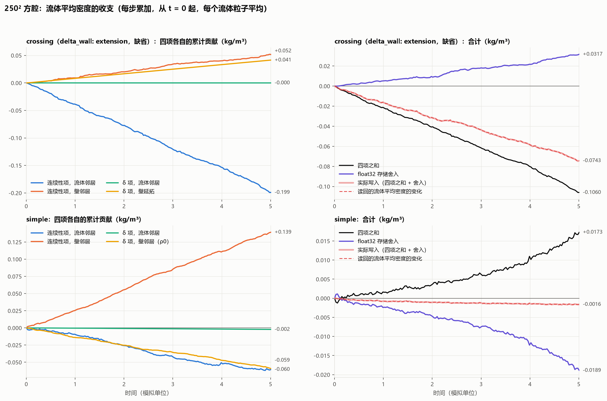

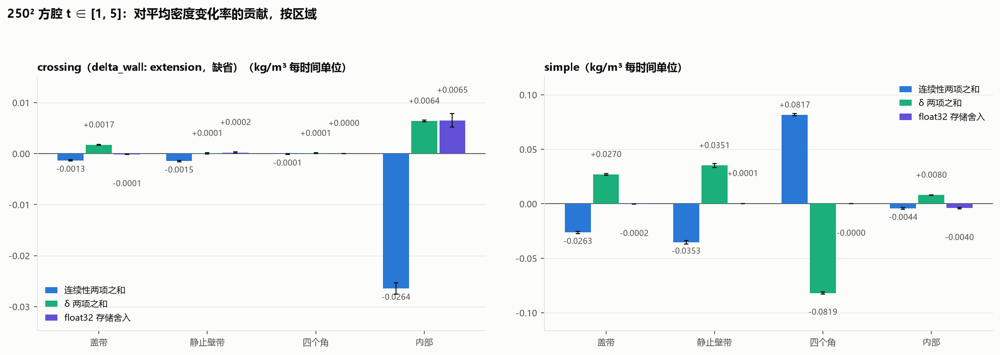

- **净汇在连续性项的流体邻居部分，位置在内部**：内部（离每面壁都超过 h）的连续性项是 −0.0264 ± 0.0011，占连续性项全场合计 −0.0293 的九成。
- **内部的汇不集中在近壁**：按每个粒子算，四层依次是 −0.019、−0.037、−0.024、−0.030，离壁 8h 以外的中心部分也一样。
- **近壁各区的连续性项相互抵消**：流体邻居和壁邻居两部分各自很大（盖带 −0.423 和 +0.421，静止壁带 +0.605 和 −0.607，盖的左角 −1.609 和 +1.615，右角 +1.413 和 −1.419），但每个区里加起来只有 −0.0013、−0.0015、+0.0061、−0.0062，近壁合计 −0.003。
- **δ 项是净源，+0.0083**：大部分来自壁延拓项在盖的两个角上的贡献（+0.0072）；流体邻居的 δ 项在角上是 −0.0072、在内部是 +0.0064，即把它带进了内部。
- **存储舍入是 +0.0066 ± 0.0014**（重复的那次 +0.0091），抵掉四项之和（−0.0211）的三到四成，主要在离壁 8h 以外的中心部分（+0.0054）。
- 合起来：实际写入 −0.0144 ± 0.0011（重复的那次 −0.0126），就是之前量到的漂移。同一算例各次运行的漂移率（拟合斜率）在 −0.0132 到 −0.0150 之间。

### 8.4 收支表：simple

**simple**：各项对流体平均密度变化率的贡献，kg/m³ 每时间单位，t ∈ [1.02, 5.01] 的时间平均（每一步都累加进去，不是样本平均）。每格 = 该区域内粒子的该项之和 ÷ 全部流体粒子数（63,001），所以各区域相加等于“全场”。“实际写入” = 每一步存进去的 float32 密度减去这一步开始时的密度；它等于四项之和加上存储舍入。± 后面是把窗口切成 8 段、各段平均值的标准误（含流动发展带来的慢变化）。

| 项 | 全场 | 盖带 | 静止壁带（左、右、底） | 四个角 | 内部 | 其中：盖的两个角 | 其中：底的两个角 |
|---|---|---|---|---|---|---|---|
| 连续性项，流体邻居 | -0.01261 ± 0.00203 | -0.27540 ± 0.00482 | +0.79268 ± 0.00757 | -0.52551 ± 0.00286 | -0.00438 ± 0.00078 | -0.53489 ± 0.00290 | +0.00938 ± 0.00007 |
| 连续性项，壁邻居 | +0.02833 ± 0.00166 | +0.24905 ± 0.00570 | -0.82798 ± 0.00925 | +0.60725 ± 0.00348 | +0.00000 ± 0.00000 | +0.61836 ± 0.00352 | -0.01111 ± 0.00008 |
| δ 项，流体邻居 | -0.00045 ± 0.00002 | -0.00036 ± 0.00010 | -0.00533 ± 0.00008 | -0.00280 ± 0.00003 | +0.00804 ± 0.00014 | -0.00281 ± 0.00003 | +0.00000 ± 0.00000 |
| δ 项，壁邻居（ρ0） | -0.01132 ± 0.00063 | +0.02735 ± 0.00097 | +0.04044 ± 0.00175 | -0.07911 ± 0.00088 | +0.00000 ± 0.00000 | -0.08085 ± 0.00088 | +0.00174 ± 0.00001 |
| **四项之和** | +0.00394 ± 0.00078 | +0.00064 ± 0.00002 | -0.00019 ± 0.00009 | -0.00017 ± 0.00001 | +0.00366 ± 0.00067 | -0.00018 ± 0.00001 | +0.00001 ± 0.00000 |
| float32 存储舍入（实际写入 − 四项之和） | -0.00415 ± 0.00075 | -0.00025 ± 0.00001 | +0.00008 ± 0.00009 | -0.00001 ± 0.00000 | -0.00397 ± 0.00065 | +0.00001 ± 0.00000 | -0.00001 ± 0.00000 |
| **实际写入的密度变化** | -0.00021 ± 0.00008 | +0.00039 ± 0.00001 | -0.00011 ± 0.00001 | -0.00018 ± 0.00000 | -0.00031 ± 0.00007 | -0.00018 ± 0.00000 | -0.00000 ± 0.00000 |
| 连续性两项之和 | +0.01572 ± 0.00106 | -0.02634 ± 0.00090 | -0.03531 ± 0.00171 | +0.08174 ± 0.00087 | -0.00438 ± 0.00078 | +0.08347 ± 0.00088 | -0.00173 ± 0.00002 |
| δ 两项之和 | -0.01178 ± 0.00064 | +0.02698 ± 0.00088 | +0.03511 ± 0.00179 | -0.08192 ± 0.00088 | +0.00804 ± 0.00014 | -0.08366 ± 0.00088 | +0.00174 ± 0.00001 |
| 区域内的流体粒子（窗口平均） | 63,001（100.00 %） | 1,189（1.89 %） | 3,573（5.67 %） | 100（0.16 %） | 58,139（92.28 %） | 50（0.08 %） | 49（0.08 %） |

- 闭合：实际写入（全场）-0.000208；同一窗口两端样本读回的平均密度之差 ÷ 时长 -0.000208；两者相差 +8.2e-15。窗口内逐样本相比，累计量与平均密度最大相差 1.0e-13 kg/m³（平均密度在窗口内变化了 -0.00083）。
- 与之前的“漂移率”（平均密度的线性拟合斜率）对应：本次运行的拟合斜率是 -0.00022。对各累计曲线做同样的拟合：四项依次 -0.01346、+0.02857、-0.00045、-0.01107，四项之和 +0.00358，存储舍入 -0.00380，实际写入 -0.00022。
- 前半窗和后半窗（全场）：四项之和 +0.00217、+0.00573；存储舍入 -0.00246、-0.00586；实际写入 -0.00029、-0.00012。
- 记录：wc-20261118-025938-e99b（0dd6338）。

| 项（内部，按到最近壁面的距离） | 内部合计 | h 到 2h | 2h 到 4h | 4h 到 8h | 8h 以外（中心部分） |
|---|---|---|---|---|---|
| 连续性项，流体邻居 | -0.00438 ± 0.00078 | -0.00242 ± 0.00015 | -0.00221 ± 0.00040 | -0.00053 ± 0.00061 | +0.00078 ± 0.00049 |
| δ 项，流体邻居 | +0.00804 ± 0.00014 | +0.00212 ± 0.00013 | +0.00279 ± 0.00028 | +0.00166 ± 0.00040 | +0.00148 ± 0.00054 |
| **四项之和** | +0.00366 ± 0.00067 | -0.00030 ± 0.00007 | +0.00058 ± 0.00016 | +0.00113 ± 0.00024 | +0.00226 ± 0.00028 |
| float32 存储舍入 | -0.00397 ± 0.00065 | +0.00024 ± 0.00006 | -0.00064 ± 0.00016 | -0.00117 ± 0.00024 | -0.00239 ± 0.00027 |
| **实际写入的密度变化** | -0.00031 ± 0.00007 | -0.00006 ± 0.00001 | -0.00006 ± 0.00002 | -0.00005 ± 0.00002 | -0.00014 ± 0.00004 |
| 该层的流体粒子（窗口平均） | 58,139（92.28 %） | 4,785（7.59 %） | 8,833（14.02 %） | 15,282（24.26 %） | 29,241（46.41 %） |
| 连续性项，流体邻居：该层每个粒子的平均（kg/m³ 每时间单位） | -0.0047 ± 0.0008 | -0.0319 ± 0.0020 | -0.0158 ± 0.0029 | -0.0022 ± 0.0025 | +0.0017 ± 0.0011 |
| 四项之和：该层每个粒子的平均 | +0.0040 ± 0.0007 | -0.0039 ± 0.0009 | +0.0041 ± 0.0011 | +0.0046 ± 0.0010 | +0.0049 ± 0.0006 |

| 项（盖的两个角分开） | 盖的左角（上游） | 盖的右角（下游） |
|---|---|---|
| 连续性项，流体邻居 | +0.38898 ± 0.00125 | -0.92386 ± 0.00308 |
| 连续性项，壁邻居 | -0.55010 ± 0.00113 | +1.16846 ± 0.00377 |
| 连续性两项之和 | -0.16112 ± 0.00017 | +0.24460 ± 0.00091 |
| δ 项，流体邻居 | -0.00474 ± 0.00008 | +0.00194 ± 0.00008 |
| δ 项，壁邻居（ρ0） | +0.16588 ± 0.00018 | -0.24673 ± 0.00092 |
| **四项之和** | +0.00001 ± 0.00000 | -0.00020 ± 0.00001 |

- **simple 没有同量级的内部净汇**：内部的连续性项是 −0.0044 ± 0.0008，是 crossing 的六分之一，而且只在离壁 4h 以内（每个粒子 −0.032、−0.016，再往里是 −0.002 和 +0.002）。
- **simple 的连续性项全场合计是净源，+0.0157**，不是净汇。它的近壁各区并不抵消：盖带 −0.026，静止壁带 −0.035，盖的两个角 +0.084（左角 −0.161，右角 +0.245）。
- **ρ0 壁的 δ 项逐区抵消的是这些近壁失衡**：δ 两项之和在盖带 +0.027、静止壁带 +0.035、四个角 −0.082，与连续性项在同一个区里大小相等、符号相反。
- 内部：连续性 −0.0044，流体邻居的 δ 项 +0.0080（从近壁区扩散进来），四项之和 +0.0037；存储舍入 −0.0040 把它几乎全部舍掉，实际写入 −0.0003。
- 所以指令里的那个问题——simple 的连续性项是否也有同量级的净汇、只是被 ρ0 壁的 δ 项补上——答案是否定的。

**两次运行的重复性**

| 量（kg/m³ 每时间单位，t ∈ [1, 5]） | crossing，连续性壁项 `full`，第 1 次 | crossing，连续性壁项 `full`，第 2 次 | simple，第 1 次 | simple，第 2 次 |
|---|---|---|---|---|
| 连续性项，流体邻居（全场） | -0.03999 ± 0.00226 | -0.03740 ± 0.00407 | -0.01261 ± 0.00203 | -0.01022 ± 0.00151 |
| 连续性项，壁邻居（全场） | +0.01067 ± 0.00145 | +0.00743 ± 0.00221 | +0.02833 ± 0.00166 | +0.02816 ± 0.00101 |
| δ 项，流体邻居（全场） | -0.00001 ± 0.00000 | -0.00001 ± 0.00000 | -0.00045 ± 0.00002 | -0.00043 ± 0.00002 |
| δ 项，壁邻居（全场） | +0.00829 ± 0.00003 | +0.00825 ± 0.00003 | -0.01132 ± 0.00063 | -0.01349 ± 0.00112 |
| 四项之和（全场） | -0.02105 ± 0.00121 | -0.02173 ± 0.00193 | +0.00394 ± 0.00078 | +0.00403 ± 0.00051 |
| float32 存储舍入（全场） | +0.00662 ± 0.00140 | +0.00911 ± 0.00144 | -0.00415 ± 0.00075 | -0.00424 ± 0.00048 |
| 实际写入的密度变化（全场） | -0.01443 ± 0.00106 | -0.01262 ± 0.00196 | -0.00021 ± 0.00008 | -0.00021 ± 0.00009 |
| 连续性两项之和：盖带 | -0.00132 ± 0.00010 | -0.00126 ± 0.00009 | -0.02634 ± 0.00090 | -0.02624 ± 0.00107 |
| 连续性两项之和：静止壁带 | -0.00147 ± 0.00012 | -0.00152 ± 0.00024 | -0.03531 ± 0.00171 | -0.03486 ± 0.00181 |
| 连续性两项之和：四个角 | -0.00011 ± 0.00008 | -0.00001 ± 0.00006 | +0.08174 ± 0.00087 | +0.08312 ± 0.00085 |
| 连续性两项之和：内部 | -0.02643 ± 0.00110 | -0.02719 ± 0.00169 | -0.00438 ± 0.00078 | -0.00408 ± 0.00056 |
| δ 两项之和：内部 | +0.00641 ± 0.00017 | +0.00659 ± 0.00013 | +0.00804 ± 0.00014 | +0.00789 ± 0.00015 |
| float32 存储舍入：内部 | +0.00653 ± 0.00130 | +0.00876 ± 0.00132 | -0.00397 ± 0.00065 | -0.00412 ± 0.00041 |
| 平均密度的线性拟合斜率（之前各表的“漂移率”） | -0.01394 | -0.01321 | -0.00022 | -0.00022 |
| 记录（提交） | wc-20261118-025805-ba45（0dd6338） | wc-20261118-030608-7d67（2ed2d09） | wc-20261118-025938-e99b（0dd6338） | wc-20261118-030740-fdc7（2ed2d09） |

### 8.5 两个对照

250² 方腔，从静止开始到 t = 5.01（167 000 步）；每个 defrag 边界采样一次（每 1000 步 = 0.03 个时间单位，共 168 个样本，含 t = 0）。平均密度和平均压力是对存活的流体粒子（不含壁）在主机端用 float64 求的平均；密度按存储值加存储偏移换算成真实密度（本配置下偏移为 0，存的就是 ρ）。漂移率 = 平均密度对 t ∈ [1.02, 5.01] 的线性拟合斜率（134 个样本）。压力、负压比例、动能取最后一个样本（t = 5.01）。除标明“新缺省”的行以外，crossing 各行的连续性壁项都是 full（2026-11-18 改缺省之前的缺省值）。

| 运行 | 漂移率（kg/m³ 每时间单位） | t = 5 的平均压力 | 负压粒子比例 | t = 5 的平均密度 − ρ0（kg/m³） | t = 5 的动能 | 备注 | 记录（提交） |
|---|---|---|---|---|---|---|---|
| crossing，delta_wall = extension（连续性壁项 full，旧缺省） | -0.01359 | -741.8 Pa（-0.742 ρ0U²） | 99.99 % | -0.07428 | 21.754 | 任务文件第 5 节的写法；连续性壁项取完整的速度差（full），2026-11-18 之前的缺省 | wc-20261117-224501-32f5（81ae0d9） |
| **crossing，新缺省（连续性壁项 normal），第 1 次** | +0.00330 | +249.9 Pa（+0.250 ρ0U²） | 0.00 % | +0.02487 | 21.144 | 2026-11-18 起的缺省：连续性壁项只取法向分量，其余同上一行 | wc-20261118-102022-0e74（6c8a55a） |
| **crossing，新缺省（连续性壁项 normal），第 2 次** | +0.00377 | +243.7 Pa（+0.244 ρ0U²） | 0.00 % | +0.02425 | 21.147 | 同上，重复 | wc-20261118-102303-1f2b（6c8a55a） |
| crossing，delta_wall = rest_density（诊断） | -0.00028 | -21.2 Pa（-0.021 ρ0U²） | 98.73 % | -0.00221 | 21.685 | 壁邻居的 δ 项逐对取 ρ0 − ρ_i，去掉循环后的 G_i·(L_i × 壁向量) 一项；其余不变 | wc-20261117-224550-a5c0（81ae0d9） |
| crossing，delta_wall = body_force（诊断） | -0.02027 | -1063.8 Pa（-1.064 ρ0U²） | 100.00 % | -0.10650 | 21.752 | 壁邻居的 δ 项逐对取 ρ_i (g − a_wall)·(r_j − r_i) / c²，去掉循环后的一项；方腔没有重力，所以壁邻居对 δ 项的贡献为零；其余不变 | wc-20261118-013702-5995（d62e005） |
| crossing，连续性的壁项只取法向分量（改缺省之前用开关跑的） | +0.00338 | +224.2 Pa（+0.224 ρ0U²） | 0.00 % | +0.02230 | 21.146 | 壁邻居的速度差先投影到壁面法向（壁粒子到盒面最近点的方向），再乘 (1 + d_j/φ_i)，只用在连续性方程里；其余不变。与新缺省是同一种设置 | wc-20261118-022650-256e（1932d2b） |
| crossing，关掉粒子位移修正（`use_pst: false`） | — | — | — | — | — | 不稳定，没有跑到拟合窗口。粒子数守恒的最后一个样本是 t = 0.06（2,000 步）：平均密度 − ρ0 = -0.0029，平均压力 -28.4 Pa，A_f 回退累计 1,182 次，越出盒的流体粒子 5 个。t = 0.03 时最小密度已经是 577 kg/m³、最大速度 1.61。下一个样本 t = 0.09 时存活粒子 11,599 / 74,529（壁粒子 11,528 个都在，流体只剩 71 个） | wc-20261118-022648-e1e9（1932d2b），状态 failed |
| simple | -0.00022 | -15.3 Pa（-0.015 ρ0U²） | 98.55 % | -0.00163 | 18.589 | 对照 | wc-20261117-224639-a58b（81ae0d9） |
| adami | -0.00033 | -47.5 Pa（-0.048 ρ0U²） | 98.00 % | -0.00484 | 23.403 | 对照 | wc-20261117-224722-a4ce（81ae0d9） |

（上表就是 6.3、7.2 的那张表，多了两行对照。）

**对照 1：关掉粒子位移修正。** 不稳定，没有数据可用。t = 0.03 的第一个样本上最小密度已经是 577 kg/m³、最大速度 1.61；t = 0.06 时粒子数还守恒，A_f 回退累计 1182 次；t = 0.09 的样本上流体粒子只剩 71 个。拟合窗口 [1, 5] 没有跑到。这与阶段 1 的记录一致（2.5 节：关掉 PST 的三次运行，包括 simple，都在 7000 步内丢粒子）。

**对照 2：连续性壁项只取法向分量。** 跑完了 t = 5。

- 漂移率从 −0.0136 变成 +0.0034，符号反了。t = 5 的平均压力 +224 Pa，没有负压粒子。动能 21.146（`full` 是 21.754）。
- 它的收支（另跑了一次带收支的，漂移率 +0.0038）：

**crossing，连续性的壁项只取法向分量（改缺省之前用开关跑的）**：各项对流体平均密度变化率的贡献，kg/m³ 每时间单位，t ∈ [1.02, 5.01] 的时间平均（每一步都累加进去，不是样本平均）。每格 = 该区域内粒子的该项之和 ÷ 全部流体粒子数（63,001），所以各区域相加等于“全场”。“实际写入” = 每一步存进去的 float32 密度减去这一步开始时的密度；它等于四项之和加上存储舍入。± 后面是把窗口切成 8 段、各段平均值的标准误（含流动发展带来的慢变化）。

| 项 | 全场 | 盖带 | 静止壁带（左、右、底） | 四个角 | 内部 | 其中：盖的两个角 | 其中：底的两个角 |
|---|---|---|---|---|---|---|---|
| 连续性项，流体邻居 | +0.03938 ± 0.00158 | -0.36132 ± 0.00106 | +0.54167 ± 0.00098 | -0.14147 ± 0.00045 | +0.00050 ± 0.00131 | -0.14106 ± 0.00047 | -0.00041 ± 0.00008 |
| 连续性项，壁邻居 | -0.03893 ± 0.00079 | +0.36065 ± 0.00103 | -0.54130 ± 0.00085 | +0.14172 ± 0.00048 | +0.00000 ± 0.00000 | +0.14136 ± 0.00049 | +0.00036 ± 0.00007 |
| δ 项，流体邻居 | +0.00046 ± 0.00005 | +0.00014 ± 0.00011 | +0.00040 ± 0.00012 | -0.00700 ± 0.00007 | +0.00692 ± 0.00010 | -0.00703 ± 0.00008 | +0.00003 ± 0.00001 |
| δ 项，壁延拓 | +0.00717 ± 0.00012 | +0.00128 ± 0.00002 | -0.00089 ± 0.00010 | +0.00678 ± 0.00002 | +0.00000 ± 0.00000 | +0.00675 ± 0.00002 | +0.00003 ± 0.00000 |
| **四项之和** | +0.00808 ± 0.00146 | +0.00075 ± 0.00001 | -0.00011 ± 0.00009 | +0.00002 ± 0.00000 | +0.00742 ± 0.00137 | +0.00002 ± 0.00000 | +0.00001 ± 0.00000 |
| float32 存储舍入（实际写入 − 四项之和） | -0.00411 ± 0.00073 | -0.00014 ± 0.00001 | -0.00005 ± 0.00005 | +0.00000 ± 0.00000 | -0.00392 ± 0.00069 | +0.00000 ± 0.00000 | -0.00000 ± 0.00000 |
| **实际写入的密度变化** | +0.00397 ± 0.00076 | +0.00060 ± 0.00001 | -0.00016 ± 0.00005 | +0.00003 ± 0.00000 | +0.00350 ± 0.00071 | +0.00002 ± 0.00000 | +0.00000 ± 0.00000 |
| 连续性两项之和 | +0.00045 ± 0.00139 | -0.00067 ± 0.00011 | +0.00037 ± 0.00014 | +0.00024 ± 0.00007 | +0.00050 ± 0.00131 | +0.00029 ± 0.00008 | -0.00005 ± 0.00001 |
| δ 两项之和 | +0.00763 ± 0.00007 | +0.00141 ± 0.00011 | -0.00048 ± 0.00009 | -0.00022 ± 0.00008 | +0.00692 ± 0.00010 | -0.00028 ± 0.00008 | +0.00006 ± 0.00001 |
| 区域内的流体粒子（窗口平均） | 63,001（100.00 %） | 1,187（1.88 %） | 3,568（5.66 %） | 100（0.16 %） | 58,146（92.29 %） | 50（0.08 %） | 50（0.08 %） |

- 闭合：实际写入（全场）+0.003975；同一窗口两端样本读回的平均密度之差 ÷ 时长 +0.003975；两者相差 +3.8e-15。窗口内逐样本相比，累计量与平均密度最大相差 6.3e-14 kg/m³（平均密度在窗口内变化了 +0.01586）。
- 与之前的“漂移率”（平均密度的线性拟合斜率）对应：本次运行的拟合斜率是 +0.00382。对各累计曲线做同样的拟合：四项依次 +0.03867、-0.03862、+0.00047、+0.00716，四项之和 +0.00768，存储舍入 -0.00385，实际写入 +0.00382。
- 前半窗和后半窗（全场）：四项之和 +0.01089、+0.00523；存储舍入 -0.00549、-0.00271；实际写入 +0.00540、+0.00253。
- 记录：wc-20261118-030109-7974（0dd6338）。

| 项（内部，按到最近壁面的距离） | 内部合计 | h 到 2h | 2h 到 4h | 4h 到 8h | 8h 以外（中心部分） |
|---|---|---|---|---|---|
| 连续性项，流体邻居 | +0.00050 ± 0.00131 | +0.00017 ± 0.00017 | -0.00191 ± 0.00013 | +0.00010 ± 0.00018 | +0.00215 ± 0.00126 |
| δ 项，流体邻居 | +0.00692 ± 0.00010 | +0.00028 ± 0.00016 | +0.00289 ± 0.00029 | +0.00181 ± 0.00039 | +0.00194 ± 0.00060 |
| **四项之和** | +0.00742 ± 0.00137 | +0.00046 ± 0.00014 | +0.00097 ± 0.00023 | +0.00190 ± 0.00035 | +0.00409 ± 0.00071 |
| float32 存储舍入 | -0.00392 ± 0.00069 | -0.00024 ± 0.00009 | -0.00047 ± 0.00014 | -0.00094 ± 0.00020 | -0.00228 ± 0.00038 |
| **实际写入的密度变化** | +0.00350 ± 0.00071 | +0.00022 ± 0.00006 | +0.00051 ± 0.00011 | +0.00097 ± 0.00018 | +0.00181 ± 0.00036 |
| 该层的流体粒子（窗口平均） | 58,146（92.29 %） | 4,788（7.60 %） | 8,830（14.02 %） | 15,286（24.26 %） | 29,242（46.42 %） |
| 连续性项，流体邻居：该层每个粒子的平均（kg/m³ 每时间单位） | +0.0005 ± 0.0014 | +0.0023 ± 0.0023 | -0.0137 ± 0.0009 | +0.0004 ± 0.0008 | +0.0046 ± 0.0027 |
| 四项之和：该层每个粒子的平均 | +0.0080 ± 0.0015 | +0.0060 ± 0.0018 | +0.0069 ± 0.0017 | +0.0078 ± 0.0014 | +0.0088 ± 0.0015 |

| 项（盖的两个角分开） | 盖的左角（上游） | 盖的右角（下游） |
|---|---|---|
| 连续性项，流体邻居 | -1.00943 ± 0.00108 | +0.86837 ± 0.00089 |
| 连续性项，壁邻居 | +1.00907 ± 0.00103 | -0.86771 ± 0.00089 |
| 连续性两项之和 | -0.00036 ± 0.00006 | +0.00066 ± 0.00004 |
| δ 项，流体邻居 | +0.00120 ± 0.00007 | -0.00823 ± 0.00003 |
| δ 项，壁延拓 | -0.00083 ± 0.00001 | +0.00758 ± 0.00002 |
| **四项之和** | +0.00001 ± 0.00000 | +0.00001 ± 0.00000 |

- **内部的连续性汇消失了**：内部的连续性项是 +0.0005 ± 0.0013（`full` 是 −0.0264），全场合计 +0.0005。
- δ 项仍是 +0.0076（壁延拓 +0.0072），存储舍入 −0.0041，实际写入 +0.0040。也就是说这时的漂移是 δ 项的净源减去舍入。
- 近壁各区的连续性两部分仍然各自很大并相互抵消，只是数值变了（盖带 −0.361 和 +0.361，静止壁带 +0.542 和 −0.541）。

### 8.6 范围和没有做的

- 只有 250²，窗口 t ∈ [1, 5]，流动还在起转阶段，不是定常统计。
- crossing 和 simple 的收支各有两次运行（8.4 的重复性表）：两次之间，四项之和相差 0.001 以内，内部的连续性项相差 0.001 以内，crossing 的存储舍入相差 0.0025。对照 2 的收支只有一次。
- 没有做 adami 的收支。没有做 3-D。
- 对照 1 没有得到数据，所以粒子位移修正与漂移的关系在这里没有结论。
- 内部连续性汇的成因没有定位到比"项 + 区域"更细的层次。

### 8.7 结论

**净汇出在连续性项的流体邻居部分、内部区域**（离每面壁都超过一个核半径）：−0.0264 ± 0.0011 kg/m³ 每时间单位（重复的那次 −0.0272），占连续性项合计的九成，按每个粒子算在整个内部大致均匀；近壁各区里流体邻居与壁邻居两部分各自很大但相互抵消，合计只有 −0.003。把连续性壁项只取法向分量后，这个内部的汇消失（+0.0005 ± 0.0013）。**simple 没有同样的净汇**：它内部的连续性项只有 −0.0044 ± 0.0008，连续性项全场合计是净源 +0.0157；ρ0 壁的 δ 项抵消的是它近壁各区的连续性失衡，不是内部的汇。另外，四项之和并不等于实测的漂移：float32 存储舍入贡献 +0.007 到 +0.009（crossing）和 −0.004（simple）。

## 9. 追加（四）：连续性壁项改为只取法向分量，并重新验证（2026-11-18）

按用户的第四份追加指令：把 `numerics.wall_crossing.continuity_wall_component` 的缺省值从 `full` 改成 `normal`，然后做回归检查、短跑和方腔统计。只改这一个缺省值。

### 9.1 改动

- **缺省值**：`full` → `normal`。壁邻居的速度差先投影到壁面法向（壁粒子到盒面最近点的方向，上一轮的实现），再乘 (1 + d_j/φ_i)，只用在连续性方程里。
- **没有动的**：粘性项仍用完整的速度差；`delta_wall` 仍是 `extension`；`continuity: wall_velocity` 没有动；`full` 保留为开关，没有删任何开关。
- **改的地方**：
  - 主机端的缺省值在 `experiment/v7/utils/wall_crossing_v7.py`。
  - 着色器里 spec const 117 的缺省值从 0 改成 1（`wall_boundary.glsl`）。主机每次都显式传这个常数，所以改它只是让两边一致。
  - 重跑了 `compile_shaders_v7.py`：变了的只有 crossing 的融合遍和它的收支构建两个 SPIR-V 文件，各差一个常数。
- **跟着缺省值走的工具**：numpy 参考解、测试用的盒算例生成器、单步对比工具的缺省值都改成 `normal`。单步工具的日志名按取值命名：`normal` 带后缀 `_wall_component_normal`，`full` 不带后缀，所以改缺省之前的日志含义不变。
- **新算例**：`cases/lid_driven_cavity_2d_n250_xi0p001_eps0p0025_crossing_continuity_full`，把 `full` 显式写出来，回归检查用。
- **新工具**：
  - `outcome_classes.py`：一个算例对一组参照转储，按结果类比较。
  - `cavity_runner_entry.py` 多记一个文件 `field_history.jsonl`：方腔统计运行的每个样本记流体的平均密度、平均压力、负压粒子比例、最大速度和粒子数。运行器本身没有改。
  - `normal_default.py`：本节的表和图。
- 提交 44e4e6f（改缺省）、6c8a55a（参考解的修正，见 9.2）、bb7e173 及之后（分析和报告），都在本地，没有 push。

### 9.2 回归检查

三项要求都通过；另外多做了一项（缺省与显式写 `normal` 是否相同）。

| 检查 | 结果 | 记录 |
|---|---|---|
| simple 和 adami 用的 SPIR-V 文件与基点相同 | 基点（eda5b90）清单里的 23 个文件，现在 23 个逐字节相同。与改缺省之前（2351a4d）相比，变了的只有 `correction_density_wall_crossing.comp.spv`、`correction_density_wall_crossing_budget.comp.spv`（crossing 的融合遍及其收支构建，各差一个常数：spec const 117 的缺省值） | MANIFEST.txt（sha256） |
| `_test_seam_layout.py` 的失败清单与基点相同 | 858 项，基点 858 项；逐行相同 | wc-20261118-095858-59ec（44e4e6f） |
| 显式设 `full` 时，crossing 与改缺省之前逐位相同（250² 方腔，K = 1，700 步） | 2 个结果类。类 0（289fad61c990）：参照 4 次，本算例 5 次；类 1（aed2170d2bbe）：参照 2 次，本算例 1 次。本算例的每次运行都落在含参照运行的类里：逐位相同 | wc-20261118-095921-6c8b（44e4e6f） |
| 不写这个键（缺省）与显式写 `normal` 逐位相同（同上；额外做的） | 1 个结果类。类 0（ce57192b008e）：参照 4 次，本算例 4 次。本算例的每次运行都落在含参照运行的类里：逐位相同 | wc-20261118-095931-4eaa（44e4e6f） |
| numpy 单步参考解，新缺省（`normal`） | 2-D：6 / 6 个配置通过，光滑场判据值最大 8.9e-06（容差 1e-4）；3-D：6 / 6 个配置通过，光滑场判据值最大 1.3e-05（容差 1e-4） | wc-20261118-095932-af59 … 6785；wc-20261118-095938-6522 … fbd6 |
| 同上，打开收支构建（四项逐粒子对参考解；含 simple） | 2-D：7 / 7 个配置通过，光滑场判据值最大 8.9e-06，收支四项的判据值最大 7.2e-06（容差 1e-4）；3-D：7 / 7 个配置通过，光滑场判据值最大 1.2e-05，收支四项的判据值最大 1.3e-05（容差 1e-4） | wc-20261118-100122-822b … 0589；wc-20261118-100125-1379 … 7962 |
| numpy 单步参考解，显式 `full`（重跑） | 2-D：6 / 6 个配置通过，光滑场判据值最大 8.9e-06（容差 1e-4）；3-D：6 / 6 个配置通过，光滑场判据值最大 1.3e-05（容差 1e-4） | wc-20261118-100028-c659 … b0d7；wc-20261118-100034-2751 … ff57 |

- **"逐位相同"是按结果类比的**。crossing 在 700 步时自己的运行间就有两种结果（8.2 节），所以单比一对运行不够。做法：改缺省之前（2351a4d）先跑 6 次存下转储，改完后把显式写 `full` 的算例再跑 6 次；这 6 次全部落在改之前出现过的两个结果类里。
- **缺省确实变了**：不写这个键的算例与显式写 `normal` 的算例 4 + 4 次运行落在同一个结果类里，它的摘要与 `full` 的两个类都不同。顺带看到，`normal` 在 700 步时只有一个结果类。
- **有一项第一次没有通过，问题在我的参考解**：打开收支构建的单步对比里，simple 的四项对不上参考解（判据值 2.3 和 5.1）。原因是 numpy 参考解给 simple 也套用了新缺省，把它的壁项也投影到了法向。GPU 一侧没有问题：simple 用的 SPIR-V 与基点相同。参考解改成对 simple 和 adami 固定用完整的速度差（6c8a55a）之后重跑，2-D 和 3-D 都通过；表里是重跑的结果。
- 新缺省下逐项的单步对比：

| 配置 | 流体 / 壁粒子 | A_f 回退（GPU = 参考） | 新密度误差（ulp，最大） | 密度变化率：超出 1 ulp 的相对误差 | 加速度：最大相对误差 / 误差 ÷ 对项绝对值之和 | 位移修正：同左 | L | A_f⁻¹ | 核和 | g_f | 推导恒等式（仅参考解）：压力 / 壁面密度扩散 | 判据值 | 结论 | 记录 |
|---|---|---|---|---|---|---|---|---|---|---|---|---|---|---|
| 2-D 光滑场，extrapolate | 2,000 / 1,224（近壁 731，低于下限 8） | 0 = 0；截断 0 | 1.14 | 2.2e-07 | 5.3e-06 / 3.8e-07 | 9.0e-05 / 1.7e-07 | 8.1e-06 | 3.6e-06 | 4.9e-07 | 5.1e-07 | 3.6e-15 / 9.5e-05 | 8.1e-06（容差 1e-04） | 通过 | wc-20261118-095932-af59 |
| 2-D 光滑场，wall_velocity | 2,000 / 1,224（近壁 731，低于下限 8） | 0 = 0；截断 0 | 1.03 | 3.1e-07 | 6.9e-06 / 3.8e-07 | 1.1e-04 / 1.8e-07 | 8.9e-06 | 3.5e-06 | 5.2e-07 | 6.2e-07 | 3.6e-15 / 3.4e-04 | 8.9e-06（容差 1e-04） | 通过 | wc-20261118-095933-6cd9 |
| 2-D Couette，extrapolate | 2,000 / 1,224（近壁 729，低于下限 0） | 0 = 0；截断 0 | 1.40 | 3.1e-07 | 8.7e-07 / 5.5e-07 | 7.7e+00 / 1.4e-07 | 7.5e-06 | 2.6e-06 | 4.3e-07 | 0 | 0 / 0 | 7.5e-06（容差 1e-04） | 通过 | wc-20261118-095934-1d23 |
| 2-D Couette，wall_velocity | 2,000 / 1,224（近壁 729，低于下限 0） | 0 = 0；截断 0 | 0.61 | 0 | 8.0e-07 / 5.5e-07 | 8.0e+00 / 1.3e-07 | 6.8e-06 | 2.9e-06 | 4.3e-07 | 0 | 0 / 0 | 6.8e-06（容差 1e-04） | 通过 | wc-20261118-095935-a8dc |
| 2-D 静水（p > 0），extrapolate | 2,000 / 1,224（近壁 729，低于下限 0） | 0 = 0；截断 0 | 0.00 | 0 | 2.7e-02 / 1.7e-07 | 6.8e+00 / 1.4e-07 | 7.5e-06 | 2.9e-06 | 4.9e-07 | 0 | 3.4e-14 / 0 | 7.5e-06（容差 1e-04） | 通过 | wc-20261118-095936-6419 |
| 2-D 静水（p < 0），extrapolate | 2,000 / 1,224（近壁 729，低于下限 0） | 0 = 0；截断 0 | 0.00 | 0 | 6.3e-04 / 2.5e-07 | 6.5e+00 / 1.5e-07 | 7.5e-06 | 2.9e-06 | 4.3e-07 | 0 | 1.5e-15 / 0 | 7.5e-06（容差 1e-04） | 通过 | wc-20261118-095937-6785 |
| 3-D 光滑场，extrapolate | 7,680 / 18,840（近壁 5,702，低于下限 8） | 0 = 0；截断 2 | 1.75 | 7.7e-07 | 5.9e-06 / 5.2e-07 | 5.5e-05 / 2.7e-07 | 1.1e-05 | 6.0e-06 | 1.2e-06 | 1.1e-06 | 4.8e-03 / 2.5e-04 | 1.1e-05（容差 1e-04） | 通过 | wc-20261118-095938-6522 |
| 3-D 光滑场，wall_velocity | 7,680 / 18,840（近壁 5,702，低于下限 8） | 0 = 0；截断 2 | 1.15 | 9.3e-07 | 5.5e-06 / 5.3e-07 | 4.6e-05 / 2.4e-07 | 1.3e-05 | 4.3e-06 | 1.2e-06 | 1.1e-06 | 4.8e-03 / 7.3e-04 | 1.3e-05（容差 1e-04） | 通过 | wc-20261118-095942-090c |
| 3-D Couette，extrapolate | 7,680 / 18,840（近壁 5,691，低于下限 0） | 0 = 0；截断 0 | 1.41 | 5.4e-07 | 1.7e-06 / 1.1e-06 | 1.4e+01 / 1.8e-07 | 1.0e-05 | 6.9e-06 | 1.8e-06 | 0 | 0 / 0 | 1.1e-05（容差 1e-04） | 通过 | wc-20261118-095945-deee |
| 3-D Couette，wall_velocity | 7,680 / 18,840（近壁 5,691，低于下限 0） | 0 = 0；截断 0 | 0.71 | 0 | 1.6e-06 / 1.1e-06 | 8.8e+00 / 1.6e-07 | 9.6e-06 | 5.9e-06 | 1.8e-06 | 0 | 0 / 0 | 1.1e-05（容差 1e-04） | 通过 | wc-20261118-095948-0296 |
| 3-D 静水（p > 0），extrapolate | 7,680 / 18,840（近壁 5,691，低于下限 0） | 0 = 0；截断 0 | 0.00 | 0 | 3.7e-02 / 2.7e-07 | 1.1e+01 / 1.8e-07 | 9.4e-06 | 6.2e-06 | 1.9e-06 | 0 | 8.7e-14 / 0 | 9.4e-06（容差 1e-04） | 通过 | wc-20261118-095951-f730 |
| 3-D 静水（p < 0），extrapolate | 7,680 / 18,840（近壁 5,691，低于下限 0） | 0 = 0；截断 0 | 0.00 | 0 | 1.3e-03 / 4.9e-07 | 1.1e+01 / 1.7e-07 | 1.1e-05 | 5.4e-06 | 1.8e-06 | 0 | 2.2e-15 / 0 | 1.1e-05（容差 1e-04） | 通过 | wc-20261118-095954-fbd6 |

### 9.3 短跑一：漂移和收支（250² 方腔，t = 0 到 5）

指令要求跑两次。我把缺省管线和收支构建各跑了两次，一共 4 次：漂移率与之前的表同口径（缺省管线），收支表也有两份。每次 1 到 2 分钟。

**漂移率**（之前那张表，加了新缺省的两行）

250² 方腔，从静止开始到 t = 5.01（167 000 步）；每个 defrag 边界采样一次（每 1000 步 = 0.03 个时间单位，共 168 个样本，含 t = 0）。平均密度和平均压力是对存活的流体粒子（不含壁）在主机端用 float64 求的平均；密度按存储值加存储偏移换算成真实密度（本配置下偏移为 0，存的就是 ρ）。漂移率 = 平均密度对 t ∈ [1.02, 5.01] 的线性拟合斜率（134 个样本）。压力、负压比例、动能取最后一个样本（t = 5.01）。除标明“新缺省”的行以外，crossing 各行的连续性壁项都是 full（2026-11-18 改缺省之前的缺省值）。

| 运行 | 漂移率（kg/m³ 每时间单位） | t = 5 的平均压力 | 负压粒子比例 | t = 5 的平均密度 − ρ0（kg/m³） | t = 5 的动能 | 备注 | 记录（提交） |
|---|---|---|---|---|---|---|---|
| crossing，delta_wall = extension（连续性壁项 full，旧缺省） | -0.01359 | -741.8 Pa（-0.742 ρ0U²） | 99.99 % | -0.07428 | 21.754 | 任务文件第 5 节的写法；连续性壁项取完整的速度差（full），2026-11-18 之前的缺省 | wc-20261117-224501-32f5（81ae0d9） |
| **crossing，新缺省（连续性壁项 normal），第 1 次** | +0.00330 | +249.9 Pa（+0.250 ρ0U²） | 0.00 % | +0.02487 | 21.144 | 2026-11-18 起的缺省：连续性壁项只取法向分量，其余同上一行 | wc-20261118-102022-0e74（6c8a55a） |
| **crossing，新缺省（连续性壁项 normal），第 2 次** | +0.00377 | +243.7 Pa（+0.244 ρ0U²） | 0.00 % | +0.02425 | 21.147 | 同上，重复 | wc-20261118-102303-1f2b（6c8a55a） |
| crossing，delta_wall = rest_density（诊断） | -0.00028 | -21.2 Pa（-0.021 ρ0U²） | 98.73 % | -0.00221 | 21.685 | 壁邻居的 δ 项逐对取 ρ0 − ρ_i，去掉循环后的 G_i·(L_i × 壁向量) 一项；其余不变 | wc-20261117-224550-a5c0（81ae0d9） |
| crossing，delta_wall = body_force（诊断） | -0.02027 | -1063.8 Pa（-1.064 ρ0U²） | 100.00 % | -0.10650 | 21.752 | 壁邻居的 δ 项逐对取 ρ_i (g − a_wall)·(r_j − r_i) / c²，去掉循环后的一项；方腔没有重力，所以壁邻居对 δ 项的贡献为零；其余不变 | wc-20261118-013702-5995（d62e005） |
| crossing，连续性的壁项只取法向分量（改缺省之前用开关跑的） | +0.00338 | +224.2 Pa（+0.224 ρ0U²） | 0.00 % | +0.02230 | 21.146 | 壁邻居的速度差先投影到壁面法向（壁粒子到盒面最近点的方向），再乘 (1 + d_j/φ_i)，只用在连续性方程里；其余不变。与新缺省是同一种设置 | wc-20261118-022650-256e（1932d2b） |
| crossing，关掉粒子位移修正（`use_pst: false`） | — | — | — | — | — | 不稳定，没有跑到拟合窗口。粒子数守恒的最后一个样本是 t = 0.06（2,000 步）：平均密度 − ρ0 = -0.0029，平均压力 -28.4 Pa，A_f 回退累计 1,182 次，越出盒的流体粒子 5 个。t = 0.03 时最小密度已经是 577 kg/m³、最大速度 1.61。下一个样本 t = 0.09 时存活粒子 11,599 / 74,529（壁粒子 11,528 个都在，流体只剩 71 个） | wc-20261118-022648-e1e9（1932d2b），状态 failed |
| simple | -0.00022 | -15.3 Pa（-0.015 ρ0U²） | 98.55 % | -0.00163 | 18.589 | 对照 | wc-20261117-224639-a58b（81ae0d9） |
| adami | -0.00033 | -47.5 Pa（-0.048 ρ0U²） | 98.00 % | -0.00484 | 23.403 | 对照 | wc-20261117-224722-a4ce（81ae0d9） |

新缺省和旧缺省的全部运行并列（含收支构建的那几次）：

250² 方腔，从静止到 t = 5.01，每 0.03 个时间单位一个样本。漂移率 = 流体平均密度对 t ∈ [1.02, 5.01] 的线性拟合斜率；其余各列取最后一个样本（t = 5.01），“最大速度”“φ_min”是整个运行的。“缺省管线”与“收支构建”是同一个算例的两种运行（后者多一遍只读的收支累加，算出的状态相同）。

| 运行 | 管线 | 漂移率（kg/m³ 每时间单位） | 平均密度 − ρ0（kg/m³） | 平均压力 | 负压粒子比例 | 动能 | 最大速度 | A_f 回退 | φ_min / dx | 记录（提交） |
|---|---|---|---|---|---|---|---|---|---|---|
| **crossing，新缺省，第 1 次** | 缺省管线 | +0.00330 | +0.02487 | +249.9 Pa（+0.250 ρ0U²） | 0.00 % | 21.144 | 0.978 | 0 | 0.302 | wc-20261118-102022-0e74（6c8a55a） |
| **crossing，新缺省，第 2 次** | 缺省管线 | +0.00377 | +0.02425 | +243.7 Pa（+0.244 ρ0U²） | 0.00 % | 21.147 | 0.977 | 0 | 0.297 | wc-20261118-102303-1f2b（6c8a55a） |
| **crossing，新缺省，第 1 次** | 收支构建 | +0.00368 | +0.02628 | +264.0 Pa（+0.264 ρ0U²） | 0.00 % | 21.140 | 0.977 | 0 | 0.300 | wc-20261118-102117-7b54（6c8a55a） |
| **crossing，新缺省，第 2 次** | 收支构建 | +0.00335 | +0.02349 | +236.2 Pa（+0.236 ρ0U²） | 0.00 % | 21.146 | 0.977 | 0 | 0.274 | wc-20261118-102354-4dd5（6c8a55a） |
| crossing，normal（改缺省之前用开关） | 缺省管线 | +0.00338 | +0.02230 | +224.2 Pa（+0.224 ρ0U²） | 0.00 % | 21.146 | 0.977 | 0 | 0.293 | wc-20261118-022650-256e（1932d2b） |
| crossing，normal（改缺省之前用开关） | 收支构建 | +0.00382 | +0.02549 | +256.2 Pa（+0.256 ρ0U²） | 0.00 % | 21.151 | 0.978 | 0 | 0.301 | wc-20261118-030109-7974（0dd6338） |
| crossing，full（旧缺省） | 缺省管线 | -0.01359 | -0.07428 | -741.8 Pa（-0.742 ρ0U²） | 99.99 % | 21.754 | 0.976 | 0 | 0.297 | wc-20261117-224501-32f5（81ae0d9） |
| crossing，full（旧缺省），第 1 次 | 收支构建 | -0.01394 | -0.07435 | -742.4 Pa（-0.742 ρ0U²） | 99.99 % | 21.753 | 0.977 | 0 | 0.293 | wc-20261118-025805-ba45（0dd6338） |
| crossing，full（旧缺省），第 2 次 | 收支构建 | -0.01321 | -0.06443 | -643.2 Pa（-0.643 ρ0U²） | 99.99 % | 21.749 | 0.977 | 0 | 0.295 | wc-20261118-030608-7d67（2ed2d09） |
| simple | 缺省管线 | -0.00022 | -0.00163 | -15.3 Pa（-0.015 ρ0U²） | 98.55 % | 18.589 | 0.936 | 0 | 0.310 | wc-20261117-224639-a58b（81ae0d9） |
| adami | 缺省管线 | -0.00033 | -0.00484 | -47.5 Pa（-0.048 ρ0U²） | 98.00 % | 23.403 | 0.981 | 0 | 0.241 | wc-20261117-224722-a4ce（81ae0d9） |

新缺省的 4 次运行：漂移率 +0.00330 到 +0.00377，平均 +0.00352，标准差 0.00024。

- **漂移率是 +0.0033 到 +0.0038 kg/m³ 每时间单位**（4 次，平均 +0.0035，标准差 0.0002）；旧缺省是 −0.0136。符号反了，大小是原来的四分之一。
- 与上一轮用开关跑的两次（+0.0034、+0.0038）一致。
- t = 5 时平均压力 +236 到 +264 Pa，没有负压粒子；旧缺省是 −742 Pa，负压粒子 99.99 %。
- t = 5 的动能 21.14 到 21.15；旧缺省 21.75。

**收支表：新缺省，第 1 次**

**crossing，新缺省（连续性壁项 `normal`），第 1 次**：各项对流体平均密度变化率的贡献，kg/m³ 每时间单位，t ∈ [1.02, 5.01] 的时间平均（每一步都累加进去，不是样本平均）。每格 = 该区域内粒子的该项之和 ÷ 全部流体粒子数（63,001），所以各区域相加等于“全场”。“实际写入” = 每一步存进去的 float32 密度减去这一步开始时的密度；它等于四项之和加上存储舍入。± 后面是把窗口切成 8 段、各段平均值的标准误（含流动发展带来的慢变化）。

| 项 | 全场 | 盖带 | 静止壁带（左、右、底） | 四个角 | 内部 | 其中：盖的两个角 | 其中：底的两个角 |
|---|---|---|---|---|---|---|---|
| 连续性项，流体邻居 | +0.03553 ± 0.00121 | -0.36039 ± 0.00136 | +0.54119 ± 0.00207 | -0.14576 ± 0.00246 | +0.00050 ± 0.00113 | -0.14522 ± 0.00251 | -0.00055 ± 0.00013 |
| 连续性项，壁邻居 | -0.03511 ± 0.00071 | +0.35978 ± 0.00135 | -0.54097 ± 0.00198 | +0.14608 ± 0.00244 | +0.00000 ± 0.00000 | +0.14555 ± 0.00248 | +0.00052 ± 0.00012 |
| δ 项，流体邻居 | +0.00048 ± 0.00005 | +0.00009 ± 0.00012 | +0.00049 ± 0.00009 | -0.00702 ± 0.00006 | +0.00692 ± 0.00010 | -0.00704 ± 0.00006 | +0.00002 ± 0.00001 |
| δ 项，壁延拓 | +0.00719 ± 0.00009 | +0.00127 ± 0.00002 | -0.00081 ± 0.00007 | +0.00673 ± 0.00002 | +0.00000 ± 0.00000 | +0.00672 ± 0.00002 | +0.00001 ± 0.00000 |
| **四项之和** | +0.00809 ± 0.00126 | +0.00075 ± 0.00001 | -0.00010 ± 0.00008 | +0.00002 ± 0.00000 | +0.00741 ± 0.00118 | +0.00002 ± 0.00000 | +0.00000 ± 0.00000 |
| float32 存储舍入（实际写入 − 四项之和） | -0.00402 ± 0.00052 | -0.00015 ± 0.00000 | -0.00005 ± 0.00004 | +0.00001 ± 0.00000 | -0.00382 ± 0.00050 | +0.00001 ± 0.00000 | -0.00000 ± 0.00000 |
| **实际写入的密度变化** | +0.00407 ± 0.00077 | +0.00061 ± 0.00001 | -0.00015 ± 0.00005 | +0.00003 ± 0.00000 | +0.00359 ± 0.00071 | +0.00003 ± 0.00000 | +0.00000 ± 0.00000 |
| 连续性两项之和 | +0.00042 ± 0.00123 | -0.00061 ± 0.00011 | +0.00021 ± 0.00012 | +0.00031 ± 0.00004 | +0.00050 ± 0.00113 | +0.00034 ± 0.00005 | -0.00002 ± 0.00001 |
| δ 两项之和 | +0.00767 ± 0.00005 | +0.00136 ± 0.00011 | -0.00032 ± 0.00007 | -0.00029 ± 0.00004 | +0.00692 ± 0.00010 | -0.00032 ± 0.00005 | +0.00003 ± 0.00001 |
| 区域内的流体粒子（窗口平均） | 63,001（100.00 %） | 1,187（1.88 %） | 3,581（5.68 %） | 99（0.16 %） | 58,134（92.27 %） | 50（0.08 %） | 49（0.08 %） |

- 闭合：实际写入（全场）+0.004071；同一窗口两端样本读回的平均密度之差 ÷ 时长 +0.004071；两者相差 +1.6e-14。窗口内逐样本相比，累计量与平均密度最大相差 1.1e-13 kg/m³（平均密度在窗口内变化了 +0.01624）。
- 与之前的“漂移率”（平均密度的线性拟合斜率）对应：本次运行的拟合斜率是 +0.00368。对各累计曲线做同样的拟合：四项依次 +0.03501、-0.03506、+0.00049、+0.00720，四项之和 +0.00764，存储舍入 -0.00397，实际写入 +0.00368。
- 前半窗和后半窗（全场）：四项之和 +0.01020、+0.00594；存储舍入 -0.00475、-0.00327；实际写入 +0.00545、+0.00267。
- 记录：wc-20261118-102117-7b54（6c8a55a）。

| 项（内部，按到最近壁面的距离） | 内部合计 | h 到 2h | 2h 到 4h | 4h 到 8h | 8h 以外（中心部分） |
|---|---|---|---|---|---|
| 连续性项，流体邻居 | +0.00050 ± 0.00113 | +0.00021 ± 0.00022 | -0.00191 ± 0.00014 | +0.00033 ± 0.00029 | +0.00187 ± 0.00119 |
| δ 项，流体邻居 | +0.00692 ± 0.00010 | +0.00028 ± 0.00016 | +0.00296 ± 0.00028 | +0.00166 ± 0.00048 | +0.00202 ± 0.00060 |
| **四项之和** | +0.00741 ± 0.00118 | +0.00049 ± 0.00013 | +0.00105 ± 0.00021 | +0.00198 ± 0.00026 | +0.00389 ± 0.00061 |
| float32 存储舍入 | -0.00382 ± 0.00050 | -0.00026 ± 0.00008 | -0.00053 ± 0.00011 | -0.00099 ± 0.00011 | -0.00205 ± 0.00028 |
| **实际写入的密度变化** | +0.00359 ± 0.00071 | +0.00023 ± 0.00006 | +0.00052 ± 0.00011 | +0.00100 ± 0.00018 | +0.00184 ± 0.00037 |
| 该层的流体粒子（窗口平均） | 58,134（92.27 %） | 4,775（7.58 %） | 8,836（14.02 %） | 15,282（24.26 %） | 29,241（46.41 %） |
| 连续性项，流体邻居：该层每个粒子的平均（kg/m³ 每时间单位） | +0.0005 ± 0.0012 | +0.0027 ± 0.0029 | -0.0136 ± 0.0010 | +0.0013 ± 0.0012 | +0.0040 ± 0.0026 |
| 四项之和：该层每个粒子的平均 | +0.0080 ± 0.0013 | +0.0065 ± 0.0017 | +0.0075 ± 0.0015 | +0.0082 ± 0.0011 | +0.0084 ± 0.0013 |

| 项（盖的两个角分开） | 盖的左角（上游） | 盖的右角（下游） |
|---|---|---|
| 连续性项，流体邻居 | -1.01090 ± 0.00094 | +0.86568 ± 0.00175 |
| 连续性项，壁邻居 | +1.01054 ± 0.00090 | -0.86499 ± 0.00175 |
| 连续性两项之和 | -0.00035 ± 0.00004 | +0.00069 ± 0.00005 |
| δ 项，流体邻居 | +0.00120 ± 0.00004 | -0.00823 ± 0.00006 |
| δ 项，壁延拓 | -0.00083 ± 0.00001 | +0.00755 ± 0.00002 |
| **四项之和** | +0.00001 ± 0.00000 | +0.00001 ± 0.00000 |

**收支表：新缺省，第 2 次**

**crossing，新缺省（连续性壁项 `normal`），第 2 次**：各项对流体平均密度变化率的贡献，kg/m³ 每时间单位，t ∈ [1.02, 5.01] 的时间平均（每一步都累加进去，不是样本平均）。每格 = 该区域内粒子的该项之和 ÷ 全部流体粒子数（63,001），所以各区域相加等于“全场”。“实际写入” = 每一步存进去的 float32 密度减去这一步开始时的密度；它等于四项之和加上存储舍入。± 后面是把窗口切成 8 段、各段平均值的标准误（含流动发展带来的慢变化）。

| 项 | 全场 | 盖带 | 静止壁带（左、右、底） | 四个角 | 内部 | 其中：盖的两个角 | 其中：底的两个角 |
|---|---|---|---|---|---|---|---|
| 连续性项，流体邻居 | +0.03834 ± 0.00107 | -0.36101 ± 0.00100 | +0.54033 ± 0.00080 | -0.14091 ± 0.00075 | -0.00007 ± 0.00139 | -0.14084 ± 0.00074 | -0.00007 ± 0.00003 |
| 连续性项，壁邻居 | -0.03827 ± 0.00079 | +0.36039 ± 0.00094 | -0.53990 ± 0.00080 | +0.14124 ± 0.00072 | +0.00000 ± 0.00000 | +0.14118 ± 0.00070 | +0.00006 ± 0.00004 |
| δ 项，流体邻居 | +0.00044 ± 0.00005 | +0.00009 ± 0.00007 | +0.00030 ± 0.00006 | -0.00706 ± 0.00008 | +0.00712 ± 0.00007 | -0.00708 ± 0.00008 | +0.00001 ± 0.00001 |
| δ 项，壁延拓 | +0.00717 ± 0.00009 | +0.00129 ± 0.00002 | -0.00086 ± 0.00006 | +0.00675 ± 0.00001 | +0.00000 ± 0.00000 | +0.00675 ± 0.00001 | -0.00000 ± 0.00000 |
| **四项之和** | +0.00769 ± 0.00146 | +0.00075 ± 0.00001 | -0.00013 ± 0.00008 | +0.00001 ± 0.00000 | +0.00706 ± 0.00138 | +0.00001 ± 0.00000 | +0.00001 ± 0.00000 |
| float32 存储舍入（实际写入 − 四项之和） | -0.00430 ± 0.00080 | -0.00016 ± 0.00001 | -0.00006 ± 0.00004 | +0.00001 ± 0.00000 | -0.00409 ± 0.00077 | +0.00001 ± 0.00000 | -0.00000 ± 0.00000 |
| **实际写入的密度变化** | +0.00339 ± 0.00068 | +0.00059 ± 0.00001 | -0.00019 ± 0.00005 | +0.00002 ± 0.00000 | +0.00296 ± 0.00063 | +0.00002 ± 0.00000 | +0.00000 ± 0.00000 |
| 连续性两项之和 | +0.00007 ± 0.00143 | -0.00062 ± 0.00008 | +0.00043 ± 0.00009 | +0.00033 ± 0.00008 | -0.00007 ± 0.00139 | +0.00033 ± 0.00008 | -0.00001 ± 0.00001 |
| δ 两项之和 | +0.00762 ± 0.00004 | +0.00137 ± 0.00007 | -0.00056 ± 0.00006 | -0.00032 ± 0.00008 | +0.00712 ± 0.00007 | -0.00033 ± 0.00008 | +0.00001 ± 0.00001 |
| 区域内的流体粒子（窗口平均） | 63,001（100.00 %） | 1,186（1.88 %） | 3,573（5.67 %） | 100（0.16 %） | 58,142（92.29 %） | 50（0.08 %） | 50（0.08 %） |

- 闭合：实际写入（全场）+0.003390；同一窗口两端样本读回的平均密度之差 ÷ 时长 +0.003390；两者相差 -8.1e-15。窗口内逐样本相比，累计量与平均密度最大相差 9.0e-14 kg/m³（平均密度在窗口内变化了 +0.01353）。
- 与之前的“漂移率”（平均密度的线性拟合斜率）对应：本次运行的拟合斜率是 +0.00335。对各累计曲线做同样的拟合：四项依次 +0.03870、-0.03854、+0.00045、+0.00713，四项之和 +0.00775，存储舍入 -0.00440，实际写入 +0.00335。
- 前半窗和后半窗（全场）：四项之和 +0.01106、+0.00427；存储舍入 -0.00606、-0.00251；实际写入 +0.00500、+0.00176。
- 记录：wc-20261118-102354-4dd5（6c8a55a）。

| 项（内部，按到最近壁面的距离） | 内部合计 | h 到 2h | 2h 到 4h | 4h 到 8h | 8h 以外（中心部分） |
|---|---|---|---|---|---|
| 连续性项，流体邻居 | -0.00007 ± 0.00139 | +0.00000 ± 0.00019 | -0.00211 ± 0.00016 | +0.00035 ± 0.00025 | +0.00169 ± 0.00136 |
| δ 项，流体邻居 | +0.00712 ± 0.00007 | +0.00045 ± 0.00013 | +0.00301 ± 0.00025 | +0.00167 ± 0.00044 | +0.00200 ± 0.00061 |
| **四项之和** | +0.00706 ± 0.00138 | +0.00046 ± 0.00012 | +0.00090 ± 0.00023 | +0.00201 ± 0.00031 | +0.00369 ± 0.00079 |
| float32 存储舍入 | -0.00409 ± 0.00077 | -0.00028 ± 0.00007 | -0.00048 ± 0.00014 | -0.00120 ± 0.00017 | -0.00214 ± 0.00047 |
| **实际写入的密度变化** | +0.00296 ± 0.00063 | +0.00017 ± 0.00005 | +0.00042 ± 0.00009 | +0.00082 ± 0.00016 | +0.00155 ± 0.00034 |
| 该层的流体粒子（窗口平均） | 58,142（92.29 %） | 4,773（7.58 %） | 8,849（14.05 %） | 15,275（24.25 %） | 29,245（46.42 %） |
| 连续性项，流体邻居：该层每个粒子的平均（kg/m³ 每时间单位） | -0.0001 ± 0.0015 | +0.0000 ± 0.0025 | -0.0150 ± 0.0011 | +0.0014 ± 0.0010 | +0.0036 ± 0.0029 |
| 四项之和：该层每个粒子的平均 | +0.0076 ± 0.0015 | +0.0060 ± 0.0016 | +0.0064 ± 0.0016 | +0.0083 ± 0.0013 | +0.0080 ± 0.0017 |

| 项（盖的两个角分开） | 盖的左角（上游） | 盖的右角（下游） |
|---|---|---|
| 连续性项，流体邻居 | -1.00983 ± 0.00069 | +0.86898 ± 0.00105 |
| 连续性项，壁邻居 | +1.00950 ± 0.00069 | -0.86833 ± 0.00103 |
| 连续性两项之和 | -0.00032 ± 0.00004 | +0.00066 ± 0.00007 |
| δ 项，流体邻居 | +0.00116 ± 0.00003 | -0.00823 ± 0.00008 |
| δ 项，壁延拓 | -0.00082 ± 0.00001 | +0.00757 ± 0.00001 |
| **四项之和** | +0.00001 ± 0.00000 | -0.00000 ± 0.00000 |

**与旧缺省、与上一轮那一次并列**

250² 方腔，t ∈ [1.02, 5.01] 的时间平均，kg/m³ 每时间单位；每格 = 该区域内粒子的该项之和 ÷ 全部流体粒子数；± 是把窗口切成 8 段、各段平均值的标准误。

| 量 | full（旧缺省），第 1 次 | full（旧缺省），第 2 次 | normal，改缺省之前用开关 | **normal（新缺省），第 1 次** | **normal（新缺省），第 2 次** |
|---|---|---|---|---|---|
| 连续性项，流体邻居（全场） | -0.03999 ± 0.00226 | -0.03740 ± 0.00407 | +0.03938 ± 0.00158 | +0.03553 ± 0.00121 | +0.03834 ± 0.00107 |
| 连续性项，壁邻居（全场） | +0.01067 ± 0.00145 | +0.00743 ± 0.00221 | -0.03893 ± 0.00079 | -0.03511 ± 0.00071 | -0.03827 ± 0.00079 |
| δ 项，流体邻居（全场） | -0.00001 ± 0.00000 | -0.00001 ± 0.00000 | +0.00046 ± 0.00005 | +0.00048 ± 0.00005 | +0.00044 ± 0.00005 |
| δ 项，壁延拓（全场） | +0.00829 ± 0.00003 | +0.00825 ± 0.00003 | +0.00717 ± 0.00012 | +0.00719 ± 0.00009 | +0.00717 ± 0.00009 |
| **四项之和（全场）** | -0.02105 ± 0.00121 | -0.02173 ± 0.00193 | +0.00808 ± 0.00146 | +0.00809 ± 0.00126 | +0.00769 ± 0.00146 |
| float32 存储舍入（全场） | +0.00662 ± 0.00140 | +0.00911 ± 0.00144 | -0.00411 ± 0.00073 | -0.00402 ± 0.00052 | -0.00430 ± 0.00080 |
| **实际写入的密度变化（全场）** | -0.01443 ± 0.00106 | -0.01262 ± 0.00196 | +0.00397 ± 0.00076 | +0.00407 ± 0.00077 | +0.00339 ± 0.00068 |
| 连续性两项之和：全场 | -0.02933 ± 0.00120 | -0.02997 ± 0.00193 | +0.00045 ± 0.00139 | +0.00042 ± 0.00123 | +0.00007 ± 0.00143 |
| 连续性两项之和：盖带 | -0.00132 ± 0.00010 | -0.00126 ± 0.00009 | -0.00067 ± 0.00011 | -0.00061 ± 0.00011 | -0.00062 ± 0.00008 |
| 连续性两项之和：静止壁带 | -0.00147 ± 0.00012 | -0.00152 ± 0.00024 | +0.00037 ± 0.00014 | +0.00021 ± 0.00012 | +0.00043 ± 0.00009 |
| 连续性两项之和：四个角 | -0.00011 ± 0.00008 | -0.00001 ± 0.00006 | +0.00024 ± 0.00007 | +0.00031 ± 0.00004 | +0.00033 ± 0.00008 |
| **连续性两项之和：内部** | -0.02643 ± 0.00110 | -0.02719 ± 0.00169 | +0.00050 ± 0.00131 | +0.00050 ± 0.00113 | -0.00007 ± 0.00139 |
| 连续性（流体邻居）：内部 h 到 2h | -0.00145 ± 0.00014 | -0.00175 ± 0.00021 | +0.00017 ± 0.00017 | +0.00021 ± 0.00022 | +0.00000 ± 0.00019 |
| 连续性（流体邻居）：内部 2h 到 4h | -0.00520 ± 0.00034 | -0.00556 ± 0.00033 | -0.00191 ± 0.00013 | -0.00191 ± 0.00014 | -0.00211 ± 0.00016 |
| 连续性（流体邻居）：内部 4h 到 8h | -0.00578 ± 0.00056 | -0.00617 ± 0.00045 | +0.00010 ± 0.00018 | +0.00033 ± 0.00029 | +0.00035 ± 0.00025 |
| 连续性（流体邻居）：内部 8h 以外 | -0.01400 ± 0.00139 | -0.01370 ± 0.00158 | +0.00215 ± 0.00126 | +0.00187 ± 0.00119 | +0.00169 ± 0.00136 |
| δ 两项之和：全场 | +0.00827 ± 0.00003 | +0.00824 ± 0.00003 | +0.00763 ± 0.00007 | +0.00767 ± 0.00005 | +0.00762 ± 0.00004 |
| δ 两项之和：四个角 | +0.00007 ± 0.00008 | -0.00002 ± 0.00006 | -0.00022 ± 0.00008 | -0.00029 ± 0.00004 | -0.00032 ± 0.00008 |
| δ 两项之和：内部 | +0.00641 ± 0.00017 | +0.00659 ± 0.00013 | +0.00692 ± 0.00010 | +0.00692 ± 0.00010 | +0.00712 ± 0.00007 |
| float32 存储舍入：内部 | +0.00653 ± 0.00130 | +0.00876 ± 0.00132 | -0.00392 ± 0.00069 | -0.00382 ± 0.00050 | -0.00409 ± 0.00077 |
| 四项之和：内部 | -0.02001 ± 0.00117 | -0.02059 ± 0.00178 | +0.00742 ± 0.00137 | +0.00741 ± 0.00118 | +0.00706 ± 0.00138 |
| 实际写入：内部 | -0.01349 ± 0.00096 | -0.01183 ± 0.00181 | +0.00350 ± 0.00071 | +0.00359 ± 0.00071 | +0.00296 ± 0.00063 |
| 平均密度的线性拟合斜率（“漂移率”） | -0.01394 | -0.01321 | +0.00382 | +0.00368 | +0.00335 |
| 闭合：实际写入与读回的平均密度，窗口内最大相差（kg/m³） | 1.0e-13 | 5.9e-14 | 6.3e-14 | 1.1e-13 | 9.0e-14 |
| 记录（提交） | wc-20261118-025805-ba45（0dd6338） | wc-20261118-030608-7d67（2ed2d09） | wc-20261118-030109-7974（0dd6338） | wc-20261118-102117-7b54（6c8a55a） | wc-20261118-102354-4dd5（6c8a55a） |

- **内部的连续性项在零附近，三次都是**：新缺省的两次是 +0.0005 ± 0.0011 和 −0.0001 ± 0.0014，上一轮那一次是 +0.0005 ± 0.0013；旧缺省是 −0.0264 ± 0.0011 和 −0.0272 ± 0.0017。
- **内部分层看并不是处处为零**：离壁 2h 到 4h 的那一层三次都是 −0.0019 到 −0.0021（± 0.0002），离壁 8h 以外的中心部分是 +0.0017 到 +0.0022（± 0.0013），两者相加抵消。
- **近壁各区仍然是两个大数相消**：盖带 −0.360 和 +0.360，静止壁带 +0.541 和 −0.541，盖的左角 −1.011 和 +1.011，右角 +0.866 和 −0.865；每个区合计不超过 0.0007。
- **δ 项是净源，+0.0077**：壁延拓项 +0.0072，几乎全在盖的右角；流体邻居的 δ 项把它带进内部（内部 +0.0069）。旧缺省下这一项是 +0.0083。
- **float32 存储舍入是 −0.0040 和 −0.0043**（旧缺省是 +0.0066 和 +0.0091，符号相反）。
- **合起来**：四项之和 +0.0081 和 +0.0077，加上舍入，实际写入 +0.0041 和 +0.0034，就是量到的漂移。
- **漂移在窗口内已经在变小**：第 1 次运行的实际写入，前半窗是 +0.0055，后半窗是 +0.0027。它之后的走向见 9.7。

### 9.4 短跑二：2-D 静水盒

新缺省在两个重力方向上各跑两次（每次约 1.5 分钟）。`full` 一列是改缺省之前的两次运行。

2-D 静水盒（250² 方腔的几何，盖静止，|g| = 10，c0 = 100，从均匀密度、零速度开始，到 t = 10.02）。速度以 √(|g| H) 为单位，压力以 ρ0 |g| H 为单位（H = 盒沿重力方向的尺寸）。“去电平” = 减去全场平均偏差后的误差；“电平” = 压力减去 ρ0 g·(r − r_中心) 之后对全部流体粒子的平均。两种设置各有两次运行：两次之间的差别就是单次运行的可重复程度。`full` 的两次是之前的运行（改缺省之前），其中第一次没有记电平的历史。

**重力沿 −y**

| 量 | full，此前的运行 | full，重复（带历史） | normal（新缺省），第 1 次 | normal（新缺省），第 2 次 |
|---|---|---|---|---|
| 到达的时刻 | t = 10.02，粒子数守恒 | t = 10.02，粒子数守恒 | t = 10.02，粒子数守恒 | t = 10.02，粒子数守恒 |
| 速度 rms / √(gH)，末 1/5 段平均 | 1.82e-04 | 2.03e-04 | 2.99e-04 | 2.32e-04 |
| 速度最大 / √(gH)，末 1/5 段的最大 | 5.85e-03 | 4.89e-03 | 6.27e-03 | 5.58e-03 |
| 速度 rms / √(gH)，近壁第 1 层（φ < dx），末态 | 5.17e-04 | 4.64e-04 | 4.00e-04 | 4.17e-04 |
| 速度 rms / √(gH)，第 2 层，末态 | 4.93e-04 | 5.33e-04 | 4.63e-04 | 5.16e-04 |
| 速度 rms / √(gH)，第 3 层，末态 | 3.82e-04 | 3.98e-04 | 3.49e-04 | 4.07e-04 |
| 速度 rms / √(gH)，内部（φ ≥ 5 dx），末态 | 1.44e-04 | 1.48e-04 | 3.15e-04 | 1.84e-04 |
| 压力 rms 误差（去电平），末态 | 0.0427 % | 0.0420 % | 0.0456 % | 0.0428 % |
| 压力最大误差（去电平），末态 | 1.042 % | 0.947 % | 0.919 % | 0.973 % |
| 拟合压力梯度的误差 / ρ0 g，末态 | 0.1078 % | 0.1091 % | 0.1142 % | 0.1053 % |
| 盒中心的压力电平，末态 | +0.053 % | +0.173 % | +2.263 % | -0.838 % |
| 压力 rms 误差（不去电平），末态 | 0.068 % | 0.178 % | 2.264 % | 0.839 % |
| 电平在 t = 2.5、5、7.5、10 | —（没有记） | -0.390 % / -0.314 % / -0.080 % / +0.173 % | +0.198 % / +0.536 % / +1.466 % / +2.263 % | -1.208 % / -1.288 % / -1.036 % / -0.838 % |
| 电平的变化率，t ∈ [3, 10]（每时间单位） | —（没有记） | +0.0964 % | +0.3244 % | +0.0756 % |
| 平均密度的漂移率，t ∈ [3, 10]（kg/m³ 每时间单位） | —（没有记） | +0.00097 | +0.00326 | +0.00076 |
| 平均密度 − ρ0，末态（kg/m³） | —（没有记） | +0.00138 | +0.02236 | -0.00878 |
| 由密度范围的中点估计的电平（粗略），t = 2.5、5、7.5、10 | -0.09 % / +0.03 % / +0.12 % / +0.03 % | -0.45 % / -0.32 % / -0.07 % / +0.18 % | +0.16 % / +0.48 % / +1.44 % / +2.26 % | -1.25 % / -1.32 % / -1.07 % / -0.87 % |
| 密度范围 − ρ0，末态（kg/m³） | -0.501 … +0.502 | -0.500 … +0.504 | -0.479 … +0.524 | -0.510 … +0.493 |
| φ 的最小值（整个运行） | 0.349 dx | 0.369 dx | 0.373 dx | 0.369 dx |
| A_f 回退（累计） | 0 | 0 | 0 | 0 |
| 记录（提交） | wc-20261117-174907-dc68（5ee25b1+dirty） | wc-20261118-014250-db8f（e24d16e） | wc-20261118-102533-f4f7（6c8a55a） | wc-20261118-102844-835c（6c8a55a） |

**重力偏离 −y 30°**

| 量 | full，此前的运行 | full，重复（带历史） | normal（新缺省），第 1 次 | normal（新缺省），第 2 次 |
|---|---|---|---|---|
| 到达的时刻 | t = 10.02，粒子数守恒 | t = 10.02，粒子数守恒 | t = 10.02，粒子数守恒 | t = 10.02，粒子数守恒 |
| 速度 rms / √(gH)，末 1/5 段平均 | 3.28e-04 | 2.78e-04 | 4.47e-04 | 3.75e-04 |
| 速度最大 / √(gH)，末 1/5 段的最大 | 3.88e-03 | 5.21e-03 | 6.85e-03 | 5.46e-03 |
| 速度 rms / √(gH)，近壁第 1 层（φ < dx），末态 | 2.50e-04 | 3.19e-04 | 2.61e-04 | 2.83e-04 |
| 速度 rms / √(gH)，第 2 层，末态 | 2.96e-04 | 4.00e-04 | 3.11e-04 | 3.32e-04 |
| 速度 rms / √(gH)，第 3 层，末态 | 2.81e-04 | 2.95e-04 | 2.83e-04 | 2.93e-04 |
| 速度 rms / √(gH)，内部（φ ≥ 5 dx），末态 | 2.85e-04 | 2.34e-04 | 3.90e-04 | 3.17e-04 |
| 压力 rms 误差（去电平），末态 | 0.0343 % | 0.0339 % | 0.0342 % | 0.0342 % |
| 压力最大误差（去电平），末态 | 0.839 % | 0.637 % | 0.839 % | 0.685 % |
| 拟合压力梯度的误差 / ρ0 g，末态 | 0.1061 % | 0.1069 % | 0.1102 % | 0.1082 % |
| 盒中心的压力电平，末态 | -1.295 % | -0.985 % | +0.346 % | -0.569 % |
| 压力 rms 误差（不去电平），末态 | 1.295 % | 0.986 % | 0.348 % | 0.571 % |
| 电平在 t = 2.5、5、7.5、10 | —（没有记） | -0.289 % / -0.622 % / -0.777 % / -0.985 % | -0.824 % / -0.572 % / -0.161 % / +0.346 % | -1.588 % / -1.628 % / -1.322 % / -0.569 % |
| 电平的变化率，t ∈ [3, 10]（每时间单位） | —（没有记） | -0.0779 % | +0.1693 % | +0.1498 % |
| 平均密度的漂移率，t ∈ [3, 10]（kg/m³ 每时间单位） | —（没有记） | -0.00107 | +0.00232 | +0.00205 |
| 平均密度 − ρ0，末态（kg/m³） | —（没有记） | -0.01387 | +0.00440 | -0.00817 |
| 由密度范围的中点估计的电平（粗略），t = 2.5、5、7.5、10 | -1.67 % / -1.94 % / -1.82 % / -1.32 % | -0.44 % / -0.79 % / -0.95 % / -1.15 % | -1.00 % / -0.74 % / -0.32 % / +0.30 % | -1.83 % / -1.86 % / -1.34 % / -0.58 % |
| 密度范围 − ρ0，末态（kg/m³） | -0.703 … +0.667 | -0.699 … +0.667 | -0.680 … +0.688 | -0.693 … +0.677 |
| φ 的最小值（整个运行） | 0.383 dx | 0.380 dx | 0.360 dx | 0.375 dx |
| A_f 回退（累计） | 0 | 0 | 0 | 0 |
| 记录（提交） | wc-20261117-175922-f0ee（5ee25b1+dirty） | wc-20261118-014549-c5ff（e24d16e+dirty） | wc-20261118-102708-5148（6c8a55a） | wc-20261118-103018-490a（6c8a55a） |

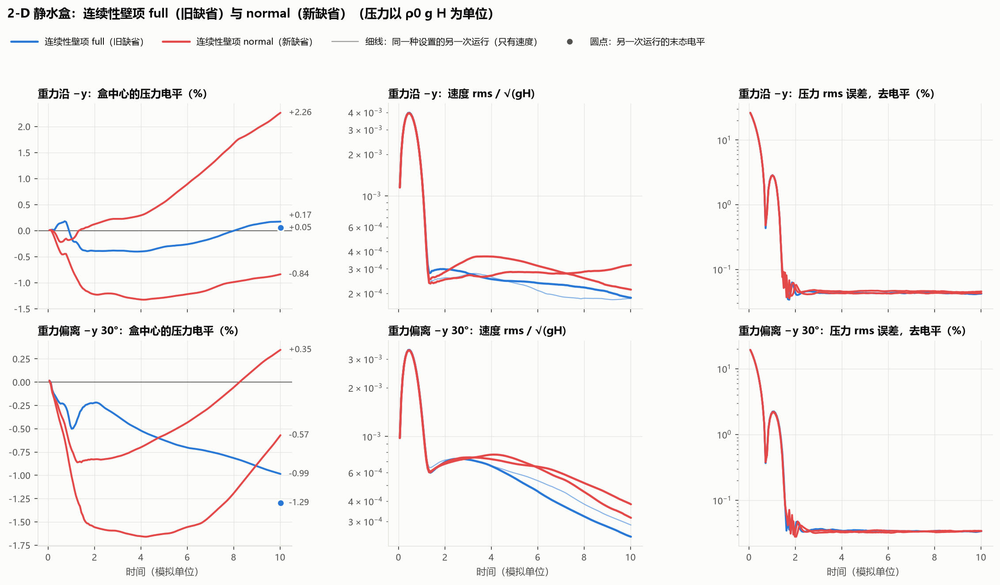

- **去电平的压力误差没有变**：沿 −y 是 0.043 % 到 0.046 %（`full` 0.042 % 到 0.043 %），倾斜 30° 是 0.034 %（`full` 0.034 %）。拟合压力梯度的误差也没有变（0.11 %）。
- **残余速度同量级，新缺省平均高三分之一左右**：末 1/5 段的 rms，沿 −y 是 2.3e-4 和 3.0e-4（`full` 1.8e-4 和 2.0e-4），倾斜 30° 是 3.8e-4 和 4.5e-4（`full` 2.8e-4 和 3.3e-4）。同一种设置的两次运行之间相差 10 % 到 30 %，所以这个差别只比单次运行的散布大一点。
- **差别出在内部，不在近壁**：近壁三层的速度与 `full` 持平或略低；内部（φ ≥ 5 dx）是 1.8e-4 到 3.9e-4，`full` 是 1.4e-4 到 2.9e-4。
- **压力电平的历史**：
  - 新缺省的 4 次运行在 t ∈ [3, 10] 上电平都在上升，每时间单位 +0.08 % 到 +0.32 %（对应平均密度 +0.0008 到 +0.0033 kg/m³ 每时间单位）。`full` 带历史的两次是 +0.10 %（沿 −y）和 −0.08 %（倾斜 30°）。
  - 末态（t = 10）的电平：新缺省沿 −y 是 +2.26 % 和 −0.84 %，倾斜 30° 是 +0.35 % 和 −0.57 %；`full` 是 +0.05 %、+0.17 % 和 −1.30 %、−0.99 %。
  - 新缺省沿 −y 的两次运行末态相差 3.1 个百分点，符号都不同。其中 1.4 个百分点在最初的沉降阶段就有了（t = 2.5 时是 +0.20 % 和 −1.21 %），其余来自之后上升得快慢不同（+0.32 % 对 +0.08 % 每时间单位）。`full` 的两次运行末态相差 0.1 个百分点（沿 −y）和 0.3 个百分点（倾斜 30°）。
- 粒子数都守恒，A_f 回退为 0，φ 的最小值 0.36 到 0.38 dx。

### 9.5 短跑三：密度按差值存储

**可以直接用，跑了一次。** 求解器现有的选项是环境变量 `V7_DELTA_DENSITY=1`（评估开关，缺省关）：密度缓冲里存 ρ − ρ_ref 而不是 ρ。没有为它改任何代码。

- **判断"可以直接用"的依据**：crossing 的着色器代码里，用到密度本身的地方都经过求解器原有的换算函数，用到密度差的地方与存储方式无关。单步检查（开着这个开关，2-D 光滑场）：GPU 的加速度、位移修正、L、A_f⁻¹、g_f 和收支四项对参考解都在 1e-5 以内（wc-20261118-100359-2a35）。
- **单步工具里有一项检查在这个开关下不适用**："密度变化率"那一项按绝对的 float32 读回密度，读回时又被舍入到 6.1e-5 的网格上，所以报不通过。这是检查工具的读法，我没有为它改工具。

250² 方腔，新缺省，t ∈ [1.02, 5.01]，kg/m³ 每时间单位；± 是 8 段的标准误。

| 量 | float32 存 ρ（缺省），第 1 次 | float32 存 ρ（缺省），第 2 次 | **float32 存 ρ − ρ_ref（`V7_DELTA_DENSITY=1`）** |
|---|---|---|---|
| 连续性两项之和（全场） | +0.00042 ± 0.00123 | +0.00007 ± 0.00143 | -0.00388 ± 0.00161 |
| δ 两项之和（全场） | +0.00767 ± 0.00005 | +0.00762 ± 0.00004 | +0.00762 ± 0.00004 |
| **四项之和（全场）** | +0.00809 ± 0.00126 | +0.00769 ± 0.00146 | +0.00374 ± 0.00162 |
| **存储舍入（实际写入 − 四项之和，全场）** | -0.00402 ± 0.00052 | -0.00430 ± 0.00080 | +0.00002 ± 0.00000 |
| **实际写入的密度变化（全场）** | +0.00407 ± 0.00077 | +0.00339 ± 0.00068 | +0.00376 ± 0.00162 |
| 连续性两项之和：内部 | +0.00050 ± 0.00113 | -0.00007 ± 0.00139 | -0.00360 ± 0.00142 |
| 存储舍入：内部 | -0.00382 ± 0.00050 | -0.00409 ± 0.00077 | +0.00000 ± 0.00000 |
| **漂移率（平均密度的线性拟合斜率）** | +0.00368 | +0.00335 | +0.00300 |
| t = 5 的平均密度 − ρ0（kg/m³） | +0.02628 | +0.02349 | +0.02904 |
| t = 5 的平均压力（Pa） | +264.0 | +236.2 | +290.4 |
| t = 5 的负压粒子比例 | 0.00 % | 0.00 % | 0.00 % |
| t = 5 的动能 | 21.140 | 21.146 | 21.138 |
| 闭合：实际写入与读回的平均密度，窗口内最大相差（kg/m³） | 1.1e-13 | 9.0e-14 | 6.8e-10 |
| 记录（提交） | wc-20261118-102117-7b54（6c8a55a） | wc-20261118-102354-4dd5（6c8a55a） | wc-20261118-103154-9984（6c8a55a） |

- **舍入那一项消失了**：+0.00002（缺省存储下是 −0.0040 和 −0.0043）。
- **漂移率是 +0.0030**，与缺省存储的 +0.0033 到 +0.0038 差不多，没有变成四项之和原来的 +0.008。
- **变的是连续性项**：全场 −0.0039 ± 0.0016，内部 −0.0036 ± 0.0014；缺省存储下是 +0.0004 和 +0.0001。也就是说两种存储下实际写入的变化率相同（+0.0034 到 +0.0041），只是缺省存储下记在"舍入"里的 −0.004，在差值存储下出现在连续性项里。
- 只有一次运行。闭合差是 6.8e-10 kg/m³（缺省存储下是 1e-13）：收支的累加器是 float32，差值存储下每步的增量不再是网格的整数倍。

### 9.6 方腔统计（Re = 1000，250² 和 500²）

**运行方式**与之前 crossing 的统计运行相同：同一个启动器和协议（从静止开始，每 0.2 个时间单位采样，10 个时间单位一个窗口判定常，跑到 max(100, t_s + 20)，最后 20 个时间单位平均），K = 1。两个运行在两张卡上并行。

**预计时长是开跑前估的**（两张卡并行各试跑 1 分钟量出的速率），实际如下：

| 运行 | 卡 | 试跑速率 | 预计 | 实际 | 定常 t_s | 平均窗口 |
|---|---|---|---|---|---|---|
| 250² | 接显示器的 5090 | 3390 步/秒 | 17 分钟 | 16.6 分钟 | 70.6 | 80.0–100.0 |
| 500² | 无显示器的 5090 | 1590 步/秒 | 70 分钟（低于 90 分钟的上限） | 72.5 分钟 | 69.6 | 80.0–99.8 |

- 之前 `full` 的 250² 运行在 t = 80.6 才判为定常，所以窗口是 80.6–100.6；这次早一个窗口判定常，窗口是 80.0–100.0。协议相同，窗口差 0.6 个时间单位。
- 没有做 1000²。

**指标**

Re = 1000 方腔对 Marchi 2021，K = 1，最后 20 个时间单位平均。括号内 = 相对参考值的偏差（负 = 偏弱）。“wall 帧”把单位方腔放在最内层壁粒子行的中线上（已发表的表用的放法，各模式同样处理）；“mid 帧”放在最内层壁粒子行与最外层流体行的正中（crossing 的盒面）。剖面误差是 28 个 Marchi 点上的 L2 / L∞，速度以盖速为单位。参考值：ψ_min -0.11894，u_min -0.38857，v_max 0.37694，v_min -0.52708。

| 运行 | ψ_min（wall 帧） | ψ_min 偏差（mid 帧） | u_min | v_max | v_min | u 剖面 L2 / L∞（wall 帧） | v 剖面 L2 / L∞（wall 帧） | u 剖面 L2 / L∞（mid 帧） | v 剖面 L2 / L∞（mid 帧） |
|---|---|---|---|---|---|---|---|---|---|
| 250² crossing，normal（新缺省） | -0.11407（-4.09 %） | -3.71 % | -0.37533（-3.41 %） | 0.36344（-3.58 %） | -0.50979（-3.28 %） | 0.0087 / 0.0162 | 0.0136 / 0.0235 | 0.0083 / 0.0134 | 0.0110 / 0.0173 |
| 250² crossing，full（旧缺省） | -0.11703（-1.60 %） | -1.21 % | -0.38493（-0.94 %） | 0.37314（-1.01 %） | -0.52217（-0.93 %） | 0.0050 / 0.0175 | 0.0056 / 0.0124 | 0.0036 / 0.0062 | 0.0038 / 0.0079 |
| 250² crossing，full（旧缺省），第二次运行 | -0.11703（-1.61 %） | -1.21 % | -0.38490（-0.94 %） | 0.37315（-1.01 %） | -0.52216（-0.93 %） | 0.0049 / 0.0174 | 0.0056 / 0.0123 | 0.0037 / 0.0063 | 0.0038 / 0.0078 |
| 250² simple | -0.10867（-8.64 %） | -8.27 % | -0.35468（-8.72 %） | 0.34184（-9.31 %） | -0.48407（-8.16 %） | 0.0230 / 0.0351 | 0.0271 / 0.0430 | 0.0264 / 0.0496 | 0.0262 / 0.0438 |
| 250² adami | -0.12336（+3.72 %） | +4.14 % | -0.40476（+4.17 %） | 0.39438（+4.63 %） | -0.54703（+3.79 %） | 0.0109 / 0.0227 | 0.0122 / 0.0193 | 0.0097 / 0.0219 | 0.0149 / 0.0271 |
| 500² crossing，normal（新缺省） | -0.11631（-2.21 %） | -2.01 % | -0.38167（-1.78 %） | 0.37010（-1.82 %） | -0.51838（-1.65 %） | 0.0042 / 0.0073 | 0.0066 / 0.0097 | 0.0049 / 0.0076 | 0.0057 / 0.0096 |
| 500² crossing，full（旧缺省） | -0.11799（-0.80 %） | -0.60 % | -0.38727（-0.33 %） | 0.37574（-0.32 %） | -0.52550（-0.30 %） | 0.0021 / 0.0066 | 0.0020 / 0.0042 | 0.0029 / 0.0054 | 0.0027 / 0.0053 |
| 500² simple | -0.11228（-5.59 %） | -5.40 % | -0.36711（-5.52 %） | 0.35500（-5.82 %） | -0.49956（-5.22 %） | 0.0150 / 0.0224 | 0.0175 / 0.0275 | 0.0167 / 0.0295 | 0.0169 / 0.0278 |
| 500² adami | -0.12059（+1.39 %） | +1.59 % | -0.39554（+1.79 %） | 0.38474（+2.07 %） | -0.53603（+1.70 %） | 0.0050 / 0.0108 | 0.0055 / 0.0104 | 0.0050 / 0.0123 | 0.0074 / 0.0151 |

极值的位置：wall 帧 / mid 帧（括号内 = mid 帧位置减参考位置）。参考位置：y(u_min) 0.1717，x(v_max) 0.1578，x(v_min) 0.9092，ψ_min (0.5308, 0.5652)。

| 运行 | y(u_min) | x(v_max) | x(v_min) | ψ_min 的位置 | 平均窗口 t | 定常 t_s | 窗口平均动能 | 提交 |
|---|---|---|---|---|---|---|---|---|
| 250² crossing，normal（新缺省） | 0.1725 / 0.1712（-0.0005） | 0.1591 / 0.1577（-0.0001） | 0.9078 / 0.9094（+0.0001） | (0.5309, 0.5641) / (0.5310, 0.5644)（+0.0002, -0.0009） | 80.0–100.0 | 70.6 | 47.8440 | 6c8a55a |
| 250² crossing，full（旧缺省） | 0.1709 / 0.1696（-0.0021） | 0.1583 / 0.1569（-0.0009） | 0.9087 / 0.9104（+0.0011） | (0.5307, 0.5639) / (0.5308, 0.5642)（+0.0000, -0.0011） | 80.6–100.6 | 80.6 | 49.6894 | 052cfb9 |
| 250² crossing，full（旧缺省），第二次运行 | 0.1710 / 0.1696（-0.0020） | 0.1583 / 0.1569（-0.0009） | 0.9087 / 0.9104（+0.0011） | (0.5307, 0.5639) / (0.5308, 0.5642)（-0.0000, -0.0010） | 80.6–100.6 | 80.6 | 49.6867 | 5ee25b1 |
| 250² simple | 0.1735 / 0.1722（+0.0005） | 0.1618 / 0.1605（+0.0026） | 0.9094 / 0.9110（+0.0017） | (0.5334, 0.5643) / (0.5336, 0.5646)（+0.0028, -0.0007） | 80.0–100.0 | 70.6 | 42.9049 | 029313a |
| 250² adami | 0.1679 / 0.1665（-0.0052） | 0.1559 / 0.1545（-0.0033） | 0.9102 / 0.9119（+0.0026） | (0.5300, 0.5646) / (0.5301, 0.5649)（-0.0007, -0.0004） | 80.6–100.6 | 80.6 | 53.7693 | 029313a |
| 500² crossing，normal（新缺省） | 0.1708 / 0.1702（-0.0015） | 0.1576 / 0.1570（-0.0009） | 0.9090 / 0.9098（+0.0006） | (0.5306, 0.5643) / (0.5307, 0.5644)（-0.0001, -0.0008） | 80.0–99.8 | 69.6 | 48.9382 | 6c8a55a |
| 500² crossing，full（旧缺省） | 0.1699 / 0.1693（-0.0024） | 0.1572 / 0.1565（-0.0013） | 0.9096 / 0.9104（+0.0012） | (0.5305, 0.5641) / (0.5306, 0.5643)（-0.0002, -0.0010） | 80.0–99.8 | 79.6 | 50.0152 | 5ee25b1 |
| 500² simple | 0.1726 / 0.1720（+0.0003） | 0.1596 / 0.1589（+0.0010） | 0.9092 / 0.9100（+0.0008） | (0.5321, 0.5649) / (0.5322, 0.5650)（+0.0014, -0.0002） | 80.0–99.8 | 69.6 | 45.5336 | 029313a |
| 500² adami | 0.1684 / 0.1677（-0.0040） | 0.1559 / 0.1552（-0.0026） | 0.9104 / 0.9112（+0.0019） | (0.5302, 0.5644) / (0.5302, 0.5645)（-0.0006, -0.0007） | 80.0–99.8 | 79.6 | 51.7032 | 029313a |

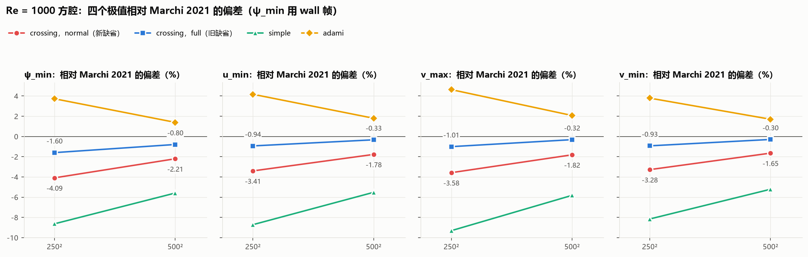

- **两档分辨率上都比旧缺省差**：ψ_min（wall 帧）在 250² 是 −4.09 %（旧缺省 −1.60 %），在 500² 是 −2.21 %（旧缺省 −0.80 %），偏差是旧缺省的 2.6 到 2.8 倍。
- **三个速度极值差得更多**：250² 是 −3.3 % 到 −3.6 %（旧缺省 −0.9 % 到 −1.0 %），500² 是 −1.7 % 到 −1.8 %（旧缺省 −0.3 %），是旧缺省的 3.5 到 5.7 倍。
- **剖面的 L2 误差是旧缺省的 1.8 到 3.3 倍**（wall 帧）：250² 是 u 0.0087、v 0.0136（旧缺省 0.0050、0.0056），500² 是 u 0.0042、v 0.0066（旧缺省 0.0021、0.0020）。u 的 L∞ 两种设置差不多（250² 是 0.0162 对 0.0175，500² 是 0.0073 对 0.0066）。
- **方向都是偏弱**：四个极值都比参考值小。窗口平均动能是 47.84（250²）和 48.94（500²），旧缺省是 49.69 和 50.02。
- **极值的位置没有变差**：mid 帧里三个速度极值的位置偏差，新缺省在两档上都不大于旧缺省（250²：−0.0005、−0.0001、+0.0001 对 −0.0021、−0.0009、+0.0011；500²：−0.0015、−0.0009、+0.0006 对 −0.0024、−0.0013、+0.0012）。
- **与另外两种壁面比**：好于 simple（ψ_min −8.64 % 和 −5.59 %）。ψ_min 的偏差比 adami 大（adami 是 +3.72 % 和 +1.39 %，符号相反）；u 剖面的 L2 比 adami 小，v 剖面的 L2 比 adami 大。
- 每档只有一次运行。`full` 在 250² 上有两次，ψ_min 相差 0.01 个百分点，所以上面的差别远大于运行间的散布。

**收敛阶（250² → 500²）**

观测收敛阶 p = ln(e₂₅₀ / e₅₀₀) / ln 2，e = 该量相对 Marchi 2021 的误差（绝对值），250² → 500²。只有两档分辨率，所以每个 p 只是一对数的比值；误差本身已经很小的量（接近运行间的散布）p 没有意义。

| 量 | crossing，normal（新缺省） | crossing，full（旧缺省） | simple | adami |
|---|---|---|---|---|
| ψ_min 偏差（绝对值，wall 帧） | 0.00487 → 0.00263，p = 0.89 | 0.00190 → 0.00095，p = 1.01 | 0.01027 → 0.00665，p = 0.63 | 0.00443 → 0.00165，p = 1.42 |
| ψ_min 偏差（绝对值，mid 帧） | 0.00441 → 0.00239，p = 0.88 | 0.00144 → 0.00071，p = 1.02 | 0.00984 → 0.00643，p = 0.61 | 0.00492 → 0.00189，p = 1.38 |
| u_min 偏差（绝对值） | 0.01324 → 0.00690，p = 0.94 | 0.00364 → 0.00130，p = 1.49 | 0.03389 → 0.02146，p = 0.66 | 0.01619 → 0.00697，p = 1.22 |
| v_max 偏差（绝对值） | 0.01350 → 0.00684，p = 0.98 | 0.00381 → 0.00120，p = 1.66 | 0.03511 → 0.02195，p = 0.68 | 0.01744 → 0.00779，p = 1.16 |
| v_min 偏差（绝对值） | 0.01729 → 0.00870，p = 0.99 | 0.00490 → 0.00157，p = 1.64 | 0.04301 → 0.02751，p = 0.64 | 0.01996 → 0.00895，p = 1.16 |
| u L2 (wall) | 0.00869 → 0.00424，p = 1.04 | 0.00496 → 0.00212，p = 1.22 | 0.02298 → 0.01499，p = 0.62 | 0.01094 → 0.00504，p = 1.12 |
| u L∞ (wall) | 0.01620 → 0.00730，p = 1.15 | 0.01755 → 0.00658，p = 1.41 | 0.03510 → 0.02239，p = 0.65 | 0.02275 → 0.01076，p = 1.08 |
| v L2 (wall) | 0.01364 → 0.00662，p = 1.04 | 0.00563 → 0.00203，p = 1.47 | 0.02714 → 0.01746，p = 0.64 | 0.01218 → 0.00554，p = 1.14 |
| v L∞ (wall) | 0.02348 → 0.00967，p = 1.28 | 0.01241 → 0.00420，p = 1.56 | 0.04300 → 0.02747，p = 0.65 | 0.01933 → 0.01044，p = 0.89 |
| u L2 (mid) | 0.00831 → 0.00491，p = 0.76 | 0.00364 → 0.00290，p = 0.33 | 0.02640 → 0.01668，p = 0.66 | 0.00971 → 0.00503，p = 0.95 |
| u L∞ (mid) | 0.01336 → 0.00763，p = 0.81 | 0.00615 → 0.00536，p = 0.20 | 0.04957 → 0.02952，p = 0.75 | 0.02193 → 0.01232，p = 0.83 |
| v L2 (mid) | 0.01098 → 0.00570，p = 0.95 | 0.00381 → 0.00273，p = 0.48 | 0.02621 → 0.01685，p = 0.64 | 0.01489 → 0.00739，p = 1.01 |
| v L∞ (mid) | 0.01734 → 0.00962，p = 0.85 | 0.00787 → 0.00529，p = 0.57 | 0.04381 → 0.02785，p = 0.65 | 0.02709 → 0.01506，p = 0.85 |

- **新缺省的观测阶在 0.9 到 1.0 附近**：ψ_min 是 0.89，三个速度极值 0.94 到 0.99，剖面 L2（wall 帧）是 1.04。
- **旧缺省的阶更高**：ψ_min 是 1.01，速度极值 1.49 到 1.66，剖面 L2 是 1.22 和 1.47。
- simple 是 0.6 到 0.7，adami 是 1.1 到 1.4。
- mid 帧的剖面误差上，旧缺省的阶只有 0.2 到 0.6（L2 从 0.0036 降到 0.0029），新缺省是 0.8 到 1.0；500² 上新缺省的 L2 误差仍是旧缺省的 1.7 到 2.1 倍。

### 9.7 长时间运行里的密度和压力电平

两个运行全程在每个样本记了流体的平均密度、平均压力、负压粒子比例、最大速度和粒子数（`field_history.jsonl`）。

| 运行 | 样本数 | 粒子数（含壁） | 流体最大速度（整个运行） | 密度范围 − ρ0（整个运行，kg/m³） | 平均密度变化率，t ∈ [1, 5]（kg/m³ 每时间单位） | 同，t ∈ [20, 末] | 同，最后 20 个时间单位 | 平均压力变化率，最后 20 个时间单位（Pa 每时间单位） | 负压粒子比例的最大值（t ≥ 5） | A_f 回退（累计） | φ_min / dx | 低于下限 / 越出盒（最大粒子数） | 运行器的结论 | 记录（提交） |
|---|---|---|---|---|---|---|---|---|---|---|---|---|---|---|
| 250² | 494，到 t = 99.99 | 74,529，每个样本都相同 | 0.978 | -0.021 … +0.151 | +0.00389 | +0.000001 | -0.000042 | -0.422 | 0.003 % | 0 | 0.295 | 0 / 0 | complete；不变量违反的段：0；定常 t_s = 70.56 | wc-20261118-100324-097b（6c8a55a） |
| 500² | 531，到 t = 99.84 | 273,529，每个样本都相同 | 0.989 | -0.041 … +0.183 | +0.00143 | +0.000044 | +0.000018 | +0.183 | 0.004 % | 0 | 0.287 | 0 / 0 | complete；不变量违反的段：0；定常 t_s = 69.61 | wc-20261118-100324-974f（6c8a55a） |

新缺省的两个方腔统计运行，各时刻的样本（每 0.2 个时间单位一个样本，取最近的一个）：对存活的流体粒子（不含壁）的 float64 平均。

| 运行 | t | 平均密度 − ρ0（kg/m³） | 平均压力 | 压力范围（Pa） | 负压粒子比例 | 流体最大速度 | 粒子数（含壁） |
|---|---|---|---|---|---|---|---|
| 250² | 1.05 | +0.01129 | +114.2 Pa（+0.114 ρ0U²） | -101 … +984 | 0.006 % | 0.971 | 74,529 |
| 250² | 5.04 | +0.02600 | +261.2 Pa（+0.261 ρ0U²） | +63 … +1198 | 0.000 % | 0.972 | 74,529 |
| 250² | 10.08 | +0.02628 | +264.1 Pa（+0.264 ρ0U²） | +66 … +1216 | 0.000 % | 0.971 | 74,529 |
| 250² | 19.95 | +0.02278 | +229.1 Pa（+0.229 ρ0U²） | +19 … +1323 | 0.000 % | 0.974 | 74,529 |
| 250² | 39.90 | +0.02206 | +221.8 Pa（+0.222 ρ0U²） | +10 … +1308 | 0.000 % | 0.975 | 74,529 |
| 250² | 60.06 | +0.02143 | +215.5 Pa（+0.215 ρ0U²） | +62 … +1212 | 0.000 % | 0.974 | 74,529 |
| 250² | 80.01 | +0.02192 | +220.4 Pa（+0.220 ρ0U²） | -62 … +1317 | 0.003 % | 0.975 | 74,529 |
| 250² | 90.72 | +0.02080 | +209.2 Pa（+0.209 ρ0U²） | +40 … +1191 | 0.000 % | 0.976 | 74,529 |
| 250² | 99.33 | +0.02194 | +220.6 Pa（+0.221 ρ0U²） | +63 … +1228 | 0.000 % | 0.976 | 74,529 |
| 250² | 99.99 | +0.02182 | +219.4 Pa（+0.219 ρ0U²） | +49 … +1206 | 0.000 % | 0.975 | 74,529 |
| 500² | 0.97 | +0.00917 | +93.0 Pa（+0.093 ρ0U²） | -401 … +1419 | 0.011 % | 0.984 | 273,529 |
| 500² | 5.07 | +0.01583 | +159.5 Pa（+0.159 ρ0U²） | -244 … +1556 | 0.003 % | 0.986 | 273,529 |
| 500² | 9.95 | +0.01747 | +175.9 Pa（+0.176 ρ0U²） | -247 … +1617 | 0.003 % | 0.986 | 273,529 |
| 500² | 20.09 | +0.01855 | +186.7 Pa（+0.187 ρ0U²） | -212 … +1567 | 0.003 % | 0.987 | 273,529 |
| 500² | 39.98 | +0.01900 | +191.2 Pa（+0.191 ρ0U²） | -173 … +1688 | 0.002 % | 0.988 | 273,529 |
| 500² | 60.06 | +0.01978 | +199.0 Pa（+0.199 ρ0U²） | -138 … +1724 | 0.003 % | 0.987 | 273,529 |
| 500² | 79.95 | +0.02053 | +206.5 Pa（+0.207 ρ0U²） | -222 … +1790 | 0.002 % | 0.988 | 273,529 |
| 500² | 90.67 | +0.02107 | +212.0 Pa（+0.212 ρ0U²） | -184 … +1639 | 0.002 % | 0.987 | 273,529 |
| 500² | 99.45 | +0.02118 | +213.0 Pa（+0.213 ρ0U²） | -190 … +1750 | 0.002 % | 0.988 | 273,529 |
| 500² | 99.84 | +0.02116 | +212.8 Pa（+0.213 ρ0U²） | -140 … +1761 | 0.003 % | 0.987 | 273,529 |

- **t = 100 时的压力电平**：250² 是 +219 Pa（+0.219 ρ0U²），500² 是 +213 Pa（+0.213 ρ0U²）。全场为正：t ≥ 5 之后负压粒子最多占 0.004 %（几个到十来个粒子）。只有启动时多一些：第一个样本（t = 0.2）是 1.2 %（250²）和 0.7 %（500²），到 t = 0.6 已降到 0.02 %。
- **平均密度不再持续漂移**：
  - 250²：在 t ≈ 8 升到 ρ0 + 0.028，回落后从 t ≈ 25 起在 ρ0 + 0.022 附近起伏（± 0.001）。t ∈ [20, 100] 的拟合变化率是 +1e-6 kg/m³ 每时间单位，最后 20 个时间单位是 −4e-5。
  - 500²：一直在缓慢上升，t = 20 时是 ρ0 + 0.0186，t = 100 时是 ρ0 + 0.0212。t ∈ [20, 100] 的变化率是 +4.4e-5，最后 20 个时间单位是 +1.8e-5。
  - 对比：旧缺省在 250² 上是每时间单位 −0.0136，并且一直持续（见下表）。
- **没有不稳定的迹象**：
  - 粒子数在每个样本上都守恒；运行器的不变量（体素表溢出、远迁移、戳、粒子数漂移）全为 0。
  - A_f 回退 0 次；φ 的最小值是 0.295 dx（250²）和 0.287 dx（500²），没有粒子低于距离下限或越出盒。
  - 流体最大速度 0.978 和 0.989（盖速 = 1）；密度范围在 ρ0 − 0.04 到 ρ0 + 0.18 之间。
- 两个运行都在第 7 个窗口判为定常（t = 70.6 和 69.6），比 `full` 早一个窗口。

**与之前各运行的压力电平比较**

之前的运行没有记压力的历史，压力只留在检查点里（每 10 个时间单位一个，只保留最后两个）：250² 的最后一个检查点在 t = 90.72，500² 的在 t = 99.45。新缺省的运行取同一时刻附近的样本。

| 运行 | t | 平均密度 − ρ0（kg/m³） | 平均压力 | 压力范围（Pa） | 负压粒子比例 | 流体最大速度 | 来源 |
|---|---|---|---|---|---|---|---|
| 250² crossing，full（旧缺省） | 90.72 | -1.31754 | -13122.6 Pa（-13.123 ρ0U²） | -13873 … -11633 | 100.00 % | 0.975 | 最后一个检查点 |
| 250² crossing，full，第二次运行 | 90.72 | -1.31632 | -13110.4 Pa（-13.110 ρ0U²） | -13821 … -11540 | 100.00 % | 0.976 | 最后一个检查点 |
| 250² simple | 90.72 | -0.00380 | -37.1 Pa（-0.037 ρ0U²） | -9732 … +10137 | 91.18 % | 0.936 | 最后一个检查点 |
| 250² adami | 90.72 | -0.00799 | -78.9 Pa（-0.079 ρ0U²） | -3006 … +3985 | 98.72 % | 0.979 | 最后一个检查点 |
| 500² crossing，full（旧缺省） | 99.45 | -0.21068 | -2104.5 Pa（-2.105 ρ0U²） | -3715 … +440 | 100.00 % | 0.987 | 最后一个检查点 |
| 500² simple | 99.45 | -0.00411 | -40.2 Pa（-0.040 ρ0U²） | -9860 … +11603 | 93.88 % | 0.968 | 最后一个检查点 |
| 500² adami | 99.45 | -0.00570 | -56.1 Pa（-0.056 ρ0U²） | -4883 … +4329 | 96.82 % | 0.989 | 最后一个检查点 |
| **250² crossing，normal（新缺省）** | 90.72 | +0.02080 | +209.2 Pa（+0.209 ρ0U²） | +40 … +1191 | 0.00 % | 0.976 | 样本历史 |
| **500² crossing，normal（新缺省）** | 99.45 | +0.02118 | +213.0 Pa（+0.213 ρ0U²） | -190 … +1750 | 0.00 % | 0.988 | 样本历史 |

- **旧缺省的压力电平是很大的负值，而且两档分辨率差很多**：250² 在 t = 90.7 是 −13.1 ρ0U²（平均密度 ρ0 − 1.32），500² 在 t = 99.5 是 −2.1 ρ0U²（ρ0 − 0.21）；全部粒子都是负压。
- **新缺省是 +0.21 ρ0U²，两档分辨率几乎相同**，粒子的压力在 −200 到 +1800 Pa 之间。
- simple 和 adami 的平均压力在零附近（−0.04 到 −0.08 ρ0U²），但粒子的压力有正有负，范围是 ±3000 到 ±11600 Pa，负压粒子占 91 % 到 99 %。

### 9.8 范围和没有做的

- 方腔只有 250² 和 500² 两档，每档一次运行；没有做 1000²、3-D 方腔和 K = 2。收敛阶只有一对数。
- 收支仍只有 250²、t ∈ [1, 5]。500² 没有做收支。
- 密度按差值存储只跑了一次 t = 0 到 5，没有用它跑统计运行。
- 静水盒只有 2-D 的两个方向，每种设置两次；3-D 静水盒没有重跑。
- 新缺省下 `continuity: wall_velocity`、`delta_wall` 的另外两个取值、距离下限的变体都没有重跑；第 2 到 8 节里 crossing 的结果都是 `full` 的。
- 新缺省使方腔精度变差的原因没有查。
- 没有做近壁筛选、计时。

### 9.9 结论

1. **内部的净汇确认消失**：新缺省的两次收支运行里，内部的连续性项是 +0.0005 ± 0.0011 和 −0.0001 ± 0.0014 kg/m³ 每时间单位，上一轮那一次是 +0.0005 ± 0.0013；旧缺省是 −0.0264 和 −0.0272。
2. **方腔精度相对旧缺省变差**：ψ_min 的偏差在 250² 从 −1.60 % 变成 −4.09 %，在 500² 从 −0.80 % 变成 −2.21 %；速度极值的偏差是旧缺省的 3.5 到 5.7 倍，剖面 L2 误差是 1.8 到 3.3 倍，观测阶从 1.0–1.7 降到 0.9–1.0；仍好于 simple。
3. **剩余漂移**：250² 在 t ∈ [1, 5] 上是 +0.0035 ± 0.0002 kg/m³ 每时间单位（旧缺省 −0.0136；500² 是 +0.0014），之后基本停住：t ∈ [20, 100] 上 250² 是 +1e-6、500² 是 +4e-5，t = 100 时平均密度是 ρ0 + 0.021 到 0.022，平均压力 +0.21 到 +0.22 ρ0U²，负压粒子不超过 0.004 %。

## 10. 追加（五）：速度的二阶延拓（沿线段取抛物线）（2026-11-18）

按用户的第五份任务书：给 crossing 加上速度的二阶延拓，做"二阶粘性"和"全二阶"两种配置，按任务书第 5 节的顺序验证。所有缺省值不变。用户在中途追加了一条：任务书 5.7 的第一项（压力分支对照）改为无条件执行。

**先说结果**

- **二阶规则本身是对的**：numpy 核对里它对二次速度场精确到舍入（10.5），GPU 对 numpy 的单步对照在 2-D 和 3-D 都通过（10.6）。
- **它没有解决主涡偏弱**：250² 的 ψ_min 偏差从一阶的 −4.09 % 变成 −3.93 %，500² 从 −2.21 % 变成 −2.16 %（10.9）。任务书第 2 节的假设（壁面剪切被直线延拓低估，所以主涡偏弱）不被这个结果支持。
- **全二阶没有通过筛查**：内部的连续性项是 −0.016，距离下限改成 0.5 后是 −0.021，都超过 0.005 的线，所以它没有进长运行（10.7）。
- **另两个候选原因也排除了**：压力分支（有效的那次对照全程负压，ψ_min 偏差 −3.94 %，10.10）；近壁第一层粒子的位置（旧缺省和一阶相同，10.11）。旧缺省与一阶之间 2.5 个百分点的差别，原因仍然没有找到。
- **代价**：500² 上每步慢 17 % 到 19 %，250² 没有可测的差别；融合遍的寄存器数从 64 升到 121（10.12）。

### 10.1 改动清单

**求解器**

- **两个开关**（`numerics.wall_crossing`，缺省都是 `linear`，即现有的一阶规则）：
  - `viscous_extension: linear | quadratic`，spec const 118。
  - `continuity_extension: linear | quadratic`，spec const 119。
  - 118 和 119 此前在全库里没有用过（`shaders/README.md` 里原来标着空闲），现在记进了 README。
- **加载时的检查**：
  - `continuity_extension: quadratic` 与 `continuity: wall_velocity` 同时出现，报 `ValueError`。
  - `continuity_extension: quadratic` 而 `viscous_extension: linear`，报 `ValueError`。
  - 任一开关取 `quadratic` 时，加载日志那一行里写出两个开关的取值；`continuity_extension: quadratic` 时再说明 `continuity_wall_component` 只用于回退的粒子。
- **瞬态缓冲** `wall_crossing_velocity_gradient`（set 0 binding 14）：每粒子 3 个 vec4，前三个分量是 ∇v_i 的一列，第一个 vec4 的第四个分量是状态（0 = 没有壁邻居，1 = 已解出，2 = 回退）。遍历 1 写、遍历 2 读自己那一格；不随 defrag 和传输搬运，不进 ghost，不进重启状态。两个开关都是 `linear` 时它是 48 字节的占位，没有核读写它。
- **遍历 1（`correction_density.comp`）**：
  - 循环内累加 M_0（流体部分和壁部分分开存）和 K_raw，用的 V_j 和 ∇W_ij 就是同一循环里累加修正矩阵的那两个量。
  - 循环后解 ∇v_i = M_0 L_i (I − K_raw L_i)⁻¹，写入缓冲。没有壁邻居的粒子不解，状态 0。
  - `continuity_extension: quadratic` 时，壁邻居不再逐对贡献漂移，循环后加 −ρ_i tr[(M_w + ∇v_i K_raw) L_i]。
- **遍历 2（`force.comp`）**：`viscous_extension: quadratic` 且该粒子状态为 1 时，壁邻居的粘性项用 (v_i − v_w)(1 + a_j)² + a_j ∇v_i (r_j − r_i)。其他用到壁邻居的项没有动。
- **保护**：det(I − K_raw L_i) < 0.5、解含非有限值、或 L_i 自身回退，三者任一出现，该粒子本步两项都用一阶规则，状态记 2。没有另加限制器。
- **诊断**（任务书 4.6）放在收支构建里（`V7_DENSITY_BUDGET=1`），缺省构建不带：回退次数、det(I − K_raw L_i) 的最小值、(1 + a_j)² 的最大值、壁面粘性扩散数的最大值，按区域分开，全程每一步都计。
- **SPIR-V**：重跑了 `compile_shaders_v7.py`。变了的是 crossing 的两个变体和两个收支构建，共 4 个文件；基点清单里的 23 个文件没有变。

**工具和算例**

- `reference.py`：numpy 参考解加了二阶规则（与着色器同样的公式，含 ξ）。
- `single_step.py`：加了 `--viscous-extension`、`--continuity-extension`，多比一项 ∇v_i 和状态。
- `quadratic_accuracy.py`（新）：任务书 5.2 的 numpy 精确性核对。
- `quadratic_extension.py`（新）：生成算例，出本节的表和图。
- `box_run.py`：每个样本多记二阶状态的粒子数；收支构建下多记 4.6 的诊断量。
- `cavity_runner_entry.py`：方腔运行每 20,000 步记一次二阶状态的粒子数；另加了"初始密度整体偏移"（压力分支对照用，`cavity_run.py --initial-density-offset`）。运行器本身没有改。
- 算例 10 个：250² 和 500² 方腔、两个 2-D 静水盒，各有二阶粘性和全二阶两种；250² 方腔另有距离下限 0.5 的两种。

**提交**（都在本地，没有 push）：b10c5ea（初始密度偏移的启动选项）、db3d609（二阶实现、工具、算例）、263381b（numpy 核对、诊断读回改稀），以及之后的分析和报告提交。

### 10.2 与任务书不一致的代码事实

- **"跑若干千步再比较"做不到**（任务书 5.1）。`canonical_dump.py` 的逐位比较只在第一次 defrag 之前有意义（步数 < 1000）。过了 defrag，同一个构建自己跑两次就不逐位相同：阶段 1 里 4000 步的比较，基点对基点自己也不同（2.4 节"6.1 simple 和 adami 逐位不变"的表）。所以这次仍用此前各轮的步数：simple 999 步，adami 200 步，crossing 700 步。
- **crossing 的比较按结果类做**。crossing 的运行之间本来就可能落在不同的结果类里（8.2 节）；现缺省（`normal`）在 700 步时只有一个类。
- **两次遍历读到的速度相同**（任务书 4.2 要求先核对）。一步里的顺序是 predict → update_voxel → 融合遍 → force，速度只在 predict 里更新。所以遍历 2 直接用遍历 1 解出的 ∇v_i，没有重新累加。
- **回退计数进不了全局状态块**。全局状态是 40 个 uint，没有空位（最后一个空位已经给了 A_f 的回退计数），而它的布局随传输搬运，不能加长。所以回退次数有两个来源：收支构建里按槽累计（每一步都计）；缺省构建里读回状态缓冲，数的是读回前那一步有多少粒子处于回退状态。
- **收支缓冲的布局变了**：每个（槽，区域）从 2 个 vec4 变成 3 个，多出来的放 4.6 的诊断量。这只影响收支构建。
- **det(I − K_raw L_i) 实际不小于 1**（任务书 3.3 的估计）：全部运行里的最小值是 1.0000（刚碰到壁的粒子），点阵上贴壁第一层是 3.62。0.5 的回退线一次也没有触发。

### 10.3 我做的决定

- **回退时连续性用哪条一阶规则**：用 `continuity_wall_component` 指定的那条（缺省 `normal`）。任务书说全二阶下这个开关不起作用；回退的粒子需要一条一阶规则，我取了当前缺省的那条。实际上没有粒子回退过。
- **M_w 单独累加**，没有用"全部邻居的散度减去流体部分"（任务书 4.2 两种都允许）。
- **解 ∇v_i 用的 L_i 是存下来的对称形式**（force 读回的那 6 个数），与密度那一遍收缩时用的一致。
- **壁粒子每步在状态格里写 0**。这样任何时刻读回状态缓冲，数到的都是当步的状态，不会混进旧值。
- **壁面粘性扩散数的定义**：时间步长 × 该粒子所有壁邻居的 2(d + 2) ν V_j |(r_i − r_j)·L_i∇W_ij| / (r² + ε²) × 因子之和；因子在二阶下是 (1 + a_j)²，在一阶下是 1 + a_j。每一对的这个量就是该对粘性项对 v_i 的阻尼率。V_j 用遍历 1 的（m_j / ρ_j）。
- **numpy 里"二阶只取法向"的取法**：∇v_i 仍按完整的二阶方程解出，再把壁邻居的二阶速度差投影到壁面法向。
- **抖动的取法**（任务书 5.2）：每个流体粒子在两个方向上各加 [−0.05, 0.05] dx 的均匀随机位移，10 个随机种子；条带以 x = 0 为中心。场 (c) 沿 x 不均匀，所以"只取法向"的散度误差按 |x| 分段给出。
- **500² 的第一次运行我停掉重跑了**。我加的诊断每 1000 步读回一次状态缓冲，在 500² 上把运行拖慢了一成以上，会污染任务书 5.8 要的每步时间。跑了 7 分钟时停掉，把读回改成每 20,000 步一次后重跑。250² 的第一次运行让它跑完了，当作第二次独立运行；计时只用改稀之后的那次。
- **压力分支对照多跑了一次**（10.10）。任务书给的初始偏移 −0.1 kg/m³ 那一次按任务书的判据无效。我另加了一次偏移 −0.45 的，偏移量是从第一次量到的上漂速率（+0.0033 每时间单位）算出来的，目的是让压力到 t = 100 一直为负。这一次不在任务书里，表里单独标出。
- **图里二阶粘性用墨色**。这次没有可用的 JavaScript 运行时来跑调色板校验，所以没有引入第五种颜色；其余四种沿用第 9 节校验过的。

### 10.4 位级回归（任务书 5.1）

| 检查 | 参照 | 结果 | 结论 | 记录 |
|---|---|---|---|---|
| simple、adami 用的 SPIR-V | 基点（eda5b90）清单里的 23 个文件 | 23 个逐字节相同 | 通过 | MANIFEST.txt |
| 相对 398f70a 变了的 SPIR-V | 全部 27 个文件 | correction_density_budget、correction_density_wall_crossing、correction_density_wall_crossing_budget、force_wall_crossing | — | MANIFEST.txt |
| simple，250²，999 步 | 基点构建的 2 个转储（2026-11-17） | 1 个结果类。类 0：参照 2 次，本次 4 次 | 逐位相同 | wc-20261118-135159-d59f |
| adami，250²，200 步 | 基点构建的 2 个转储（2026-11-17） | 1 个结果类。类 0：参照 2 次，本次 4 次 | 逐位相同 | wc-20261118-135204-01db |
| crossing，两个开关都是 linear（缺省），250²，700 步 | 398f70a 的求解器的 8 个转储（6c8a55a 时产生；之后到 398f70a 求解器没有改动） | 1 个结果类。类 0：参照 8 次，本次 6 次 | 逐位相同 | wc-20261118-132452-1301 |
| `_test_seam_layout.py` 的失败清单 | 基点的清单（858 条，基点自身就有） | 858 条，与基点的清单逐行相同 | 通过 | wc-20261118-133142-21d5 |

- 三种模式都逐位相同：simple 和 adami 对基点构建的转储，crossing（两个开关都是 `linear`）对 398f70a 的求解器的转储。
- 步数的说明见 10.2 第一条。

### 10.5 numpy 精确性核对（任务书 5.2）

float64，ξ = 0，单面平壁，流体和壁在同一套方点阵上，h = 5 dx。三个场：(a) 线性，(b) 二次，(c) 二次、无滑移、无散度。

**点阵上**（每层一个粒子）

| 场 | 层 | φ_i / dx | ∇v_i 对解析梯度 | 壁邻居速度对多项式真值 | 粘性加速度对“填真值”（÷ 逐对项绝对值之和） | 一阶规则：粘性加速度 ÷ 填真值的 | det(I − K L) |
|---|---|---|---|---|---|---|---|
| (a) v = (γy, 0) | 1 | 0.5 | 3.5e-16 | 1.9e-15 | 2.0e-16 | （填真值的加速度为零） | 3.623 |
| (a) v = (γy, 0) | 2 | 1.5 | 3.4e-16 | 2.6e-16 | 4.5e-18 | （填真值的加速度为零） | 1.220 |
| (a) v = (γy, 0) | 3 | 2.5 | 1.7e-16 | 1.7e-16 | 2.5e-18 | （填真值的加速度为零） | 1.023 |
| (b) v = (γy + κy²/2, 0) | 1 | 0.5 | 4.0e-16 | 1.1e-14 | 2.5e-16 | 0.690 | 3.623 |
| (b) v = (γy + κy²/2, 0) | 2 | 1.5 | 1.9e-16 | 4.6e-16 | 3.7e-19 | 0.934 | 1.220 |
| (b) v = (γy + κy²/2, 0) | 3 | 2.5 | 2.9e-16 | 2.7e-16 | 0.0e+00 | 0.994 | 1.023 |
| (c) v = (2a·x·y, −a·y²) | 1 | 0.5 | 4.6e-17 | 5.3e-16 | 5.8e-17 | 0.572 | 3.623 |
| (c) v = (2a·x·y, −a·y²) | 2 | 1.5 | 3.8e-16 | 7.3e-16 | 1.1e-17 | 0.778 | 1.220 |
| (c) v = (2a·x·y, −a·y²) | 3 | 2.5 | 2.0e-16 | 5.6e-16 | 1.2e-18 | 0.955 | 1.023 |

记录 wc-20261118-134312-fc1a。

- **三项误差都在舍入水平**，最大 1.1e-14，任务书的线是 1e-10：解出的 ∇v_i、二阶规则给出的壁邻居速度、粘性加速度。
- **一阶规则的粘性加速度在第一层是真值的 69.0 %**（场 (b)），与任务书里纸面核对的数字一致；第二层 93.4 %，第三层 99.4 %。场 (c) 第一层是 57.2 %。

**场 (c) 的速度散度**，以 |∂v_y/∂y| = 2a·φ_i 归一化（真值是 0）

| 层 | φ_i / dx | 一阶，只取法向 | 一阶，完整向量 | 二阶，完整向量 | 二阶，只取法向 | 壁粒子填真值 |
|---|---|---|---|---|---|---|
| 1 | 0.5 | -14.16 % | -14.16 % | -1.7e-15 | +53.70 % | +2.3e-16 |
| 2 | 1.5 | -4.94 % | -4.94 % | -1.0e-16 | +3.82 % | +6.2e-17 |
| 3 | 2.5 | -0.79 % | -0.79 % | -2.2e-16 | +0.23 % | -2.1e-16 |

记录 wc-20261118-134312-fc1a。

- **二阶、完整向量**：舍入水平。
- **一阶、只取法向**：第一层 −14.2 %，与任务书的预期（约 14 %）一致。
- **二阶、只取法向**：第一层 +53.7 %，与任务书的估计（50 % 以上）一致。任务书不做这个组合的理由成立。
- **点阵上一阶的"只取法向"和"完整向量"相同**：切向部分在点阵上由于左右对称而抵消。两者的差别只在粒子不规则时才出现，见下。

**流体粒子抖动 5 % 间距**（壁保持点阵；每格是中位数 / 最大值，每层 2000 个粒子）

| 场 | 层 | 量 | 一阶规则 | 二阶规则 | 壁粒子填真值 |
|---|---|---|---|---|---|
| (a) v = (γy, 0) | 1 | ∇v_i 对解析梯度 | 0.00 % / 0.00 % | 0.00 % / 0.00 % | 0.00 % / 0.00 % |
| (a) v = (γy, 0) | 1 | 壁邻居速度对真值 | 0.00 % / 0.00 % | 0.00 % / 0.00 % | — |
| (a) v = (γy, 0) | 1 | 粘性加速度对“填真值”（÷ 逐对项绝对值之和） | 0.00 % / 0.00 % | 0.00 % / 0.00 % | — |
| (a) v = (γy, 0) | 1 | 粘性加速度 ÷ 填真值的（沿真值方向；中位数和范围） | 1.000（1.000 到 1.000） | 1.000（1.000 到 1.000） | 1 |
| (a) v = (γy, 0) | 2 | ∇v_i 对解析梯度 | 0.00 % / 0.00 % | 0.00 % / 0.00 % | 0.00 % / 0.00 % |
| (a) v = (γy, 0) | 2 | 壁邻居速度对真值 | 0.00 % / 0.00 % | 0.00 % / 0.00 % | — |
| (a) v = (γy, 0) | 2 | 粘性加速度对“填真值”（÷ 逐对项绝对值之和） | 0.00 % / 0.00 % | 0.00 % / 0.00 % | — |
| (a) v = (γy, 0) | 2 | 粘性加速度 ÷ 填真值的（沿真值方向；中位数和范围） | 1.000（1.000 到 1.000） | 1.000（1.000 到 1.000） | 1 |
| (a) v = (γy, 0) | 3 | ∇v_i 对解析梯度 | 0.00 % / 0.00 % | 0.00 % / 0.00 % | 0.00 % / 0.00 % |
| (a) v = (γy, 0) | 3 | 壁邻居速度对真值 | 0.00 % / 0.00 % | 0.00 % / 0.00 % | — |
| (a) v = (γy, 0) | 3 | 粘性加速度对“填真值”（÷ 逐对项绝对值之和） | 0.00 % / 0.00 % | 0.00 % / 0.00 % | — |
| (a) v = (γy, 0) | 3 | 粘性加速度 ÷ 填真值的（沿真值方向；中位数和范围） | 1.000（1.000 到 1.000） | 1.000（1.000 到 1.000） | 1 |
| (b) v = (γy + κy²/2, 0) | 1 | ∇v_i 对解析梯度 | 14.38 % / 15.43 % | 0.09 % / 0.29 % | 0.18 % / 0.65 % |
| (b) v = (γy + κy²/2, 0) | 1 | 壁邻居速度对真值 | 257.67 % / 428.74 % | 2.45 % / 10.89 % | — |
| (b) v = (γy + κy²/2, 0) | 1 | 粘性加速度对“填真值”（÷ 逐对项绝对值之和） | 5.77 % / 6.33 % | 0.05 % / 0.16 % | — |
| (b) v = (γy + κy²/2, 0) | 1 | 粘性加速度 ÷ 填真值的（沿真值方向；中位数和范围） | 0.692（0.626 到 0.738） | 1.000（0.993 到 1.008） | 1 |
| (b) v = (γy + κy²/2, 0) | 2 | ∇v_i 对解析梯度 | 3.91 % / 4.56 % | 0.13 % / 0.44 % | 0.14 % / 0.51 % |
| (b) v = (γy + κy²/2, 0) | 2 | 壁邻居速度对真值 | 89.72 % / 160.27 % | 0.60 % / 2.85 % | — |
| (b) v = (γy + κy²/2, 0) | 2 | 粘性加速度对“填真值”（÷ 逐对项绝对值之和） | 0.86 % / 0.98 % | 0.00 % / 0.02 % | — |
| (b) v = (γy + κy²/2, 0) | 2 | 粘性加速度 ÷ 填真值的（沿真值方向；中位数和范围） | 0.934（0.912 到 0.948） | 1.000（0.999 到 1.001） | 1 |
| (b) v = (γy + κy²/2, 0) | 3 | ∇v_i 对解析梯度 | 0.59 % / 0.99 % | 0.12 % / 0.41 % | 0.12 % / 0.41 % |
| (b) v = (γy + κy²/2, 0) | 3 | 壁邻居速度对真值 | 31.82 % / 67.17 % | 0.16 % / 0.94 % | — |
| (b) v = (γy + κy²/2, 0) | 3 | 粘性加速度对“填真值”（÷ 逐对项绝对值之和） | 0.06 % / 0.07 % | 0.00 % / 0.00 % | — |
| (b) v = (γy + κy²/2, 0) | 3 | 粘性加速度 ÷ 填真值的（沿真值方向；中位数和范围） | 0.994（0.990 到 0.996） | 1.000（1.000 到 1.000） | 1 |
| (c) v = (2a·x·y, −a·y²) | 1 | ∇v_i 对解析梯度 | 0.87 % / 56.96 % | 0.01 % / 0.86 % | 0.02 % / 1.51 % |
| (c) v = (2a·x·y, −a·y²) | 1 | 壁邻居速度对真值 | 5.21 % / 116.30 % | 0.06 % / 1.51 % | — |
| (c) v = (2a·x·y, −a·y²) | 1 | 粘性加速度对“填真值”（÷ 逐对项绝对值之和） | 0.41 % / 10.20 % | 0.01 % / 0.49 % | — |
| (c) v = (2a·x·y, −a·y²) | 1 | 粘性加速度 ÷ 填真值的（沿真值方向；中位数和范围） | 0.748（-4.294 到 5.322） | 1.000（0.906 到 1.073） | 1 |
| (c) v = (2a·x·y, −a·y²) | 2 | ∇v_i 对解析梯度 | 0.29 % / 7.34 % | 0.02 % / 0.91 % | 0.02 % / 1.00 % |
| (c) v = (2a·x·y, −a·y²) | 2 | 壁邻居速度对真值 | 3.70 % / 123.92 % | 0.03 % / 2.13 % | — |
| (c) v = (2a·x·y, −a·y²) | 2 | 粘性加速度对“填真值”（÷ 逐对项绝对值之和） | 0.21 % / 3.00 % | 0.00 % / 0.07 % | — |
| (c) v = (2a·x·y, −a·y²) | 2 | 粘性加速度 ÷ 填真值的（沿真值方向；中位数和范围） | 0.891（-1.037 到 3.045） | 1.000（0.956 到 1.022） | 1 |
| (c) v = (2a·x·y, −a·y²) | 3 | ∇v_i 对解析梯度 | 0.06 % / 1.12 % | 0.02 % / 0.57 % | 0.02 % / 0.58 % |
| (c) v = (2a·x·y, −a·y²) | 3 | 壁邻居速度对真值 | 2.38 % / 118.04 % | 0.01 % / 1.07 % | — |
| (c) v = (2a·x·y, −a·y²) | 3 | 粘性加速度对“填真值”（÷ 逐对项绝对值之和） | 0.04 % / 0.40 % | 0.00 % / 0.00 % | — |
| (c) v = (2a·x·y, −a·y²) | 3 | 粘性加速度 ÷ 填真值的（沿真值方向；中位数和范围） | 0.978（0.654 到 1.622） | 1.000（0.998 到 1.002） | 1 |

记录 wc-20261118-134312-fc1a。

场 (c) 的散度：

| 粒子 | 层 | 粒子数 | 一阶，只取法向 | 一阶，完整向量 | 二阶，完整向量 | 二阶，只取法向 | 壁粒子填真值 |
|---|---|---|---|---|---|---|---|
| 全部（|x| ≤ 100 dx） | 1 | 2000 | 16.34 % / 137.53 % | 14.06 % / 18.12 % | 0.58 % / 2.62 % | 53.65 % / 192.39 % | 1.00 % / 4.62 % |
| 全部（|x| ≤ 100 dx） | 2 | 2000 | 5.27 % / 33.45 % | 4.94 % / 7.12 % | 0.36 % / 1.73 % | 4.31 % / 34.64 % | 0.38 % / 1.91 % |
| 全部（|x| ≤ 100 dx） | 3 | 2000 | 0.93 % / 5.74 % | 0.81 % / 2.13 % | 0.25 % / 1.40 % | 0.60 % / 5.54 % | 0.25 % / 1.41 % |
| |x| ≤ 10 dx | 1 | 200 | 13.77 % / 22.78 % | 14.03 % / 17.53 % | 0.57 % / 2.56 % | 53.47 % / 68.14 % | 0.94 % / 4.51 % |
| |x| ≤ 10 dx | 2 | 200 | 4.88 % / 7.24 % | 4.88 % / 6.37 % | 0.31 % / 1.63 % | 3.84 % / 5.95 % | 0.34 % / 1.76 % |
| |x| ≤ 10 dx | 3 | 200 | 0.80 % / 2.05 % | 0.76 % / 1.70 % | 0.25 % / 0.97 % | 0.31 % / 0.99 % | 0.25 % / 0.98 % |
| 50 dx ≤ |x| ≤ 100 dx | 1 | 1000 | 23.16 % / 137.53 % | 14.01 % / 18.12 % | 0.58 % / 2.35 % | 53.34 % / 192.39 % | 1.02 % / 4.58 % |
| 50 dx ≤ |x| ≤ 100 dx | 2 | 1000 | 6.48 % / 33.45 % | 4.95 % / 6.85 % | 0.37 % / 1.62 % | 6.05 % / 34.64 % | 0.40 % / 1.81 % |
| 50 dx ≤ |x| ≤ 100 dx | 3 | 1000 | 1.10 % / 5.74 % | 0.79 % / 2.13 % | 0.23 % / 1.40 % | 0.95 % / 5.54 % | 0.24 % / 1.41 % |

记录 wc-20261118-134312-fc1a。

- **二阶规则在抖动下仍然有效**：场 (b) 第一层的粘性加速度是填真值的 1.000（0.993 到 1.008）；一阶是 0.692（0.626 到 0.738）。
- **二阶完整向量的散度误差与算子本身的误差同量级**：第一层中位数 0.6 %，把真值直接填进壁粒子是 1.0 %。
- **"只取法向"的误差随切向速度增大**：一阶只取法向在 |x| ≤ 10 dx 处第一层是 13.8 % / 22.8 %，在 50 dx ≤ |x| ≤ 100 dx 处是 23.2 % / 137.5 %；一阶完整向量在两段都是 14 % / 18 %。原因是丢掉壁邻居的切向部分之后，流体邻居的切向部分在不规则的粒子上没有东西与它抵消，剩下的量正比于粒子相对壁面的切向速度。
- 这一项只要数字，没有通过线。

### 10.6 GPU 单步对照（任务书 5.3）

做法和判据与原任务的 6.2 项相同（2.4 节）：小盒（2-D 2000 个流体粒子，3-D 7680 个），抖动的点阵，非线性的速度、密度、压力场，GPU 一次求值对 numpy 参考解逐粒子比较。

| 维数 | 配置 | 构建 | 连续性规则 | 流体粒子 / 其中有壁邻居的 | ∇v_i 的相对误差（最大） | 加速度误差 ÷ 逐对项绝对值之和（最大） | 密度变化率的相对误差（超出 1 ulp 的部分，最大） | 收支四项：10 × 误差 ÷ 逐对项之和（最大） | 二阶回退的粒子 | 判据值（容差 1e-4） | 结论 | 记录 |
|---|---|---|---|---|---|---|---|---|---|---|---|---|
| 2-D | 二阶粘性 | 缺省构建 | extrapolate | 2,000 / 731 | 8.1e-07 | 4.9e-07 | 1.9e-07 | — | 0（解出 731） | 8.8e-06 | 通过 | wc-20261118-132654-b501 |
| 2-D | 二阶粘性 | 缺省构建 | wall_velocity | 2,000 / 731 | 8.2e-07 | 5.8e-07 | 3.1e-07 | — | 0（解出 731） | 8.6e-06 | 通过 | wc-20261118-132654-c7cb |
| 2-D | 二阶粘性 | 收支构建 | extrapolate | 2,000 / 731 | 8.2e-07 | 5.8e-07 | 1.8e-07 | 5.6e-06 | 0（解出 731） | 9.1e-06 | 通过 | wc-20261118-135931-f7b3 |
| 2-D | 全二阶 | 缺省构建 | extrapolate | 2,000 / 731 | 8.1e-07 | 5.4e-07 | 8.4e-07 | — | 0（解出 731） | 9.1e-06 | 通过 | wc-20261118-132704-9696 |
| 2-D | 全二阶 | 收支构建 | extrapolate | 2,000 / 731 | 8.0e-07 | 4.9e-07 | 4.0e-07 | 1.4e-05 | 0（解出 731） | 9.1e-06 | 通过 | wc-20261118-135934-4276 |
| 2-D | 一阶（两个开关都是 linear） | 缺省构建 | extrapolate | 2,000 / 731 | — | 3.8e-07 | 1.8e-07 | — | — | 8.5e-06 | 通过 | wc-20261118-132711-6b2a |
| 2-D | 一阶（两个开关都是 linear） | 缺省构建 | wall_velocity | 2,000 / 731 | — | 3.7e-07 | 3.1e-07 | — | — | 9.1e-06 | 通过 | wc-20261118-132712-4aaf |
| 2-D | 一阶（两个开关都是 linear） | 收支构建 | extrapolate | 2,000 / 731 | — | 3.8e-07 | 1.9e-07 | 5.6e-06 | — | 9.1e-06 | 通过 | wc-20261118-135936-35c9 |
| 2-D | 二阶粘性，回退测试 | 缺省构建 | extrapolate | 2,000 / 731 | 5.9e-07 | 5.7e-07 | 1.4e-07 | — | 363（解出 368） | 8.9e-06 | 通过 | wc-20261118-142354-9474 |
| 2-D | 全二阶，回退测试 | 缺省构建 | extrapolate | 2,000 / 731 | 5.9e-07 | 5.1e-07 | 1.6e-07 | — | 363（解出 368） | 7.8e-06 | 通过 | wc-20261118-142353-a450 |
| 2-D | 全二阶，回退测试 | 收支构建 | extrapolate | 2,000 / 731 | 5.8e-07 | 4.1e-07 | 1.6e-07 | 7.1e-06 | 363（解出 368） | 7.5e-06 | 通过 | wc-20261118-142408-4976 |
| 3-D | 二阶粘性 | 缺省构建 | extrapolate | 7,680 / 5,702 | 1.1e-06 | 6.7e-07 | 1.2e-06 | — | 0（解出 5702） | 1.1e-05 | 通过 | wc-20261118-132720-9efc |
| 3-D | 二阶粘性 | 缺省构建 | wall_velocity | 7,680 / 5,702 | 9.7e-07 | 6.7e-07 | 9.3e-07 | — | 0（解出 5702） | 1.5e-05 | 通过 | wc-20261118-132724-68df |
| 3-D | 二阶粘性 | 收支构建 | extrapolate | 7,680 / 5,702 | 1.0e-06 | 7.1e-07 | 1.2e-06 | 1.3e-05 | 0（解出 5702） | 1.2e-05 | 通过 | wc-20261118-135939-5d35 |
| 3-D | 全二阶 | 缺省构建 | extrapolate | 7,680 / 5,702 | 1.0e-06 | 6.5e-07 | 1.5e-06 | — | 0（解出 5702） | 1.2e-05 | 通过 | wc-20261118-132754-3447 |
| 3-D | 全二阶 | 收支构建 | extrapolate | 7,680 / 5,702 | 1.1e-06 | 6.2e-07 | 1.5e-06 | 2.1e-05 | 0（解出 5702） | 1.1e-05 | 通过 | wc-20261118-135950-02e7 |
| 3-D | 一阶（两个开关都是 linear） | 缺省构建 | extrapolate | 7,680 / 5,702 | — | 5.3e-07 | 6.0e-07 | — | — | 1.3e-05 | 通过 | wc-20261118-132818-4e24 |
| 3-D | 一阶（两个开关都是 linear） | 缺省构建 | wall_velocity | 7,680 / 5,702 | — | 5.1e-07 | 9.3e-07 | — | — | 1.5e-05 | 通过 | wc-20261118-132822-e0a4 |
| 3-D | 一阶（两个开关都是 linear） | 收支构建 | extrapolate | 7,680 / 5,702 | — | 5.2e-07 | 1.2e-06 | 1.3e-05 | — | 1.1e-05 | 通过 | wc-20261118-140000-d9ac |
| 3-D | 二阶粘性，回退测试 | 缺省构建 | extrapolate | 7,680 / 5,702 | 1.0e-06 | 5.9e-07 | 1.0e-06 | — | 2915（解出 2787） | 1.3e-05 | 通过 | wc-20261118-142421-f883 |
| 3-D | 全二阶，回退测试 | 缺省构建 | extrapolate | 7,680 / 5,702 | 1.1e-06 | 6.2e-07 | 6.9e-07 | — | 2915（解出 2787） | 1.1e-05 | 通过 | wc-20261118-142417-0003 |

- **二阶粘性和全二阶在 2-D 和 3-D 都通过**，判据值最大 1.5e-5（容差 1e-4）；∇v_i 的相对误差最大 1.1e-6。
- 两个开关都是 `linear` 的对照也重跑了，通过。
- 收支构建里的四项和 4.6 的诊断量也对上了参考解。
- **有一处是我的检查写得不对，改过**：收支构建第一次跑时，"扩散数"这一项报不通过（相对误差 1e-3）。原因是只在核半径边缘碰到壁的粒子，这个量本身接近零，相对误差没有意义。判据改成与别的量一样（参考值以最大值的 1 % 为下限）之后重跑，6 个配置都通过，误差 1e-6 以下。表里是重跑的结果。
- 这个小盒里有 8 个粒子被特意放在距离下限以下，(1 + a_j)² 最大到 365，没有粒子回退。
- **回退分支单独测了**（表里标"回退测试"的行）。正常的算例里没有粒子回退，回退分支不会被执行到。为了执行它，把 L 的行列式阈值从 1e-4 调到小盒里行列式的中位数（2-D 1.27，3-D 1.26），使大约一半的近壁粒子走回退：2-D 是 363 个回退、368 个解出，3-D 是 2915 和 2787。两种配置在 2-D 和 3-D 都通过，收支构建里的回退计数也与参考解一致。
- **未验证**：触发回退的另外两个条件（det(I − K_raw L_i) < 0.5、解含非有限值）没有被任何算例触发过。

### 10.7 筛查（任务书 5.4）

250² 方腔，t = 0 到 5，打开收支构建，每种配置一次。窗口和漂移率的算法与第 8、9 节相同（t ∈ [1.02, 5.01]）。

| 运行 | 粒子数（含壁） | 流体最大速度（盖速 = 1；线 1.05） | 内部的连续性项（线 ±0.005） | 漂移率（平均密度的线性拟合斜率；线 ±0.008） | 四项之和（全场） | float32 存储舍入 | 实际写入 | t = 5 的平均压力；负压粒子比例 | t = 5 的动能 | 筛查结论 | 记录（提交） |
|---|---|---|---|---|---|---|---|---|---|---|---|
| **二阶粘性** | 74,529，守恒；越出盒 0 | 0.977 | -0.00074 ± 0.00121 | +0.00315 | +0.00678 ± 0.00130 | -0.00349 | +0.00330 ± 0.00067 | +248.1 Pa；0.00 % | 21.232 | **通过** | wc-20261118-133255-f6d2（db3d609） |
| **全二阶** | 74,529，守恒；越出盒 0 | 0.977 | -0.01596 ± 0.00076（**超过 0.005**） | -0.00360 | -0.00983 ± 0.00083 | +0.00595 | -0.00388 ± 0.00123 | -244.8 Pa；99.86 % | 21.433 | **不通过** | wc-20261118-133449-9cc4（db3d609） |
| **全二阶，距离下限 0.5** | 74,529，守恒；越出盒 0 | 0.974 | -0.02078 ± 0.00053（**超过 0.005**） | -0.00521 | -0.01480 ± 0.00063 | +0.00984 | -0.00496 ± 0.00045 | -286.5 Pa；99.84 % | 21.364 | **不通过** | wc-20261118-133817-85f0（db3d609） |
| 一阶（现缺省），第 1 次 | 74,529，守恒；越出盒 0 | 0.977 | +0.00050 ± 0.00113 | +0.00368 | +0.00809 ± 0.00126 | -0.00402 | +0.00407 ± 0.00077 | +264.0 Pa；0.00 % | 21.140 | （参照） | wc-20261118-102117-7b54（6c8a55a） |
| 一阶（现缺省），第 2 次 | 74,529，守恒；越出盒 0 | 0.977 | -0.00007 ± 0.00139 | +0.00335 | +0.00769 ± 0.00146 | -0.00430 | +0.00339 ± 0.00068 | +236.2 Pa；0.00 % | 21.146 | （参照） | wc-20261118-102354-4dd5（6c8a55a） |
| 旧缺省（一阶，完整向量） | 74,529，守恒；越出盒 0 | 0.977 | -0.02643 ± 0.00110（**超过 0.005**） | -0.01394（**超过 0.008**） | -0.02105 ± 0.00121 | +0.00662 | -0.01443 ± 0.00106 | -742.4 Pa；99.99 % | 21.753 | （参照） | wc-20261118-025805-ba45（0dd6338） |

- **二阶粘性通过**：内部的连续性项 −0.0007 ± 0.0012，漂移率 +0.0032，与一阶（0 ± 0.001，+0.0033 到 +0.0038）没有区别。
- **全二阶不通过**：内部的连续性项 −0.0160 ± 0.0008，是线的 3 倍。
- **全二阶把距离下限改成 0.5 之后仍不通过**：−0.0208 ± 0.0005，比 0.25 时更大。按任务书，全二阶不进入后面的长运行。

**全二阶出问题的位置**（连续性两项之和，按区域）

| 运行 | 盖带 | 静止壁带 | 四个角 | 内部：h 到 2h | 内部：2h 到 4h | 内部：4h 到 8h | 内部：8h 以外 |
|---|---|---|---|---|---|---|---|
| 二阶粘性 | -0.00090 ± 0.00009 | +0.00023 ± 0.00008 | +0.00054 ± 0.00005 | -0.00002 ± 0.00029 | -0.00191 ± 0.00018 | -0.00004 ± 0.00030 | +0.00123 ± 0.00123 |
| 全二阶 | -0.00124 ± 0.00011 | -0.00075 ± 0.00007 | -0.00048 ± 0.00010 | -0.00063 ± 0.00013 | -0.00377 ± 0.00033 | -0.00343 ± 0.00063 | -0.00813 ± 0.00090 |
| 全二阶，距离下限 0.5 | -0.00133 ± 0.00008 | -0.00091 ± 0.00011 | -0.00042 ± 0.00008 | -0.00107 ± 0.00012 | -0.00450 ± 0.00029 | -0.00476 ± 0.00051 | -0.01045 ± 0.00086 |
| 一阶（现缺省），第 1 次 | -0.00061 ± 0.00011 | +0.00021 ± 0.00012 | +0.00031 ± 0.00004 | +0.00021 ± 0.00022 | -0.00191 ± 0.00014 | +0.00033 ± 0.00029 | +0.00187 ± 0.00119 |
| 一阶（现缺省），第 2 次 | -0.00062 ± 0.00008 | +0.00043 ± 0.00009 | +0.00033 ± 0.00008 | +0.00000 ± 0.00019 | -0.00211 ± 0.00016 | +0.00035 ± 0.00025 | +0.00169 ± 0.00136 |
| 旧缺省（一阶，完整向量） | -0.00132 ± 0.00010 | -0.00147 ± 0.00012 | -0.00011 ± 0.00008 | -0.00145 ± 0.00014 | -0.00520 ± 0.00034 | -0.00578 ± 0.00056 | -0.01400 ± 0.00139 |

- **汇在内部，不在近壁**：全二阶的盖带、静止壁带、四个角合计只有 −0.0025，内部是 −0.0160，而且越往中心越大（8h 以外 −0.0081）。
- **这与旧缺省（一阶、完整向量）的图样相同**，量是它的六成（旧缺省内部 −0.0264）。两者的共同点是壁邻居的切向速度差进入了连续性；只取法向的两种（一阶、二阶粘性）都没有这个汇。
- 全二阶下流体的平均压力是负的（t = 5 时 −245 Pa，99.9 % 的粒子为负），与旧缺省一样。

**任务书 4.6 的诊断量**

| 运行 | 区域 | 回退的粒子·步 / 有壁邻居的粒子·步 | det(I − K L) 的最小值 | (1 + a_j)² 的最大值 | 壁面粘性扩散数的最大值 |
|---|---|---|---|---|---|
| 二阶粘性 | 静止壁带（左、右、下） | 0 / 5.52e+08 | 1.0000 | 212 | 0.067 |
| 二阶粘性 | 盖带 | 0 / 1.84e+08 | 1.0000 | 231 | 0.074 |
| 二阶粘性 | 下面两个角 | 0 / 8.2e+06 | 1.0000 | 197 | 0.085 |
| 二阶粘性 | 盖的左角（上游） | 0 / 4.08e+06 | 1.0000 | 232 | 0.101（**超过 0.1**） |
| 二阶粘性 | 盖的右角（下游） | 0 / 4.17e+06 | 1.0000 | 331 | 0.144（**超过 0.1**） |
| 全二阶 | 静止壁带（左、右、下） | 0 / 5.51e+08 | 1.0000 | 216 | 0.069 |
| 全二阶 | 盖带 | 0 / 1.84e+08 | 1.0000 | 252 | 0.081 |
| 全二阶 | 下面两个角 | 0 / 8.34e+06 | 1.0000 | 182 | 0.068 |
| 全二阶 | 盖的左角（上游） | 0 / 4.1e+06 | 1.0000 | 261 | 0.106（**超过 0.1**） |
| 全二阶 | 盖的右角（下游） | 0 / 4.15e+06 | 1.0000 | 302 | 0.130（**超过 0.1**） |
| 全二阶，距离下限 0.5 | 静止壁带（左、右、下） | 0 / 5.54e+08 | 1.0000 | 100 | 0.037 |
| 全二阶，距离下限 0.5 | 盖带 | 0 / 1.84e+08 | 1.0000 | 100 | 0.037 |
| 全二阶，距离下限 0.5 | 下面两个角 | 0 / 8.14e+06 | 1.0000 | 100 | 0.056 |
| 全二阶，距离下限 0.5 | 盖的左角（上游） | 0 / 4.09e+06 | 1.0000 | 101 | 0.059 |
| 全二阶，距离下限 0.5 | 盖的右角（下游） | 0 / 4.15e+06 | 1.0000 | 101 | 0.061 |

- **没有粒子回退**：三次运行合计 2.3e9 个"有壁邻居的粒子·步"里是 0 次。det(I − K_raw L_i) 的最小值是 1.0000。
- **(1 + a_j)² 最大到 331**（盖的右角）。
- **壁面粘性扩散数在盖的两个角超过 0.1**：二阶粘性是 0.101（左角）和 0.144（右角），全二阶是 0.106 和 0.130；其余各处 0.05 到 0.085。距离下限 0.5 时全场不超过 0.061。这一项按任务书标出；运行里没有看到与它有关的不稳定（10.9）。

三次筛查运行的完整收支表：

**crossing，二阶粘性**：各项对流体平均密度变化率的贡献，kg/m³ 每时间单位，t ∈ [1.02, 5.01] 的时间平均（每一步都累加进去，不是样本平均）。每格 = 该区域内粒子的该项之和 ÷ 全部流体粒子数（63,001），所以各区域相加等于“全场”。“实际写入” = 每一步存进去的 float32 密度减去这一步开始时的密度；它等于四项之和加上存储舍入。± 后面是把窗口切成 8 段、各段平均值的标准误（含流动发展带来的慢变化）。

| 项 | 全场 | 盖带 | 静止壁带（左、右、底） | 四个角 | 内部 | 其中：盖的两个角 | 其中：底的两个角 |
|---|---|---|---|---|---|---|---|
| 连续性项，流体邻居 | +0.04403 ± 0.00192 | -0.34034 ± 0.00119 | +0.49631 ± 0.00112 | -0.11121 ± 0.00104 | -0.00074 ± 0.00121 | -0.11136 ± 0.00105 | +0.00016 ± 0.00003 |
| 连续性项，壁邻居（一阶，只取法向） | -0.04490 ± 0.00077 | +0.33944 ± 0.00118 | -0.49608 ± 0.00112 | +0.11175 ± 0.00102 | +0.00000 ± 0.00000 | +0.11188 ± 0.00103 | -0.00014 ± 0.00003 |
| δ 项，流体邻居 | +0.00049 ± 0.00004 | +0.00020 ± 0.00009 | +0.00076 ± 0.00009 | -0.00738 ± 0.00004 | +0.00691 ± 0.00008 | -0.00736 ± 0.00004 | -0.00002 ± 0.00000 |
| δ 项，壁延拓 | +0.00717 ± 0.00008 | +0.00143 ± 0.00002 | -0.00113 ± 0.00006 | +0.00686 ± 0.00002 | +0.00000 ± 0.00000 | +0.00685 ± 0.00002 | +0.00001 ± 0.00000 |
| **四项之和** | +0.00678 ± 0.00130 | +0.00073 ± 0.00002 | -0.00013 ± 0.00007 | +0.00002 ± 0.00001 | +0.00617 ± 0.00123 | +0.00002 ± 0.00000 | +0.00000 ± 0.00000 |
| float32 存储舍入（实际写入 − 四项之和） | -0.00349 ± 0.00069 | -0.00013 ± 0.00001 | -0.00007 ± 0.00003 | +0.00001 ± 0.00000 | -0.00329 ± 0.00066 | +0.00001 ± 0.00000 | -0.00000 ± 0.00000 |
| **实际写入的密度变化** | +0.00330 ± 0.00067 | +0.00060 ± 0.00001 | -0.00020 ± 0.00004 | +0.00003 ± 0.00000 | +0.00288 ± 0.00062 | +0.00003 ± 0.00000 | +0.00000 ± 0.00000 |
| 连续性两项之和 | -0.00087 ± 0.00129 | -0.00090 ± 0.00009 | +0.00023 ± 0.00008 | +0.00054 ± 0.00005 | -0.00074 ± 0.00121 | +0.00052 ± 0.00005 | +0.00002 ± 0.00000 |
| δ 两项之和 | +0.00766 ± 0.00004 | +0.00163 ± 0.00008 | -0.00037 ± 0.00006 | -0.00052 ± 0.00005 | +0.00691 ± 0.00008 | -0.00051 ± 0.00005 | -0.00001 ± 0.00000 |
| 区域内的流体粒子（窗口平均） | 63,001（100.00 %） | 1,183（1.88 %） | 3,572（5.67 %） | 100（0.16 %） | 58,146（92.29 %） | 50（0.08 %） | 49（0.08 %） |

- 闭合：实际写入（全场）+0.003298；同一窗口两端样本读回的平均密度之差 ÷ 时长 +0.003298；两者相差 +6.4e-15。窗口内逐样本相比，累计量与平均密度最大相差 8.3e-14 kg/m³（平均密度在窗口内变化了 +0.01316）。
- 与之前的“漂移率”（平均密度的线性拟合斜率）对应：本次运行的拟合斜率是 +0.00315。对各累计曲线做同样的拟合：四项依次 +0.04405、-0.04505、+0.00050、+0.00715，四项之和 +0.00665，存储舍入 -0.00350，实际写入 +0.00315。
- 前半窗和后半窗（全场）：四项之和 +0.00909、+0.00445；存储舍入 -0.00461、-0.00235；实际写入 +0.00448、+0.00210。
- 记录：wc-20261118-133255-f6d2（db3d609）。

| 项（内部，按到最近壁面的距离） | 内部合计 | h 到 2h | 2h 到 4h | 4h 到 8h | 8h 以外（中心部分） |
|---|---|---|---|---|---|
| 连续性项，流体邻居 | -0.00074 ± 0.00121 | -0.00002 ± 0.00029 | -0.00191 ± 0.00018 | -0.00004 ± 0.00030 | +0.00123 ± 0.00123 |
| δ 项，流体邻居 | +0.00691 ± 0.00008 | +0.00039 ± 0.00021 | +0.00277 ± 0.00033 | +0.00172 ± 0.00046 | +0.00202 ± 0.00062 |
| **四项之和** | +0.00617 ± 0.00123 | +0.00038 ± 0.00011 | +0.00085 ± 0.00021 | +0.00169 ± 0.00029 | +0.00325 ± 0.00067 |
| float32 存储舍入 | -0.00329 ± 0.00066 | -0.00022 ± 0.00007 | -0.00045 ± 0.00013 | -0.00089 ± 0.00015 | -0.00174 ± 0.00036 |
| **实际写入的密度变化** | +0.00288 ± 0.00062 | +0.00016 ± 0.00005 | +0.00041 ± 0.00009 | +0.00080 ± 0.00015 | +0.00151 ± 0.00034 |
| 该层的流体粒子（窗口平均） | 58,146（92.29 %） | 4,785（7.59 %） | 8,842（14.03 %） | 15,277（24.25 %） | 29,242（46.42 %） |
| 连续性项，流体邻居：该层每个粒子的平均（kg/m³ 每时间单位） | -0.0008 ± 0.0013 | -0.0003 ± 0.0038 | -0.0136 ± 0.0013 | -0.0002 ± 0.0012 | +0.0026 ± 0.0027 |
| 四项之和：该层每个粒子的平均 | +0.0067 ± 0.0013 | +0.0049 ± 0.0014 | +0.0061 ± 0.0015 | +0.0070 ± 0.0012 | +0.0070 ± 0.0014 |

| 项（盖的两个角分开） | 盖的左角（上游） | 盖的右角（下游） |
|---|---|---|
| 连续性项，流体邻居 | -1.05239 ± 0.00090 | +0.94103 ± 0.00042 |
| 连续性项，壁邻居（一阶，只取法向） | +1.05039 ± 0.00087 | -0.93850 ± 0.00040 |
| 连续性两项之和 | -0.00200 ± 0.00005 | +0.00252 ± 0.00005 |
| δ 项，流体邻居 | +0.00131 ± 0.00004 | -0.00867 ± 0.00005 |
| δ 项，壁延拓 | +0.00070 ± 0.00002 | +0.00615 ± 0.00001 |
| **四项之和** | +0.00001 ± 0.00000 | +0.00001 ± 0.00000 |

**crossing，全二阶**：各项对流体平均密度变化率的贡献，kg/m³ 每时间单位，t ∈ [1.02, 5.01] 的时间平均（每一步都累加进去，不是样本平均）。每格 = 该区域内粒子的该项之和 ÷ 全部流体粒子数（63,001），所以各区域相加等于“全场”。“实际写入” = 每一步存进去的 float32 密度减去这一步开始时的密度；它等于四项之和加上存储舍入。± 后面是把窗口切成 8 段、各段平均值的标准误（含流动发展带来的慢变化）。

| 项 | 全场 | 盖带 | 静止壁带（左、右、底） | 四个角 | 内部 | 其中：盖的两个角 | 其中：底的两个角 |
|---|---|---|---|---|---|---|---|
| 连续性项，流体邻居 | +0.02021 ± 0.00087 | -0.34051 ± 0.00144 | +0.50406 ± 0.00105 | -0.12739 ± 0.00089 | -0.01596 ± 0.00076 | -0.12738 ± 0.00089 | -0.00001 ± 0.00000 |
| 连续性项，壁邻居（二阶，完整向量） | -0.03864 ± 0.00048 | +0.33926 ± 0.00147 | -0.50480 ± 0.00102 | +0.12690 ± 0.00086 | +0.00000 ± 0.00000 | +0.12690 ± 0.00086 | -0.00000 ± 0.00000 |
| δ 项，流体邻居 | -0.00001 ± 0.00000 | +0.00018 ± 0.00010 | +0.00057 ± 0.00010 | -0.00712 ± 0.00010 | +0.00636 ± 0.00015 | -0.00712 ± 0.00010 | +0.00000 ± 0.00000 |
| δ 项，壁延拓 | +0.00860 ± 0.00002 | +0.00163 ± 0.00001 | -0.00062 ± 0.00001 | +0.00759 ± 0.00002 | +0.00000 ± 0.00000 | +0.00759 ± 0.00002 | +0.00000 ± 0.00000 |
| **四项之和** | -0.00983 ± 0.00083 | +0.00057 ± 0.00003 | -0.00080 ± 0.00007 | -0.00001 ± 0.00001 | -0.00960 ± 0.00077 | -0.00000 ± 0.00001 | -0.00001 ± 0.00000 |
| float32 存储舍入（实际写入 − 四项之和） | +0.00595 ± 0.00066 | -0.00010 ± 0.00001 | +0.00019 ± 0.00007 | +0.00002 ± 0.00001 | +0.00584 ± 0.00063 | +0.00001 ± 0.00001 | +0.00001 ± 0.00000 |
| **实际写入的密度变化** | -0.00388 ± 0.00123 | +0.00047 ± 0.00003 | -0.00061 ± 0.00007 | +0.00001 ± 0.00000 | -0.00376 ± 0.00113 | +0.00001 ± 0.00000 | -0.00000 ± 0.00000 |
| 连续性两项之和 | -0.01843 ± 0.00084 | -0.00124 ± 0.00011 | -0.00075 ± 0.00007 | -0.00048 ± 0.00010 | -0.01596 ± 0.00076 | -0.00047 ± 0.00010 | -0.00001 ± 0.00000 |
| δ 两项之和 | +0.00859 ± 0.00002 | +0.00181 ± 0.00011 | -0.00005 ± 0.00009 | +0.00047 ± 0.00010 | +0.00636 ± 0.00015 | +0.00047 ± 0.00010 | +0.00000 ± 0.00000 |
| 区域内的流体粒子（窗口平均） | 63,001（100.00 %） | 1,186（1.88 %） | 3,572（5.67 %） | 100（0.16 %） | 58,143（92.29 %） | 50（0.08 %） | 50（0.08 %） |

- 闭合：实际写入（全场）-0.003884；同一窗口两端样本读回的平均密度之差 ÷ 时长 -0.003884；两者相差 -1.7e-14。窗口内逐样本相比，累计量与平均密度最大相差 1.1e-13 kg/m³（平均密度在窗口内变化了 -0.01550）。
- 与之前的“漂移率”（平均密度的线性拟合斜率）对应：本次运行的拟合斜率是 -0.00360。对各累计曲线做同样的拟合：四项依次 +0.02046、-0.03854、-0.00001、+0.00860，四项之和 -0.00949，存储舍入 +0.00589，实际写入 -0.00360。
- 前半窗和后半窗（全场）：四项之和 -0.00961、-0.01007；存储舍入 +0.00543、+0.00648；实际写入 -0.00418、-0.00359。
- 记录：wc-20261118-133449-9cc4（db3d609）。

| 项（内部，按到最近壁面的距离） | 内部合计 | h 到 2h | 2h 到 4h | 4h 到 8h | 8h 以外（中心部分） |
|---|---|---|---|---|---|
| 连续性项，流体邻居 | -0.01596 ± 0.00076 | -0.00063 ± 0.00013 | -0.00377 ± 0.00033 | -0.00343 ± 0.00063 | -0.00813 ± 0.00090 |
| δ 项，流体邻居 | +0.00636 ± 0.00015 | +0.00002 ± 0.00013 | +0.00282 ± 0.00026 | +0.00167 ± 0.00048 | +0.00186 ± 0.00060 |
| **四项之和** | -0.00960 ± 0.00077 | -0.00061 ± 0.00008 | -0.00095 ± 0.00016 | -0.00177 ± 0.00030 | -0.00627 ± 0.00043 |
| float32 存储舍入 | +0.00584 ± 0.00063 | +0.00023 ± 0.00005 | +0.00036 ± 0.00008 | +0.00083 ± 0.00010 | +0.00442 ± 0.00059 |
| **实际写入的密度变化** | -0.00376 ± 0.00113 | -0.00038 ± 0.00010 | -0.00059 ± 0.00017 | -0.00094 ± 0.00029 | -0.00185 ± 0.00057 |
| 该层的流体粒子（窗口平均） | 58,143（92.29 %） | 4,792（7.61 %） | 8,829（14.01 %） | 15,280（24.25 %） | 29,242（46.42 %） |
| 连续性项，流体邻居：该层每个粒子的平均（kg/m³ 每时间单位） | -0.0173 ± 0.0008 | -0.0082 ± 0.0017 | -0.0269 ± 0.0024 | -0.0142 ± 0.0026 | -0.0175 ± 0.0019 |
| 四项之和：该层每个粒子的平均 | -0.0104 ± 0.0008 | -0.0080 ± 0.0011 | -0.0068 ± 0.0012 | -0.0073 ± 0.0013 | -0.0135 ± 0.0009 |

| 项（盖的两个角分开） | 盖的左角（上游） | 盖的右角（下游） |
|---|---|---|
| 连续性项，流体邻居 | -1.49665 ± 0.00123 | +1.36927 ± 0.00077 |
| 连续性项，壁邻居（二阶，完整向量） | +1.49947 ± 0.00121 | -1.37257 ± 0.00077 |
| 连续性两项之和 | +0.00282 ± 0.00005 | -0.00329 ± 0.00008 |
| δ 项，流体邻居 | +0.00119 ± 0.00005 | -0.00831 ± 0.00009 |
| δ 项，壁延拓 | -0.00401 ± 0.00001 | +0.01160 ± 0.00001 |
| **四项之和** | +0.00000 ± 0.00000 | -0.00001 ± 0.00001 |

**crossing，全二阶，距离下限 0.5**：各项对流体平均密度变化率的贡献，kg/m³ 每时间单位，t ∈ [1.02, 5.01] 的时间平均（每一步都累加进去，不是样本平均）。每格 = 该区域内粒子的该项之和 ÷ 全部流体粒子数（63,001），所以各区域相加等于“全场”。“实际写入” = 每一步存进去的 float32 密度减去这一步开始时的密度；它等于四项之和加上存储舍入。± 后面是把窗口切成 8 段、各段平均值的标准误（含流动发展带来的慢变化）。

| 项 | 全场 | 盖带 | 静止壁带（左、右、底） | 四个角 | 内部 | 其中：盖的两个角 | 其中：底的两个角 |
|---|---|---|---|---|---|---|---|
| 连续性项，流体邻居 | +0.00829 ± 0.00171 | -0.35476 ± 0.00146 | +0.51195 ± 0.00068 | -0.12812 ± 0.00116 | -0.02078 ± 0.00053 | -0.12812 ± 0.00116 | -0.00001 ± 0.00000 |
| 连续性项，壁邻居（二阶，完整向量） | -0.03172 ± 0.00137 | +0.35343 ± 0.00146 | -0.51286 ± 0.00062 | +0.12771 ± 0.00114 | +0.00000 ± 0.00000 | +0.12771 ± 0.00114 | +0.00000 ± 0.00000 |
| δ 项，流体邻居 | -0.00001 ± 0.00000 | +0.00023 ± 0.00008 | +0.00056 ± 0.00008 | -0.00724 ± 0.00007 | +0.00644 ± 0.00010 | -0.00724 ± 0.00007 | +0.00000 ± 0.00000 |
| δ 项，壁延拓 | +0.00865 ± 0.00001 | +0.00161 ± 0.00001 | -0.00061 ± 0.00000 | +0.00765 ± 0.00002 | +0.00000 ± 0.00000 | +0.00765 ± 0.00002 | -0.00000 ± 0.00000 |
| **四项之和** | -0.01480 ± 0.00063 | +0.00051 ± 0.00001 | -0.00096 ± 0.00007 | -0.00001 ± 0.00001 | -0.01434 ± 0.00059 | -0.00000 ± 0.00000 | -0.00001 ± 0.00000 |
| float32 存储舍入（实际写入 − 四项之和） | +0.00984 ± 0.00035 | -0.00006 ± 0.00002 | +0.00029 ± 0.00006 | +0.00001 ± 0.00001 | +0.00959 ± 0.00033 | +0.00001 ± 0.00000 | +0.00000 ± 0.00000 |
| **实际写入的密度变化** | -0.00496 ± 0.00045 | +0.00045 ± 0.00001 | -0.00067 ± 0.00003 | +0.00001 ± 0.00000 | -0.00475 ± 0.00042 | +0.00001 ± 0.00000 | -0.00000 ± 0.00000 |
| 连续性两项之和 | -0.02343 ± 0.00064 | -0.00133 ± 0.00008 | -0.00091 ± 0.00011 | -0.00042 ± 0.00008 | -0.02078 ± 0.00053 | -0.00041 ± 0.00008 | -0.00001 ± 0.00000 |
| δ 两项之和 | +0.00863 ± 0.00001 | +0.00184 ± 0.00008 | -0.00006 ± 0.00008 | +0.00041 ± 0.00008 | +0.00644 ± 0.00010 | +0.00041 ± 0.00008 | +0.00000 ± 0.00000 |
| 区域内的流体粒子（窗口平均） | 63,001（100.00 %） | 1,186（1.88 %） | 3,567（5.66 %） | 99（0.16 %） | 58,149（92.30 %） | 50（0.08 %） | 49（0.08 %） |

- 闭合：实际写入（全场）-0.004956；同一窗口两端样本读回的平均密度之差 ÷ 时长 -0.004956；两者相差 +9.7e-15。窗口内逐样本相比，累计量与平均密度最大相差 7.2e-14 kg/m³（平均密度在窗口内变化了 -0.01978）。
- 与之前的“漂移率”（平均密度的线性拟合斜率）对应：本次运行的拟合斜率是 -0.00521。对各累计曲线做同样的拟合：四项依次 +0.00742、-0.03157、-0.00002、+0.00864，四项之和 -0.01552，存储舍入 +0.01031，实际写入 -0.00521。
- 前半窗和后半窗（全场）：四项之和 -0.01414、-0.01546；存储舍入 +0.01004、+0.00964；实际写入 -0.00410、-0.00582。
- 记录：wc-20261118-133817-85f0（db3d609）。

| 项（内部，按到最近壁面的距离） | 内部合计 | h 到 2h | 2h 到 4h | 4h 到 8h | 8h 以外（中心部分） |
|---|---|---|---|---|---|
| 连续性项，流体邻居 | -0.02078 ± 0.00053 | -0.00107 ± 0.00012 | -0.00450 ± 0.00029 | -0.00476 ± 0.00051 | -0.01045 ± 0.00086 |
| δ 项，流体邻居 | +0.00644 ± 0.00010 | +0.00013 ± 0.00009 | +0.00279 ± 0.00030 | +0.00167 ± 0.00046 | +0.00186 ± 0.00060 |
| **四项之和** | -0.01434 ± 0.00059 | -0.00095 ± 0.00009 | -0.00170 ± 0.00015 | -0.00310 ± 0.00020 | -0.00859 ± 0.00033 |
| float32 存储舍入 | +0.00959 ± 0.00033 | +0.00049 ± 0.00007 | +0.00095 ± 0.00012 | +0.00189 ± 0.00015 | +0.00626 ± 0.00028 |
| **实际写入的密度变化** | -0.00475 ± 0.00042 | -0.00046 ± 0.00003 | -0.00075 ± 0.00006 | -0.00121 ± 0.00010 | -0.00233 ± 0.00023 |
| 该层的流体粒子（窗口平均） | 58,149（92.30 %） | 4,785（7.60 %） | 8,843（14.04 %） | 15,280（24.25 %） | 29,241（46.41 %） |
| 连续性项，流体邻居：该层每个粒子的平均（kg/m³ 每时间单位） | -0.0225 ± 0.0006 | -0.0141 ± 0.0015 | -0.0320 ± 0.0021 | -0.0196 ± 0.0021 | -0.0225 ± 0.0019 |
| 四项之和：该层每个粒子的平均 | -0.0155 ± 0.0006 | -0.0125 ± 0.0011 | -0.0121 ± 0.0011 | -0.0128 ± 0.0008 | -0.0185 ± 0.0007 |

| 项（盖的两个角分开） | 盖的左角（上游） | 盖的右角（下游） |
|---|---|---|
| 连续性项，流体邻居 | -1.50876 ± 0.00111 | +1.38064 ± 0.00071 |
| 连续性项，壁邻居（二阶，完整向量） | +1.51207 ± 0.00110 | -1.38437 ± 0.00073 |
| 连续性两项之和 | +0.00332 ± 0.00004 | -0.00373 ± 0.00007 |
| δ 项，流体邻居 | +0.00116 ± 0.00003 | -0.00840 ± 0.00006 |
| δ 项，壁延拓 | -0.00447 ± 0.00001 | +0.01212 ± 0.00002 |
| **四项之和** | +0.00001 ± 0.00000 | -0.00001 ± 0.00000 |

### 10.8 静水盒（任务书 5.5）

通过筛查的只有二阶粘性，两个 2-D 算例各跑一次（到 t = 10.02）。一阶的两列是第 9 节的运行。

| 方向 | 一阶的残余速度 rms / √(gH)（末 1/5 段；两次） | 二阶粘性 | 二阶粘性 ÷ 一阶两次的平均 | 不超过 2 倍 |
|---|---|---|---|---|
| 重力沿 −y | 2.99e-04 / 2.32e-04 | 2.16e-04 | 0.81 | 通过 |
| 重力偏离 −y 30° | 4.47e-04 / 3.75e-04 | 4.32e-04 | 1.05 | 通过 |

- **通过**：二阶粘性的残余速度是一阶的 0.81 倍（沿 −y）和 1.05 倍（倾斜 30°），线是 2 倍。一阶自己两次运行之间相差 20 % 到 30 %，所以这两个比值都在运行间的散布之内。

2-D 静水盒（250² 方腔的几何，盖静止，|g| = 10，c0 = 100，从均匀密度、零速度开始，到 t = 10.02）。速度以 √(|g| H) 为单位，压力以 ρ0 |g| H 为单位。“去电平” = 减去全场平均偏差后的误差；“电平” = 压力减去 ρ0 g·(r − r_中心) 之后对全部流体粒子的平均。一阶的两次是第 9 节的运行，二阶粘性每个方向一次。

**重力沿 −y**

| 量 | 一阶（现缺省），第 1 次 | 一阶（现缺省），第 2 次 | 二阶粘性 |
|---|---|---|---|
| 到达的时刻 | t = 10.02，粒子数守恒 | t = 10.02，粒子数守恒 | t = 10.02，粒子数守恒 |
| 速度 rms / √(gH)，末 1/5 段平均 | 2.99e-04 | 2.32e-04 | 2.16e-04 |
| 速度最大 / √(gH)，末 1/5 段的最大 | 6.27e-03 | 5.58e-03 | 3.71e-03 |
| 速度 rms / √(gH)，近壁第 1 层（φ < dx），末态 | 4.00e-04 | 4.17e-04 | 2.93e-04 |
| 速度 rms / √(gH)，第 2 层，末态 | 4.63e-04 | 5.16e-04 | 3.53e-04 |
| 速度 rms / √(gH)，第 3 层，末态 | 3.49e-04 | 4.07e-04 | 3.89e-04 |
| 速度 rms / √(gH)，内部（φ ≥ 5 dx），末态 | 3.15e-04 | 1.84e-04 | 1.83e-04 |
| 压力 rms 误差（去电平），末态 | 0.0456 % | 0.0428 % | 0.0396 % |
| 压力最大误差（去电平），末态 | 0.919 % | 0.973 % | 0.788 % |
| 拟合压力梯度的误差 / ρ0 g，末态 | 0.1142 % | 0.1053 % | 0.1017 % |
| 盒中心的压力电平，末态 | +2.263 % | -0.838 % | -0.838 % |
| 压力 rms 误差（不去电平），末态 | 2.264 % | 0.839 % | 0.839 % |
| 电平在 t = 2.5、5、7.5、10 | +0.198 % / +0.536 % / +1.466 % / +2.263 % | -1.208 % / -1.288 % / -1.036 % / -0.838 % | -1.107 % / -1.045 % / -0.826 % / -0.838 % |
| 电平的变化率，t ∈ [3, 10]（每时间单位） | +0.3244 % | +0.0756 % | +0.0469 % |
| 平均密度的漂移率，t ∈ [3, 10]（kg/m³ 每时间单位） | +0.00326 | +0.00076 | +0.00047 |
| 平均密度 − ρ0，末态（kg/m³） | +0.02236 | -0.00878 | -0.00877 |
| 由密度范围的中点估计的电平（粗略），t = 2.5、5、7.5、10 | +0.16 % / +0.48 % / +1.44 % / +2.26 % | -1.25 % / -1.32 % / -1.07 % / -0.87 % | -1.13 % / -1.10 % / -0.82 % / -0.83 % |
| 密度范围 − ρ0，末态（kg/m³） | -0.479 … +0.524 | -0.510 … +0.493 | -0.510 … +0.493 |
| φ 的最小值（整个运行） | 0.373 dx | 0.369 dx | 0.383 dx |
| A_f 回退（累计） | 0 | 0 | 0 |
| 记录（提交） | wc-20261118-102533-f4f7（6c8a55a） | wc-20261118-102844-835c（6c8a55a） | wc-20261118-141713-60ce（a352556） |

**重力偏离 −y 30°**

| 量 | 一阶（现缺省），第 1 次 | 一阶（现缺省），第 2 次 | 二阶粘性 |
|---|---|---|---|
| 到达的时刻 | t = 10.02，粒子数守恒 | t = 10.02，粒子数守恒 | t = 10.02，粒子数守恒 |
| 速度 rms / √(gH)，末 1/5 段平均 | 4.47e-04 | 3.75e-04 | 4.32e-04 |
| 速度最大 / √(gH)，末 1/5 段的最大 | 6.85e-03 | 5.46e-03 | 4.12e-03 |
| 速度 rms / √(gH)，近壁第 1 层（φ < dx），末态 | 2.61e-04 | 2.83e-04 | 2.50e-04 |
| 速度 rms / √(gH)，第 2 层，末态 | 3.11e-04 | 3.32e-04 | 3.47e-04 |
| 速度 rms / √(gH)，第 3 层，末态 | 2.83e-04 | 2.93e-04 | 3.11e-04 |
| 速度 rms / √(gH)，内部（φ ≥ 5 dx），末态 | 3.90e-04 | 3.17e-04 | 3.69e-04 |
| 压力 rms 误差（去电平），末态 | 0.0342 % | 0.0342 % | 0.0337 % |
| 压力最大误差（去电平），末态 | 0.839 % | 0.685 % | 0.695 % |
| 拟合压力梯度的误差 / ρ0 g，末态 | 0.1102 % | 0.1082 % | 0.1071 % |
| 盒中心的压力电平，末态 | +0.346 % | -0.569 % | -1.275 % |
| 压力 rms 误差（不去电平），末态 | 0.348 % | 0.571 % | 1.276 % |
| 电平在 t = 2.5、5、7.5、10 | -0.824 % / -0.572 % / -0.161 % / +0.346 % | -1.588 % / -1.628 % / -1.322 % / -0.569 % | -2.075 % / -2.049 % / -1.704 % / -1.275 % |
| 电平的变化率，t ∈ [3, 10]（每时间单位） | +0.1693 % | +0.1498 % | +0.1273 % |
| 平均密度的漂移率，t ∈ [3, 10]（kg/m³ 每时间单位） | +0.00232 | +0.00205 | +0.00175 |
| 平均密度 − ρ0，末态（kg/m³） | +0.00440 | -0.00817 | -0.01785 |
| 由密度范围的中点估计的电平（粗略），t = 2.5、5、7.5、10 | -1.00 % / -0.74 % / -0.32 % / +0.30 % | -1.83 % / -1.86 % / -1.34 % / -0.58 % | -2.19 % / -2.16 % / -1.82 % / -1.39 % |
| 密度范围 − ρ0，末态（kg/m³） | -0.680 … +0.688 | -0.693 … +0.677 | -0.702 … +0.664 |
| φ 的最小值（整个运行） | 0.360 dx | 0.375 dx | 0.382 dx |
| A_f 回退（累计） | 0 | 0 | 0 |
| 记录（提交） | wc-20261118-102708-5148（6c8a55a） | wc-20261118-103018-490a（6c8a55a） | wc-20261118-141852-99c7（a352556） |

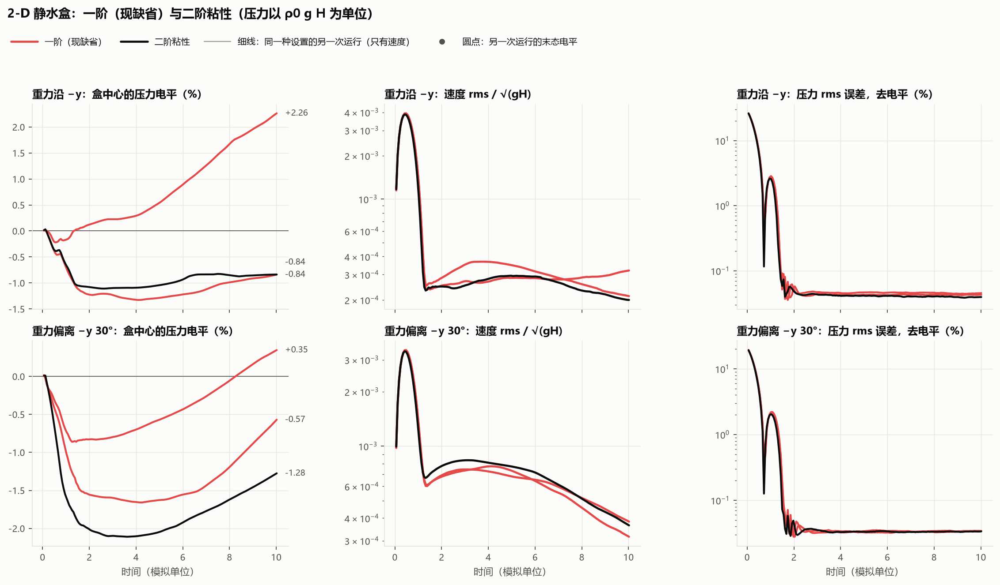

- 去电平的压力误差没有变：0.040 % 和 0.034 %（一阶 0.043 % 到 0.046 % 和 0.034 %）。
- 压力电平仍在缓慢上升，每时间单位 +0.05 % 和 +0.13 %（一阶 +0.08 % 到 +0.32 %）；这是连续性一侧的事，二阶粘性没有动它。
- 粒子数守恒，A_f 回退为 0。

### 10.9 方腔 Re = 1000（任务书 5.6）

通过筛查的只有二阶粘性，所以两张卡上跑的是同一种配置的两个分辨率：250² 在接显示器的卡上，500² 在无显示器的卡上，协议与第 9 节相同（从静止开始，到 max(100, t_s + 20)，最后 20 个时间单位平均）。

- 250² 有两次独立运行（原因见 10.3），用时 16.7 分钟和 18.9 分钟（后一个是诊断读回每 1000 步一次的那次）。
- 500² 一次，用时 84.8 分钟。
- 一阶、旧缺省、simple、adami 四行直接引用第 9 节和更早的运行，没有重跑。

**指标**

Re = 1000 方腔对 Marchi 2021，K = 1，最后 20 个时间单位平均。括号内 = 相对参考值的偏差（负 = 偏弱）。“wall 帧”把单位方腔放在最内层壁粒子行的中线上（已发表的表用的放法，各模式同样处理）；“mid 帧”放在最内层壁粒子行与最外层流体行的正中（crossing 的盒面）。剖面误差是 28 个 Marchi 点上的 L2 / L∞，速度以盖速为单位。参考值：ψ_min -0.11894，u_min -0.38857，v_max 0.37694，v_min -0.52708。

| 运行 | ψ_min（wall 帧） | ψ_min 偏差（mid 帧） | u_min | v_max | v_min | u 剖面 L2 / L∞（wall 帧） | v 剖面 L2 / L∞（wall 帧） | u 剖面 L2 / L∞（mid 帧） | v 剖面 L2 / L∞（mid 帧） |
|---|---|---|---|---|---|---|---|---|---|
| 250² crossing，二阶粘性 | -0.11426（-3.93 %） | -3.55 % | -0.37593（-3.25 %） | 0.36411（-3.40 %） | -0.51073（-3.10 %） | 0.0085 / 0.0174 | 0.0129 / 0.0220 | 0.0078 / 0.0129 | 0.0104 / 0.0165 |
| 250² crossing，二阶粘性，另一次运行（诊断读回每 1000 步一次） | -0.11427（-3.92 %） | -3.54 % | -0.37595（-3.25 %） | 0.36415（-3.40 %） | -0.51064（-3.12 %） | 0.0085 / 0.0173 | 0.0129 / 0.0220 | 0.0078 / 0.0128 | 0.0104 / 0.0165 |
| 250² crossing，一阶（现缺省） | -0.11407（-4.09 %） | -3.71 % | -0.37533（-3.41 %） | 0.36344（-3.58 %） | -0.50979（-3.28 %） | 0.0087 / 0.0162 | 0.0136 / 0.0235 | 0.0083 / 0.0134 | 0.0110 / 0.0173 |
| 250² crossing，一阶，初始密度 ρ0 − 0.1（对照） | -0.11409（-4.08 %） | -3.70 % | -0.37541（-3.39 %） | 0.36352（-3.56 %） | -0.50995（-3.25 %） | 0.0087 / 0.0162 | 0.0136 / 0.0233 | 0.0083 / 0.0133 | 0.0109 / 0.0172 |
| 250² crossing，一阶，初始密度 ρ0 − 0.45（对照） | -0.11424（-3.94 %） | -3.56 % | -0.37606（-3.22 %） | 0.36402（-3.43 %） | -0.51052（-3.14 %） | 0.0085 / 0.0165 | 0.0132 / 0.0228 | 0.0079 / 0.0125 | 0.0105 / 0.0166 |
| 250² crossing，旧缺省（一阶，完整向量） | -0.11703（-1.60 %） | -1.21 % | -0.38493（-0.94 %） | 0.37314（-1.01 %） | -0.52217（-0.93 %） | 0.0050 / 0.0175 | 0.0056 / 0.0124 | 0.0036 / 0.0062 | 0.0038 / 0.0079 |
| 250² crossing，旧缺省，第二次运行 | -0.11703（-1.61 %） | -1.21 % | -0.38490（-0.94 %） | 0.37315（-1.01 %） | -0.52216（-0.93 %） | 0.0049 / 0.0174 | 0.0056 / 0.0123 | 0.0037 / 0.0063 | 0.0038 / 0.0078 |
| 250² simple | -0.10867（-8.64 %） | -8.27 % | -0.35468（-8.72 %） | 0.34184（-9.31 %） | -0.48407（-8.16 %） | 0.0230 / 0.0351 | 0.0271 / 0.0430 | 0.0264 / 0.0496 | 0.0262 / 0.0438 |
| 250² adami | -0.12336（+3.72 %） | +4.14 % | -0.40476（+4.17 %） | 0.39438（+4.63 %） | -0.54703（+3.79 %） | 0.0109 / 0.0227 | 0.0122 / 0.0193 | 0.0097 / 0.0219 | 0.0149 / 0.0271 |
| 500² crossing，二阶粘性 | -0.11636（-2.16 %） | -1.97 % | -0.38181（-1.74 %） | 0.37028（-1.77 %） | -0.51864（-1.60 %） | 0.0041 / 0.0072 | 0.0064 / 0.0093 | 0.0048 / 0.0075 | 0.0056 / 0.0095 |
| 500² crossing，一阶（现缺省） | -0.11631（-2.21 %） | -2.01 % | -0.38167（-1.78 %） | 0.37010（-1.82 %） | -0.51838（-1.65 %） | 0.0042 / 0.0073 | 0.0066 / 0.0097 | 0.0049 / 0.0076 | 0.0057 / 0.0096 |
| 500² crossing，旧缺省（一阶，完整向量） | -0.11799（-0.80 %） | -0.60 % | -0.38727（-0.33 %） | 0.37574（-0.32 %） | -0.52550（-0.30 %） | 0.0021 / 0.0066 | 0.0020 / 0.0042 | 0.0029 / 0.0054 | 0.0027 / 0.0053 |
| 500² simple | -0.11228（-5.59 %） | -5.40 % | -0.36711（-5.52 %） | 0.35500（-5.82 %） | -0.49956（-5.22 %） | 0.0150 / 0.0224 | 0.0175 / 0.0275 | 0.0167 / 0.0295 | 0.0169 / 0.0278 |
| 500² adami | -0.12059（+1.39 %） | +1.59 % | -0.39554（+1.79 %） | 0.38474（+2.07 %） | -0.53603（+1.70 %） | 0.0050 / 0.0108 | 0.0055 / 0.0104 | 0.0050 / 0.0123 | 0.0074 / 0.0151 |

极值的位置：wall 帧 / mid 帧（括号内 = mid 帧位置减参考位置）。参考位置：y(u_min) 0.1717，x(v_max) 0.1578，x(v_min) 0.9092，ψ_min (0.5308, 0.5652)。

| 运行 | y(u_min) | x(v_max) | x(v_min) | ψ_min 的位置 | 平均窗口 t | 定常 t_s | 窗口平均动能 | 提交 |
|---|---|---|---|---|---|---|---|---|
| 250² crossing，二阶粘性 | 0.1723 / 0.1710（-0.0007） | 0.1591 / 0.1577（-0.0001） | 0.9079 / 0.9095（+0.0003） | (0.5309, 0.5640) / (0.5310, 0.5643)（+0.0002, -0.0010） | 80.6–100.6 | 80.6 | 48.0193 | 263381b |
| 250² crossing，二阶粘性，另一次运行（诊断读回每 1000 步一次） | 0.1723 / 0.1710（-0.0007） | 0.1590 / 0.1577（-0.0002） | 0.9079 / 0.9095（+0.0002） | (0.5309, 0.5640) / (0.5310, 0.5643)（+0.0002, -0.0009） | 80.6–100.6 | 80.6 | 48.0203 | db3d609 |
| 250² crossing，一阶（现缺省） | 0.1725 / 0.1712（-0.0005） | 0.1591 / 0.1577（-0.0001） | 0.9078 / 0.9094（+0.0001） | (0.5309, 0.5641) / (0.5310, 0.5644)（+0.0002, -0.0009） | 80.0–100.0 | 70.6 | 47.8440 | 6c8a55a |
| 250² crossing，一阶，初始密度 ρ0 − 0.1（对照） | 0.1725 / 0.1712（-0.0005） | 0.1591 / 0.1578（-0.0001） | 0.9078 / 0.9094（+0.0002） | (0.5309, 0.5641) / (0.5310, 0.5644)（+0.0002, -0.0009） | 80.0–100.0 | 70.6 | 47.8552 | b10c5ea |
| 250² crossing，一阶，初始密度 ρ0 − 0.45（对照） | 0.1728 / 0.1715（-0.0002） | 0.1594 / 0.1580（+0.0002） | 0.9078 / 0.9094（+0.0002） | (0.5310, 0.5641) / (0.5311, 0.5643)（+0.0003, -0.0009） | 80.0–100.0 | 70.6 | 47.9675 | a352556 |
| 250² crossing，旧缺省（一阶，完整向量） | 0.1709 / 0.1696（-0.0021） | 0.1583 / 0.1569（-0.0009） | 0.9087 / 0.9104（+0.0011） | (0.5307, 0.5639) / (0.5308, 0.5642)（+0.0000, -0.0011） | 80.6–100.6 | 80.6 | 49.6894 | 052cfb9 |
| 250² crossing，旧缺省，第二次运行 | 0.1710 / 0.1696（-0.0020） | 0.1583 / 0.1569（-0.0009） | 0.9087 / 0.9104（+0.0011） | (0.5307, 0.5639) / (0.5308, 0.5642)（-0.0000, -0.0010） | 80.6–100.6 | 80.6 | 49.6867 | 5ee25b1 |
| 250² simple | 0.1735 / 0.1722（+0.0005） | 0.1618 / 0.1605（+0.0026） | 0.9094 / 0.9110（+0.0017） | (0.5334, 0.5643) / (0.5336, 0.5646)（+0.0028, -0.0007） | 80.0–100.0 | 70.6 | 42.9049 | 029313a |
| 250² adami | 0.1679 / 0.1665（-0.0052） | 0.1559 / 0.1545（-0.0033） | 0.9102 / 0.9119（+0.0026） | (0.5300, 0.5646) / (0.5301, 0.5649)（-0.0007, -0.0004） | 80.6–100.6 | 80.6 | 53.7693 | 029313a |
| 500² crossing，二阶粘性 | 0.1708 / 0.1702（-0.0015） | 0.1576 / 0.1569（-0.0009） | 0.9091 / 0.9099（+0.0006） | (0.5307, 0.5643) / (0.5307, 0.5644)（-0.0001, -0.0009） | 80.0–99.8 | 79.6 | 48.9830 | 263381b |
| 500² crossing，一阶（现缺省） | 0.1708 / 0.1702（-0.0015） | 0.1576 / 0.1570（-0.0009） | 0.9090 / 0.9098（+0.0006） | (0.5306, 0.5643) / (0.5307, 0.5644)（-0.0001, -0.0008） | 80.0–99.8 | 69.6 | 48.9382 | 6c8a55a |
| 500² crossing，旧缺省（一阶，完整向量） | 0.1699 / 0.1693（-0.0024） | 0.1572 / 0.1565（-0.0013） | 0.9096 / 0.9104（+0.0012） | (0.5305, 0.5641) / (0.5306, 0.5643)（-0.0002, -0.0010） | 80.0–99.8 | 79.6 | 50.0152 | 5ee25b1 |
| 500² simple | 0.1726 / 0.1720（+0.0003） | 0.1596 / 0.1589（+0.0010） | 0.9092 / 0.9100（+0.0008） | (0.5321, 0.5649) / (0.5322, 0.5650)（+0.0014, -0.0002） | 80.0–99.8 | 69.6 | 45.5336 | 029313a |
| 500² adami | 0.1684 / 0.1677（-0.0040） | 0.1559 / 0.1552（-0.0026） | 0.9104 / 0.9112（+0.0019） | (0.5302, 0.5644) / (0.5302, 0.5645)（-0.0006, -0.0007） | 80.0–99.8 | 79.6 | 51.7032 | 029313a |

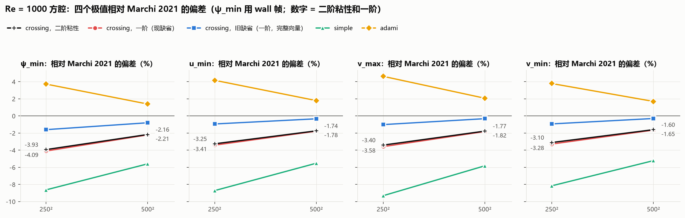

- **250²：ψ_min 偏差 −3.93 % 和 −3.92 %（两次运行），一阶是 −4.09 %，旧缺省是 −1.60 %**。二阶粘性把一阶到旧缺省的差距补回了 6 %。
- 250² 的三个速度极值各改善 0.16 到 0.18 个百分点（−3.25 %、−3.40 %、−3.10 % 对 −3.41 %、−3.58 %、−3.28 %）；剖面 L2 从 0.0087 / 0.0136 变成 0.0085 / 0.0129。
- **500²：ψ_min 偏差 −2.16 %，一阶是 −2.21 %，旧缺省是 −0.80 %**。三个速度极值 −1.74 %、−1.77 %、−1.60 %（一阶 −1.78 %、−1.82 %、−1.65 %）；剖面 L2 是 0.0041 / 0.0064（一阶 0.0042 / 0.0066）。
- 两次 250² 运行之间 ψ_min 只差 0.01 个百分点，所以上面的差别虽然小，但不是运行间的散布。
- 极值的位置与一阶相同（相差不超过 0.0003）。
- 二阶粘性的 250² 两次都在 t = 80.6 判为定常，一阶在 70.6；平均窗口因此是 80.6 到 100.6 对 80.0 到 100.0。协议相同。

**收敛阶（250² → 500²）**

观测收敛阶 p = ln(e₂₅₀ / e₅₀₀) / ln 2，e = 该量相对 Marchi 2021 的误差（绝对值），250² → 500²。只有两档分辨率，所以每个 p 只是一对数的比值；误差本身已经很小的量（接近运行间的散布）p 没有意义。

| 量 | crossing，二阶粘性 | crossing，一阶（现缺省） | crossing，旧缺省（一阶，完整向量） | simple | adami |
|---|---|---|---|---|---|
| ψ_min 偏差（绝对值，wall 帧） | 0.00467 → 0.00257，p = 0.86 | 0.00487 → 0.00263，p = 0.89 | 0.00190 → 0.00095，p = 1.01 | 0.01027 → 0.00665，p = 0.63 | 0.00443 → 0.00165，p = 1.42 |
| ψ_min 偏差（绝对值，mid 帧） | 0.00422 → 0.00234，p = 0.85 | 0.00441 → 0.00239，p = 0.88 | 0.00144 → 0.00071，p = 1.02 | 0.00984 → 0.00643，p = 0.61 | 0.00492 → 0.00189，p = 1.38 |
| u_min 偏差（绝对值） | 0.01264 → 0.00676，p = 0.90 | 0.01324 → 0.00690，p = 0.94 | 0.00364 → 0.00130，p = 1.49 | 0.03389 → 0.02146，p = 0.66 | 0.01619 → 0.00697，p = 1.22 |
| v_max 偏差（绝对值） | 0.01283 → 0.00667，p = 0.94 | 0.01350 → 0.00684，p = 0.98 | 0.00381 → 0.00120，p = 1.66 | 0.03511 → 0.02195，p = 0.68 | 0.01744 → 0.00779，p = 1.16 |
| v_min 偏差（绝对值） | 0.01635 → 0.00844，p = 0.95 | 0.01729 → 0.00870，p = 0.99 | 0.00490 → 0.00157，p = 1.64 | 0.04301 → 0.02751，p = 0.64 | 0.01996 → 0.00895，p = 1.16 |
| u L2 (wall) | 0.00846 → 0.00415，p = 1.03 | 0.00869 → 0.00424，p = 1.04 | 0.00496 → 0.00212，p = 1.22 | 0.02298 → 0.01499，p = 0.62 | 0.01094 → 0.00504，p = 1.12 |
| u L∞ (wall) | 0.01738 → 0.00717，p = 1.28 | 0.01620 → 0.00730，p = 1.15 | 0.01755 → 0.00658，p = 1.41 | 0.03510 → 0.02239，p = 0.65 | 0.02275 → 0.01076，p = 1.08 |
| v L2 (wall) | 0.01293 → 0.00644，p = 1.01 | 0.01364 → 0.00662，p = 1.04 | 0.00563 → 0.00203，p = 1.47 | 0.02714 → 0.01746，p = 0.64 | 0.01218 → 0.00554，p = 1.14 |
| v L∞ (wall) | 0.02199 → 0.00929，p = 1.24 | 0.02348 → 0.00967，p = 1.28 | 0.01241 → 0.00420，p = 1.56 | 0.04300 → 0.02747，p = 0.65 | 0.01933 → 0.01044，p = 0.89 |
| u L2 (mid) | 0.00778 → 0.00478，p = 0.70 | 0.00831 → 0.00491，p = 0.76 | 0.00364 → 0.00290，p = 0.33 | 0.02640 → 0.01668，p = 0.66 | 0.00971 → 0.00503，p = 0.95 |
| u L∞ (mid) | 0.01287 → 0.00750，p = 0.78 | 0.01336 → 0.00763，p = 0.81 | 0.00615 → 0.00536，p = 0.20 | 0.04957 → 0.02952，p = 0.75 | 0.02193 → 0.01232，p = 0.83 |
| v L2 (mid) | 0.01037 → 0.00557，p = 0.90 | 0.01098 → 0.00570，p = 0.95 | 0.00381 → 0.00273，p = 0.48 | 0.02621 → 0.01685，p = 0.64 | 0.01489 → 0.00739，p = 1.01 |
| v L∞ (mid) | 0.01647 → 0.00955，p = 0.79 | 0.01734 → 0.00962，p = 0.85 | 0.00787 → 0.00529，p = 0.57 | 0.04381 → 0.02785，p = 0.65 | 0.02709 → 0.01506，p = 0.85 |

- 二阶粘性的观测阶：ψ_min 0.86，三个速度极值 0.90 到 0.95，剖面 L2 1.03 / 1.01；一阶是 0.89、0.94 到 0.99、1.04 / 1.04；旧缺省是 1.01、1.49 到 1.66、1.22 / 1.47。每个阶只是两档分辨率上一对数的比值。

**全程的平均密度和负压粒子比例**

| 运行 | t | 平均密度 − ρ0（kg/m³） | 平均压力 | 负压粒子比例 | 流体最大速度 | 粒子数（含壁） |
|---|---|---|---|---|---|---|
| 250² 二阶粘性 | 0.21 | +0.00258 | +0.027 ρ0U² | 21.950 % | 0.927 | 74,529 |
| 250² 二阶粘性 | 1.05 | +0.01099 | +0.111 ρ0U² | 0.008 % | 0.971 | 74,529 |
| 250² 二阶粘性 | 5.04 | +0.02600 | +0.261 ρ0U² | 0.000 % | 0.974 | 74,529 |
| 250² 二阶粘性 | 10.08 | +0.02639 | +0.265 ρ0U² | 0.000 % | 0.973 | 74,529 |
| 250² 二阶粘性 | 19.95 | +0.02301 | +0.231 ρ0U² | 0.000 % | 0.975 | 74,529 |
| 250² 二阶粘性 | 39.90 | +0.02341 | +0.235 ρ0U² | 0.000 % | 0.977 | 74,529 |
| 250² 二阶粘性 | 60.06 | +0.02267 | +0.228 ρ0U² | 0.000 % | 0.976 | 74,529 |
| 250² 二阶粘性 | 80.01 | +0.02240 | +0.225 ρ0U² | 0.000 % | 0.975 | 74,529 |
| 250² 二阶粘性 | 99.99 | +0.02316 | +0.233 ρ0U² | 0.000 % | 0.975 | 74,529 |
| 500² 二阶粘性 | 0.20 | +0.00346 | +0.036 ρ0U² | 12.426 % | 0.961 | 273,529 |
| 500² 二阶粘性 | 0.97 | +0.00872 | +0.088 ρ0U² | 0.016 % | 0.986 | 273,529 |
| 500² 二阶粘性 | 5.07 | +0.01717 | +0.173 ρ0U² | 0.004 % | 0.986 | 273,529 |
| 500² 二阶粘性 | 9.95 | +0.01880 | +0.189 ρ0U² | 0.003 % | 0.986 | 273,529 |
| 500² 二阶粘性 | 20.09 | +0.01890 | +0.190 ρ0U² | 0.002 % | 0.988 | 273,529 |
| 500² 二阶粘性 | 39.98 | +0.02078 | +0.209 ρ0U² | 0.003 % | 0.988 | 273,529 |
| 500² 二阶粘性 | 60.06 | +0.02120 | +0.213 ρ0U² | 0.002 % | 0.988 | 273,529 |
| 500² 二阶粘性 | 79.95 | +0.02109 | +0.212 ρ0U² | 0.002 % | 0.987 | 273,529 |
| 500² 二阶粘性 | 99.84 | +0.02108 | +0.212 ρ0U² | 0.003 % | 0.988 | 273,529 |
| 250² 二阶粘性，另一次运行 | 0.21 | +0.00236 | +0.025 ρ0U² | 6.789 % | 0.924 | 74,529 |
| 250² 二阶粘性，另一次运行 | 1.05 | +0.01125 | +0.114 ρ0U² | 0.010 % | 0.970 | 74,529 |
| 250² 二阶粘性，另一次运行 | 5.04 | +0.02614 | +0.263 ρ0U² | 0.002 % | 0.971 | 74,529 |
| 250² 二阶粘性，另一次运行 | 10.08 | +0.02661 | +0.267 ρ0U² | 0.000 % | 0.973 | 74,529 |
| 250² 二阶粘性，另一次运行 | 19.95 | +0.02366 | +0.238 ρ0U² | 0.000 % | 0.974 | 74,529 |
| 250² 二阶粘性，另一次运行 | 39.90 | +0.02358 | +0.237 ρ0U² | 0.000 % | 0.975 | 74,529 |
| 250² 二阶粘性，另一次运行 | 60.06 | +0.02360 | +0.237 ρ0U² | 0.000 % | 0.974 | 74,529 |
| 250² 二阶粘性，另一次运行 | 80.01 | +0.02210 | +0.222 ρ0U² | 0.000 % | 0.976 | 74,529 |
| 250² 二阶粘性，另一次运行 | 99.99 | +0.02199 | +0.221 ρ0U² | 0.000 % | 0.974 | 74,529 |
| 250² 一阶 | 0.21 | +0.00211 | +0.022 ρ0U² | 1.244 % | 0.924 | 74,529 |
| 250² 一阶 | 1.05 | +0.01129 | +0.114 ρ0U² | 0.006 % | 0.971 | 74,529 |
| 250² 一阶 | 5.04 | +0.02600 | +0.261 ρ0U² | 0.000 % | 0.972 | 74,529 |
| 250² 一阶 | 10.08 | +0.02628 | +0.264 ρ0U² | 0.000 % | 0.971 | 74,529 |
| 250² 一阶 | 19.95 | +0.02278 | +0.229 ρ0U² | 0.000 % | 0.974 | 74,529 |
| 250² 一阶 | 39.90 | +0.02206 | +0.222 ρ0U² | 0.000 % | 0.975 | 74,529 |
| 250² 一阶 | 60.06 | +0.02143 | +0.215 ρ0U² | 0.000 % | 0.974 | 74,529 |
| 250² 一阶 | 80.01 | +0.02192 | +0.220 ρ0U² | 0.003 % | 0.975 | 74,529 |
| 250² 一阶 | 99.99 | +0.02182 | +0.219 ρ0U² | 0.000 % | 0.975 | 74,529 |
| 500² 一阶 | 0.20 | +0.00362 | +0.037 ρ0U² | 0.681 % | 0.964 | 273,529 |
| 500² 一阶 | 0.97 | +0.00917 | +0.093 ρ0U² | 0.011 % | 0.984 | 273,529 |
| 500² 一阶 | 5.07 | +0.01583 | +0.159 ρ0U² | 0.003 % | 0.986 | 273,529 |
| 500² 一阶 | 9.95 | +0.01747 | +0.176 ρ0U² | 0.003 % | 0.986 | 273,529 |
| 500² 一阶 | 20.09 | +0.01855 | +0.187 ρ0U² | 0.003 % | 0.987 | 273,529 |
| 500² 一阶 | 39.98 | +0.01900 | +0.191 ρ0U² | 0.002 % | 0.988 | 273,529 |
| 500² 一阶 | 60.06 | +0.01978 | +0.199 ρ0U² | 0.003 % | 0.987 | 273,529 |
| 500² 一阶 | 79.95 | +0.02053 | +0.207 ρ0U² | 0.002 % | 0.988 | 273,529 |
| 500² 一阶 | 99.84 | +0.02116 | +0.213 ρ0U² | 0.003 % | 0.987 | 273,529 |

| 运行 | 到达 | 粒子数（含壁） | 流体最大速度（整个运行） | 平均密度变化率，t ∈ [1, 5] | 同，t ∈ [20, 末] | 同，最后 20 个时间单位 | 负压粒子比例的最大值（t ≥ 5） | A_f 回退（累计） | 二阶回退的粒子（各次读回的最大值） | φ_min / dx | 低于下限 / 越出盒（最大粒子数） | 运行器的结论 | 记录（提交） |
|---|---|---|---|---|---|---|---|---|---|---|---|---|---|
| 250² 二阶粘性 | t = 100.59 | 74,529，每个样本都相同 | 0.979 | +0.00388 | +0.000002 | -0.000008 | 0.003 % | 0 | 0（336 次读回） | 0.283 | 0 / 0 | 不变量违反的段：0 | wc-20261118-140016-fdbb（263381b） |
| 500² 二阶粘性 | t = 99.84 | 273,529，每个样本都相同 | 0.989 | +0.00184 | +0.000021 | -0.000009 | 0.004 % | 0 | 0（667 次读回） | 0.295 | 0 / 0 | 不变量违反的段：0 | wc-20261118-134547-634a（263381b） |
| 250² 二阶粘性，另一次运行 | t = 100.59 | 74,529，每个样本都相同 | 0.979 | +0.00364 | -0.000011 | -0.000003 | 0.003 % | 0 | 0（6712 次读回） | 0.287 | 0 / 0 | 不变量违反的段：0 | wc-20261118-134031-a056（db3d609） |
| 250² 一阶 | t = 99.99 | 74,529，每个样本都相同 | 0.978 | +0.00389 | +0.000001 | -0.000042 | 0.003 % | 0 | —（一阶） | 0.295 | 0 / 0 | 不变量违反的段：0 | wc-20261118-100324-097b（6c8a55a） |
| 500² 一阶 | t = 99.84 | 273,529，每个样本都相同 | 0.989 | +0.00143 | +0.000044 | +0.000018 | 0.004 % | 0 | —（一阶） | 0.287 | 0 / 0 | 不变量违反的段：0 | wc-20261118-100324-974f（6c8a55a） |

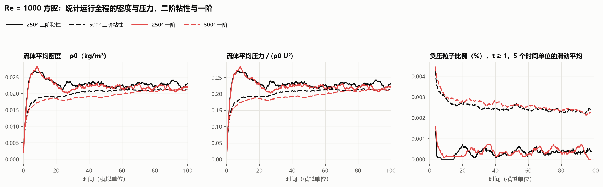

- **平均密度和平均压力的历史与一阶重合**：t = 100 时 250² 是 ρ0 + 0.023、+0.233 ρ0U²，500² 是 ρ0 + 0.021、+0.212 ρ0U²（一阶 +0.022、+0.219 和 +0.021、+0.213）。
- **负压粒子比例**：t ≥ 5 之后不超过 0.004 %，与一阶相同。只有起步的第一个样本（t = 0.2）不同：二阶粘性是 22 % 和 7 %（250² 的两次）、12 %（500²），一阶是 1.2 % 和 0.7 %；到 t = 1 都已降到 0.02 % 以下。
- **没有不稳定的迹象**：粒子数全程守恒，运行器的不变量全为 0，A_f 回退 0 次，各次读回时处于二阶回退状态的粒子数都是 0，没有粒子低于距离下限或越出盒，最大速度 0.979（250²）和 0.989（500²）。

### 10.10 压力分支对照（任务书 5.7 第一项；按用户中途的指示无条件执行）

**要回答的问题**：一阶（现缺省）下流体压力为正，压力项走加号分支；旧缺省下压力为负，走减号分支。旧缺省的 ψ_min 更准，是不是因为这个？

**做法**：一阶配置，250²，把全部流体粒子的初始密度整体调低（质量、壁、ρ0 都不动），其余与第 9 节的统计运行相同，跑到 t = 100。

| 运行（250²，到 t = 100） | ψ_min 偏差（wall 帧） | u_min / v_max / v_min 偏差 | u / v 剖面 L2（wall 帧） | 平均窗口内（t ≥ 80）：负压粒子比例；平均压力 | 负压粒子比例的历史 | 对照是否有效 | 记录（提交） |
|---|---|---|---|---|---|---|---|
| 一阶（现缺省），正常起步 | -4.09 % | -3.41 % / -3.58 % / -3.28 % | 0.0087 / 0.0136 | 0.00 %；+0.219 ρ0U² | t = 0.2 起低于 95 % | （参照） | wc-20261118-100324-097b（6c8a55a） |
| 一阶，初始密度 ρ0 − 0.1 | -4.08 % | -3.39 % / -3.56 % / -3.25 % | 0.0087 / 0.0136 | 0.00 %；+0.218 ρ0U² | t = 28.8 起低于 95 % | **无效**（t ≥ 50 时负压比例低于 95 %） | wc-20261118-131828-80f0（b10c5ea） |
| 一阶，初始密度 ρ0 − 0.45 | -3.94 % | -3.22 % / -3.43 % / -3.14 % | 0.0085 / 0.0132 | 100.00 %；-1.657 ρ0U² | 一直在 95 % 以上 | **有效** | wc-20261118-142028-b7bc（a352556） |
| 旧缺省（一阶，完整向量），正常起步 | -1.60 % | -0.94 % / -1.01 % / -0.93 % | 0.0050 / 0.0056 | —（没有记历史） | — | （参照） | wc-20261117-171048-8697（052cfb9） |

| 运行 | t | 平均密度 − ρ0（kg/m³） | 平均压力 | 负压粒子比例 |
|---|---|---|---|---|
| 一阶（现缺省），正常起步 | 0.21 | +0.00211 | +0.022 ρ0U² | 1.24 % |
| 一阶（现缺省），正常起步 | 5.04 | +0.02600 | +0.261 ρ0U² | 0.00 % |
| 一阶（现缺省），正常起步 | 10.08 | +0.02628 | +0.264 ρ0U² | 0.00 % |
| 一阶（现缺省），正常起步 | 19.95 | +0.02278 | +0.229 ρ0U² | 0.00 % |
| 一阶（现缺省），正常起步 | 30.03 | +0.02139 | +0.215 ρ0U² | 0.00 % |
| 一阶（现缺省），正常起步 | 39.90 | +0.02206 | +0.222 ρ0U² | 0.00 % |
| 一阶（现缺省），正常起步 | 49.98 | +0.02230 | +0.224 ρ0U² | 0.00 % |
| 一阶（现缺省），正常起步 | 80.01 | +0.02192 | +0.220 ρ0U² | 0.00 % |
| 一阶（现缺省），正常起步 | 99.99 | +0.02182 | +0.219 ρ0U² | 0.00 % |
| 一阶，初始密度 ρ0 − 0.1 | 0.21 | -0.09878 | -0.987 ρ0U² | 100.00 % |
| 一阶，初始密度 ρ0 − 0.1 | 5.04 | -0.08034 | -0.802 ρ0U² | 99.99 % |
| 一阶，初始密度 ρ0 − 0.1 | 10.08 | -0.06307 | -0.630 ρ0U² | 99.98 % |
| 一阶，初始密度 ρ0 − 0.1 | 19.95 | -0.03127 | -0.312 ρ0U² | 99.85 % |
| 一阶，初始密度 ρ0 − 0.1 | 30.03 | +0.00119 | +0.013 ρ0U² | 38.24 % |
| 一阶，初始密度 ρ0 − 0.1 | 39.90 | +0.01896 | +0.191 ρ0U² | 0.00 % |
| 一阶，初始密度 ρ0 − 0.1 | 49.98 | +0.02254 | +0.227 ρ0U² | 0.00 % |
| 一阶，初始密度 ρ0 − 0.1 | 80.01 | +0.02113 | +0.213 ρ0U² | 0.00 % |
| 一阶，初始密度 ρ0 − 0.1 | 99.99 | +0.02328 | +0.234 ρ0U² | 0.00 % |
| 一阶，初始密度 ρ0 − 0.45 | 0.21 | -0.44900 | -4.483 ρ0U² | 100.00 % |
| 一阶，初始密度 ρ0 − 0.45 | 5.04 | -0.43250 | -4.318 ρ0U² | 100.00 % |
| 一阶，初始密度 ρ0 − 0.45 | 10.08 | -0.41575 | -4.151 ρ0U² | 100.00 % |
| 一阶，初始密度 ρ0 − 0.45 | 19.95 | -0.38409 | -3.836 ρ0U² | 100.00 % |
| 一阶，初始密度 ρ0 − 0.45 | 30.03 | -0.35119 | -3.507 ρ0U² | 100.00 % |
| 一阶，初始密度 ρ0 − 0.45 | 39.90 | -0.32241 | -3.220 ρ0U² | 100.00 % |
| 一阶，初始密度 ρ0 − 0.45 | 49.98 | -0.28941 | -2.891 ρ0U² | 100.00 % |
| 一阶，初始密度 ρ0 − 0.45 | 80.01 | -0.19662 | -1.964 ρ0U² | 100.00 % |
| 一阶，初始密度 ρ0 − 0.45 | 99.99 | -0.13573 | -1.356 ρ0U² | 100.00 % |

- **任务书规定的那一次（ρ0 − 0.1）无效**。平均密度以每时间单位 +0.0033 的速率上升，t = 28.8 起负压粒子比例低于 95 %，t = 29.8 时平均密度超过 ρ0，t = 50 以后没有负压粒子。平均窗口（t ≥ 80）里压力全是正的，所以它的 ψ_min（−4.08 %）说明不了减号分支。
- **顺带看到的**：从 ρ0 − 0.1 出发，平均密度最后停在 ρ0 + 0.021 到 0.023，与正常起步的终值相同。一阶下平均密度的终值不取决于初值：压力为负时它一直以 +0.003 左右的速率上升，升到正值后停住。
- **我加的那一次（ρ0 − 0.45）有效**。偏移量是按上面量到的速率算的（100 个时间单位上升 0.33）。全程 100 % 的粒子压力为负，平均窗口内平均压力是 −1.66 ρ0U²，t = 100 时 −1.36 ρ0U²。
- **结论：压力分支不是原因**。同一个配置，压力全正时 ψ_min 偏差 −4.09 %，全负时 −3.94 %；旧缺省是 −1.60 %。三个速度极值也一样：全负时 −3.22 %、−3.43 %、−3.14 %，全正时 −3.41 %、−3.58 %、−3.28 %。
- 压力的符号有一个小的影响，负压略好 0.15 个百分点。这比同一设置两次运行之间的差别（0.01 个百分点，10.9）大，但两次对照各只有一次运行。

### 10.11 近壁第一层粒子到壁面的距离（任务书 5.7 第二项）

这一项的条件成立（二阶粘性在 250² 的 ψ_min 偏差仍差于 −3 %），所以做了。各次 250² 运行最后 21 个快照都还在；取 t ≈ 90 到 100 的 11 个。

250² 方腔，t ≈ 90 到 100 的 11 个快照合在一起：流体粒子到各壁面（crossing 的盒面，±0.502）的距离，以粒子间距 dx 为单位；只取离另外两面壁超过核半径 h 的那一段（每面壁中间 0.964 的长度，点阵上是 241 个粒子）。第一层 = 距离小于 1 dx 的粒子；点阵上第一层在 0.5 dx，第二层在 1.5 dx。

| 壁 | 运行 | 第一层的粒子数（每个快照；相对点阵） | 第一层距离的平均（dx） | 标准差 | 5 % / 中位 / 95 % 分位 | 最小 | 第二层（1 到 2 dx）的平均 |
|---|---|---|---|---|---|---|---|
| 左壁 | 旧缺省（一阶，完整向量） | 230.0（95.4 %） | 0.484 | 0.037 | 0.437 / 0.486 / 0.521 | 0.358 | 1.440 |
| 左壁 | 旧缺省，第二次运行 | 229.9（95.4 %） | 0.483 | 0.036 | 0.434 / 0.485 / 0.520 | 0.348 | 1.440 |
| 左壁 | 一阶（现缺省） | 228.3（94.7 %） | 0.483 | 0.034 | 0.436 / 0.485 / 0.522 | 0.372 | 1.438 |
| 左壁 | 二阶粘性 | 229.1（95.1 %） | 0.485 | 0.033 | 0.438 / 0.486 / 0.518 | 0.371 | 1.441 |
| 左壁 | 二阶粘性，另一次运行 | 229.0（95.0 %） | 0.484 | 0.035 | 0.438 / 0.486 / 0.521 | 0.357 | 1.439 |
| 左壁 | simple | 229.7（95.3 %） | 0.484 | 0.037 | 0.434 / 0.485 / 0.525 | 0.355 | 1.440 |
| 左壁 | adami | 234.1（97.1 %） | 0.484 | 0.037 | 0.428 / 0.488 / 0.527 | 0.337 | 1.452 |
| 右壁 | 旧缺省（一阶，完整向量） | 245.0（101.7 %） | 0.510 | 0.056 | 0.442 / 0.501 / 0.613 | 0.372 | 1.522 |
| 右壁 | 旧缺省，第二次运行 | 244.5（101.4 %） | 0.510 | 0.055 | 0.442 / 0.501 / 0.611 | 0.351 | 1.518 |
| 右壁 | 一阶（现缺省） | 245.1（101.7 %） | 0.507 | 0.052 | 0.438 / 0.500 / 0.605 | 0.378 | 1.516 |
| 右壁 | 二阶粘性 | 245.3（101.8 %） | 0.508 | 0.052 | 0.445 / 0.500 / 0.602 | 0.347 | 1.521 |
| 右壁 | 二阶粘性，另一次运行 | 244.7（101.5 %） | 0.507 | 0.051 | 0.440 / 0.500 / 0.610 | 0.343 | 1.517 |
| 右壁 | simple | 245.1（101.7 %） | 0.511 | 0.057 | 0.438 / 0.502 / 0.615 | 0.351 | 1.522 |
| 右壁 | adami | 244.8（101.6 %） | 0.516 | 0.057 | 0.446 / 0.506 / 0.629 | 0.385 | 1.528 |
| 底壁 | 旧缺省（一阶，完整向量） | 238.8（99.1 %） | 0.498 | 0.034 | 0.450 / 0.499 / 0.548 | 0.385 | 1.484 |
| 底壁 | 旧缺省，第二次运行 | 238.8（99.1 %） | 0.498 | 0.034 | 0.449 / 0.498 / 0.540 | 0.374 | 1.482 |
| 底壁 | 一阶（现缺省） | 238.2（98.8 %） | 0.496 | 0.030 | 0.449 / 0.498 / 0.534 | 0.390 | 1.477 |
| 底壁 | 二阶粘性 | 238.7（99.1 %） | 0.497 | 0.031 | 0.451 / 0.498 / 0.540 | 0.392 | 1.481 |
| 底壁 | 二阶粘性，另一次运行 | 238.7（99.1 %） | 0.496 | 0.038 | 0.444 / 0.497 / 0.554 | 0.382 | 1.480 |
| 底壁 | simple | 237.1（98.4 %） | 0.496 | 0.031 | 0.447 / 0.499 / 0.536 | 0.386 | 1.475 |
| 底壁 | adami | 238.6（99.0 %） | 0.498 | 0.031 | 0.455 / 0.499 / 0.538 | 0.385 | 1.480 |
| 盖（上壁） | 旧缺省（一阶，完整向量） | 217.7（90.3 %） | 0.463 | 0.051 | 0.410 / 0.458 / 0.516 | 0.350 | 1.373 |
| 盖（上壁） | 旧缺省，第二次运行 | 217.5（90.2 %） | 0.462 | 0.044 | 0.412 / 0.458 / 0.513 | 0.322 | 1.377 |
| 盖（上壁） | 一阶（现缺省） | 217.5（90.2 %） | 0.462 | 0.045 | 0.413 / 0.459 / 0.515 | 0.339 | 1.373 |
| 盖（上壁） | 二阶粘性 | 216.3（89.7 %） | 0.460 | 0.049 | 0.411 / 0.457 / 0.509 | 0.353 | 1.372 |
| 盖（上壁） | 二阶粘性，另一次运行 | 216.9（90.0 %） | 0.462 | 0.049 | 0.411 / 0.458 / 0.517 | 0.332 | 1.374 |
| 盖（上壁） | simple | 217.2（90.1 %） | 0.463 | 0.065 | 0.401 / 0.455 / 0.526 | 0.336 | 1.377 |
| 盖（上壁） | adami | 218.5（90.7 %） | 0.462 | 0.054 | 0.401 / 0.459 / 0.523 | 0.326 | 1.376 |

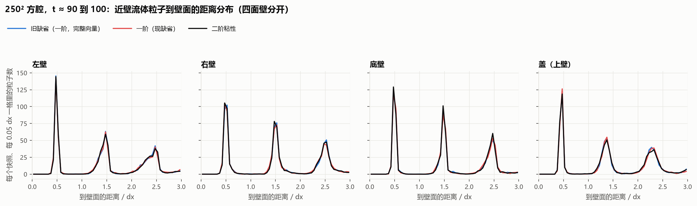

- **旧缺省和一阶之间没有差别**：四面壁上第一层距离的平均值相差不超过 0.003 dx（左 0.484 对 0.483，右 0.510 对 0.507，底 0.498 对 0.496，盖 0.463 对 0.462），分位数和第一层的粒子数也一样。旧缺省自己两次运行之间相差 0.001 dx。
- **所以"旧缺省的精度来自近壁粒子位置不同"这个候选原因不成立**：两者的近壁排布相同，ψ_min 却差 2.5 个百分点。
- 二阶粘性和 simple 与它们相差不超过 0.004 dx。adami 在右壁是 0.516，在左壁的第一层多 2 % 的粒子，其余相同。
- 顺带看到的：四面壁不对称，各模式都一样。盖下面的第一层只有点阵的 90 % 的粒子，平均距离 0.46 dx；右壁（盖的下游）是 102 %，0.51 dx。

### 10.12 每步时间、寄存器数、双卡（任务书 5.8）

**每步时间**，取自两次方腔统计运行的样本时间戳，与第 9 节一阶的运行比（同一张卡，另一张卡上同时在跑另一个分辨率，与当时相同）。

| 算例（卡） | 窗口 | 一阶（第 9 节的运行） | 二阶粘性 | 每步时间：二阶粘性 ÷ 一阶 |
|---|---|---|---|---|
| 250²（接显示器的 5090） | t ∈ [1, 5] | 3408 步/秒（293 µs/步） | 3406 步/秒（294 µs/步） | 1.001 |
| 250²（接显示器的 5090） | t ∈ [20, 60] | 3356 步/秒（298 µs/步） | 3380 步/秒（296 µs/步） | 0.993 |
| 250²（接显示器的 5090） | t ∈ [0, 100] | 3348 步/秒（299 µs/步） | 3357 步/秒（298 µs/步） | 0.997 |
| 500²（无显示器的 5090） | t ∈ [1, 5] | 1582 步/秒（632 µs/步） | 1329 步/秒（753 µs/步） | 1.191 |
| 500²（无显示器的 5090） | t ∈ [20, 60] | 1527 步/秒（655 µs/步） | 1307 步/秒（765 µs/步） | 1.168 |
| 500²（无显示器的 5090） | t ∈ [0, 100] | 1533 步/秒（652 µs/步） | 1311 步/秒（763 µs/步） | 1.170 |

- **250²：没有可测的差别**（0.99 到 1.00）。这一档每步约 295 µs，其中大部分不是 GPU 计算的时间。
- **500²：每步慢 17 % 到 19 %**。
- 二阶粘性的运行每 20,000 步多一次状态缓冲的读回（250² 约 20 ms，500² 约 75 到 150 ms），折合不到 1 %，包含在上面的数里。

**寄存器数**（驱动通过 `VK_KHR_pipeline_executable_properties` 报告的编译统计；记录 wc-20261118-135254-2aa9、wc-20261118-135256-0770、wc-20261118-135257-6dba）

| 配置（250² 的 2-D 算例） | 融合遍：寄存器数 | 融合遍：二进制大小（字节） | force：寄存器数 | force：二进制大小（字节） |
|---|---|---|---|---|
| 一阶（两个开关都是 linear） | 64 | 9,984 | 78 | 7,424 |
| 二阶粘性 | 121 | 13,952 | 80 | 9,088 |
| 全二阶 | 124 | 14,848 | 80 | 9,088 |

- **融合遍的寄存器数从 64 升到 121**，force 从 78 到 80。融合遍里多出来的是三个 3 × 3 的累加矩阵（M_0 的流体部分、壁部分和 K_raw）。
- 其中 M_0 的流体部分对每个流体粒子的每个流体邻居都要累加，不管这个粒子附近有没有壁；这是 500² 上变慢的最可能的来源，但我没有做专门的计时去确认。

**K = 1 对 K = 2**（二阶粘性，250²，700 步；做法同原任务的 6.7 项：canonical 逐位比较）

- 单卡两次运行逐位相同；双卡链对单卡逐位相同（体素号除外）。700 步内有 3 个粒子过切口。记录 wc-20261118-143703-c14b 到 wc-20261118-143706-9996。
- ∇v_i 的缓冲不随传输搬运：每个 slab 在同一步里自己写、自己读，与 A_f⁻¹ 的做法相同，所以双卡没有改传输。

### 10.13 没做或没验证的

- **全二阶没有长运行**：筛查两次都没过，按任务书不进入 5.5 到 5.8。它的静水盒、方腔、计时都是**未验证**。
- **3-D 未验证**：二阶规则在 3-D 只做了单步对照（10.6）。没有 3-D 的方腔、静水盒或任何多步运行。
- **K = 2 只有 250²、700 步的等价性检查**。K = 2 的长运行和吞吐未验证。
- **触发回退的两个条件未验证**：det(I − K_raw L_i) < 0.5 和解含非有限值，没有算例触发过（10.6）。
- **扩散数超过 0.1 的两个角有没有影响，未验证**：没有用更小的时间步长重跑来确认。两次 250² 和一次 500² 的长运行里没有看到不稳定。
- **500² 上变慢的原因未验证**：没有做专门的计时（任务书要求不做）。
- **运行次数**：二阶粘性的 250² 有两次，500² 一次；静水盒每个方向一次；两次压力分支对照各一次。
- **与其他开关的组合未验证**：二阶粘性配 `continuity: wall_velocity` 只在单步对照里跑过；配 `continuity_wall_component: full`、`delta_wall` 的诊断值、距离下限 0.5，都没有跑。
- **角上的精度未验证**：二阶规则是对单面平壁推导和核对的。盒角附近的壁粒子按"到盒的最近点"取深度，穿壁比例在那里本来就是近似（一阶规则也一样），二阶规则在角上还剩几阶没有核对。
- 没有跑 1000² 和 3-D 方腔（任务书要求不跑）。

### 10.14 我对下一步的看法

以下是看法，不是做过的事。

1. **二阶粘性不建议作为缺省，也不建议再优化它**。它本身是对的（10.5、10.6），但对方腔的精度几乎没有作用（250² 改善 0.16 个百分点，500² 改善 0.04 个百分点），代价是 500² 上每步慢 17 % 到 19 %。开关可以留着。
2. **一阶偏弱的原因，这一轮排除了三个**：粘性壁项的阶（10.9）、压力分支（10.10）、近壁粒子的位置（10.11）。旧缺省和一阶之间剩下的差别只有一处：连续性的壁项里有没有切向分量。
3. **而切向分量进连续性就带来内部的净汇**，与延拓的阶无关：一阶完整向量 −0.026，二阶完整向量 −0.016（10.7）。所以目前的局面是：方腔更准的那个配置，和平均密度一直下降的那个配置，是同一个。
4. **一个没有检验过的猜测**：10.5 的抖动核对里，"只取法向"的散度误差随粒子相对壁面的切向速度增大（第一层在切向速度大的那一段是 23 % / 138 %），完整向量没有这个问题。方腔里近壁剪切最大的地方是盖下面。如果现缺省在那里的密度方程里有这样一项随粒子排布涨落的误差，它可能是一个额外的耗散来源，方向上与主涡偏弱一致。这只是从 numpy 的数字推出来的，方腔里没有量过。
5. **最便宜的下一步是不用新运行的**：旧缺省和一阶的 250² 运行都留着时间平均的剖面和快照，可以直接比较两者的速度场差在哪里（盖附近、角上，还是整体），以及两者近盖几层的密度涨落。这能判断第 4 条的猜测值不值得继续。
6. **如果要保留二阶粘性**：融合遍里 M_0 的流体部分现在对所有流体粒子都累加，只对离壁不到 h 的粒子累加就能去掉大部分额外开销。没有做。

## 11. 追加（六）：旧缺省与一阶的速度场、压力场之差（2026-11-18，没有新运行）

用户的两个问题：(1) 连续性里"只取法向分量"的法向怎么取；(2) 用旧缺省和一阶已有的 250² 结果（t 在 80 到 100 的平均）画速度场和压力场的差，说明差别集中在哪里，并说明 10.14 的那个猜测。这一节没有任何新的求解器运行；工具是 `experiment/wall_crossing/field_difference.py`，记录 wc-20261118-163131-e79f。

**先说结果**

- **差别集中在盖的两个角**。两个上角（各 0.1 L 见方）只占 2 % 的面积，却占速度差平方的 21 % 和压力差平方的 61 %。两个下角没有差别。
- **内部的差只是主涡整体强 2.5 %**：旧缺省的内部速度场等于一阶的乘 1.0249，这一个系数解释了内部平方差的 95 %。内部没有形状上的差别。
- **10.14 的猜测要改**。一阶丢掉的切向项在壁的中段确实是零均值的涨落，但两次运行的速度涨落一样大，"涨落造成耗散"没有证据。真正不同的是两个上角：丢掉的项在那里有很大的平均值（离角 h 以内 +5.4 和 −6.0 U/L），是一个系统项，不是涨落。

### 11.1 法向的取法（读代码，没有跑）

**法向按壁面粒子 j 取，不是按流体粒子 i。**

- **n_j** 是从壁粒子 j 指向盒上离它最近的点的单位向量（`wall_crossing_inward_normal`）。
  - 面块里的壁粒子：n_j 是它所在那面壁的内法向，沿坐标轴。
  - **角块里的壁粒子**：n_j 指向盒的角点，是斜的，并且随粒子在角块里的位置变，不是固定的 45°。3-D 的棱块指向棱上最近的点，角块指向顶点。
- **投影的对象**是该邻居的速度差：先取 n_j (n_j·(v_w,j − v_i))，再乘 (1 + d_j/φ_i)。每个壁邻居各用自己的 n_j。
- **距离是混着取的**：φ_i 按流体粒子 i 取（i 到最近那面壁的距离，带下限，对它的所有壁邻居用同一个值）；d_j 按壁粒子 j 取（j 到盒的距离，角块里是到角点的距离）。所以在角附近，i 离侧壁最近时，同一个 φ_i 也用在盖的壁邻居身上，那里的 (1 + d_j/φ_i) 不是真正的穿壁比例。这是一阶规则原有的近似，两种缺省都一样。
- **在方腔里的后果**：
  - 盖的粒子 n_j = (0, −1)，所以盖的切向运动（盖速 1）完全不进连续性，只有流体的竖直速度进。
  - 上面两个角块属于静止壁（速度 0，不属于盖），法向是斜的。
  - 侧壁粒子 n_j = (±1, 0)，流体的水平速度相对侧壁是法向分量，照常进。

### 11.2 做法

- **数据**：运行器给每次运行留了最后 21 个快照，每个时间单位一个，t = 80.2 到 100.0。快照里有位置、速度和体积；压力由体积经状态方程还原（壁粒子存的是 ρ0，所以 ρ/ρ0 = V_壁/V）。
- **时间平均场**：把每个快照的流体粒子用 Shepard 权（Wendland C2，半径 1.5 dx）放到初始点阵的节点上（251 × 251），对 21 个快照合并。第一排节点就是贴壁第一层。
- **压力去电平**：每个快照先减去该时刻全部流体粒子的平均压力。两次运行的电平差一个量级（旧缺省 −14.4 到 −11.6 ρ0U²，一阶 +0.21 到 +0.23），而且旧缺省的电平在窗口内还在变。
- **对照**：同一设置的两次运行各自的时间平均场之差，给出"一个差值小到什么程度就没有意义"。旧缺省有第二次运行；一阶用 ρ0 − 0.1 的那次对照（它在 t = 50 之后与正常起步的状态相同）。
- 图的画法沿用此前方腔场图的做法：主图加四个角的放大，每个放大用自己的色标并在标题里写原始范围，壁灰、盖黑。时间平均场没有粒子可画，放大图里一格是一个点阵节点。

### 11.3 差有多大

| 两个时间平均场之差 | 速度差的 rms（盖速 = 1） | 速度差的最大值 | 去电平压力差的 rms（ρ0U²） | 去电平压力差的最大值 |
|---|---|---|---|---|
| 旧缺省 − 一阶 | 0.00732 | 0.2629 | 0.00418 | 0.5072 |
| 旧缺省两次运行之差 | 0.00043 | 0.0206 | 0.00320 | 0.0477 |
| 一阶两次运行之差 | 0.00040 | 0.0160 | 0.00077 | 0.0361 |
| 一阶全程负压 − 一阶 | 0.00064 | 0.0195 | 0.00090 | 0.0286 |
| 旧缺省 − 一阶全程负压 | 0.00701 | 0.2682 | 0.00409 | 0.4892 |

- **速度**：旧缺省与一阶之差的 rms 是 0.0073（盖速 = 1），是两次运行之差（0.0004）的 17 倍。最大 0.26，在盖的角上。
- **压力只有两个上角里的差是可信的**。在上角以外，旧缺省与一阶之差（各区 rms 0.002 到 0.004）与旧缺省自己两次运行之差（各区 0.0006 到 0.006，全场 0.0032）同量级，分辨不出来。上角里是 0.023 对 0.005（0.1 L 方块）和 0.11 对 0.015（h 方块）。
- 一阶全程负压的那次对照与一阶正常起步之差只有 0.0006，与运行间的差同量级：压力的符号不改变平均流场。

### 11.4 差集中在哪里

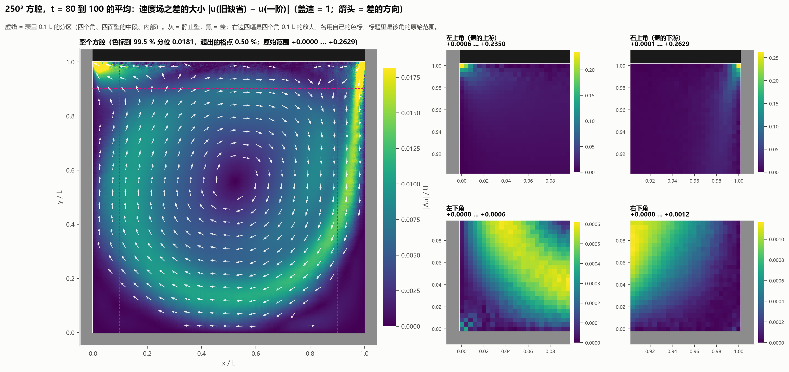

**分区宽度 0.1 L**

分区宽度 0.1 L：角 = 离两面壁都不到这个宽度的方块，壁的中段 = 离一面壁不到这个宽度、去掉角，内部 = 其余。占比 = 该区域内平方差之和 ÷ 全腔之和；rms 的单位是盖速（速度）和 ρ0U²（压力）。

| 区域 | 面积占比 | 速度差 |Δu|² 的占比 | 该区域内的 rms | 去电平压力差 Δp'² 的占比 | 该区域内的 rms | 对照：旧缺省两次运行之差的速度 rms | 对照：同上，压力 rms |
|---|---|---|---|---|---|---|---|
| 左上角（盖的上游） | 0.99 % | 9.9 % | 0.02314 | 31.7 % | 0.02360 | 0.00229 | 0.00501 |
| 右上角（盖的下游） | 0.99 % | 11.1 % | 0.02454 | 29.6 % | 0.02279 | 0.00178 | 0.00437 |
| 左下角 | 0.99 % | 0.0 % | 0.00037 | 0.9 % | 0.00394 | 0.00003 | 0.00056 |
| 右下角 | 0.99 % | 0.0 % | 0.00051 | 0.9 % | 0.00393 | 0.00004 | 0.00645 |
| 盖的中段 | 7.98 % | 3.0 % | 0.00446 | 4.9 % | 0.00328 | 0.00073 | 0.00423 |
| 底壁中段 | 7.98 % | 2.1 % | 0.00380 | 3.2 % | 0.00266 | 0.00018 | 0.00437 |
| 左壁中段 | 7.98 % | 3.4 % | 0.00476 | 3.1 % | 0.00260 | 0.00020 | 0.00235 |
| 右壁中段 | 7.98 % | 11.7 % | 0.00887 | 4.5 % | 0.00313 | 0.00062 | 0.00389 |
| 内部 | 64.13 % | 58.8 % | 0.00701 | 21.2 % | 0.00240 | 0.00017 | 0.00274 |
| **两个上角合计** | 1.98 % | **21.1 %** |  | **61.3 %** |  |  |  |
| **两个下角合计** | 1.98 % | **0.0 %** |  | **1.8 %** |  |  |  |
| **四面壁的中段合计** | 31.90 % | **20.2 %** |  | **15.8 %** |  |  |  |
| **内部合计** | 64.13 % | **58.8 %** |  | **21.2 %** |  |  |  |

**分区宽度 h = 0.02 L**

分区宽度 h = 0.02 L（核半径）：角 = 离两面壁都不到这个宽度的方块，壁的中段 = 离一面壁不到这个宽度、去掉角，内部 = 其余。占比 = 该区域内平方差之和 ÷ 全腔之和；rms 的单位是盖速（速度）和 ρ0U²（压力）。

| 区域 | 面积占比 | 速度差 |Δu|² 的占比 | 该区域内的 rms | 去电平压力差 Δp'² 的占比 | 该区域内的 rms | 对照：旧缺省两次运行之差的速度 rms | 对照：同上，压力 rms |
|---|---|---|---|---|---|---|---|
| 左上角（盖的上游） | 0.04 % | 6.3 % | 0.09217 | 30.0 % | 0.11477 | 0.00707 | 0.01422 |
| 右上角（盖的下游） | 0.04 % | 6.6 % | 0.09458 | 26.8 % | 0.10859 | 0.00575 | 0.01557 |
| 左下角 | 0.04 % | 0.0 % | 0.00014 | 0.0 % | 0.00388 | 0.00000 | 0.00090 |
| 右下角 | 0.04 % | 0.0 % | 0.00006 | 0.0 % | 0.00400 | 0.00000 | 0.00672 |
| 盖的中段 | 1.91 % | 1.7 % | 0.00699 | 2.7 % | 0.00497 | 0.00176 | 0.00471 |
| 底壁中段 | 1.91 % | 0.0 % | 0.00081 | 1.0 % | 0.00294 | 0.00008 | 0.00456 |
| 左壁中段 | 1.91 % | 0.5 % | 0.00383 | 1.2 % | 0.00334 | 0.00019 | 0.00240 |
| 右壁中段 | 1.91 % | 3.8 % | 0.01038 | 1.6 % | 0.00378 | 0.00109 | 0.00431 |
| 内部 | 92.19 % | 81.0 % | 0.00686 | 36.7 % | 0.00263 | 0.00027 | 0.00309 |
| **两个上角合计** | 0.08 % | **12.9 %** |  | **56.8 %** |  |  |  |
| **两个下角合计** | 0.08 % | **0.0 %** |  | **0.1 %** |  |  |  |
| **四面壁的中段合计** | 7.65 % | **6.1 %** |  | **6.4 %** |  |  |  |
| **内部合计** | 92.19 % | **81.0 %** |  | **36.7 %** |  |  |  |

- **两个上角**：占面积 2 %，占速度差平方的 21.1 %、压力差平方的 61.3 %。单位面积上是全腔平均的 11 倍和 31 倍。
  - 取 h 的方块更集中：占面积 0.08 %，占速度差的 12.9 %、压力差的 56.8 %。那里两种规则的平均速度相差 0.09（rms），最大 0.26，都以盖速为单位。
  - 上游角和下游角差不多一样大。
- **两个下角**：没有差别（速度差 rms 0.0004 到 0.0005，占比 0.0 %）。
- **四面壁的中段**：合计 20.2 %。其中右壁（盖的下游一侧，沿壁向下的那股流）占 11.7 %，rms 0.0089；盖、底壁、左壁各 2 % 到 3 %，rms 0.004 到 0.005。
- **内部**：占 58.8 %，但它是整体变快，不是形状不同。旧缺省的内部速度场 = 一阶的 × (1 + 2.49 %)，这一个系数解释了内部平方差的 95.4 %；去掉它之后内部只剩 rms 0.0015。2.49 % 与两者 ψ_min 的差（2.5 个百分点）一致。

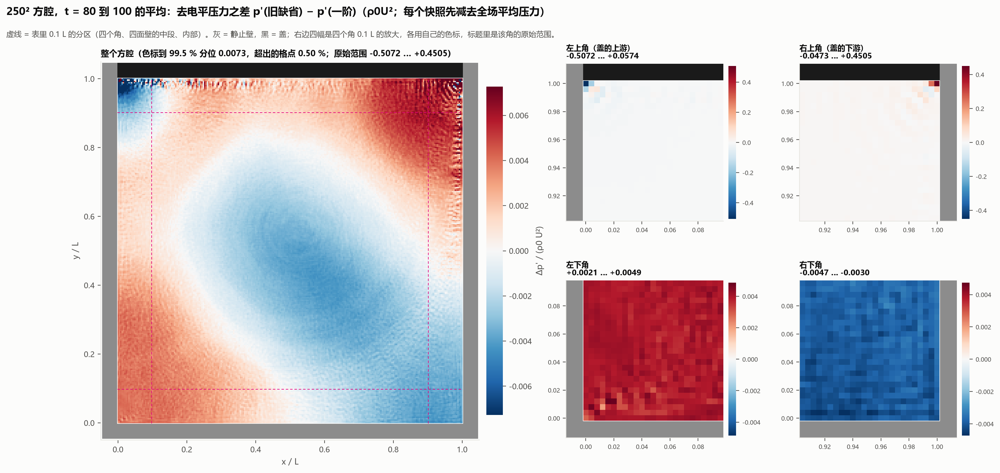

- **压力**：旧缺省在上游角低 0.51 ρ0U²，在下游角高 0.45 ρ0U²，都集中在角点的两三个节点上。
- 主图里内部那片平滑的正负图样（±0.006）不超过旧缺省两次运行之差，不能当作两种规则的差别。

### 11.5 报告 10.14 的那个猜测

**猜测的内容**：一阶规则丢掉了壁邻居速度差的切向部分。numpy 核对（10.5）里，丢掉之后的散度误差随粒子相对壁面的切向速度增大，并且随粒子排布涨落。方腔里近壁剪切最大的地方是盖下面。所以猜测是：现缺省在盖下面的密度方程里有一项涨落的误差，它带来额外的耗散，使主涡偏弱。

**用已有数据的检验**。在两次运行最后 3 个快照的粒子上，用 numpy 参考解直接算出被丢掉的那一项（完整向量的壁项减去只取法向的壁项），换算成速度散度：

壁邻居漂移项里的切向部分，用 numpy 参考解在各运行最后 3 个快照的粒子上算出，换算成速度散度（单位 U / L）。“切向部分” = 完整向量的壁项 − 只取法向的壁项，就是一阶规则丢掉的那一项；“只取法向时留下的散度” = 流体邻居的部分 + 壁邻居的法向部分；“完整向量的散度” = 两者之和。只统计有壁邻居的流体粒子，壁的中段。

| 壁 | 层 | 一阶的粒子：切向部分的平均 | 切向部分的 rms | 只取法向时留下的散度的平均 | 它的 rms | 完整向量的散度的 rms | 旧缺省的粒子：切向部分的平均 | 切向部分的 rms | 只取法向时留下的散度的平均 | 它的 rms | 完整向量的散度的 rms |
|---|---|---|---|---|---|---|---|---|---|---|---|
| 盖 | 第 1 层（< 1 dx） | +0.0002 | 0.0119 | +0.0001 | 0.0010 | 0.0118 | +0.0001 | 0.0156 | -0.0000 | 0.0157 | 0.0014 |
| 盖 | 第 2 层 | +0.0005 | 0.0096 | -0.0002 | 0.0062 | 0.0115 | +0.0003 | 0.0098 | -0.0002 | 0.0120 | 0.0082 |
| 盖 | 第 3 层 | +0.0000 | 0.0027 | -0.0000 | 0.0152 | 0.0151 | +0.0001 | 0.0031 | -0.0002 | 0.0182 | 0.0183 |
| 盖 | 3 到 5 dx | -0.0000 | 0.0002 | +0.0002 | 0.0131 | 0.0132 | -0.0000 | 0.0002 | +0.0000 | 0.0138 | 0.0138 |
| 底壁 | 第 1 层（< 1 dx） | -0.0000 | 0.0003 | +0.0000 | 0.0007 | 0.0008 | -0.0000 | 0.0003 | +0.0002 | 0.0009 | 0.0008 |
| 底壁 | 第 2 层 | +0.0000 | 0.0002 | -0.0002 | 0.0009 | 0.0009 | +0.0000 | 0.0002 | +0.0002 | 0.0008 | 0.0007 |
| 底壁 | 第 3 层 | +0.0000 | 0.0001 | -0.0002 | 0.0020 | 0.0019 | +0.0000 | 0.0001 | +0.0002 | 0.0008 | 0.0008 |
| 底壁 | 3 到 5 dx | +0.0000 | 0.0000 | -0.0001 | 0.0017 | 0.0017 | +0.0000 | 0.0000 | +0.0002 | 0.0008 | 0.0008 |
| 左壁 | 第 1 层（< 1 dx） | -0.0000 | 0.0008 | +0.0000 | 0.0008 | 0.0011 | -0.0000 | 0.0007 | +0.0002 | 0.0011 | 0.0008 |
| 左壁 | 第 2 层 | +0.0000 | 0.0006 | -0.0003 | 0.0010 | 0.0010 | +0.0000 | 0.0005 | +0.0002 | 0.0010 | 0.0008 |
| 左壁 | 第 3 层 | +0.0000 | 0.0002 | +0.0001 | 0.0021 | 0.0021 | +0.0000 | 0.0002 | +0.0002 | 0.0013 | 0.0013 |
| 左壁 | 3 到 5 dx | +0.0000 | 0.0000 | -0.0002 | 0.0019 | 0.0019 | +0.0000 | 0.0000 | +0.0002 | 0.0013 | 0.0013 |
| 右壁 | 第 1 层（< 1 dx） | -0.0002 | 0.0060 | -0.0001 | 0.0009 | 0.0059 | +0.0002 | 0.0081 | -0.0003 | 0.0081 | 0.0011 |
| 右壁 | 第 2 层 | -0.0000 | 0.0037 | +0.0006 | 0.0050 | 0.0060 | -0.0000 | 0.0049 | +0.0003 | 0.0074 | 0.0057 |
| 右壁 | 第 3 层 | +0.0000 | 0.0011 | -0.0009 | 0.0124 | 0.0124 | +0.0000 | 0.0012 | -0.0003 | 0.0123 | 0.0123 |
| 右壁 | 3 到 5 dx | +0.0000 | 0.0001 | +0.0005 | 0.0095 | 0.0096 | +0.0000 | 0.0001 | +0.0002 | 0.0081 | 0.0081 |
| 左上角 | 0.1 L 的方块 | +0.6624 | 5.7360 | -0.0002 | 0.0341 | 5.7365 | +0.9007 | 8.2416 | -0.9018 | 8.2408 | 0.0447 |
| 左上角 | h 的方块 | +5.4381 | 16.4416 | +0.0029 | 0.0630 | 16.4430 | +7.2862 | 23.4445 | -7.3026 | 23.4421 | 0.0807 |
| 右上角 | 0.1 L 的方块 | -0.7171 | 5.9757 | +0.0005 | 0.0490 | 5.9773 | -0.8445 | 7.5056 | +0.8471 | 7.5038 | 0.0428 |
| 右上角 | h 的方块 | -6.0133 | 17.3022 | -0.0049 | 0.1240 | 17.3065 | -6.8665 | 21.4051 | +6.8834 | 21.3999 | 0.0993 |
| 左下角 | 0.1 L 的方块 | +0.0000 | 0.0005 | -0.0000 | 0.0012 | 0.0013 | -0.0000 | 0.0000 | +0.0004 | 0.0009 | 0.0009 |
| 左下角 | h 的方块 | +0.0004 | 0.0014 | -0.0001 | 0.0014 | 0.0020 | -0.0000 | 0.0001 | +0.0003 | 0.0009 | 0.0008 |
| 右下角 | 0.1 L 的方块 | -0.0000 | 0.0003 | +0.0000 | 0.0014 | 0.0015 | +0.0000 | 0.0001 | -0.0001 | 0.0013 | 0.0013 |
| 右下角 | h 的方块 | -0.0002 | 0.0009 | -0.0000 | 0.0020 | 0.0022 | +0.0000 | 0.0001 | -0.0001 | 0.0014 | 0.0014 |

粒子相对时间平均场的涨落：

粒子的速度（盖速 = 1）相对时间平均场的 rms（21 个快照的全部粒子；壁的中段，去掉 0.1 L 的角）。

| 壁 | 层 | 旧缺省（完整向量） | 旧缺省，第二次运行 | 一阶（只取法向） | 一阶，另一次运行（初始密度 ρ0 − 0.1 的对照） | 一阶，全程负压（初始密度 ρ0 − 0.45 的对照） |
|---|---|---|---|---|---|---|
| 盖 | 第 1 层（< 1 dx） | 0.00997 | 0.01005 | 0.01010 | 0.00988 | 0.01012 |
| 盖 | 第 2 层 | 0.00411 | 0.00391 | 0.00399 | 0.00384 | 0.00402 |
| 盖 | 第 3 层 | 0.00534 | 0.00521 | 0.00539 | 0.00519 | 0.00528 |
| 盖 | 3 到 5 dx | 0.00460 | 0.00462 | 0.00453 | 0.00454 | 0.00455 |
| 底壁 | 第 1 层（< 1 dx） | 0.00044 | 0.00045 | 0.00046 | 0.00045 | 0.00044 |
| 底壁 | 第 2 层 | 0.00022 | 0.00022 | 0.00029 | 0.00028 | 0.00020 |
| 底壁 | 第 3 层 | 0.00030 | 0.00029 | 0.00033 | 0.00031 | 0.00028 |
| 底壁 | 3 到 5 dx | 0.00039 | 0.00038 | 0.00041 | 0.00039 | 0.00038 |
| 左壁 | 第 1 层（< 1 dx） | 0.00092 | 0.00094 | 0.00090 | 0.00092 | 0.00092 |
| 左壁 | 第 2 层 | 0.00032 | 0.00033 | 0.00037 | 0.00035 | 0.00030 |
| 左壁 | 第 3 层 | 0.00043 | 0.00045 | 0.00046 | 0.00045 | 0.00042 |
| 左壁 | 3 到 5 dx | 0.00055 | 0.00054 | 0.00057 | 0.00055 | 0.00053 |
| 右壁 | 第 1 层（< 1 dx） | 0.00476 | 0.00459 | 0.00445 | 0.00444 | 0.00451 |
| 右壁 | 第 2 层 | 0.00285 | 0.00262 | 0.00251 | 0.00260 | 0.00266 |
| 右壁 | 第 3 层 | 0.00264 | 0.00259 | 0.00253 | 0.00250 | 0.00243 |
| 右壁 | 3 到 5 dx | 0.00255 | 0.00252 | 0.00241 | 0.00237 | 0.00233 |
| 内部 | ≥ 5 dx | 0.00080 | 0.00080 | 0.00080 | 0.00080 | 0.00078 |

粒子的去电平压力（ρ0U²）相对时间平均场的 rms（21 个快照的全部粒子；壁的中段，去掉 0.1 L 的角）。

| 壁 | 层 | 旧缺省（完整向量） | 旧缺省，第二次运行 | 一阶（只取法向） | 一阶，另一次运行（初始密度 ρ0 − 0.1 的对照） | 一阶，全程负压（初始密度 ρ0 − 0.45 的对照） |
|---|---|---|---|---|---|---|
| 盖 | 第 1 层（< 1 dx） | 0.01119 | 0.01076 | 0.00351 | 0.00321 | 0.00305 |
| 盖 | 第 2 层 | 0.01217 | 0.01177 | 0.00580 | 0.00531 | 0.00555 |
| 盖 | 第 3 层 | 0.01491 | 0.01388 | 0.01041 | 0.00983 | 0.01052 |
| 盖 | 3 到 5 dx | 0.01341 | 0.01328 | 0.00894 | 0.00828 | 0.00834 |
| 底壁 | 第 1 层（< 1 dx） | 0.00842 | 0.00734 | 0.00267 | 0.00195 | 0.00224 |
| 底壁 | 第 2 层 | 0.00843 | 0.00733 | 0.00272 | 0.00196 | 0.00224 |
| 底壁 | 第 3 层 | 0.00841 | 0.00735 | 0.00290 | 0.00223 | 0.00223 |
| 底壁 | 3 到 5 dx | 0.00833 | 0.00734 | 0.00283 | 0.00216 | 0.00223 |
| 左壁 | 第 1 层（< 1 dx） | 0.00915 | 0.00867 | 0.00249 | 0.00225 | 0.00224 |
| 左壁 | 第 2 层 | 0.00921 | 0.00871 | 0.00254 | 0.00234 | 0.00223 |
| 左壁 | 第 3 层 | 0.00928 | 0.00876 | 0.00282 | 0.00254 | 0.00231 |
| 左壁 | 3 到 5 dx | 0.00928 | 0.00871 | 0.00276 | 0.00253 | 0.00232 |
| 右壁 | 第 1 层（< 1 dx） | 0.00974 | 0.00982 | 0.00307 | 0.00281 | 0.00251 |
| 右壁 | 第 2 层 | 0.01047 | 0.01041 | 0.00473 | 0.00470 | 0.00440 |
| 右壁 | 第 3 层 | 0.01230 | 0.01222 | 0.00799 | 0.00810 | 0.00769 |
| 右壁 | 3 到 5 dx | 0.01084 | 0.01109 | 0.00591 | 0.00583 | 0.00541 |
| 内部 | ≥ 5 dx | 0.00792 | 0.00767 | 0.00250 | 0.00215 | 0.00201 |

- **前提在壁的中段成立**：被丢掉的项在那里确实是零均值的涨落，并且集中在盖下面。第一层的 rms 是 0.012 U/L，第二层 0.010；右壁是 0.006 和 0.004；底壁和左壁不到 0.001。平均值都在 ±0.0005 以内。
- **但"涨落带来耗散"没有证据**：
  - 两次运行里粒子速度的涨落在每一层都相同（盖下第一层 0.0100 对 0.0101，内部 0.0008 对 0.0008）。
  - 压力的涨落是一阶更小，不是更大（盖下第一层 0.0035 对 0.0112，内部 0.0025 对 0.0079）。
- **真正不同的是两个上角，而且不是涨落**。被丢掉的项在那里有很大的平均值：离角 h 以内，上游角 +5.4 U/L，下游角 −6.0 U/L（rms 16 到 17），是壁中段的上千倍。0.1 L 的方块里是 +0.66 和 −0.72。
  - 符号的含义：完整向量的规则把盖相对静止侧壁的切向运动算成上游角的膨胀和下游角的压缩。
  - 这与 11.4 的压力差一致：旧缺省在上游角压力更低，在下游角更高。
  - 只取法向的规则里，盖粒子的法向是竖直的（11.1），盖的切向运动不进连续性，角上这一对膨胀和压缩也就没有了。
- **每次运行自己的规则算出的散度都很小**，另一条规则在同一批粒子上算出的就大：一阶的粒子上，只取法向的散度在上游角是 0.003 ± 0.06，完整向量的是 5.4 ± 16；旧缺省的粒子上反过来。也就是说两次运行各自把自己那条规则下的散度压到了零附近，流场因此在角上不同。
- **所以猜测要改成**：区分两种缺省的不是盖下面的涨落误差，而是盖的两个角上的一个系统项。

**没有回答的**

- 角上这一对源汇为什么使主涡整体强 2.5 %，没有验证。数据只说明两种规则的差别和被丢掉的项都集中在这里；因果没有单独检验。
- 它与旧缺省的内部净汇（第 8 节）是不是同一件事，没有查。
- 哪一种角上的处理更接近真实流动，这里判断不了：真实的盖驱动方腔在这两个角上压力是奇异的（上游负、下游正），旧缺省的符号与之相同，但大小由粒子间距决定。

**这一节的限制**

- 时间平均只有 21 个快照；噪声水平由两次运行之差给出。
- 被丢掉的项只在最后 3 个快照上算，并且是在各次运行自己的粒子上事后算的，不是求解器运行时记下的。
- 压力由 float32 的体积还原，单个粒子的分辨率是 6e-4 ρ0U²。
- 角上的最大值（速度差 0.26、压力差 0.5）是单个节点的值。
- 只有 250²。500² 的两次运行也有快照，没有做。

## 12. 追加（七）：逐对几何，压力和密度在壁面处反射（2026-11-18，快速验证）

任务书：把穿壁比例和法向改为逐对按真实的壁面计算，压力和密度在壁面处改用反射；只跑几个短测试，不补做完整的验收。下面把"`geometry: pairwise` + `pressure_wall: reflection` + `delta_wall: reflection`，其余取缺省"叫做**反射版**，"一阶"指现缺省。工具是 `experiment/wall_crossing/pairwise_reflection.py`。上一条指令的第 1、2 步在第 11 节，已经做完。

**先说结果**

- **实现完成，缺省不变。** 三个开关取缺省时，crossing 与 b18597b 逐位相同（250²，700 步）；基点清单里的 23 个 SPIR-V 文件逐字节相同。
- **numpy 核对、GPU 单步对照（2-D 和 3-D）、两个静水盒都通过。**
- **方腔短跑（4.5）不通过**，卡在一条上：内部的连续性项是 −0.021，线是 ±0.005。另外三条通过：粒子数守恒，没有粒子越出盒，最大速度 0.978。
- **问题出在逐对几何本身，不在两个反射。** 两个反射都关、只留逐对几何，内部的连续性项仍是 −0.014。三次定位短跑都不通过。
- **所以没有做到 t = 100 的方腔运行（4.6），没有新的 ψ_min。** 同时启动的反射版长跑按任务书停在 t = 18.06。
- **δ 项的预期只成立一半。** 壁邻居的 δ 项从 +0.0072 降到 +0.0009，接近零。但平均密度没有因此停止上升：t = 5 时是 ρ0 + 0.12，一阶是 ρ0 + 0.026。
- **逐对几何的四个组合压力噪声都大了约 6 倍**（平均压力的逐样本涨落 0.0045 对 0.0008 ρ0U²）。

### 12.1 改动清单

提交：`bd9fec1`（实现、参考解、单步工具、反射版的算例）、`8748bcd`（三个定位算例、numpy 核对），以及本节的表、图和报告。都在本地分支 `v7-wall-crossing` 上，没有 push。

**开关（缺省值都保持现有行为）**

| 开关 | 取值 | 规格常量 |
|---|---|---|
| `numerics.wall_crossing.geometry` | `nearest_wall`（缺省）、`pairwise` | 128 |
| `numerics.wall_crossing.pressure_wall` | `extension`（缺省）、`reflection` | 129 |
| `numerics.wall_crossing.delta_wall` | 原有三个值之外增加 `reflection` | 116 = 3 |

- 两个 `reflection` 都要求 `geometry: pairwise`，否则报 `ValueError`。
- `geometry: pairwise` 与任一个二阶开关同时出现时报 `ValueError`。

**着色器**

- `wall_boundary.glsl`：两个新规格常量和 `delta_wall` 的新值；逐对几何集中在一个函数 `wall_crossing_pair_geometry` 里（输入流体粒子和壁粒子的位置，输出法向 n_ij、d_ij/φ_ij、r_j − r_j′）。换一般几何时只替换它。
- `correction_density.comp`：壁邻居的连续性项用逐对的法向和倍数；密度反射多累加一个向量 q，循环后减去 `diffusion_coefficient · (G^ρ − ρ_i g / c²) · q`。
- `force.comp`：粘性项用逐对的倍数；压力反射多累加一个矩阵 M_d，循环后在压力加速度上加 `(1/ρ_i) · L_i · M_d · (G − ρ_i g)`。
- `density_budget.glsl`（只在收支构建里）：收支遍历用同样的逐对量，壁邻居的 δ 项包含反射的新增部分。
- 所有新语句都在规格常量后面。重新编译后变了的 SPIR-V 只有 crossing 的三个变体（`correction_density_wall_crossing`、`force_wall_crossing`、`correction_density_wall_crossing_budget`）。`README.md` 和 `MANIFEST.txt` 已更新。
- A_f 求逆走了回退的粒子，两个反射的新增项都取零。壁粒子自身的处理没有动。

**主机端和工具**

- `wall_crossing_v7.py`：设置、解析和上面的 `ValueError`；逐对几何的 numpy 版 `box_pair_geometry`。
- `simulator_v7.py`：crossing 的规格常量表多两项（只在 crossing 的片上）。
- `reference.py`、`single_step.py`、`box_case.py`、`box_run.py`、`cavity_tables.py`：跟随新开关。
- `pairwise_reflection.py`（新）：生成算例、numpy 核对、本节的表和图。
- 新算例 6 个：反射版的 250² 方腔和两个 2-D 静水盒；三个定位用的 250² 方腔。

**没有改的**：所有缺省值；`simple` / `adami`；随传输和 defrag 搬运的 SoA 布局、ghost 记录格式、ghost 层数。所有新量都由粒子位置现算，没有新增缓冲区。

### 12.2 与任务书不一致的代码事实

1. **当前提交。** 任务书写的是 b18597b；实际分支头是 282f598，多出来的是第 11 节和它的工具，着色器与 b18597b 相同。回归的参照是 b18597b 的着色器。
2. **2.4 的新增项没有乘修正矩阵 L。** 求解器里一对粒子的 δ 项是 `… · (r_j − r_i)·(L ∇W)`。任务书给的 q 用 `|∇W|·r`，这是 L = I 时的值。我按任务书实现。
   - 它与"逐对带 L 写出来"的差别：在单步测试的状态上，壁邻居 δ 项的这个差是全场最大密度变化率的 0.22 %（2-D）和 0.20 %（3-D）。
   - 现有延拓项自己的同一个差是 0.01 % 和 0.03 %。也就是新增项的近似比原来的粗一个量级。
3. **c² 不是 c0²。** 状态方程是 Tait（γ = 7），不是线性的。c² 取 ρ_i 处的 dp/dρ = γB/ρ0 · (ρ_i/ρ0)^(γ−1)，与现有的诊断开关 `body_force` 相同。
4. **重力向量不用另传。** 融合遍历里本来就有（规格常量 `GRAVITY_X/Y/Z`）。
5. **方腔没有重力。** 两个反射里带 g 的部分在方腔里是零，反射在方腔里只剩"壁粒子取镜像点处的值"。带 g 的部分由单步对照和静水盒检验。
6. **盖两端上方的角块是静止壁（速度 0），不属于盖。** 逐对几何下，盖附近的流体粒子与角块粒子的连线如果先穿过盖所在的面，法向取盖的法向，但壁速度仍是角块粒子存的 0（任务书 2.2 的写法）。
7. **`delta_wall` 原来是诊断开关。** `reflection` 不是诊断，文档里单独注明。
8. **规格常量编号。** 116 到 127 已经用完，新开关用 128 和 129（grep 确认未用，记在 `shaders/README.md`）。

### 12.3 我做的决定

- **流体粒子越出盒时的 φ_ij。** 任务书写的是 `|face − r_i|` 再取下限。我用带符号的距离（盒内为正）再取下限，所以越出盒的粒子直接得到下限，与现有 `nearest_wall` 的做法一致。盒内的粒子两种写法相同。
- **两个出界轴的 s 相等时**（连线正好穿过角点）取 x、y、z 顺序里的第一个轴。两个轴给出的倍数相同，只有法向不同。
- **`|∇W|·r`** 写成核梯度的模乘以粒子间距。
- **回归的参照**是第 10 节 5.1 留下的 6 个转储（b18597b 的着色器产生）。`simple` 和 `adami` 没有重跑：它们用的 SPIR-V 逐字节没变，规格常量表也没变（新的两项只加在 crossing 的片上）。
- **单步对照的光滑场配置在反射打开时带重力**（2-D 是 (3.5, −8)，3-D 是 (3.5, −8, 4.5)），否则带 g 的部分测不到。
- **numpy 核对多做了**：3-D 的盒，正负两种压力，一阶规则并列。
- **4.5 的通过条件**按任务书的四条。平均密度的变化率只报告，不作为通过条件。
- **4.6 没有追加运行。** 四个组合都不通过，没有"能通过的最大组合"。任务书对"4.5 不通过"的规定是停掉长跑、不用不通过的配置做 4.6，所以我没有用任何一个不通过的组合跑到 t = 100。三个开关都不开就是已有的一阶运行，它的数直接引用。
- **额外做的**（都不需要新的长运行）：回退路径的单步测试（几秒）；停下的长跑与一阶在 t = 5 到 18 的涨落对比；各筛查短跑 t = 5 终态的第一层距离；各筛查短跑平均压力的逐样本涨落。

### 12.4 回归（任务书 4.1）

| 检查 | 参照 | 结果 | 结论 | 记录 |
|---|---|---|---|---|
| 基点清单里的 SPIR-V 文件 | 基点（eda5b90）清单里的 23 个文件 | 23 个逐字节相同 | 通过 | MANIFEST.txt |
| 相对 b18597b 变了的 SPIR-V | 全部 27 个文件 | correction_density_wall_crossing、correction_density_wall_crossing_budget、force_wall_crossing | — | MANIFEST.txt |
| crossing，三个开关取缺省，250²，700 步 | b18597b 的着色器的 6 个转储（第 10 节 5.1 的那 6 次；db3d609 之后到 b18597b 着色器没有改动） | 1 个结果类。类 0：参照 6 次，本次 6 次 | 逐位相同 | wc-20261118-164940-939a |
| `_test_seam_layout.py` 的失败清单 | 基点的清单（858 条，基点自身就有） | 858 条，与基点的清单逐行相同 | 通过 | wc-20261118-165619-559a |

### 12.5 numpy 核对（任务书 4.2）

float64，ξ = 0，粒子在点阵上，盒含四个角。记录 wc-20261118-165533-18b4。三项都通过。

**(1) 任务书的例子**：逐对几何给出 1/t_ij = 3.5/3，法向是侧壁的法向；旧写法给 2。另外三行是同一个流体粒子对盖里和角块里的壁粒子。

| 情形（间距 = 1，盒 [0, 40] × [0, 30]，盖在 y = 30） | r_i | r_j | 逐对 1/t_ij | 逐对法向 n_ij | 镜像点 r_j′ | 旧写法 1 + d_j/φ_i |
|---|---|---|---|---|---|---|
| 任务书的例子：i 离盖 0.5、离侧壁 3；j 在侧壁里深 0.5，与 i 同高 | (3, 29.5) | (-0.5, 29.5) | 1.166667 | (+1, +0) | (0.5, 29.5) | 2.000000 |
| 同一个 i；j 在盖里深 0.5，正上方 | (3, 29.5) | (3, 30.5) | 2.000000 | (+0, -1) | (3, 29.5) | 2.000000 |
| 同一个 i；j 在左上角块里（两个轴各出界 0.5） | (3, 29.5) | (-0.5, 30.5) | 2.000000 | (+0, -1) | (0.5, 29.5) | 2.414214 |
| 同一个 i；j 在左上角块里（x 出界 0.5，y 出界 2.5） | (3, 29.5) | (-0.5, 32.5) | 6.000000 | (+0, -1) | (0.5, 27.5) | 6.099020 |

**(2) 远离拐角处两种几何相同。** 速度、密度、压力取非平凡的光滑场，盖运动，带重力。离任何第二面壁超过一个核半径的粒子上，`pairwise` 与 `nearest_wall` 的密度变化率和加速度完全相同（差是 0，不是舍入量级）。

| 盒 | 流体粒子 | 离恰好一面壁不到 h 的粒子 | 这些粒子上密度变化率之差的最大值 | 加速度之差的最大值 | 离两面以上壁不到 h 的粒子（角） | 角里密度变化率之差 / 全场最大值 | 角里加速度之差 / 全场最大值 |
|---|---|---|---|---|---|---|---|
| 2-D（50 × 40，h/dx = 5） | 2,000 | 700 | 0.0e+00 | 0.0e+00 | 100 | 16.5 % | 8.6 % |
| 3-D（24 × 20 × 16，h/dx = 4） | 7,680 | 3,328 | 0.0e+00 | 0.0e+00 | 2,816 | 25.2 % | 7.4 % |

- 两种几何只在离两面壁都不到 h 的粒子上不同。250² 方腔里这是四个角各约 25 个粒子，共约 100 个，占流体粒子的 0.16 %。

**(3) 静水场**（均匀 ρ0，p = p_0 + ρ0 g·x，速度为零）：反射版在所有流体粒子上（含拐角）压力加速度加重力不超过 2.5e-13 |g|，线是 1e-10。

| 维数 | 重力方向 | 压力符号 | 配置 | 全部流体粒子上 |a_p + g| / |g| 的最大值 | 其中角里的最大值 | A_f 回退 / 被 Frobenius 上限缩小的粒子数 | ≤ 1e-10 |
|---|---|---|---|---|---|---|---|
| 2-D | 重力沿 −y | p > 0 | 反射版 | 1.6e-13 | 5.9e-14 | 0 / 0 | 通过 |
| 2-D | 重力沿 −y | p > 0 | 一阶（现缺省） | 1.6e-13 | 6.2e-14 | 0 / 0 | 通过 |
| 2-D | 重力沿 −y | p < 0 | 反射版 | 2.9e-15 | 2.5e-15 | 0 / 0 | 通过 |
| 2-D | 重力沿 −y | p < 0 | 一阶（现缺省） | 3.8e-15 | 3.8e-15 | 0 / 0 | 通过 |
| 2-D | 重力偏离 −y 30° | p > 0 | 反射版 | 2.4e-13 | 1.3e-13 | 0 / 0 | 通过 |
| 2-D | 重力偏离 −y 30° | p > 0 | 一阶（现缺省） | 2.4e-13 | 1.3e-13 | 0 / 0 | 通过 |
| 2-D | 重力偏离 −y 30° | p < 0 | 反射版 | 3.5e-15 | 2.8e-15 | 0 / 0 | 通过 |
| 2-D | 重力偏离 −y 30° | p < 0 | 一阶（现缺省） | 9.2e-15 | 7.8e-15 | 0 / 0 | 通过 |
| 3-D | 重力沿 −y | p > 0 | 反射版 | 1.0e-13 | 1.0e-13 | 0 / 0 | 通过 |
| 3-D | 重力沿 −y | p > 0 | 一阶（现缺省） | 1.0e-13 | 1.0e-13 | 0 / 0 | 通过 |
| 3-D | 重力沿 −y | p < 0 | 反射版 | 3.8e-15 | 2.7e-15 | 0 / 0 | 通过 |
| 3-D | 重力沿 −y | p < 0 | 一阶（现缺省） | 3.8e-15 | 2.7e-15 | 0 / 0 | 通过 |
| 3-D | 重力偏离 −y 30° | p > 0 | 反射版 | 1.4e-13 | 1.4e-13 | 0 / 0 | 通过 |
| 3-D | 重力偏离 −y 30° | p > 0 | 一阶（现缺省） | 1.4e-13 | 1.4e-13 | 0 / 0 | 通过 |
| 3-D | 重力偏离 −y 30° | p < 0 | 反射版 | 3.3e-15 | 2.7e-15 | 0 / 0 | 通过 |
| 3-D | 重力偏离 −y 30° | p < 0 | 一阶（现缺省） | 5.7e-15 | 5.7e-15 | 0 / 0 | 通过 |

- 这个场上密度反射的新增项不是零：密度是均匀的，不是静水分布，而壁面要求的法向密度梯度是 ρ g / c²。任务书没有把它列为判据；它的实现由 12.6 的单步对照检验。

### 12.6 GPU 单步对照（任务书 4.3）

反射版，沿用现有工具和判据（容差 1e-4）。场是光滑的非平凡场，盖运动，带重力，粒子位置有 0.2 dx 的扰动，有 8 个粒子在距离下限以内。

| 维数 | 构建 | 流体粒子 / 其中有壁邻居的 | A_f 回退的粒子（反射项取零） | 低于距离下限的粒子；最大的 1/t_ij | 压力反射项的最大值 / 压力加速度的最大值 | 密度反射项的最大值 / 密度变化率的最大值 | 加速度误差 ÷ 逐对项绝对值之和（最大） | 密度变化率的相对误差（超出 1 ulp 的部分，最大） | 收支四项：10 × 误差 ÷ 逐对项之和（最大） | 判据值（容差 1e-4） | 结论 | 记录 |
|---|---|---|---|---|---|---|---|---|---|---|---|---|
| 2-D | 缺省构建 | 2,000 / 731 | 0 | 8；19 | 12.5 / 16.0 | 1564 / 76653 | 3.6e-07 | 2.1e-07 | — | 8.8e-06 | 通过 | wc-20261118-165138-9b50 |
| 2-D | 收支构建 | 2,000 / 731 | 0 | 8；19 | 12.5 / 16.0 | 1564 / 76653 | 3.7e-07 | 2.1e-07 | 6.5e-06 | 9.0e-06 | 通过 | wc-20261118-165151-bf2e |
| 2-D | 缺省构建，回退测试（L 和 A_f 的行列式阈值 1.27） | 2,000 / 731 | 1,249 | 8；19 | 0.4 / 17.1 | 9 / 84110 | 3.8e-07 | 1.4e-07 | — | 8.9e-06 | 通过 | wc-20261118-170537-fe75 |
| 3-D | 缺省构建 | 7,680 / 5,702 | 0 | 8；15 | 19.1 / 22.0 | 1542 / 68129 | 5.1e-07 | 1.1e-06 | — | 1.2e-05 | 通过 | wc-20261118-165151-e463 |

- 2-D 通过，判据值 8.8e-6。3-D 也通过，1.2e-5。
- 两个反射项在这个状态上都不小：压力反射项最大是压力加速度最大值的 78 %（2-D），密度反射项最大是密度变化率最大值的 2 %。所以对照确实检验到了它们。
- 收支构建（4.5 用的那个）也通过，四项与参考解一致。
- 回退测试：把行列式阈值提高到 1.27，使 2,000 个粒子里有 1,249 个的 A_f 走回退。这些粒子的两个反射项取零，GPU 与参考解仍然一致。

### 12.7 静水盒（任务书 4.4）

现有的两个 2-D 算例，反射版各一次。残余速度都不超过一阶的 2 倍。

| 方向 | 一阶的残余速度 rms / √(gH)（末 1/5 段；两次） | 反射版 | 反射版 ÷ 一阶两次的平均 | 不超过 2 倍 |
|---|---|---|---|---|
| 重力沿 −y | 2.99e-04 / 2.32e-04 | 1.70e-04 | 0.64 | 通过 |
| 重力偏离 −y 30° | 4.47e-04 / 3.75e-04 | 4.17e-04 | 1.01 | 通过 |

2-D 静水盒（250² 方腔的几何，盖静止，|g| = 10，c0 = 100，从均匀密度、零速度开始，到 t = 10.02）。速度以 √(|g| H) 为单位，压力以 ρ0 |g| H 为单位。“去电平” = 减去全场平均偏差后的误差；“电平” = 压力减去 ρ0 g·(r − r_中心) 之后对全部流体粒子的平均。一阶的两次是第 9 节的运行，反射版每个方向一次。

**重力沿 −y**

| 量 | 一阶（现缺省），第 1 次 | 一阶（现缺省），第 2 次 | 反射版 |
|---|---|---|---|
| 到达的时刻 | t = 10.02，粒子数守恒 | t = 10.02，粒子数守恒 | t = 10.02，粒子数守恒 |
| 速度 rms / √(gH)，末 1/5 段平均 | 2.99e-04 | 2.32e-04 | 1.70e-04 |
| 速度最大 / √(gH)，末 1/5 段的最大 | 6.27e-03 | 5.58e-03 | 3.54e-03 |
| 速度 rms / √(gH)，近壁第 1 层（φ < dx），末态 | 4.00e-04 | 4.17e-04 | 4.13e-04 |
| 速度 rms / √(gH)，第 2 层，末态 | 4.63e-04 | 5.16e-04 | 4.49e-04 |
| 速度 rms / √(gH)，第 3 层，末态 | 3.49e-04 | 4.07e-04 | 3.68e-04 |
| 速度 rms / √(gH)，内部（φ ≥ 5 dx），末态 | 3.15e-04 | 1.84e-04 | 1.30e-04 |
| 压力 rms 误差（去电平），末态 | 0.0456 % | 0.0428 % | 0.0396 % |
| 压力最大误差（去电平），末态 | 0.919 % | 0.973 % | 0.877 % |
| 拟合压力梯度的误差 / ρ0 g，末态 | 0.1142 % | 0.1053 % | 0.0969 % |
| 盒中心的压力电平，末态 | +2.263 % | -0.838 % | -5.253 % |
| 压力 rms 误差（不去电平），末态 | 2.264 % | 0.839 % | 5.253 % |
| 电平在 t = 2.5、5、7.5、10 | +0.198 % / +0.536 % / +1.466 % / +2.263 % | -1.208 % / -1.288 % / -1.036 % / -0.838 % | -2.149 % / -2.942 % / -3.939 % / -5.253 % |
| 电平的变化率，t ∈ [3, 10]（每时间单位） | +0.3244 % | +0.0756 % | -0.4286 % |
| 平均密度的漂移率，t ∈ [3, 10]（kg/m³ 每时间单位） | +0.00326 | +0.00076 | -0.00430 |
| 平均密度 − ρ0，末态（kg/m³） | +0.02236 | -0.00878 | -0.05310 |
| 由密度范围的中点估计的电平（粗略），t = 2.5、5、7.5、10 | +0.16 % / +0.48 % / +1.44 % / +2.26 % | -1.25 % / -1.32 % / -1.07 % / -0.87 % | -2.04 % / -2.82 % / -3.81 % / -5.13 % |
| 密度范围 − ρ0，末态（kg/m³） | -0.479 … +0.524 | -0.510 … +0.493 | -0.555 … +0.452 |
| φ 的最小值（整个运行） | 0.373 dx | 0.369 dx | 0.369 dx |
| A_f 回退（累计） | 0 | 0 | 0 |
| 记录（提交） | wc-20261118-102533-f4f7（6c8a55a） | wc-20261118-102844-835c（6c8a55a） | wc-20261118-165725-99d1（bd9fec1） |

**重力偏离 −y 30°**

| 量 | 一阶（现缺省），第 1 次 | 一阶（现缺省），第 2 次 | 反射版 |
|---|---|---|---|
| 到达的时刻 | t = 10.02，粒子数守恒 | t = 10.02，粒子数守恒 | t = 10.02，粒子数守恒 |
| 速度 rms / √(gH)，末 1/5 段平均 | 4.47e-04 | 3.75e-04 | 4.17e-04 |
| 速度最大 / √(gH)，末 1/5 段的最大 | 6.85e-03 | 5.46e-03 | 3.17e-03 |
| 速度 rms / √(gH)，近壁第 1 层（φ < dx），末态 | 2.61e-04 | 2.83e-04 | 2.35e-04 |
| 速度 rms / √(gH)，第 2 层，末态 | 3.11e-04 | 3.32e-04 | 2.66e-04 |
| 速度 rms / √(gH)，第 3 层，末态 | 2.83e-04 | 2.93e-04 | 2.45e-04 |
| 速度 rms / √(gH)，内部（φ ≥ 5 dx），末态 | 3.90e-04 | 3.17e-04 | 3.92e-04 |
| 压力 rms 误差（去电平），末态 | 0.0342 % | 0.0342 % | 0.0349 % |
| 压力最大误差（去电平），末态 | 0.839 % | 0.685 % | 0.754 % |
| 拟合压力梯度的误差 / ρ0 g，末态 | 0.1102 % | 0.1082 % | 0.1004 % |
| 盒中心的压力电平，末态 | +0.346 % | -0.569 % | -2.313 % |
| 压力 rms 误差（不去电平），末态 | 0.348 % | 0.571 % | 2.313 % |
| 电平在 t = 2.5、5、7.5、10 | -0.824 % / -0.572 % / -0.161 % / +0.346 % | -1.588 % / -1.628 % / -1.322 % / -0.569 % | -1.535 % / -1.652 % / -1.879 % / -2.313 % |
| 电平的变化率，t ∈ [3, 10]（每时间单位） | +0.1693 % | +0.1498 % | -0.1066 % |
| 平均密度的漂移率，t ∈ [3, 10]（kg/m³ 每时间单位） | +0.00232 | +0.00205 | -0.00146 |
| 平均密度 − ρ0，末态（kg/m³） | +0.00440 | -0.00817 | -0.03208 |
| 由密度范围的中点估计的电平（粗略），t = 2.5、5、7.5、10 | -1.00 % / -0.74 % / -0.32 % / +0.30 % | -1.83 % / -1.86 % / -1.34 % / -0.58 % | -1.60 % / -1.70 % / -1.92 % / -2.34 % |
| 密度范围 − ρ0，末态（kg/m³） | -0.680 … +0.688 | -0.693 … +0.677 | -0.717 … +0.653 |
| φ 的最小值（整个运行） | 0.360 dx | 0.375 dx | 0.367 dx |
| A_f 回退（累计） | 0 | 0 | 0 |
| 记录（提交） | wc-20261118-102708-5148（6c8a55a） | wc-20261118-103018-490a（6c8a55a） | wc-20261118-165859-42c7（8748bcd） |

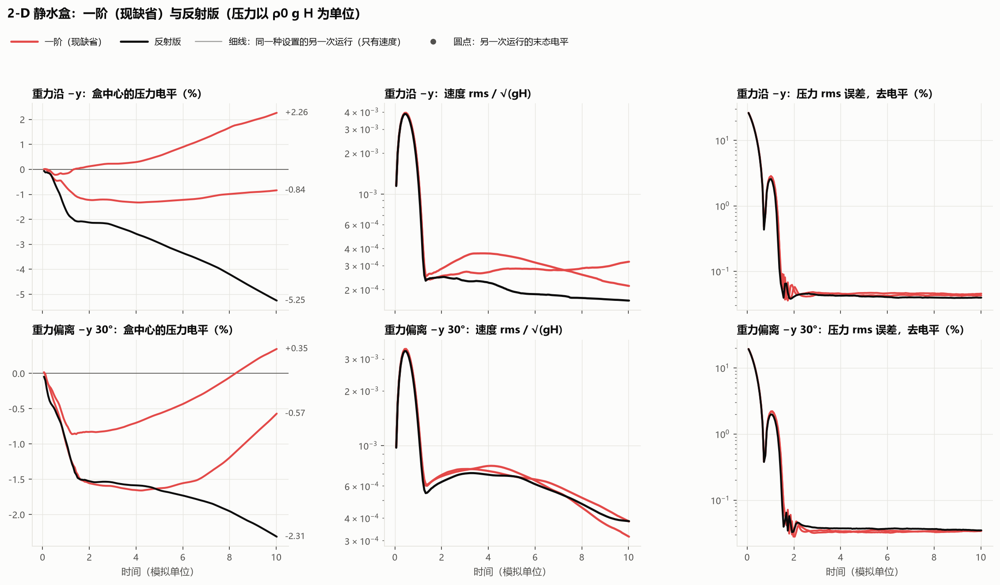

- 残余速度：重力沿 −y 时是一阶的 0.64 倍，倾斜 30° 时是 1.01 倍。
- 去电平的压力误差与一阶相近（rms 0.035 % 到 0.040 %，最大 0.75 % 到 0.88 %；一阶 rms 0.034 % 到 0.046 %）。
- **压力电平的走向变了**：一阶的电平缓慢上升（每时间单位 +0.08 % 到 +0.32 %），反射版缓慢下降（−0.11 % 和 −0.43 %）。到 t = 10 时反射版的电平是 −5.3 % 和 −2.3 %。每个方向只有一次运行，一阶两次之间的电平最多相差 3 个百分点，所以大小不能细读；下降这个符号在两个方向上一致。

### 12.8 方腔短跑和三次定位短跑（任务书 4.5）

250²，t = 0 到 5.01，收支构建。先跑反射版；它不通过，再按任务书跑三次定位：只关压力反射、只关密度反射、两个都关。后三行是已有的参照运行。

| 运行 | 粒子数（含壁） | 流体最大速度（盖速 = 1；线 1.05） | 内部的连续性项（线 ±0.005） | δ 项全场合计 | 平均密度的变化率（线性拟合斜率） | 低于距离下限的粒子数（各样本的最大值）；φ_min / dx | 结论 | 记录（提交） |
|---|---|---|---|---|---|---|---|---|
| **反射版** | 74,529，守恒；越出盒 0 | 0.978 | -0.02058 ± 0.00605（**超过 0.005**） | +0.00353（流体 +0.00266，壁 +0.00087） | +0.00591 | 0；0.312 | **不通过** | wc-20261118-165529-a2b4（bd9fec1） |
| **逐对几何 + 密度反射（关压力反射）** | 74,529，守恒；越出盒 0 | 0.978 | -0.01241 ± 0.00436（**超过 0.005**） | +0.00169（流体 +0.00191，壁 -0.00022） | +0.01437 | 0；0.297 | **不通过** | wc-20261118-170235-70e5（8748bcd） |
| **逐对几何 + 压力反射（关密度反射）** | 74,529，守恒；越出盒 0 | 0.977 | -0.02046 ± 0.00630（**超过 0.005**） | +0.00120（流体 +0.00286，壁 -0.00166） | +0.00441 | 0；0.297 | **不通过** | wc-20261118-170046-7f12（8748bcd） |
| **只有逐对几何（两个反射都关）** | 74,529，守恒；越出盒 0 | 0.977 | -0.01402 ± 0.00424（**超过 0.005**） | +0.00692（流体 +0.00198，壁 +0.00494） | +0.00910 | 0；0.301 | **不通过** | wc-20261118-165901-fd2d（8748bcd） |
| 一阶（现缺省），第 1 次 | 74,529，守恒；越出盒 0 | 0.977 | +0.00050 ± 0.00113 | +0.00767（流体 +0.00048，壁 +0.00719） | +0.00368 | 0；0.300 | （参照） | wc-20261118-102117-7b54（6c8a55a） |
| 一阶（现缺省），第 2 次 | 74,529，守恒；越出盒 0 | 0.977 | -0.00007 ± 0.00139 | +0.00762（流体 +0.00044，壁 +0.00717） | +0.00335 | 0；0.274 | （参照） | wc-20261118-102354-4dd5（6c8a55a） |
| 旧缺省（完整向量） | 74,529，守恒；越出盒 0 | 0.977 | -0.02643 ± 0.00110（**超过 0.005**） | +0.00827（流体 -0.00001，壁 +0.00829） | -0.01394 | 0；0.293 | （参照） | wc-20261118-025805-ba45（0dd6338） |

- **四个组合都不通过，都卡在内部的连续性项上**：−0.012 到 −0.021，线是 ±0.005。一阶是 0 ± 0.001，旧缺省是 −0.026。
- **只留逐对几何就已经不通过（−0.014）。** 所以原因在逐对几何，不在反射。两个带压力反射的组合更负（−0.020 和 −0.021）。
- 其余三条四个组合都通过：粒子数守恒，没有粒子越出盒，最大速度 0.977 到 0.978。
- 低于距离下限的粒子数：每个样本都是 0。φ 的最小值 0.30 到 0.31 dx，一阶是 0.27 和 0.30。

**各项和电平**

| 运行 | 连续性项，流体邻居 | 连续性项，壁邻居 | 连续性项合计 | δ 项合计 | 四项之和 | float32 存储舍入 | 实际写入 | 平均密度 − ρ0：t = 1 / t = 5 | t = 5 的平均压力；负压粒子比例 | 平均压力的逐样本涨落，t ∈ [1, 5]（ρ0U²） | |ρ − ρ0| 的最大值：整个运行（出现的时刻）；t ≥ 1 | t = 5 的动能 |
|---|---|---|---|---|---|---|---|---|---|---|---|---|
| **反射版** | +0.07520 | -0.08596 | -0.01077 | +0.00353 | -0.00723 ± 0.00627 | +0.01709 | +0.00985 | +0.0797 / +0.1205 | +1.207 ρ0U²；0.00 % | 0.0044 | 0.861（t = 1.26）；0.861 | 21.046 |
| **逐对几何 + 密度反射（关压力反射）** | +0.05571 | -0.06059 | -0.00487 | +0.00169 | -0.00318 ± 0.00438 | +0.01661 | +0.01343 | +0.0464 / +0.0996 | +0.998 ρ0U²；0.00 % | 0.0047 | 0.683（t = 2.25）；0.683 | 21.044 |
| **逐对几何 + 压力反射（关密度反射）** | +0.06737 | -0.07778 | -0.01041 | +0.00120 | -0.00921 ± 0.00692 | +0.01599 | +0.00679 | +0.0910 / +0.1193 | +1.194 ρ0U²；0.00 % | 0.0045 | 1.325（t = 3.21）；1.325 | 21.054 |
| **只有逐对几何（两个反射都关）** | +0.05111 | -0.06238 | -0.01127 | +0.00692 | -0.00436 ± 0.00453 | +0.01615 | +0.01179 | +0.0511 / +0.0990 | +0.992 ρ0U²；0.00 % | 0.0045 | 0.756（t = 1.23）；0.756 | 21.054 |
| 一阶（现缺省），第 1 次 | +0.03553 | -0.03511 | +0.00042 | +0.00767 | +0.00809 ± 0.00126 | -0.00402 | +0.00407 | +0.0099 / +0.0263 | +0.264 ρ0U²；0.00 % | 0.0008 | 0.143（t = 5.01）；0.143 | 21.140 |
| 一阶（现缺省），第 2 次 | +0.03834 | -0.03827 | +0.00007 | +0.00762 | +0.00769 ± 0.00146 | -0.00430 | +0.00339 | +0.0098 / +0.0235 | +0.236 ρ0U²；0.00 % | 0.0007 | 0.150（t = 3.90）；0.150 | 21.146 |
| 旧缺省（完整向量） | -0.03999 | +0.01067 | -0.02933 | +0.00827 | -0.02105 ± 0.00121 | +0.00662 | -0.01443 | -0.0163 / -0.0743 | -0.742 ρ0U²；99.99 % | 0.0033 | 0.156（t = 4.95）；0.156 | 21.753 |

- **δ 项**：壁邻居的部分在密度反射打开时接近零（反射版 +0.0009，只开密度反射 −0.0002），一阶是 +0.0072。这一点符合预期。流体邻居的部分从 +0.0005 升到 +0.002 到 +0.003，所以密度反射打开的两个组合合计是 +0.0035 和 +0.0017，不是零。
- **平均密度没有停止上升。** 四个组合在 t ∈ [1, 5] 的变化率是 +0.004 到 +0.014，一阶是 +0.0035。
- **电平高了约 4 倍，而且主要是在 t < 1 里升上去的。** t = 1 时已经是 ρ0 + 0.05 到 +0.09（一阶 +0.010），t = 5 时是 +0.10 到 +0.12（一阶 +0.026）。平均压力约 +1.0 到 +1.2 ρ0U²，全部为正。
- **使密度上升的不是四项之和，而是 float32 的存储舍入。** 四个组合的四项之和都是负的（−0.003 到 −0.009），舍入项都是 +0.016 到 +0.017；一阶的舍入项是 −0.004。舍入项为什么变号，没有查。
- **压力噪声**：平均压力的逐样本涨落四个组合都是 0.0044 到 0.0047 ρ0U²，一阶是 0.0008，旧缺省是 0.0033。只留逐对几何也是这样。
- **启动阶段有一个密度尖峰**：|ρ − ρ0| 的最大值是 0.68 到 1.33 kg/m³，出现在 t = 1.2 到 3.2；一阶是 0.14 到 0.15。
- **t = 5 的动能**四个组合都是 21.05，一阶 21.14，旧缺省 21.75。这不是 ψ_min，只是唯一一个与主涡强弱有关、现在就有的数：四个组合都没有比一阶高。

**连续性项 / δ 项，按区域**（每格两个数）

| 运行 | 盖带 | 静止壁带 | 盖的左角（上游） | 盖的右角（下游） | 下面两个角 | 内部 |
|---|---|---|---|---|---|---|
| **反射版** | -0.00028 / +0.00066 | -0.00474 / +0.00432 | -0.00005 / +0.00007 | +0.01495 / -0.01493 | -0.00006 / +0.00006 | -0.02058 / +0.01336 |
| **逐对几何 + 密度反射（关压力反射）** | +0.00101 / -0.00050 | -0.00221 / +0.00216 | -0.00067 / +0.00067 | +0.00949 / -0.00947 | -0.00008 / +0.00009 | -0.01241 / +0.00874 |
| **逐对几何 + 压力反射（关密度反射）** | +0.00621 / -0.00581 | +0.00980 / -0.01024 | -0.00168 / +0.00169 | -0.00437 / +0.00438 | +0.00010 / -0.00009 | -0.02046 / +0.01127 |
| **只有逐对几何（两个反射都关）** | +0.00030 / +0.00020 | +0.00211 / -0.00217 | -0.00106 / +0.00108 | +0.00144 / -0.00144 | -0.00004 / +0.00005 | -0.01402 / +0.00919 |
| 一阶（现缺省），第 1 次 | -0.00061 / +0.00136 | +0.00021 / -0.00032 | -0.00035 / +0.00036 | +0.00069 / -0.00069 | -0.00002 / +0.00003 | +0.00050 / +0.00692 |
| 一阶（现缺省），第 2 次 | -0.00062 / +0.00137 | +0.00043 / -0.00056 | -0.00032 / +0.00033 | +0.00066 / -0.00066 | -0.00001 / +0.00001 | -0.00007 / +0.00712 |
| 旧缺省（完整向量） | -0.00132 / +0.00172 | -0.00147 / +0.00007 | +0.00607 / -0.00607 | -0.00616 / +0.00615 | -0.00002 / -0.00000 | -0.02643 / +0.00641 |

- 四个组合共同的只有内部的汇。内部的 δ 项补回它的一部分（+0.009 到 +0.013）。
- 壁带和角上的连续性项各组合不一致，没有共同的图样。例如盖的下游角：反射版 +0.015，只开密度反射 +0.009，只开压力反射 −0.004，只留逐对几何 +0.001；一阶 +0.001，旧缺省 −0.006。

**壁面的诊断量**（收支构建记录的，整个运行的最大值）

| 运行（每格 = 最大的 1/t_ij / 壁面粘性扩散数的最大值，整个运行） | 静止壁带（左、右、下） | 盖带 | 下面两个角 | 盖的左角（上游） | 盖的右角（下游） |
|---|---|---|---|---|---|
| **反射版** | 14.7 / 0.015 | 15.6 / 0.016 | 13.5 / 0.017 | 15.5 / 0.018 | 16.9 / 0.020 |
| **逐对几何 + 密度反射（关压力反射）** | 15.0 / 0.015 | 15.0 / 0.015 | 13.3 / 0.017 | 15.0 / 0.018 | 16.6 / 0.020 |
| **逐对几何 + 压力反射（关密度反射）** | 14.9 / 0.015 | 15.1 / 0.015 | 11.8 / 0.016 | 15.0 / 0.017 | 17.0 / 0.020 |
| **只有逐对几何（两个反射都关）** | 14.9 / 0.015 | 15.2 / 0.016 | 13.6 / 0.017 | 15.2 / 0.017 | 16.9 / 0.020 |

- 最大的 1/t_ij 是 12 到 17，在盖的下游角最大。壁面粘性扩散数最大 0.020。

反射版的完整收支表：

**crossing，反射版**：各项对流体平均密度变化率的贡献，kg/m³ 每时间单位，t ∈ [1.02, 5.01] 的时间平均（每一步都累加进去，不是样本平均）。每格 = 该区域内粒子的该项之和 ÷ 全部流体粒子数（63,001），所以各区域相加等于“全场”。“实际写入” = 每一步存进去的 float32 密度减去这一步开始时的密度；它等于四项之和加上存储舍入。± 后面是把窗口切成 8 段、各段平均值的标准误（含流动发展带来的慢变化）。

| 项 | 全场 | 盖带 | 静止壁带（左、右、底） | 四个角 | 内部 | 其中：盖的两个角 | 其中：底的两个角 |
|---|---|---|---|---|---|---|---|
| 连续性项，流体邻居 | +0.07520 ± 0.00464 | -0.32170 ± 0.00309 | +0.57415 ± 0.00259 | -0.15667 ± 0.00175 | -0.02058 ± 0.00605 | -0.15490 ± 0.00231 | -0.00176 ± 0.00100 |
| 连续性项，壁邻居（一阶，只取法向） | -0.08596 ± 0.00455 | +0.32143 ± 0.00288 | -0.57889 ± 0.00318 | +0.17150 ± 0.00168 | +0.00000 ± 0.00000 | +0.16980 ± 0.00224 | +0.00171 ± 0.00099 |
| δ 项，流体邻居 | +0.00266 ± 0.00013 | -0.00289 ± 0.00043 | -0.00029 ± 0.00021 | -0.00752 ± 0.00009 | +0.01336 ± 0.00064 | -0.00759 ± 0.00010 | +0.00006 ± 0.00006 |
| δ 项，壁邻居 | +0.00087 ± 0.00054 | +0.00355 ± 0.00017 | +0.00461 ± 0.00041 | -0.00728 ± 0.00004 | +0.00000 ± 0.00000 | -0.00728 ± 0.00004 | -0.00000 ± 0.00002 |
| **四项之和** | -0.00723 ± 0.00627 | +0.00039 ± 0.00012 | -0.00043 ± 0.00039 | +0.00003 ± 0.00001 | -0.00722 ± 0.00577 | +0.00003 ± 0.00001 | +0.00000 ± 0.00001 |
| float32 存储舍入（实际写入 − 四项之和） | +0.01709 ± 0.00040 | +0.00029 ± 0.00001 | +0.00065 ± 0.00003 | +0.00002 ± 0.00000 | +0.01614 ± 0.00038 | +0.00001 ± 0.00000 | +0.00000 ± 0.00000 |
| **实际写入的密度变化** | +0.00985 ± 0.00629 | +0.00067 ± 0.00012 | +0.00022 ± 0.00038 | +0.00005 ± 0.00001 | +0.00892 ± 0.00579 | +0.00004 ± 0.00001 | +0.00001 ± 0.00001 |
| 连续性两项之和 | -0.01077 ± 0.00694 | -0.00028 ± 0.00042 | -0.00474 ± 0.00085 | +0.01484 ± 0.00011 | -0.02058 ± 0.00605 | +0.01489 ± 0.00012 | -0.00006 ± 0.00006 |
| δ 两项之和 | +0.00353 ± 0.00067 | +0.00066 ± 0.00040 | +0.00432 ± 0.00050 | -0.01481 ± 0.00012 | +0.01336 ± 0.00064 | -0.01487 ± 0.00011 | +0.00006 ± 0.00007 |
| 区域内的流体粒子（窗口平均） | 63,001（100.00 %） | 1,186（1.88 %） | 3,573（5.67 %） | 100（0.16 %） | 58,142（92.29 %） | 50（0.08 %） | 50（0.08 %） |

- 闭合：实际写入（全场）+0.009854；同一窗口两端样本读回的平均密度之差 ÷ 时长 +0.009854；两者相差 -1.2e-14。窗口内逐样本相比，累计量与平均密度最大相差 6.9e-14 kg/m³（平均密度在窗口内变化了 +0.03932）。
- 与之前的“漂移率”（平均密度的线性拟合斜率）对应：本次运行的拟合斜率是 +0.00591。对各累计曲线做同样的拟合：四项依次 +0.07309、-0.08824、+0.00275、+0.00123，四项之和 -0.01117，存储舍入 +0.01708，实际写入 +0.00591。
- 前半窗和后半窗（全场）：四项之和 +0.00482、-0.01946；存储舍入 +0.01733、+0.01684；实际写入 +0.02214、-0.00262。
- 记录：wc-20261118-165529-a2b4（bd9fec1）。

| 项（内部，按到最近壁面的距离） | 内部合计 | h 到 2h | 2h 到 4h | 4h 到 8h | 8h 以外（中心部分） |
|---|---|---|---|---|---|
| 连续性项，流体邻居 | -0.02058 ± 0.00605 | -0.00608 ± 0.00094 | -0.00304 ± 0.00080 | -0.00431 ± 0.00148 | -0.00715 ± 0.00330 |
| δ 项，流体邻居 | +0.01336 ± 0.00064 | +0.00565 ± 0.00063 | +0.00225 ± 0.00060 | +0.00263 ± 0.00034 | +0.00282 ± 0.00054 |
| **四项之和** | -0.00722 ± 0.00577 | -0.00043 ± 0.00050 | -0.00079 ± 0.00093 | -0.00168 ± 0.00156 | -0.00432 ± 0.00281 |
| float32 存储舍入 | +0.01614 ± 0.00038 | +0.00112 ± 0.00003 | +0.00219 ± 0.00006 | +0.00412 ± 0.00023 | +0.00871 ± 0.00016 |
| **实际写入的密度变化** | +0.00892 ± 0.00579 | +0.00069 ± 0.00049 | +0.00140 ± 0.00091 | +0.00244 ± 0.00155 | +0.00439 ± 0.00285 |
| 该层的流体粒子（窗口平均） | 58,142（92.29 %） | 4,780（7.59 %） | 8,835（14.02 %） | 15,284（24.26 %） | 29,244（46.42 %） |
| 连续性项，流体邻居：该层每个粒子的平均（kg/m³ 每时间单位） | -0.0223 ± 0.0066 | -0.0801 ± 0.0123 | -0.0217 ± 0.0057 | -0.0178 ± 0.0061 | -0.0154 ± 0.0071 |
| 四项之和：该层每个粒子的平均 | -0.0078 ± 0.0062 | -0.0056 ± 0.0066 | -0.0057 ± 0.0066 | -0.0069 ± 0.0064 | -0.0093 ± 0.0061 |

| 项（盖的两个角分开） | 盖的左角（上游） | 盖的右角（下游） |
|---|---|---|
| 连续性项，流体邻居 | -0.91260 ± 0.00139 | +0.75770 ± 0.00125 |
| 连续性项，壁邻居（一阶，只取法向） | +0.91255 ± 0.00135 | -0.74275 ± 0.00122 |
| 连续性两项之和 | -0.00005 ± 0.00006 | +0.01495 ± 0.00007 |
| δ 项，流体邻居 | +0.00106 ± 0.00007 | -0.00865 ± 0.00006 |
| δ 项，壁邻居 | -0.00100 ± 0.00003 | -0.00628 ± 0.00004 |
| **四项之和** | +0.00001 ± 0.00001 | +0.00001 ± 0.00000 |

另外三个组合的完整收支表在 `claude/wall_crossing/tables/density_budget_n250_crossing_pairwise*.md`。

### 12.9 方腔到 t = 100（任务书 4.6）：没有做

- 反射版的长跑与 4.5 同时启动，4.5 不通过后停在 t = 18.06（记录 wc-20261118-165856-381c，数据和检查点都留着）。
- 三次定位短跑也都不通过，所以没有用任何组合跑到 t = 100。
- **ψ_min、三个速度极值、u 和 v 剖面 L2：反射版和三个组合都没有，未验证。** 已有各行见 10.9 的表（250²：一阶 −4.09 %，二阶粘性 −3.93 %，旧缺省 −1.60 %，simple −8.64 %，adami +3.72 %）。

**停下的那次长跑里能看到的**（t ≤ 18.06）

| 运行 | t | 平均密度 − ρ0（kg/m³） | 平均压力 | 负压粒子比例 | 流体最大速度 | 粒子数（含壁） |
|---|---|---|---|---|---|---|
| 250² 反射版（逐对几何 + 压力反射 + 密度反射）（停在中途） | 0.21 | +0.02010 | +0.202 ρ0U² | 0.011 % | 0.927 | 74,529 |
| 250² 反射版（逐对几何 + 压力反射 + 密度反射）（停在中途） | 1.05 | +0.08408 | +0.842 ρ0U² | 0.000 % | 0.972 | 74,529 |
| 250² 反射版（逐对几何 + 压力反射 + 密度反射）（停在中途） | 5.04 | +0.13670 | +1.369 ρ0U² | 0.000 % | 0.973 | 74,529 |
| 250² 反射版（逐对几何 + 压力反射 + 密度反射）（停在中途） | 10.08 | +0.10944 | +1.096 ρ0U² | 0.000 % | 0.972 | 74,529 |
| 250² 反射版（逐对几何 + 压力反射 + 密度反射）（停在中途） | 18.06 | +0.11227 | +1.124 ρ0U² | 0.000 % | 0.975 | 74,529 |
| 250² 一阶（现缺省） | 0.21 | +0.00211 | +0.022 ρ0U² | 1.244 % | 0.924 | 74,529 |
| 250² 一阶（现缺省） | 1.05 | +0.01129 | +0.114 ρ0U² | 0.006 % | 0.971 | 74,529 |
| 250² 一阶（现缺省） | 5.04 | +0.02600 | +0.261 ρ0U² | 0.000 % | 0.972 | 74,529 |
| 250² 一阶（现缺省） | 10.08 | +0.02628 | +0.264 ρ0U² | 0.000 % | 0.971 | 74,529 |
| 250² 一阶（现缺省） | 18.06 | +0.02326 | +0.234 ρ0U² | 0.000 % | 0.974 | 74,529 |
| 250² 一阶（现缺省） | 19.95 | +0.02278 | +0.229 ρ0U² | 0.000 % | 0.974 | 74,529 |
| 250² 一阶（现缺省） | 39.90 | +0.02206 | +0.222 ρ0U² | 0.000 % | 0.975 | 74,529 |
| 250² 一阶（现缺省） | 60.06 | +0.02143 | +0.215 ρ0U² | 0.000 % | 0.974 | 74,529 |
| 250² 一阶（现缺省） | 80.01 | +0.02192 | +0.220 ρ0U² | 0.003 % | 0.975 | 74,529 |
| 250² 一阶（现缺省） | 90.09 | +0.02112 | +0.212 ρ0U² | 0.000 % | 0.975 | 74,529 |
| 250² 一阶（现缺省） | 99.99 | +0.02182 | +0.219 ρ0U² | 0.000 % | 0.975 | 74,529 |

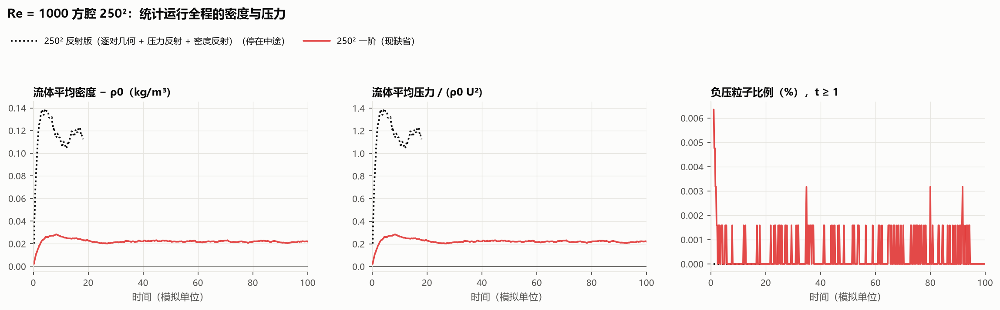

- 平均密度在 t ≈ 4 升到 ρ0 + 0.14，之后在 +0.10 到 +0.12 之间摆动，没有继续上升。一阶稳定在 +0.022。
- t ≥ 5 之后负压粒子比例是 0。
- 粒子数守恒，最大速度 0.977。

250² 方腔的两次统计运行，t 从 5 到 18.06（反射版停下的时刻），每 7000 步（0.21 个时间单位）一个样本。“涨落” = 一个样本减去前后两个样本平均值之后的 rms；密度的平均值已减去 ρ0。

| 量 | 反射版：平均 | 反射版：涨落 | 一阶（现缺省）：平均 | 一阶：涨落 | 涨落之比 |
|---|---|---|---|---|---|
| 平均密度（kg/m³） | +0.1176 | 0.0012 | +0.0256 | 0.0001 | 8.6 |
| 平均压力（ρ0U²） | +1.1772 | 0.0118 | +0.2577 | 0.0014 | 8.6 |
| 最小压力（ρ0U²） | +0.8425 | 0.1179 | +0.0499 | 0.0456 | 2.6 |
| 最大压力（ρ0U²） | +2.7864 | 0.8816 | +1.2749 | 0.0686 | 12.9 |
| 最大密度（kg/m³） | +0.2783 | 0.0879 | +0.1273 | 0.0068 | 12.8 |
| 最大速度（盖速） | +0.9728 | 0.0012 | +0.9728 | 0.0012 | 1.0 |

- 反射版的平均压力逐样本涨落是一阶的 8.6 倍，最大压力的涨落是 12.9 倍。最大速度的涨落相同。

**贴壁第一层到壁面的距离**

任务书要的是 t 在 90 到 100 之间的数。反射版没有跑到那里，所以只有一阶的：

250² 方腔，t ≈ 90 到 100 的 11 个快照合在一起：流体粒子到各壁面（crossing 的盒面，±0.502）的距离，以粒子间距 dx 为单位；只取离另外两面壁超过核半径 h 的那一段（每面壁中间 0.964 的长度，点阵上是 241 个粒子）。第一层 = 距离小于 1 dx 的粒子；点阵上第一层在 0.5 dx，第二层在 1.5 dx。

| 壁 | 运行 | 第一层的粒子数（每个快照；相对点阵） | 第一层到壁面距离的平均（绝对值，dx） | 标准差 | 5 % / 中位 / 95 % 分位 | 最小 | 第二层（1 到 2 dx）的平均 |
|---|---|---|---|---|---|---|---|
| 左壁 | 一阶（现缺省） | 228.3（94.7 %） | 0.483 | 0.034 | 0.436 / 0.485 / 0.522 | 0.372 | 1.438 |
| 右壁 | 一阶（现缺省） | 245.1（101.7 %） | 0.507 | 0.052 | 0.438 / 0.500 / 0.605 | 0.378 | 1.516 |
| 底壁 | 一阶（现缺省） | 238.2（98.8 %） | 0.496 | 0.030 | 0.449 / 0.498 / 0.534 | 0.390 | 1.477 |
| 盖（上壁） | 一阶（现缺省） | 217.5（90.2 %） | 0.462 | 0.045 | 0.413 / 0.459 / 0.515 | 0.339 | 1.373 |

同一时刻能比的只有各筛查短跑 t = 5 的终态（一个快照）：

250² 方腔的筛查短跑，各自 t = 5.01 的终态（一个快照）：四面壁各自贴壁第一层流体粒子（距离小于 1 dx，只取离另外两面壁超过核半径 h 的那一段）到壁面距离的平均，单位 dx；括号内是粒子数（点阵上是 241）。

| 运行 | 左壁 | 右壁 | 底壁 | 盖（上壁） |
|---|---|---|---|---|
| 反射版 | 0.463（217） | 0.506（245） | 0.499（240） | 0.458（215） |
| 逐对几何 + 密度反射（关压力反射） | 0.466（218） | 0.504（243） | 0.497（238） | 0.458（215） |
| 逐对几何 + 压力反射（关密度反射） | 0.467（218） | 0.502（243） | 0.496（238） | 0.458（216） |
| 只有逐对几何（两个反射都关） | 0.458（214） | 0.505（244） | 0.497（239） | 0.462（218） |
| 一阶（现缺省），第 1 次 | 0.463（217） | 0.510（247） | 0.496（237） | 0.461（217） |
| 一阶（现缺省），第 2 次 | 0.467（218） | 0.503（243） | 0.499（240） | 0.455（213） |
| 旧缺省（完整向量） | 0.463（219） | 0.504（242） | 0.498（240） | 0.457（216） |

- t = 5 时四个组合的第一层距离与一阶没有差别（各面壁相差不超过 0.01 dx，在一阶两次运行之间的差别以内）。t = 90 到 100 的情况未验证。

### 12.10 没做或没验证的

- **反射版和三个组合的 ψ_min、速度极值、剖面 L2：未验证**（没有 t = 100 的运行）。
- **反射版在 t = 90 到 100 的第一层距离：未验证。**
- **逐对几何为什么使内部的连续性项变负：没有查。** 已知的只有：两种几何只在四个角的约 100 个粒子上不同；四个组合的压力噪声都大了约 6 倍；内部的汇与旧缺省（完整向量）的同号、同量级。
- **float32 舍入项为什么从 −0.004 变成 +0.016：没有查。**
- **收支构建与缺省构建逐位相同：这一轮没有重新检查**（收支遍历的着色器改过；以前的检查是在改动之前做的）。4.5 的数都来自收支构建。
- **`simple`、`adami` 没有重跑**（它们用的 SPIR-V 逐字节没变）。
- **密度反射新增项的精确性没有单独检验**（任务书的安排；12.2 第 2 条给出了它与逐对写法的差）。
- **3-D**：只做了 numpy 核对和 GPU 单步对照，没有多步运行。
- **没有做**：500² 及以上、双卡、计时、近壁粒子跳过优化、一般几何（任务书的范围）。
- 每个组合的短跑只有一次。四个组合内部连续性项的标准误是 ±0.004 到 ±0.006（一阶 ±0.001），偏离零 3 个标准误左右；一阶两次运行之间相差 0.0006。

## 13. 追加（八）：反射版和"逐对几何 + 完整向量"跑到 t = 100（2026-11-18）

用户的指令：250² 到 t = 100，两张卡同时各跑一个。A 是反射版，能续跑就续跑。B 是 `geometry: pairwise` + `continuity_wall_component: full`，其余取缺省，即旧缺省换成逐对几何。只有粒子丢失、越出盒，或最大速度超过盖速 1.05 倍时才停；内部的连续性项只报告。另外不用新跑：一阶、旧缺省、反射版在 t = 18 的动能和 ψ_min；上一条的第 1、2 步的结论贴出来。工具是 `pairwise_reflection.py long-runs` 和 `cavity_watch.py`。

**先说结果**

- **两次都跑到了 t = 100，没有触发任何停止条件。** 粒子数守恒，没有粒子越出盒，最大速度 0.980 和 0.978。
- **A（反射版）：ψ_min −4.66 %，比一阶（−4.09 %）弱 0.57 个百分点。** 三个速度极值和剖面 L2 也都比一阶略差。
- **B（逐对几何 + 完整向量）：ψ_min −1.66 %，与旧缺省（−1.60 %）相同。** 速度极值相差不超过 0.05 个百分点，剖面 L2 相同。
- **主涡的强弱跟着"连续性壁项取完整向量还是只取法向"走，不跟着几何的取法走。** 在逐对几何上两者相差 3.0 个百分点（−1.66 % 对 −4.66 %），在原来的几何上相差 2.5 个百分点（−1.60 % 对 −4.09 %）。A 同时带着两个反射，这 3.0 里反射占多少，这两次运行分不开。
- **内部的连续性项与 ψ_min 没有对应关系。** A 是 −0.021，B 是 −0.015，同号同量级，ψ_min 却相差 3 个百分点；一阶是 0，ψ_min 与 A 接近。
- **压力噪声**：两次都是一阶的 9 到 11 倍，从头到尾如此。
- **密度和压力**：A 的平均密度稳定在 ρ0 + 0.12，压力为正。B 的平均密度一直在降，t = 100 时是 ρ0 − 0.19，还没有停；t = 39 以后 99 % 以上的粒子负压。
- **t = 18 时各配置的差别已经定型**：反射版的动能和 ψ_min 估计比一阶低约 1 %，旧缺省和 B 高 2.6 % 到 3.8 %，与 t = 100 时的比例相同。

### 13.1 运行和我做的决定

- **A 从 t = 10.08 续跑，不是从 18.06。** 运行器每 336,000 步（10.08 个时间单位）存一个检查点，18.06 那一刻没有。续跑前把运行目录原样复制成 `cavity/n250_reflection_stopped_t18`，第 12 节的表读这个副本。
  - 续跑重现了第一次：t = 18.06 的动能第一次是 41.670，续跑是 41.662。
- **B 这个组合代码支持**，没有改跑别的。跑之前做了一次它的 GPU 单步对照，通过（判据值 8.2e-6，记录 wc-20261118-172351-81ae）。
- **停止条件怎么执行的**：
  - 粒子丢失：运行器自己在每个样本查粒子数，不一致就结束。
  - 越出盒和最大速度：新写的 `cavity_watch.py` 在旁边看着，读运行写出的文件（每个样本的流体最大速度；每 20,000 步一次位置读回里越出盒的流体粒子数），触发时结束运行器进程。
  - 启动器用 `--retries 0`，被停掉的运行不会自动续跑。
  - 密度、压力、收支都不作为停止条件。
- **内部的连续性项**：长跑用的是缺省构建，没有这个量。A 引用第 12 节的收支短跑；B 没有现成的，我追加了一次 t ≤ 5 的收支短跑（2 分钟，与 A 同卡，A 因此慢了约 1 分钟）。
- **t = 18 的 ψ_min 只能给估计值。** 运行器只在统计窗口（t ≥ 80）存粒子快照，三次运行在 t = 18 都没有快照，真正的 ψ_min 算不出来。每 0.21 个时间单位存一次的是两条中心线上的速度剖面，由它得到"中心线估计"（13.6）。
- **更正第 12 节的一处**：12.9 的涨落表表头写的样本间隔是"每 1000 步（0.03 个时间单位）"，实际是每 7000 步（0.21 个时间单位）。表里的数没有变，表头已改。12.8 里各筛查短跑的涨落确实是 0.03 间隔，没有错。

### 13.2 运行情况

| 运行 | 到达 | 粒子数（含壁） | 越出盒的流体粒子（各次位置读回的最大值） | 流体最大速度（整个运行；线 1.05） | 停止条件 | A_f 回退（累计） | φ_min / dx；低于距离下限的粒子（最大） | 记录（提交） |
|---|---|---|---|---|---|---|---|---|
| 反射版（从 t = 10.08 的检查点续跑） | t = 100.59 | 74,529，每个样本都相同 | 0 | 0.980 | 没有触发 | 0 | 0.308；0 | wc-20261118-172400-694d（a414a93） |
| 逐对几何 + 完整向量 | t = 99.99 | 74,529，每个样本都相同 | 0 | 0.978 | 没有触发 | 0 | 0.276；0 | wc-20261118-172401-8ba7（a414a93） |
| 一阶（现缺省） | t = 99.99 | 74,529，每个样本都相同 | 0 | 0.978 | 没有触发 | 0 | 0.295；0 | wc-20261118-100324-097b（6c8a55a） |

- 两次都跑到了统计窗口的末尾。A 到 t = 100.59（运行器在 t = 80.6 判定定常，之后再平均 20 个时间单位），B 到 t = 99.99。
- 两个看门进程都以"没有满足任何停止条件"结束。停止的路径在这两次运行里没有被用到；我用两个假运行另外测过（最大速度 1.2、越出盒 3 个粒子），两种情况都能把进程停掉。
- A_f 回退 0 次，低于距离下限的粒子 0 个。

### 13.3 ψ_min、速度极值、剖面 L2，与已有各行并列

Re = 1000 方腔对 Marchi 2021，K = 1，最后 20 个时间单位平均。括号内 = 相对参考值的偏差（负 = 偏弱）。“wall 帧”把单位方腔放在最内层壁粒子行的中线上（已发表的表用的放法，各模式同样处理）；“mid 帧”放在最内层壁粒子行与最外层流体行的正中（crossing 的盒面）。剖面误差是 28 个 Marchi 点上的 L2 / L∞，速度以盖速为单位。参考值：ψ_min -0.11894，u_min -0.38857，v_max 0.37694，v_min -0.52708。

| 运行 | ψ_min（wall 帧） | ψ_min 偏差（mid 帧） | u_min | v_max | v_min | u 剖面 L2 / L∞（wall 帧） | v 剖面 L2 / L∞（wall 帧） | u 剖面 L2 / L∞（mid 帧） | v 剖面 L2 / L∞（mid 帧） |
|---|---|---|---|---|---|---|---|---|---|
| 250² crossing，反射版 | -0.11340（-4.66 %） | -4.28 % | -0.37239（-4.16 %） | 0.36030（-4.42 %） | -0.50735（-3.74 %） | 0.0099 / 0.0162 | 0.0154 / 0.0251 | 0.0099 / 0.0163 | 0.0129 / 0.0197 |
| 250² crossing，逐对几何 + 完整向量 | -0.11696（-1.66 %） | -1.27 % | -0.38477（-0.98 %） | 0.37297（-1.06 %） | -0.52204（-0.96 %） | 0.0050 / 0.0174 | 0.0057 / 0.0125 | 0.0037 / 0.0062 | 0.0039 / 0.0080 |
| 250² crossing，一阶（现缺省） | -0.11407（-4.09 %） | -3.71 % | -0.37533（-3.41 %） | 0.36344（-3.58 %） | -0.50979（-3.28 %） | 0.0087 / 0.0162 | 0.0136 / 0.0235 | 0.0083 / 0.0134 | 0.0110 / 0.0173 |
| 250² crossing，二阶粘性 | -0.11426（-3.93 %） | -3.55 % | -0.37593（-3.25 %） | 0.36411（-3.40 %） | -0.51073（-3.10 %） | 0.0085 / 0.0174 | 0.0129 / 0.0220 | 0.0078 / 0.0129 | 0.0104 / 0.0165 |
| 250² crossing，旧缺省（一阶，完整向量） | -0.11703（-1.60 %） | -1.21 % | -0.38493（-0.94 %） | 0.37314（-1.01 %） | -0.52217（-0.93 %） | 0.0050 / 0.0175 | 0.0056 / 0.0124 | 0.0036 / 0.0062 | 0.0038 / 0.0079 |
| 250² crossing，旧缺省，第二次运行 | -0.11703（-1.61 %） | -1.21 % | -0.38490（-0.94 %） | 0.37315（-1.01 %） | -0.52216（-0.93 %） | 0.0049 / 0.0174 | 0.0056 / 0.0123 | 0.0037 / 0.0063 | 0.0038 / 0.0078 |
| 250² simple | -0.10867（-8.64 %） | -8.27 % | -0.35468（-8.72 %） | 0.34184（-9.31 %） | -0.48407（-8.16 %） | 0.0230 / 0.0351 | 0.0271 / 0.0430 | 0.0264 / 0.0496 | 0.0262 / 0.0438 |
| 250² adami | -0.12336（+3.72 %） | +4.14 % | -0.40476（+4.17 %） | 0.39438（+4.63 %） | -0.54703（+3.79 %） | 0.0109 / 0.0227 | 0.0122 / 0.0193 | 0.0097 / 0.0219 | 0.0149 / 0.0271 |
| 500² crossing，一阶（现缺省） | -0.11631（-2.21 %） | -2.01 % | -0.38167（-1.78 %） | 0.37010（-1.82 %） | -0.51838（-1.65 %） | 0.0042 / 0.0073 | 0.0066 / 0.0097 | 0.0049 / 0.0076 | 0.0057 / 0.0096 |
| 500² crossing，二阶粘性 | -0.11636（-2.16 %） | -1.97 % | -0.38181（-1.74 %） | 0.37028（-1.77 %） | -0.51864（-1.60 %） | 0.0041 / 0.0072 | 0.0064 / 0.0093 | 0.0048 / 0.0075 | 0.0056 / 0.0095 |
| 500² crossing，旧缺省（一阶，完整向量） | -0.11799（-0.80 %） | -0.60 % | -0.38727（-0.33 %） | 0.37574（-0.32 %） | -0.52550（-0.30 %） | 0.0021 / 0.0066 | 0.0020 / 0.0042 | 0.0029 / 0.0054 | 0.0027 / 0.0053 |
| 500² simple | -0.11228（-5.59 %） | -5.40 % | -0.36711（-5.52 %） | 0.35500（-5.82 %） | -0.49956（-5.22 %） | 0.0150 / 0.0224 | 0.0175 / 0.0275 | 0.0167 / 0.0295 | 0.0169 / 0.0278 |
| 500² adami | -0.12059（+1.39 %） | +1.59 % | -0.39554（+1.79 %） | 0.38474（+2.07 %） | -0.53603（+1.70 %） | 0.0050 / 0.0108 | 0.0055 / 0.0104 | 0.0050 / 0.0123 | 0.0074 / 0.0151 |

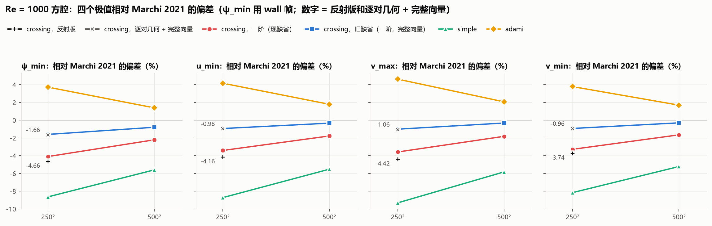

- **A 比一阶差一点**：ψ_min −4.66 % 对 −4.09 %；u_min −4.16 % 对 −3.41 %；v_max −4.42 % 对 −3.58 %；v_min −3.74 % 对 −3.28 %。剖面 L2（wall 帧）是 0.0099 / 0.0154，一阶是 0.0087 / 0.0136。
- **B 与旧缺省分不开**：ψ_min −1.66 % 对 −1.60 %（旧缺省的第二次运行 −1.61 %）；三个速度极值 −0.98 / −1.06 / −0.96 % 对 −0.94 / −1.01 / −0.93 %；剖面 L2 0.0050 / 0.0057 对 0.0050 / 0.0056。图里 B 的记号压在旧缺省的方块上。
- B 与旧缺省相差 0.06 个百分点，旧缺省两次运行之间相差 0.01。所以差别如果有，也只有 0.05 左右。
- 只有 250²。500² 没有跑，收敛阶没有。

极值的位置和窗口平均动能：

极值的位置：wall 帧 / mid 帧（括号内 = mid 帧位置减参考位置）。参考位置：y(u_min) 0.1717，x(v_max) 0.1578，x(v_min) 0.9092，ψ_min (0.5308, 0.5652)。

| 运行 | y(u_min) | x(v_max) | x(v_min) | ψ_min 的位置 | 平均窗口 t | 定常 t_s | 窗口平均动能 | 提交 |
|---|---|---|---|---|---|---|---|---|
| 250² crossing，反射版 | 0.1724 / 0.1711（-0.0006） | 0.1591 / 0.1577（-0.0001） | 0.9076 / 0.9092（+0.0000） | (0.5312, 0.5643) / (0.5313, 0.5645)（+0.0005, -0.0007） | 80.6–100.6 | 80.6 | 47.3527 | bd9fec1 |
| 250² crossing，逐对几何 + 完整向量 | 0.1710 / 0.1697（-0.0020） | 0.1583 / 0.1569（-0.0009） | 0.9087 / 0.9104（+0.0011） | (0.5307, 0.5639) / (0.5308, 0.5642)（-0.0000, -0.0011） | 80.0–100.0 | 70.6 | 49.6637 | a414a93 |
| 250² crossing，一阶（现缺省） | 0.1725 / 0.1712（-0.0005） | 0.1591 / 0.1577（-0.0001） | 0.9078 / 0.9094（+0.0001） | (0.5309, 0.5641) / (0.5310, 0.5644)（+0.0002, -0.0009） | 80.0–100.0 | 70.6 | 47.8440 | 6c8a55a |
| 250² crossing，二阶粘性 | 0.1723 / 0.1710（-0.0007） | 0.1591 / 0.1577（-0.0001） | 0.9079 / 0.9095（+0.0003） | (0.5309, 0.5640) / (0.5310, 0.5643)（+0.0002, -0.0010） | 80.6–100.6 | 80.6 | 48.0193 | 263381b |
| 250² crossing，旧缺省（一阶，完整向量） | 0.1709 / 0.1696（-0.0021） | 0.1583 / 0.1569（-0.0009） | 0.9087 / 0.9104（+0.0011） | (0.5307, 0.5639) / (0.5308, 0.5642)（+0.0000, -0.0011） | 80.6–100.6 | 80.6 | 49.6894 | 052cfb9 |
| 250² crossing，旧缺省，第二次运行 | 0.1710 / 0.1696（-0.0020） | 0.1583 / 0.1569（-0.0009） | 0.9087 / 0.9104（+0.0011） | (0.5307, 0.5639) / (0.5308, 0.5642)（-0.0000, -0.0010） | 80.6–100.6 | 80.6 | 49.6867 | 5ee25b1 |
| 250² simple | 0.1735 / 0.1722（+0.0005） | 0.1618 / 0.1605（+0.0026） | 0.9094 / 0.9110（+0.0017） | (0.5334, 0.5643) / (0.5336, 0.5646)（+0.0028, -0.0007） | 80.0–100.0 | 70.6 | 42.9049 | 029313a |
| 250² adami | 0.1679 / 0.1665（-0.0052） | 0.1559 / 0.1545（-0.0033） | 0.9102 / 0.9119（+0.0026） | (0.5300, 0.5646) / (0.5301, 0.5649)（-0.0007, -0.0004） | 80.6–100.6 | 80.6 | 53.7693 | 029313a |
| 500² crossing，一阶（现缺省） | 0.1708 / 0.1702（-0.0015） | 0.1576 / 0.1570（-0.0009） | 0.9090 / 0.9098（+0.0006） | (0.5306, 0.5643) / (0.5307, 0.5644)（-0.0001, -0.0008） | 80.0–99.8 | 69.6 | 48.9382 | 6c8a55a |
| 500² crossing，二阶粘性 | 0.1708 / 0.1702（-0.0015） | 0.1576 / 0.1569（-0.0009） | 0.9091 / 0.9099（+0.0006） | (0.5307, 0.5643) / (0.5307, 0.5644)（-0.0001, -0.0009） | 80.0–99.8 | 79.6 | 48.9830 | 263381b |
| 500² crossing，旧缺省（一阶，完整向量） | 0.1699 / 0.1693（-0.0024） | 0.1572 / 0.1565（-0.0013） | 0.9096 / 0.9104（+0.0012） | (0.5305, 0.5641) / (0.5306, 0.5643)（-0.0002, -0.0010） | 80.0–99.8 | 79.6 | 50.0152 | 5ee25b1 |
| 500² simple | 0.1726 / 0.1720（+0.0003） | 0.1596 / 0.1589（+0.0010） | 0.9092 / 0.9100（+0.0008） | (0.5321, 0.5649) / (0.5322, 0.5650)（+0.0014, -0.0002） | 80.0–99.8 | 69.6 | 45.5336 | 029313a |
| 500² adami | 0.1684 / 0.1677（-0.0040） | 0.1559 / 0.1552（-0.0026） | 0.9104 / 0.9112（+0.0019） | (0.5302, 0.5644) / (0.5302, 0.5645)（-0.0006, -0.0007） | 80.0–99.8 | 79.6 | 51.7032 | 029313a |

### 13.4 平均密度、平均压力、压力噪声、负压粒子比例随时间的变化

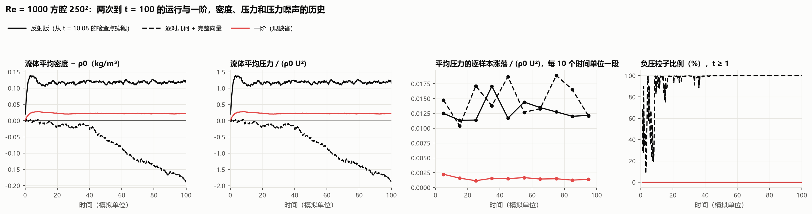

| 运行 | t | 平均密度 − ρ0（kg/m³） | 平均压力 | 负压粒子比例 | 流体最大速度 |
|---|---|---|---|---|---|
| 反射版（从 t = 10.08 的检查点续跑） | 1.05 | +0.08408 | +0.842 ρ0U² | 0.000 % | 0.972 |
| 反射版（从 t = 10.08 的检查点续跑） | 5.04 | +0.13670 | +1.369 ρ0U² | 0.000 % | 0.973 |
| 反射版（从 t = 10.08 的检查点续跑） | 10.08 | +0.10944 | +1.096 ρ0U² | 0.000 % | 0.972 |
| 反射版（从 t = 10.08 的检查点续跑） | 18.06 | +0.12046 | +1.206 ρ0U² | 0.000 % | 0.976 |
| 反射版（从 t = 10.08 的检查点续跑） | 30.03 | +0.11805 | +1.182 ρ0U² | 0.000 % | 0.976 |
| 反射版（从 t = 10.08 的检查点续跑） | 39.90 | +0.12296 | +1.231 ρ0U² | 0.000 % | 0.976 |
| 反射版（从 t = 10.08 的检查点续跑） | 60.06 | +0.11802 | +1.182 ρ0U² | 0.000 % | 0.975 |
| 反射版（从 t = 10.08 的检查点续跑） | 80.01 | +0.12317 | +1.233 ρ0U² | 0.000 % | 0.975 |
| 反射版（从 t = 10.08 的检查点续跑） | 90.09 | +0.12055 | +1.207 ρ0U² | 0.000 % | 0.975 |
| 反射版（从 t = 10.08 的检查点续跑） | 99.96 | +0.11735 | +1.175 ρ0U² | 0.000 % | 0.977 |
| 逐对几何 + 完整向量 | 1.05 | +0.00083 | +0.009 ρ0U² | 29.076 % | 0.970 |
| 逐对几何 + 完整向量 | 5.04 | -0.00039 | -0.003 ρ0U² | 57.723 % | 0.973 |
| 逐对几何 + 完整向量 | 10.08 | -0.00771 | -0.076 ρ0U² | 99.221 % | 0.972 |
| 逐对几何 + 完整向量 | 18.06 | -0.01467 | -0.146 ρ0U² | 99.549 % | 0.976 |
| 逐对几何 + 完整向量 | 30.03 | -0.02266 | -0.226 ρ0U² | 99.744 % | 0.974 |
| 逐对几何 + 完整向量 | 39.90 | -0.02272 | -0.226 ρ0U² | 99.906 % | 0.976 |
| 逐对几何 + 完整向量 | 60.06 | -0.08430 | -0.842 ρ0U² | 99.995 % | 0.976 |
| 逐对几何 + 完整向量 | 80.01 | -0.13939 | -1.392 ρ0U² | 99.998 % | 0.976 |
| 逐对几何 + 完整向量 | 90.09 | -0.15640 | -1.562 ρ0U² | 100.000 % | 0.975 |
| 逐对几何 + 完整向量 | 99.96 | -0.18908 | -1.889 ρ0U² | 100.000 % | 0.974 |
| 一阶（现缺省） | 1.05 | +0.01129 | +0.114 ρ0U² | 0.006 % | 0.971 |
| 一阶（现缺省） | 5.04 | +0.02600 | +0.261 ρ0U² | 0.000 % | 0.972 |
| 一阶（现缺省） | 10.08 | +0.02628 | +0.264 ρ0U² | 0.000 % | 0.971 |
| 一阶（现缺省） | 18.06 | +0.02326 | +0.234 ρ0U² | 0.000 % | 0.974 |
| 一阶（现缺省） | 30.03 | +0.02139 | +0.215 ρ0U² | 0.000 % | 0.974 |
| 一阶（现缺省） | 39.90 | +0.02206 | +0.222 ρ0U² | 0.000 % | 0.975 |
| 一阶（现缺省） | 60.06 | +0.02143 | +0.215 ρ0U² | 0.000 % | 0.974 |
| 一阶（现缺省） | 80.01 | +0.02192 | +0.220 ρ0U² | 0.003 % | 0.975 |
| 一阶（现缺省） | 90.09 | +0.02112 | +0.212 ρ0U² | 0.000 % | 0.975 |
| 一阶（现缺省） | 99.96 | +0.02195 | +0.221 ρ0U² | 0.000 % | 0.974 |

平均压力的逐样本涨落（ρ0U²）：一个样本减去前后两个样本平均值之后的 rms，样本间隔 0.21 个时间单位，按每 10 个时间单位一段给出。最后一列是 t ≥ 5 里负压粒子比例的最大值。

| 运行 | t 0–10 | t 10–20 | t 20–30 | t 30–40 | t 40–50 | t 50–60 | t 60–70 | t 70–80 | t 80–90 | t 90–100 | 负压粒子比例的最大值（t ≥ 5） |
|---|---|---|---|---|---|---|---|---|---|---|---|
| 反射版（从 t = 10.08 的检查点续跑） | 0.0125 | 0.0113 | 0.0114 | 0.0171 | 0.0117 | 0.0144 | 0.0135 | 0.0128 | 0.0120 | 0.0122 | 0.002 % |
| 逐对几何 + 完整向量 | 0.0147 | 0.0104 | 0.0171 | 0.0138 | 0.0187 | 0.0127 | 0.0133 | 0.0189 | 0.0165 | 0.0121 | 100.000 % |
| 一阶（现缺省） | 0.0022 | 0.0016 | 0.0012 | 0.0016 | 0.0015 | 0.0017 | 0.0014 | 0.0015 | 0.0013 | 0.0014 | 0.003 % |

- **A 的平均密度**：t = 1 时 ρ0 + 0.084，t = 5 时到 +0.137，t = 18 以后在 +0.117 到 +0.123 之间，最后 20 个时间单位的变化率是每时间单位 +0.0001，已经持平。平均压力 +1.18 到 +1.23 ρ0U²。负压粒子比例在 t ≥ 5 里最大 0.002 %。
- **B 的平均密度**：t ≤ 5 在 ρ0 附近，之后一直降：t = 18 时 −0.015，t = 40 时 −0.023，t = 60 时 −0.084，t = 100 时 −0.189。最后 20 个时间单位的变化率是每时间单位 −0.0020，没有停。平均压力在 t = 100 是 −1.89 ρ0U²；负压粒子比例在 t = 10 到 39 之间是 74 % 到 99.9 %，t = 39 以后一直在 99 % 以上。
  - 旧缺省在 t = 80 到 100 的电平是 −11.6 到 −14.4 ρ0U²（第 11 节），B 是 −1.4 到 −1.9。B 降得比旧缺省慢得多，但方向相同。
- **压力噪声**：A 各段是 0.011 到 0.017 ρ0U²，B 是 0.010 到 0.019，一阶是 0.0012 到 0.0022。t ≥ 80 的平均是 0.0120、0.0145 和 0.0013，即 9 倍和 11 倍。没有随时间变大或变小的趋势。
- 最大速度三次运行相同（0.97 到 0.98）。

- 旧缺省的那次运行（第 6 节）是在记录历史的钩子之前跑的，没有这四条曲线；已知它全程负压（第 9 节）。

### 13.5 内部的连续性项（只报告）

收支短跑（250²，t = 0 到 5.01，收支构建），t ∈ [1, 5] 的时间平均，kg/m³ 每时间单位。

| 配置 | 内部的连续性项 | 连续性项全场：流体邻居 / 壁邻居 | δ 项全场合计 | 四项之和 | float32 存储舍入 | 实际写入 | 记录（提交） |
|---|---|---|---|---|---|---|---|
| 反射版 | -0.02058 ± 0.00605 | +0.07520 / -0.08596 | +0.00353 | -0.00723 | +0.01709 | +0.00985 | wc-20261118-165529-a2b4（bd9fec1） |
| 逐对几何 + 完整向量 | -0.01511 ± 0.00210 | -0.02287 / +0.00534 | +0.00852 | -0.00900 | +0.01028 | +0.00128 | wc-20261118-172659-95ca（a414a93） |
| 只有逐对几何（第 12 节） | -0.01402 ± 0.00424 | +0.05111 / -0.06238 | +0.00692 | -0.00436 | +0.01615 | +0.01179 | wc-20261118-165901-fd2d（8748bcd） |
| 一阶（现缺省），第 1 次 | +0.00050 ± 0.00113 | +0.03553 / -0.03511 | +0.00767 | +0.00809 | -0.00402 | +0.00407 | wc-20261118-102117-7b54（6c8a55a） |
| 一阶（现缺省），第 2 次 | -0.00007 ± 0.00139 | +0.03834 / -0.03827 | +0.00762 | +0.00769 | -0.00430 | +0.00339 | wc-20261118-102354-4dd5（6c8a55a） |
| 旧缺省（完整向量） | -0.02643 ± 0.00110 | -0.03999 / +0.01067 | +0.00827 | -0.02105 | +0.00662 | -0.01443 | wc-20261118-025805-ba45（0dd6338） |

- A：−0.021 ± 0.006（第 12 节的短跑）。B：−0.015 ± 0.002（这次追加的短跑）。一阶 0 ± 0.001，旧缺省 −0.026 ± 0.001。
- B 的各项与旧缺省同一个样子：流体邻居的连续性项全场为负，壁邻居的为正，四项之和为负（−0.009，旧缺省 −0.021）。t ≤ 5 时舍入项（+0.010）把它抵掉了，实际写入是 +0.001；之后密度下降（13.4）。
- **四个配置放在一起，内部的连续性项与 ψ_min 没有对应关系**：

| 配置 | 内部的连续性项 | ψ_min 偏差 |
|---|---|---|
| 一阶（现缺省） | 0 ± 0.001 | −4.09 % |
| A：反射版 | −0.021 | −4.66 % |
| B：逐对几何 + 完整向量 | −0.015 | −1.66 % |
| 旧缺省（完整向量） | −0.026 | −1.60 % |

### 13.6 t = 18 的动能和 ψ_min（不用新跑）

250²，t = 18.06。动能是运行器记录的流体动能；“窗口平均”和剖面量是 t ∈ (16.06, 18.06] 的 10 个样本的平均。ψ 的估计 = 竖直中心线上 u 剖面从底向上积分的最小值，除以 1 + 2 dx（wall 帧）；括号内是相对 Marchi 2021 定常值 -0.11894 的偏差（流动在 t = 18 还没有定常）。

| 运行 | 动能，t = 18.06 | 动能，窗口平均 | ψ_min 的中心线估计（wall 帧） | 估计的最小值所在高度 y | 中心线上的 u_min | v_max | v_min |
|---|---|---|---|---|---|---|---|
| 一阶（现缺省） | 42.076 | 41.168 | -0.10681（-10.20 %） | 0.574 | -0.3448 | 0.3198 | -0.4774 |
| 旧缺省（完整向量） | 43.675 | 42.739 | -0.10967（-7.79 %） | 0.573 | -0.3538 | 0.3285 | -0.4892 |
| 反射版，第一次（停在 t = 18.06 的那次） | 41.670 | 40.780 | -0.10598（-10.89 %） | 0.574 | -0.3423 | 0.3169 | -0.4762 |
| 反射版，续跑（从 t = 10.08 的检查点） | 41.662 | 40.776 | -0.10595（-10.92 %） | 0.574 | -0.3425 | 0.3169 | -0.4758 |
| 逐对几何 + 完整向量 | 43.633 | 42.692 | -0.10960（-7.85 %） | 0.573 | -0.3535 | 0.3281 | -0.4890 |
| 二阶粘性 | 42.247 | 41.342 | -0.10700（-10.03 %） | 0.573 | -0.3459 | 0.3203 | -0.4789 |
| simple | 37.234 | 36.388 | -0.10106（-15.03 %） | 0.576 | -0.3243 | 0.2981 | -0.4503 |
| adami | 47.437 | 46.438 | -0.11602（-2.45 %） | 0.572 | -0.3732 | 0.3491 | -0.5145 |

- **动能是准确的**（运行器在每个样本记录的流体动能）。
- **ψ_min 是中心线估计，不是真值。** 它等于竖直中心线上的流函数最小值；主涡中心在中心线旁边，所以估计偏小。在两者都有的 t = 80 到 100，估计是真值的 0.995 到 0.996 倍，各模式几乎相同：

中心线估计与真正的 ψ_min 的关系，在两者都有的地方（t = 80 到 100 的窗口；真值由粒子快照在整个腔上求）。

| 运行 | 中心线估计（wall 帧） | ψ_min（wall 帧，快照） | 估计 ÷ 真值 |
|---|---|---|---|
| 一阶（现缺省） | -0.11360 | -0.11407 | 0.9959 |
| 旧缺省（完整向量） | -0.11656 | -0.11703 | 0.9959 |
| 反射版，续跑（从 t = 10.08 的检查点） | -0.11292 | -0.11340 | 0.9958 |
| 逐对几何 + 完整向量 | -0.11650 | -0.11696 | 0.9961 |
| 二阶粘性 | -0.11379 | -0.11426 | 0.9959 |
| simple | -0.10814 | -0.10867 | 0.9952 |
| adami | -0.12288 | -0.12336 | 0.9961 |

- **t = 18.06 的动能**：一阶 42.08，旧缺省 43.68，反射版 41.67（续跑 41.66），B 43.63。
- **t = 18 的 ψ_min 估计**：一阶 −0.1068，旧缺省 −0.1097，反射版 −0.1060，B −0.1096。
- **相对一阶的比例在 t = 18 和 t = 100 相同**：

| 配置 ÷ 一阶 | 动能，t = 18 | 动能，t = 100 | ψ_min 估计，t = 18 | ψ_min（真值），t = 100 |
|---|---|---|---|---|
| 旧缺省 | 1.038 | 1.039 | 1.027 | 1.026 |
| 反射版 | 0.990 | 0.990 | 0.992 | 0.994 |
| B：逐对几何 + 完整向量 | 1.037 | 1.038 | 1.026 | 1.025 |

- 所以各配置之间的差别在 t = 18 就已经形成，之后只是一起长大。t = 5 时动能的比例是 1.029、0.995 和 1.028，已经有最终差距的大部分。

各运行的动能随时间：

流体的动能 ½ Σ m |v|²（运行器在每个样本记录的值），250²，各时刻最近的那个样本。

| 运行 | t = 5.04 | t = 10.08 | t = 18.06 | t = 30.03 | t = 39.9 | t = 60.06 | t = 80.01 | t = 99.96 |
|---|---|---|---|---|---|---|---|---|
| 反射版（从 t = 10.08 的检查点续跑） | 21.099 | 30.987 | 41.662 | 46.424 | 47.040 | 47.300 | 47.346 | 47.359 |
| 逐对几何 + 完整向量 | 21.809 | 32.288 | 43.633 | 48.659 | 49.326 | 49.605 | 49.654 | 49.668 |
| 一阶（现缺省） | 21.210 | 31.223 | 42.076 | 46.922 | 47.549 | 47.797 | 47.829 | 47.852 |
| 旧缺省（完整向量） | 21.831 | 32.335 | 43.675 | 48.698 | 49.371 | 49.627 | 49.680 | 49.696 |
| 二阶粘性 | 21.306 | 31.368 | 42.247 | 47.084 | 47.727 | 47.971 | 48.014 | 48.024 |
| simple | 18.653 | 27.461 | 37.234 | 42.007 | 42.650 | 42.863 | 42.894 | 42.908 |
| adami | 23.470 | 35.053 | 47.437 | 52.687 | 53.390 | 53.690 | 53.750 | 53.769 |

### 13.7 贴壁第一层流体粒子到壁面的距离（t = 90 到 100）

第 12 节没能给出的数，现在有了。

250² 方腔，t ≈ 90 到 100 的 11 个快照合在一起：流体粒子到各壁面（盒面，±0.502）的距离，单位 dx；只取离另外两面壁超过核半径 h 的那一段（点阵上是 241 个粒子）。第一层 = 距离小于 1 dx 的粒子。

| 壁 | 运行 | 第一层的粒子数（每个快照） | 第一层到壁面距离的平均（绝对值，dx） | 标准差 | 最小 | 第二层（1 到 2 dx）的平均 |
|---|---|---|---|---|---|---|
| 左壁 | 反射版（从 t = 10.08 的检查点续跑） | 228.3 | 0.483 | 0.033 | 0.380 | 1.437 |
| 左壁 | 逐对几何 + 完整向量 | 229.1 | 0.482 | 0.036 | 0.363 | 1.437 |
| 左壁 | 一阶（现缺省） | 228.3 | 0.483 | 0.034 | 0.372 | 1.438 |
| 左壁 | 旧缺省（完整向量） | 230.0 | 0.484 | 0.037 | 0.358 | 1.440 |
| 右壁 | 反射版（从 t = 10.08 的检查点续跑） | 245.8 | 0.508 | 0.054 | 0.380 | 1.519 |
| 右壁 | 逐对几何 + 完整向量 | 246.0 | 0.511 | 0.057 | 0.362 | 1.523 |
| 右壁 | 一阶（现缺省） | 245.1 | 0.507 | 0.052 | 0.378 | 1.516 |
| 右壁 | 旧缺省（完整向量） | 245.0 | 0.510 | 0.056 | 0.372 | 1.522 |
| 底壁 | 反射版（从 t = 10.08 的检查点续跑） | 238.5 | 0.497 | 0.033 | 0.371 | 1.478 |
| 底壁 | 逐对几何 + 完整向量 | 238.9 | 0.498 | 0.038 | 0.369 | 1.481 |
| 底壁 | 一阶（现缺省） | 238.2 | 0.496 | 0.030 | 0.390 | 1.477 |
| 底壁 | 旧缺省（完整向量） | 238.8 | 0.498 | 0.034 | 0.385 | 1.484 |
| 盖（上壁） | 反射版（从 t = 10.08 的检查点续跑） | 217.0 | 0.461 | 0.043 | 0.361 | 1.369 |
| 盖（上壁） | 逐对几何 + 完整向量 | 217.3 | 0.461 | 0.041 | 0.325 | 1.373 |
| 盖（上壁） | 一阶（现缺省） | 217.5 | 0.462 | 0.045 | 0.339 | 1.373 |
| 盖（上壁） | 旧缺省（完整向量） | 217.7 | 0.463 | 0.051 | 0.350 | 1.373 |

- 四次运行没有差别。每面壁的第一层距离在四次运行之间相差不超过 0.004 dx：左壁 0.482 到 0.484，右壁 0.507 到 0.511，底壁 0.496 到 0.498，盖 0.461 到 0.463。第二层也一样。
- 所以 ψ_min 的差别不是近壁粒子位置不同造成的（10.11 对一阶和旧缺省得到的结论，现在对 A 和 B 也成立）。

### 13.8 上一条指令的第 1、2 步的结论（第 11 节，原样摘出）

**法向怎么取**

- 连续性里"只取法向分量"的法向按壁面粒子 j 取，不是按流体粒子 i。
- n_j 是从壁粒子 j 指向盒上离它最近的点的单位向量。面块里的壁粒子，n_j 是它所在那面壁的内法向。角块里的壁粒子，n_j 指向盒的角点，是斜的，随粒子在角块里的位置变。
- 距离是混着取的：φ_i 按流体粒子 i 取（到它最近那面壁），d_j 按壁粒子 j 取（到盒的距离）。
- 在方腔里：盖的粒子 n_j = (0, −1)，盖的切向运动完全不进连续性。上面两个角块属于静止壁。
- 这是 `geometry: nearest_wall` 的做法。第 12 节的 `pairwise` 把法向和距离都改成逐对取。

**旧缺省与一阶的场之差**（250²，t = 80 到 100 的平均，旧缺省 − 一阶）

| 区域（0.1 L 分区） | 面积占比 | 速度差平方的占比 | 压力差平方的占比 |
|---|---|---|---|
| 两个上角 | 2.0 % | 21.1 % | 61.3 % |
| 两个下角 | 2.0 % | 0.0 % | 1.8 % |
| 四面壁的中段 | 31.9 % | 20.2 % | 15.8 % |
| 内部 | 64.1 % | 58.8 % | 21.2 % |

- 差别集中在盖的两个角。两个上角占面积 2 %，占速度差平方的 21 %、压力差平方的 61 %。
- 内部的差只是主涡整体强 2.49 %：旧缺省的内部速度场等于一阶的乘 1.0249，这一个系数解释了内部平方差的 95 %。
- 四面壁中段的差主要在右壁（盖的下游一侧），占 11.7 %。两个下角没有差别。
- 速度差的 rms 是 0.0073（盖速 = 1），是两次运行之差的 17 倍。压力差只有两个上角里的可信：旧缺省在上游角低 0.51 ρ0U²，在下游角高 0.45 ρ0U²。
- 10.14 的猜测改了：区分两种缺省的不是盖下面的涨落误差，而是盖的两个角上的一个系统项。一阶丢掉的切向项在壁的中段是零均值的涨落；在两个上角有很大的平均值，离角 h 以内是 +5.4 和 −6.0 U/L。
- 图是 `figures/field_difference_velocity.png` 和 `figures/field_difference_pressure.png`，完整的表在第 11 节。

### 13.9 没做或没验证的

- **只有 250²，每个配置一次运行。** 500² 没有跑。
- **A 弱的 0.57 个百分点里几何和反射各占多少：未验证。** "只有逐对几何、连续性只取法向"没有跑到 t = 100。
- **t = 18 的 ψ_min 是中心线估计，不是真值**（没有那一刻的粒子快照）。动能是准确的。
- **B 的平均密度到 t = 100 还在降**（每时间单位 −0.002），更长时间会怎样未验证。
- **内部的连续性项来自 t ≤ 5 的短跑**，不是长跑本身；长跑后期这一项的大小未验证。B 的短跑只有一次。
- **逐对几何为什么带来内部的汇和压力噪声：仍然没有查。**
- A 是从第一次运行在 t = 10.08 的检查点续跑的，没有从头重跑。续跑在 t = 18.06 重现了第一次的动能（差 0.02 %）。
- 第 12 节列的未验证项（收支构建与缺省构建是否逐位相同等）没有变。

## 14. 追加（九）：完整方案，从 ρ0 和 ρ0 + 0.3 各跑到 t = 100（2026-11-18）

用户的指令：250² 到 t = 100，两张卡同时各跑一个，配置都是"完整方案"：`geometry: pairwise` + `continuity_wall_component: full` + `pressure_wall: reflection` + `delta_wall: reflection`，其余取缺省。C1 的初始密度是 ρ0；C2 的初始密度整体加 0.3 kg/m³，其余相同。跑之前先做这个组合的 GPU 单步对照。停止条件同第 13 节。另外不用新跑：B 在同样时刻的平均密度；旧缺省的平均压力涨落。工具是 `pairwise_reflection.py full-scheme`。A、B 是第 13 节的两次运行（A = 反射版，只取法向；B = 逐对几何 + 完整向量，没有反射）。

**先说结果**

- **两次都跑到了 t = 100，没有触发任何停止条件。**
- **ψ_min 是 −1.39 %（C1）和 −1.40 %（C2）**，是目前 crossing 各配置里最接近参考值的；旧缺省是 −1.60 %，B 是 −1.66 %。三个速度极值是 −0.73 % 到 −0.81 %，剖面 L2 是 0.0048 / 0.0051。
- **初始密度不影响结果。** C2 多出来的 0.3 kg/m³ 按约 1.8 个时间单位的时间常数衰减，t = 5 时只剩 0.02，t = 10 以后跟着 C1 走（最多低 0.02）。两次的 ψ_min 相差 0.01 个百分点。
- **平均密度一直在降，没有稳住。** t ∈ [60, 100] 的变化率是每时间单位 −0.0027（C1）和 −0.0029（C2），比 B（−0.0021）还快一点。t = 100 时是 ρ0 − 0.26 和 ρ0 − 0.28。
- **压力为负**：t = 100 时平均压力 −2.6 和 −2.8 ρ0U²，t = 40 以后 99.99 % 以上的粒子负压。
- **平均压力的涨落是一阶的 5 到 6 倍**（0.0078 和 0.0062 对 0.0013 ρ0U²），约是 A、B 的一半。
- **旧缺省的长跑没有密度和压力的历史文件。** 由它存下的 t = 80 到 100 的快照按同一量度补算：涨落是 0.014 和 0.021（两次运行），一阶是 0.0028，C1、C2 是 0.023 和 0.016。

### 14.1 运行和我做的决定

- **单步对照**（跑之前）：完整方案这个组合，2-D 通过（判据值 9.1e-6，记录 wc-20261118-180146-2569），3-D 也通过（1.1e-5，记录 wc-20261118-180146-dcfa）。容差 1e-4。
- **C2 的初始密度**用 `cavity_run.py --initial-density-offset 0.3`（第 10 节做压力分支对照时加的启动选项）：每个流体粒子的初始密度是 ρ0 + 0.3，初始压力按状态方程取这个密度的值；质量、壁粒子和 ρ0 本身不动。求解器没有改。
- **停止条件**的执行方式与第 13 节相同（运行器查粒子数，`cavity_watch.py` 看越出盒和最大速度，`--retries 0`）。
- **旧缺省的压力涨落**：它的两次长跑是在记录历史的钩子之前跑的，没有 0.21 间隔的平均压力序列。我用两种已有数据补：
  - 长跑存下的 21 个快照（t = 80.2 到 100.0，间隔 0.99）。平均压力由粒子体积经状态方程还原；对有历史文件的运行，还原值算出的涨落与历史文件里记录的压力算出的完全相同，所以还原是可靠的。但 0.99 间隔的涨落与 0.21 间隔的不是同一个数，只能在同一列里互相比。
  - 第 8 节的收支短跑（t ≤ 5，间隔 0.03）。
- 这一轮没有追加任何短跑；完整方案的内部连续性项没有（任务没有要）。

### 14.2 运行情况

| 运行 | 到达 | 粒子数（含壁） | 越出盒的流体粒子（各次位置读回的最大值） | 流体最大速度（整个运行；线 1.05） | 停止条件 | A_f 回退（累计） | φ_min / dx；低于距离下限的粒子（最大） | 记录（提交） |
|---|---|---|---|---|---|---|---|---|
| C1：完整方案，初始密度 ρ0 | t = 100.59 | 74,529，每个样本都相同 | 0 | 0.978 | 没有触发 | 0 | 0.292；0 | wc-20261118-180207-570c（3176d57） |
| C2：完整方案，初始密度 ρ0 + 0.3 | t = 99.99 | 74,529，每个样本都相同 | 0 | 0.978 | 没有触发 | 0 | 0.296；0 | wc-20261118-180207-3a53（3176d57） |

- 两个看门进程都以"没有满足任何停止条件"结束。粒子数守恒，越出盒 0 个，最大速度 0.978。
- A_f 回退 0 次，低于距离下限的粒子 0 个。

### 14.3 ψ_min、速度极值、剖面 L2，与已有各行并列

Re = 1000 方腔对 Marchi 2021，K = 1，最后 20 个时间单位平均。括号内 = 相对参考值的偏差（负 = 偏弱）。“wall 帧”把单位方腔放在最内层壁粒子行的中线上（已发表的表用的放法，各模式同样处理）；“mid 帧”放在最内层壁粒子行与最外层流体行的正中（crossing 的盒面）。剖面误差是 28 个 Marchi 点上的 L2 / L∞，速度以盖速为单位。参考值：ψ_min -0.11894，u_min -0.38857，v_max 0.37694，v_min -0.52708。

| 运行 | ψ_min（wall 帧） | ψ_min 偏差（mid 帧） | u_min | v_max | v_min | u 剖面 L2 / L∞（wall 帧） | v 剖面 L2 / L∞（wall 帧） | u 剖面 L2 / L∞（mid 帧） | v 剖面 L2 / L∞（mid 帧） |
|---|---|---|---|---|---|---|---|---|---|
| 250² crossing，完整方案（C1） | -0.11728（-1.39 %） | -1.00 % | -0.38565（-0.75 %） | 0.37390（-0.81 %） | -0.52314（-0.75 %） | 0.0048 / 0.0176 | 0.0051 / 0.0119 | 0.0035 / 0.0061 | 0.0035 / 0.0072 |
| 250² crossing，完整方案，初始密度 ρ0 + 0.3（C2） | -0.11727（-1.40 %） | -1.01 % | -0.38572（-0.73 %） | 0.37393（-0.80 %） | -0.52313（-0.75 %） | 0.0048 / 0.0177 | 0.0050 / 0.0116 | 0.0034 / 0.0061 | 0.0035 / 0.0073 |
| 250² crossing，逐对几何 + 完整向量（B） | -0.11696（-1.66 %） | -1.27 % | -0.38477（-0.98 %） | 0.37297（-1.06 %） | -0.52204（-0.96 %） | 0.0050 / 0.0174 | 0.0057 / 0.0125 | 0.0037 / 0.0062 | 0.0039 / 0.0080 |
| 250² crossing，反射版，只取法向（A） | -0.11340（-4.66 %） | -4.28 % | -0.37239（-4.16 %） | 0.36030（-4.42 %） | -0.50735（-3.74 %） | 0.0099 / 0.0162 | 0.0154 / 0.0251 | 0.0099 / 0.0163 | 0.0129 / 0.0197 |
| 250² crossing，一阶（现缺省） | -0.11407（-4.09 %） | -3.71 % | -0.37533（-3.41 %） | 0.36344（-3.58 %） | -0.50979（-3.28 %） | 0.0087 / 0.0162 | 0.0136 / 0.0235 | 0.0083 / 0.0134 | 0.0110 / 0.0173 |
| 250² crossing，二阶粘性 | -0.11426（-3.93 %） | -3.55 % | -0.37593（-3.25 %） | 0.36411（-3.40 %） | -0.51073（-3.10 %） | 0.0085 / 0.0174 | 0.0129 / 0.0220 | 0.0078 / 0.0129 | 0.0104 / 0.0165 |
| 250² crossing，旧缺省（一阶，完整向量） | -0.11703（-1.60 %） | -1.21 % | -0.38493（-0.94 %） | 0.37314（-1.01 %） | -0.52217（-0.93 %） | 0.0050 / 0.0175 | 0.0056 / 0.0124 | 0.0036 / 0.0062 | 0.0038 / 0.0079 |
| 250² crossing，旧缺省，第二次运行 | -0.11703（-1.61 %） | -1.21 % | -0.38490（-0.94 %） | 0.37315（-1.01 %） | -0.52216（-0.93 %） | 0.0049 / 0.0174 | 0.0056 / 0.0123 | 0.0037 / 0.0063 | 0.0038 / 0.0078 |
| 250² simple | -0.10867（-8.64 %） | -8.27 % | -0.35468（-8.72 %） | 0.34184（-9.31 %） | -0.48407（-8.16 %） | 0.0230 / 0.0351 | 0.0271 / 0.0430 | 0.0264 / 0.0496 | 0.0262 / 0.0438 |
| 250² adami | -0.12336（+3.72 %） | +4.14 % | -0.40476（+4.17 %） | 0.39438（+4.63 %） | -0.54703（+3.79 %） | 0.0109 / 0.0227 | 0.0122 / 0.0193 | 0.0097 / 0.0219 | 0.0149 / 0.0271 |
| 500² crossing，一阶（现缺省） | -0.11631（-2.21 %） | -2.01 % | -0.38167（-1.78 %） | 0.37010（-1.82 %） | -0.51838（-1.65 %） | 0.0042 / 0.0073 | 0.0066 / 0.0097 | 0.0049 / 0.0076 | 0.0057 / 0.0096 |
| 500² crossing，二阶粘性 | -0.11636（-2.16 %） | -1.97 % | -0.38181（-1.74 %） | 0.37028（-1.77 %） | -0.51864（-1.60 %） | 0.0041 / 0.0072 | 0.0064 / 0.0093 | 0.0048 / 0.0075 | 0.0056 / 0.0095 |
| 500² crossing，旧缺省（一阶，完整向量） | -0.11799（-0.80 %） | -0.60 % | -0.38727（-0.33 %） | 0.37574（-0.32 %） | -0.52550（-0.30 %） | 0.0021 / 0.0066 | 0.0020 / 0.0042 | 0.0029 / 0.0054 | 0.0027 / 0.0053 |
| 500² simple | -0.11228（-5.59 %） | -5.40 % | -0.36711（-5.52 %） | 0.35500（-5.82 %） | -0.49956（-5.22 %） | 0.0150 / 0.0224 | 0.0175 / 0.0275 | 0.0167 / 0.0295 | 0.0169 / 0.0278 |
| 500² adami | -0.12059（+1.39 %） | +1.59 % | -0.39554（+1.79 %） | 0.38474（+2.07 %） | -0.53603（+1.70 %） | 0.0050 / 0.0108 | 0.0055 / 0.0104 | 0.0050 / 0.0123 | 0.0074 / 0.0151 |

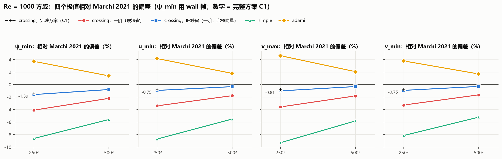

- **完整方案比旧缺省和 B 都略好**：ψ_min −1.39 % 对 −1.60 %（旧缺省）和 −1.66 %（B）；u_min −0.75 % 对 −0.94 % 和 −0.98 %；v_max −0.81 % 对 −1.01 % 和 −1.06 %；v_min −0.75 % 对 −0.93 % 和 −0.96 %。
- 剖面 L2（wall 帧）0.0048 / 0.0051，旧缺省 0.0050 / 0.0056，B 0.0050 / 0.0057。mid 帧 0.0035 / 0.0035，旧缺省 0.0036 / 0.0038。
- **C1 与 C2 相同**：ψ_min 相差 0.01 个百分点，速度极值相差不超过 0.02 个百分点。旧缺省两次运行之间也是相差 0.01。所以完整方案比旧缺省好的 0.2 个百分点不是运行间的散布。
- **两个反射在"完整向量"下的作用是正的，在"只取法向"下是负的**：
  - 完整向量：B（没有反射）−1.66 % → C1（加两个反射）−1.39 %，好 0.27 个百分点。
  - 只取法向：一阶（原几何，没有反射）−4.09 % → A（逐对几何，加两个反射）−4.66 %，差 0.57 个百分点。A 同时换了几何，这 0.57 里几何和反射各占多少仍然分不开。
- 只有 250²。500² 没有跑。

极值的位置和窗口平均动能：

极值的位置：wall 帧 / mid 帧（括号内 = mid 帧位置减参考位置）。参考位置：y(u_min) 0.1717，x(v_max) 0.1578，x(v_min) 0.9092，ψ_min (0.5308, 0.5652)。

| 运行 | y(u_min) | x(v_max) | x(v_min) | ψ_min 的位置 | 平均窗口 t | 定常 t_s | 窗口平均动能 | 提交 |
|---|---|---|---|---|---|---|---|---|
| 250² crossing，完整方案（C1） | 0.1707 / 0.1694（-0.0023） | 0.1581 / 0.1568（-0.0010） | 0.9088 / 0.9104（+0.0012） | (0.5306, 0.5640) / (0.5308, 0.5642)（-0.0000, -0.0010） | 80.6–100.6 | 80.6 | 49.8390 | 3176d57 |
| 250² crossing，完整方案，初始密度 ρ0 + 0.3（C2） | 0.1708 / 0.1695（-0.0022） | 0.1582 / 0.1568（-0.0010） | 0.9088 / 0.9104（+0.0012） | (0.5307, 0.5640) / (0.5308, 0.5642)（+0.0000, -0.0010） | 80.0–100.0 | 70.6 | 49.8402 | 3176d57 |
| 250² crossing，逐对几何 + 完整向量（B） | 0.1710 / 0.1697（-0.0020） | 0.1583 / 0.1569（-0.0009） | 0.9087 / 0.9104（+0.0011） | (0.5307, 0.5639) / (0.5308, 0.5642)（-0.0000, -0.0011） | 80.0–100.0 | 70.6 | 49.6637 | a414a93 |
| 250² crossing，反射版，只取法向（A） | 0.1724 / 0.1711（-0.0006） | 0.1591 / 0.1577（-0.0001） | 0.9076 / 0.9092（+0.0000） | (0.5312, 0.5643) / (0.5313, 0.5645)（+0.0005, -0.0007） | 80.6–100.6 | 80.6 | 47.3527 | bd9fec1 |
| 250² crossing，一阶（现缺省） | 0.1725 / 0.1712（-0.0005） | 0.1591 / 0.1577（-0.0001） | 0.9078 / 0.9094（+0.0001） | (0.5309, 0.5641) / (0.5310, 0.5644)（+0.0002, -0.0009） | 80.0–100.0 | 70.6 | 47.8440 | 6c8a55a |
| 250² crossing，二阶粘性 | 0.1723 / 0.1710（-0.0007） | 0.1591 / 0.1577（-0.0001） | 0.9079 / 0.9095（+0.0003） | (0.5309, 0.5640) / (0.5310, 0.5643)（+0.0002, -0.0010） | 80.6–100.6 | 80.6 | 48.0193 | 263381b |
| 250² crossing，旧缺省（一阶，完整向量） | 0.1709 / 0.1696（-0.0021） | 0.1583 / 0.1569（-0.0009） | 0.9087 / 0.9104（+0.0011） | (0.5307, 0.5639) / (0.5308, 0.5642)（+0.0000, -0.0011） | 80.6–100.6 | 80.6 | 49.6894 | 052cfb9 |
| 250² crossing，旧缺省，第二次运行 | 0.1710 / 0.1696（-0.0020） | 0.1583 / 0.1569（-0.0009） | 0.9087 / 0.9104（+0.0011） | (0.5307, 0.5639) / (0.5308, 0.5642)（-0.0000, -0.0010） | 80.6–100.6 | 80.6 | 49.6867 | 5ee25b1 |
| 250² simple | 0.1735 / 0.1722（+0.0005） | 0.1618 / 0.1605（+0.0026） | 0.9094 / 0.9110（+0.0017） | (0.5334, 0.5643) / (0.5336, 0.5646)（+0.0028, -0.0007） | 80.0–100.0 | 70.6 | 42.9049 | 029313a |
| 250² adami | 0.1679 / 0.1665（-0.0052） | 0.1559 / 0.1545（-0.0033） | 0.9102 / 0.9119（+0.0026） | (0.5300, 0.5646) / (0.5301, 0.5649)（-0.0007, -0.0004） | 80.6–100.6 | 80.6 | 53.7693 | 029313a |
| 500² crossing，一阶（现缺省） | 0.1708 / 0.1702（-0.0015） | 0.1576 / 0.1570（-0.0009） | 0.9090 / 0.9098（+0.0006） | (0.5306, 0.5643) / (0.5307, 0.5644)（-0.0001, -0.0008） | 80.0–99.8 | 69.6 | 48.9382 | 6c8a55a |
| 500² crossing，二阶粘性 | 0.1708 / 0.1702（-0.0015） | 0.1576 / 0.1569（-0.0009） | 0.9091 / 0.9099（+0.0006） | (0.5307, 0.5643) / (0.5307, 0.5644)（-0.0001, -0.0009） | 80.0–99.8 | 79.6 | 48.9830 | 263381b |
| 500² crossing，旧缺省（一阶，完整向量） | 0.1699 / 0.1693（-0.0024） | 0.1572 / 0.1565（-0.0013） | 0.9096 / 0.9104（+0.0012） | (0.5305, 0.5641) / (0.5306, 0.5643)（-0.0002, -0.0010） | 80.0–99.8 | 79.6 | 50.0152 | 5ee25b1 |
| 500² simple | 0.1726 / 0.1720（+0.0003） | 0.1596 / 0.1589（+0.0010） | 0.9092 / 0.9100（+0.0008） | (0.5321, 0.5649) / (0.5322, 0.5650)（+0.0014, -0.0002） | 80.0–99.8 | 69.6 | 45.5336 | 029313a |
| 500² adami | 0.1684 / 0.1677（-0.0040） | 0.1559 / 0.1552（-0.0026） | 0.9104 / 0.9112（+0.0019） | (0.5302, 0.5644) / (0.5302, 0.5645)（-0.0006, -0.0007） | 80.0–99.8 | 79.6 | 51.7032 | 029313a |

### 14.4 平均密度

流体平均密度 − ρ0（kg/m³），各时刻最近的那个样本（样本间隔 0.21）。变化率 = t ∈ [60, 100] 的线性拟合斜率，kg/m³ 每时间单位；最后一列是拟合残差的标准差。

| 运行 | t = 1 | t = 5 | t = 10 | t = 20 | t = 40 | t = 60 | t = 80 | t = 100 | 变化率，t ∈ [60, 100] | 拟合残差 |
|---|---|---|---|---|---|---|---|---|---|---|
| C1：完整方案，初始密度 ρ0 | -0.0065 | -0.0149 | -0.0182 | -0.0312 | -0.0854 | -0.1470 | -0.2002 | -0.2558 | -0.00267 | 0.0042 |
| C2：完整方案，初始密度 ρ0 + 0.3 | +0.1765 | +0.0044 | -0.0069 | -0.0278 | -0.0877 | -0.1537 | -0.2158 | -0.2787 | -0.00289 | 0.0035 |
| B：逐对几何 + 完整向量 | +0.0008 | -0.0004 | -0.0077 | -0.0160 | -0.0227 | -0.0843 | -0.1394 | -0.1895 | -0.00214 | 0.0042 |
| A：反射版（只取法向） | +0.0841 | +0.1367 | +0.1094 | +0.1101 | +0.1230 | +0.1180 | +0.1232 | +0.1161 | +0.00002 | 0.0036 |
| 一阶（现缺省） | +0.0113 | +0.0260 | +0.0263 | +0.0228 | +0.0221 | +0.0214 | +0.0219 | +0.0218 | -0.00001 | 0.0005 |

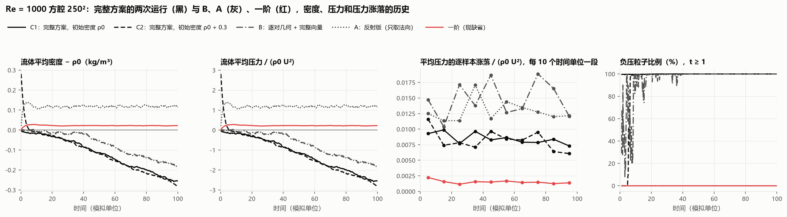

- **C1 从 t = 0 起一直降**：t = 20 时 −0.031，t = 60 时 −0.147，t = 100 时 −0.256。t ∈ [60, 100] 的变化率是每时间单位 −0.0027，拟合残差 0.004，即这一段基本是直线，没有变缓的迹象。
- **C2 的初始偏移很快消失**：C2 与 C1 的密度差在 t = 0.21 是 +0.286，t = 1.05 是 +0.183，t = 4.4 降到 +0.03，t = 6.7 降到 +0.01。t ∈ [0.2, 4] 的指数拟合给出时间常数 1.8 个时间单位。
- **之后 C2 跟着 C1 走，略低一点**：两者之差在 t = 10 到 20 平均是 0.000，t = 80 到 100 平均是 −0.012。C2 的变化率是 −0.0029。
- **B（不用新跑）**：t = 1、5、10、20、40、60、80、100 的平均密度是 +0.001、−0.000、−0.008、−0.016、−0.023、−0.084、−0.139、−0.190；t ∈ [60, 100] 的变化率是 −0.0021。B 在 t ≈ 40 之前降得慢，之后与 C1 差不多平行。
- 对照：A 稳定在 +0.12，一阶稳定在 +0.022，这两个的变化率都是零（±0.00002）。**完整向量的三次运行（B、C1、C2）密度都在降，只取法向的两次（A、一阶）都稳住了。**

### 14.5 平均压力、负压粒子比例、平均压力的涨落

流体平均压力（ρ0U²），同样的时刻；最后一列是 t ∈ [60, 100] 的线性拟合斜率（ρ0U² 每时间单位）。

| 运行 | t = 1 | t = 5 | t = 10 | t = 20 | t = 40 | t = 60 | t = 80 | t = 100 | 变化率，t ∈ [60, 100] |
|---|---|---|---|---|---|---|---|---|---|
| C1：完整方案，初始密度 ρ0 | -0.064 | -0.149 | -0.181 | -0.311 | -0.853 | -1.468 | -2.000 | -2.555 | -0.0267 |
| C2：完整方案，初始密度 ρ0 + 0.3 | +1.767 | +0.045 | -0.069 | -0.277 | -0.875 | -1.535 | -2.156 | -2.783 | -0.0289 |
| B：逐对几何 + 完整向量 | +0.009 | -0.003 | -0.076 | -0.159 | -0.226 | -0.842 | -1.392 | -1.893 | -0.0214 |
| A：反射版（只取法向） | +0.842 | +1.369 | +1.096 | +1.103 | +1.231 | +1.182 | +1.233 | +1.163 | +0.0002 |
| 一阶（现缺省） | +0.114 | +0.261 | +0.264 | +0.229 | +0.222 | +0.215 | +0.220 | +0.219 | -0.0001 |

压力为负的流体粒子比例，同样的时刻；最后一列是 t ≥ 5 里的最大值。

| 运行 | t = 1 | t = 5 | t = 10 | t = 20 | t = 40 | t = 60 | t = 80 | t = 100 | 最大值（t ≥ 5） |
|---|---|---|---|---|---|---|---|---|---|
| C1：完整方案，初始密度 ρ0 | 99.57 % | 99.69 % | 99.59 % | 99.82 % | 100.00 % | 100.00 % | 100.00 % | 100.00 % | 100.00 % |
| C2：完整方案，初始密度 ρ0 + 0.3 | 0.00 % | 8.01 % | 98.93 % | 99.85 % | 99.99 % | 100.00 % | 100.00 % | 100.00 % | 100.00 % |
| B：逐对几何 + 完整向量 | 29.08 % | 57.72 % | 99.22 % | 99.39 % | 99.91 % | 100.00 % | 100.00 % | 100.00 % | 100.00 % |
| A：反射版（只取法向） | 0.00 % | 0.00 % | 0.00 % | 0.00 % | 0.00 % | 0.00 % | 0.00 % | 0.00 % | 0.00 % |
| 一阶（现缺省） | 0.01 % | 0.00 % | 0.00 % | 0.00 % | 0.00 % | 0.00 % | 0.00 % | 0.00 % | 0.00 % |

平均压力的逐样本涨落（ρ0U²）：一个样本减去前后两个样本平均值之后的 rms，样本间隔 0.21 个时间单位，按每 10 个时间单位一段给出；最后一列是 t ≥ 80。

| 运行 | t 0–10 | t 10–20 | t 20–30 | t 30–40 | t 40–50 | t 50–60 | t 60–70 | t 70–80 | t 80–90 | t 90–100 | t ≥ 80 |
|---|---|---|---|---|---|---|---|---|---|---|---|
| C1：完整方案，初始密度 ρ0 | 0.0093 | 0.0099 | 0.0077 | 0.0096 | 0.0083 | 0.0086 | 0.0079 | 0.0079 | 0.0084 | 0.0073 | 0.0078 |
| C2：完整方案，初始密度 ρ0 + 0.3 | 0.0116 | 0.0074 | 0.0078 | 0.0071 | 0.0096 | 0.0084 | 0.0083 | 0.0095 | 0.0064 | 0.0061 | 0.0062 |
| B：逐对几何 + 完整向量 | 0.0147 | 0.0104 | 0.0171 | 0.0138 | 0.0187 | 0.0127 | 0.0133 | 0.0189 | 0.0165 | 0.0121 | 0.0145 |
| A：反射版（只取法向） | 0.0125 | 0.0113 | 0.0114 | 0.0171 | 0.0117 | 0.0144 | 0.0135 | 0.0128 | 0.0120 | 0.0122 | 0.0120 |
| 一阶（现缺省） | 0.0022 | 0.0016 | 0.0012 | 0.0016 | 0.0015 | 0.0017 | 0.0014 | 0.0015 | 0.0013 | 0.0014 | 0.0013 |

- **平均压力**跟着密度走：t = 100 时 C1 是 −2.56 ρ0U²，C2 是 −2.78，每时间单位降 0.027 和 0.029。
- **负压粒子比例**：C1 从 t = 0.4 起一直在 99 % 以上；C2 起步时全部为正，t = 5 时 8 %，t = 10.3 起一直在 99 % 以上；两者 t = 40 以后都在 99.99 % 以上。
- **平均压力的涨落**（0.21 间隔）：C1 各段是 0.0073 到 0.0099，C2 是 0.0061 到 0.0116；t ≥ 80 是 0.0078 和 0.0062。一阶是 0.0013，A 是 0.0120，B 是 0.0145。所以完整方案是一阶的 5 到 6 倍，是 A、B 的一半左右。没有随时间变大的趋势。

### 14.6 旧缺省的平均压力涨落（不用新跑）

**历史文件里没有。** 旧缺省的两次 250² 长跑（第 6 节和第 9 节的第二次运行）没有 `field_history.jsonl`。下面是由已有数据补出来的两个量度。

**(1) 由 t = 80 到 100 的快照**（间隔 0.99）

由 t = 80 到 100 的粒子快照（每 0.99 个时间单位一个）得到的平均压力（ρ0U²；由存下的粒子体积经状态方程还原）和它的涨落：一个快照减去前后两个快照平均值之后的 rms。有历史文件的运行另给两个数：同样这些时刻取历史文件里记录的平均压力算出的涨落（检验还原），和 0.21 间隔的涨落（13.4、14.4 用的量度）。

| 运行 | 快照数 | 平均压力：第一个 → 最后一个快照 | 涨落（快照，0.99 间隔） | 同样时刻，用历史文件的压力 | 涨落（历史文件，0.21 间隔，t ≥ 80） |
|---|---|---|---|---|---|
| 旧缺省（完整向量） | 21（t = 80.2 到 100.0） | -11.554 → -14.415 | 0.0137 | — | — |
| 旧缺省，第二次运行 | 21（t = 80.2 到 100.0） | -11.571 → -14.422 | 0.0210 | — | — |
| 一阶（现缺省） | 21（t = 80.2 到 100.0） | +0.219 → +0.219 | 0.0028 | 0.0028 | 0.0013 |
| A：反射版（只取法向） | 21（t = 80.2 到 100.0） | +1.241 → +1.162 | 0.0201 | 0.0201 | 0.0120 |
| B：逐对几何 + 完整向量 | 21（t = 80.2 到 100.0） | -1.396 → -1.894 | 0.0284 | 0.0284 | 0.0145 |
| C1：完整方案，初始密度 ρ0 | 21（t = 80.2 到 100.0） | -1.997 → -2.556 | 0.0225 | 0.0225 | 0.0078 |
| C2：完整方案，初始密度 ρ0 + 0.3 | 21（t = 80.2 到 100.0） | -2.162 → -2.784 | 0.0155 | 0.0155 | 0.0062 |

- 旧缺省是 0.014 和 0.021（两次运行），是一阶（0.0028）的 5 倍和 7.5 倍；与 A（0.020）、C1（0.023）、C2（0.016）同量级，B 最大（0.028）。
- 这个量度的散布不小：旧缺省的两次运行相差 1.5 倍，C1 和 C2 也相差 1.5 倍。它只说明"旧缺省的压力涨落比一阶大几倍、与逐对几何的各次运行同量级"，不能排出更细的次序。
- 同一次运行里，0.99 间隔的数是 0.21 间隔的 1.7 到 2.9 倍，两列不能混着比。

**(2) 由收支短跑**（t ∈ [1, 5]，间隔 0.03）

收支短跑（250²，t ≤ 5.01），t ∈ [1, 5]，样本间隔 0.03 个时间单位：平均压力的逐样本涨落（ρ0U²）。

| 运行 | 涨落 | 记录（提交） |
|---|---|---|
| 旧缺省（完整向量） | 0.0033 | wc-20261118-025805-ba45（0dd6338） |
| 一阶（现缺省），第 1 次 | 0.0008 | wc-20261118-102117-7b54（6c8a55a） |
| 一阶（现缺省），第 2 次 | 0.0007 | wc-20261118-102354-4dd5（6c8a55a） |
| B：逐对几何 + 完整向量 | 0.0055 | wc-20261118-172659-95ca（a414a93） |
| A：反射版（只取法向） | 0.0044 | wc-20261118-165529-a2b4（bd9fec1） |

- 旧缺省 0.0033，一阶 0.0008，即 4 倍；B 是 0.0055，A 是 0.0044。完整方案没有收支短跑。

### 14.7 没做或没验证的

- **只有 250²。** 500² 没有跑，完整方案的收敛阶没有。
- **密度下降的归宿：未验证。** 到 t = 100 还是直线下降。旧缺省在同一时刻已经降到 −11.6 到 −14.4 ρ0U²，完整方案是 −2.6 到 −2.8，慢得多，但没有看到它停。
- **完整方案的内部连续性项和密度收支：没有做**（没有它的收支短跑）。
- **两个反射各自的作用：未验证。** 完整向量下只跑了"两个都开"（C1、C2）和"两个都关"（B）。
- **A 弱的 0.57 个百分点里几何和反射各占多少：仍未验证**（同 13.9）。
- 每个配置一次运行；C1 和 C2 可以当作同一配置的两次运行看，它们的 ψ_min 相差 0.01 个百分点。
- 第 12、13 节列的未验证项没有变。

## 15. 追加（十）：封闭域的流体总体积约束；完整方案 + 约束的 250² 和 500²（2026-11-18）

任务书：给封闭域加一个流体总体积的约束（缺省关闭），然后用完整方案（`geometry: pairwise` + `continuity_wall_component: full` + `pressure_wall: reflection` + `delta_wall: reflection`）加这个约束跑 250² 和 500² 各一次。测试只做任务书第 3 节列的。工具是 `pairwise_reflection.py volume-constraint`。C1、C2 是第 14 节没有约束的两次完整方案运行。

**先说结果**

- **约束实现了，缺省关闭。** 关闭时完整方案与上一个提交逐位相同（700 步）；`simple` / `adami` 用的 23 个 SPIR-V 文件逐字节相同，在这两种模式下打开约束会报 `ValueError`。
- **单步对照通过**（判据值 8.8e-6），**短跑通过**：约束把平均密度拉住了，没有振荡。
- **250²：ψ_min 是 −1.42 %，没有约束时是 −1.39 % 和 −1.40 %，即不变。** 三个速度极值和剖面 L2 也不变。
- **平均密度被拉住了。** 250² 在 t ∈ [60, 100] 的变化率是每时间单位 −0.000007（没有约束时 −0.0027）；这一段的平均是 ρ0 − 0.0070 ± 0.0025。
  - 这个偏差是预期（偏差 × τ ≈ −0.003）的 2.6 倍，原因没有查。
- **平均压力在零附近**（250²：−0.07 ρ0U²），所以负压粒子比例不再是 0 或 100 %，而是在 56 % 到 99 % 之间摆（平均 94 %）。
- **平均压力的涨落没有变**：250² 是 0.0071 ρ0U²，没有约束时 0.0078；仍是一阶的 5 倍多。
- **静水盒通过**：残余速度是一阶的 0.65 倍和 0.92 倍；压力电平不再一直下降。
- **500²：ψ_min 是 −0.76 %**；旧缺省 −0.80 %，adami +1.39 %，一阶 −2.21 %。三个速度极值是 −0.28 % 到 −0.32 %。
- **ψ_min 的两点收敛阶是 0.90**（−1.42 % → −0.76 %）；旧缺省 1.01，adami 1.42，一阶 0.89。
- **500² 的平均密度也被拉住了**：ρ0 + 0.0027 ± 0.0004，变化率每时间单位 +0.000004。偏差的符号与 250² 相反（250² 偏低，500² 偏高）。
- **每步时间**：250² 是一阶的 1.04 倍，500² 是 1.05 倍；约束本身在 250² 上是 +0.7 %。

### 15.1 改动清单

提交：`b0a2791`（约束、参考解、单步工具、算例）、`5f27286`（日志路径的环境变量改名），以及本节的表、图和报告。都在本地分支 `v7-wall-crossing` 上，没有 push。

**配置**（`case.yaml` 的 `numerics.volume_constraint`，每一项都可省）

| 键 | 缺省 | 含义 |
|---|---|---|
| `enabled` | `false` | 开关 |
| `relaxation_time` | 1.0 | 松弛时间 τ，模拟时间 |
| `update_interval` | τ / 5 | 更新间隔，模拟时间；不能大于 τ / 5 |

- `simple` / `adami` 下打开时报 `ValueError`（两种都试过）。
- 更新间隔向下取整到 defrag 周期的整数倍；一个 defrag 周期比 τ / 5 还长时报 `ValueError`。250² 是每 6,000 步（0.18），500² 是每 13,000 步（0.195）。

**求解器**

- 新文件 `experiment/v7/utils/volume_constraint_v7.py`：设置和解析、多片求和用的主机端对象、日志。
- `simulator_v7.py`：
  - 启动时由初始载荷算出 V_target = Σ m_i/ρ_i（只算流体粒子，float64 求和）。
  - 每次 defrag 之后（此时队列已排空）数一次；到了更新间隔，就读回本片自己的粒子（位置、质量、密度、材料），算出 V_now、θ 和 rate，把 rate 写进一个 16 字节的缓冲区 `volume_constraint_state`（set 0 binding 15）。
  - 规格常量 130 = 开关。
- 着色器：`wall_boundary.glsl` 里声明规格常量和缓冲区；`correction_density.comp` 的 crossing 变体里加一句 `density_rate += self_density * volume_constraint_state.x`，放在规格常量后面，关闭时整句去掉。壁粒子不受影响。
- 重新编译后变了的 SPIR-V 只有 crossing 的三个变体。`README.md`、`MANIFEST.txt` 已更新。

**工具**：`reference.py`（参考解加上 ρ_i·rate）、`single_step.py`（`--volume-constraint`）、`box_case.py`、`box_run.py`、`hydrostatic.py`、`cavity_runner_entry.py`（都把更新日志写进运行目录的 `volume_constraint.jsonl`）、`cavity_tables.py`、`pairwise_reflection.py`。新算例 4 个：完整方案 + 约束的 250² 和 500² 方腔、两个 2-D 静水盒。

**没有改的**：所有缺省值；`simple` / `adami`；随传输和 defrag 搬运的 SoA 布局、ghost 记录格式、ghost 层数。新缓冲区只有 16 字节，不随粒子搬运。

### 15.2 我做的决定

- **求和放在主机端。** 更新时读回粒子、在主机上用 float64 求和，没有写 GPU 上的归约。理由：不需要新的着色器和管线；更新每 6,000 到 13,000 步才一次。实测的开销见 15.6：250² 上相对没有约束的完整方案是 +0.7 %。
- **更新间隔**的配置名是 `update_interval`，缺省取 τ / 5（任务书允许的最大值），再向下取整到 defrag 周期的整数倍。
- **V_target 取自初始载荷**（求解器准备上传的那份 float32 数据），不是第一步之后的读回。这样从检查点续跑的运行仍然用最初的目标值。t = 0 的那次更新 θ 恰好是 0。
- **rate 在两次更新之间不变**，写进缓冲区后由每一步读取。
- **日志**：每次更新写一行 JSON（墙钟时间、步数、时间、V_now、V_target、θ、rate、流体粒子数）到环境变量 `SPH_VOLUME_CONSTRAINT_LOG` 指的文件，各运行工具把它设成运行目录下的 `volume_constraint.jsonl`。"时间"是本进程的步数乘时间步长，续跑的运行从 0 重新数。
  - 这个变量最初叫 `V7_VOLUME_CONSTRAINT_LOG`。方腔运行器只接受发布配置那一组 `V7_` 变量，所以 3.4 的第一次启动两张卡都在启动时就退出了（记录 wc-20261118-184008-2fa4 等）。改名后重新启动，耽误约 8 分钟。
- **与收支构建不能同时用**（报 `ValueError`）：收支的四项里没有约束项，加起来对不上实际写入。
- **多卡求和写了但没有测。** 每一片把自己的 Σ m/ρ 报给同一个主机端对象，最后一片报到时算出 θ 和 rate 并同时写给所有片。本轮的测试都是单卡，这条路径未验证。
- **单步对照的测试盒**时间步长很长（c0 = 10），一个 defrag 周期就有 1.5 个时间单位，所以测试用例把 τ 设成 100；测试自己把 rate = 2.0 写进缓冲区，自举那一步不做更新。
- **回归的参照**：完整方案在 700 步时旧求解器自己就有两个结果类。第一次只取了 6 个参照转储，没有碰到第二类，结论是"次数不够"（记录 wc-20261118-183545-aec5）；补到 24 个参照转储后重做。
- **3.3 用缺省构建**（不是收支构建）做短跑。τ = 1 没有引起振荡，所以没有用到 τ = 5 的备用方案。
- **每步时间的比值**取 t ∈ [20, 80] 这一段的墙钟时间，对比的两次运行在同一张卡上。

### 15.3 回归（任务书 3.1）

| 检查 | 参照 | 结果 | 结论 | 记录 |
|---|---|---|---|---|
| simple、adami 用的 SPIR-V | 基点（eda5b90）清单里的 23 个文件 | 23 个逐字节相同 | 通过 | MANIFEST.txt |
| 相对 2186032 变了的 SPIR-V | 全部 27 个文件 | correction_density_wall_crossing、correction_density_wall_crossing_budget、force_wall_crossing | — | MANIFEST.txt |
| 完整方案，约束关闭，250²，700 步 | 2186032 的求解器（冻结检出 3176d57，求解器文件相同）的 24 个转储 | 2 个结果类。类 0：参照 18 次，本次 9 次；类 1：参照 6 次，本次 3 次 | 逐位相同 | wc-20261118-183647-e3b7 |
| `_test_seam_layout.py` 的失败清单 | 基点的清单（858 条，基点自身就有） | 858 条，与基点的清单逐行相同 | 通过 | wc-20261118-184813-0dfc |

- 约束关闭时，完整方案的 12 次运行全部落在旧求解器的两个结果类里（9 次和 3 次；旧求解器的 24 次是 18 次和 6 次）。逐位相同。

### 15.4 GPU 单步对照（任务书 3.2）

完整方案，2-D，rate = 2.0（每时间单位），沿用现有工具和判据。

| 维数 | 流体粒子 / 其中有壁邻居的 | 约束项 ρ_i·rate 的最大值 / 密度变化率的最大值 | 密度变化率的相对误差（超出 1 ulp 的部分，最大） | 新密度与参考解之差（ulp，最大） | 加速度误差 ÷ 逐对项绝对值之和（最大） | 判据值（容差 1e-4） | 结论 | 记录 |
|---|---|---|---|---|---|---|---|---|
| 2-D | 2,000 / 731 | 2060 / 74213 | 2.9e-07 | 1.40 | 3.5e-07 | 8.8e-06 | 通过 | wc-20261118-183704-733a |

- 通过，判据值 8.8e-6（容差 1e-4）。约束项最大是密度变化率最大值的 2.8 %；如果着色器里漏了这一项，密度变化率的误差会是 2.8e-2。

### 15.5 方腔短跑（任务书 3.3）

250² 方腔短跑，完整方案 + 体积约束，t = 0 到 5.01（记录 wc-20261118-183844-5cbb）。θ 和 rate 是约束在那一刻更新出的值；“没有约束”一列是 C1（第 14 节）在同一时刻的平均密度。

| t | θ | rate（每时间单位） | 平均密度 − ρ0（kg/m³） | 同，没有约束（C1） | 平均压力（ρ0U²） | 负压粒子比例 |
|---|---|---|---|---|---|---|
| 0.18 | +2.94e-06 | +2.94e-06 | -0.00294 | -0.00514 | -0.0283 | 62.7 % |
| 0.36 | +4.06e-06 | +4.06e-06 | -0.00406 | -0.00552 | -0.0396 | 99.8 % |
| 0.54 | +3.35e-06 | +3.35e-06 | -0.00335 | -0.00624 | -0.0326 | 99.8 % |
| 1.08 | +2.59e-06 | +2.59e-06 | -0.00259 | -0.00652 | -0.0249 | 97.2 % |
| 1.98 | +2.31e-06 | +2.31e-06 | -0.00231 | -0.00844 | -0.0222 | 99.3 % |
| 3.06 | +2.30e-09 | +2.30e-09 | -0.00000 | -0.01134 | +0.0012 | 38.2 % |
| 3.96 | -2.63e-07 | -2.63e-07 | +0.00026 | -0.01450 | +0.0037 | 43.6 % |
| 4.86 | -2.39e-07 | -2.39e-07 | +0.00024 | -0.01412 | +0.0035 | 32.0 % |

- **约束在工作。** 平均密度在 t = 0.36 降到 −0.004，之后被拉回；t = 3 到 5 的各次更新时在 ±0.0005 以内。没有约束时同一时刻是 −0.011 到 −0.015。
- **θ 的量级合理**：t < 2 是 2e-6 到 4e-6（最大 4.1e-6），t ≥ 2 的平均是 +2.5e-7，标准差 9e-7。
- **没有振荡**：θ 在 t ≈ 3 降到零附近，之后只有 ±4e-7 的起伏，没有越摆越大。
- 粒子数守恒，越出盒 0 个，最大速度 0.979，低于距离下限的粒子 0 个。
- 平均压力在 t ≥ 3 接近零（±0.004 ρ0U²），所以正压和负压的粒子各占一部分（负压的占 32 % 到 44 %）。

通过，随后启动 3.4。

### 15.6 方腔长跑（任务书 3.4）

| 运行 | 到达 | 粒子数（含壁） | 越出盒的流体粒子（各次位置读回的最大值） | 流体最大速度（线 1.05） | 停止条件 | A_f 回退（累计） | φ_min / dx；低于距离下限的粒子（最大） | 记录（提交） |
|---|---|---|---|---|---|---|---|---|
| 250² 完整方案 + 体积约束 | t = 99.99 | 74,529，每个样本都相同 | 0 | 0.979 | 没有触发 | 0 | 0.298；0 | wc-20261118-184757-91d3（5f27286） |
| 500² 完整方案 + 体积约束 | t = 99.84 | 273,529，每个样本都相同 | 0 | 0.989 | 没有触发 | 0 | 0.285；0 | wc-20261118-184757-0730（5f27286） |

- 两次都跑到了统计窗口的末尾（250² 到 t = 99.99，500² 到 t = 99.84），看门进程都以"没有满足任何停止条件"结束。
- 粒子数守恒，越出盒 0 个，最大速度 0.979 和 0.989，A_f 回退 0 次，低于距离下限的粒子 0 个。

**ψ_min、速度极值、剖面 L2**

Re = 1000 方腔对 Marchi 2021，K = 1，最后 20 个时间单位平均。括号内 = 相对参考值的偏差（负 = 偏弱）。“wall 帧”把单位方腔放在最内层壁粒子行的中线上（已发表的表用的放法，各模式同样处理）；“mid 帧”放在最内层壁粒子行与最外层流体行的正中（crossing 的盒面）。剖面误差是 28 个 Marchi 点上的 L2 / L∞，速度以盖速为单位。参考值：ψ_min -0.11894，u_min -0.38857，v_max 0.37694，v_min -0.52708。

| 运行 | ψ_min（wall 帧） | ψ_min 偏差（mid 帧） | u_min | v_max | v_min | u 剖面 L2 / L∞（wall 帧） | v 剖面 L2 / L∞（wall 帧） | u 剖面 L2 / L∞（mid 帧） | v 剖面 L2 / L∞（mid 帧） |
|---|---|---|---|---|---|---|---|---|---|
| 250² crossing，完整方案 + 体积约束 | -0.11724（-1.42 %） | -1.03 % | -0.38558（-0.77 %） | 0.37390（-0.81 %） | -0.52295（-0.78 %） | 0.0048 / 0.0176 | 0.0052 / 0.0121 | 0.0034 / 0.0061 | 0.0034 / 0.0072 |
| 250² crossing，完整方案，没有约束（C1） | -0.11728（-1.39 %） | -1.00 % | -0.38565（-0.75 %） | 0.37390（-0.81 %） | -0.52314（-0.75 %） | 0.0048 / 0.0176 | 0.0051 / 0.0119 | 0.0035 / 0.0061 | 0.0035 / 0.0072 |
| 250² crossing，完整方案，没有约束，初始密度 ρ0 + 0.3（C2） | -0.11727（-1.40 %） | -1.01 % | -0.38572（-0.73 %） | 0.37393（-0.80 %） | -0.52313（-0.75 %） | 0.0048 / 0.0177 | 0.0050 / 0.0116 | 0.0034 / 0.0061 | 0.0035 / 0.0073 |
| 250² crossing，逐对几何 + 完整向量（B） | -0.11696（-1.66 %） | -1.27 % | -0.38477（-0.98 %） | 0.37297（-1.06 %） | -0.52204（-0.96 %） | 0.0050 / 0.0174 | 0.0057 / 0.0125 | 0.0037 / 0.0062 | 0.0039 / 0.0080 |
| 250² crossing，反射版，只取法向（A） | -0.11340（-4.66 %） | -4.28 % | -0.37239（-4.16 %） | 0.36030（-4.42 %） | -0.50735（-3.74 %） | 0.0099 / 0.0162 | 0.0154 / 0.0251 | 0.0099 / 0.0163 | 0.0129 / 0.0197 |
| 250² crossing，旧缺省（一阶，完整向量） | -0.11703（-1.60 %） | -1.21 % | -0.38493（-0.94 %） | 0.37314（-1.01 %） | -0.52217（-0.93 %） | 0.0050 / 0.0175 | 0.0056 / 0.0124 | 0.0036 / 0.0062 | 0.0038 / 0.0079 |
| 250² adami | -0.12336（+3.72 %） | +4.14 % | -0.40476（+4.17 %） | 0.39438（+4.63 %） | -0.54703（+3.79 %） | 0.0109 / 0.0227 | 0.0122 / 0.0193 | 0.0097 / 0.0219 | 0.0149 / 0.0271 |
| 250² crossing，一阶（现缺省） | -0.11407（-4.09 %） | -3.71 % | -0.37533（-3.41 %） | 0.36344（-3.58 %） | -0.50979（-3.28 %） | 0.0087 / 0.0162 | 0.0136 / 0.0235 | 0.0083 / 0.0134 | 0.0110 / 0.0173 |
| 250² crossing，二阶粘性 | -0.11426（-3.93 %） | -3.55 % | -0.37593（-3.25 %） | 0.36411（-3.40 %） | -0.51073（-3.10 %） | 0.0085 / 0.0174 | 0.0129 / 0.0220 | 0.0078 / 0.0129 | 0.0104 / 0.0165 |
| 250² simple | -0.10867（-8.64 %） | -8.27 % | -0.35468（-8.72 %） | 0.34184（-9.31 %） | -0.48407（-8.16 %） | 0.0230 / 0.0351 | 0.0271 / 0.0430 | 0.0264 / 0.0496 | 0.0262 / 0.0438 |
| 500² crossing，完整方案 + 体积约束 | -0.11803（-0.76 %） | -0.56 % | -0.38732（-0.32 %） | 0.37581（-0.30 %） | -0.52560（-0.28 %） | 0.0021 / 0.0066 | 0.0020 / 0.0042 | 0.0029 / 0.0053 | 0.0027 / 0.0052 |
| 500² crossing，旧缺省（一阶，完整向量） | -0.11799（-0.80 %） | -0.60 % | -0.38727（-0.33 %） | 0.37574（-0.32 %） | -0.52550（-0.30 %） | 0.0021 / 0.0066 | 0.0020 / 0.0042 | 0.0029 / 0.0054 | 0.0027 / 0.0053 |
| 500² adami | -0.12059（+1.39 %） | +1.59 % | -0.39554（+1.79 %） | 0.38474（+2.07 %） | -0.53603（+1.70 %） | 0.0050 / 0.0108 | 0.0055 / 0.0104 | 0.0050 / 0.0123 | 0.0074 / 0.0151 |
| 500² crossing，一阶（现缺省） | -0.11631（-2.21 %） | -2.01 % | -0.38167（-1.78 %） | 0.37010（-1.82 %） | -0.51838（-1.65 %） | 0.0042 / 0.0073 | 0.0066 / 0.0097 | 0.0049 / 0.0076 | 0.0057 / 0.0096 |
| 500² crossing，二阶粘性 | -0.11636（-2.16 %） | -1.97 % | -0.38181（-1.74 %） | 0.37028（-1.77 %） | -0.51864（-1.60 %） | 0.0041 / 0.0072 | 0.0064 / 0.0093 | 0.0048 / 0.0075 | 0.0056 / 0.0095 |
| 500² simple | -0.11228（-5.59 %） | -5.40 % | -0.36711（-5.52 %） | 0.35500（-5.82 %） | -0.49956（-5.22 %） | 0.0150 / 0.0224 | 0.0175 / 0.0275 | 0.0167 / 0.0295 | 0.0169 / 0.0278 |

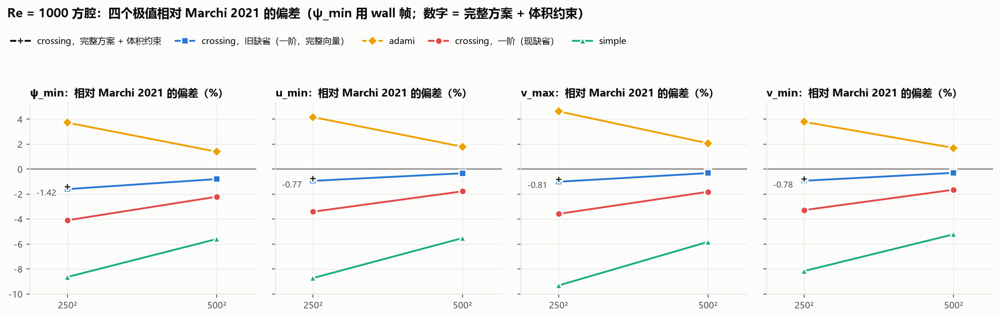

- **250²，加约束前后相同**：ψ_min −1.42 % 对 −1.39 %（C1）和 −1.40 %（C2）；u_min −0.77 % 对 −0.75 % 和 −0.73 %；v_max −0.81 % 对 −0.81 % 和 −0.80 %；v_min −0.78 % 对 −0.75 %。剖面 L2（wall 帧）0.0048 / 0.0052 对 0.0048 / 0.0051。
  - 差别最大 0.04 个百分点。C1 与 C2 之间（同一配置的两次运行）差 0.01 到 0.02，所以约束的影响如果有，也只有 0.03 左右。
- **500²**：ψ_min −0.76 %，三个速度极值 −0.32 / −0.30 / −0.28 %，剖面 L2 0.0021 / 0.0020。
  - 旧缺省的 500²：−0.80 %，−0.33 / −0.32 / −0.30 %，0.0021 / 0.0020。完整方案 + 约束略好 0.01 到 0.04 个百分点，剖面 L2 相同。
  - adami 的 500²：+1.39 %，+1.79 / +2.07 / +1.70 %，0.0050 / 0.0055。完整方案 + 约束的偏差是它的一半（ψ_min）到六分之一（速度极值），符号相反。
  - 一阶的 500²：−2.21 %，−1.78 / −1.82 / −1.65 %，0.0042 / 0.0066。

**两点收敛阶**（250² → 500²）

观测收敛阶 p = ln(e₂₅₀ / e₅₀₀) / ln 2，e = 该量相对 Marchi 2021 的误差（绝对值），250² → 500²。只有两档分辨率，所以每个 p 只是一对数的比值；误差本身已经很小的量（接近运行间的散布）p 没有意义。

| 量 | crossing，完整方案 + 体积约束 | crossing，旧缺省（一阶，完整向量） | adami | crossing，一阶（现缺省） | simple |
|---|---|---|---|---|---|
| ψ_min 偏差（绝对值，wall 帧） | 0.00169 → 0.00091，p = 0.90 | 0.00190 → 0.00095，p = 1.01 | 0.00443 → 0.00165，p = 1.42 | 0.00487 → 0.00263，p = 0.89 | 0.01027 → 0.00665，p = 0.63 |
| ψ_min 偏差（绝对值，mid 帧） | 0.00123 → 0.00067，p = 0.87 | 0.00144 → 0.00071，p = 1.02 | 0.00492 → 0.00189，p = 1.38 | 0.00441 → 0.00239，p = 0.88 | 0.00984 → 0.00643，p = 0.61 |
| u_min 偏差（绝对值） | 0.00299 → 0.00125，p = 1.26 | 0.00364 → 0.00130，p = 1.49 | 0.01619 → 0.00697，p = 1.22 | 0.01324 → 0.00690，p = 0.94 | 0.03389 → 0.02146，p = 0.66 |
| v_max 偏差（绝对值） | 0.00305 → 0.00113，p = 1.43 | 0.00381 → 0.00120，p = 1.66 | 0.01744 → 0.00779，p = 1.16 | 0.01350 → 0.00684，p = 0.98 | 0.03511 → 0.02195，p = 0.68 |
| v_min 偏差（绝对值） | 0.00413 → 0.00148，p = 1.48 | 0.00490 → 0.00157，p = 1.64 | 0.01996 → 0.00895，p = 1.16 | 0.01729 → 0.00870，p = 0.99 | 0.04301 → 0.02751，p = 0.64 |
| u L2 (wall) | 0.00482 → 0.00211，p = 1.19 | 0.00496 → 0.00212，p = 1.22 | 0.01094 → 0.00504，p = 1.12 | 0.00869 → 0.00424，p = 1.04 | 0.02298 → 0.01499，p = 0.62 |
| u L∞ (wall) | 0.01762 → 0.00659，p = 1.42 | 0.01755 → 0.00658，p = 1.41 | 0.02275 → 0.01076，p = 1.08 | 0.01620 → 0.00730，p = 1.15 | 0.03510 → 0.02239，p = 0.65 |
| v L2 (wall) | 0.00518 → 0.00198，p = 1.39 | 0.00563 → 0.00203，p = 1.47 | 0.01218 → 0.00554，p = 1.14 | 0.01364 → 0.00662，p = 1.04 | 0.02714 → 0.01746，p = 0.64 |
| v L∞ (wall) | 0.01212 → 0.00417，p = 1.54 | 0.01241 → 0.00420，p = 1.56 | 0.01933 → 0.01044，p = 0.89 | 0.02348 → 0.00967，p = 1.28 | 0.04300 → 0.02747，p = 0.65 |
| u L2 (mid) | 0.00344 → 0.00288，p = 0.26 | 0.00364 → 0.00290，p = 0.33 | 0.00971 → 0.00503，p = 0.95 | 0.00831 → 0.00491，p = 0.76 | 0.02640 → 0.01668，p = 0.66 |
| u L∞ (mid) | 0.00611 → 0.00531，p = 0.20 | 0.00615 → 0.00536，p = 0.20 | 0.02193 → 0.01232，p = 0.83 | 0.01336 → 0.00763，p = 0.81 | 0.04957 → 0.02952，p = 0.75 |
| v L2 (mid) | 0.00344 → 0.00270，p = 0.35 | 0.00381 → 0.00273，p = 0.48 | 0.01489 → 0.00739，p = 1.01 | 0.01098 → 0.00570，p = 0.95 | 0.02621 → 0.01685，p = 0.64 |
| v L∞ (mid) | 0.00719 → 0.00520，p = 0.47 | 0.00787 → 0.00529，p = 0.57 | 0.02709 → 0.01506，p = 0.85 | 0.01734 → 0.00962，p = 0.85 | 0.04381 → 0.02785，p = 0.65 |

- **ψ_min**：完整方案 + 约束 p = 0.90（误差 0.00169 → 0.00091），旧缺省 1.01（0.00190 → 0.00095），adami 1.42（0.00443 → 0.00165），一阶 0.89，simple 0.63。
  - 完整方案 + 约束的阶比旧缺省低一点，是因为它在 250² 的误差更小而 500² 两者几乎一样；两档上它的误差都不比旧缺省大。
- **速度极值**：完整方案 + 约束 p = 1.26 到 1.48，旧缺省 1.49 到 1.66，adami 1.16 到 1.22。
- **剖面 L2（wall 帧）**：1.19 和 1.39，与旧缺省（1.22 和 1.47）接近。mid 帧的阶很低（0.3 左右），旧缺省也一样：两档上 mid 帧的误差本身已经很小（0.003）。

**平均密度和 θ**

流体平均密度 − ρ0（kg/m³），各时刻最近的那个样本（样本间隔 0.21）。变化率 = t ∈ [60, 100] 的线性拟合斜率，kg/m³ 每时间单位；最后一列是这一段的平均值 ± 标准差。

| 运行 | t = 1 | t = 5 | t = 10 | t = 20 | t = 40 | t = 60 | t = 80 | t = 100 | 变化率，t ∈ [60, 100] | t ∈ [60, 100] 的平均 ± 标准差 |
|---|---|---|---|---|---|---|---|---|---|---|
| 250² 完整方案 + 体积约束 | -0.00592 | -0.00014 | -0.00124 | -0.01052 | -0.00723 | -0.00754 | -0.00691 | -0.00434 | -0.000007 | -0.00699 ± 0.00249 |
| 500² 完整方案 + 体积约束 | +0.00092 | +0.00090 | +0.00048 | +0.00249 | +0.00282 | +0.00240 | +0.00330 | +0.00265 | +0.000004 | +0.00269 ± 0.00043 |
| 250² 完整方案，没有约束（C1） | -0.00652 | -0.01495 | -0.01820 | -0.03116 | -0.08541 | -0.14699 | -0.20020 | -0.25580 | -0.002669 | -0.20744 ± 0.03128 |
| 250² 一阶（现缺省） | +0.01129 | +0.02600 | +0.02628 | +0.02278 | +0.02206 | +0.02143 | +0.02192 | +0.02182 | -0.000009 | +0.02177 ± 0.00053 |
| 500² 一阶（现缺省） | +0.00917 | +0.01583 | +0.01747 | +0.01855 | +0.01900 | +0.01978 | +0.02053 | +0.02116 | +0.000029 | +0.02077 ± 0.00037 |

θ = (V_now − V_target) / V_target，各时刻最近的那次更新。θ > 0 表示密度整体偏低；−ρ0·θ 是它对应的平均密度偏差。

| 运行 | t = 1 | t = 5 | t = 10 | t = 20 | t = 40 | t = 60 | t = 80 | t = 100 | t ∈ [60, 100] 的平均 ± 标准差 | 对应的密度偏差 −ρ0·θ（kg/m³） | 更新次数 |
|---|---|---|---|---|---|---|---|---|---|---|---|
| 250² 完整方案 + 体积约束 | +5.81e-06 | +1.40e-07 | +1.24e-06 | +1.01e-05 | +6.80e-06 | +7.63e-06 | +6.98e-06 | +2.70e-06 | +6.95e-06 ± 2.5e-06 | -0.00695 | 556（间隔 0.180） |
| 500² 完整方案 + 体积约束 | -9.17e-07 | -8.97e-07 | -4.76e-07 | -2.49e-06 | -2.82e-06 | -2.40e-06 | -3.30e-06 | -2.65e-06 | -2.69e-06 ± 4.3e-07 | +0.00269 | 513（间隔 0.195） |

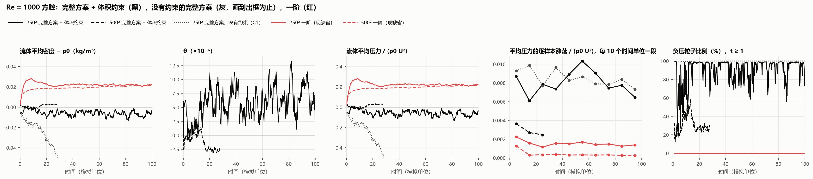

- **250²，平均密度**：t = 20 以后在 ρ0 − 0.002 到 ρ0 − 0.013 之间，t ∈ [60, 100] 的线性拟合斜率是每时间单位 −0.000007。没有约束的 C1 同一段是 −0.0027，t = 100 时已经到 ρ0 − 0.256。
- **250²，θ**：t ∈ [60, 100] 的平均是 +7.0e-6，标准差 2.5e-6，在 1.0e-6 到 1.3e-5 之间起伏；整个运行的最大值是 1.3e-5（t = 82）。一共更新了 556 次，间隔 0.18。
- **500²，平均密度**：t = 20 以后在 ρ0 + 0.001 到 +0.004 之间，t ∈ [60, 100] 的平均是 +0.0027 ± 0.0004，斜率 +0.000004。
- **500²，θ**：t ∈ [60, 100] 的平均是 −2.7e-6，标准差 4e-7，比 250² 平稳得多。一共更新了 513 次，间隔 0.195。
- **两档的偏差符号相反**：250² 的密度被拉在初值以下 0.007，500² 被拉在初值以上 0.003。约束在两档上各自抵住的漂移方向不同。500² 没有约束时往哪边漂，没有运行可以对照。
- **250² 稳定后的偏差比预期大**：任务书的估计是 偏差 × τ ≈ −0.003 kg/m³，实际是 −0.0070，即约束需要 2.6 倍的 θ 才能抵住漂移。原因没有查。一个有关的事实：这时约束项每步给密度加的量是 2e-7 kg/m³，是 float32 存储的密度格子（6.1e-5）的三百分之一。

**平均压力、负压粒子比例、平均压力的涨落**

流体平均压力（ρ0U²），同样的时刻；最后一列是 t ∈ [60, 100] 的平均 ± 标准差。

| 运行 | t = 1 | t = 5 | t = 10 | t = 20 | t = 40 | t = 60 | t = 80 | t = 100 | t ∈ [60, 100] |
|---|---|---|---|---|---|---|---|---|---|
| 250² 完整方案 + 体积约束 | -0.0582 | -0.0003 | -0.0114 | -0.1043 | -0.0714 | -0.0745 | -0.0681 | -0.0424 | -0.0689 ± 0.0250 |
| 500² 完整方案 + 体积约束 | +0.0104 | +0.0102 | +0.0058 | +0.0261 | +0.0293 | +0.0252 | +0.0342 | +0.0276 | +0.0281 ± 0.0043 |
| 250² 完整方案，没有约束（C1） | -0.0644 | -0.1486 | -0.1810 | -0.3106 | -0.8529 | -1.4684 | -1.9998 | -2.5551 | -2.0721 ± 0.3124 |
| 250² 一阶（现缺省） | +0.1142 | +0.2612 | +0.2641 | +0.2291 | +0.2218 | +0.2155 | +0.2204 | +0.2194 | +0.2189 ± 0.0053 |
| 500² 一阶（现缺省） | +0.0930 | +0.1595 | +0.1759 | +0.1867 | +0.1912 | +0.1990 | +0.2065 | +0.2128 | +0.2089 ± 0.0037 |

压力为负的流体粒子比例，同样的时刻；最后一列是 t ∈ [60, 100] 的平均（最小到最大）。

| 运行 | t = 1 | t = 5 | t = 10 | t = 20 | t = 40 | t = 60 | t = 80 | t = 100 | t ∈ [60, 100] |
|---|---|---|---|---|---|---|---|---|---|
| 250² 完整方案 + 体积约束 | 99.7 % | 58.8 % | 58.4 % | 99.2 % | 98.2 % | 98.7 % | 98.6 % | 85.5 % | 93.6 %（56.0 到 99.3） |
| 500² 完整方案 + 体积约束 | 15.0 % | 19.1 % | 35.6 % | 27.0 % | 28.9 % | 30.4 % | 25.1 % | 27.9 % | 28.2 %（21.7 到 38.7） |
| 250² 完整方案，没有约束（C1） | 99.6 % | 99.7 % | 99.6 % | 99.8 % | 100.0 % | 100.0 % | 100.0 % | 100.0 % | 100.0 %（100.0 到 100.0） |
| 250² 一阶（现缺省） | 0.0 % | 0.0 % | 0.0 % | 0.0 % | 0.0 % | 0.0 % | 0.0 % | 0.0 % | 0.0 %（0.0 到 0.0） |
| 500² 一阶（现缺省） | 0.0 % | 0.0 % | 0.0 % | 0.0 % | 0.0 % | 0.0 % | 0.0 % | 0.0 % | 0.0 %（0.0 到 0.0） |

平均压力的逐样本涨落（ρ0U²）：一个样本减去前后两个样本平均值之后的 rms，样本间隔 0.21 个时间单位，按每 10 个时间单位一段给出；最后一列是 t ≥ 80。

| 运行 | t 0–10 | t 10–20 | t 20–30 | t 30–40 | t 40–50 | t 50–60 | t 60–70 | t 70–80 | t 80–90 | t 90–100 | t ≥ 80 |
|---|---|---|---|---|---|---|---|---|---|---|---|
| 250² 完整方案 + 体积约束 | 0.0087 | 0.0061 | 0.0079 | 0.0073 | 0.0089 | 0.0103 | 0.0091 | 0.0074 | 0.0077 | 0.0065 | 0.0071 |
| 500² 完整方案 + 体积约束 | 0.0036 | 0.0027 | 0.0031 | 0.0021 | 0.0023 | 0.0020 | 0.0023 | 0.0025 | 0.0022 | 0.0019 | 0.0020 |
| 250² 完整方案，没有约束（C1） | 0.0093 | 0.0099 | 0.0077 | 0.0096 | 0.0083 | 0.0086 | 0.0079 | 0.0079 | 0.0084 | 0.0073 | 0.0078 |
| 250² 一阶（现缺省） | 0.0022 | 0.0016 | 0.0012 | 0.0016 | 0.0015 | 0.0017 | 0.0014 | 0.0015 | 0.0013 | 0.0014 | 0.0013 |
| 500² 一阶（现缺省） | 0.0013 | 0.0003 | 0.0003 | 0.0004 | 0.0003 | 0.0003 | 0.0003 | 0.0003 | 0.0003 | 0.0003 | 0.0003 |

- **平均压力贴着零**：t ∈ [60, 100] 的平均，250² 是 −0.069 ± 0.025 ρ0U²，500² 是 +0.028 ± 0.004。没有约束的 C1（250²）同一段是 −2.07，而且每时间单位再降 0.027。
- **负压粒子比例**：250² 平均 94 %（56 % 到 99 %），500² 平均 28 %（22 % 到 39 %）。压力整体离零很近，所以哪一部分粒子为负随时间变；两档一个偏负一个偏正，跟着密度偏差的符号走。压力项在正压和负压时用的是两种写法，这里两种写法同时在场；ψ_min 没有因此改变（250² 有对照）。
- **平均压力的涨落**（t ≥ 80）：250² 是 0.0071，500² 是 0.0020。
  - 250² 没有约束的 C1 是 0.0078：约束没有增加也没有减少涨落。
  - 一阶是 0.0013（250²）和 0.0003（500²）：完整方案 + 约束是它的 5 倍和 7 倍。
  - 分辨率加倍，完整方案 + 约束的涨落降到 0.28 倍，一阶降到 0.23 倍。

**每步时间相对一阶**（取自运行日志，没有另做计时运行）

每秒步数取自运行日志（field_history.jsonl 的墙钟时间），t ∈ [20, 80]，含运行器的采样。每步时间之比 = 参照的每秒步数 ÷ 本次的每秒步数。括号里是跑这次运行的卡。

| 对比 | 本次：每秒步数 | 参照：每秒步数 | 每步时间之比 |
|---|---|---|---|
| 250² | 3224（显示卡） | 3346（显示卡） | **1.038** |
| 500² | 1459（无头卡） | 1528（无头卡） | **1.047** |
| 250²，对没有约束的完整方案（C2，同一张卡） | 3224（显示卡） | 3248（显示卡） | **1.007** |

- **250²：每步时间是一阶的 1.04 倍**（每秒 3224 步对 3346 步，同一张卡）。
- **500²：每步时间是一阶的 1.05 倍**（每秒 1459 步对 1528 步，同一张卡）。
- 约束本身的开销：250² 上相对没有约束的完整方案（C2，同一张卡，每秒 3248 步）是 +0.7 %，其余的 3 % 是完整方案相对一阶多出来的。500² 没有这个对照。
- 同一张卡上不同运行之间每秒步数本身有百分之几的起伏（例如 B 是每秒 3519 步），所以这些比值的不确定度也是百分之几。

### 15.7 静水盒（任务书 3.5）

现有的两个 2-D 算例，完整方案 + 约束，各一次。残余速度都不超过一阶的 2 倍。

| 方向 | 一阶的残余速度 rms / √(gH)（末 1/5 段；两次） | 完整方案 + 体积约束 | ÷ 一阶两次的平均 | 不超过 2 倍 |
|---|---|---|---|---|
| 重力沿 −y | 2.99e-04 / 2.32e-04 | 1.72e-04 | 0.65 | 通过 |
| 重力偏离 −y 30° | 4.47e-04 / 3.75e-04 | 3.76e-04 | 0.92 | 通过 |

2-D 静水盒（250² 方腔的几何，盖静止，|g| = 10，c0 = 100，从均匀密度、零速度开始，到 t = 10.02）。速度以 √(|g| H) 为单位，压力以 ρ0 |g| H 为单位。“去电平” = 减去全场平均偏差后的误差；“电平” = 压力减去 ρ0 g·(r − r_中心) 之后对全部流体粒子的平均。一阶的两次是第 9 节的运行，完整方案 + 体积约束每个方向一次。

**重力沿 −y**

| 量 | 一阶（现缺省），第 1 次 | 一阶（现缺省），第 2 次 | 完整方案 + 体积约束 |
|---|---|---|---|
| 到达的时刻 | t = 10.02，粒子数守恒 | t = 10.02，粒子数守恒 | t = 10.02，粒子数守恒 |
| 速度 rms / √(gH)，末 1/5 段平均 | 2.99e-04 | 2.32e-04 | 1.72e-04 |
| 速度最大 / √(gH)，末 1/5 段的最大 | 6.27e-03 | 5.58e-03 | 3.41e-03 |
| 速度 rms / √(gH)，近壁第 1 层（φ < dx），末态 | 4.00e-04 | 4.17e-04 | 4.26e-04 |
| 速度 rms / √(gH)，第 2 层，末态 | 4.63e-04 | 5.16e-04 | 4.27e-04 |
| 速度 rms / √(gH)，第 3 层，末态 | 3.49e-04 | 4.07e-04 | 3.79e-04 |
| 速度 rms / √(gH)，内部（φ ≥ 5 dx），末态 | 3.15e-04 | 1.84e-04 | 1.31e-04 |
| 压力 rms 误差（去电平），末态 | 0.0456 % | 0.0428 % | 0.0430 % |
| 压力最大误差（去电平），末态 | 0.919 % | 0.973 % | 0.702 % |
| 拟合压力梯度的误差 / ρ0 g，末态 | 0.1142 % | 0.1053 % | 0.1052 % |
| 盒中心的压力电平，末态 | +2.263 % | -0.838 % | -0.622 % |
| 压力 rms 误差（不去电平），末态 | 2.264 % | 0.839 % | 0.624 % |
| 电平在 t = 2.5、5、7.5、10 | +0.198 % / +0.536 % / +1.466 % / +2.263 % | -1.208 % / -1.288 % / -1.036 % / -0.838 % | -1.666 % / -1.047 % / -0.634 % / -0.622 % |
| 电平的变化率，t ∈ [3, 10]（每时间单位） | +0.3244 % | +0.0756 % | +0.1422 % |
| 平均密度的漂移率，t ∈ [3, 10]（kg/m³ 每时间单位） | +0.00326 | +0.00076 | +0.00143 |
| 平均密度 − ρ0，末态（kg/m³） | +0.02236 | -0.00878 | -0.00661 |
| 由密度范围的中点估计的电平（粗略），t = 2.5、5、7.5、10 | +0.16 % / +0.48 % / +1.44 % / +2.26 % | -1.25 % / -1.32 % / -1.07 % / -0.87 % | -1.52 % / -0.90 % / -0.49 % / -0.49 % |
| 密度范围 − ρ0，末态（kg/m³） | -0.479 … +0.524 | -0.510 … +0.493 | -0.508 … +0.498 |
| φ 的最小值（整个运行） | 0.373 dx | 0.369 dx | 0.386 dx |
| A_f 回退（累计） | 0 | 0 | 0 |
| 记录（提交） | wc-20261118-102533-f4f7（6c8a55a） | wc-20261118-102844-835c（6c8a55a） | wc-20261118-190531-f52f（5f27286） |

**重力偏离 −y 30°**

| 量 | 一阶（现缺省），第 1 次 | 一阶（现缺省），第 2 次 | 完整方案 + 体积约束 |
|---|---|---|---|
| 到达的时刻 | t = 10.02，粒子数守恒 | t = 10.02，粒子数守恒 | t = 10.02，粒子数守恒 |
| 速度 rms / √(gH)，末 1/5 段平均 | 4.47e-04 | 3.75e-04 | 3.76e-04 |
| 速度最大 / √(gH)，末 1/5 段的最大 | 6.85e-03 | 5.46e-03 | 4.23e-03 |
| 速度 rms / √(gH)，近壁第 1 层（φ < dx），末态 | 2.61e-04 | 2.83e-04 | 2.74e-04 |
| 速度 rms / √(gH)，第 2 层，末态 | 3.11e-04 | 3.32e-04 | 3.17e-04 |
| 速度 rms / √(gH)，第 3 层，末态 | 2.83e-04 | 2.93e-04 | 2.75e-04 |
| 速度 rms / √(gH)，内部（φ ≥ 5 dx），末态 | 3.90e-04 | 3.17e-04 | 3.40e-04 |
| 压力 rms 误差（去电平），末态 | 0.0342 % | 0.0342 % | 0.0361 % |
| 压力最大误差（去电平），末态 | 0.839 % | 0.685 % | 0.626 % |
| 拟合压力梯度的误差 / ρ0 g，末态 | 0.1102 % | 0.1082 % | 0.1013 % |
| 盒中心的压力电平，末态 | +0.346 % | -0.569 % | -1.395 % |
| 压力 rms 误差（不去电平），末态 | 0.348 % | 0.571 % | 1.395 % |
| 电平在 t = 2.5、5、7.5、10 | -0.824 % / -0.572 % / -0.161 % / +0.346 % | -1.588 % / -1.628 % / -1.322 % / -0.569 % | -1.354 % / -1.357 % / -1.281 % / -1.395 % |
| 电平的变化率，t ∈ [3, 10]（每时间单位） | +0.1693 % | +0.1498 % | +0.0063 % |
| 平均密度的漂移率，t ∈ [3, 10]（kg/m³ 每时间单位） | +0.00232 | +0.00205 | +0.00009 |
| 平均密度 − ρ0，末态（kg/m³） | +0.00440 | -0.00817 | -0.01948 |
| 由密度范围的中点估计的电平（粗略），t = 2.5、5、7.5、10 | -1.00 % / -0.74 % / -0.32 % / +0.30 % | -1.83 % / -1.86 % / -1.34 % / -0.58 % | -1.40 % / -1.33 % / -1.27 % / -1.43 % |
| 密度范围 − ρ0，末态（kg/m³） | -0.680 … +0.688 | -0.693 … +0.677 | -0.704 … +0.665 |
| φ 的最小值（整个运行） | 0.360 dx | 0.375 dx | 0.356 dx |
| A_f 回退（累计） | 0 | 0 | 0 |
| 记录（提交） | wc-20261118-102708-5148（6c8a55a） | wc-20261118-103018-490a（6c8a55a） | wc-20261118-190711-8a6e（5f27286） |

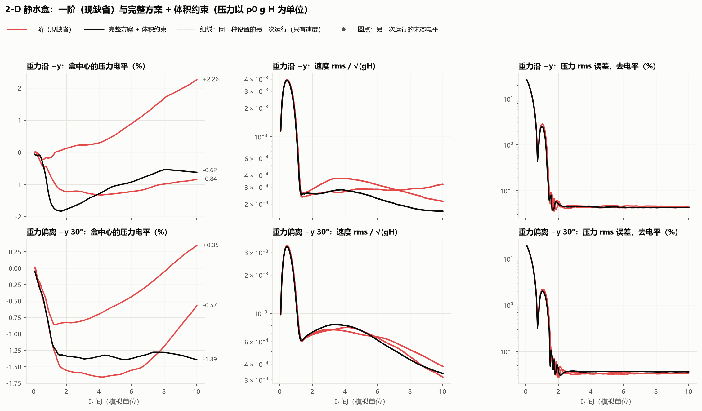

静水盒里约束的 θ（各时刻最近的那次更新）；最后两列是 t ≥ 3 的平均 ± 标准差和它对应的密度偏差。

| 方向 | t = 0.18 | t = 1.08 | t = 2.52 | t = 5.04 | t = 7.56 | t = 9.9 | t ≥ 3 的平均 ± 标准差 | −ρ0·θ（kg/m³） |
|---|---|---|---|---|---|---|---|---|
| 重力沿 −y | +1.01e-06 | +1.66e-05 | +1.72e-05 | +1.09e-05 | +6.68e-06 | +6.64e-06 | +9.34e-06 ± 3.1e-06 | -0.00934 |
| 重力偏离 −y 30° | +2.16e-06 | +1.52e-05 | +1.90e-05 | +1.91e-05 | +1.80e-05 | +1.95e-05 | +1.88e-05 ± 4.8e-07 | -0.01880 |

- **残余速度**：重力沿 −y 时是一阶的 0.65 倍，倾斜 30° 时是 0.92 倍。
- **平均压力随时间的变化**（表里的"电平"）：
  - 重力沿 −y：t = 2.5、5、7.5、10 时是 −1.67 %、−1.05 %、−0.63 %、−0.62 %（以 ρ0 g H 为单位），在收拢。
  - 倾斜 30°：−1.35 %、−1.36 %、−1.28 %、−1.40 %，基本不动。
  - 没有约束的反射版（第 12 节）在 t = 10 是 −5.3 % 和 −2.3 %，而且还在降。
- **θ 没有回到零**：t ≥ 3 的平均是 +9.3e-6（沿 −y，还在减小）和 +1.9e-5（倾斜 30°，稳定）。对应的平均密度比初值低 0.009 和 0.019 kg/m³，正好是上面的压力电平。
- 去电平的压力误差与一阶相同（rms 0.036 % 到 0.043 %）。

### 15.8 没做或没验证的

- **500² 没有"完整方案、没有约束"的运行。** 所以 500² 上约束对 ψ_min 有没有影响、没有约束时 500² 的密度往哪边漂、约束在 500² 的开销，都没有直接的对照。250² 上这三样都有对照。
- **只有两档分辨率**，收敛阶只是一对数的比值。
- **多卡求和：写了，未验证**（本轮的测试都是单卡）。
- **稳定后的密度偏差为什么是预期的 2 到 4 倍：没有查**（250² 方腔 −0.007 对 −0.003；静水盒 −0.009 和 −0.019）。
- **约束 + 收支构建：不支持**，所以加了约束之后的密度收支和内部连续性项没有。
- **τ 和更新间隔只用了缺省值**（1.0 和 τ / 5）。τ = 5 的备用方案没有用到，也没有试别的值。
- **续跑**：目标值不受续跑影响这一点是按实现推出来的，没有实际续跑过一次。
- **3-D、有进出口或自由面的算例**：没有测。约束只应在封闭、充满的容器里打开。
- 每个配置一次运行。
- 第 12 到 14 节列的未验证项没有变（其中"密度下降会不会停"由本节的约束解决了）。

## 16. 追加（十一）：ψ_min、速度极值和涡心的后处理检验（2026-11-18，没有新运行）

用户的四个问题：(1) ψ_min 现在怎么算；(2) 用一个解析的无散场检验后处理本身，250² 和 500² 各一次；(3) 对八次运行换一条积分路径重算 ψ_min；(4) 这些运行的主涡中心位置偏差。只用已有的 t = 80 到 100 的快照。工具是 `experiment/wall_crossing/stream_function_check.py`，记录 wc-20261118-230303-bae6（表）和 wc-20261118-225032-*（十个网格计算）。

**先说结果**

- **后处理本身的误差很小。** 解析场上 ψ_min 偏弱 0.04 %（250²）和 0.01 %（500²）；速度极值偏弱 0.05 % 到 0.06 % 和 0.012 % 到 0.015 %；涡心误差不到 0.01 个粒子间距。
- **帧的选择比这个误差大一个量级。** 如果真实的壁在 crossing 的盒面，按 wall 帧报出的 ψ_min 会多偏弱 0.44 %（250²）和 0.21 %（500²）；按 mid 帧报没有这个偏差。
- **换成不经过盖的路径，ψ_min 基本不变。** 沿 x 积 v（从左或从右出发）与原算法相比：crossing 的四次运行相差不超过 0.02 个百分点；adami 和 simple 相差 −0.25 到 +0.19 个百分点。
- **从盖出发向下积，ψ_min 差 +0.9 到 +2.9 个百分点**（adami 是 −0.1 到 −0.7）。原因是时间平均场在盖的第一排粒子处 ψ 不为零。这条路径的起点不是一面静止的壁，不能用来算 ψ_min；原算法从底壁出发，不受影响。
- **主涡中心**与 Marchi 2021 的偏差都不到一个粒子间距。完整方案 + 约束是 (−0.0000, −0.0010)（250²）和 (−0.0002, −0.0009)（500²），mid 帧。

### 16.1 现在怎么算（读代码）

代码在 `experiment/validation/cavity_analysis.py`（`stream_function_minimum`、`analyse_run`）和 `cavity_sampling.py`。

**ψ_min**

- **数据**：统计窗口（最后 20 个时间单位）里的粒子快照，每 0.99 个时间单位一个，窗口里有 20 个。
- **网格**：513 × 513 个点，覆盖 [−(0.5 + dx), 0.5 + dx]²，即四面最内层壁粒子行的中线围成的正方形。格距约 0.002（250² 是 dx/2，500² 是 dx）。
- **插值**：每个网格点上，对半径 h（算例的核半径，5 dx）以内的全部粒子做线性的移动最小二乘拟合，取拟合的常数项。权重是 W(r/h)·V_j，W 是求解器用的 Wendland C4，V_j = m_j/ρ_j。线性场精确重现。
  - 矩阵病态（条件数超过 1e8）或邻居少于 6 个时退回 Shepard 平均；本节算的十二个网格里一次也没有发生。
- **近壁处核没有被截断。** 快照里有全部粒子，壁粒子也参加拟合。壁有 11 层（2.2 h），所以任何网格点的支撑域都是满的。
  - 壁粒子用的是它存的速度：静止壁是 0，盖是盖速 1。盖两端上方的角块是 0。
  - adami 的壁粒子用的也是存的速度，不是它算粘性时用的虚拟速度。
- **时间平均**：先把 20 个快照的 u 网格平均，再积分。
- **积分路径**：ψ(x, y) = ∫ u dy，沿每一条竖直网格线从底行（y = −(0.5 + dx)，ψ = 0）向上，梯形公式。这是 Marchi 2021 的定义（主涡 ψ < 0）。v 没有用到。
- **求最小值**：在 |x|、|y| < 0.3 的范围里找网格上的最小值，再用 5 × 5 个点的二次曲面拟合细化，同时得到涡心位置。

**"wall 帧"和"mid 帧"**

- 求解器里流体点阵占 [−0.5, 0.5]²，盖速 1。对照的基准是单位方腔。帧规定物理长度怎么换成单位长度；速度不换算。
- **wall 帧**：单位方腔 = 最内层壁粒子行的中线，L = 1 + 2 dx。表里的 ψ_min = ψ / L，位置 = (x + 0.5 + dx) / L。这是已发表的表用的放法。
- **mid 帧**：单位方腔 = 最内层壁粒子行与最外层流体行的正中，L = 1 + dx。这正是 crossing 的盒面（±0.502）。
- 两帧之间 ψ_min 只差一个固定的比例：mid 帧的值是 wall 帧的 (1 + 2 dx)/(1 + dx) 倍，250² 大 0.40 %，500² 大 0.20 %。

**速度极值和剖面 L2**（不走上面的网格）

- 运行时每 0.21 个时间单位在两条中心线上各采 1001 个点（wall 帧里等距），同样的线性移动最小二乘、同样包含壁粒子。窗口里有 96 个样本，先做时间平均。
- u_min 在竖直中心线的 y ∈ (0.05, 0.45) 里找，v_max 在水平中心线的 x ∈ (0.05, 0.45)，v_min 在 x ∈ (0.60, 0.99)；离散极值再用 7 个点的抛物线细化。
- 剖面 L2 是 28 个 Marchi 点上误差的均方根。

### 16.2 用解析场检验后处理（250² 和 500²）

**解析场**：ψ = −A f(x/a) g(y/a)，f(s) = (1 − s²)²(1 + αs)，g(s) = (1 − s²)²(1 + βs)，u = ∂ψ/∂y，v = −∂ψ/∂x。

- ψ 和两个速度分量在四面壁 |x| = a、|y| = a 上都是零，场无散。
- α、β 把最小值放在 Marchi 的涡心位置，A 使 ψ_min = −0.119。速度极值是 −0.33、+0.33、−0.38，与方腔同量级。
- 取值：用完整方案 + 约束那两次运行的 20 个快照里的真实粒子位置和体积；流体粒子取场值，壁粒子和盖粒子取 0。然后走 16.1 的同一套函数。
- 壁的位置做了两种：a = 0.5 + dx/2（crossing 的盒面）和 a = 0.5 + dx（最内层壁粒子行）。

**ψ_min 和涡心**

解析场 ψ = −A f(x/a) g(y/a) 在快照的真实粒子位置上取值（流体粒子取场值，壁粒子和盖粒子取 0），走同一套后处理。ψ 以物理单位给出（没有除以帧的长度）；括号内和后面各列是相对精确值的误差，负 = 后处理偏弱。涡心误差以粒子间距 dx 为单位。最后两列：表里的 ψ_min（除以该帧的长度）相对真正的无量纲值 ψ / (2a) 的误差。

| 分辨率 | 解析场的壁 | 精确的 ψ_min | 后处理（路径 A，原算法） | 路径 B 的误差 | 路径 C 的误差 | 路径 D 的误差 | 涡心误差 (Δx, Δy) / dx | 按 wall 帧报出的误差 | 按 mid 帧报出的误差 |
|---|---|---|---|---|---|---|---|---|---|
| 250² | 壁在 ±(0.5 + dx/2)（crossing 的盒面，mid 帧） | -0.11900 | -0.11895（-0.040 %） | -0.047 % | -0.042 % | -0.045 % | (-0.00, -0.00) | -0.436 % | -0.040 % |
| 250² | 壁在 ±(0.5 + dx)（最内层壁粒子行，wall 帧） | -0.11900 | -0.11895（-0.044 %） | -0.065 % | -0.051 % | -0.060 % | (-0.00, -0.00) | -0.044 % | +0.354 % |
| 500² | 壁在 ±(0.5 + dx/2)（crossing 的盒面，mid 帧） | -0.11900 | -0.11899（-0.010 %） | -0.013 % | -0.011 % | -0.012 % | (-0.00, -0.00) | -0.210 % | -0.010 % |
| 500² | 壁在 ±(0.5 + dx)（最内层壁粒子行，wall 帧） | -0.11900 | -0.11899（-0.012 %） | -0.017 % | -0.013 % | -0.016 % | (-0.00, -0.00) | -0.012 % | +0.188 % |

- **后处理的误差**：ψ_min 偏弱 0.040 % 到 0.044 %（250²）、0.010 % 到 0.012 %（500²）。分辨率加倍，误差降到四分之一。
- 四条积分路径在这个场上给出几乎相同的值（相差不到 0.03 个百分点），因为这个场是闭合的。
- 涡心误差不到 0.005 dx。
- **帧的影响**（最后两列）：壁在盒面时，按 wall 帧报出的值偏弱 0.44 %（250²）和 0.21 %（500²），按 mid 帧只偏弱 0.04 % 和 0.01 %。壁在最内层壁粒子行时反过来：wall 帧准，mid 帧偏强 0.35 % 和 0.19 %。
  - 对 crossing 的各次运行，壁在盒面，所以表里"ψ_min 偏差（mid 帧）"那一列更接近真实的偏差。例如完整方案 + 约束是 −1.03 %（250²）和 −0.56 %（500²），wall 帧是 −1.42 % 和 −0.76 %。

**速度极值和剖面**

同一个解析场，两条中心线上的速度极值：精确值 → 后处理的值（括号内 = 相对误差，负 = 偏弱）。最后一列是整条中心线上采样剖面与精确剖面之差的最大值，以该分量的最大速度为单位（u 线 / v 线；它出现在线的端点，即壁面处）。后两列以速度为单位：28 个 Marchi 点上的误差 L2 / L∞（u 线 ; v 线），和去掉两端各 5 % 之后整条线上的最大误差（u 线 / v 线）。

| 分辨率 | 解析场的壁 | u_min | v_max | v_min | 整条线上的最大误差 | 28 个 Marchi 点上的 L2 / L∞ | 去掉两端后的最大误差 |
|---|---|---|---|---|---|---|---|
| 250² | 壁在 ±(0.5 + dx/2)（crossing 的盒面，mid 帧） | -0.32629 → -0.32613（-0.049 %） | +0.32936 → +0.32919（-0.050 %） | -0.37825 → -0.37802（-0.062 %） | 2.49 % / 2.23 % | 0.00024 / 0.00047 ; 0.00021 / 0.00033 | 0.00044 / 0.00033 |
| 250² | 壁在 ±(0.5 + dx)（最内层壁粒子行，wall 帧） | -0.32499 → -0.32484（-0.048 %） | +0.32805 → +0.32789（-0.049 %） | -0.37675 → -0.37652（-0.061 %） | 2.25 % / 2.02 % | 0.00024 / 0.00046 ; 0.00021 / 0.00033 | 0.00044 / 0.00032 |
| 500² | 壁在 ±(0.5 + dx/2)（crossing 的盒面，mid 帧） | -0.32694 → -0.32690（-0.012 %） | +0.33001 → +0.32997（-0.012 %） | -0.37901 → -0.37895（-0.015 %） | 1.26 % / 1.13 % | 0.00006 / 0.00012 ; 0.00005 / 0.00008 | 0.00011 / 0.00008 |
| 500² | 壁在 ±(0.5 + dx)（最内层壁粒子行，wall 帧） | -0.32629 → -0.32625（-0.012 %） | +0.32936 → +0.32931（-0.012 %） | -0.37825 → -0.37819（-0.015 %） | 1.14 % / 1.02 % | 0.00006 / 0.00012 ; 0.00005 / 0.00008 | 0.00011 / 0.00008 |

- 速度极值偏弱 0.05 % 到 0.06 %（250²）、0.012 % 到 0.015 %（500²）。速度不随帧换算，所以没有帧的问题。
- 28 个 Marchi 点上，后处理自己带来的误差是 L2 0.0002（250²）和 0.00006（500²）。各运行报出的剖面 L2 是 0.005 到 0.027（250²）和 0.002 到 0.018（500²），后处理的份额最多 5 %。
- 整条线上最大的误差出现在线的端点（壁面处），是最大速度的 2.5 %（250²）和 1.3 %（500²）：那里速度剖面有折点，被半径 5 dx 的拟合抹平。去掉两端各 5 % 之后最大只有 0.0004 和 0.0001。

### 16.3 换积分路径重算 ψ_min

同一批快照的同一个时间平均速度场，四条路径：A 是原算法；B 沿同一方向从对面（盖）出发；C、D 改成沿 x 积 v，分别从左、右壁出发。

ψ_min（wall 帧）按四条积分路径，同一批快照的同一个时间平均速度场。括号内 = 相对 Marchi 2021（-0.11894）的偏差；B、C、D 三列是该路径的偏差，括号内是它减去路径 A 的偏差（百分点）。“A、C、D 的极差”是不经过盖的三条路径之间最大与最小偏差之差。最后一列：本工具的路径 A 与分析表里的值之差（应为 0）。

| 运行 | A：u，从底行向上（原算法） | B：u，从顶行（盖）向下 | C：v，从左行向右 | D：v，从右行向左 | A、C、D 的极差（百分点） | 与分析表之差 |
|---|---|---|---|---|---|---|
| 250² 完整方案 + 体积约束 | -0.11724（-1.42 %） | +0.38 %（+1.80） | -1.43 %（-0.00） | -1.42 %（+0.00） | 0.01 | 0.0e+00 |
| 250² 一阶（现缺省） | -0.11407（-4.09 %） | -1.18 %（+2.92） | -4.10 %（-0.00） | -4.08 %（+0.01） | 0.02 | 0.0e+00 |
| 250² adami | -0.12336（+3.72 %） | +3.02 %（-0.71） | +3.91 %（+0.19） | +3.48 %（-0.24） | 0.43 | 0.0e+00 |
| 250² simple | -0.10867（-8.64 %） | -6.81 %（+1.83） | -8.53 %（+0.10） | -8.89 %（-0.25） | 0.36 | 0.0e+00 |
| 500² 完整方案 + 体积约束 | -0.11803（-0.76 %） | +0.12 %（+0.88） | -0.76 %（+0.00） | -0.76 %（-0.00） | 0.00 | 0.0e+00 |
| 500² 一阶（现缺省） | -0.11631（-2.21 %） | -0.74 %（+1.47） | -2.21 %（-0.00） | -2.21 %（+0.00） | 0.00 | 0.0e+00 |
| 500² adami | -0.12059（+1.39 %） | +1.26 %（-0.13） | +1.49 %（+0.10） | +1.25 %（-0.14） | 0.24 | 0.0e+00 |
| 500² simple | -0.11228（-5.59 %） | -4.47 %（+1.13） | -5.48 %（+0.11） | -5.83 %（-0.24） | 0.35 | 0.0e+00 |

时间平均速度场的闭合：路径 A 积到顶行（盖的第一排粒子）时的 ψ，和路径 C 积到右行时的 ψ。无散、壁面无滑移的场这两个数都是 0。

| 运行 | 顶行的 ψ，涡心所在的列 | 同，÷ (U dx) | 顶行 |ψ| 的最大值 | 右行的 ψ，涡心所在的行 | 右行 |ψ| 的最大值 |
|---|---|---|---|---|---|
| 250² 完整方案 + 体积约束 | +0.00216 | +0.54 | 0.00216 | +0.00001 | 0.00012 |
| 250² 一阶（现缺省） | +0.00350 | +0.87 | 0.00350 | +0.00002 | 0.00018 |
| 250² adami | -0.00085 | -0.21 | 0.00101 | -0.00051 | 0.00106 |
| 250² simple | +0.00219 | +0.55 | 0.00257 | -0.00043 | 0.00101 |
| 500² 完整方案 + 体积约束 | +0.00105 | +0.53 | 0.00107 | -0.00000 | 0.00002 |
| 500² 一阶（现缺省） | +0.00175 | +0.88 | 0.00175 | +0.00000 | 0.00005 |
| 500² adami | -0.00016 | -0.08 | 0.00035 | -0.00029 | 0.00047 |
| 500² simple | +0.00134 | +0.67 | 0.00165 | -0.00042 | 0.00084 |

- **路径 A 与分析表里的值完全相同**（最后一列是 0），说明本工具重现了原来的计算。
- **C、D 与 A 的差**：
  - crossing 的四次运行（完整方案 + 约束、一阶，两档分辨率）：不超过 0.02 个百分点。时间平均场左右闭合得很好，右行的 ψ 只有 0.00001 的量级。
  - adami：+0.19 / −0.24（250²），+0.10 / −0.14（500²）。
  - simple：+0.10 / −0.25（250²），+0.11 / −0.24（500²）。
  - adami 和 simple 的时间平均场左右不闭合：积到右行时 ψ 是 −0.0003 到 −0.0005，即主涡流量的 0.2 % 到 0.4 %。原因没有查。
- **B 与 A 的差很大**：完整方案 + 约束 +1.80（250²）和 +0.88（500²）；一阶 +2.92 和 +1.47；simple +1.83 和 +1.13；adami −0.71 和 −0.13。
  - 原因在闭合表的前三列：从底行积到顶行（盖的第一排粒子）时 ψ 不回到零，而是 +0.5 到 +0.9 U·dx（adami 是 −0.1 到 −0.2 U·dx）。从顶行出发就等于把这个量从 ψ_min 里减掉。
  - 完整方案 + 约束的 0.53 到 0.54 U·dx 与下面这个简单的图像相符：盖面在盒面，顶行在它上方半个间距，其间插值出的速度约等于盖速，贡献 0.5 U·dx。一阶是 0.87 到 0.88 U·dx，多出来的部分没有查。
  - 所以路径 B 的起点不是 ψ = 0 的地方，它给出的不是另一个可用的 ψ_min。原算法从静止的底壁出发，底行的速度是零，不受这个影响。
- **结论**：就积分路径而言，crossing 各次运行的 ψ_min 可以信到 0.02 个百分点；adami 和 simple 是 0.25 个百分点。这些都远小于各模式之间的差别（1 到 8 个百分点）。

### 16.4 主涡中心

主涡中心（路径 A，原算法），Marchi 2021 的位置是 (0.5308, 0.5652)。偏差 = 本次 − 参考。倒数第二列是 mid 帧的偏差换成粒子间距 dx；最后一列是路径 C 的涡心减路径 A 的涡心（mid 帧）。

| 运行 | wall 帧的位置 | wall 帧的偏差 | mid 帧的位置 | mid 帧的偏差 | mid 帧的偏差 / dx | 路径 C − 路径 A |
|---|---|---|---|---|---|---|
| 250² 完整方案 + 体积约束 | (0.5306, 0.5640) | (-0.0002, -0.0013) | (0.5307, 0.5642) | (-0.0000, -0.0010) | (-0.01, -0.26) | (+0.0000, +0.0001) |
| 250² 一阶（现缺省） | (0.5309, 0.5641) | (+0.0001, -0.0011) | (0.5310, 0.5644) | (+0.0002, -0.0009) | (+0.05, -0.22) | (+0.0000, +0.0000) |
| 250² adami | (0.5300, 0.5646) | (-0.0008, -0.0006) | (0.5301, 0.5649) | (-0.0007, -0.0004) | (-0.18, -0.10) | (+0.0002, +0.0005) |
| 250² simple | (0.5334, 0.5643) | (+0.0026, -0.0009) | (0.5336, 0.5646) | (+0.0028, -0.0007) | (+0.70, -0.17) | (+0.0002, +0.0008) |
| 500² 完整方案 + 体积约束 | (0.5305, 0.5642) | (-0.0003, -0.0010) | (0.5306, 0.5643) | (-0.0002, -0.0009) | (-0.12, -0.46) | (+0.0000, +0.0000) |
| 500² 一阶（现缺省） | (0.5306, 0.5643) | (-0.0002, -0.0010) | (0.5307, 0.5644) | (-0.0001, -0.0008) | (-0.05, -0.41) | (-0.0000, -0.0000) |
| 500² adami | (0.5302, 0.5644) | (-0.0006, -0.0008) | (0.5302, 0.5645) | (-0.0006, -0.0007) | (-0.28, -0.35) | (+0.0002, +0.0003) |
| 500² simple | (0.5321, 0.5649) | (+0.0013, -0.0003) | (0.5322, 0.5650) | (+0.0014, -0.0002) | (+0.70, -0.10) | (+0.0002, +0.0007) |

- Marchi 2021 给出的涡心是 (0.5308, 0.5652)，它标的不确定度是 1e-9 量级，可以当作精确值。
- **crossing 的四次运行**：水平方向偏差不超过 0.0003；竖直方向都偏低 0.0008 到 0.0013（两帧、两档分辨率都是）。换成粒子间距是 0.2 到 0.5 dx。
- **adami**：(−0.0007, −0.0004)（250²）和 (−0.0006, −0.0007)（500²），mid 帧。
- **simple**：水平方向偏右 0.0028（250²）和 0.0014（500²），都是 0.7 dx；竖直方向 −0.0007 和 −0.0002。
- 竖直方向 −0.001 的偏低在两档分辨率上大小相同，没有随分辨率缩小。16.2 的解析场检验里后处理的涡心误差不到 0.005 dx，所以这个偏差不是后处理造成的。
- 换成路径 C，涡心移动不超过 0.0001（crossing）和 0.0008（adami、simple）。

### 16.5 没做或没验证的

- **解析场没有运动的盖，也没有角上的奇性。** 它检验的是插值、积分和求极值这三步，不是盖附近的处理。盖附近的情况由 16.3 的闭合量给出。
- **速度极值的检验用的是 20 个快照**；实际分析用的是窗口里的 96 个样本，采样函数相同。
- **时间平均的统计误差没有另外估计。** 路径之间的差里包含它。
- **adami 和 simple 的时间平均场为什么左右不闭合**，以及**一阶在顶行多出的 0.37 U·dx**：没有查。
- 只做了要求的八次运行。旧缺省、没有约束的完整方案等没有做。
- 没有改分析代码，也没有改任何已经报出的数。

## 17. 追加（十二）：250² 完整方案 + 体积约束续跑到 t = 200（2026-11-19）

用户的指令：把 250² 完整方案 + 约束从 t = 100 续跑到 t = 200；报告 t 在 80–100、130–150、180–200 三个窗口的 ψ_min（按壁面在盒面的归一化）、速度极值、涡心位置，动能在 t = 80 到 200 的变化，以及续跑前后约束的目标值是否相同、平均密度是否接着原来的走。工具是 `experiment/wall_crossing/continuation_check.py`，记录 wc-20261119-000948-4819（表）；运行的记录是 wc-20261118-234425-2208。

**先说结果**

- **续跑到了 t = 199.92，没有触发任何停止条件**（粒子数守恒，没有越出盒，最大速度没有超过 1.05）。
- **三个窗口的结果几乎相同。** ψ_min（mid 帧，壁面在盒面）依次是 −1.03 %、−1.00 %、−0.98 %；三个速度极值在 −0.76 % 到 −0.81 % 之间，窗口间相差不超过 0.03 个百分点；涡心位置相差不超过 0.00004。
- **ψ_min 随时间略有变小**：后两个窗口比第一个少偏 0.03 和 0.05 个百分点。这与动能的变化一致。
- **动能**：80–100 窗口里还在缓慢上升（每时间单位 +0.0006），平均 49.8225；t ≈ 120 以后在 49.837 ± 0.004 附近起伏，不再有趋势。所以 80–100 的窗口比后来低 0.03 %。
- **约束的目标值续跑前后相同**（V_target = 1.1383621929138896，逐位相同）。续跑后的第一次更新与原运行在同一时刻的更新逐位相同。
- **平均密度接着原来的走**：三个窗口是 ρ0 − 0.0073、−0.0063、−0.0067（各 ± 0.0025）；t ∈ (100, 200] 的斜率是每时间单位 −0.00002。
- **续跑不是逐位的延续。** 从检查点出发的第一个样本（0.21 个时间单位之后）起，动能、θ 就与原运行不同，差别和它们自己的逐样本涨落一样大。在两次都算了的 90.72–100 这一段，两者的平均值一致。

### 17.1 运行和我做的决定

- **从 t = 90.72 续跑，不是从 100。** 运行器每 10.08 个时间单位存一个检查点，原运行最后一个检查点在 t = 90.72，t = 100 没有。所以 90.72 到 100 又算了一遍。这一段正好用来检查续跑接得上接不上（17.4）。
- **在副本目录里续跑。** 续跑会删除检查点之后的样本和快照，所以先把原运行的目录原样复制成 `cavity/n250_reflection_full_volume_to200`，在副本里续跑。原运行的目录没有动，第 15、16 节的数仍然由它算出。
- **130–150 的快照是另加的。** 运行器只在最后 20 个时间单位存粒子快照。我在 `cavity_runner_entry.py` 加了一个钩子（`cavity_run.py --extra-snapshot-windows 130:150`）：运行器每次读取状态做采样时，如果时间在窗口里、步数是 35,000 的倍数，就把这份状态按运行器自己的快照格式另存一份。得到 19 个快照，间隔 1.05。80–100 和 180–200 用运行器自己的快照，各 20 个，间隔 0.99。钩子不改变求解器的任何计算。
- **窗口的取法**：80–100 和 180–200 用方腔分析表的窗口（80.01–99.96 和 179.97–199.92），所以这两个窗口的数与表里的逐位相同（核对表见 17.2）。130–150 取 130 < t ≤ 150 的 95 个样本。
- **归一化**：按用户的要求，ψ_min 和涡心按壁面在盒面归一化，即 L = 1 + dx（表里的 mid 帧）。第 16 节说明了 crossing 应当用这个帧。wall 帧（L = 1 + 2 dx）的 ψ_min 并列在旁边，便于和前面各节对照。
- 续跑用同一张卡（显示卡），`t_end = 200`，从冻结检出 `faebf7a` 运行。它的求解器、运行器和算例文件与原运行的 `5f27286` 相同，运行器的代码哈希检查也通过了。墙钟时间 19 分钟。

### 17.2 三个窗口的 ψ_min、速度极值、涡心

250² 完整方案 + 体积约束，三个窗口。ψ_min 按壁面在盒面归一化（L = 1 + dx，即表里的 mid 帧），括号内是相对 Marchi 2021（-0.11894）的偏差；wall 帧（L = 1 + 2 dx）的偏差在旁边。涡心也在 mid 帧，Marchi 2021 的位置是 (0.5308, 0.5652)。动能是窗口内各样本的平均 ± 标准差。

| 窗口 | 运行，快照目录 | 实际窗口 | 快照数 / 样本数 | ψ_min（mid 帧） | ψ_min 偏差（wall 帧） | 涡心（mid 帧） | 涡心偏差 | 动能 |
|---|---|---|---|---|---|---|---|---|
| 80–100 | n250_reflection_full_volume，snapshots | 80.01–99.96 | 20 / 96 | -0.11771（-1.03 %） | -1.42 % | (0.5307, 0.5642) | (-0.0000, -0.0010) | 49.8225 ± 0.0045 |
| 130–150 | n250_reflection_full_volume_to200，snapshots_extra | 130.00–150.00 | 19 / 95 | -0.11774（-1.00 %） | -1.39 % | (0.5308, 0.5642) | (-0.0000, -0.0010) | 49.8394 ± 0.0033 |
| 180–200 | n250_reflection_full_volume_to200，snapshots | 179.97–199.92 | 20 / 96 | -0.11777（-0.98 %） | -1.38 % | (0.5307, 0.5643) | (-0.0001, -0.0010) | 49.8357 ± 0.0042 |

同样三个窗口，两条中心线上的速度极值：值（相对 Marchi 2021 的偏差），位置（mid 帧）。Marchi 2021：u_min -0.38857 在 y = 0.1717，v_max 0.37694 在 x = 0.1578，v_min -0.52708 在 x = 0.9092。

| 窗口 | u_min | v_max | v_min |
|---|---|---|---|
| 80–100 | -0.38558（-0.77 %），0.1695 | +0.37390（-0.81 %），0.1568 | -0.52295（-0.78 %），0.9104 |
| 130–150 | -0.38562（-0.76 %），0.1695 | +0.37393（-0.80 %），0.1568 | -0.52309（-0.76 %），0.9104 |
| 180–200 | -0.38557（-0.77 %），0.1696 | +0.37391（-0.80 %），0.1568 | -0.52305（-0.76 %），0.9104 |

后两个窗口减第一个窗口：ψ_min 和三个速度极值的偏差之差（百分点），涡心位置之差（mid 帧），平均动能的相对变化。

|  | ψ_min（mid 帧） | u_min | v_max | v_min | 涡心 | 动能 |
|---|---|---|---|---|---|---|
| 130–150 − 80–100 | +0.029 | +0.011 | +0.008 | +0.027 | (+0.00000, -0.00001) | +0.034 % |
| 180–200 − 80–100 | +0.048 | -0.004 | +0.004 | +0.018 | (-0.00001, +0.00004) | +0.027 % |

本工具与方腔分析表在同一个窗口上的差（应为 0 或舍入量级）。

| 窗口 | 运行 | ψ_min（mid 帧）之差 | 速度极值之差的最大值 |
|---|---|---|---|
| 80–100 | n250_reflection_full_volume | 0.0e+00 | 0.0e+00 |
| 180–200 | n250_reflection_full_volume_to200 | 0.0e+00 | 0.0e+00 |

- **ψ_min（mid 帧）**：−1.03 %、−1.00 %、−0.98 %。wall 帧是 −1.42 %、−1.39 %、−1.38 %。
- **速度极值**：u_min −0.77 / −0.76 / −0.77 %，v_max −0.81 / −0.80 / −0.80 %，v_min −0.78 / −0.76 / −0.76 %。位置在三个窗口里相同（到 0.0001）。
- **涡心**（mid 帧）：(0.5307, 0.5642)、(0.5308, 0.5642)、(0.5307, 0.5643)。相对 Marchi 2021 的偏差三个窗口都是 (0.0000, −0.0010)，即竖直方向低 0.26 dx，与第 16 节相同。
- **窗口之间的差**：ψ_min 少偏 0.03 和 0.05 个百分点，速度极值的差不超过 0.03 个百分点。作为比较，同一配置的两次独立运行（第 14 节的 C1 和 C2）之间 ψ_min 差 0.01 到 0.02 个百分点。
- 后两个窗口之间（130–150 到 180–200）ψ_min 只差 0.02 个百分点，与运行间的散布同量级。

### 17.3 动能（t = 80 到 200）

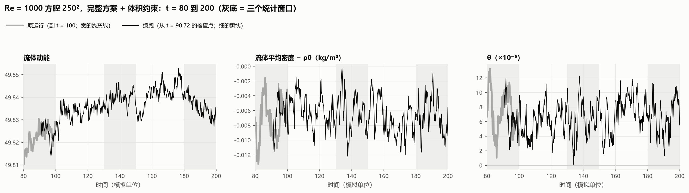

流体动能 ½ Σ m |v|²（运行器在每个样本记录的值）。原运行到 t = 99.96；续跑从 t = 90.72 的检查点开始（它的第一个样本在 t = 90.93），90.72 到 99.96 两次都算了。

| t | 原运行 | 续跑 |
|---|---|---|
| 80.01 | 49.8106 | — |
| 90.09 | 49.8233 | — |
| 90.72（检查点） | 49.8288 | — |
| 99.96 | 49.8280 | 49.8250 |
| 110.04 | — | 49.8314 |
| 120.12 | — | 49.8371 |
| 130.20 | — | 49.8347 |
| 140.07 | — | 49.8387 |
| 150.15 | — | 49.8355 |
| 160.02 | — | 49.8393 |
| 170.10 | — | 49.8419 |
| 180.18 | — | 49.8426 |
| 190.05 | — | 49.8378 |
| 199.92 | — | 49.8343 |

每 20 个时间单位一段（续跑）：平均 ± 标准差，线性拟合斜率（每时间单位）。

| 时间段 | 平均 | 标准差 | 斜率 |
|---|---|---|---|
| 100–120 | 49.8329 | 0.0037 | +0.00023 |
| 120–140 | 49.8371 | 0.0036 | +0.00042 |
| 140–160 | 49.8381 | 0.0045 | -0.00005 |
| 160–180 | 49.8438 | 0.0035 | +0.00014 |
| 180–200 | 49.8357 | 0.0041 | -0.00059 |

- **80–100**：平均 49.8225，窗口里还在上升，线性拟合斜率每时间单位 +0.0006（t = 80 是 49.811，t = 100 是 49.828）。运行器的定常判据（10 个时间单位窗口间的相对变化小于 1e-3）在 t = 70.56 已经满足，这个上升在判据以下。
- **100 到 120**：继续升到平均 49.833。
- **120 到 200**：平均 49.839，各 20 个时间单位段的平均在 49.836 到 49.844 之间，段内斜率正负交替（+0.0004 到 −0.0006）。t ∈ (100, 200] 整体的斜率是每时间单位 +0.00006。
- 所以 80–100 窗口的动能比后来的平稳水平低 0.03 %。这与 ψ_min 在后两个窗口少偏 0.03 到 0.05 个百分点同向，量级也相当。
- 动能还有周期约 10 到 20 个时间单位、幅度约 ±0.005 的慢起伏（例如 t ≈ 140 和 175 的高点）。t ≈ 100 之后那一段上升没有异常：续跑里 1 个时间单位内的最大上升是 0.0107（t ≈ 102），原运行 t ≥ 60 里是 0.0106。

### 17.4 约束的目标值，平均密度是否接着原来的走

续跑前后的约束和平均密度。原运行和续跑的约束日志都在续跑目录的 volume_constraint.jsonl 里（续跑的行接在后面，时间从 0 重新数，这里加上了 90.72）。

|  | 原运行 | 续跑 | 比较 |
|---|---|---|---|
| 约束的目标值 V_target | 1.13836219291389 | 1.13836219291389 | 相同 |
| t = 90.72 的那次更新：V_now | 1.138373213819474 | 1.138373213819474 | 差 0.0e+00 |
| t = 90.72 的那次更新：θ | 9.681370e-06 | 9.681370e-06 | 差 0.0e+00 |
| 重叠段 90.72–99.96 的更新：θ 之差的最大值 |  |  | 9.22e-06（52 次更新，其中 1 次逐位相同） |
| 重叠段的平均密度 − ρ0（平均） | -0.00744 | -0.00625 | 之差 rms 0.00307，最大 0.00673 |

三个窗口的平均密度 − ρ0（kg/m³，平均 ± 标准差）、约束的 θ、平均压力（ρ0U²）和负压粒子比例。续跑 t ∈ (100, 200] 的平均密度线性拟合斜率：-0.000017 kg/m³ 每时间单位。

| 窗口 | 平均密度 − ρ0 | θ | 平均压力 | 负压粒子比例 |
|---|---|---|---|---|
| 80–100 | -0.00730 ± 0.00269 | +7.33e-06 ± 2.8e-06（111 次） | -0.0720 | 93.5 % |
| 130–150 | -0.00627 ± 0.00249 | +6.34e-06 ± 2.5e-06（111 次） | -0.0617 | 91.5 % |
| 180–200 | -0.00668 ± 0.00225 | +6.64e-06 ± 2.3e-06（111 次） | -0.0658 | 93.4 % |

- **目标值相同**：续跑的进程启动时由算例的初始粒子重新算出 V_target（检查点里不存它），与原运行的值逐位相同，每一次更新都用这个值。
- **续跑后的第一次更新**（t = 90.72，重启时做的那次 defrag 之后）：V_now 和 θ 与原运行在 t = 90.72 的那次更新逐位相同。重启的状态就是原运行那一刻的状态，约束一开始就用上了正确的速率。
- **之后两次运行不再逐位相同。** 重叠段 90.72–99.96 的 52 次更新里只有第一次逐位相同；θ 之差最大 9.2e-6，与 θ 本身的起伏（标准差 2.8e-6，范围 1e-6 到 1.3e-5）同量级。
  - 动能在续跑的第一个样本（t = 90.93）就差 0.005，与动能的逐样本涨落（标准差 0.0045）一样大。
  - 原因：重启时粒子按检查点的行序重新编号、重建体素表，邻居求和的顺序变了，舍入不同。这一部分高频涨落是混沌的，很快就失去相关。
- **平均值是接上的**：
  - 重叠段里，平均密度的平均是 −0.0074（原运行）和 −0.0063（续跑），差 0.0011，小于各自的涨落（标准差约 0.0027）。动能的平均是 49.8252 和 49.8240。
  - 三个窗口的平均密度 −0.0073、−0.0063、−0.0067，θ 的平均 7.3e-6、6.3e-6、6.6e-6，都在一个标准差以内。
  - t ∈ (100, 200] 平均密度的斜率是每时间单位 −0.00002，即 100 个时间单位里 −0.0017，没有约束时同样的时间里是 −0.27（第 14 节）。
  - 平均压力 −0.072、−0.062、−0.066 ρ0U²，负压粒子比例 93 %、92 %、93 %，与第 15 节的 80–100 相同。

### 17.5 没做或没验证的

- **只有 250²、一次续跑。** 500² 没有续跑。
- **从 t = 100 的精确状态续跑：做不到**（没有那一刻的检查点），所以 90.72 到 100 重算了一遍；原运行这一段的数据仍然有效，80–100 的窗口用的是原运行的。
- **130–150 的快照间隔是 1.05**，另外两个窗口是 0.99；快照数 19 对 20。时间平均因此略有不同，影响没有单独估计。
- **窗口间 0.03 到 0.05 个百分点的变化是趋势还是统计起伏**，三个窗口不足以分开；动能的走势说明 80–100 时流动还在极缓慢地变强。
- 约束的多卡路径仍未验证（同第 15 节）。

## 18. 追加（十三）：完整方案设为 crossing 模式的缺省（2026-11-19）

用户的指令：把 crossing 模式的缺省配置改成第 15 节用的完整方案，只改四项缺省值，总体积约束仍默认关闭；做完六项检查，写进报告后停下。工具是 `experiment/wall_crossing/default_change.py`。

**先说结果**

- **缺省值从提交 `3cba19f` 起改变**（2026-11-19 01:36）。新缺省是 `geometry: pairwise`、`continuity_wall_component: full`、`pressure_wall: reflection`、`delta_wall: reflection`。总体积约束仍默认关闭；所有原有取值都保留。
- **新缺省等于显式写出的完整方案，逐位相同**：250²、700 步，约束关闭和打开各一次。两者都落在同样的两个结果类里；这两个类从 `2186032`（加约束之前）起就没有变过。
- **旧缺省仍可复现，逐位相同**：显式写出原来四项缺省的运行，与改动之前的提交 `48d370f` 上的缺省运行落在同一个结果类里。
- **simple / adami 不受影响**：它们用的 23 个 SPIR-V 文件与基点逐字节相同；999 步和 200 步的运行与基点的转储逐位相同。
- **单步对照通过**：新缺省下 2-D 判据值 9.1e-6，3-D 1.2e-5（容差 1e-4）。收支构建、非零的约束速率也都通过。
- **组合检查**：16 条路径（拒绝或载入）全部符合预期。只打开二阶开关时，报错信息写明要同时写 `geometry: nearest_wall`、`pressure_wall: extension`、`delta_wall: extension`。
- **现有测试**：四个测试脚本通过（`_test_seam_layout.py` 的失败清单与基点逐行相同，标准同前）；`_test_partition_chain.py` 在这个检出里跑不起来，因为它要的 1M / 8M 算例的 `.obj` 文件不在这里，改动之前也一样。
- **算例**：本系列的 8 个缺省封闭域算例加上了约束；新建 2 个回归算例。诊断算例按指示没有动：其中 24 个的含义随缺省改变，10 个二阶算例现在载入时报错。
- **此前 `runs.jsonl` 里的 crossing 运行用的是当时的缺省**：801 条记录，没有写出的开关取的都是那时的值（18.5）。

### 18.1 改动清单

提交：`3cba19f`（改缺省、着色器、工具、算例）、`8a7f02d`（两条报错信息的措辞，以及检查工具）、`380ea90` 及之后（检查工具的表和本节）。都在本地分支 `v7-wall-crossing` 上，没有 push。

**缺省值**

| 开关 | 规格常量 | 原缺省 | 新缺省 |
|---|---|---|---|
| `wall_crossing.geometry` | 128 | `nearest_wall`（0） | `pairwise`（1） |
| `wall_crossing.continuity_wall_component` | 117 | `normal`（1） | `full`（0） |
| `wall_crossing.pressure_wall` | 129 | `extension`（0） | `reflection`（1） |
| `wall_crossing.delta_wall` | 116 | `extension`（0） | `reflection`（3） |

其余开关的缺省不变：`continuity: extrapolate`、`distance_floor_factor: 0.25`、两个延拓阶数 `linear`、`numerics.volume_constraint.enabled: false`。

**求解器**

- `wall_crossing_v7.py`：
  - 四个缺省值。
  - 两个常量：`WALL_CROSSING_FIRST_ORDER_SETTINGS`（2026-11-18 到 11-19 的四项缺省，供工具引用）和 `WALL_CROSSING_NEAREST_WALL_REQUIREMENTS`（二阶延拓要求的三项）。
  - 组合检查集中到 `check_wall_crossing_combination`：每种不支持的组合抛一条 `ValueError`，写明算例需要写哪些键，以及出问题的值是算例写的还是缺省（18.3 有原文）。
  - 日志行总是写出四项的值。
  - 配置说明（`parse_wall_crossing_settings` 的文档）按新缺省重写，并注明各项缺省的日期。
- `wall_boundary.glsl`：规格常量 116、117、128、129 的缺省跟着主机端改（主机在 crossing 片上总是显式传这四个常量，这只是让两边一致，与 `44e4e6f` 的做法相同）。注释同步更新。
- 重新编译：变的只有 crossing 的三个构建（融合遍、它的收支构建、force），只差缺省字面量，文件大小不变；simple 和 adami 用的 23 个文件与基点逐字节相同。`MANIFEST.txt`、`shaders/README.md` 已更新。
- `simulator_v7.py`：规格常量旁的注释；"约束与收支构建不能同用"的报错信息加上了该用哪个算例（缺省算例现在带约束）。

**工具和参考解**

- `reference.py`：参数缺省跟随求解器的缺省（从 `wall_crossing_v7` 导入）。simple / adami 的参考解把所有开关都显式写出，不随 crossing 的缺省走（第 9 节出过这类错）。
- `single_step.py`：命令行缺省跟随求解器。只给二阶开关而没给三个 nearest-wall 参数时，工具自己先报错。标签和汇总文件名按取值命名、不按缺省，所以此前的日志含义不变。
- `box_case.py`：测试盒的缺省跟随求解器，只写与缺省不同的开关（缺省盒检验的就是缺省）。
- 分项统计构建：着色器缺省跟着改（上面的三个构建之一）。新缺省下的收支对照见 18.3。
- `cavity_watch.py`：只读运行目录里的速度、出盒计数和粒子数，不依赖 crossing 的缺省，没有改。
- 算例生成器：
  - `pairwise_reflection.py` 和 `quadratic_extension.py` 现在把四项开关全部显式写出（取各变体当初的含义）。源算例的约束块先去掉，变体需要约束时再加。已有的变体文件没有重写（生成器跳过已存在的文件）。
  - `hydrostatic.py` 给缺省 crossing 模式的算例写上约束。
- `cavity_tables.py`：一阶那一行的标签写明了它是哪两天的缺省。

### 18.2 我做的决定

- **着色器里的缺省也改**，按 `44e4e6f` 的惯例：主机端总是显式传这几个常量，着色器的缺省只是跟着一致。代价是 crossing 的三个 SPIR-V 文件变了（只差字面量）；simple / adami 的不变。
- **新建两个回归算例**，都从改动前（`48d370f`）的 250² 缺省算例派生，其余内容与它逐字相同：
  - `..._crossing_constraint_off`：不写开关、不写约束，即新缺省、约束关闭。检查 1 用。
  - `..._crossing_first_order`：原来四项缺省显式写出、没有约束。检查 2 用。
- **加约束的算例**是本系列建的、写法为"只写 `continuity: extrapolate`"的 8 个封闭域缺省算例：250²、500²、1000² 方腔，3-D 方腔 `cavity3d_1m_crossing`，2-D 静水盒 gy / g30，3-D 静水盒 gy / gtilt。
  - 3-D 算例和 1000² 也算在内，因为它们同样是封闭域。
  - 8 个都载入检查过：约束的更新间隔在 1,000 到 26,000 步之间，都不超过 τ/5。
  - 这些算例在新缺省加约束下都没有跑过（不跑长时间运行）。
- **诊断算例没有动**（按指示）。它们只写了部分开关，其余开关现在取新缺省，所以有 24 个的含义变了，10 个二阶算例载入时报错，名单见 18.4。
  - 要复现第 10 节的二阶运行，算例里需要写 `geometry: nearest_wall`、`pressure_wall: extension`、`delta_wall: extension`，再加 `continuity_wall_component: normal`（当时的缺省）。报错信息里提到了这一点。
- **算例生成器改成显式写出**：用新的源算例重新生成全部 22 个已有变体（只在内存里），每一个的含义都与它当初生成时相同，其余文本也相同。`hydrostatic.py` 重新生成的 2-D 文件与树里的 10 个逐字节相同。3-D 的 8 个文件只差 `det_threshold: 0.0001` 与 `1.0e-4` 的写法，这是早已有的差别，与本次无关。
- **检查 1、2 的参照**：
  - 检查 1 的两个算例在同一提交上交替运行，每边 16 次。完整方案在 700 步时有两个结果类（第 15 节），次数取得多一些，两个类都碰到了。
  - 检查 2 的参照是在 `48d370f` 的冻结检出上、改任何代码之前做的 6 个转储（记录 wc-20261119-012513-198d）。
- **检查 1"约束打开"一项的范围**：canonical 转储要在第一次 defrag 之前结束，而约束只在 defrag 时更新，所以 700 步内速率一直是 0。这一项证明的是两种写法得到相同的管线和相同的计算，不是约束本身的效果。
  - 实际上它与约束关闭的运行落在同一对结果类里。
  - 非零速率的效果由单步对照检验：速率 2.0，约束项是密度变化率最大值的 2.8 % 到 11 %。
- **检查 1 到 3 跑了两遍**：先在 `3cba19f` 上，然后在 `8a7f02d` 上又跑了一遍（这个提交只改了两条报错信息的措辞）。两遍结果相同。检查 4 到 6 在 `8a7f02d` / `380ea90` 上运行，求解器与 `8a7f02d` 相同。
- **检查 3 的步数沿用此前**：simple 999 步，adami 200 步。参照是第 2 节起一直用的基点转储，每种各跑 2 次。
- **检查 5 的收支构建路径第一次没有触发**：`canonical_dump.py` 会把环境里的 `V7_` 变量全部换成发布配置，我设的 `V7_DENSITY_BUDGET=1` 被丢掉了，运行照常结束。改用它自己的 `--env` 选项传开关（同时要 `V7_DEEP_WALL_SKIP=0`，收支构建不支持深壁跳过）之后，求解器按预期拒绝。
- **`_test_partition_chain.py` 没有运行**：它读 `cases/lid_driven_cavity_2d` 和 `_8m` 的 `.obj` 文件，这些文件被 git 忽略，不在本检出里。主仓库里虽有，但对应的 `case.yaml` 与本检出的不同，盘上也只剩 26 GB，所以没有拷过来。在 `48d370f` 上同样跑不起来；本次没有改分区代码。

### 18.3 检查结果

**检查 1 到 3：逐位回归**

| 检查 | 参照 | 结果 | 结论 | 记录 |
|---|---|---|---|---|
| 1. 新缺省、约束关闭（`..._crossing_constraint_off`：不写开关，不写约束），250²，700 步；3cba19f | 同一提交上显式写出完整方案的 `..._crossing_reflection_full`，交替运行 | 2 个结果类。类 0：参照 14 次，本算例 13 次；类 1：参照 2 次，本算例 3 次 | 逐位相同 | wc-20261119-013713-1f46 |
| 1. 新缺省、约束关闭（`..._crossing_constraint_off`：不写开关，不写约束），250²，700 步；8a7f02d | 同一提交上显式写出完整方案的 `..._crossing_reflection_full`，交替运行 | 2 个结果类。类 0：参照 11 次，本算例 12 次；类 1：参照 5 次，本算例 4 次 | 逐位相同 | wc-20261119-014034-3af9 |
| 1. 新缺省、约束打开（`..._crossing`：不写开关，约束打开），250²，700 步；3cba19f | 同一提交上显式写出完整方案并打开约束的 `..._crossing_reflection_full_volume`，交替运行 | 2 个结果类。类 0：参照 11 次，本算例 11 次；类 1：参照 5 次，本算例 5 次 | 逐位相同 | wc-20261119-013714-691d |
| 1. 新缺省、约束打开（`..._crossing`：不写开关，约束打开），250²，700 步；8a7f02d | 同一提交上显式写出完整方案并打开约束的 `..._crossing_reflection_full_volume`，交替运行 | 2 个结果类。类 0：参照 15 次，本算例 13 次；类 1：参照 1 次，本算例 3 次 | 逐位相同 | wc-20261119-014042-ffc9 |
| 2. 显式写出原来四项缺省（`..._crossing_first_order`），250²，700 步；3cba19f | 改动之前的提交（48d370f，冻结检出）上缺省运行（`..._crossing`，当时不写开关、没有约束）的 6 个转储 | 1 个结果类。类 0：参照 6 次，本算例 6 次 | 逐位相同 | wc-20261119-013832-dfc0 |
| 2. 显式写出原来四项缺省（`..._crossing_first_order`），250²，700 步；8a7f02d | 改动之前的提交（48d370f，冻结检出）上缺省运行（`..._crossing`，当时不写开关、没有约束）的 6 个转储 | 1 个结果类。类 0：参照 6 次，本算例 6 次 | 逐位相同 | wc-20261119-014003-4b73 |
| 3. simple，250²，999 步；3cba19f | 基点构建的 2 个转储（2026-11-17，第 2 节起一直用的那 2 个） | 1 个结果类。类 0：参照 2 次，本算例 2 次 | 逐位相同 | wc-20261119-013848-9d89 |
| 3. simple，250²，999 步；8a7f02d | 基点构建的 2 个转储（2026-11-17，第 2 节起一直用的那 2 个） | 1 个结果类。类 0：参照 2 次，本算例 2 次 | 逐位相同 | wc-20261119-014037-2906 |
| 3. adami，250²，200 步；3cba19f | 基点构建的 2 个转储（同上） | 1 个结果类。类 0：参照 2 次，本算例 2 次 | 逐位相同 | wc-20261119-013850-2e07 |
| 3. adami，250²，200 步；8a7f02d | 基点构建的 2 个转储（同上） | 1 个结果类。类 0：参照 2 次，本算例 2 次 | 逐位相同 | wc-20261119-014039-c618 |
| 3. simple、adami 用的 SPIR-V | 基点（eda5b90）清单里的 23 个文件 | 23 个逐字节相同 | 通过 | MANIFEST.txt |
| 相对 48d370f 变了的 SPIR-V | 全部 27 个文件 | correction_density_wall_crossing、correction_density_wall_crossing_budget、force_wall_crossing | —（只差缺省字面量，大小不变） | MANIFEST.txt |

- 完整方案两个结果类的摘要（`f7703fe322ff`、`9b7c0f9318cb`）与 `2186032` 上的 24 个转储、第 15 节的回归完全相同。所以从加约束之前到现在，这个配置 700 步的状态没有变过。
- 约束打开与关闭落在同一对结果类里，原因见 18.2：700 步内速率为 0。
- 显式写出的一阶落在 `48d370f` 缺省运行的唯一结果类（`ce57192b008e`）里。

**检查 4：单步对照**（容差 1e-4；只列光滑场一项，三个性质检验只报告残差）

| 维数 | 运行组 | 壁面，连续性规则 | 流体粒子 / 其中有壁邻居的 | 反射项的最大值 ÷ 该量的最大值（压力加速度 / 密度变化率） | 新密度与参考解之差（ulp，最大） | 加速度误差 ÷ 逐对项绝对值之和（最大） | 判据值（容差 1e-4） | 收支四项 | 结论 | 记录 |
|---|---|---|---|---|---|---|---|---|---|---|
| 2-D | 新缺省 | crossing，extrapolate | 2,000 / 731 | 78 % / 2.1 % | 1.10 | 3.5e-07 | 9.1e-06 | — | 通过 | wc-20261119-014051-badf |
| 2-D | 新缺省 | crossing，wall_velocity | 2,000 / 731 | 78 % / 9.1 % | 1.01 | 3.5e-07 | 8.9e-06 | — | 通过 | wc-20261119-014053-8613 |
| 2-D | 新缺省，收支构建 | crossing，extrapolate | 2,000 / 731 | 78 % / 2.1 % | 1.10 | 3.5e-07 | 8.8e-06 | 通过 | 通过 | wc-20261119-014100-73e6 |
| 2-D | 新缺省，收支构建 | crossing，wall_velocity | 2,000 / 731 | 78 % / 9.1 % | 1.01 | 3.5e-07 | 8.8e-06 | 通过 | 通过 | wc-20261119-014102-e0e9 |
| 2-D | 新缺省，收支构建 | simple | 2,000 | — | — | — | — | 通过 | 通过 | wc-20261119-014104-1b34 |
| 2-D | 新缺省 + 约束（rate = 2.0） | crossing，extrapolate | 2,000 / 731 | 78 % / 2.1 %；约束项 2.8 % | 1.28 | 3.7e-07 | 8.8e-06 | — | 通过 | wc-20261119-014105-a03f |
| 2-D | 新缺省 + 约束（rate = 2.0） | crossing，wall_velocity | 2,000 / 731 | 78 % / 8.4 %；约束项 11.1 % | 1.01 | 3.5e-07 | 8.8e-06 | — | 通过 | wc-20261119-014106-a6f6 |
| 3-D | 新缺省 | crossing，extrapolate | 7,680 / 5,702 | 87 % / 2.6 % | 1.48 | 5.4e-07 | 1.1e-05 | — | 通过 | wc-20261119-014052-9d07 |
| 3-D | 新缺省 | crossing，wall_velocity | 7,680 / 5,702 | 87 % / 6.1 % | 1.21 | 4.8e-07 | 1.2e-05 | — | 通过 | wc-20261119-014056-6247 |

- 新缺省下两个反射项都不小（压力反射项是压力加速度最大值的 78 % 到 87 %），所以对照确实检验到了它们。
- 光滑场在新缺省下带重力，这是工具在打开反射时的做法，第 12 节起一直如此。

**检查 5：组合检查**（每条拒绝路径触发一次，另有应当载入的几种）

| 路径 | 组合 | 应当 | 实际 | 信息（原文） | 结论 |
|---|---|---|---|---|---|
| parse_wall_crossing_settings | 二阶粘性开关单独打开（新缺省是逐对几何和两个反射） | 拒绝 | 拒绝 | `numerics.wall_crossing: viscous_extension quadratic needs geometry: nearest_wall, pressure_wall: extension, delta_wall: extension written in the case as well (the second-order continuation is not offered with the pairwise geometry, and a reflection needs it; the defaults are geometry pairwise, pressure_wall reflection and delta_wall reflection since 2026-11-19; the second-order runs of 2026-11-18 also had continuity_wall_component: normal); now geometry: pairwise (the default); pressure_wall: reflection (the default); delta_wall: reflection (the default)` | 通过 |
| parse_wall_crossing_settings | 连续性二阶开关单独打开（还缺粘性二阶） | 拒绝 | 拒绝 | `numerics.wall_crossing: continuity_extension quadratic is offered together with viscous_extension quadratic only (viscous_extension: linear (the default)) / continuity_extension quadratic needs geometry: nearest_wall, pressure_wall: extension, delta_wall: extension written in the case as well (the second-order continuation is not offered with the pairwise geometry, and a reflection needs it; the defaults are geometry pairwise, pressure_wall reflection and delta_wall reflection since 2026-11-19; the second-order runs of 2026-11-18 also had continuity_wall_component: normal); now geometry: pairwise (the default); pressure_wall: reflection (the default); delta_wall: reflection (the default)` | 通过 |
| parse_wall_crossing_settings | 两个二阶开关都打开（第 10 节的全二阶算例就是这样写的） | 拒绝 | 拒绝 | `numerics.wall_crossing: viscous_extension quadratic and continuity_extension quadratic need geometry: nearest_wall, pressure_wall: extension, delta_wall: extension written in the case as well (the second-order continuation is not offered with the pairwise geometry, and a reflection needs it; the defaults are geometry pairwise, pressure_wall reflection and delta_wall reflection since 2026-11-19; the second-order runs of 2026-11-18 also had continuity_wall_component: normal); now geometry: pairwise (the default); pressure_wall: reflection (the default); delta_wall: reflection (the default)` | 通过 |
| parse_wall_crossing_settings | 二阶 + 只写了 geometry: nearest_wall（两个反射仍是缺省） | 拒绝 | 拒绝 | `numerics.wall_crossing: viscous_extension quadratic needs geometry: nearest_wall, pressure_wall: extension, delta_wall: extension written in the case as well (the second-order continuation is not offered with the pairwise geometry, and a reflection needs it; the defaults are geometry pairwise, pressure_wall reflection and delta_wall reflection since 2026-11-19; the second-order runs of 2026-11-18 also had continuity_wall_component: normal); now pressure_wall: reflection (the default); delta_wall: reflection (the default)` | 通过 |
| parse_wall_crossing_settings | 只写 geometry: nearest_wall（两个反射仍是缺省） | 拒绝 | 拒绝 | `numerics.wall_crossing: a reflection needs geometry: pairwise; with geometry: nearest_wall (written in the case) write pressure_wall: extension and delta_wall: extension as well (delta_wall may also be a diagnostic value; the defaults of pressure_wall and delta_wall are reflection since 2026-11-19); now pressure_wall: reflection (the default); delta_wall: reflection (the default)` | 通过 |
| parse_wall_crossing_settings | nearest_wall + 压力 extension，密度反射仍是缺省 | 拒绝 | 拒绝 | `numerics.wall_crossing: a reflection needs geometry: pairwise; with geometry: nearest_wall (written in the case) write delta_wall: extension as well (delta_wall may also be a diagnostic value; the defaults of pressure_wall and delta_wall are reflection since 2026-11-19); now delta_wall: reflection (the default)` | 通过 |
| parse_wall_crossing_settings | nearest_wall + 密度 extension，压力反射仍是缺省 | 拒绝 | 拒绝 | `numerics.wall_crossing: a reflection needs geometry: pairwise; with geometry: nearest_wall (written in the case) write pressure_wall: extension as well (delta_wall may also be a diagnostic value; the defaults of pressure_wall and delta_wall are reflection since 2026-11-19); now pressure_wall: reflection (the default)` | 通过 |
| parse_wall_crossing_settings | 改动之前就有的拒绝（连续性二阶不能与 wall_velocity 同用），检查它仍在 | 拒绝 | 拒绝 | `numerics.wall_crossing: continuity_extension quadratic continues the velocity across the wall; it cannot be combined with continuity wall_velocity` | 通过 |
| parse_wall_crossing_settings | 不写任何开关：完整方案 | 载入 | 载入 | `pairwise / full / reflection / reflection / linear / linear` | 通过 |
| parse_wall_crossing_settings | 原来的四项缺省显式写出（一阶） | 载入 | 载入 | `nearest_wall / normal / extension / extension / linear / linear` | 通过 |
| parse_wall_crossing_settings | 二阶 + 报错信息要求的三项：可以载入 | 载入 | 载入 | `nearest_wall / full / extension / extension / quadratic / quadratic` | 通过 |
| parse_wall_crossing_settings | nearest_wall 配诊断值 rest_density（不是反射）：可以载入 | 载入 | 载入 | `nearest_wall / full / extension / rest_density / linear / linear` | 通过 |
| load_case_v7 | 第 10 节的二阶算例文件（没有改） | 拒绝 | 拒绝 | `numerics.wall_crossing: viscous_extension quadratic needs geometry: nearest_wall, pressure_wall: extension, delta_wall: extension written in the case as well (the second-order continuation is not offered with the pairwise geometry, and a reflection needs it; the defaults are geometry pairwise, pressure_wall reflection and delta_wall reflection since 2026-11-19; the second-order runs of 2026-11-18 also had continuity_wall_component: normal); now geometry: pairwise (the default); pressure_wall: reflection (the default); delta_wall: reflection (the default)` | 通过 |
| load_case_v7 | 第 10 节的二阶算例文件（没有改） | 拒绝 | 拒绝 | `numerics.wall_crossing: viscous_extension quadratic and continuity_extension quadratic need geometry: nearest_wall, pressure_wall: extension, delta_wall: extension written in the case as well (the second-order continuation is not offered with the pairwise geometry, and a reflection needs it; the defaults are geometry pairwise, pressure_wall reflection and delta_wall reflection since 2026-11-19; the second-order runs of 2026-11-18 also had continuity_wall_component: normal); now geometry: pairwise (the default); pressure_wall: reflection (the default); delta_wall: reflection (the default)` | 通过 |
| single_step.py | 单步工具：只给二阶开关 | 拒绝 | 拒绝 | `single_step.py: error: a quadratic extension needs --geometry nearest_wall --pressure-wall extension --delta-wall extension (now geometry pairwise, pressure_wall reflection, delta_wall reflection)` | 通过 |
| SphSimulatorV7 (V7_DENSITY_BUDGET=1) | 缺省方腔算例（现在带约束）用收支构建 | 拒绝 | 拒绝 | `ValueError: numerics.volume_constraint and V7_DENSITY_BUDGET=1 together are not supported: the budget's four terms do not contain the constraint's term. The default crossing cases carry the constraint since 2026-11-19; for the budget take a case without it (the 250^2 cavity: cases/lid_driven_cavity_2d_n250_xi0p001_eps0p0025_crossing_constraint_off)` | 通过 |

**检查 6：现有测试**

| 测试 | 结果 | 结论 | 记录 |
|---|---|---|---|
| `_test_chain_cuts.py` | ALL PASS | 通过 | wc-20261119-014152-f1bc |
| `_test_partition_chain.py` | 没有跑起来：输入文件不在本检出里（'C:\\Users\\cchen\\PycharmProjects\\vulkan-demo-wall-crossing\\cases\\lid_driven_cavity_2d\\domain.obj'） | 没有运行（改动前同样） | wc-20261119-014152-e2ad |
| `_test_transport_relay.py` | ALL PASS | 通过 | wc-20261119-014152-2030 |
| `_test_weight_calibration.py` | ALL PASS | 通过 | wc-20261119-014210-5bc7 |
| `_test_seam_layout.py` | 858 条失败，与基点的清单逐行相同；其中 SPIR-V 新鲜度一段通过（没有一条过期、编译失败或多余的文件） | 通过（标准同前：失败清单与基点相同） | wc-20261119-014210-05d4 |

### 18.4 算例

| 类别 | 算例（`cases/` 下） | 说明 |
|---|---|---|
| 加上约束（缺省算例） | `cavity3d_1m_crossing` `lid_driven_cavity_2d_n1000_xi0p001_eps0p0025_crossing` `lid_driven_cavity_2d_n250_xi0p001_eps0p0025_crossing` `lid_driven_cavity_2d_n500_xi0p001_eps0p0025_crossing` `wall_crossing/hydrostatic_2d_n250_g30_crossing` `wall_crossing/hydrostatic_2d_n250_gy_crossing` `wall_crossing/hydrostatic_3d_n48_gtilt_crossing` `wall_crossing/hydrostatic_3d_n48_gy_crossing` | 开关不写（取新缺省），约束打开 |
| 新建（回归检查用） | `lid_driven_cavity_2d_n250_xi0p001_eps0p0025_crossing_constraint_off` `lid_driven_cavity_2d_n250_xi0p001_eps0p0025_crossing_first_order` | `_constraint_off`：不写开关、没有约束；`_first_order`：原来四项缺省显式写出、没有约束 |
| 没动，含义不变 | `lid_driven_cavity_2d_n250_xi0p001_eps0p0025_crossing_reflection_full` `lid_driven_cavity_2d_n250_xi0p001_eps0p0025_crossing_reflection_full_volume` `lid_driven_cavity_2d_n500_xi0p001_eps0p0025_crossing_reflection_full_volume` `wall_crossing/hydrostatic_2d_n250_g30_crossing_reflection_full_volume` `wall_crossing/hydrostatic_2d_n250_gy_crossing_reflection_full_volume` | 四项都显式写着 |
| 没动，含义变了（10 个） | `cavity3d_1m_crossing_wall_velocity` `lid_driven_cavity_2d_n1000_xi0p001_eps0p0025_crossing_wall_velocity` `lid_driven_cavity_2d_n250_xi0p001_eps0p0025_crossing_floor0p5` `lid_driven_cavity_2d_n250_xi0p001_eps0p0025_crossing_no_pst` `lid_driven_cavity_2d_n250_xi0p001_eps0p0025_crossing_wall_velocity` `lid_driven_cavity_2d_n500_xi0p001_eps0p0025_crossing_wall_velocity` `wall_crossing/hydrostatic_2d_n250_g30_crossing_wall_velocity` `wall_crossing/hydrostatic_2d_n250_gy_crossing_wall_velocity` `wall_crossing/hydrostatic_3d_n48_gtilt_crossing_wall_velocity` `wall_crossing/hydrostatic_3d_n48_gy_crossing_wall_velocity` | 只写了一部分开关的诊断算例，其余取缺省：geometry nearest_wall → pairwise, continuity_wall_component normal → full, pressure_wall extension → reflection, delta_wall extension → reflection |
| 没动，含义变了（5 个） | `lid_driven_cavity_2d_n250_xi0p001_eps0p0025_crossing_delta_wall_body_force` `lid_driven_cavity_2d_n250_xi0p001_eps0p0025_crossing_delta_wall_rest_density` `lid_driven_cavity_2d_n250_xi0p001_eps0p0025_crossing_wall_velocity_delta_wall_rest_density` `wall_crossing/hydrostatic_2d_n250_g30_crossing_delta_wall_body_force` `wall_crossing/hydrostatic_2d_n250_gy_crossing_delta_wall_body_force` | 只写了一部分开关的诊断算例，其余取缺省：geometry nearest_wall → pairwise, continuity_wall_component normal → full, pressure_wall extension → reflection |
| 没动，含义变了（3 个） | `lid_driven_cavity_2d_n250_xi0p001_eps0p0025_crossing_reflection` `wall_crossing/hydrostatic_2d_n250_g30_crossing_reflection` `wall_crossing/hydrostatic_2d_n250_gy_crossing_reflection` | 只写了一部分开关的诊断算例，其余取缺省：continuity_wall_component normal → full |
| 没动，含义变了（2 个） | `lid_driven_cavity_2d_n250_xi0p001_eps0p0025_crossing_continuity_full` `lid_driven_cavity_2d_n250_xi0p001_eps0p0025_crossing_continuity_normal` | 只写了一部分开关的诊断算例，其余取缺省：geometry nearest_wall → pairwise, pressure_wall extension → reflection, delta_wall extension → reflection |
| 没动，含义变了（1 个） | `lid_driven_cavity_2d_n250_xi0p001_eps0p0025_crossing_pairwise` | 只写了一部分开关的诊断算例，其余取缺省：continuity_wall_component normal → full, pressure_wall extension → reflection, delta_wall extension → reflection |
| 没动，含义变了（1 个） | `lid_driven_cavity_2d_n250_xi0p001_eps0p0025_crossing_pairwise_delta_reflection` | 只写了一部分开关的诊断算例，其余取缺省：continuity_wall_component normal → full, pressure_wall extension → reflection |
| 没动，含义变了（1 个） | `lid_driven_cavity_2d_n250_xi0p001_eps0p0025_crossing_pairwise_full` | 只写了一部分开关的诊断算例，其余取缺省：pressure_wall extension → reflection, delta_wall extension → reflection |
| 没动，含义变了（1 个） | `lid_driven_cavity_2d_n250_xi0p001_eps0p0025_crossing_pairwise_pressure_reflection` | 只写了一部分开关的诊断算例，其余取缺省：continuity_wall_component normal → full, delta_wall extension → reflection |
| 没动，现在载入时报错 | `lid_driven_cavity_2d_n250_xi0p001_eps0p0025_crossing_quadratic_full` `lid_driven_cavity_2d_n250_xi0p001_eps0p0025_crossing_quadratic_full_floor0p5` `lid_driven_cavity_2d_n250_xi0p001_eps0p0025_crossing_quadratic_viscous` `lid_driven_cavity_2d_n250_xi0p001_eps0p0025_crossing_quadratic_viscous_floor0p5` `lid_driven_cavity_2d_n500_xi0p001_eps0p0025_crossing_quadratic_full` `lid_driven_cavity_2d_n500_xi0p001_eps0p0025_crossing_quadratic_viscous` `wall_crossing/hydrostatic_2d_n250_g30_crossing_quadratic_full` `wall_crossing/hydrostatic_2d_n250_g30_crossing_quadratic_viscous` `wall_crossing/hydrostatic_2d_n250_gy_crossing_quadratic_full` `wall_crossing/hydrostatic_2d_n250_gy_crossing_quadratic_viscous` | 二阶算例：报错信息要求同时写 geometry: nearest_wall、pressure_wall: extension、delta_wall: extension |

- "含义不变"的 5 个是显式写全了完整方案的算例，它们正好等于新缺省（或新缺省加约束）。
- 含义变了的诊断算例里，`..._crossing_continuity_full` 现在等于完整方案。`..._crossing_continuity_normal` 现在等于第 12 节的反射版（逐对几何 + 法向分量 + 两个反射）。

### 18.5 缺省值从哪个提交起改变

| 时期 | 提交 | `geometry` | `continuity_wall_component` | `pressure_wall` | `delta_wall` | `runs.jsonl` 里用 crossing 算例的记录 |
|---|---|---|---|---|---|---|
| 2026-11-17 起 | 第 2 节的提交到 `44e4e6f` 之前 | nearest_wall | full | extension | extension | 511 条 |
| 2026-11-18 09:58 起 | `44e4e6f` 到 `48d370f` | nearest_wall | normal | extension | extension | 290 条 |
| 2026-11-19 01:36 起 | `3cba19f` 起 | pairwise | full | reflection | reflection | 163 条（都是本节的检查） |

- **此前 `runs.jsonl` 里 crossing 的运行用的是当时的缺省**：一条记录没有写出的开关，取的是它所在时期的值。记录里的算例路径同理，例如 2026-11-19 之前的 `cases/lid_driven_cavity_2d_n250_xi0p001_eps0p0025_crossing` 指一阶（11-18 起，各节叫"现缺省"）或一阶加完整向量（11-17，各节叫"旧缺省"）；现在它指完整方案加约束。
- 记录的时期以 `started` 时间与上面两个提交的时间比较得出；记录里的 `commit` 字段也能直接看出。
- 已有的方腔运行目录不能用新代码续跑：运行器比较物理代码的哈希，改了缺省之后对不上，会拒绝。这是预期的行为。

### 18.6 没做或没验证的

- **没有任何长时间运行**（按指示）。1000² 方腔、3-D 方腔、3-D 静水盒在新缺省加约束下一步都没有跑过。3-D 的着色器路径只由一步的单步对照覆盖。
- **多卡**：缺省算例现在带约束，约束的多卡求和仍未验证（同第 15 节）。`k2_equivalence.py` 等工具的示例命令用的就是这些算例。
- **约束在 700 步的逐位窗口里不更新**（18.2），非零速率只在单步里验证过。
- 诊断算例变了的含义只列在表里，没有逐个评估它们现在是否还有意义。
- 没有改 `simple` / `adami` 的任何数值或缺省，没有改 2.1 以外的缺省，没有改 SoA 布局、ghost 记录格式或 ghost 层数。

## 19. 追加（十四）：长时间验证——2-D 1000²、3-D 方腔、双卡（2026-11-19）

用户的任务书：用现在的缺省配置（完整方案，封闭域算例里打开总体积约束），先做约 1 小时的短检查（第 2 节），全部通过后在两张卡上同时启动约 9 小时的长运行（第 3 节），按时间点把进展写进报告。工具是 `experiment/wall_crossing/long_validation.py`（表和图）、`box_run.py` / `box_run_supervised.py`（3-D 长运行）、`cavity_run.py` + `cavity_watch.py`（2-D 长运行）。

> **本节的状态**：全部做完（第六次更新，2026-11-19 11:40）：第 2 节的短检查全部做完；第 3 节的四个长运行都已结束：1000² 完整方案（11:11，19.4）、3-D crossing（06:21）、3-D simple（08:35）、3-D adami（t = 6.72 触发停止条件，已定位，19.5）、远端 1000² adami（06:45，19.6）。总表、没做或没验证的清单和下一步在 19.7。

**先说结果（第 2 节，短检查）**

- **2.1 诊断算例恢复了原意。** 34 个只写了部分开关的诊断算例，按各自建立时的缺省补写成完整配置；挑的三个（含一个二阶算例）与当时提交上的同名算例 700 步逐位相同。
- **2.2 双卡与约束：**
  - 第一次约束更新（t = 0）时 K = 1 与 K = 2 的 V_target、V_now 逐位相同（相对差 0），θ 都是 0。
  - 接缝审计通过（2-D 250² 和 3-D 方腔，不变量全为 0），粒子数漂移为 0。
  - θ、平均密度、动能的历史：K = 2 与 K = 1 之差在运行间散布以内（各 6 次运行的组均值在一个标准差内，depth 1 的 K = 2 也一样）。最初各 3 次时看起来 K = 2 在 t = 0.5–2 的密度偏低，加到 6 次之后是 K = 1 自己的散布更大，见 2.2 的定位。
  - 3-D 的 K = 1 对 K = 2 逐位比较：现有工具（canonical 转储）在 3-D 的 K = 2 上丢粒子，simple 也一样，所以这一项做不了；3-D 的双卡只有接缝审计这一项。
- **修了一个实现错误**：约束的目标值原来在模拟器构造时取，与接缝审计的插桩冲突，有约束的算例都做不了接缝审计。改成在启动时取（`f6ee476`），算出的东西不变（700 步逐位、单步对照都复核过）。
- **2.3 3-D 静水盒**：稳定。残余速度均方根是 11-17 一阶运行的 1.4 倍，比 adami 小 30 倍。压力电平不再一路下降，但停在 −0.33 / −0.16 ρ0gH：3-D 里有约 0.3 kg/m³ 每时间单位的密度汇，比例式的约束留下"汇 × τ"的偏移。
- **2.4 3-D 方腔试跑**（1M，到 t = 5）：稳定（粒子数守恒，没有越出盒，最大速度 0.95）。crossing 每步 14.7 ms，simple 9.9 ms，adami 11.5 ms。另外做了一次断点续跑的实测（中途杀掉进程，从 t = 2.04 的检查点接上）。
- **长运行在 03:02 启动**，各自的结束时刻见 19.3。

**先说结果（第 3 节，长运行）**

- **3.1 2-D 1000²，完整方案 + 约束**（19.4）：
  - 稳定地跑到 t = 100，统计窗口 80–100，与 250²、500² 相同。
  - ψ_min −0.33 %（mid 帧，壁面在盒面）/ −0.43 %（wall 帧）。
  - 三个速度极值 −0.05 到 −0.08 %，剖面 L2 0.0017 / 0.0015（wall 帧）。
  - 与 1000² adami（+0.24 % / +0.14 %，速度极值 +0.45 到 +0.62 %）比，ψ_min 偏离稍大、方向相反，速度极值和剖面更好。
  - simple 1000²（v6 的文档）是 −4.0 %。
  - 窗口内平均密度 ρ0 − 0.0006，是三个分辨率里偏移最小的。
- **3.1 收敛**：
  - ψ_min 的两点阶 0.87 / 0.79，速度极值的从 1.3–1.5 升到 2.0–2.5。
  - 两种解释里 (a)"常数 + C·Δx^p"更符合：四个量共用 p ≈ 1，残差 0.005 个百分点。(b)"C·Δx^p，ψ_min 与速度极值的 p 不同"留下 0.02–0.05 个百分点，与 250² 的窗口间变化同量级，不能排除。
  - 两个系列（完整方案和 adami）的 (a) 常数不一致，所以至少一个系列还不在渐近区。要 2000² 才能判断。
- **3.2 3-D 方腔 1M**（19.5）：
  - crossing（新缺省 + 约束）和 simple 都稳定地跑到 t = 45。
  - crossing 的主涡比 simple 强约 15 %，动能高 27 %；没有 3-D 参考数据，哪个更准未验证。
  - crossing 的约束在 3-D 留下了大的偏移：平均密度 ρ0 − 0.079，平均压力 −0.78 ρ0U²。
  - adami 在 t = 6.72 触发停止条件：盖与下游侧壁交线上的单个粒子达到盖速的 1.065 倍。已定位，没有放宽门槛。
- **3.3 远端 1000² adami**（19.6）：ψ_min +0.24 % / +0.14 %，稳定。
- 总表、没做或没验证的、下一步的看法在 19.7。

### 19.1 改动和我做的决定

**改动**（都在本地分支 `v7-wall-crossing`，没有 push）

| 提交 | 内容 |
|---|---|
| `f2c318a` | 34 个诊断算例补写成建立时的完整配置；`outcome_classes.py --reference-repo`（参照用另一个检出、它自己的工具和求解器） |
| `0a1eb0a`、`08e6b83`、`9308a18` | `box_run.py`：检查点、续跑、心跳、停止条件、`--depth`；`chain_runner.py` 从保存的状态重启；`box_run_supervised.py`（看门狗 + 续跑） |
| `acd0c43` | `cavity_run.py` 写 `launcher.pid`，被 `cavity_watch` 停下的运行不再续跑；`cavity_watch.py --follow-launcher`（续跑的每一段都看） |
| `f6ee476` | **求解器**：约束的目标值改在 `bootstrap_init` / `restart_init` 时取（原来在构造函数里），见下 |
| `7e444b8` | `box_run.py`：每行记下最快流体粒子的坐标，停止条件触发时写出那个样本的流体状态（`stop_state.npz`），用来定位 adami 的超速（19.5） |
| `6fa853a` | `long_validation.py`：三点数据的两种解释，四个量一起拟合（`group_fits`），以及两个系列共用极限的拟合（`shared_limit_fit`）；1000² 的表加上 mid 帧的剖面误差 |

没有改任何缺省值、`simple` / `adami` 的数值、SoA 布局、ghost 记录格式或层数；没有改着色器。

**我做的决定**

- **诊断算例的"原意"取它建立时的缺省**：2026-11-18 09:58（`44e4e6f`）之前建的补 `nearest_wall` / `full` / `extension` / `extension`，之后、`3cba19f` 之前建的补 `nearest_wall` / `normal` / `extension` / `extension`，只补没写的键。查了 `runs.jsonl`：每个算例的运行都落在它建立的那个时期里（`_continuity_normal` 两个时期都有，但它自己写了 `normal`），所以没有歧义。
- **逐位比较挑的三个**：二阶的 `_quadratic_full`（建在 `db3d609`，也在那里跑过）、11-17 时期的诊断算例 `_delta_wall_rest_density`（`81ae0d9`）、只写了部分开关的 `_reflection`（`bd9fec1`）。参照在一个临时检出（`vulkan-demo-wall-crossing-old`）里切到当时的提交、用当时的算例文件和求解器跑。
- **2.2 用 `box_run.py`**（生产路径，K = 1 和 K = 2 都走 `chain_runner`），K = 1、K = 2 各 3 次，每 0.03 个时间单位采一次样。
- **3-D 的 K = 2 逐位比较做不了**：
  - 48³ 静水盒和 1M 方腔的 canonical K = 2 转储都大量丢粒子（下表）。分区器在运行前就警告：每体素的副本槽数（46–56）小于需要的 1.2 (h/dx)^d = 76.8，预期 ghost 溢出。
  - simple 的 1M 方腔同样丢粒子，所以这是现有工具在 3-D K = 2 上的限制，与壁面模式无关。
  - 第 4 节 3-D 的双卡也只做过接缝审计（非 canonical 的生产路径），这次照做，通过了。
- **接缝审计失败是实现错误，修了**：
  - 现象：有约束的算例做接缝审计时报"simulator has no global ids attached"。
  - 原因：约束的目标值在模拟器构造函数里通过 `_build_initial_data()` 取；接缝审计包装了这个函数，要在构造之后才挂上全局编号。
  - 修法：目标值改在启动时（`bootstrap_init` / `restart_init`）取，值不变。
  - 复核：修完后缺省算例 700 步仍落在原来的两个结果类里（记录 wc-20261119-024150-abc5），2-D 单步对照加约束速率仍通过（判据 9.1e-6）。
- **3-D 长运行用 `box_run.py`，给它加了检查点和续跑**：现有的心跳和断点续跑只在 2-D 方腔运行器里有，3-D 方腔没有可用的。
  - 加了：每 5 个时间单位存一次全体粒子的重启状态（保留最新两个）；`--resume` 从最新检查点接上，序列、剖面和约束日志截到检查点；心跳；停止条件（粒子丢失、越出盒、速度 > 1.05 盖速）。
  - `box_run_supervised.py` 用 `cavity_run.py` 的心跳看门狗：失败或停滞就续跑，最多 3 次；停止条件触发则不续跑。
  - 实测：3-D 试跑在 t ≈ 2.2 时杀掉求解进程，看门狗从 t = 2.04 的检查点接上并跑完。
  - 发现一个小问题并修了：被杀的那一段没有写段记录，续跑的一段编号又是 0（`08e6b83` 起按已有痕迹编号）。
- **2-D 长运行**：`cavity_run.py` 原来在"看门狗停下运行"后仍会续跑，而看门狗在运行器退出后就退出，续跑的那段没人看。这次的运行要同时有停止条件和意外中断后的续跑，所以改了这两处（`acd0c43`），用 250² 实测过"看门狗停下 → 不续跑"。
- **1000² 的协议与 250²、500² 相同**：`t_end = 100`，运行器在 max(100, 定常时刻 + 20) 停，统计窗口是最后 20 个时间单位。
  - 500² 的同一配置在 t = 79.56 判为定常，停在 100。1000² 预计相同。
  - 如果 1000² 在 t = 80 之后才判为定常而跑过 100，另外按 80–100 的窗口分析。
  - 估算 7.6 小时，不超过 14 小时，所以跑到 t = 100。
  - 结果：在 t = 79.38 判为定常，停在 100，窗口 80–100，所以不需要另外分析。
- **两种收敛解释怎么检验**：
  - 三个点上，(a)"常数 + C·Δx^p"对单个量总能精确拟合，单看一个量分不开两种解释。所以我把四个量（ψ_min 和三个速度极值）放在一起拟合：
    - (a) 四个量共用一个 p，各自有常数和系数；
    - (b) 没有常数，ψ_min 一个 p，三个速度极值共用一个 p。这是任务书里"ψ_min 与速度极值的 p 不同"的写法。
  - 两者都用线性空间的最小二乘、扫描指数，用残差和剩余自由度比较。
  - 噪声的量级取第 16、17 节在 250² / 500² 上测过的后处理误差和窗口间变化。1000² 自己的噪声没有测。
  - 另外让完整方案和 adami 两个系列共用极限再拟合一次：同一组方程的两种离散应当有同一个极限，这是检验 (a) 的常数是不是真的极限。
- **3-D 方腔选 1M（`cavity3d_1m`），三种模式都到 t = 45，统计窗口 35–45**：
  - 规模：`cases/cavity3d_*` 里有 crossing / adami 变体的只有 1M；2M、4M 只有 `case.yaml`，粒子文件不在本检出里。
  - 时间：按 2.4 的实测，crossing 每个时间单位 4.1 分钟，2M 至少要两倍，三小时到不了 t = 25，动能不会平稳。所以 1M 是三种模式都能在约 3 小时内跑到平稳的最大规模。
  - 结束时刻 45：crossing 约 3.1 小时，adami 2.5 小时，simple 2.1 小时，合计 7.7 小时，与 1000² 同时结束。
  - 窗口 35–45：11-17 的 1M crossing 运行动能在 t ≈ 13.7 到 18.2 只涨了 1.5 %，按这个速度 t = 35 以后的变化在 0.1 % 以下；窗口内的动能斜率在结果里报告，用来核对是否平稳。
  - 采样：每 0.12 一个历史样本，每 0.48 一条中心线剖面（101 点，流体粒子的 Shepard 平均，与第 3 节相同的取法）。请求的是 0.1 和 0.5，`box_run.py` 把间隔取整到 defrag 间隔（1000 步 = 0.06）的倍数。
- **3-D 的雷诺数和参考**：盖速 1、边长 1、ν = 1e-3，Re = 1000。仓库里没有 3-D 方腔的参考数据（`docs/validation/data` 只有 2-D 的 Marchi / Ghia），只做三种模式的互比。
- **远端（3.3）**：远端机器上 11-17 的 1000² adami 运行停在 t = 47.8，有 t = 39.69 的检查点。我用它当时的代码（`029313a`）从检查点续跑到 t = 100，协议与 3.1 相同。
  - adami 的数值从基点起没有变过，所以与重新跑等价，省 3 小时。
  - 远端那份代码里没有 `cavity_watch.py`，所以只有运行器自己的不变量检查（粒子丢失）。速度和越出盒在结束后从样本里核对。
- **停止条件**（所有长运行）：粒子丢失、越出盒、最大速度超过盖速 1.05 倍。2-D 由 `cavity_watch.py` 判，3-D 由 `box_run.py` 自己判。

### 19.2 第 2 节：短检查

**2.1 诊断算例**

| 个数 | 算例（建立它的提交） | 补写的键和值 |
|---|---|---|
| 10 | `cavity3d_1m_crossing_wall_velocity`（a2149ed） `lid_driven_cavity_2d_n1000_xi0p001_eps0p0025_crossing_wall_velocity`（052cfb9） `lid_driven_cavity_2d_n250_xi0p001_eps0p0025_crossing_floor0p5`（052cfb9） `lid_driven_cavity_2d_n250_xi0p001_eps0p0025_crossing_no_pst`（1932d2b） `lid_driven_cavity_2d_n250_xi0p001_eps0p0025_crossing_wall_velocity`（052cfb9） `lid_driven_cavity_2d_n500_xi0p001_eps0p0025_crossing_wall_velocity`（052cfb9） `wall_crossing/hydrostatic_2d_n250_g30_crossing_wall_velocity`（5ee25b1） `wall_crossing/hydrostatic_2d_n250_gy_crossing_wall_velocity`（5ee25b1） `wall_crossing/hydrostatic_3d_n48_gtilt_crossing_wall_velocity`（5ee25b1） `wall_crossing/hydrostatic_3d_n48_gy_crossing_wall_velocity`（5ee25b1） | geometry nearest_wall；continuity_wall_component full；pressure_wall extension；delta_wall extension |
| 10 | `lid_driven_cavity_2d_n250_xi0p001_eps0p0025_crossing_quadratic_full`（db3d609） `lid_driven_cavity_2d_n250_xi0p001_eps0p0025_crossing_quadratic_full_floor0p5`（db3d609） `lid_driven_cavity_2d_n250_xi0p001_eps0p0025_crossing_quadratic_viscous`（db3d609） `lid_driven_cavity_2d_n250_xi0p001_eps0p0025_crossing_quadratic_viscous_floor0p5`（db3d609） `lid_driven_cavity_2d_n500_xi0p001_eps0p0025_crossing_quadratic_full`（db3d609） `lid_driven_cavity_2d_n500_xi0p001_eps0p0025_crossing_quadratic_viscous`（db3d609） `wall_crossing/hydrostatic_2d_n250_g30_crossing_quadratic_full`（db3d609） `wall_crossing/hydrostatic_2d_n250_g30_crossing_quadratic_viscous`（db3d609） `wall_crossing/hydrostatic_2d_n250_gy_crossing_quadratic_full`（db3d609） `wall_crossing/hydrostatic_2d_n250_gy_crossing_quadratic_viscous`（db3d609） | geometry nearest_wall；continuity_wall_component normal；pressure_wall extension；delta_wall extension |
| 5 | `lid_driven_cavity_2d_n250_xi0p001_eps0p0025_crossing_delta_wall_body_force`（d62e005） `lid_driven_cavity_2d_n250_xi0p001_eps0p0025_crossing_delta_wall_rest_density`（81ae0d9） `lid_driven_cavity_2d_n250_xi0p001_eps0p0025_crossing_wall_velocity_delta_wall_rest_density`（81ae0d9） `wall_crossing/hydrostatic_2d_n250_g30_crossing_delta_wall_body_force`（d62e005） `wall_crossing/hydrostatic_2d_n250_gy_crossing_delta_wall_body_force`（d62e005） | geometry nearest_wall；continuity_wall_component full；pressure_wall extension |
| 3 | `lid_driven_cavity_2d_n250_xi0p001_eps0p0025_crossing_reflection`（bd9fec1） `wall_crossing/hydrostatic_2d_n250_g30_crossing_reflection`（bd9fec1） `wall_crossing/hydrostatic_2d_n250_gy_crossing_reflection`（bd9fec1） | continuity_wall_component normal |
| 2 | `lid_driven_cavity_2d_n250_xi0p001_eps0p0025_crossing_continuity_full`（44e4e6f） `lid_driven_cavity_2d_n250_xi0p001_eps0p0025_crossing_continuity_normal`（1932d2b） | geometry nearest_wall；pressure_wall extension；delta_wall extension |
| 1 | `lid_driven_cavity_2d_n250_xi0p001_eps0p0025_crossing_pairwise`（8748bcd） | continuity_wall_component normal；pressure_wall extension；delta_wall extension |
| 1 | `lid_driven_cavity_2d_n250_xi0p001_eps0p0025_crossing_pairwise_delta_reflection`（8748bcd） | continuity_wall_component normal；pressure_wall extension |
| 1 | `lid_driven_cavity_2d_n250_xi0p001_eps0p0025_crossing_pairwise_full`（a414a93） | pressure_wall extension；delta_wall extension |
| 1 | `lid_driven_cavity_2d_n250_xi0p001_eps0p0025_crossing_pairwise_pressure_reflection`（8748bcd） | continuity_wall_component normal；delta_wall extension |

| 算例（补写之后，当前提交） | 说明 | 参照 | 结果 | 结论 | 记录 |
|---|---|---|---|---|---|
| `..._crossing_quadratic_full` | 二阶（全二阶），11-18 建 | db3d609 上的同名算例（当时的文件、当时的求解器） | 1 个结果类。类 0：参照 6 次，本次 6 次 | 逐位相同 | wc-20261119-022329-edab |
| `..._crossing_delta_wall_rest_density` | 诊断 delta_wall rest_density，11-17 建（连续性取完整向量的时期） | 81ae0d9 上的同名算例（当时的文件、当时的求解器） | 1 个结果类。类 0：参照 6 次，本次 6 次 | 逐位相同 | wc-20261119-022347-154e |
| `..._crossing_reflection` | 反射版（只写了逐对几何和两个反射），11-18 建（法向分量的时期） | bd9fec1 上的同名算例（当时的文件、当时的求解器） | 1 个结果类。类 0：参照 6 次，本次 6 次 | 逐位相同 | wc-20261119-022406-3cf3 |

- 34 个算例都补写了：其中 24 个原来含义变了，10 个二阶算例原来载入时报错（第 18 节 18.4）。补写之后，每个算例按新缺省解析出的配置都等于它建立时的配置（脚本逐个核对过）。

**2.2 双卡与总体积约束**（250² 方腔，新缺省 + 约束，到 t = 5，约束每 6,000 步更新一次，共 28 次）

| 运行 | 片数 K | V_target | 第一次更新（t = 0）的 V_now | θ | 与 K = 1 第 1 次的相对差（V_target / V_now） | 第二次更新（t = 0.18）的 θ | 更新次数 |
|---|---|---|---|---|---|---|---|
| k1_n250_default_volume_r1 | 1 | 1.13836219291389 | 1.13836219291389 | 0 | 0.0e+00 / 0.0e+00 | +3.323e-06 | 28 |
| k1_n250_default_volume_r2 | 1 | 1.13836219291389 | 1.13836219291389 | 0 | 0.0e+00 / 0.0e+00 | +4.766e-06 | 28 |
| k1_n250_default_volume_r3 | 1 | 1.13836219291389 | 1.13836219291389 | 0 | 0.0e+00 / 0.0e+00 | +3.436e-06 | 28 |
| k2_n250_default_volume_r1 | 2 | 1.13836219291389 | 1.13836219291389 | 0 | 0.0e+00 / 0.0e+00 | +3.627e-06 | 28 |
| k2_n250_default_volume_r2 | 2 | 1.13836219291389 | 1.13836219291389 | 0 | 0.0e+00 / 0.0e+00 | +3.391e-06 | 28 |
| k2_n250_default_volume_r3 | 2 | 1.13836219291389 | 1.13836219291389 | 0 | 0.0e+00 / 0.0e+00 | +4.253e-06 | 28 |

| 量（t = 0 到 5） | K = 1 各次之间：最大差（rms） | K = 2 各次之间 | K = 2 对 K = 1：最大差（rms） | rms 之比（跨组 ÷ K = 1 组内） |
|---|---|---|---|---|
| θ（每次更新） | 6.32e-06（rms 2.87e-06） | 8.46e-06（rms 3.80e-06） | 1.11e-05（rms 4.02e-06） | 1.40 |
| 平均密度 − ρ0（kg/m³） | 6.55e-03（rms 2.92e-03） | 8.77e-03（rms 3.90e-03） | 1.11e-02（rms 4.03e-03） | 1.38 |
| 动能 | 1.06e-02（rms 4.06e-03） | 1.07e-02（rms 3.45e-03） | 1.31e-02（rms 3.75e-03） | 0.92 |

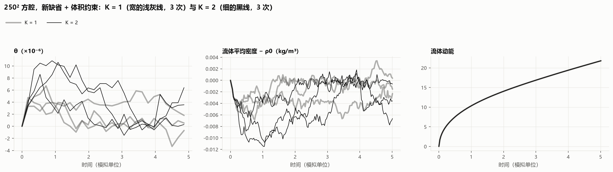

| 运行 | 到达的 t | 粒子数（始 → 末） | 越出盒（最大） | 体素表溢出（最大） | 最大速度（最大） | 步 / 秒（显示卡上同时有别的作业时偏低） |
|---|---|---|---|---|---|---|
| k1_n250_default_volume_r1 | 5.01 | 74,529 → 74,529 | 0 | 0 | 0.9771 | 3246 |
| k1_n250_default_volume_r2 | 5.01 | 74,529 → 74,529 | 0 | 0 | 0.9767 | 3227 |
| k1_n250_default_volume_r3 | 5.01 | 74,529 → 74,529 | 0 | 0 | 0.9762 | 2812 |
| k2_n250_default_volume_r1 | 5.01 | 74,529 → 74,529 | 0 | 0 | 0.9775 | 505 |
| k2_n250_default_volume_r2 | 5.01 | 74,529 → 74,529 | 0 | 0 | 0.9767 | 999 |
| k2_n250_default_volume_r3 | 5.01 | 74,529 → 74,529 | 0 | 0 | 0.9768 | 2019 |

- **第一次更新**：K = 1 和 K = 2 的 V_target 与 t = 0 的 V_now 逐位相同（相对差 0，好于要求的 1e-12），θ 都是 0。两片各自求和再相加，在这里恰好与一片的求和得到同一个 float64。这一条路径（多片求和）在第 15 节写了但没有测过，这次是第一次实测。
- **之后的更新**：第二次更新（t = 0.18）的 θ，K = 1 的 3 次是 3.3、4.8、3.4（×10⁻⁶），K = 2 的 3 次是 3.6、3.4、4.3，同一范围。
- **历史**：上表里 K = 2 对 K = 1 的 rms 差是 K = 1 组内的 1.4 倍（θ、密度）和 0.92 倍（动能）。但从图上看，t = 0.5 到 2 之间 K = 2 的前两次运行密度明显偏低。三对三的比较不够，于是做了定位：

**2.2 的定位**（到 t = 2，K = 1 再跑 3 次，K = 2 再跑 3 次，另加 3 次 `--depth 1` 的 K = 2；这 9 次运行是在长运行已经占着两张卡时做的）

| 组 | 运行 | t ∈ [0.03, 0.5)：平均密度 − ρ0 / θ（×10⁻⁶） | t ∈ [0.5, 1.5)：平均密度 − ρ0 / θ（×10⁻⁶） | t ∈ [1.5, 2)：平均密度 − ρ0 / θ（×10⁻⁶） | 步 / 秒（中位数，卡上负载的指标） | 粒子数（末） |
|---|---|---|---|---|---|---|
| K = 1 | r1 | -0.0031 / +3.32 | -0.0036 / +3.54 | -0.0033 / +3.72 | 3266 | 74,529 |
| K = 1 | r2 | -0.0039 / +4.34 | -0.0028 / +2.85 | -0.0003 / +0.07 | 3244 | 74,529 |
| K = 1 | r3 | -0.0038 / +4.16 | -0.0033 / +3.26 | +0.0001 / +0.07 | 2902 | 74,529 |
| K = 1 | r4 | -0.0038 / +3.91 | -0.0083 / +8.57 | -0.0073 / +7.18 | 1239 | 74,529 |
| K = 1 | r5 | -0.0035 / +4.12 | -0.0054 / +5.42 | -0.0043 / +4.30 | 1282 | 74,529 |
| K = 1 | r6 | -0.0043 / +4.99 | -0.0069 / +7.00 | -0.0061 / +5.82 | 1257 | 74,529 |
| K = 2，depth 2 | r1 | -0.0060 / +6.55 | -0.0100 / +9.94 | -0.0082 / +7.87 | 511 | 74,529 |
| K = 2，depth 2 | r2 | -0.0039 / +4.18 | -0.0083 / +8.18 | -0.0063 / +6.23 | 667 | 74,529 |
| K = 2，depth 2 | r3 | -0.0048 / +5.03 | -0.0041 / +4.34 | -0.0030 / +3.02 | 2025 | 74,529 |
| K = 2，depth 2 | r4 | -0.0032 / +3.39 | -0.0034 / +3.55 | -0.0032 / +3.30 | 380 | 74,529 |
| K = 2，depth 2 | r5 | -0.0044 / +5.31 | -0.0057 / +5.69 | -0.0041 / +3.32 | 381 | 74,529 |
| K = 2，depth 2 | r6 | -0.0032 / +3.94 | +0.0004 / -0.39 | -0.0002 / +0.24 | 388 | 74,529 |
| K = 2，depth 1 | r4 | -0.0047 / +5.32 | -0.0058 / +5.83 | -0.0045 / +4.49 | 206 | 74,529 |
| K = 2，depth 1 | r5 | -0.0032 / +3.42 | -0.0034 / +3.50 | -0.0049 / +4.73 | 202 | 74,529 |
| K = 2，depth 1 | r6 | -0.0052 / +5.76 | -0.0056 / +5.74 | -0.0054 / +5.36 | 206 | 74,529 |

各组的平均 ± 标准差（平均密度 − ρ0，kg/m³）：

| 组 | 次数 | [0.03, 0.5) | [0.5, 1.5) | [1.5, 2) |
|---|---|---|---|---|
| K = 1 | 6 次 | -0.0037 ± 0.0004 | -0.0050 ± 0.0020 | -0.0035 ± 0.0027 |
| K = 2，depth 2 | 6 次 | -0.0043 ± 0.0010 | -0.0052 ± 0.0034 | -0.0042 ± 0.0025 |
| K = 2，depth 1 | 3 次 | -0.0044 ± 0.0009 | -0.0050 ± 0.0011 | -0.0049 ± 0.0004 |

- 加到 6 次之后，三组在每个时间段的组均值都在一个标准差以内：t ∈ [0.5, 1.5) 是 −0.0050 ± 0.0020（K = 1）、−0.0052 ± 0.0034（K = 2）、−0.0050 ± 0.0011（K = 2，depth 1）kg/m³。
- 最初的三次 K = 1 恰好挤在一起（−0.0028 到 −0.0036），后加的三次散到 −0.0083。所以"K = 2 偏低"是样本太少造成的，不是系统差别；流水线深度也没有影响。
- 平均密度在这一段的运行间散布有 ±0.002 到 ±0.003 kg/m³，与约束留下的偏移同量级。原因是结果类：体素表的填充顺序每次不同，几百步后轨迹就分开。
- 一个没有定论的迹象：K = 1 里在卡有负载时跑的三次（r4–r6，1,250 步/秒）恰好是最低的三次。纯属巧合的概率是 1/20。K = 2 里没有这样的规律（无负载的 r3 在中间，负载最重的 r4–r6 有高有低），所以我不认为负载影响结果，但这一点没有验证。
- 粒子数在 15 次运行里都守恒。

**接缝审计**（`dump_state` + `analyze`，单卡两次对链两次，按全局编号配对；修了约束的启动之后做）

**2-D 250² 方腔，新缺省 + 约束**（`seam_audit/n250_crossing_default_volume_f6ee476`）

算例 `cases/lid_driven_cavity_2d_n250_xi0p001_eps0p0025_crossing/case.yaml`；参考 A1、A2 = 单卡（设备 1）两次，测试 B1、B2 = 链（设备 0,1）两次；粒子按全局编号配对。比值 = rms(|B1 − A1|) / rms(|A1 − A2|)，d = 到切口的体素列距离。

| 步数 N | 配对粒子 | 加速度 d = 0（接缝超出量） | 位移修正 d = 0 | 密度 d = 0 | 第二对 (B2, A2) 加速度 d = 0 | 链自身噪声 \|B1 − B2\| / \|A1 − A2\| 加速度 d = 0 | 远区最坏 rms 比值（加速度 / 位移 / 密度） | 不变量（漂移、编号、戳、溢出） |
|---|---|---|---|---|---|---|---|---|
| 300 | 63,001 | 1.05 | 1.03 | 0.96 | 1.03 | 0.90 | 1.06 / 1.09 / 1.07 | 全部为 0，四个运行有效 |
| 2000 | 63,001 | 1.16 | 1.18 | 1.20 | 1.02 | 1.10 | 1.08 / 1.93 / 1.14 | 全部为 0，四个运行有效 |

记录：wc-20261119-023559-feee … wc-20261119-023607-d0b5（共 6 条）

**3-D 方腔 1M，新缺省 + 约束**（`seam_audit/cavity3d_1m_crossing_default_volume`）

算例 `cases/cavity3d_1m_crossing/case.yaml`；参考 A1、A2 = 单卡（设备 1）两次，测试 B1、B2 = 链（设备 0,1）两次；粒子按全局编号配对。比值 = rms(|B1 − A1|) / rms(|A1 − A2|)，d = 到切口的体素列距离。

| 步数 N | 配对粒子 | 加速度 d = 0（接缝超出量） | 位移修正 d = 0 | 密度 d = 0 | 第二对 (B2, A2) 加速度 d = 0 | 链自身噪声 \|B1 − B2\| / \|A1 − A2\| 加速度 d = 0 | 远区最坏 rms 比值（加速度 / 位移 / 密度） | 不变量（漂移、编号、戳、溢出） |
|---|---|---|---|---|---|---|---|---|
| 300 | 1,030,301 | 1.01 | 0.92 | 1.00 | 0.97 | 0.96 | 1.03 / 1.09 / 1.01 | 全部为 0，四个运行有效 |
| 1000 | 1,030,301 | 0.91 | 0.94 | 1.31 | 1.00 | 0.98 | 1.13 / 1.03 / 1.13 | 全部为 0，四个运行有效 |

记录：wc-20261119-023758-9075 … wc-20261119-023915-f65b（共 6 条）

- 两个算例、各四次运行的不变量全部为 0：粒子数漂移 0，没有丢失或重复的编号，没有戳错误，没有溢出。
- 切口处（d = 0）的比值在 0.91 到 1.31 之间，与第 4 节的 0.76–1.42 同一范围。
- 2-D 在 N = 2000 时"远区最坏"的位移修正比值是 1.93，比第 4 节的范围大；它在离切口远的地方，切口处是 1.18。没有再查。

**3-D 的 K = 2 逐位比较（canonical 转储，700 步）**：

| 算例 | K = 1：700 步后存活 / 总数 | K = 2：700 步后存活 / 总数 | K = 2 两片的迁入粒子数 | 分区器的警告：每体素副本槽数 对 需要的 1.2 (h/dx)^d |
|---|---|---|---|---|
| 3-D 静水盒 48³ gtilt，crossing 新缺省 + 约束 | 195,112 / 195,112 | 85,752 / 195,112 | 7418 / 6308 | 55.7 对 76.8 |
| 3-D 方腔 1M，crossing 新缺省 + 约束 | 1,685,159 / 1,685,159 | 655,721 / 1,685,159 | 22514 / 22910 | 46.4 对 76.8 |
| 3-D 方腔 1M，simple | 1,685,159 / 1,685,159 | 1,646,662 / 1,685,159 | 192058 / 183674 | 46.4 对 76.8 |

**2.3 3-D 静水盒**（48³，|g| = 10，到 t = 10，与 11-17 的运行同一时刻）

| 重力方向 | 配置 | t | 末段最大速度 ÷ √(gH) | 均方根速度 ÷ √(gH) | 盒心压力电平 ÷ ρ0gH | 压力误差均方根（去电平）÷ ρ0gH | 平均密度 − ρ0（末，kg/m³） | θ（末） | 记录 |
|---|---|---|---|---|---|---|---|---|---|
| gy | 新缺省（完整方案）+ 约束 | 10.0 | 1.28e-02 | 6.39e-04 | -0.329 | 3.69e-04 | -0.330 | +3.30e-04 | wc-20261119-022253-4aaa |
| gy | 11-17：一阶，连续性取完整向量 | 10.0 | 5.42e-03 | 4.49e-04 | -0.379 | 2.26e-04 | —（当时没有记） | — | wc-20261117-180509-4674 |
| gy | adami | 10.0 | 8.07e-02 | 2.30e-02 | -0.010 | 3.35e-03 | —（当时没有记） | — | wc-20261117-181912-de87 |
| gtilt | 新缺省（完整方案）+ 约束 | 10.0 | 2.09e-02 | 8.02e-04 | -0.160 | 3.97e-04 | -0.264 | +2.65e-04 | wc-20261119-022701-bc3f |
| gtilt | 11-17：一阶，连续性取完整向量 | 10.0 | 1.30e-02 | 5.90e-04 | -0.210 | 2.59e-04 | —（当时没有记） | — | wc-20261117-183244-5118 |
| gtilt | adami | 10.0 | 2.34e-01 | 1.96e-02 | -0.009 | 2.57e-03 | —（当时没有记） | — | wc-20261117-184428-d0a7 |

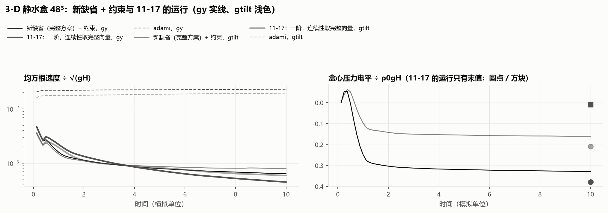

- **稳定**，两个方向都跑完，粒子数守恒。
- **残余速度**：均方根是 11-17 一阶运行的 1.4 倍（gy 6.4e-4 对 4.5e-4，gtilt 8.0e-4 对 5.9e-4 √(gH)），最大值是 1.6 到 2.4 倍；都比 adami 小 30 倍左右。
- **压力电平**：
  - 新缺省加约束在 t ≈ 2 之后几乎不再变化：gy 从 −0.30 到 −0.33，gtilt 停在 −0.16 ρ0gH 附近。11-17 的运行在 10 个时间单位里一直往下掉，末值 −0.38 和 −0.21。
  - 但电平没有回到 0。约束的 θ 稳定在 +3.3e-4（gy）和 +2.7e-4（gtilt），平均密度停在 ρ0 − 0.33 和 ρ0 − 0.26 kg/m³。
  - 这正是比例式约束在有恒定汇时的平衡：偏移 = 汇 × τ。反推 3-D 静水盒的密度汇约 0.3 kg/m³ 每时间单位，是 2-D 方腔（第 15 节，约 0.003）的约 100 倍。
  - 汇从哪里来没有查。
- 去掉电平之后的压力误差均方根是 3.7e-4 和 4.0e-4 ρ0gH（11-17 的是 2.3e-4 和 2.6e-4）。
- 11-17 的运行只在结束时记了压力电平，所以图里它们只有末值的点。

**2.4 3-D 方腔试跑**（`cavity3d_1m_crossing`，新缺省 + 约束，到 t = 5；simple、adami 只测速度，到 t = 0.3）

| 运行 | 到达的 t | 粒子数（始 → 末） | 越出盒（最大） | 最大速度（最大） | 动能（末） | 平均密度 − ρ0（末） | θ（末） | 步 / 秒（中位数） | 段数 | 各段 |
|---|---|---|---|---|---|---|---|---|---|---|
| crossing，新缺省 + 约束 | 5.04 | 1,685,159 → 1,685,159 | 0 | 0.9515 | 17.779 | -0.0646 | +6.43e-05 | 68.1 | 1 | complete |
| simple（测速） | 0.30 | 1,685,159 → 1,685,159 | 0 | 0.7535 | 3.035 | +0.0001 | — | 101.5 | 1 | complete |
| adami（测速） | 0.30 | 1,685,159 → 1,685,159 | 0 | 1.0173 | 5.783 | -0.0037 | — | 87.0 | 1 | complete |

- **稳定**：粒子数 1,685,159 不变，没有流体粒子越出盒，最大速度 0.95（盖速 1）。
- 动能在 t = 5 是 17.8，与 11-17 一阶运行同一时刻的值（约 17.5）相近。
- 平均密度在 t = 5 是 ρ0 − 0.065，还在缓慢下降，θ = +6.4e-5：与静水盒同一个现象，量级小一些。
- **每步时间**（中位数，含采样）：crossing 14.7 ms（68 步 / 秒），simple 9.9 ms，adami 11.5 ms。1M 的 crossing 每个时间单位约 4.1 分钟。
- **断点续跑实测**：在 t ≈ 2.2 杀掉求解进程，看门狗从 t = 2.04 的检查点接上，跑完到 t = 5.04。

### 19.3 长运行：配置和预计结束时刻

| 运行 | 卡 | 算例和配置 | 结束条件 | 启动 | 结束 |
|---|---|---|---|---|---|
| 2-D 方腔 1000²（`n1000_complete_volume`） | GPU 0（显示卡） | `lid_driven_cavity_2d_n1000_xi0p001_eps0p0025_crossing`：新缺省 + 约束 | 运行器的协议：max(100, 定常 + 20)；13,333,333 步 | 03:02 | **11:11 结束**（08:37 时估约 11:10），见 19.4 |
| 3-D 方腔 crossing（`cavity3d_1m_crossing_long`） | GPU 1（无头） | `cavity3d_1m_crossing`：新缺省 + 约束 | t = 45（750,000 步） | 03:02 | **06:21 结束**，见 19.5 |
| 3-D 方腔 simple（`cavity3d_1m_simple_long`） | GPU 1 | `cavity3d_1m` | t = 45 | 06:21 | **08:35 结束**，见 19.5 |
| 3-D 方腔 adami（`cavity3d_1m_adami_long`） | GPU 1 | `cavity3d_1m_adami` | t = 45 | 08:35 | **08:58 在 t = 6.72 触发停止条件**（流体速度 1.0649 > 1.05），见 19.5 |
| 2-D 方腔 1000² adami（远端 `n1000_adami`） | 远端 RTX 5090 | `lid_driven_cavity_2d_n1000_xi0p001_eps0p0025_adami`，代码 `029313a` | 从 t = 39.69 的检查点续跑，协议同上 | 03:02 | **06:45 结束**，见 19.6 |

- 2.2 的定位运行（03:04–03:33）与长运行共用了两张卡。这段时间里 1000² 平均 395 步 / 秒（单独时 478），3-D crossing 平均 49 步 / 秒（单独时约 65）。每步时间只用这段之后的数据报告（3-D 用 t ≥ 10）。
- 三个长运行都从冻结检出 `08e6b83` 运行。它们用的算例文件和着色器在运行期间不改。

### 19.4 2-D 方腔 1000²

**跑完了**（11:11，第六次更新）。GPU 0（显示卡），冻结检出 `08e6b83`，算例 `lid_driven_cavity_2d_n1000_xi0p001_eps0p0025_crossing`（新缺省 + 约束），K = 1，记录 wc-20261119-030151-00c6。

- **运行**：03:02 开始，11:11 结束，8.2 小时，一段跑完，没有中断，没有续跑。运行器在 t = 79.38 判为定常（500² 是 79.56，远端 adami 也是 79.38），按协议停在 t = 100.00（第 13,334,000 步）。统计窗口 80.0–99.8（20 个快照），与 250²、500² 相同。没有跑过 100，所以不用另算 80–100 的窗口。
- **稳定性**（`cavity_watch.py` 全程在看，没有触发停止条件）：
  - 粒子数 1,046,529 在全部 493 个样本里不变，运行器的不变量（溢出、远距迁移、时间戳、漂移）全为 0。
  - 每 10,000 步一次的位置读回共 1,360 次，越出盒的流体粒子都是 0。窗口内 20 个快照里流体坐标最大 0.50018，盒面在 0.5005。
  - 流体最大速度全程最大 0.994（t = 75.7），停止条件是 1.05。
- **速度**：459 步 / 秒（各时间段的中位数都是 459–463）。03:04–03:33 与 2.2 的定位运行共用卡时是 389 步 / 秒。运行前估 7.6 小时，实际 8.2 小时：前半小时被定位运行拖慢，单独跑时也比试跑测得的 478 步 / 秒慢 4 %。

**与 250²、500² 并列**（偏差相对 Marchi 2021；ψ_min 给两种归一化：mid 帧 = 壁面在盒面，对 crossing 是对的那个；wall 帧 = 壁面在最内层壁粒子行，已发表的表用的放法。速度极值和涡心与帧无关，或在 mid 帧）

| 运行 | 统计窗口 | ψ_min（mid 帧：壁在盒面） | ψ_min（wall 帧） | u_min | v_max | v_min | u 剖面 L2 / L∞（wall 帧） | v 剖面 L2 / L∞（wall 帧） | u 剖面 L2 / L∞（mid 帧） | v 剖面 L2 / L∞（mid 帧） | 涡心（mid 帧） | 涡心偏差 |
|---|---|---|---|---|---|---|---|---|---|---|---|---|
| **250²，完整方案 + 约束（新缺省）** | 80.0–100.0 | -1.03 % | -1.42 % | -0.77 % | -0.81 % | -0.78 % | 0.0048 / 0.0176 | 0.0052 / 0.0121 | 0.0034 / 0.0061 | 0.0034 / 0.0072 | (0.5307, 0.5642) | (-0.0000, -0.0010) |
| **500²，完整方案 + 约束（新缺省）** | 80.0–99.8 | -0.56 % | -0.76 % | -0.32 % | -0.30 % | -0.28 % | 0.0021 / 0.0066 | 0.0020 / 0.0042 | 0.0029 / 0.0053 | 0.0027 / 0.0052 | (0.5306, 0.5643) | (-0.0002, -0.0009) |
| **1000²，完整方案 + 约束（新缺省）** | 80.0–99.8 | -0.33 % | -0.43 % | -0.08 % | -0.05 % | -0.06 % | 0.0017 / 0.0033 | 0.0015 / 0.0034 | 0.0026 / 0.0048 | 0.0026 / 0.0052 | (0.5305, 0.5643) | (-0.0002, -0.0009) |
| 250²，一阶（11-18 的缺省） | 80.0–100.0 | -3.71 % | -4.09 % | -3.41 % | -3.58 % | -3.28 % | 0.0087 / 0.0162 | 0.0136 / 0.0235 | 0.0083 / 0.0134 | 0.0110 / 0.0173 | (0.5310, 0.5644) | (+0.0002, -0.0009) |
| 500²，一阶（11-18 的缺省） | 80.0–99.8 | -2.01 % | -2.21 % | -1.78 % | -1.82 % | -1.65 % | 0.0042 / 0.0073 | 0.0066 / 0.0097 | 0.0049 / 0.0076 | 0.0057 / 0.0096 | (0.5307, 0.5644) | (-0.0001, -0.0008) |
| 250²，adami | 80.6–100.6 | +4.14 % | +3.72 % | +4.17 % | +4.63 % | +3.79 % | 0.0109 / 0.0227 | 0.0122 / 0.0193 | 0.0097 / 0.0219 | 0.0149 / 0.0271 | (0.5301, 0.5649) | (-0.0007, -0.0004) |
| 500²，adami | 80.0–99.8 | +1.59 % | +1.39 % | +1.79 % | +2.07 % | +1.70 % | 0.0050 / 0.0108 | 0.0055 / 0.0104 | 0.0050 / 0.0123 | 0.0074 / 0.0151 | (0.5302, 0.5645) | (-0.0006, -0.0007) |
| 1000²，adami（远端） | 80.0–99.8 | +0.24 % | +0.14 % | +0.48 % | +0.62 % | +0.45 % | 0.0022 / 0.0054 | 0.0022 / 0.0052 | 0.0028 / 0.0063 | 0.0035 / 0.0078 | (0.5305, 0.5646) | (-0.0003, -0.0007) |
| 250²，simple | 80.0–100.0 | -8.27 % | -8.64 % | -8.72 % | -9.31 % | -8.16 % | 0.0230 / 0.0351 | 0.0271 / 0.0430 | 0.0264 / 0.0496 | 0.0262 / 0.0438 | (0.5336, 0.5646) | (+0.0028, -0.0007) |
| 500²，simple | 80.0–99.8 | -5.40 % | -5.59 % | -5.52 % | -5.82 % | -5.22 % | 0.0150 / 0.0224 | 0.0175 / 0.0275 | 0.0167 / 0.0295 | 0.0169 / 0.0278 | (0.5322, 0.5650) | (+0.0014, -0.0002) |
| 1000²，simple（9cde618（v6，K = 2；ξ / ε² 缺省 f2b6d67），docs/validation/cavity_re1000.md） | 80.0–99.8 | — | -4.0 % | −3.8 到 −4.1 % |  |  | 0.0108 / — | 0.0126 / — | — | — | — | — |

- **1000² 的完整方案 + 约束**：
  - ψ_min −0.33 %（mid 帧）/ −0.43 %（wall 帧）。
  - 三个速度极值 −0.05 % 到 −0.08 %。
  - 剖面误差：wall 帧 L2 0.0017 / 0.0015，L∞ 0.0033 / 0.0034；mid 帧 L2 0.0026 / 0.0026。
  - 涡心 (0.5305, 0.5643)。
- **与 1000² 的 adami（远端，19.6）比**：
  - 两者偏差方向相反：完整方案偏弱，adami 偏强。
  - ψ_min 上 adami 更近：+0.24 % 对 −0.33 %（mid 帧），+0.14 % 对 −0.43 %（wall 帧）。
  - 速度极值上完整方案近 6 到 10 倍：−0.05 到 −0.08 %，adami +0.45 到 +0.62 %。
  - 剖面 L2 上完整方案更小：wall 帧 0.0017 / 0.0015 对 0.0022 / 0.0022，mid 帧 0.0026 / 0.0026 对 0.0028 / 0.0035。
- **与 1000² 的 simple 比**：
  - 用的是 `docs/validation/cavity_re1000.md` 的结果：提交 `9cde618`（v6，K = 2，ξ / ε² 的缺省来自 `f2b6d67`），wall 帧归一化。
  - 与当前 simple 的数值一致：那份文档里 250²、500² 的剖面误差与本系列 simple 运行的结果在 3–4 位上相同。
  - simple 的 ψ_min −4.0 %，速度极值 −3.8 到 −4.1 %，剖面 L2 0.0108 / 0.0126。
  - 完整方案的 ψ_min 偏差（wall 帧）是它的约 1/9，剖面 L2 是它的 1/6 到 1/8。没有在当前代码上重跑 simple 1000²。
- **涡心**：
  - 竖直方向的偏差在三个分辨率上都是 −0.0009 到 −0.0010，不随分辨率减小；1000² 上它是 0.9 个粒子间距。
  - adami 的三个分辨率是 −0.0004 到 −0.0007，simple 是 −0.0002 到 −0.0007，同一方向。
  - 原因没有查，**未验证**。可能是后处理：ψ 在 513² 网格上求，网格间距 0.002，比这个偏差大。
- **剖面误差的两种帧**：
  - wall 帧的 L2 从 250² 到 1000² 是 0.0048 → 0.0021 → 0.0017。
  - mid 帧的 L2 是 0.0034 → 0.0029 → 0.0026，下降得很慢，adami 的 mid 帧也只到 0.0028 / 0.0035。
  - 两种帧的剖面取法不同（见 `cavity_tables.py` 的文档串）：wall 帧用 28 个 MLS 样本点，mid 帧用时间平均后的稠密线加三次样条。
  - 第 16 节在 250→500 已经见到 mid 帧的阶很低。这个"地板"从哪里来没有查，**未验证**。

**三点收敛阶和两种解释**

| 量（相对 Marchi 2021 的偏差，%） | 250² / 500² / 1000² | 两点阶（250→500 / 500→1000） | (a) 偏差 = c + C·Δx^p（三点精确解） | (b) 偏差 = C·Δx^p（对数最小二乘） |
|---|---|---|---|---|
| ψ_min（mid 帧） | -1.031 / -0.564 / -0.326 | 0.87 / 0.79 | p = 0.97，c = -0.080 % | p = 0.83，对数残差 0.013 |
| ψ_min（wall 帧） | -1.424 / -0.762 / -0.426 | 0.90 / 0.84 | p = 0.98，c = -0.078 % | p = 0.87，对数残差 0.010 |
| u_min | -0.769 / -0.322 / -0.083 | 1.26 / 1.95 | p = 0.91，c = +0.189 % | p = 1.60，对数残差 0.113 |
| v_max | -0.808 / -0.300 / -0.052 | 1.43 / 2.53 | p = 1.03，c = +0.185 % | p = 1.98，对数残差 0.180 |
| v_min | -0.783 / -0.281 / -0.061 | 1.48 / 2.21 | p = 1.19，c = +0.111 % | p = 1.84，对数残差 0.119 |

| 系列 | ψ_min 的归一化 | (a) 常数 + C·Δx^p，四个量共用 p | (a) 残差 rms（剩余自由度） | (b) C·Δx^p，ψ_min 与三个速度极值各一个 p | (b) 残差 rms（剩余自由度） |
|---|---|---|---|---|---|
| 完整方案 + 约束 | mid 帧 | p = 1.03；c：ψ -0.11 %，速度 +0.13 / +0.19 / +0.18 % | 0.005 %（3） | p_ψ = 0.85，p_速度 = 1.51 | 0.023 %（6） |
| 完整方案 + 约束 | wall 帧 | p = 1.02；c：ψ -0.11 %，速度 +0.13 / +0.19 / +0.18 % | 0.005 %（3） | p_ψ = 0.88，p_速度 = 1.51 | 0.023 %（6） |
| adami | mid 帧 | p = 0.84；c：ψ -1.57 %，速度 -1.21 / -1.21 / -1.05 % | 0.015 %（3） | p_ψ = 1.55，p_速度 = 1.30 | 0.146 %（6） |
| adami | wall 帧 | p = 0.83；c：ψ -1.54 %，速度 -1.24 / -1.23 / -1.07 % | 0.014 %（3） | p_ψ = 1.62，p_速度 = 1.30 | 0.147 %（6） |
| 两个系列共用极限（mid 帧） | mid 帧 | p = 2.08（完整方案）/ 1.26（adami）；共用的 c：ψ -0.39 %，速度 -0.13 / -0.07 / -0.08 % | 0.090 %（10），最大 0.163 % | — | — |

- **两点阶**：
  - ψ_min 是 0.87 / 0.79（mid 帧），0.90 / 0.84（wall 帧）：一阶左右，500→1000 还略低一点。
  - 三个速度极值从 1.3–1.5 升到 2.0–2.5：1000² 上的速度极值已经很小（−0.05 到 −0.08 %），阶在往上走。
- **两种解释的检验**：每种都同时拟合四个量（ψ_min 和三个速度极值，残差以百分点计）。
  - (a) 偏差 = c + C·Δx^p，四个量共用一个 p：
    - 拟合出 p = 1.03；
    - 常数 c：ψ_min −0.11 %，速度极值 +0.13 到 +0.19 %；
    - 残差 rms 0.005 个百分点（剩 3 个自由度），最大 0.011。
  - (b) 偏差 = C·Δx^p，ψ_min 与速度极值各一个 p：
    - 拟合出 p_ψ = 0.85，p_速度 = 1.51；
    - 残差 rms 0.023 个百分点（剩 6 个自由度），集中在 500² 和 1000² 的速度极值上，最大 0.048；
    - 三个速度极值各取自己的 p（1.38 / 1.57 / 1.58），残差 rms 仍有 0.019–0.028。
  - 噪声的量级：
    - 后处理对 ψ_min 自身的误差，250² 是 0.04 %，500² 是 0.01 %（第 16 节）；
    - 250² 的三个时间窗口之间，速度极值相差不超过 0.03 个百分点，ψ_min 0.03–0.05（第 17 节）；
    - 1000² 只有一个运行、一个窗口，它自己的噪声没有测。
- **判断**：
  - **(a) 更符合**：一个共同的 p ≈ 1 就把四个量拟合到噪声以内。
  - (b) 要让 ψ_min 和速度极值的阶不同，而且仍留下 0.02–0.05 个百分点的残差，与 250² 的窗口间变化同量级或略大。
  - 但 (b) **不能排除**：1000² 的噪声没有测，如果它和 250² 的窗口间变化一样大，(b) 的残差也在噪声以内。
  - 两种解释的预测：
    - 按 (a)，再加密下去 ψ_min 停在约 −0.1 %，速度极值穿过 0、停在 +0.1 到 +0.2 %；
    - 按 (b)，四个量都趋向 0，ψ_min 以 0.85 阶。
- **与 adami 对照**（同一检验，数据见 19.6）：
  - adami 自己用 (a) 拟合得好（残差 0.015），用 (b) 拟合不好（0.146，是噪声的 5 到 10 倍）。
  - 但 adami 在 (a) 下的常数是 −1.0 到 −1.6 %，完整方案是 −0.1 到 +0.2 %。两种壁面处理离散的是同一组方程，声速、ξ、ε² 相同，与 Δx 无关的误差（例如固定马赫数下的可压缩误差）应当相同，所以两者的极限应当一样。
  - 让两个系列共用极限（每个系列一个 p），残差 rms 0.09 个百分点，最大 0.16，远大于噪声。
  - 所以两个 (a) 的常数不能都是真的极限：至少有一个系列在 250²–1000² 还没进入渐近区，它的 c 只是拟合参数。
  - 从两点阶看，更可能是 adami：ψ_min 的阶从 1.4 跳到 2.8。
  - 三个点分不开这些，要 2000² 才能判断，**未验证**。

**平均密度、θ、平均压力、负压粒子比例、平均压力涨落的历史**

| 时间段 | 平均密度 − ρ0（kg/m³） | θ（平均） | 平均压力（ρ0U²） | 负压粒子比例 | 平均压力的涨落（高通，ρ0U²） | 步 / 秒（中位数） |
|---|---|---|---|---|---|---|
| 0–20 | -0.0219 ± 0.0129 | +2.19e-05 | -0.2177 | 85.4 % | 0.0016 | 463 |
| 20–40 | -0.0064 ± 0.0060 | +6.34e-06 | -0.0629 | 78.2 % | 0.0005 | 459 |
| 40–60 | -0.0009 ± 0.0002 | +9.35e-07 | -0.0083 | 53.2 % | 0.0006 | 459 |
| 60–80 | -0.0009 ± 0.0002 | +8.67e-07 | -0.0076 | 52.6 % | 0.0007 | 459 |
| 80–100 | -0.0006 ± 0.0001 | +6.31e-07 | -0.0052 | 50.9 % | 0.0006 | 459 |

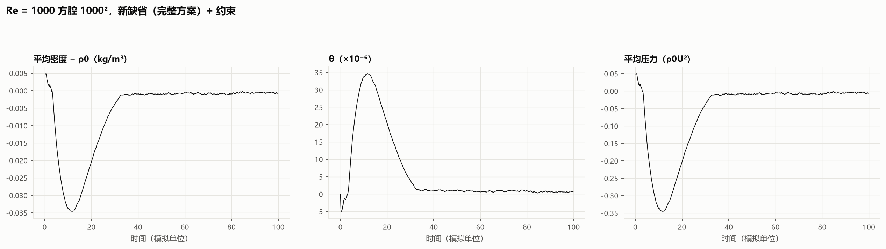

- **窗口 80–100 内**：
  - 平均密度 ρ0 − 0.0006 ± 0.0001 kg/m³，θ +6.3e-7，平均压力 −0.0052 ρ0U²，负压粒子 51 %，平均压力的涨落（高通）0.0006 ρ0U²。
  - 这是三个分辨率里偏移最小的：250² 是 ρ0 − 0.0073、θ +7.3e-6、−0.072 ρ0U²、负压 94 %；500² 是 ρ0 + 0.0027、θ −2.7e-6、+0.028 ρ0U²、负压 28 %。
- **起动阶段有一个 250²、500² 没有的过渡**：
  - 平均密度在 t ≈ 3 到 12 降到 ρ0 − 0.035（θ 升到 +3.5e-5，平均压力 −0.34 ρ0U²），t ≈ 31 回到窗口值附近，之后平直。
  - 500² 起动时最低只到 ρ0 − 0.0014（t ≈ 13）；250² 全程在 ρ0 − 0.007 ± 0.003 附近起伏，没有这样的下沉。
  - 按比例式约束"偏移 = 汇 × τ"，这相当于起动时有约 0.035 kg/m³ 每时间单位的密度汇，持续约 20 个时间单位后消失。
  - 它在窗口之前已经结束，不影响窗口内的结果。为什么只在 1000² 上出现没有查，**未验证**。
- **动能**：
  - 窗口平均 50.12；40–60、60–80、80–100 三段的平均是 49.96、50.09、50.12。
  - 窗口内斜率每时间单位 +0.0016 %，整个窗口 +0.03 %，与 500²（+0.03 %）和 1000² adami（+0.03 %）相同。
  - 也就是说，流动还在极慢地变强，这与第 17 节 250² 续跑到 t = 200 时看到的一样。

### 19.5 3-D 方腔，三种模式

**进度**：crossing 06:21 跑完（第二次更新），simple 08:35 跑完（第四次更新）。**adami 08:35 起跑，08:58 在 t = 6.72 触发了停止条件**（流体最大速度 1.0649 > 1.05 × 盖速），数据保留（第五次更新，09:05）。

**adami 的停止和定位**

- **现象**：停在第 112,000 步（t = 6.72）的样本上，流体最大速度 1.0649；前一个样本（t = 6.60）是 1.0035。停下之前粒子数不变、没有越出盒、动能和平均密度平滑（动能 21.8，平均密度 ρ0 − 0.005）。但在停下之前，adami 的流体最大速度一直贴着或略超盖速：57 个样本里 53 % 超过 1.0，23 % 超过 1.02，t = 0.36、2.16、2.76、4.08、5.64 都有 1.03–1.05 的尖峰。crossing 和 simple 在整个运行里从没超过 0.95 和 0.90。所以触发停止不是偶然的一次，按 1.05 的门槛，这个算例的 adami 迟早会停。2.4 的试跑（到 t = 0.3）已经见到 1.017。
- **定位**：GPU 1 空出来以后，我从 adami 长运行 t = 4.98 的检查点用同样的代码和同样的停止条件重跑，每个 defrag 间隔（0.06）采一次样，记录最快粒子的位置（`box_run.py` 为此加了两样东西：每行的最快粒子坐标，停下时写出那个样本的流体状态 `stop_state.npz`）。重跑不与原运行逐位相同（结果类），在 t = 5.88 以 1.0516 再次停下。

| t | 流体最大速度 | 最快粒子的位置 (x, y, z) | 位置 |
|---|---|---|---|
| 5.04 | 1.0171 | (-0.5023, +0.5024, -0.4948) | 上游顶边（盖与 x = −0.5 壁的交线） |
| 5.10 | 0.9971 | (+0.5004, +0.4891, +0.3250) | 下游顶边（盖与 x = +0.5 壁的交线） |
| 5.16 | 0.9951 | (+0.5009, +0.4896, -0.1540) | 下游顶边（盖与 x = +0.5 壁的交线） |
| 5.22 | 1.0121 | (+0.5004, +0.4868, -0.1560) | 下游顶边（盖与 x = +0.5 壁的交线） |
| 5.28 | 0.9934 | (+0.5010, +0.4866, +0.2656) | 下游顶边（盖与 x = +0.5 壁的交线） |
| 5.34 | 1.0101 | (+0.5007, +0.4906, -0.0850) | 下游顶边（盖与 x = +0.5 壁的交线） |
| 5.40 | 1.0058 | (+0.5008, +0.4888, +0.2043) | 下游顶边（盖与 x = +0.5 壁的交线） |
| 5.46 | 1.0304 | (+0.5007, +0.4895, -0.4459) | 下游顶边（盖与 x = +0.5 壁的交线） |
| 5.52 | 1.0064 | (+0.5011, +0.4869, -0.0344) | 下游顶边（盖与 x = +0.5 壁的交线） |
| 5.58 | 1.0441 | (+0.5011, +0.4879, -0.4558) | 下游顶边（盖与 x = +0.5 壁的交线） |
| 5.64 | 1.0102 | (+0.5003, +0.4887, -0.2319) | 下游顶边（盖与 x = +0.5 壁的交线） |
| 5.70 | 1.0220 | (+0.5008, +0.4903, +0.1750) | 下游顶边（盖与 x = +0.5 壁的交线） |
| 5.76 | 1.0027 | (+0.5009, +0.4911, +0.3444) | 下游顶边（盖与 x = +0.5 壁的交线） |
| 5.82 | 0.9901 | (+0.5014, +0.4914, +0.0047) | 下游顶边（盖与 x = +0.5 壁的交线） |
| 5.88 | 1.0516 | (+0.5011, +0.4889, -0.2564) | 下游顶边（盖与 x = +0.5 壁的交线） |

停下的那个样本（t = 5.88）里最快的 5 个流体粒子；速度超过 1.0 的有 1 个，超过 0.95 的有 5 个：

| 速度 | 位置 (x, y, z) | 速度向量 | 位置 |
|---|---|---|---|
| 1.0516 | (+0.5011, +0.4889, -0.2564) | (-0.179, -1.036, -0.042) | 下游顶边（盖与 x = +0.5 壁的交线） |
| 0.9996 | (-0.5018, +0.5024, +0.2150) | (-0.485, +0.874, +0.009) | 上游顶边（盖与 x = −0.5 壁的交线） |
| 0.9827 | (+0.5015, +0.4937, +0.3551) | (-0.209, -0.960, -0.010) | 下游顶边（盖与 x = +0.5 壁的交线） |
| 0.9572 | (+0.5007, +0.4926, -0.1553) | (-0.136, -0.947, -0.001) | 下游顶边（盖与 x = +0.5 壁的交线） |
| 0.9534 | (+0.5011, +0.4849, -0.1845) | (-0.136, -0.944, +0.014) | 下游顶边（盖与 x = +0.5 壁的交线） |

（坐标是绝对坐标：流体在 [−0.5, 0.5]³，壁面在 ±0.505；盖是 +y 面，沿 +x 运动。）

- 15 个样本里 14 个的最快粒子在**下游顶边**：x ≈ +0.501（离右壁面 0.4 个粒子间距），y ≈ 0.487–0.491（盖面下 1.4–1.8 个间距），z 沿整条边分布（−0.46 到 +0.34），速度方向是沿右壁向下（v ≈ −0.95 到 −1.04）。另一个在上游顶边。停下的那个样本里只有 1 个粒子超过 1.0。
- 也就是说，超速是**单个粒子**在运动的盖与静止侧壁相交的那条棱上，被盖带到角上、再沿侧壁向下转弯时出现的，超出盖速 5 % 左右；整体流动（动能、剖面、密度）没有异常。这条棱是速度不连续的角点（盖速 1 对壁速 0），本身是奇异的。我的推测是 adami 的壁面速度外推（镜像 2u_wall − ũ）在这条棱附近同时看到盖和侧壁两类壁粒子，给出了偏大的外推速度；这一点**未验证**。crossing 在同一条棱上没有超过 0.95。
- 按任务书的停止条件，adami 的长运行到此为止，没有放宽门槛再跑。GPU 1 从 09:04 起空闲，没有别的待跑项目（3.2 的三种模式都已跑过；1000² 在 GPU 0 上）。

**三种模式在 adami 停下之前的比较**（t = 5.74–6.24，起动阶段，不是定常；只是三者共有的最后一段）

窗口 t = 5.74–6.24（每种模式都有的最后两条剖面）

| 模式 / 差 | 窗口内剖面个数 | u 沿 y（过中心的竖线）的最小值 | v 沿 x（过中心的横线）的最大值 | v 沿 x 的最小值 | 动能（窗口平均） |
|---|---|---|---|---|---|
| crossing（新缺省 + 约束） | 2 | -0.1858（y = 0.440） | +0.1501（x = 0.480） | -0.3217（x = 0.870） | 18.996 |
| simple | 2 | -0.1341（y = 0.470） | +0.1068（x = 0.520） | -0.2661（x = 0.870） | 14.224 |
| adami | 2 | -0.2215（y = 0.430） | +0.1639（x = 0.470） | -0.3442（x = 0.870） | 20.919 |
| crossing（新缺省 + 约束） − simple |  | rms 0.0330，最大 0.1047（u 线） | rms 0.0294，最大 0.0557（v 线） |  |  |
| crossing（新缺省 + 约束） − adami |  | rms 0.0151，最大 0.0376（u 线） | rms 0.0133，最大 0.0239（v 线） |  |  |
| simple − adami |  | rms 0.0446，最大 0.1035（u 线） | rms 0.0419，最大 0.0784（v 线） |  |  |

- 这一段 adami 的涡最强，crossing 次之（与 adami 的剖面差 rms 0.015），simple 最弱（与 crossing 差 rms 0.033）。动能 20.9 / 19.0 / 14.2。顺序与 2-D 方腔 250² 一样（ψ_min 相对 Marchi，wall 帧：adami +3.7 %、完整方案 −1.4 %、simple −8.6 %）。
- 表里剖面的坐标 x、y 是盒内相对坐标（0 到 1）。

**稳定性和每步时间**

| 模式 | 到达的 t | 粒子数（始 → 末） | 越出盒（最大） | 最大速度（最大） | 动能（窗口 35–45 平均 ± 标准差） | 窗口内动能斜率（每时间单位） | 平均密度 − ρ0（末） | θ（末） | 步 / 秒（t ≥ 10，含采样） | 每步毫秒 | 段数 | 停止条件 |
|---|---|---|---|---|---|---|---|---|---|---|---|---|
| crossing（新缺省 + 约束） | 45.00 | 1,685,159 → 1,685,159 | 0 | 0.9496 | 24.327 ± 0.018 | -0.0062 | -0.0787 | +7.87e-05 | 65.3 | 15.3 | 1 | 没有 |
| simple | 45.00 | 1,685,159 → 1,685,159 | 0 | 0.8990 | 19.109 ± 0.013 | -0.0044 | -0.0009 | — | 92.7 | 10.8 | 1 | 没有 |
| adami | 6.72 | 1,685,159 → 1,685,159 | 0 | 1.0649 | — | — | -0.0050 | — | 81.2 | 12.3 | 1 | step 112000 (t = 6.720): fluid speed 1.0649 > 1.05 x the lid speed 1 |

- **adami** 的一行是它停下之前（t ≤ 6.72）的数；每步 12.3 ms（81 步 / 秒，整段的平均，试跑是 11.5 ms）。
- **crossing 和 simple 都稳定**：t = 0 到 45 各 750,000 步，各一段跑完，没有中断、没有续跑。粒子数 1,685,159 自始至终不变；越出盒的粒子始终为 0；流体最大速度最大 0.950（crossing）和 0.899（simple），停止条件是盖速的 1.05 倍。
- **每步时间**（t ≥ 10，含每 0.12 一次的采样和每 0.48 一次的剖面）：crossing 15.3 ms（65.3 步 / 秒），simple 10.8 ms（92.7 步 / 秒），crossing 是 simple 的 1.42 倍。两者都在另一张卡跑 1000² 的同时测得，这一段没有其他运行共用这张卡（2.2 的定位运行 03:33 结束时 crossing 在 t ≈ 5.6）。比 2.4 试跑（14.7 / 9.9 ms）各慢 4 % 和 9 %：试跑每 0.96 才取一次剖面，也不是两张卡同时在跑。crossing 整个运行 3 小时 19 分（平均 62.7 步 / 秒，含定位运行占卡的 30 分钟），simple 2 小时 14 分。
- **动能**：
  - crossing 在 t ≈ 17 到达最大值 24.7，之后缓慢下降：每 2.5 个时间单位的平均值在 t = 20、25、30、35、40、45 是 24.69、24.56、24.44、24.38、24.33、24.31。
  - simple 在 t ≈ 22 到达最大值 19.3，之后同样缓慢下降：19.27、19.28、19.20、19.15、19.11、19.09。
  - 窗口 35–45 内的斜率是 −0.0062（crossing）和 −0.0044（simple）每时间单位，都是每时间单位 −0.02 到 −0.03 %，整个窗口内变化 0.2–0.3 %。两者都大体平稳，但都还有一个慢的下降没有走完，没有到严格的定常。
- **平均密度和约束**：
  - crossing（有约束）的平均密度在 t ≈ 1 降到 ρ0 − 0.05，之后慢慢降到 ρ0 − 0.079（t ≈ 25 以后不再变）；θ 停在 +7.8e-5 到 +8.0e-5。这与 2.3 的 3-D 静水盒是同一个现象：3-D 里有一个持续的密度汇，比例式约束留下"汇 × τ"的偏移（τ = 1）。2-D 方腔同一配置的 θ 小一个数量级以上（250² 在 t = 70–100 是 +6e-6 到 +8e-6，500² 是 −2.7e-6），3-D 静水盒（2.3）大四倍（+3.3e-4 / +2.7e-4）。
  - simple（没有约束，算例没有改）的平均密度停在 ρ0 − 0.0009，没有这个汇。
- **平均压力**：crossing −781 Pa，即 −0.78 ρ0U²（这个算例的声速是 100，c²·(−0.079) = −790），负压粒子占 99.99 %：密度的散布（最小 ρ0 − 0.17，最大 ρ0 + 0.14）比偏移小，几乎所有粒子都低于 ρ0。这是约束偏移的直接后果，不是新的不稳定：最大速度、粒子数、越出盒都正常。simple 是 −8.5 Pa（−0.0085 ρ0U²），负压粒子占 75 %。

**中心线剖面（t = 35–45 平均）**

| 模式 / 差 | 窗口内剖面个数 | u 沿 y（过中心的竖线）的最小值 | v 沿 x（过中心的横线）的最大值 | v 沿 x 的最小值 |
|---|---|---|---|---|
| crossing（新缺省 + 约束） | 22 | -0.2748（y = 0.130） | +0.2420（x = 0.110） | -0.4235（x = 0.910） |
| simple | 22 | -0.2346（y = 0.130） | +0.2057（x = 0.120） | -0.3686（x = 0.910） |
| crossing（新缺省 + 约束） − simple |  | rms 0.0242，最大 0.1021（u 线） | rms 0.0220，最大 0.0568（v 线） |  |

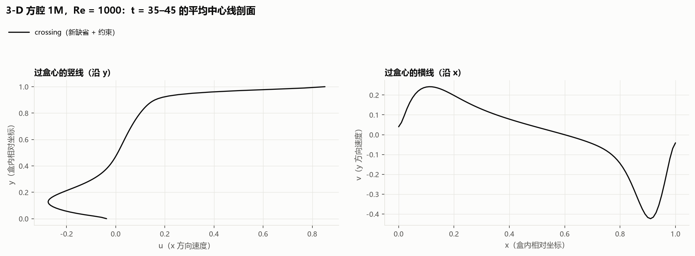

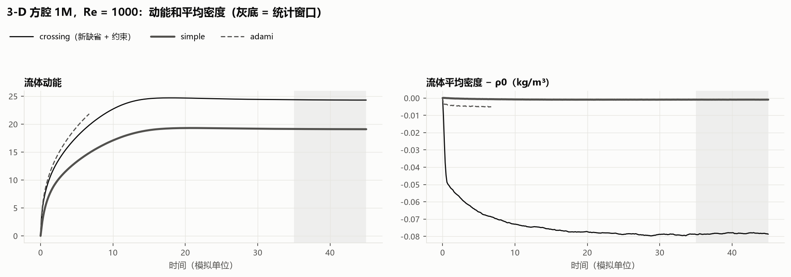

- 剖面取过盒心的两条线（z = 0.5 平面内）：竖线上的 u(y)，横线上的 v(x)，各 101 点，是流体粒子的 Shepard 平均。每种模式是窗口内 22 条剖面（每 0.48 一条：t = 35.04 到 44.64，加上 t = 45）的平均。
- **crossing 的主涡比 simple 强约 15 %**：u_min −0.275 对 −0.235，v_max +0.242 对 +0.206，v_min −0.424 对 −0.369（simple 分别弱 14.6 %、15.0 %、13.0 %）；动能 24.3 对 19.1（高 27 %）。两条线上的剖面差 rms 0.024 / 0.022，最大 0.10 / 0.057，集中在下壁附近的回流和右壁附近的下行流。中间段（y ≈ 0.3–0.9、x ≈ 0.3–0.7）两者几乎重合。
- 哪个更接近真值，这里判断不了：仓库里没有 3-D 方腔的参考数据。2-D 方腔的方向是一致的：250² 上 simple 的 ψ_min 比 Marchi 弱 8.6 %，完整方案弱 1.4 %（wall 帧），两者差约 7 %；3-D 的 1M 每边只有 100 个粒子间距、h/dx = 4，比 2-D 的 250² 粗，差别更大在意料之中。这只是一个旁证，3-D 的绝对误差**未验证**。
- 竖线最顶端的点 u = 0.85（crossing）和 0.75（simple），不是盖速 1：这一点的 Shepard 平均只用了流体粒子，靠近盖的那一层平均进了低于盖速的流体。横线两端（x = 0、1）的 v 不为 0，原因相同。这只影响贴壁的一两个点。

### 19.6 远端：1000² adami

**跑完了**（第三次更新，06:55）。远端的 RTX 5090，代码 `029313a`（11-17 那份），算例 `lid_driven_cavity_2d_n1000_xi0p001_eps0p0025_adami`，K = 1。

- **运行**：11-17 的运行停在 t = 47.8；这次从它 t = 39.69 的检查点（第 5,292,000 步）续跑，03:02 开始，06:45 结束，一段跑完，没有中断。运行器在 t = 79.38 判为定常，按协议停在 t = 100.00（第 13,334,000 步），统计窗口 79.99–99.83。记录：第一段是本机 `runs.jsonl` 里的 `wc-20261117-223709-65e7`（11-17 记下）；这次是远端 `runs.jsonl` 里的 `wc-20261119-030203-0e76`，远端的文件取回到 `logs/wall_crossing/remote/runs_DESKTOP-9IN3NPD.jsonl`（原来那份的扩展，前 5 行不变）。
- **取回的数据**：运行目录除检查点外全部取回到 `logs/wall_crossing/cavity/n1000_adami/`（样本、t ≥ 80 的 20 个快照、`samples.jsonl`、`windows.jsonl`、`steady.json`、`result.json` 等，约 460 MB）；检查点（280 MB）留在远端。
- **稳定性**（远端没有 `cavity_watch.py`，结束后核对）：
  - 运行器的不变量全为 0（溢出、远距迁移、时间戳、粒子漂移），粒子数 1,046,529 在全部 493 个样本里不变。
  - 流体最大速度在全部样本里最大 0.995（盖速的 1.00 倍以内）。
  - 越出盒：t ≥ 80 的 20 个快照里流体坐标的范围是 ±0.50025，壁面（盒面）在 ±0.5005，没有越出。t < 80 没有位置数据，这一段的越出盒**未验证**；粒子数不变说明没有粒子丢失。
- **速度**：602 步 / 秒（续跑段的中位数，含采样）。本机 1000² crossing 是 455 步 / 秒，但两者不在同一张卡上，不能直接比每步代价。

**adami 的三个分辨率**（窗口都是 t ≈ 80–100；偏差相对 Marchi 2021；L2 / L∞ 是 wall 帧的剖面误差）

| 分辨率 | ψ_min（mid 帧） | ψ_min（wall 帧） | u_min | v_max | v_min | u L2 / L∞ | v L2 / L∞ | 涡心（mid 帧） |
|---|---|---|---|---|---|---|---|---|
| 250² | +4.14 % | +3.72 % | +4.17 % | +4.63 % | +3.79 % | 0.0109 / 0.0227 | 0.0122 / 0.0193 | (0.5301, 0.5649) |
| 500² | +1.59 % | +1.39 % | +1.79 % | +2.07 % | +1.70 % | 0.0050 / 0.0108 | 0.0055 / 0.0104 | (0.5302, 0.5645) |
| **1000²** | **+0.24 %** | **+0.14 %** | **+0.48 %** | **+0.62 %** | **+0.45 %** | **0.0022 / 0.0054** | **0.0022 / 0.0052** | (0.5305, 0.5646) |

- adami 在 1000² 上 ψ_min 与 Marchi 相差 0.24 %（mid 帧）/ 0.14 %（wall 帧），速度极值 +0.45 到 +0.62 %，剖面 L2 0.0022。
- 两点阶（250→500 / 500→1000）：ψ_min（mid 帧）1.38 / 2.76，速度极值 1.16–1.22 / 1.74–1.91，剖面 L2 1.12–1.14 / 1.22–1.31。500→1000 的阶比 250→500 高，说明偏差不是单纯的 C·Δx^p。
- 用 19.4 同样的两种解释拟合：(a) 偏差 = c + C·Δx^p 给出 p = 0.75–0.91，c = −1.2 到 −1.4 %（ψ_min 和三个速度极值都在这个范围）；(b) 偏差 = C·Δx^p 给出 ψ_min p = 2.1、速度极值 p = 1.45–1.56，对数残差 0.09–0.23。按 (a)，adami 的偏差在 1000² 之后会穿过 0、趋向 −1.3 %；按 (b)，会继续以二阶左右趋向 0。四个量一起拟合时（19.4），(a) 的残差 0.015 个百分点，(b) 是 0.146，(a) 更符合；但 (a) 给的极限与完整方案的不同，两个系列共用一个极限拟合不好，所以至少一个系列还没进入渐近区（19.4）。要 2000² 才能判断，**未验证**。
- 与 1000² 的完整方案的并列和三点收敛阶在 19.4。

### 19.7 总表、没做或没验证的、下一步

**总表**

| 项 | 结果 | 判定 |
|---|---|---|
| 2.1 诊断算例恢复原意 | 34 个补写成建立时的完整配置；挑的 3 个（含二阶 `_quadratic_full`）与当时提交上的同名运行 700 步逐位相同 | 通过 |
| 2.2 第一次约束更新，K = 1 对 K = 2 | V_target、V_now 逐位相同（相对差 0 ≤ 1e-12），θ 都是 0 | 通过 |
| 2.2 θ、平均密度、动能的历史 | K = 2 与 K = 1 之差在运行间散布以内（各 6 次，组均值在一个标准差内） | 通过 |
| 2.2 接缝审计、粒子数漂移 | 2-D 250² 和 3-D 方腔，不变量全为 0，漂移 0 | 通过 |
| 2.2 3-D K = 1 对 K = 2 的 700 步逐位比较 | 现有工具（canonical 转储）在 3-D K = 2 上丢粒子，simple 也一样 | 做不了 |
| 2.2 发现的实现错误 | 约束的目标值在构造时取，与接缝审计冲突；改在启动时取（`f6ee476`），值不变 | 修了，复核过 |
| 2.3 3-D 静水盒（gy、gtilt） | 稳定；残余速度均方根是 11-17 一阶的 1.4 倍、adami 的 1/30；压力电平不再下降，停在 −0.33 / −0.16 ρ0gH（约束偏移，θ +3.3e-4 / +2.7e-4） | 稳定；电平有偏移 |
| 2.4 3-D 方腔试跑（1M，t = 5） | 粒子数守恒，没有越出盒，最大速度 0.95；每步 14.7 ms（simple 9.9，adami 11.5） | 通过 |
| 3.1 2-D 1000²，完整方案 + 约束 | 稳定（粒子数不变，没有越出盒，最大速度 0.994）；ψ_min −0.33 %（mid 帧）/ −0.43 %（wall 帧），速度极值 −0.05 到 −0.08 %，剖面 L2 0.0017 / 0.0015（wall 帧）；459 步 / 秒；窗口内平均密度 ρ0 − 0.0006，θ +6.3e-7 | 通过（稳定）；ψ_min 比 adami 偏离稍大、方向相反，速度极值和剖面比 adami 好 |
| 3.1 三点收敛 | ψ_min 两点阶 0.87 / 0.79，速度极值 1.3–1.5 → 2.0–2.5；(a) 四个量共用 p = 1.03，残差 0.005 个百分点；(b) p_ψ 0.85、p_速度 1.51，残差 0.023 | (a) 更符合，(b) 不能排除（**未验证**） |
| 3.2 3-D 方腔 crossing（新缺省 + 约束，1M，t = 45） | 稳定（最大速度 0.950，粒子数不变，没有越出盒）；15.3 ms / 步；动能 24.3，窗口内每时间单位 −0.025 %；平均密度 ρ0 − 0.079，平均压力 −0.78 ρ0U² | 稳定；约束偏移大 |
| 3.2 3-D 方腔 simple | 稳定（最大速度 0.899）；10.8 ms / 步；主涡比 crossing 弱约 15 %，动能 19.1 | 稳定 |
| 3.2 3-D 方腔 adami | t = 6.72 触发停止条件：盖与下游侧壁交线上单个粒子 1.065 倍盖速；定位重跑在 t = 5.88 以 1.052 再次停下 | 停止，已定位 |
| 3.3 远端 2-D 1000² adami | ψ_min +0.24 %（mid）/ +0.14 %（wall），速度极值 +0.45 到 +0.62 %，剖面 L2 0.0022；稳定 | 通过 |

**没做或没验证的**

1. **3-D 的 K = 1 对 K = 2 逐位比较**：没做。现有的 canonical 转储在 3-D 的 K = 2 上丢粒子（每体素的副本槽数不够，simple 也一样），3-D 的双卡只做了接缝审计。**未验证**。
2. **2.2 里的负载迹象**：K = 1 的六次里，卡有负载时跑的三次恰好平均密度最低（纯属巧合的概率 1/20）；K = 2 里没有这样的规律。负载是否影响结果，**未验证**。
3. **3-D 的密度汇**：
   - 静水盒约 0.3 kg/m³ 每时间单位，方腔留下 θ ≈ +8e-5。它从哪里来没有查。
   - 约束留下的偏移（3-D 方腔平均密度 ρ0 − 0.079，平均压力 −0.78 ρ0U²，99.99 % 的粒子负压）对流动有没有影响，**未验证**。
4. **3-D 方腔的绝对精度**：仓库里没有同一雷诺数的 3-D 参考数据，只做了互比。crossing 的主涡比 simple 强约 15 %，哪个更接近真值，**未验证**。3-D 只跑了 1M 一个分辨率。
5. **3-D 方腔是否到了定常**：窗口 35–45 内，动能每时间单位还在降 0.02–0.03 %。窗口平均的剖面是不是定常剖面，**未验证**。
6. **3-D adami**：
   - 它触发了停止条件，没有定常结果，所以三种模式的定常比较只有 crossing 和 simple。
   - 超速的机理（我推测是 adami 的壁面速度外推在盖与侧壁的交线上偏大），**未验证**。
   - 放宽门槛后它是否仍然稳定，没有试（任务书的停止条件没有改）。
7. **远端 1000² adami 在 t < 80 是否越出盒**：没有位置数据，**未验证**。粒子数不变，说明没有粒子丢失。
8. **收敛的解释**：
   - 三点数据更符合 (a)，但 1000² 的噪声没有测，所以 (b) 不能排除。
   - 两个系列的 (a) 常数不一致，至少一个系列还没进入渐近区。
   - 要 2000² 才能判断，**未验证**。
9. **1000² 的噪声**：只有一个运行、一个窗口。ψ_min 和速度极值的运行间散布、窗口间变化都没有测（250² 测过），**未验证**。
10. **1000² 起动阶段的密度下沉**（t ≈ 3–31，最低 ρ0 − 0.035）只在 1000² 上出现，原因**未验证**。
11. **两个不随分辨率减小的量**：
    - 涡心竖直方向的偏差，三个分辨率都是 −0.0009 到 −0.0010，**未验证**；
    - mid 帧剖面误差停在 L2 ≈ 0.0026 附近，**未验证**。
12. **simple 1000²**：没有在当前代码上重跑，用的是 `docs/validation/cavity_re1000.md` 里 v6（`9cde618`）的结果。它与当前代码一致的依据是 250²、500² 的剖面误差在 3–4 位上相同；1000² 本身是否一致，**未验证**。
13. **2-D 接缝审计里 N = 2000 时远区最坏的位移修正比值 1.93**：比第 4 节的范围大，没有再查，**未验证**。
14. **2-D 的动能在 t = 80–100 还在极慢地上升**：三个 1000² / 500² 运行在整个窗口内都是 +0.03 %。窗口平均是否已等于 t → ∞ 的值，**未验证**。第 17 节 250² 续跑到 t = 200，之后的变化在 0.05 个百分点以内。
15. **3-D 的每步时间**是两张卡同时在跑时测的，2.4 的单独试跑快 4–9 %。哪个更代表单独运行的代价，没有分开测。

**我对下一步的看法**

1. **3-D 里约束留下的偏移，最值得先看。**
   - 2-D 方腔里比例式约束留下的偏移很小（1000² 的 θ 是 6e-7），但 3-D 的密度汇大得多：3-D 静水盒的汇约是 2-D 方腔的 100 倍，3-D 方腔留下 ρ0 − 0.079 的密度偏移（2-D 250² 的约 10 倍）和几乎全场的负压。
   - 有两条路：(i) 找出 3-D 密度汇的来源，看连续性方程里哪一项在 3-D 不守恒；(ii) 给约束加积分项（PI），把偏移压到 0。
   - (i) 治本，可以先在 3-D 静水盒（小、快）上把密度变化率逐项求和来做。(ii) 是改数值，要你决定。
2. **收敛的解释，先测噪声，再考虑 2000²。**
   - 把 1000² 从最后的检查点（t = 99.2）续跑到 t = 140，约 3.3 小时，就能得到第二个窗口，看出窗口间的变化有多大。如果明显小于 0.02 个百分点，(b) 就被排除。
   - 2000²（4.2M 粒子，步长减半）单卡约 65 小时，K = 2 约 35 小时。等噪声测过、确实需要时再跑。
3. **3-D adami 的超速。**
   - 先确认机理：`stop_state.npz` 里有停下那一刻的流体状态，在那条棱附近把壁粒子的外推速度打出来，看是否大于盖速，不用重跑长运行。
   - 如果要 adami 的 3-D 定常结果，就需要放宽它的停止门槛（例如 1.1），只为比较而跑。这改的是任务书的条件，要你决定。
4. **3-D 的参考。** 要回答 crossing 和 simple 哪个更准，需要一个能写清来源和数值的 Re = 1000 立方方腔参考；或者在 2M / 4M 上加密一次，看 crossing 往哪个方向变。2M、4M 的粒子文件要先生成。
5. **3-D 的 K = 2 逐位比较。** 只改工具：让 canonical 转储在 3-D 上用更多的副本槽，就能补做。

## 20. 追加（十五）：推送并打标签；3-D 双卡丢粒子的监视（2026-11-19）

用户的任务书，两件事按顺序做：

- **A**：把 `v7-wall-crossing` 推送到 GitHub，在推送前的分支末端打带说明的标签。这一次推送和打标签是用户同意的，只限这个分支和这个标签。
- **B**：加一个默认关闭、只读的监视开关，查 3-D 双卡时粒子从哪里丢。第一次发现粒子进入壁面层（或粒子数变少、数值异常）就停下，保存现场，写说明，然后等用户看，**不修**。

> **本节的状态**：做完了，按要求停在这里等用户看。
> - A 已推送：分支 `origin/v7-wall-crossing` 和标签 `crossing-boundary` 都指向 `d94c26c`。
> - B 的改动只在本地提交（`2c49ec0`、`1c0cbeb` 和加入本节的提交），没有推送。
> - 没有改缺省值、`simple` / `adami` 的数值、随传输和 defrag 搬运的数据布局、ghost 记录格式或层数。没有改着色器：监视只在 Python 一侧读回，不需要重编 SPIR-V。

**先说结果**

- **A**：推送前的三项检查都通过；分支和标签已推送，标签指向 `d94c26c`（标签对象 `f05b843`）。
- **B，监视开关**：在 2-D 250² 上（K = 1 和 K = 2，700 步），开关关闭、打开与当前提交的结果都逐位相同。3-D 小算例上这一项做不到逐位：同一个构建跑两次，1 步之后就不逐位相同（这是新发现，见 20.3）；开关关、开的差别落在这个散布以内。
- **B，三次运行**：
  - 复现（crossing，双卡）在第 8 步（第一次）和第 10 步（正式那次）停下：3 个和 5 个流体粒子越过盒子的 z+ 面（侧壁）。
  - 对照一（simple，双卡）在第 8 步停下，同一个位置，同一种情况。
  - 对照二（crossing，单卡）跑完 700 步，没有事件：粒子一个不少，没有越出盒，没有溢出。
  - 三次双卡运行停下时粒子数都还没少，也没有非有限值：最先出现的是“进入壁面层”。
- **看到了什么**：出事的粒子都在两卡分界面上（离分界面不到 0.0011 m，约 0.1 个粒子间距），在侧壁 z+ 附近、靠近顶盖或底面的地方。每一步它们移动约 0.001 m（0.1 个间距），而速度乘时间步只有 1e-6 m 的量级：推它们的不是速度，是粒子位移修正（`use_pst`）。它们这样动，是因为在它们所在那张卡上，支撑半径内本该有的邻居缺了四成多（分界面另一侧的壁面和流体粒子，这张卡上没有它们的副本）：每张卡每一步大约有 24,000 个副本（ghost）没有发过来，从起步那一步就开始。单卡和对照 A 里没有这些现象。
- **初步判断（推测）**：这是现有工具（`canonical_dump.py`）的配置在 3-D 上把副本区开小了，不是 crossing 的问题：它用了 2-D 的副本区系数 0.29，3-D 的代码缺省是 0.5。我加了一个对照 A，只把这个系数改成 0.5，其余照旧：双卡 700 步没有事件、没有任何溢出，结果与单卡的差别和单卡自己跑两次之间一样大。小算例上另有一个机理：分界面恰好落在一层粒子上时，第 1 步的迁移粒子装不下，多出来的留在 ghost 列里不被计算。对照 B（小算例、0.5）在第 657 步因此出事件。

### 20.1 A：推送和标签

**推送前检查**（任务书 2.1；任一项不通过就不推送）

| 检查 | 结果 |
|---|---|
| 工作区干净 | 干净（`git status` 没有输出） |
| 第 19 节报告的提交都在分支上 | 报告第 19 节里出现的 16 个提交号都是分支末端 `d94c26c` 的祖先 |
| 凭据：在 `origin/bootstrap-density-fix..v7-wall-crossing` 的全部改动里搜 `password`、`passwd`、`密码`、`sshpass` | 2 行命中，都是同一句话（报告第 19 节“我做的决定”第 15 条，在 `report_source.md` 和 `wall_crossing_report.md` 里各一次），内容是“一直用密码，密码只经环境变量传，没有写进任何文件”，不是凭据 |
| 凭据：第一份任务书给的远端机器密码 | 0 次（逐提交的全部改动，二进制文件按文本一起搜，提交说明也搜了；搜的时候没有把密码打印出来） |
| 凭据：顺带搜了私钥头、GitHub / AWS / Anthropic 令牌的格式 | 0 次 |
| 任务书文件 `cc_prompt_*.md` | 这个范围里没有新增，分支末端也没有 |
| 新增的大文件 | 这个范围新增 832 个文件对象，共 74.7 MB（未压缩）；没有一个大于 10 MB，所以也没有大于 50 MB 的 |

**推送**

- `git push origin v7-wall-crossing`：远端原来没有这个分支，新建 `origin/v7-wall-crossing`，指向 `d94c26c`。
- 在 `d94c26c`（推送前的分支末端，B 的任何改动之前）打带说明的标签 `crossing-boundary`，说明照任务书的原文；`git push origin crossing-boundary`。远端核对：`refs/tags/crossing-boundary` = 标签对象 `f05b843`，`^{}` = `d94c26c`。
- 只推了这个分支和这个标签；没有合并，没有改写已推送的历史，没有动别的标签。本地分支的上游仍是 `origin/bootstrap-density-fix`，没有改。
- 标签说明里“封闭盒的总体积修正默认关闭”指代码的缺省（`numerics.volume_constraint` 不写就是关）；8 个封闭域算例在算例文件里把它打开了（第 18、19 节）。说明照原文写，没有改。

### 20.2 B：监视开关

开关是 `canonical_dump.py --watch 目录`（缺省不开）。做的事写在 `experiment/wall_crossing/particle_watch.py` 的文档串里，要点：

- **查什么**（三种事件，任一出现就停）：
  - 进入壁面层：一个自有的流体粒子在任一轴上越过流体盒的面（x < 下界或 x > 上界）。盒子就是 crossing 用的那个（算例没写盒子时，装载器取流体初始包围盒向外扩一个粒子半径）；simple 没有 crossing 设置，按同一规则算出同一个盒子。1M 方腔是 [−0.505, 0.505]³。
  - 粒子数变少：两张卡上自有的流体粒子（不算 ghost、不算出发区的副本）合计比初始少。
  - 数值异常：自有粒子（流体或壁面）的位置或速度出现非有限值。
- **怎么查**：起步之后和每一步之后，从每张卡读回位置、速度、密度压力、材料、全局编号、位移修正、加速度七个缓冲区，加上体素表和全局计数器。这时运行循环用深度 1（读完这一步才提交下一步），所以每次读到的都是一个完整走完的步，GPU 上没有别的工作在跑。监视只读：只做拷到主机暂存区的拷贝，不写任何设备缓冲区，不改任何分派、特化常量或开关。
- **每一步还记一行**（`watch_steps.jsonl`）：两卡的自有粒子数；自有粒子里有多少落在 ghost 列、有多少不在任何体素表里；各计数器的增量（副本溢出、迁入、出发区溢出、远距迁移等）；离盒面最近的距离；最大速度；最大单步位移、最大位移修正、最大加速度（各带粒子编号、位置和到分界面的距离）。
- **轨迹**：内存里保留最近 128 步全部流体粒子的位置、速度、密度、压力、所在卡和是否在体素表里（按全局编号）；最近 3 步保留两卡的全部原始缓冲区。求解器在 defrag 之后不逐位重复，所以不靠从检查点重算来复现。
- **开销**（1M 方腔，700 步的平均）：双卡每步读回和检查约 1.2 秒，连同计算约 1.8 秒；单卡约 0.9 秒，连同计算约 1.6 秒（不开监视时一步只要十几毫秒）。内存约 5 GB（128 步的环）。

停下以后，`particle_watch_report.py` 把现场整理成任务书 3.4 要的文件（20.6）。

### 20.3 开关的逐位核对

参照是当前提交 `d94c26c`（另建了一个检出 `vulkan-demo-wall-crossing-ref` 停在 `d94c26c` 上跑，算例文件用同一份）。开关关闭和打开是在 `2c49ec0` 上跑的；之后的 `1c0cbeb` 只给每步日志加了几个字段，读回和检查都没有变。

| 算例 | 比较 | canonical_dump --compare | 位置：相同的行 / 总数，最大差 | 速度：相同的行 / 总数，最大差 | 密度：相同的行 / 总数，最大差 | 记录 |
|---|---|---|---|---|---|---|
| 2-D 250² crossing，K = 1，700 步 | 参照对参照（d94c26c 跑两次） | 逐位相同（10 个字段） | 74529 / 74529，0.0e+00 | 74529 / 74529，0.0e+00 | 74529 / 74529，0.0e+00 | wc-20261119-140602-ffed / wc-20261119-140603-9f76 |
| 2-D 250² crossing，K = 1，700 步 | 开关关闭对参照 | 逐位相同（10 个字段） | 74529 / 74529，0.0e+00 | 74529 / 74529，0.0e+00 | 74529 / 74529，0.0e+00 | wc-20261119-140605-02d4 / wc-20261119-140602-ffed |
| 2-D 250² crossing，K = 1，700 步 | 开关打开对参照 | 逐位相同（10 个字段） | 74529 / 74529，0.0e+00 | 74529 / 74529，0.0e+00 | 74529 / 74529，0.0e+00 | wc-20261119-140606-7951 / wc-20261119-140602-ffed |
| 2-D 250² crossing，K = 2，700 步 | 参照对参照（d94c26c 跑两次） | 逐位相同（10 个字段） | 74529 / 74529，0.0e+00 | 74529 / 74529，0.0e+00 | 74529 / 74529，0.0e+00 | wc-20261119-140652-e2ef / wc-20261119-140654-e15e |
| 2-D 250² crossing，K = 2，700 步 | 开关关闭对参照 | 逐位相同（10 个字段） | 74529 / 74529，0.0e+00 | 74529 / 74529，0.0e+00 | 74529 / 74529，0.0e+00 | wc-20261119-140655-d154 / wc-20261119-140652-e2ef |
| 2-D 250² crossing，K = 2，700 步 | 开关打开对参照 | 逐位相同（10 个字段） | 74529 / 74529，0.0e+00 | 74529 / 74529，0.0e+00 | 74529 / 74529，0.0e+00 | wc-20261119-140657-930c / wc-20261119-140652-e2ef |
| 3-D 小算例，K = 1，1 步 | 参照对参照（d94c26c 跑两次） | 不逐位相同 | 195112 / 195112，0.0e+00 | 195112 / 195112，0.0e+00 | 195112 / 195112，0.0e+00 | wc-20261119-135241-f73d / wc-20261119-135242-d7be |
| 3-D 小算例，K = 1，1 步 | 开关关闭对开关关闭 | 不逐位相同 | 195112 / 195112，0.0e+00 | 195112 / 195112，0.0e+00 | 195112 / 195112，0.0e+00 | wc-20261119-140744-350a / wc-20261119-140747-54e1 |
| 3-D 小算例，K = 1，1 步 | 开关打开对开关打开 | 不逐位相同 | 195112 / 195112，0.0e+00 | 195112 / 195112，0.0e+00 | 195112 / 195112，0.0e+00 | wc-20261119-140745-7bd5 / wc-20261119-140748-5771 |
| 3-D 小算例，K = 1，1 步 | 开关关闭对参照 | 不逐位相同 | 195112 / 195112，0.0e+00 | 195112 / 195112，0.0e+00 | 195112 / 195112，0.0e+00 | wc-20261119-140744-350a / wc-20261119-135241-f73d |
| 3-D 小算例，K = 1，1 步 | 开关打开对开关关闭 | 不逐位相同 | 195112 / 195112，0.0e+00 | 195112 / 195112，0.0e+00 | 195112 / 195112，0.0e+00 | wc-20261119-140745-7bd5 / wc-20261119-140744-350a |
| 3-D 小算例，K = 1，50 步 | 参照对参照（d94c26c 跑两次） | 不逐位相同 | 91421 / 195112，1.5e-07 | 84520 / 195112，8.4e-06 | 188877 / 195112，1.2e-04 | wc-20261119-135125-ad7c / wc-20261119-135127-a639 |
| 3-D 小算例，K = 1，50 步 | 开关关闭对开关关闭 | 不逐位相同 | 91574 / 195112，1.5e-07 | 84522 / 195112，9.7e-06 | 188954 / 195112，1.2e-04 | wc-20261119-140750-4102 / wc-20261119-140801-826b |
| 3-D 小算例，K = 1，50 步 | 开关打开对开关打开 | 不逐位相同 | 91275 / 195112，1.5e-07 | 84522 / 195112，9.2e-06 | 189249 / 195112，1.2e-04 | wc-20261119-140751-7044 / wc-20261119-140802-c2c3 |
| 3-D 小算例，K = 1，50 步 | 开关关闭对参照 | 不逐位相同 | 91455 / 195112，1.5e-07 | 84520 / 195112，8.5e-06 | 188726 / 195112，1.2e-04 | wc-20261119-140750-4102 / wc-20261119-135125-ad7c |
| 3-D 小算例，K = 1，50 步 | 开关打开对开关关闭 | 不逐位相同 | 91570 / 195112，1.5e-07 | 84521 / 195112，9.3e-06 | 189043 / 195112，1.2e-04 | wc-20261119-140751-7044 / wc-20261119-140750-4102 |
| 3-D 小算例，K = 1，700 步 | 参照对参照（d94c26c 跑两次） | 不逐位相同 | 84520 / 195112，1.1e-03 | 84520 / 195112，1.7e-04 | 109917 / 195112，9.2e-04 | wc-20261119-135139-78c4 / wc-20261119-135142-82e8 |
| 3-D 小算例，K = 1，700 步 | 开关关闭对开关关闭 | 不逐位相同 | 84520 / 195112，9.9e-04 | 84520 / 195112，1.6e-04 | 109711 / 195112，7.9e-04 | wc-20261119-140812-dff0 / wc-20261119-141017-2377 |
| 3-D 小算例，K = 1，700 步 | 开关打开对开关打开 | 不逐位相同 | 84520 / 195112，9.8e-04 | 84520 / 195112，1.6e-04 | 109939 / 195112，7.9e-04 | wc-20261119-140815-a97b / wc-20261119-141020-8e28 |
| 3-D 小算例，K = 1，700 步 | 开关关闭对参照 | 不逐位相同 | 84520 / 195112，1.1e-03 | 84520 / 195112，1.5e-04 | 110408 / 195112，7.9e-04 | wc-20261119-140812-dff0 / wc-20261119-135139-78c4 |
| 3-D 小算例，K = 1，700 步 | 开关打开对开关关闭 | 不逐位相同 | 84520 / 195112，1.2e-03 | 84520 / 195112，1.4e-04 | 109478 / 195112，7.3e-04 | wc-20261119-140815-a97b / wc-20261119-140812-dff0 |

- **2-D 250² crossing，700 步**：K = 1 和 K = 2 两组，参照自己跑两次、开关关闭对参照、开关打开对参照，全部逐位相同（10 个字段）。K = 2 这一组也覆盖了打开开关后的深度 1 和每步读回。
- **3-D 小算例（48³ 静水盒 gtilt，crossing 新缺省 + 约束），K = 1**：任务书要的“700 步核对一次”做不到逐位，因为当前提交自己就不逐位重复：
  - 同一个构建跑两次，1 步之后位置、速度、密度还相同，但校正矩阵、核梯度和、位移修正、加速度已经在多数流体粒子上差最后几位（内部的粒子也差，不只是壁面附近），50 步后位置和速度也开始差。
  - 这在第 19 节没有发现：那里 3-D 的逐位比较因为双卡丢粒子没有做成，单卡两次之间没有比。原因没查，**未验证**。（任务书 3.2 不要求查它，所以只记下来。）
  - 开关关闭对参照、开关打开对开关关闭，在 1、50、700 步上的差别，与参照对参照、关对关、开对开是同一类、同一大小（表中位置、速度、密度的相同行数和最大差）。所以在这个算例上能说的是：开关关、开的差别落在构建自己的散布以内。

### 20.4 三次运行（每次都开着监视）

算例和工具就是第 19 节丢粒子的那个：`canonical_dump.py --solver v7 --canonical-lists --transport-extension`，700 步，1M 方腔 `cases/cavity3d_1m_crossing`（crossing 新缺省 + 约束）和 `cases/cavity3d_1m`（simple），双卡 = 设备 0、1，单卡 = 设备 1。两卡的分界在全局第 15 列，x = −0.016 m。

| 运行 | 算例 | K | 副本区系数 | 停在 | 事件 | 出事粒子 | 最后一步：不在任何体素表里的自有粒子（卡 0 / 卡 1） | 最后一步：overflow_ghost_count 增量（卡 0 / 卡 1） | 记录 | 目录 |
|---|---|---|---|---|---|---|---|---|---|---|
| 复现（第一次，工具 2c49ec0） | cavity3d_1m_crossing | 2 | V7_GHOST_POOL_FACTOR=0.29 | 第 8 步（t = 0.00048） | 进入壁面层：3 个流体粒子越过盒面，最深 4.8e-04 m | 粒子 509847（卡 0）在 (-0.0160, 0.4801, 0.5055)，越过 z+（面），到分界面 -0.0000 m，在本卡自有列 | 0 / 0 | 22965 / 23647 | wc-20261119-141300-7571 | `logs/wall_crossing/particle_watch/run2_reproduction_crossing_k2/` |
| 复现（正式，工具 1c0cbeb） | cavity3d_1m_crossing | 2 | V7_GHOST_POOL_FACTOR=0.29 | 第 10 步（t = 0.00060） | 进入壁面层：5 个流体粒子越过盒面，最深 1.0e-03 m | 粒子 509847（卡 0）在 (-0.0170, 0.4796, 0.5060)，越过 z+（面），到分界面 -0.0010 m，在本卡自有列 | 0 / 0 | 22862 / 23858 | wc-20261119-141555-7102 | `logs/wall_crossing/particle_watch/run2_reproduction_crossing_k2_b/` |
| 对照一：simple，双卡 | cavity3d_1m | 2 | V7_GHOST_POOL_FACTOR=0.29 | 第 8 步（t = 0.00048） | 进入壁面层：2 个流体粒子越过盒面，最深 1.6e-04 m | 粒子 509544（卡 1）在 (-0.0157, 0.4500, 0.5052)，越过 z+（面），到分界面 +0.0003 m，在本卡自有列 | 0 / 0 | 23109 / 23587 | wc-20261119-141627-cd65 | `logs/wall_crossing/particle_watch/run3_control_simple_k2/` |
| 对照二：crossing，单卡 | cavity3d_1m_crossing | 1 | V7_GHOST_POOL_FACTOR=0.29 | 跑完 700 步 | 没有事件 | — | 0 | 0 | wc-20261119-141654-5983 | `logs/wall_crossing/particle_watch/run4_control_crossing_k1/` |
| 我加的对照 A：crossing，双卡，副本区系数 0.5 | cavity3d_1m_crossing | 2 | V7_GHOST_POOL_FACTOR=0.5 | 跑完 700 步 | 没有事件 | — | 0 / 0 | 0 / 0 | wc-20261119-143523-b0ca | `logs/wall_crossing/particle_watch/extra_a_crossing_k2_ghost_pool_0p5/` |
| 我加的对照 B：小算例 crossing，双卡，副本区系数 0.5 | hydrostatic_3d_n48_gtilt_crossing | 2 | V7_GHOST_POOL_FACTOR=0.5 | 第 657 步（t = 0.08213） | 进入壁面层：48 个流体粒子越过盒面，最深 2.3e-05 m | 粒子 57600（卡 1）在 (0.0178, -0.5000, -0.4837)，越过 y-（面），到分界面 -0.0135 m，在本卡内层 ghost 列，不在任何体素表里 | 0 / 1190 | 0 / 0 | wc-20261119-145626-77ad | `logs/wall_crossing/particle_watch/extra_b_small_crossing_k2_ghost_pool_0p5/` |
| 开发试跑 1（小算例，双卡） | hydrostatic_3d_n48_gtilt_crossing | 2 | V7_GHOST_POOL_FACTOR=0.29 | 第 14 步（t = 0.00175） | 进入壁面层：4 个流体粒子越过盒面，最深 5.7e-04 m | — | 0 / 1574 | 2454 / 2053 | wc-20261119-135732-628f | `logs/wall_crossing/particle_watch/smoke/hydrostatic_3d_k2/` |
| 开发试跑 2（小算例，双卡） | hydrostatic_3d_n48_gtilt_crossing | 2 | V7_GHOST_POOL_FACTOR=0.29 | 第 22 步（t = 0.00275） | 进入壁面层：2 个流体粒子越过盒面，最深 8.4e-04 m | 粒子 57559（卡 0）在 (0.0211, 0.5008, -0.3397)，越过 y+（面），到分界面 -0.0102 m，在本卡自有列 | 0 / 1541 | 2505 / 1968 | wc-20261119-135939-63e0 | `logs/wall_crossing/particle_watch/smoke/hydrostatic_3d_k2_b/` |
| 开发试跑 3（小算例，双卡） | hydrostatic_3d_n48_gtilt_crossing | 2 | V7_GHOST_POOL_FACTOR=0.29 | 第 13 步（t = 0.00163） | 进入壁面层：1 个流体粒子越过盒面，最深 2.2e-05 m | 粒子 59856（卡 1）在 (0.0063, 0.4897, -0.5000)，越过 z-（面），到分界面 -0.0249 m，在本卡内层 ghost 列，不在任何体素表里 | 0 / 1590 | 2440 / 2067 | wc-20261119-141521-9a24 | `logs/wall_crossing/particle_watch/smoke/hydrostatic_3d_k2_c/` |

- **复现**跑了两次：第一次用 `2c49ec0`，停下后我给每步日志加了最大位移、最大位移修正和最大加速度三项（`1c0cbeb`），再用它把三次运行都正式跑一遍（“我做的决定”）。两次停在第 8 步和第 10 步，出事的是同一批粒子（509847、509948、509746 两次都在里面），位置也相同：可见这个事件不是偶然的。
- **对照一（simple，双卡）**在第 8 步停下，出事粒子 509544、509645，同一个位置（x ≈ −0.016，y ≈ 0.45–0.46，越过 z+）。
- **对照二（crossing，单卡）**：跑完 700 步，没有事件。1,685,159 个粒子都在，没有溢出计数、没有传输错误；流体离盒面最近 0.0029 m（0.29 个间距），最大速度 0.45。全程最大单步位移 3.0e-5 m、最大位移修正 2.8e-5 m、最大加速度 822 m/s²（在顶盖与侧壁的交线上，x = ±0.5、y = 0.5，这里本来就有盖速的间断）。
- 三次双卡运行在停下的那一步都还没有少粒子（1,030,301 个流体粒子都在），没有非有限值，自有粒子也都在体素表里。

**复现（正式那次）每一步的记录**（两卡各一个数时写成“卡 0 / 卡 1”）

| 步 | 自有流体粒子 | 越出盒 | 离盒面最近（m） | 最大速度 | 自有粒子在 ghost 列（卡 0 / 1） | 不在任何体素表里（卡 0 / 1） | overflow_ghost_count 增量 | 迁入 | overflow_departed 增量 | far_migration 增量 | 最大单步位移 m（x − x_cut） | 单步位移中位数 m | 最大位移修正 m（x − x_cut） |
|---|---|---|---|---|---|---|---|---|---|---|---|---|---|
| 0 | 1030301 | 0 | 5.00e-03 | 0.001 | 0 / 0 | 0 / 0 | 24116 / 24180 | 0 / 0 | 0 / 0 | 0 / 0 | — | — | 9.99e-04（+0.006） |
| 1 | 1030301 | 0 | 4.44e-03 | 0.001 | 0 / 0 | 0 / 0 | 24176 / 24160 | 0 / 0 | 0 / 0 | 0 / 0 | 9.99e-04（-0.003） | 0.0e+00 | 1.06e-03（+0.006） |
| 2 | 1030301 | 0 | 3.95e-03 | 0.206 | 0 / 0 | 0 / 0 | 24144 / 24144 | 0 / 0 | 0 / 0 | 0 / 0 | 1.06e-03（+0.005） | 0.0e+00 | 1.13e-03（-0.003） |
| 3 | 1030301 | 0 | 3.46e-03 | 0.473 | 0 / 0 | 0 / 0 | 24124 / 24192 | 0 / 0 | 0 / 0 | 0 / 0 | 1.13e-03（-0.002） | 0.0e+00 | 1.40e-03（-0.001） |
| 4 | 1030301 | 0 | 3.53e-03 | 0.664 | 0 / 0 | 0 / 0 | 24140 / 24192 | 0 / 0 | 0 / 0 | 0 / 0 | 1.40e-03（-0.001） | 0.0e+00 | 1.46e-03（+0.004） |
| 5 | 1030301 | 0 | 2.78e-03 | 0.714 | 0 / 0 | 0 / 0 | 23978 / 24128 | 0 / 146 | 0 / 0 | 0 / 0 | 1.46e-03（+0.003） | 0.0e+00 | 4.72e-03（+0.000） |
| 6 | 1030301 | 0 | 1.79e-03 | 0.746 | 0 / 0 | 0 / 0 | 23521 / 24176 | 162 / 505 | 0 / 0 | 0 / 0 | 4.72e-03（-0.004） | 0.0e+00 | 5.14e-03（+0.000） |
| 7 | 1030301 | 0 | 7.42e-04 | 0.693 | 0 / 0 | 0 / 0 | 22952 / 24035 | 661 / 693 | 0 / 0 | 0 / 0 | 5.14e-03（-0.005） | 0.0e+00 | 6.07e-03（-0.001） |
| 8 | 1030301 | 0 | 3.29e-04 | 0.733 | 0 / 0 | 0 / 0 | 22917 / 23468 | 1188 / 701 | 0 / 419 | 0 / 0 | 6.07e-03（+0.005） | 0.0e+00 | 6.29e-03（-0.001） |
| 9 | 1030301 | 0 | 2.96e-04 | 0.704 | 0 / 0 | 0 / 0 | 23053 / 23643 | 594 / 1105 | 336 / 0 | 0 / 0 | 6.29e-03（+0.006） | 0.0e+00 | 5.12e-03（-0.001） |
| 10 | 1030301 | 5 | -1.03e-03 | 0.760 | 0 / 0 | 0 / 0 | 22862 / 23858 | 872 / 762 | 0 / 103 | 0 / 0 | 5.12e-03（+0.004） | 0.0e+00 | 5.10e-03（-0.000） |

### 20.5 现场：在哪里，什么推着它们

**在哪里**：出事粒子都在两卡分界面上，离分界面不到 0.0011 m（0.1 个粒子间距）；大多在侧壁 z+ 上、离顶盖 1–5 个间距（y ≈ 0.46–0.49），复现正式那次另有一个越过底面 y−（在 z ≈ 0.48，也靠近 z+ 侧壁）。越过的深度 0.0002–0.001 m。越过的都是面，不是棱或角。

**什么推着它们**（复现正式那次，主粒子 509847；其余粒子和其余两次一样）：

- 它在 10 步里从 x = −0.010（卡 1 的第一个自有列）挪到分界面上，第 10 步换到卡 0；同时从最外一层流体（z = 0.500）越过 z = 0.505 的盒面。同批的另几个粒子在两卡之间来回换了 2–4 次卡。
- 平均每步挪 0.00098 m，而 |v|·Δt 平均只有 1.8e-6 m。第 10 步它的位移修正向量长 0.0015 m。所以推着它走的是粒子位移修正，不是速度。
- 整个运行里，每一步的最大单步位移（1e-3 → 6e-3 m）、最大位移修正和最大加速度（3,000–13,000 m/s²）都出在分界面两侧 0.006 m 以内。最大速度第 2 步就到 0.2：分界面上 3,400 m/s² 的加速度乘一个时间步。

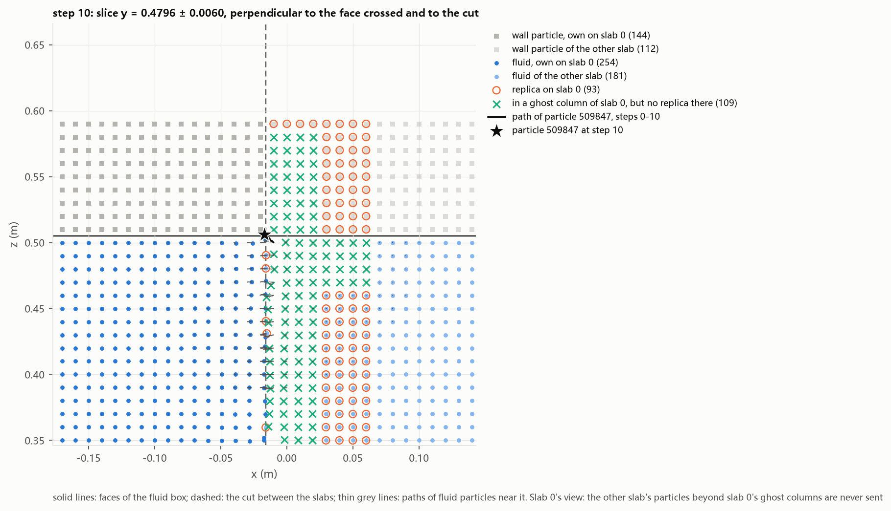

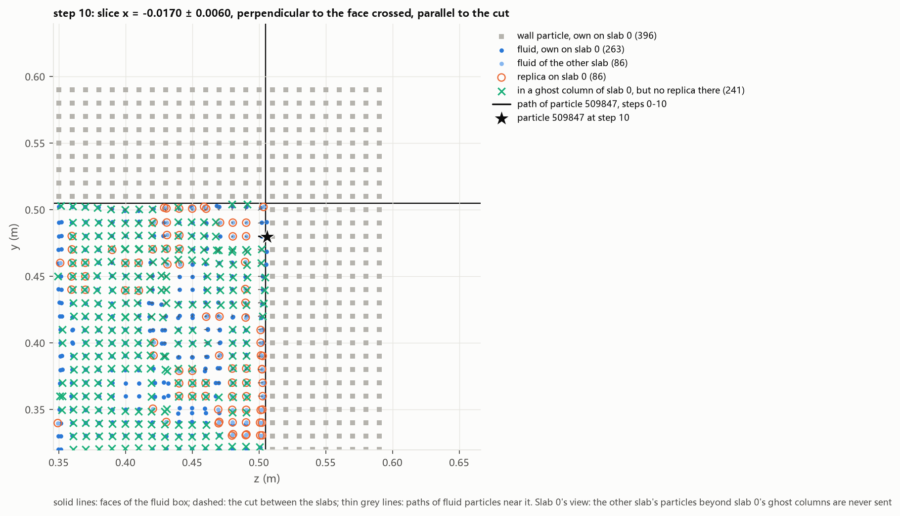

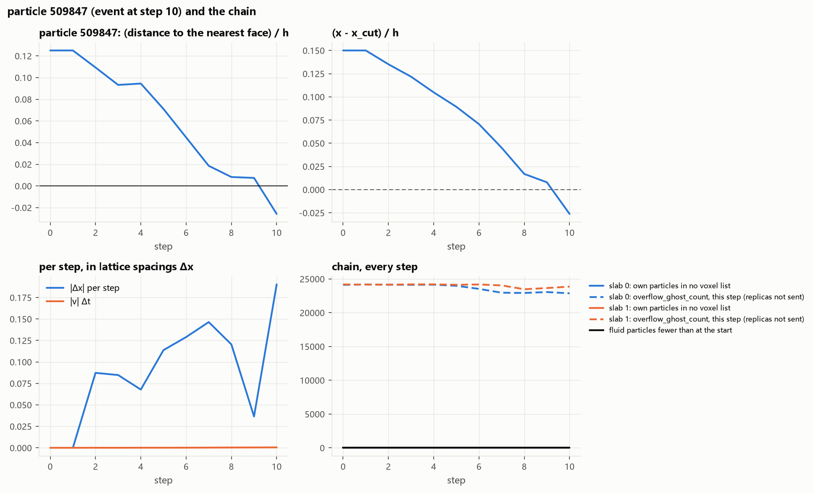

**为什么那里会被推**：在出事粒子所在那张卡上看，分界面另一侧的邻居有一大块不在。

- 第 10 步，主粒子在支撑半径内本该有 267 个邻居（两张卡的自有粒子按位置算），它所在卡的体素表里只有 145 个；缺的 122 个是 68 个壁面粒子和 54 个流体粒子，全都属于另一张卡、位于这张卡的 ghost 列里、这张卡上没有它们的副本。前两步也一样（缺 113 个和 74 个）。邻居清单在 `report/neighbours.csv`。
- 每张卡每一步大约有 24,000 个副本没有发出去（`overflow_ghost_count` 的增量，起步那一步就是 24,116 / 24,180）。副本区每层只有 44,591 个位置（每体素 46.4 个，`V7_GHOST_POOL_FACTOR = 0.29`），而一个 ghost 列里有约 56,000–57,000 个粒子（流体加壁面）。所以每张卡每个 ghost 列都缺约 21 %。
- 缺的是整个体素（下图深色格子是整格没有副本）。在两张卡的内层 ghost 列（紧挨着自有列的那一列）里，缺口集中在 z 大的那一侧：z 最高的四分之一里缺 69 %（卡 0）和 50 %（卡 1），其余部分只缺 5 % 和 10 %。出事粒子都落在这片缺口里，所以事件都在 z+ 侧壁附近。
- 粒子位移修正把粒子从粒子密的地方推向粒子稀的地方。在出事粒子看来，分界面另一侧和头顶的壁面粒子缺了一大块，那里“稀”，所以它被推向分界面、推进壁面层。压力也一样：缺邻居让密度和压力梯度失真，分界面上出现上千 m/s² 的加速度。

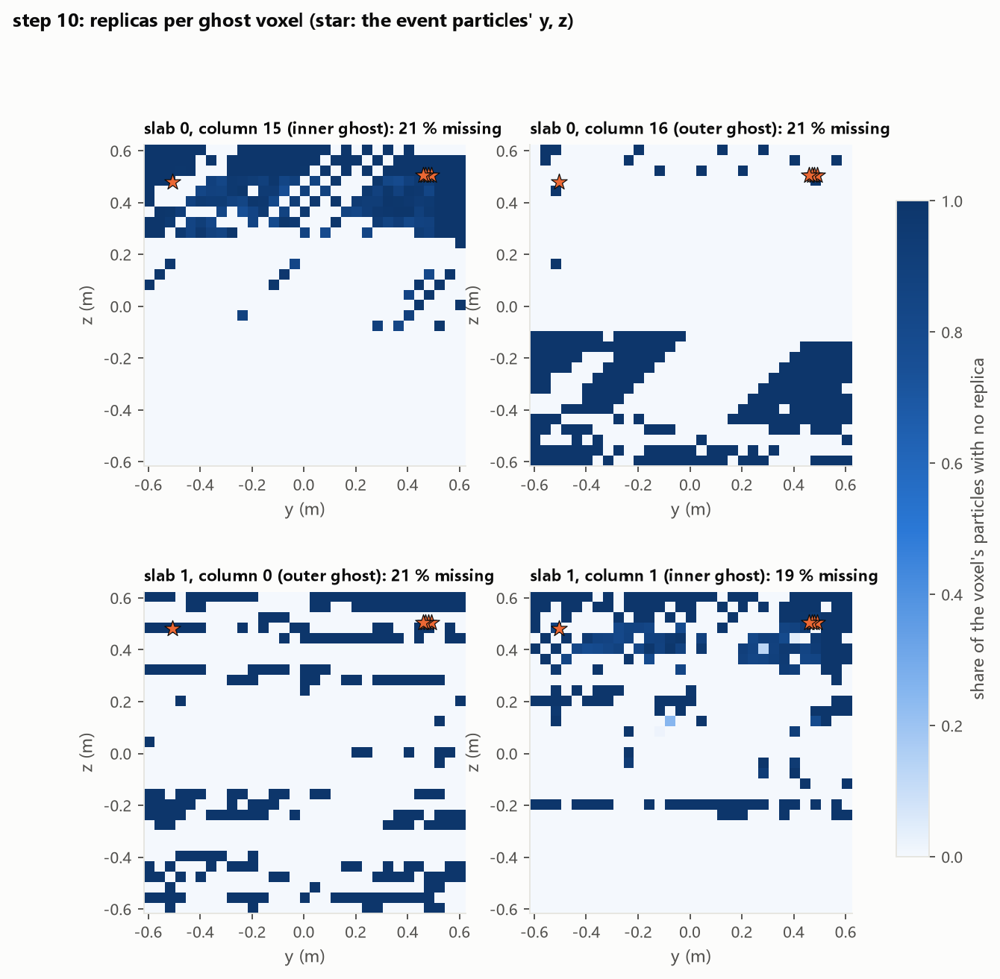

**对照一（simple）一样**：第 8 步，缺邻居 124 个（67 壁面、57 流体，都是没有副本），内层 ghost 列的缺口同样集中在 z 高的一侧（66 % / 63 %），最大单步位移和位移修正同样出在分界面上。所以这与壁面模式无关。

**对照二（单卡）**：同一个算例在单卡上，前 10 步的最大单步位移从 3e-8 长到 1.3e-5 m、最大位移修正从 9e-9 长到 8e-6 m，最大加速度 17–822 m/s²，都出在顶盖与侧壁的交线上；700 步内最大单步位移也只有 3.0e-5 m。双卡在同样的前 10 步里，位移修正一开始（第 0 步，起步之后）就是 1e-3 m，单步位移 1e-3 到 6e-3 m，加速度 3,000–13,000 m/s²，都在分界面上：大 100 到 1000 倍，位置也不同。所以双卡分界面上的这股推力是双卡才有的。

**我加的对照 A：同一个工具，只把副本区系数改成 3-D 的代码缺省 0.5**（`--env V7_GHOST_POOL_FACTOR=0.5`，其余照旧，crossing，双卡）：

- 分区器不再警告；跑完 700 步，没有事件。1,685,159 个粒子都在；副本区、出发区、迁移区、远距迁移的计数全为 0；全程只有 101 次正常的迁移。
- 每一步记录的最大单步位移（3.03e-5 m）、最大位移修正（2.78e-5 m）、最大加速度（822 m/s²）、离盒面最近（0.0029 m）和最大速度（0.446），三位有效数字上都与单卡（对照二）相同。
- 700 步后的全部粒子与单卡比：差别与单卡自己跑两次之间一样大（下表；3-D 不逐位重复，所以只能这样比）。这也就是第 19 节没做成的 3-D K = 1 对 K = 2 比较，不过不是逐位的。第 19 节那两次单卡转储是在冻结检出 `vulkan-demo-wall-crossing-run`（`f6ee476`）上跑的，求解器的 Python 文件和着色器与现在相同（`git diff f6ee476 d94c26c` 在这两处为空；表里 Python 文件的哈希不同，是因为哈希取的是工作区字节，那个检出是 CRLF 换行）。

| 比较 | 存活粒子 | 位置差 均方根 / 最大（m） | 速度差 均方根 / 最大（m/s） | 密度差 均方根 / 最大（kg/m³） | 提交 |
|---|---|---|---|---|---|
| K = 1 对 K = 1（第 19 节的两次） | 1685159 / 1685159 | 1.92e-07 / 5.69e-06 | 7.08e-07 / 1.67e-04 | 1.57e-05 / 2.44e-04 | f6ee476 / f6ee476（SPIR-V 48c8ed53 / 48c8ed53） |
| K = 1（对照二）对 K = 1（第 19 节） | 1685159 / 1685159 | 1.91e-07 / 4.41e-06 | 7.18e-07 / 1.26e-04 | 1.57e-05 / 1.83e-04 | 1c0cbeb / f6ee476（SPIR-V 48c8ed53 / 48c8ed53） |
| K = 2、副本区系数 0.5（对照 A）对 K = 1（对照二） | 1685159 / 1685159 | 1.96e-07 / 1.08e-05 | 6.88e-07 / 9.83e-05 | 1.56e-05 / 1.22e-04 | 1c0cbeb / 1c0cbeb（SPIR-V 48c8ed53 / 48c8ed53） |
| K = 2、副本区系数 0.5（对照 A）对 K = 1（第 19 节） | 1685159 / 1685159 | 1.95e-07 / 1.06e-05 | 7.16e-07 / 1.17e-04 | 1.56e-05 / 1.83e-04 | 1c0cbeb / f6ee476（SPIR-V 48c8ed53 / 48c8ed53） |

**我加的对照 B：小算例（48³），双卡，副本区系数 0.5**：在第 657 步停下，48 个流体粒子越过 y− 面（最深 2.3e-5 m）。这是另一个机理，见下一段：这 48 个都是下面说的“留在 ghost 列里的粒子”。

**另一个机理（小算例：分界面恰好落在一层粒子上）**：开发监视时在 3-D 小算例的双卡上试跑了三次（副本区系数 0.29），后来又有对照 B（0.5）。那里分界面 x = 0.03125 正好落在一层流体粒子上：

- 第 1 步，这一层 2,304 个粒子在单精度分箱下落进 ghost 列，一齐成为迁移粒子。接收方的迁移区每个方向只有 720 个位置，装下了 716–720 个；没装下的 1,584 个记进发送方的 `overflow_ghost_count`（对照 B 第 1 步卡 1 的增量正好是 1,584），出发区（180 个位置）也溢出了 540 个。
- 没发出去的粒子留在发送方，仍算它的自有粒子，但位于 ghost 列、不在任何体素表里：密度和力都不再计算它们，别的粒子也不把它们当邻居。积分照常进行，所以它们带着第 1 步的加速度一直加速（对照 B 里主粒子 57600 每步位移正好等于 |v|Δt，速度长到 0.44 m/s）。只有在它们换到另一个体素时才会被重新发出：对照 B 里第 578、579、615 步分别走了 306、44、44 个，到第 657 步还剩 1,190 个。
- 对照 B 的 48 个出事粒子都是这种粒子（在卡 1 的内层 ghost 列，离分界面 0.013 m，不在任何体素表里），它们一路滑到底面 y−。开发试跑里（0.29）副本区也溢出，第一个事件来得早得多（第 14、22、13 步）。试跑 2 的出事粒子是被位移修正推着走的普通粒子，旁边有这种粒子；试跑 3 的出事粒子本身就是这种粒子：它每步移动 2.08e-3 m，正好等于它的位移修正向量的长度（这个向量在第 1 步算出后再没更新，每步都照样加上），13 步就到了 z− 面。（试跑 1 用的是最早的工具版本，现场里没有位移修正和加速度，整理工具读不了它，表里“出事粒子”一栏空着。）
- 1M 方腔的分界面（x = −0.016）不在粒子层上，三次正式运行和对照 A 里都没有这种粒子（表中 0 / 0）。

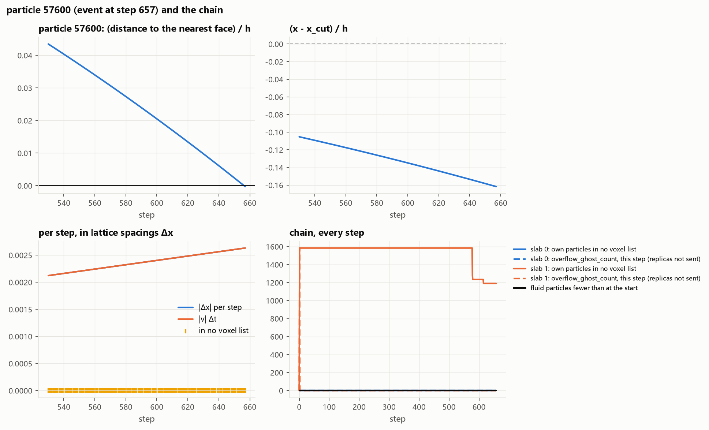

### 20.6 现场文件

每次停下的现场在 `C:\Users\cchen\PycharmProjects\vulkan-demo-wall-crossing\logs\wall_crossing\particle_watch\<运行名>\`（`logs/` 不入库）：

| 任务书 3.4 | 文件 |
|---|---|
| 1. 事件那一步两卡的全部粒子状态 | `report/event_state.npz`：每张卡的自有粒子和体素表引用的全部非自有行（副本、出发区副本），字段：卡、行号、类别（自有 / 前向副本 / 后向副本 / 出发区副本）、全局编号（副本按位置字节对回原粒子）、位置、速度、密度、压力、材料、体素号、位移修正、加速度、是否在体素表里。原始缓冲区在 `raw_step<步>.npz`（最后 3 步） |
| 2. 出事粒子 | `report/event_particles.json`：编号、位置、速度、密度、压力、所在卡、到分界面的距离、越过的面 / 棱 / 角、越过的那一步、所在列、是否在体素表里、环里的历史（每步位移对 |v|Δt） |
| 3. 那一步的邻居清单 | `report/neighbours.json` / `.csv`：主粒子所在卡上、它周围 27 个体素表里支撑半径内的每个邻居（编号、材料、本卡还是副本、距离），以及两卡自有粒子里在支撑半径内却不在表里的每一个和原因；最后 3 步各一份 |
| 4. 此前的轨迹 | `report/trajectories.npz`（主粒子周围 3 个支撑半径内的流体粒子，最近 128 步；本运行从第 0 步起都在）；`ring.npz` 是 4 个支撑半径内的 |
| 5. ParaView 和图 | `report/vtp/region_step<步>.vtp`（最后 3 步，带副本）、`region_step<步>_fluid_and_walls.vtp`（更早几步：流体和壁面）、`primary_path.vtp`（主粒子的路径）；`report/slice_*.png`、`history.png`、`replica_coverage.png`，也复制到了 `claude/wall_crossing/figures/particle_watch_<运行名>_*.png` |
| 6. 粒子数变少 | 三次都不是这种事件；`event_particles.json` 的 `vanished` 为空 |

另有每一步的记录 `watch_steps.jsonl`、副本覆盖 `report/replica_coverage.npz`、汇总 `report/summary.json`（也复制到 `claude/wall_crossing/particle_watch/`）。

### 20.7 初步判断（推测）

以下是推测，没有改代码去验证：

1. **3-D 双卡丢粒子的起点是副本区溢出，不是粒子穿壁本身。** 现有工具 `canonical_dump.py` 把环境换成 `cavity_runner.RELEASE_ENVIRONMENT`，里面是 2-D 的发布值 `V7_GHOST_POOL_FACTOR = 0.29`（还有 `V7_MIGRANT_POOL_FACTOR = 0.05`、`V7_DEPARTED_FACE_FRACTION = 0.8`）。代码在 3-D 的缺省是 0.5 / 0.02 / 0.64（`partition_v7.RELEASE_POOL_DEFAULTS`）。0.29 在 3-D 给每体素 46.4 个副本位置，装不下 h/dx = 4 时一个体素约 64 个粒子；分区器在运行前就打印了警告（第 19 节表里的“46.4 对 76.8”）。
2. **然后是一条链**：副本缺整格体素 → 分界面两侧的粒子缺邻居（缺的有壁面粒子）→ 密度、压力梯度和位移修正失真 → 分界面上出现上千 m/s² 的加速度和每步 0.1 个间距的位移修正 → 粒子被推进壁面层、在两卡之间来回换卡 → 迁移和出发区的数量暴涨（第 7–10 步出发区已经溢出 24–419 个）。第 19 节 700 步后丢掉六成粒子，我推测是这条链往后走的结果（远距迁移 474 / 421、出发区溢出 3,492 / 3,315 都记在那次的转储里）；监视按要求停在第一个事件，后面丢粒子的那一步本节没有看到，**未验证**。
3. **它与 crossing 无关**：simple 在同一个位置、同一步数出同样的事件。第 19 节说的“现有工具在 3-D 双卡上丢粒子，simple 也一样”就是这个。
4. **生产路径可能没有这个问题**：`box_run.py` / `chain_runner.py` 不覆盖这三个变量，用的是 3-D 缺省（每体素 80 个位置 ≥ 76.8）；第 4、19 节 3-D 双卡的接缝审计（同样不覆盖这些变量）不变量全为 0。对照 A 支持这一点：同一个工具只把副本区系数改成 0.5，双卡 700 步没有事件、没有任何溢出，结果与单卡的差别和单卡两次之间一样大。但对照 A 仍是 canonical 工具的流程，不是生产路径本身。
5. **小算例里的第二个机理**（20.5 末）：分界面落在粒子层上时，第 1 步的迁移数超过接收方迁移区，没发出去的粒子留在发送方的 ghost 列里、不在任何体素表里，带着冻结的加速度（和冻结的位移修正，开发试跑 3）漂走，只有换体素时才被重新发出。它与副本区大小无关：对照 B 用 0.5 照样出现，在第 657 步把粒子送进壁面层。迁移区由 `V7_MIGRANT_POOL_FACTOR` 定，3-D 的代码缺省 0.02 比工具用的 0.05 还小，所以生产路径上的迁移区更小（同一个小算例约 288 个位置；推算，没有跑）。发送方的 `overflow_ghost_count` 记下了这件事（canonical 工具到运行结束才查这些计数器）。这一条只在分界面恰好落在粒子层上的小算例上见到，**未验证**它在生产路径上会不会出现。

**我做的决定**

- **开关放在工具一侧**（`canonical_dump.py --watch` + 新模块 `particle_watch.py`），不放进求解器：任务书要查的是第 19 节那个工具上的现象，读回在 Python 一侧就能做到“只读不写”，不必改着色器或特化常量，也就不用重编 SPIR-V。关闭时工具走原来的代码路径。
- **3-D 的逐位核对改成两部分**：3-D 小算例 700 步上当前提交自己就不逐位重复（1 步就开始），所以用“与构建自身散布比”回答；另在 2-D 250² 上（K = 1 和 K = 2，这个算例逐位重复）做了真正的逐位核对。参照另建了一个检出 `vulkan-demo-wall-crossing-ref`（停在 `d94c26c`，只用来跑参照），没有动别的检出。
- **复现跑了两次**：第一次之后我给每步日志加了三项（最大单步位移、最大位移修正、最大加速度，带位置），好让单卡对照能逐步比；为了三次运行用同一版工具，复现用新版本重跑了一次，两次都报告。
- **单卡对照跑 700 步**（任务书说“步数与复现那次相同”；复现请求的是 700 步、在第 10 步停下，700 步覆盖了它）。
- **盒子判据用严格越过**（坐标 < 下界或 > 上界），与第 19 节 `box_run.py` 的“距离 ≤ 0”只差恰好落在面上的点。
- **加了两个任务书里没有的对照**（A、B），只用工具已有的 `--env` 把副本区系数设成 3-D 的代码缺省 0.5，其余照旧；不改代码、不改缺省值。目的是检验第 1 条推测。
- **环保留 128 步**（任务书要至少 100 步），原始缓冲区保留 3 步；1M 方腔时约 5 GB 内存。
- **复现与对照停下时都还没有少粒子**，所以“粒子数变少”那一项的现场（3.4 第 6 条）没有可写的；没有为了看到丢粒子而让运行越过第一个事件继续跑（任务书要求停）。

**没做或没验证的**

1. 第 19 节 700 步后丢掉的那六成粒子是在哪一步、经哪个计数器丢的：监视按要求停在第一个事件（第 8–10 步，还没少粒子），**未验证**。要看的话，可以让监视只在“粒子数变少”时停（需要用户同意改停止条件）。
2. 3-D 小算例单卡两次之间不逐位相同的原因（1 步后校正矩阵、核梯度和、位移修正就差最后几位，而位置、速度、密度相同），**未验证**。
3. 生产路径（`box_run.py` / `chain_runner.py`，3-D 缺省的池大小）在 3-D 双卡上长时间跑会不会出事件：本节没有跑，**未验证**；第 4、19 节只有接缝审计。
4. 分界面落在粒子层上时迁移超出迁移区、多出的粒子留在 ghost 列里的情况（20.5 末），只在小算例上看到（开发试跑和对照 B，都是 canonical 工具），生产路径上**未验证**。
5. 监视只在 `canonical_dump.py` 里接了；`box_run.py` 等其他运行器没有接。
6. `.vtp` 文件按 VTK XML 格式写成 ASCII，我核对了结构（点数和各数组长度一致），但本机没有 ParaView，**没有在 ParaView 里打开过**。

## 21. 追加（十六）：体素网格整体偏移，避免体素边界压在粒子层上（2026-11-19）

用户的任务书：只做一件事。载入算例时，如果某个方向上有粒子层正好压在体素边界上，就把网格原点在这个方向上挪开一点；缓冲区大小、溢出处理和其他缺省值都不动。只跑几分钟的测试，看第 20 节的问题还会不会出现，写进报告后停下。

> **本节的状态**：做完了，停在这里等用户看。改动只在本地提交（`3792010` 和加入本节的提交），没有推送。没有改缓冲区系数、溢出处理、着色器或别的缺省值。

**先说结果**

- **改了什么**：`case_loader_v7.py` 里原点照旧先算出来，然后逐个方向量“初始粒子离体素边界最近的距离”（单位 dx）。小于 0.25 dx 的方向，把原点往负方向挪 δ（0 < δ ≤ 0.5 dx，取使这个距离最大的 δ）；其他方向原点和体素数与原来完全相同。每次载入打印三行。
- **与任务书预计不同的一点**：2-D 方腔 250² **挪了**。它每个体素里有 5 层粒子（h = 5 dx），按原来的原点，每 5 层里有一层离体素边界只有 0.1 dx，小于 0.25 dx，所以 x、y 都挪了 0.4 dx（之后最近距离 0.5 dx）。500² 和 1000² 一样。所以任务书第 3 节第 2 项（与当前提交逐位相同）按任务书的规定没有做；我做了一个替代的检查（新网格上自己跑两次逐位相同，与旧网格的差别和旧网格单卡对双卡的差别同一量级）。
- **1M 3-D 方腔没挪**：三个方向的最近距离都是 0.4 dx。所以第 4 项没有跑。
- **48³ 静水盒（重力倾斜）挪了半个间距**：三个方向都从 0 挪到 0.5 dx。
- **复现那次问题**（48³，crossing，双卡，监视打开，3-D 缺省的三个缓冲区系数，700 步）：**没有事件**。初始化时被挤回本卡一侧的粒子 0 个；第 1 步迁移 0 个，整个 700 步也是 0 个；全部 overflow 计数为 0；没有任何自有粒子落在 ghost 列或不在体素表里。同样的设置在旧网格上（我加的对照）又在第 657 步出事件：第 1 步 2,304 个粒子要迁移，只装下 288 个，剩下 2,016 个留在 ghost 列里。

### 21.1 改了什么

只改了 `experiment/v7/utils/case_loader_v7.py`：新函数 `_place_grid_origin`，由 `load_case_v7` 代替原来直接调用的 `_compute_grid`；`_compute_grid` 本身没改。

1. 原点先照原来的式子算。注意：**原来的式子取的是 `frame.obj` 顶点的最小值 − 0.5 h**，不是任务书说的“所有粒子坐标的最小值 − 0.5 h”；体素数也由 `frame.obj` 的跨度定。这一步照原样保留。
2. 对 x、y、z（2-D 只看 x、y），用全部初始粒子（流体和壁面）的坐标算“到最近的体素边界（原点 + k h）的最小距离”，除以粒子间距 dx = 2 × `physics.particle_radius`。
3. 小于 0.25 dx 的方向：在 (0, 0.5 dx] 里等距取 200 个候选 δ（步长 0.0025 dx），逐个算这个最小距离，取最大的那个（并列时取最小的 δ），原点在这个方向上减去 δ。点阵算例里结果正是体素边界落在两层粒子正中间（最小距离 0.5 dx）。
4. 不小于 0.25 dx 的方向不动：原点和体素数与原来完全相同。
5. 挪动后检查这个方向上网格 [原点, 原点 + 体素数 × h) 仍包住全部粒子和 `frame.obj` 的包围盒，不够就加一个体素。本节的五个算例都不需要加。
6. 每次载入打印三行：各方向挪动前、后的最小距离（单位 dx）和 δ。最近一次的结果也放在模块变量 `LAST_GRID_PLACEMENT` 里，只供诊断，求解器不读它。

**原点只按算例的初始数据算**（`frame.obj` 和初始粒子）。查过续跑的路径：`restart_init`、`box_run.py --resume`、`cavity_runner` 续跑都重新载入算例、用算例的网格，没有按当前粒子位置重算原点的地方，所以不用改（续跑旧运行时的情况见文末第 2 条）。双卡的分界按体素列定，跟着原点一起移动（48³ 的分界从 x = 0.03125 移到 x = 0.02083，正好在两层粒子中间）。crossing 的流体盒按流体粒子算，不受影响。

### 21.2 测试 1：各算例的最小距离和 δ

| 算例 | 方向 | 改前：离体素边界最近（dx） | 改后（dx） | δ（dx，向负方向） | 加的体素 | 原点（m） | 体素数 | h / dx |
|---|---|---|---|---|---|---|---|---|
| lid_driven_cavity_2d_n250_xi0p001_eps0p0025_crossing | x | 0.1000 | 0.1000 | 0.0000 | 0 | -0.556400 → -0.556400 | 56 → 56 | 5.00 |
| lid_driven_cavity_2d_n250_xi0p001_eps0p0025_crossing | y | 0.1000 | 0.1000 | 0.0000 | 0 | -0.556400 → -0.556400 | 56 → 56 | 5.00 |
| lid_driven_cavity_2d_n500_xi0p001_eps0p0025_crossing | x | 0.1000 | 0.1000 | 0.0000 | 0 | -0.528200 → -0.528200 | 106 → 106 | 5.00 |
| lid_driven_cavity_2d_n500_xi0p001_eps0p0025_crossing | y | 0.1000 | 0.1000 | 0.0000 | 0 | -0.528200 → -0.528200 | 106 → 106 | 5.00 |
| lid_driven_cavity_2d_n1000_xi0p001_eps0p0025_crossing | x | 0.1000 | 0.1000 | 0.0000 | 0 | -0.514100 → -0.514100 | 206 → 206 | 5.00 |
| lid_driven_cavity_2d_n1000_xi0p001_eps0p0025_crossing | y | 0.1000 | 0.1000 | 0.0000 | 0 | -0.514100 → -0.514100 | 206 → 206 | 5.00 |
| cavity3d_1m_crossing | x | 0.4000 | 0.4000 | 0.0000 | 0 | -0.616000 → -0.616000 | 31 → 31 | 4.00 |
| cavity3d_1m_crossing | y | 0.4000 | 0.4000 | 0.0000 | 0 | -0.616000 → -0.616000 | 31 → 31 | 4.00 |
| cavity3d_1m_crossing | z | 0.4000 | 0.4000 | 0.0000 | 0 | -0.616000 → -0.616000 | 31 → 31 | 4.00 |
| hydrostatic_3d_n48_gtilt_crossing | x | 0.0000 | 0.5000 | 0.5000 | 0 | -0.635417 → -0.645833 | 15 → 15 | 4.00 |
| hydrostatic_3d_n48_gtilt_crossing | y | 0.0000 | 0.5000 | 0.5000 | 0 | -0.635417 → -0.645833 | 15 → 15 | 4.00 |
| hydrostatic_3d_n48_gtilt_crossing | z | 0.0000 | 0.5000 | 0.5000 | 0 | -0.635417 → -0.645833 | 15 → 15 | 4.00 |

- 2-D 250²、500²、1000²（同一个生成器，h = 5 dx）：改前每 5 层里有一层离边界 0.1 dx，x、y 都挪 0.4 dx，改后 0.5 dx。
- 1M 3-D 方腔（h = 4 dx）：三个方向都是 0.4 dx，不挪，原点和体素数不变。第 20 节里它的分界 x = −0.016 本来就在两层粒子（−0.02 和 −0.01）之间。
- 48³ 静水盒（h = 4 dx）：三个方向都有粒子层正好压在边界上（0 dx），挪 0.5 dx，改后 0.5 dx。

### 21.3 测试 2：逐位核对（没有做）

任务书规定“只有这个算例真的没挪时才做”，2-D 250² 挪了，所以没有做与当前提交的逐位比较。新网格上粒子的分箱全变了，与旧网格逐位相同本来也不可能。

我改做了下面的检查（我加的，不是任务书的那一项），2-D 250² crossing，canonical，700 步：

| 比较（2-D 250² crossing，700 步，canonical） | 存活 | 结果 | 位置（x, y, z）差 均方根 / 最大（m） | 速度差 均方根 / 最大（m/s） | 密度差 均方根 / 最大（kg/m³） | 提交 |
|---|---|---|---|---|---|---|
| 新网格 K = 1 对 新网格 K = 1（跑两次） | 74529 / 74529 | 位置、速度、密度逐位相同 | 0.0e+00 / 0.0e+00 | 0.0e+00 / 0.0e+00 | 0.0e+00 / 0.0e+00 | 3792010 / 3792010 |
| 新网格 K = 1 对 旧网格 K = 1 | 74529 / 74529 | 不逐位相同 | 5.9e-08 / 2.3e-06 | 1.6e-06 / 2.1e-05 | 3.3e-05 / 1.8e-04 | 3792010 / d94c26c |
| 新网格 K = 2 对 旧网格 K = 2 | 74529 / 74529 | 不逐位相同 | 5.7e-08 / 2.0e-06 | 1.6e-06 / 2.2e-05 | 3.3e-05 / 1.8e-04 | 3792010 / d94c26c |
| 旧网格 K = 1 对 旧网格 K = 2（尺度） | 74529 / 74529 | 不逐位相同 | 1.7e-08 / 4.2e-07 | 1.0e-06 / 1.3e-05 | 2.3e-05 / 1.2e-04 | d94c26c / d94c26c |
| 新网格 K = 1 对 新网格 K = 2 | 74529 / 74529 | 不逐位相同 | 6.9e-09 / 2.1e-07 | 4.9e-07 / 8.7e-06 | 1.2e-05 / 6.1e-05 | 3792010 / 3792010 |

- 新网格上单卡跑两次逐位相同：新网格没有破坏这个算例的逐位重复。
- 新网格对旧网格（单卡、双卡各一）：位置差的均方根 6e-8 m、最大 2e-6 m，速度差均方根 1.6e-6 m/s，粒子一个不少。旧网格自己单卡对双卡的差别是 1.7e-8 / 4e-7 m 和 1.0e-6 m/s：新旧网格的差别比它大几倍，但同一量级，都是求和顺序不同带来的舍入差别在 700 步里的增长。

### 21.4 测试 3：复现那次问题（48³，crossing，双卡）

设置：`canonical_dump.py --solver v7 --canonical-lists --transport-extension --watch`，双卡（设备 0、1），700 步，缓冲区用 3-D 缺省（`--env V7_GHOST_POOL_FACTOR=0.5 --env V7_MIGRANT_POOL_FACTOR=0.02 --env V7_DEPARTED_FACE_FRACTION=0.64`）。同样的设置在旧网格上也跑了一次（我加的对照，用 `vulkan-demo-wall-crossing-ref` 检出，停在 `94eccdd`：旧的载入器加第 20 节的监视）。

| 网格 | 结果 | initialization_seam_clamp_count（卡 0 / 1） | 第 1 步迁入（卡 0 / 1） | 全程迁入 | overflow 计数（到最后一步，卡 0 / 1） | 最多时不在任何体素表里的自有粒子 | 最大速度 | 最大单步位移（m） | 记录 |
|---|---|---|---|---|---|---|---|---|---|
| 新网格（原点挪 0.5 dx） | 跑完 700 步，没有事件 | 0 / 0 | 0 / 0 | 0 / 0 | 全为 0 | 0 / 0 | 0.045 | 2.8e-05 | wc-20261119-172835-b8a9 |
| 旧网格（同样设置，我加的对照） | 第 657 步：48 个流体粒子越过盒面 | 0 / 0 | 288 / 0 | 854 / 466 | overflow_ghost_count 0 / 2140；overflow_departed_count 0 / 286 | 0 / 2016 | 0.821 | 1.6e-03 | wc-20261119-173113-922e |

- **新网格：没有事件**，700 步跑完，195,112 个粒子都在。
  - 初始化时被挤回本卡一侧的粒子（`initialization_seam_clamp_count`）：0 / 0。
  - 第 1 步迁移 0 个；整个 700 步一个迁移也没有（重力倾斜的静水盒，粒子几乎不动）。
  - 全部 overflow 计数（副本、体素表、迁入、安装、出发区、远距迁移、戳错误）都是 0；没有自有粒子落在 ghost 列或不在任何体素表里；最大速度 0.045，最大单步位移 2.8e-5 m。
- **旧网格（同样的三个系数）：第 657 步出事件**，48 个流体粒子越过 y− 面，与第 20 节对照 B 的那次是同一批、同样深。
  - `initialization_seam_clamp_count` 在旧网格上也是 0：分界上那层粒子初始化时就分在卡 1 的自有列里，不需要挤回；但它们正压在边界上，第 1 步只要往 −x 动一点点就落进 ghost 列。
  - 第 1 步卡 1 发出 288 个迁移粒子（3-D 缺省下迁移区正好 288 个位置，第 20 节推算过），没发出去的 2,016 个留在卡 1 的 ghost 列里、不在任何体素表里；卡 1 的 `overflow_ghost_count` 到第 657 步累计 2,140，`overflow_departed_count` 286。
  - 第 20 节对照 B 用的是 0.5 / 0.05 / 0.8（只改了副本区系数），那次迁移区有 720 个位置、留下 1,584 个；这次三个系数都是 3-D 缺省，留下的更多，事件仍在第 657 步。所以任务书说的“上次同样的设置”与上次并不完全相同；这次的旧网格对照才是完全相同的设置。

### 21.5 测试 4（没有跑）

1M 方腔没有任何方向挪动，按任务书不跑。

**我做的决定**

- **原点的起点照原代码**（`frame.obj` 的最小值 − 0.5 h），没有改成“所有粒子坐标的最小值 − 0.5 h”：任务书描述的“现在”与代码不一致，任务书要的是在现有原点上挪动，改起点会让不需要挪的方向也变，违反第 4 条。
- **候选 δ 取 200 个**（(0, 0.5 dx] 等距，步长 0.0025 dx），并列时取最小的 δ。
- **包住的检查同时检查 `frame.obj` 的包围盒**（不只是粒子）：原来的网格是按 `frame.obj` 定大小的，挪动后保留这个保证。只在挪动的方向检查，不挪的方向体素数一定不变。
- **测试 2 改做替代检查**（21.3），因为 2-D 250² 挪了。
- **测试 3 加了旧网格的对照**：任务书说的“上次”只改了副本区系数，与这次的三个 3-D 缺省系数不完全相同，所以用完全相同的设置在旧网格上再跑一次。参照检出 `vulkan-demo-wall-crossing-ref` 从 `d94c26c` 切到了 `94eccdd`（第 20 节建的、只用来跑参照的检出）。
- **测试 1 的表多放了 2-D 500² 和 1000²**，看这个改动波及哪些已有算例。

**没做或没验证的**

1. 测试 2（2-D 250² 与当前提交逐位相同）没有做，原因见 21.3；做的是替代检查。
2. **这个改动影响已有的 2-D 方腔算例**：250²、500²、1000² 都挪了 0.4 dx。第 1–20 节里这些算例的结果都是旧网格上的；从 `3792010` 起再跑，结果与以前不逐位相同（物理上应当一样，**未验证**）。用旧检查点续跑：`cavity_runner` 比较求解器 Python 文件（含 `case_loader_v7.py`）的哈希，不同就拒绝续跑，所以旧的方腔运行用新代码续不了，要续就用它当时的检出（第 19 节 1000² 是在冻结检出 `vulkan-demo-wall-crossing-run` 上跑的，那里还是旧网格）；`box_run.py --resume` 不比较哈希，会在新网格上接着跑，续跑段与原运行不逐位连续。其他算例（`cases/` 里别的 2-D、3-D 算例）有没有挪，没有逐个查。
3. `experiment/validation/cavity_fields.py` 画分界线时自己按旧式子算原点（第 497 行），在挪了 x 的算例上，图上的分界线会差 δ（250² 是 0.0016 m）。它不在本任务允许改的范围里，没有改。
4. 测试 4 没跑（1M 没挪）。1M 方腔在第 20 节的问题是副本区系数，与这个改动无关。
5. 生产路径（`box_run.py` / `chain_runner.py`）上没有跑新网格；本节的运行都是 canonical 工具。
6. 缓冲区和溢出处理没动：这个改动去掉的是“一整层粒子压在分界上、第 1 步一起过界”这个触发条件。如果别的原因让一大批粒子在一步里同时过分界、超过迁移区，没发出去的粒子仍会留在 ghost 列里、不被计算（第 20 节的机理），**未验证**有没有这样的情形。

## 22. 追加（十七）：网格偏移门槛下调；近壁和内部分开计算；总体积修正改为按平均体积在 GPU 上规约；3-D 密度下降复测（2026-11-19）

用户的任务书：接着第 21 节做四件事。先把网格偏移的门槛从 0.25 dx 降到 0.05 dx，让 2-D 方腔回到原来的网格；A：离壁面远的粒子用不含 crossing 代码的版本计算，只有近壁粒子跑 crossing；B：总体积修正改成按平均每个粒子的体积算，在 GPU 上规约，目标值存进检查点；C：3-D 方腔关掉总体积修正，复测密度下降，按区域拆开。每个运行只跑几分钟，写进报告后停下。

> **本节的状态**：做完了，停在这里等用户看。改动都在本地提交（`73e3137`、`b8eaed5`、`606d2f5` 和加入本节的提交），没有推送。除第 22.1 节的门槛外没有改任何缺省值；A、B 的新功能都在新开关后面，缺省关闭。simple、adami 用的 SPIR-V 与基点逐字节相同；开关关闭时 crossing 与 `73e3137` 逐位相同（22.6）。

**先说结果**

- **网格门槛**：0.05 dx（配置项 `numerics.grid_boundary_clearance_minimum`）。2-D 方腔 250² / 500² / 1000² 和 1M 3-D 方腔 δ = 0；48³ 静水盒仍挪 0.5 dx。2-D 250² crossing 单卡、双卡 700 步，与 `3792010` 之前的 `94eccdd` 逐位相同（按结果类）。
- **A，近壁和内部分开**（`numerics.wall_crossing.split_dispatch`，缺省 false）：
  - 正确性：单卡第 1 步和第 700 步，内部粒子在两个版本下逐位相同（最大差 0），近壁粒子与开关关闭逐位相同；位置判断与查材料 700 步里不一致 0 次。双卡方式 2 逐位相同；方式 1 从第 60 步起有舍入级差别（原因是推测）。
  - 寄存器：内部版本回到 simple 的数（2-D 56 / 63，3-D 64 / 64），近壁版本与 crossing 相同（72 / 80，80 / 96）。
  - 近壁体素里的流体占比：250² 8.6 %，1000² 2.2 %，3-D 1M 24.4 %。
- **A 的计时**（相对基线 simple 的每步时间）：

  | 算例 | 开关关 | 开关开 |
  |---|---|---|
  | 2-D 1000² 单卡 | 1.418 | 1.144 |
  | 3-D 1M 单卡 | 1.367 | 1.171 |
  | 2-D 250² 单卡 | 1.315 | 1.888（更慢：问题太小，两次调度各占一个延迟） |
  | 3-D 1M 双卡 | 1.386 | 方式 1 1.282，方式 2 1.433 |

  双卡负载较重的那张卡上，传输都藏住了（B → C 空等 6–9 µs）。
- **B，平均体积在 GPU 上规约**（`numerics.volume_constraint.gpu_mean_volume`，缺省 false）：
  - 同一状态下 GPU 规约与主机双精度的 θ 最大差 6.5e-13（2-D 250²、48³，单卡、双卡）。
  - 同一检查点在双卡与单卡上续跑，第一次更新的 θ 差 1.3e-15。
  - 续跑后 v_ref 逐位相同；旧检查点打印警告并重算出同一个 v_ref。
- **C，3-D 密度下降**（1M 3-D 方腔，crossing 缺省，总体积修正关，到 t = 1.02）：
  - 粒子数全程不变，overflow 全为 0。平均密度降 0.0068 %，窗口 t = 0.24 – 0.96 内平均每秒降 0.055 kg/m³。
  - 四项之和 −0.088，其中 80 % 来自内部（支撑半径内没有壁面）的连续性项。每个该区域粒子的下降速率各区域相近（−0.05 到 −0.09 kg/m³/s），不集中在棱和角上。
  - 实际存储的变化比四项之和少，差额是 float32 存储的舍入，后半段更大。
- **开关关闭时**与 `73e3137` 逐位相同（按结果类）；simple / adami 的 SPIR-V 与基点逐字节相同。

### 22.1 先做：网格偏移门槛下调

**改动**（`73e3137`）：`case_loader_v7.py` 的门槛做成配置项 `numerics.grid_boundary_clearance_minimum`（单位 dx，缺省 0.05，只接受 0 到 0.5），由 `_place_grid_origin` 读；其余规则（候选 δ、最多 0.5 dx、必要时加一个体素、打印三行）不变。`cavity_fields.py` 画分界线时改为用这次运行的求解器对应的载入器载入算例，取它给出的原点（`loaded_grid_origin_x`），不再自己按 `frame.obj` 算。

**检查 1：各算例的打印**

| 算例 | 方向 | 改前：离体素边界最近（dx） | 改后（dx） | δ（dx，向负方向） | 加的体素 | 原点（m） | 体素数 | h / dx |
|---|---|---|---|---|---|---|---|---|
| lid_driven_cavity_2d_n250_xi0p001_eps0p0025_crossing | x | 0.1000 | 0.1000 | 0.0000 | 0 | -0.556400 → -0.556400 | 56 → 56 | 5.00 |
| lid_driven_cavity_2d_n250_xi0p001_eps0p0025_crossing | y | 0.1000 | 0.1000 | 0.0000 | 0 | -0.556400 → -0.556400 | 56 → 56 | 5.00 |
| lid_driven_cavity_2d_n500_xi0p001_eps0p0025_crossing | x | 0.1000 | 0.1000 | 0.0000 | 0 | -0.528200 → -0.528200 | 106 → 106 | 5.00 |
| lid_driven_cavity_2d_n500_xi0p001_eps0p0025_crossing | y | 0.1000 | 0.1000 | 0.0000 | 0 | -0.528200 → -0.528200 | 106 → 106 | 5.00 |
| lid_driven_cavity_2d_n1000_xi0p001_eps0p0025_crossing | x | 0.1000 | 0.1000 | 0.0000 | 0 | -0.514100 → -0.514100 | 206 → 206 | 5.00 |
| lid_driven_cavity_2d_n1000_xi0p001_eps0p0025_crossing | y | 0.1000 | 0.1000 | 0.0000 | 0 | -0.514100 → -0.514100 | 206 → 206 | 5.00 |
| cavity3d_1m_crossing | x | 0.4000 | 0.4000 | 0.0000 | 0 | -0.616000 → -0.616000 | 31 → 31 | 4.00 |
| cavity3d_1m_crossing | y | 0.4000 | 0.4000 | 0.0000 | 0 | -0.616000 → -0.616000 | 31 → 31 | 4.00 |
| cavity3d_1m_crossing | z | 0.4000 | 0.4000 | 0.0000 | 0 | -0.616000 → -0.616000 | 31 → 31 | 4.00 |
| hydrostatic_3d_n48_gtilt_crossing | x | 0.0000 | 0.5000 | 0.5000 | 0 | -0.635417 → -0.645833 | 15 → 15 | 4.00 |
| hydrostatic_3d_n48_gtilt_crossing | y | 0.0000 | 0.5000 | 0.5000 | 0 | -0.635417 → -0.645833 | 15 → 15 | 4.00 |
| hydrostatic_3d_n48_gtilt_crossing | z | 0.0000 | 0.5000 | 0.5000 | 0 | -0.635417 → -0.645833 | 15 → 15 | 4.00 |

2-D 250²、500²、1000²：离体素边界最近 0.1 dx，不小于 0.05 dx，δ = 0，原点和体素数回到第 21 节以前。1M 3-D 方腔：0.4 dx，δ = 0。48³ 静水盒：0 dx，仍挪 0.5 dx（与第 21 节相同）。

**检查 2：2-D 250² crossing，单卡和双卡各 700 步，与 `3792010` 之前那个提交（`94eccdd`）逐位比较**。700 步 crossing 的结果每次运行会落进少数几个结果类（粒子开始换体素后原子操作的次序不同，第 14 节），所以按结果类比：两边各跑 4 次，比全部字段的字节。

| 卡数 | 结果类（字段字节的 sha256） | `reference_94eccdd` | `threshold_0p05` |
|---|---|---|---|
| K = 1 | `b65a33c0554d` | r1, r3, r4 | r4 |
| K = 1 | `1d3f1d0702b5` | r2 | r1, r2, r3 |
| K = 1 | **2 类** | 4 次 | 4 次 |
| K = 2 | `40240f4c3f14` | r1, r2, r3, r4 | r1, r2, r3, r4 |
| K = 2 | **1 类** | 4 次 | 4 次 |

单卡两个结果类、双卡一个结果类，每一类里两个提交都有运行：门槛下调后的结果就是 `94eccdd` 的结果。

**检查 3**：48³ 静水盒的 δ 与第 21 节相同（三个方向 0.5 dx），第 21 节测试 3 的结论照旧适用，没有重跑。

### 22.2 A：近壁和内部分开计算（`numerics.wall_crossing.split_dispatch`，缺省 false）

**近壁体素的标记**（新着色器 `wall_crossing_near_wall_marker.comp`，照 `deep_wall_marker.comp` 的做法；新缓冲区 set 1 binding 9 `wall_crossing_near_wall_voxel_flag`，2 × 体素容量个 uint，只在开关打开时有）：

1. 第一遍：每个扩展体素（自有列和 ghost 列）记它的粒子表里有没有壁面粒子。ghost 体素用它自己的表，也就是交换来的副本。
2. 第二遍：3^d 个相邻体素（`in_own_grid`）里任一个有壁面，这个体素就是近壁体素。

壁面不动，所以只在三处记录这两遍：单卡初始登记之后（`_record_bootstrap_compute_cmd`，ghost 表展开之后）；多卡也在同一处，那时第一次交换的副本已经装进 ghost 表；续跑之后（`restart_init`，壁面外推之后）。多卡续跑时 ghost 表在第一步之前是空的，所以我在 `ChainOrchestratorV7.restart_all` 里加了一轮只交换副本、不装迁移粒子的交换（`restart_replica_round_send` / `restart_replica_round_mark`），之后再标记。有会动的边界（材料种类 inlet / rotor）时报 ValueError。

近壁体素里的流体粒子占比（初始状态；`split_dispatch.py near-wall`）：

| 算例 | 流体粒子 | 其中在近壁体素里 | 比例 | 近壁体素 / 全部体素 | 不在近壁体素里的壁面粒子（应为 0） | 记录 |
|---|---|---|---|---|---|---|
| lid_driven_cavity_2d_n250_xi0p001_eps0p0025_crossing | 63,001 | 5,401 | 8.57 % | 832 / 3,136 | 0 | wc-20261119-182039-c4e5 |
| lid_driven_cavity_2d_n1000_xi0p001_eps0p0025_crossing | 1,002,001 | 21,901 | 2.19 % | 3,232 / 42,436 | 0 | wc-20261119-182041-bde0 |
| cavity3d_1m_crossing | 1,030,301 | 251,613 | 24.42 % | 17,624 / 29,791 | 0 | wc-20261119-182044-af6e |

每个算例都检查了“不在近壁体素里的壁面粒子”为 0，也就是壁面粒子全部由近壁版本处理。

**两个版本**（`compile_shaders_v7.py` 多编四个模块，照 `DEEP_WALL_SKIP` 变体的做法；原有模块逐字节不变）：

- 内部版本 `correction_density_wall_crossing_interior`、`force_wall_crossing_interior`（`-DWALL_CROSSING_INTERIOR`，不定义 `WALL_CROSSING`）：crossing 的代码全部编译掉，数学上与 simple 相同。只多两样：总体积修正打开时密度变化率加 ρ_i × rate（spec const 130 和 set 0 binding 15，与 crossing 相同）；不写只含流体邻居的逆矩阵。
- 近壁版本 `correction_density_wall_crossing_near_wall`、`force_wall_crossing_near_wall`（`-DWALL_CROSSING -DWALL_CROSSING_NEAR_WALL`）：现在的 crossing，只有一处不同：邻居是不是壁面粒子改用位置判断（在 crossing 的流体盒外就是壁面；3-D 也判断 z），不再每对读材料。
- 两个版本开头都读自己所在体素的标记：内部版本跳过近壁体素里的粒子，近壁版本跳过其余粒子，直接返回（新 spec const 131 `WALL_CROSSING_SPLIT_SELECTION`：1 = 只算自己那一类，0 = 每个粒子都算，后者只给 phase C 的方式 1 和诊断用）。

**寄存器数**（`VK_KHR_pipeline_executable_properties`，`pipeline_statistics.py`；基点 simple 在 `eda5b90` 的工作树里量）：

| 算例 | fused pass：simple（基点 eda5b90） | crossing（开关关） | 内部版本 | 近壁版本 | force：simple（基点） | crossing（开关关） | 内部版本 | 近壁版本 | 标记两遍 |
|---|---|---|---|---|---|---|---|---|---|
| 2-D 250² | 56（6,144 B） | 72（9,984 B） | 56（6,528 B） | 72（9,728 B） | 63（5,504 B） | 80（10,496 B） | 63（5,760 B） | 80（9,472 B） | 16（1,408 B） / 16（2,688 B） |
| 2-D 1000² | — | 72（9,984 B） | 56（6,528 B） | 72（9,728 B） | — | 80（10,496 B） | 63（5,760 B） | 80（9,472 B） | 16（1,408 B） / 16（2,688 B） |
| 3-D 1M | 64（7,552 B） | 80（12,288 B） | 64（7,424 B） | 80（12,288 B） | 64（6,016 B） | 96（10,112 B） | 64（6,144 B） | 96（10,112 B） | 16（1,408 B） / 24（3,200 B） |

内部版本的寄存器数正好回到 simple 的数（2-D 56 / 63，3-D 64 / 64），近壁版本与现在的 crossing 相同（2-D 72 / 80，3-D 80 / 96）。（第 6 节记的 crossing force 是 78（2-D）/ 72（3-D），是当时的代码；之后的完整方案把它们提高到了 80 / 96，本节量的是现在的数。）分界带管线在单卡时只有 256 字节、16 个寄存器：单卡不调度它们，编译器把主体去掉了。

**调度**：

- 单卡：fused pass 和 force 各调度两次，内部版本在前、近壁版本在后，两次都覆盖原来的粒子范围，中间不加同步屏障（两次写的是不同粒子的输出，只读前面各遍写的东西）。
- 多卡 phase B（`correction_density_interior`、`force_deep_interior_scratch`）同样拆成两次。
- phase C（分界带）：方式 1 只调度近壁版本（131 = 0，每个粒子都算）覆盖整个分界带；方式 2 也拆两次。环境变量 `V7_WALL_CROSSING_SPLIT_BAND_MODE=1|2` 选择，缺省方式 1。
- 不支持而报 ValueError 的组合：`V7_BAND_COMPACT_DISPATCH=1`；`V7_BAND_OVERLAP`；`V7_FAKE_BAND_TEST`；`V7_DENSITY_BUDGET=1`；二阶延拓（`viscous_extension` / `continuity_extension` 为 quadratic：内部版本不写 ∇v_i，近壁粒子要读邻居的）。
- 计时：开关打开时每次拆开的调度之间加一个时间戳（`<tick>_interior`），`bench_v7.compute_durations` 的单卡和双卡两种模式都能分开报两个版本的时间。

**正确性（3.5）**，2-D 250² crossing，canonical 转储（`split_dispatch.py compare`），粒子按全局网格上的体素分成内部流体和近壁流体：

| 比较 | 步数 | 粒子 | 个数 | 各量：逐位相同的行 / 行数，最大差（位置、速度、密度压力、加速度、位移修正、校正矩阵、密度梯度与核和） |
|---|---|---|---|---|
| 内部粒子：内部版本 对 近壁版本 | 1 | 内部流体 | 57600 | 位置 57600/57600 0.0e+00；速度 57600/57600 0.0e+00；密度压力 57600/57600 0.0e+00；加速度 57600/57600 0.0e+00；位移修正 57600/57600 0.0e+00；校正矩阵 57600/57600 0.0e+00；密度梯度与核和 57600/57600 0.0e+00 |
| 内部粒子：内部版本 对 近壁版本 | 1 | 近壁流体 | 5401 | 位置 5401/5401 0.0e+00；速度 5401/5401 0.0e+00；密度压力 5401/5401 0.0e+00；加速度 5401/5401 0.0e+00；位移修正 5401/5401 0.0e+00；校正矩阵 5401/5401 0.0e+00；密度梯度与核和 5401/5401 0.0e+00 |
| 内部粒子：内部版本 对 近壁版本（同一结果类） | 700 | 内部流体 | 57606 | 位置 57606/57606 0.0e+00；速度 57606/57606 0.0e+00；密度压力 57606/57606 0.0e+00；加速度 57606/57606 0.0e+00；位移修正 57606/57606 0.0e+00；校正矩阵 57606/57606 0.0e+00；密度梯度与核和 57606/57606 0.0e+00 |
| 内部粒子：内部版本 对 近壁版本（同一结果类） | 700 | 近壁流体 | 5395 | 位置 5395/5395 0.0e+00；速度 5395/5395 0.0e+00；密度压力 5395/5395 0.0e+00；加速度 5395/5395 0.0e+00；位移修正 5395/5395 0.0e+00；校正矩阵 5395/5395 0.0e+00；密度梯度与核和 5395/5395 0.0e+00 |
| 开关打开 对 开关关闭 | 1 | 内部流体 | 57600 | 位置 57600/57600 0.0e+00；速度 57600/57600 0.0e+00；密度压力 57600/57600 0.0e+00；加速度 57600/57600 0.0e+00；位移修正 57600/57600 0.0e+00；校正矩阵 57600/57600 0.0e+00；密度梯度与核和 57600/57600 0.0e+00 |
| 开关打开 对 开关关闭 | 1 | 近壁流体 | 5401 | 位置 5401/5401 0.0e+00；速度 5401/5401 0.0e+00；密度压力 5401/5401 0.0e+00；加速度 5401/5401 0.0e+00；位移修正 5401/5401 0.0e+00；校正矩阵 5401/5401 0.0e+00；密度梯度与核和 5401/5401 0.0e+00 |
| 开关打开 对 开关关闭（同一结果类） | 700 | 内部流体 | 57606 | 位置 57606/57606 0.0e+00；速度 57606/57606 0.0e+00；密度压力 57606/57606 0.0e+00；加速度 57606/57606 0.0e+00；位移修正 57606/57606 0.0e+00；校正矩阵 57606/57606 0.0e+00；密度梯度与核和 57606/57606 0.0e+00 |
| 开关打开 对 开关关闭（同一结果类） | 700 | 近壁流体 | 5395 | 位置 5395/5395 0.0e+00；速度 5395/5395 0.0e+00；密度压力 5395/5395 0.0e+00；加速度 5395/5395 0.0e+00；位移修正 5395/5395 0.0e+00；校正矩阵 5395/5395 0.0e+00；密度梯度与核和 5395/5395 0.0e+00 |
| 近壁版本处处 对 开关关闭（位置判断 对 查材料） | 1 | 内部流体 | 57600 | 位置 57600/57600 0.0e+00；速度 57600/57600 0.0e+00；密度压力 57600/57600 0.0e+00；加速度 57600/57600 0.0e+00；位移修正 57600/57600 0.0e+00；校正矩阵 57600/57600 0.0e+00；密度梯度与核和 57600/57600 0.0e+00 |
| 近壁版本处处 对 开关关闭（位置判断 对 查材料） | 1 | 近壁流体 | 5401 | 位置 5401/5401 0.0e+00；速度 5401/5401 0.0e+00；密度压力 5401/5401 0.0e+00；加速度 5401/5401 0.0e+00；位移修正 5401/5401 0.0e+00；校正矩阵 5401/5401 0.0e+00；密度梯度与核和 5401/5401 0.0e+00 |
| 近壁版本处处 对 开关关闭（同一结果类） | 700 | 内部流体 | 57606 | 位置 57606/57606 0.0e+00；速度 57606/57606 0.0e+00；密度压力 57606/57606 0.0e+00；加速度 57606/57606 0.0e+00；位移修正 57606/57606 0.0e+00；校正矩阵 57606/57606 0.0e+00；密度梯度与核和 57606/57606 0.0e+00 |
| 近壁版本处处 对 开关关闭（同一结果类） | 700 | 近壁流体 | 5395 | 位置 5395/5395 0.0e+00；速度 5395/5395 0.0e+00；密度压力 5395/5395 0.0e+00；加速度 5395/5395 0.0e+00；位移修正 5395/5395 0.0e+00；校正矩阵 5395/5395 0.0e+00；密度梯度与核和 5395/5395 0.0e+00 |

| 类（摘要） | 运行数 | 运行 |
|---|---|---|
| c7bb02493718 | 10 | off_s700、off_s700_r2、off_s700_r3、off_s700_r4、split_s700、split_s700_r3、split_s700_r4、near_s700_r2、near_s700_r3、near_s700_r4 |
| fc823678cd9f | 2 | split_s700_r2、near_s700 |

- **内部粒子**：第一种比较是“内部版本”与“近壁版本（131 = 0，处处）”两次运行里内部粒子的结果。第 1 步和第 700 步（同一结果类内）全部字段逐位相同，最大差 0，没有单精度舍入的差别。
- **近壁粒子**：开关打开与关闭，第 1 步和第 700 步（同一结果类内）逐位相同。
- **盒体位置判断与查材料完全一致**：（a）近壁版本处处运行（每一对都用位置判断）与开关关闭（每一对都查材料）700 步逐位相同；（b）700 步里每一步对全部自有粒子用 float32 重做着色器的盒体判断，与材料比较（`particle_watch.py` 的 `box_classification_mismatch`），701 次检查里不一致 0 次。
- 700 步的结果类：开关关闭、打开、近壁版本处处一共 12 次运行，落进 2 个类，每个类里都有关闭的运行，也都有打开的运行。

**双卡**（2-D 250² crossing，K = 2）：

| 比较 | 步数 | 粒子 | 个数 | 各量：逐位相同的行 / 行数，最大差（位置、速度、密度压力、加速度、位移修正、校正矩阵、密度梯度与核和） |
|---|---|---|---|---|
| 双卡：分界带方式 2 对 开关关闭 | 700 | 内部流体 | 57606 | 位置 57606/57606 0.0e+00；速度 57606/57606 0.0e+00；密度压力 57606/57606 0.0e+00；加速度 57606/57606 0.0e+00；位移修正 57606/57606 0.0e+00；校正矩阵 57606/57606 0.0e+00；密度梯度与核和 57606/57606 0.0e+00 |
| 双卡：分界带方式 2 对 开关关闭 | 700 | 近壁流体 | 5395 | 位置 5395/5395 0.0e+00；速度 5395/5395 0.0e+00；密度压力 5395/5395 0.0e+00；加速度 5395/5395 0.0e+00；位移修正 5395/5395 0.0e+00；校正矩阵 5395/5395 0.0e+00；密度梯度与核和 5395/5395 0.0e+00 |
| 双卡：分界带方式 1 对 开关关闭（1 步） | 1 | 内部流体 | 57600 | 位置 57600/57600 0.0e+00；速度 57600/57600 0.0e+00；密度压力 57600/57600 0.0e+00；加速度 57600/57600 0.0e+00；位移修正 57600/57600 0.0e+00；校正矩阵 57600/57600 0.0e+00；密度梯度与核和 57600/57600 0.0e+00 |
| 双卡：分界带方式 1 对 开关关闭（1 步） | 1 | 近壁流体 | 5401 | 位置 5401/5401 0.0e+00；速度 5401/5401 0.0e+00；密度压力 5401/5401 0.0e+00；加速度 5401/5401 0.0e+00；位移修正 5401/5401 0.0e+00；校正矩阵 5401/5401 0.0e+00；密度梯度与核和 5401/5401 0.0e+00 |
| 双卡：分界带方式 1 对 开关关闭（40 步） | 40 | 内部流体 | 57600 | 位置 57600/57600 0.0e+00；速度 57600/57600 0.0e+00；密度压力 57600/57600 0.0e+00；加速度 57600/57600 0.0e+00；位移修正 57600/57600 0.0e+00；校正矩阵 57600/57600 0.0e+00；密度梯度与核和 57600/57600 0.0e+00 |
| 双卡：分界带方式 1 对 开关关闭（40 步） | 40 | 近壁流体 | 5401 | 位置 5401/5401 0.0e+00；速度 5401/5401 0.0e+00；密度压力 5401/5401 0.0e+00；加速度 5401/5401 0.0e+00；位移修正 5401/5401 0.0e+00；校正矩阵 5401/5401 0.0e+00；密度梯度与核和 5401/5401 0.0e+00 |
| 双卡：分界带方式 1 对 开关关闭（60 步） | 60 | 内部流体 | 57600 | 位置 57600/57600 0.0e+00；速度 57417/57600 1.1e-13；密度压力 57600/57600 0.0e+00；加速度 57346/57600 2.3e-10；位移修正 57600/57600 0.0e+00；校正矩阵 57600/57600 0.0e+00；密度梯度与核和 57600/57600 0.0e+00 |
| 双卡：分界带方式 1 对 开关关闭（60 步） | 60 | 近壁流体 | 5401 | 位置 5401/5401 0.0e+00；速度 5401/5401 0.0e+00；密度压力 5401/5401 0.0e+00；加速度 5401/5401 0.0e+00；位移修正 5401/5401 0.0e+00；校正矩阵 5401/5401 0.0e+00；密度梯度与核和 5401/5401 0.0e+00 |
| 双卡：分界带方式 1 对 开关关闭（700 步） | 700 | 内部流体 | 57606 | 位置 2442/57606 3.5e-06；速度 0/57606 1.2e-05；密度压力 39875/57606 2.6e+00；加速度 0/57606 1.0e-01；位移修正 0/57606 2.0e-08；校正矩阵 0/57606 7.6e-06；密度梯度与核和 0/57606 8.8e-03 |
| 双卡：分界带方式 1 对 开关关闭（700 步） | 700 | 近壁流体 | 5395 | 位置 375/5395 8.3e-07；速度 0/5395 1.2e-05；密度压力 3372/5395 2.4e+00；加速度 0/5395 1.0e-01；位移修正 0/5395 1.6e-08；校正矩阵 0/5395 3.8e-06；密度梯度与核和 0/5395 1.1e-02 |

| 类（摘要） | 运行数 | 运行 |
|---|---|---|
| c10165779ccb | 4 | k2_off_r1、k2_off_r2、k2_split_mode2_r1、k2_split_mode2_r2 |
| 9f0a4c6afc6a | 2 | k2_split_mode1_r1、k2_split_mode1_r2 |

- 方式 2 与开关关闭在 700 步时同一个结果类，逐位相同。
- 方式 1 到第 40 步逐位相同，第 60 步开始有单精度舍入级的差别：只在分界带里离分界较近的内部粒子上，只有加速度（相对 ≤ 8.3e-7）和速度。之后差别像通常的混沌放大那样长大，700 步时是另一个结果类。
- 原因我没有查清，只是**推测**：方式 1 用近壁版本算分界带里的内部粒子，这一版本在分界带的特化下对内部粒子算出的 (A_f⁻¹ − L)·g_f 不是严格的 0，于是多了舍入级的一项。任务书没有要求方式 1 逐位相同，这里照实报告。

### 22.3 B：总体积修正改为平均体积，在 GPU 上规约（`numerics.volume_constraint.gpu_mean_volume`，缺省 false）

**定义**（`volume_constraint_v7.py`）：v_ref = 初始时刻流体粒子 m_i / ρ_i 的平均值（主机双精度，所有卡合起来）；θ = 当前平均 / v_ref − 1；rate = θ / relaxation_time。何时更新、怎样写回 rate、日志都没变。

**GPU 规约**（新着色器 `volume_constraint_reduction.comp`，只在开关打开时编译成管线、只在这时调度；新缓冲区 set 3 binding 11 `volume_constraint_partial_sums`，每个工作组一对 (float, uint)）：

1. 每次更新的那个 defrag 之前（`submit_defrag_and_wait`，defrag 只换行的次序），主机先把 v_ref 的 float32 值 v32 写进 `volume_constraint_state.z`，再调度一次，一个线程对应一个自有槽位。
2. 活着的流体粒子算 δ_i = fma(−ρ_i, v32, m_i) / (ρ_i v32)，即 (m_i / ρ_i) / v32 − 1。分子 m_i − ρ_i v32 很小，fma 只舍入一次，δ_i 保住相对精度。
3. 每个工作组在共享内存里做树形求和，写一对（δ 的和，流体粒子数）。
4. 主机读回这个小缓冲区（不再读回全部粒子），用双精度把各工作组、各卡的部分和相加，再按 θ = (v32 / v_ref)(1 + Σδ / N) − 1 改正 v32 的舍入。多卡时由进程内的 `PROCESS_GROUP` 把各卡的部分和合起来（与原来合并各卡体积的方式相同）。

求和的是偏差而不是体积，所以 float32 的部分和够用。工作组大小必须是 2 的幂、不超过 1024，否则报 ValueError。

**检查点**：box_run 和 cavity_runner 的检查点多存 `_volume_constraint_reference_mean_volume`、`_volume_constraint_rate`、`_volume_constraint_theta`（float64）。续跑时 `restart_init(volume_constraint=…)` 用存下的值，并把存下的 rate 写进状态缓冲区；旧检查点里没有时按现在的方式从算例的初始粒子重算 v_ref，rate 从 0 开始，并打印警告。开关关闭时检查点、缓冲区、模块、调用都与原来相同。

注意（不是改动，是现有流程）：续跑后的第一个 defrag 本身就是一次更新，它从载入的状态重新量 θ，在第一步之前就换掉了存下的 rate。存下的 rate 只在这一次更新之前有效，所以在现在的流程里它实际上不参与计算；v_ref 才是续跑时真正要用到的那个值。

**检查（4.4）**：

（a）**GPU 规约与主机双精度，同一状态**（`volume_constraint_check.py theta`：每次采样时在排空的 defrag 边界上，用 GPU 部分和算一个 θ，再读回全部粒子用双精度算一个 θ）：

| 算例 | 卡数 | 步 | θ（GPU 部分和） | θ（主机双精度） | 差 | 流体粒子数（GPU / 主机） | 记录 |
|---|---|---|---|---|---|---|---|
| lid_driven_cavity_2d_n250_xi0p001_eps0p0025_crossing_gpu_mean | K = 1 | 1000 | +7.778747124210e-07 | +7.778747403986e-07 | -2.80e-14 | 63,001 / 63,001 | wc-20261119-183523-96e7 |
| lid_driven_cavity_2d_n250_xi0p001_eps0p0025_crossing_gpu_mean | K = 1 | 2000 | +1.542679833433e-06 | +1.542679857414e-06 | -2.40e-14 | 63,001 / 63,001 | wc-20261119-183523-96e7 |
| lid_driven_cavity_2d_n250_xi0p001_eps0p0025_crossing_gpu_mean | K = 1 | 3000 | +2.822029442351e-06 | +2.822029475658e-06 | -3.33e-14 | 63,001 / 63,001 | wc-20261119-183523-96e7 |
| hydrostatic_3d_n48_gtilt_crossing_gpu_mean | K = 1 | 1000 | -2.618428900369e-07 | -2.618434664647e-07 | +5.76e-13 | 110,592 / 110,592 | wc-20261119-183526-3961 |
| hydrostatic_3d_n48_gtilt_crossing_gpu_mean | K = 1 | 2000 | -6.385737381309e-05 | -6.385737380765e-05 | -5.44e-15 | 110,592 / 110,592 | wc-20261119-183526-3961 |
| hydrostatic_3d_n48_gtilt_crossing_gpu_mean | K = 1 | 3000 | -1.088409263291e-04 | -1.088409256763e-04 | -6.53e-13 | 110,592 / 110,592 | wc-20261119-183526-3961 |

| 算例 | 卡数 | 步 | θ（GPU 部分和） | θ（主机双精度） | 差 | 流体粒子数（GPU / 主机） | 记录 |
|---|---|---|---|---|---|---|---|
| lid_driven_cavity_2d_n250_xi0p001_eps0p0025_crossing_gpu_mean | K = 2 | 1000 | +7.877265242318e-07 | +7.877265175704e-07 | +6.66e-15 | 63,001 / 63,001 | wc-20261119-183555-9586 |
| lid_driven_cavity_2d_n250_xi0p001_eps0p0025_crossing_gpu_mean | K = 2 | 2000 | +1.551258440369e-06 | +1.551258494548e-06 | -5.42e-14 | 63,001 / 63,001 | wc-20261119-183555-9586 |
| lid_driven_cavity_2d_n250_xi0p001_eps0p0025_crossing_gpu_mean | K = 2 | 3000 | +2.837636943420e-06 | +2.837636957187e-06 | -1.38e-14 | 63,001 / 63,001 | wc-20261119-183555-9586 |
| hydrostatic_3d_n48_gtilt_crossing_gpu_mean | K = 2 | 1000 | -3.074212340248e-07 | -3.074214082188e-07 | +1.74e-13 | 110,592 / 110,592 | wc-20261119-183600-7d19 |
| hydrostatic_3d_n48_gtilt_crossing_gpu_mean | K = 2 | 2000 | -6.440688270370e-05 | -6.440688291731e-05 | +2.14e-13 | 110,592 / 110,592 | wc-20261119-183600-7d19 |
| hydrostatic_3d_n48_gtilt_crossing_gpu_mean | K = 2 | 3000 | -1.114116297036e-04 | -1.114116291846e-04 | -5.19e-13 | 110,592 / 110,592 | wc-20261119-183600-7d19 |

12 次比较的绝对差最大 6.5e-13，远小于 1e-9（2-D 250² 和 48³ 静水盒，单卡和双卡）。两边数的流体粒子数也相同。

（b）**双卡与单卡**：

- 按任务书字面，第一次更新是第 0 步（启动时的 defrag）：单卡和双卡的 θ 都是 −6.661338147750939e-16，差 0。不过这个比较很弱：初始状态的 θ 按定义接近 0。
- 所以我另做了一次同一状态的比较：把单卡运行在第 18,000 步的检查点分别在单卡和双卡上续跑，比较续跑后第一次更新的 θ（量的就是检查点的状态）。单卡 6.794727062331418e-06，双卡 6.794727063663686e-06，差 1.3e-15。
- 两次独立运行到第 6,000 步再比 θ 没有意义：单卡和双卡（甚至两次单卡）到那时已经是不同的轨迹（3.47e-6 对 3.33e-6），差别来自轨迹，不来自规约。

| 运行 | 步（本段） | t（本段） | θ | v_ref | 流体粒子 | 卡数 |
|---|---|---|---|---|---|---|
| s22_gpu_mean_n250_restart | 0 | 0.0000 | -6.661338147750939e-16 | 1.8068954348564144e-05 | 63001 | 1 |
| s22_gpu_mean_n250_restart | — | — | segment 1 from step 6000 |  |  |  |
| s22_gpu_mean_n250_restart | 0 | 0.0000 | +3.632239466089260e-06 | 1.8068954348564144e-05 | 63001 | 1 |
| s22_gpu_mean_n250_restart | 6000 | 0.1800 | +4.577216119017180e-06 | 1.8068954348564144e-05 | 63001 | 1 |
| s22_gpu_mean_n250_restart | 12000 | 0.3600 | +6.794727062331418e-06 | 1.8068954348564144e-05 | 63001 | 1 |
| s22_gpu_mean_n250_restart | 18000 | 0.5400 | +6.489287918354236e-06 | 1.8068954348564144e-05 | 63001 | 1 |
| s22_gpu_mean_n250_same_state_k1 | 0 | 0.0000 | -6.661338147750939e-16 | 1.8068954348564144e-05 | 63001 | 1 |
| s22_gpu_mean_n250_same_state_k1 | — | — | segment 1 from step 6000 |  |  |  |
| s22_gpu_mean_n250_same_state_k1 | 0 | 0.0000 | +3.632239466089260e-06 | 1.8068954348564144e-05 | 63001 | 1 |
| s22_gpu_mean_n250_same_state_k1 | 6000 | 0.1800 | +4.577216119017180e-06 | 1.8068954348564144e-05 | 63001 | 1 |
| s22_gpu_mean_n250_same_state_k1 | — | — | segment 2 from step 18000 |  |  |  |
| s22_gpu_mean_n250_same_state_k1 | 0 | 0.0000 | +6.794727062331418e-06 | 1.8068954348564144e-05 | 63001 | 1 |
| s22_gpu_mean_n250_same_state_k2 | 0 | 0.0000 | -6.661338147750939e-16 | 1.8068954348564144e-05 | 63001 | 1 |
| s22_gpu_mean_n250_same_state_k2 | — | — | segment 1 from step 6000 |  |  |  |
| s22_gpu_mean_n250_same_state_k2 | 0 | 0.0000 | +3.632239466089260e-06 | 1.8068954348564144e-05 | 63001 | 1 |
| s22_gpu_mean_n250_same_state_k2 | 6000 | 0.1800 | +4.577216119017180e-06 | 1.8068954348564144e-05 | 63001 | 1 |
| s22_gpu_mean_n250_same_state_k2 | — | — | segment 2 from step 18000 |  |  |  |
| s22_gpu_mean_n250_same_state_k2 | 0 | 0.0000 | +6.794727063663686e-06 | 1.8068954348564144e-05 | 63001 | 2 |

（c）**续跑**（2-D 250²，单卡，每 0.18 存一次检查点，跑到 0.36，再续跑到 0.72；`volume_constraint_check.py logs`）：

| 运行 | 步（本段） | t（本段） | θ | v_ref | 流体粒子 | 卡数 |
|---|---|---|---|---|---|---|
| s22_gpu_mean_n250_k1 | 0 | 0.0000 | -6.661338147750939e-16 | 1.8068954348564144e-05 | 63001 | 1 |
| s22_gpu_mean_n250_k1 | 6000 | 0.1800 | +3.473575364676407e-06 | 1.8068954348564144e-05 | 63001 | 1 |
| s22_gpu_mean_n250_k1 | 12000 | 0.3600 | +7.386232445893981e-06 | 1.8068954348564144e-05 | 63001 | 1 |
| s22_gpu_mean_n250_k2 | 0 | 0.0000 | -6.661338147750939e-16 | 1.8068954348564144e-05 | 63001 | 2 |
| s22_gpu_mean_n250_k2 | 6000 | 0.1800 | +3.332075153350544e-06 | 1.8068954348564144e-05 | 63001 | 2 |
| s22_gpu_mean_n250_k2 | 12000 | 0.3600 | +4.349615273957497e-06 | 1.8068954348564144e-05 | 63001 | 2 |
| s22_gpu_mean_n250_restart | 0 | 0.0000 | -6.661338147750939e-16 | 1.8068954348564144e-05 | 63001 | 1 |
| s22_gpu_mean_n250_restart | — | — | segment 1 from step 6000 |  |  |  |
| s22_gpu_mean_n250_restart | 0 | 0.0000 | +3.632239466089260e-06 | 1.8068954348564144e-05 | 63001 | 1 |
| s22_gpu_mean_n250_restart | 6000 | 0.1800 | +4.577216119017180e-06 | 1.8068954348564144e-05 | 63001 | 1 |
| s22_gpu_mean_n250_restart | 12000 | 0.3600 | +6.794727062331418e-06 | 1.8068954348564144e-05 | 63001 | 1 |
| s22_gpu_mean_n250_restart | 18000 | 0.5400 | +6.489287918354236e-06 | 1.8068954348564144e-05 | 63001 | 1 |
| s22_gpu_mean_n250_restart_old_checkpoint | 0 | 0.0000 | -6.661338147750939e-16 | 1.8068954348564144e-05 | 63001 | 1 |
| s22_gpu_mean_n250_restart_old_checkpoint | — | — | segment 1 from step 6000 |  |  |  |
| s22_gpu_mean_n250_restart_old_checkpoint | 0 | 0.0000 | +3.632239466089260e-06 | 1.8068954348564144e-05 | 63001 | 1 |
| s22_gpu_mean_n250_restart_old_checkpoint | 6000 | 0.1800 | +4.577216119017180e-06 | 1.8068954348564144e-05 | 63001 | 1 |
| s22_gpu_mean_n250_restart_old_checkpoint | — | — | segment 2 from step 18000 |  |  |  |
| s22_gpu_mean_n250_restart_old_checkpoint | 0 | 0.0000 | +6.794727062331418e-06 | 1.8068954348564144e-05 | 63001 | 1 |
| s22_gpu_mean_n250_restart_old_checkpoint | 6000 | 0.1800 | +4.767264841332164e-06 | 1.8068954348564144e-05 | 63001 | 1 |
| s22_gpu_mean_n250_restart_old_checkpoint | 12000 | 0.3600 | +4.337943377619169e-06 | 1.8068954348564144e-05 | 63001 | 1 |

- 续跑后的 v_ref（1.8068954348564144e-05）与原运行逐位相同，打印的“from the checkpoint”行确认取自检查点。
- 去掉检查点里的三项再续跑（模拟旧检查点）：打印了警告，重算的 v_ref 也与原值逐位相同。从第 18,000 步的检查点续跑后第一次更新的 θ = 6.794727062331418e-06，与原运行在第 18,000 步的 θ 逐位相同。

### 22.4 C：3-D 密度下降复测（关掉总体积修正）

**设置**：1M 3-D 方腔，crossing 缺省配置（完整方案），单卡（无显示器的 5090），关掉总体积修正（新算例 `cases/cavity3d_1m_crossing_no_volume_constraint`：只把 `numerics.volume_constraint.enabled` 改成 false），`box_run --density-budget`（V7_DENSITY_BUDGET=1），跑到 t = 1：17,000 步（dt = 6e-5，到 t = 1.02，整数个 defrag 间隔），每 1,000 步（0.06）采样一次，35 步/秒，记录 `wc-20261119-184309-3f21`。

**为此做的改动（诊断工具，不影响求解）**：

- 原来的收支区域只按 x、y 分（3-D 时忽略 z），分不出棱和角。我在 `density_budget.glsl` 里加了 3-D 的分法（`DIMENSION == 3` 时），按支撑半径 h 内有哪几面壁划分：盖子中部、底面中部、侧面中部、盖子的边、底面的边、竖棱、盖子的角、底面的角，内部仍按离最近壁面的距离分成四档。槽位数还是 12，缓冲区布局不变；主机端照着写了 `density_budget_region_index(…, dimension=3)` 和 `DENSITY_BUDGET_REGION_NAMES_3D`。2-D 的分法一字未改。
- 这改变了两个**诊断**模块的字节（`correction_density_budget`、`correction_density_wall_crossing_budget`，只在 V7_DENSITY_BUDGET=1 时载入；plain 的收支版本另声明了 spec const 124 / 127）。没有重新核对 3-D 收支版本算出的状态与不开收支时逐位相同（第 8 节在 2-D 核对过 700 步；收支的遍历放在 pass 存完结果之后）。
- `box_run` 每个采样点多记每个 overflow 计数（`overflow_*`）和活着的流体粒子数（`fluid_alive`）。
- 分析脚本 `density_drop_3d.py`。窗口取 t ≥ 0.2 的第一个采样点到 t ≤ 1 的最后一个采样点，即 **t = 0.24 – 0.96**（第 4,000 – 16,000 步）。

run `s22_cavity3d_1m_density_budget`, window t = 0.24 – 0.96 (steps 4000 – 16000), 1,030,301 fluid particles; rates in kg/m³/s per fluid particle (region contributions divided by all fluid particles)

**checks**

| 项目 | 值 | 备注 |
|---|---|---|
| 采样点数 | 18 | t = 0.00 … 1.02 |
| 全部粒子数（各采样点出现过的值） | 1,685,159 |  |
| 活着的流体粒子数（各采样点出现过的值） | 1,030,301 |  |
| `overflow_deep_wall_skip_count` 最大值 | 0 |  |
| `overflow_departed_count` 最大值 | 0 |  |
| `overflow_ghost_count` 最大值 | 0 |  |
| `overflow_incoming_count` 最大值 | 0 |  |
| `overflow_initialization_outside` 最大值 | 0 |  |
| `overflow_inside_count` 最大值 | 0 |  |
| `overflow_install_inside` 最大值 | 0 |  |
| `overflow_install_tail` 最大值 | 0 |  |
| 盒外流体粒子数最大值 | 0 |  |
| correction 回退次数（最后一个采样点） | 0 |  |
| 梯度回退次数（最后一个采样点） | 0 |  |

**mean density**

| t | 步 | 平均密度 kg/m³ | 相对 ρ0 | 动能 J |
|---|---|---|---|---|
| 0.00 | 0 | 1000.000000 | +0.0000 % | 1.3358e-06 |
| 0.24 | 4000 | 999.973282 | -0.0027 % | 4.6967e+00 |
| 0.48 | 8000 | 999.948125 | -0.0052 % | 6.7049e+00 |
| 0.72 | 12000 | 999.938312 | -0.0062 % | 8.1040e+00 |
| 0.96 | 16000 | 999.933632 | -0.0066 % | 9.2058e+00 |
| 1.02 | 17000 | 999.932429 | -0.0068 % | 9.4504e+00 |

**rates over the window**

| 量 | kg/m³/s（每个流体粒子平均） |
|---|---|
| 平均密度的变化率（`density_mean` 两端之差 / 时长） | -5.506925e-02 |
| 连续性项·流体邻居 | -2.476709e-01 |
| 连续性项·壁面粒子 | +1.638990e-01 |
| δ 项·流体邻居 | +1.138059e-05 |
| δ 项·壁面粒子 | -4.526018e-03 |
| 四项之和 | -8.828662e-02 |
| 存储密度实际变化 | -5.506925e-02 |
| 存储密度实际变化 − 四项之和（float32 存储的舍入，累计） | +3.322e-02 |

**rates over parts of the run** (kg/m³/s per fluid particle; four terms = continuity + δ, fluid + wall)

| t | 平均密度的变化率 | 四项之和：全部 | 其中内部 | 其中近壁（其余区域） | 存储密度实际变化 |
|---|---|---|---|---|---|
| 0.00 – 0.24 | -1.1133e-01 | -1.1234e-01 | -8.7959e-02 | -2.4385e-02 | -1.1133e-01 |
| 0.24 – 0.48 | -1.0482e-01 | -1.0635e-01 | -8.3632e-02 | -2.2720e-02 | -1.0482e-01 |
| 0.48 – 0.72 | -4.0888e-02 | -8.5501e-02 | -6.9514e-02 | -1.5986e-02 | -4.0888e-02 |
| 0.72 – 0.96 | -1.9502e-02 | -7.3007e-02 | -5.9609e-02 | -1.3398e-02 | -1.9502e-02 |

**task groups**

| 区域 | 连续性项·流体邻居 | 连续性项·壁面粒子 | δ 项·流体邻居 | δ 项·壁面粒子 | 四项之和 | 存储密度实际变化 | 流体粒子数（t = 0.24 / 0.96） |
|---|---|---|---|---|---|---|---|
| 盖子的四条边 | -7.1387e-01 | +7.2891e-01 | -1.1059e-02 | -4.2871e-03 | -2.9681e-04 | -2.6578e-04 | 5,939 / 5,882 |
| 其余八条棱 | +9.3287e-02 | -9.4309e-02 | +3.7631e-05 | +2.2964e-05 | -9.6180e-04 | -6.1199e-04 | 11,829 / 11,529 |
| 八个角 | -4.6246e-02 | +4.7045e-02 | -5.2825e-04 | -3.1221e-04 | -4.0822e-05 | -2.8819e-05 | 499 / 504 |
| 盖子中部 | -1.1449e+00 | +1.1380e+00 | +5.2255e-03 | -4.1547e-04 | -2.0934e-03 | -1.7234e-03 | 34,195 / 34,358 |
| 其余五个面的中部 | +1.6399e+00 | -1.6557e+00 | +1.4263e-03 | +4.6576e-04 | -1.3975e-02 | -9.1549e-03 | 172,252 / 169,066 |
| 内部 | -7.5828e-02 | +0.0000e+00 | +4.9095e-03 | +0.0000e+00 | -7.0919e-02 | -4.3284e-02 | 805,587 / 808,962 |
| 合计 | -2.4767e-01 | +1.6390e-01 | +1.1381e-05 | -4.5260e-03 | -8.8287e-02 | -5.5069e-02 | 1,030,301 / 1,030,301 |

**fine regions**

| 区域 | 连续性项·流体邻居 | 连续性项·壁面粒子 | δ 项·流体邻居 | δ 项·壁面粒子 | 四项之和 | 存储密度实际变化 | 流体粒子数（t = 0.24 / 0.96） |
|---|---|---|---|---|---|---|---|
| 盖子的边（盖 + 一个侧面） | -7.1387e-01 | +7.2891e-01 | -1.1059e-02 | -4.2871e-03 | -2.9681e-04 | -2.6578e-04 | 5,939 / 5,882 |
| 底面的边（底 + 一个侧面） | -3.2279e-04 | -1.8063e-04 | -6.4006e-08 | -1.0977e-08 | -5.0350e-04 | -2.9622e-04 | 5,925 / 5,759 |
| 竖棱（两个侧面） | +9.3609e-02 | -9.4128e-02 | +3.7695e-05 | +2.2975e-05 | -4.5830e-04 | -3.1577e-04 | 5,904 / 5,770 |
| 盖子的角（盖 + 两个侧面） | -4.6232e-02 | +4.7055e-02 | -5.2824e-04 | -3.1221e-04 | -1.7608e-05 | -1.6172e-05 | 250 / 262 |
| 底面的角（底 + 两个侧面） | -1.3702e-05 | -9.5028e-06 | -4.5960e-09 | -3.8216e-09 | -2.3213e-05 | -1.2646e-05 | 249 / 242 |
| 盖子中部 | -1.1449e+00 | +1.1380e+00 | +5.2255e-03 | -4.1547e-04 | -2.0934e-03 | -1.7234e-03 | 34,195 / 34,358 |
| 底面中部 | -2.1584e-03 | -5.7643e-04 | -1.1056e-06 | +8.9293e-08 | -2.7359e-03 | -1.7390e-03 | 34,453 / 33,638 |
| 四个侧面的中部 | +1.6420e+00 | -1.6552e+00 | +1.4274e-03 | +4.6567e-04 | -1.1239e-02 | -7.4159e-03 | 137,799 / 135,428 |
| 内部 h–2h | -2.1779e-02 | +0.0000e+00 | +5.7143e-03 | +0.0000e+00 | -1.6065e-02 | -1.0388e-02 | 191,332 / 195,513 |
| 内部 2h–4h | -2.4009e-02 | +0.0000e+00 | -5.4982e-04 | +0.0000e+00 | -2.4559e-02 | -1.5305e-02 | 285,697 / 284,973 |
| 内部 4h–8h | -2.5108e-02 | +0.0000e+00 | -2.3573e-04 | +0.0000e+00 | -2.5344e-02 | -1.4874e-02 | 277,843 / 277,819 |
| 内部 ≥ 8h | -4.9318e-03 | +0.0000e+00 | -1.9237e-05 | +0.0000e+00 | -4.9510e-03 | -2.7173e-03 | 50,715 / 50,657 |

**per particle of the region** (four terms, divided by the region's own mean count)

| 区域 | kg/m³/s（每个该区域粒子） | 占流体粒子 |
|---|---|---|
| 盖子的四条边 | -5.1739e-02 | 0.57 % |
| 其余八条棱 | -8.4848e-02 | 1.13 % |
| 八个角 | -8.3866e-02 | 0.05 % |
| 盖子中部 | -6.2924e-02 | 3.33 % |
| 其余五个面的中部 | -8.4372e-02 | 16.56 % |
| 内部 | -9.0511e-02 | 78.35 % |

**先确认**：粒子数全程不变（全部粒子 1,685,159，活着的流体粒子 1,030,301，18 个采样点都一样），八个 overflow 计数全程为 0（`overflow_ghost_count` 是副本区和迁移区共用的计数，这里也是 0），盒外流体 0，A_f 回退 0。所以下面的密度变化不是丢粒子造成的。

**分项**（窗口内，kg/m³/s，按全部流体粒子平均）：

- 平均密度每单位时间降 0.0551（相对 ρ0 是 −5.5e-5 /s），到 t = 1.02 共降 0.0068 %。`density_mean` 两端之差与收支里“存储密度实际变化”一项完全相等（都是 −5.506925e-02），说明密度只在 fused pass 里变。
- 四项：连续性项·流体邻居 −0.248，连续性项·壁面粒子 +0.164，δ 项·流体邻居 +1.1e-5（几乎为 0），δ 项·壁面粒子 −0.0045；四项之和 −0.0883。
- 存储密度实际变化（−0.0551）比四项之和少降 0.0332：这是 float32 存储的舍入，累计（第 8 节的做法）。分时段看，前半段两者相差 1–2 %，后半段舍入吃掉一半以上：四项之和从 −0.112 慢慢降到 −0.073，实际变化从 −0.111 降到 −0.0195。为什么后半段舍入变大，我没有查。

**按区域**（每格 = 该区域的贡献 / 全部流体粒子数；最后一张小表把四项之和除以该区域自己的粒子数）：

- **内部占了大头**：支撑半径内没有壁面的粒子占 78 %，贡献 −0.0709，是四项之和 −0.0883 的 80 %。内部只有流体邻居，主要是连续性项（−0.0758），δ 项 +0.0049。
- **按每个该区域粒子算，各区域下降的快慢差不多**：内部 −0.091，其余五个面的中部 −0.084，其余八条棱 −0.085，八个角 −0.084，盖子中部 −0.063，盖子的四条边 −0.052（kg/m³/s）。下降不是集中在近壁、棱或角上，盖子附近反而略慢；内部四档（h–2h 到 ≥ 8h）每粒子的速率也相近（−0.086 到 −0.10）。
- **近壁各区域**：连续性项的流体部分和壁面部分大小相近、符号相反，几乎抵消。例如其余五个面的中部 +1.640 对 −1.656，盖子中部 −1.145 对 +1.138，净剩的只有百分之一的量级。δ 项在各区域都很小。

**我的理解（推测，没有验证）**：内部的连续性项在 KCG 修正下不是逐对反对称的（Σ_i ρ_i Σ_j V_j (v_j − v_i)·L_i ∇W_ij，L_i、ρ_i、V_j 都随粒子变），所以对全部粒子求和不为零。这次的下降主要来自这一项，与壁面的处理关系不大。任务书说只报告不修，所以没有再查。

### 22.5 计时

同一张空闲的卡（无显示器的 5090；双卡时两张 5090），基线是基点 `eda5b90` 工作树里的 simple。单卡用现有的分核计时工具 `kernel_timing.py`：每次运行一个命令缓冲区一步，每个核之后打时间戳，三轮交替，取每轮平均值的中位数。2-D 每次 8,000 步，前 3,000 步不算；3-D 每次 3,000 步，前 1,000 步不算。双卡用 `dual_timing.py`：chain bench `--anatomy`，等权重，流水线深度 2，三轮交替，每次 6,000 步，前 2,000 步不算。双卡的 phase 时间取每个 defrag 时那一帧的时间戳（4 帧 × 3 轮），稳态步速取流水线运行。全部 12 次双卡运行粒子数守恒（drift 0），overflow 全为 0。

**单卡**（µs / 步；fused pass 和 force 在开关打开时给出两次调度各自的时间，第二次是它在第一次之后**多出来**的时间）：

| 算例 | 代码 | predict | update_voxel | fused pass | density_copy | force | 每步合计（三轮最小–最大） | 相对基线 simple |
|---|---|---|---|---|---|---|---|---|
| 2-D 250² | simple（基点 eda5b90） | 4.8 | 10.3 | 98.7 | 2.0 | 89.9 | 205.4（205.4–206.7） | 1.000 |
| 2-D 250² | crossing，开关关 | 4.8 | 10.4 | 115.6 | 2.0 | 136.9 | 270.1（267.0–270.4） | 1.315 |
| 2-D 250² | crossing，开关开 | 4.8 | 10.3 | 184.1（内部 87.9 + 近壁 96.0） | 2.0 | 186.5（内部 88.8 + 近壁 98.4） | 387.8（387.2–390.8） | 1.888 |
| 2-D 1000² | simple（基点 eda5b90） | 27.7 | 20.4 | 607.0 | 8.2 | 669.9 | 1332.8（1332.7–1334.0） | 1.000 |
| 2-D 1000² | crossing，开关关 | 34.2 | 20.0 | 780.5 | 8.2 | 1047.4 | 1890.2（1888.7–1890.6） | 1.418 |
| 2-D 1000² | crossing，开关开 | 24.6 | 18.7 | 691.4（内部 579.6 + 近壁 111.7） | 8.2 | 781.4（内部 658.9 + 近壁 122.5） | 1524.3（1524.0–1525.0） | 1.144 |
| 3-D 1M | simple（基点 eda5b90） | 33.8 | 44.9 | 4914.9 | 11.0 | 4124.9 | 9152.3（9148.0–9158.0） | 1.000 |
| 3-D 1M | crossing，开关关 | 38.5 | 43.8 | 5543.5 | 12.3 | 6871.6 | 12509.7（12491.6–12529.4） | 1.367 |
| 3-D 1M | crossing，开关开 | 29.2 | 43.1 | 5066.9（内部 2936.0 + 近壁 2130.9） | 12.3 | 5559.7（内部 3099.0 + 近壁 2459.0） | 10713.5（10689.5–10714.9） | 1.171 |

- **2-D 1000²**：开关关 1.418 倍于 simple，开关开 1.144 倍，每步少 366 µs（−19 %）。内部版本那一次调度（579.6 / 658.9 µs）与 simple 的整遍（607.0 / 669.9）相当；近壁那一次多 111.7 / 122.5 µs。
- **3-D 1M**：开关关 1.367 倍，开关开 1.171 倍，每步少 1,796 µs（−14 %）。这里近壁那一次调度贵得多（fused 2,131、force 2,459 µs），因为 3-D 的近壁体素里有 24 % 的流体粒子，壁面粒子（654,858 个）也都由近壁版本处理。
- **2-D 250²**：开关打开反而更慢（1.888 倍，开关关 1.315 倍）。两次调度各用 88–98 µs，近壁那一次只算 8.6 % 的流体粒子和壁面粒子，却与内部那一次一样长。我的理解：250² 只有约 7.5 万个粒子，填不满 GPU，一次调度的时间由最慢的工作组的延迟决定，而不是由工作量决定，所以两次调度接近两倍的延迟。两次之间没有屏障，但实际上没怎么重叠。所以这个开关只对填得满 GPU 的问题有用。
- predict、update_voxel 在三种代码里是同一个核，时间却差到 10 µs（1000²：simple 27.7、开关关 34.2、开关开 24.6），没有分析原因。

**双卡，3-D 1M**（每步时间相对 simple = simple 的稳态步速 / 这一行的稳态步速）：

| 代码 | 卡 | 稳态步速 fps（三轮最小–最大） | 每步时间相对基线 simple | phase A | phase B | B → C 空等 | phase C | 读回 DMA | 上传 DMA | 上传完成到 phase C 开始 |
|---|---|---|---|---|---|---|---|---|---|---|
| simple（基点 eda5b90） | 卡 0 | 150.8（150.2–151.1） | 1.000 | 62 | 4428 | 93 | 2202 | 178 | 294 | 58 |
|  | 卡 1 |  |  | 61 | 4499 | 8 | 2234 | 180 | 291 | 3411 |
| crossing，开关关 | 卡 0 | 108.8（108.8–108.9） | 1.386 | 65 | 6225 | 136 | 2881 | 178 | 284 | 76 |
|  | 卡 1 |  |  | 66 | 6262 | 7 | 2984 | 180 | 283 | 5180 |
| crossing，开关开，phase C 方式 1 | 卡 0 | 117.6（117.4–117.8） | 1.282 | 62 | 5511 | 274 | 2680 | 178 | 289 | 49 |
|  | 卡 1 |  |  | 63 | 5768 | 9 | 2702 | 180 | 288 | 4645 |
| crossing，开关开，phase C 方式 2 | 卡 0 | 105.2（104.5–105.4） | 1.433 | 60 | 5514 | 381 | 3776 | 178 | 299 | 56 |
|  | 卡 1 |  |  | 60 | 5721 | 6 | 3816 | 180 | 300 | 4568 |

| 代码 | 卡 | phase B：fused pass（内部版本 + 近壁版本） | phase B：force（内部 + 近壁） | phase C：分界带 fused pass（内部 + 近壁） | phase C：分界带 force（内部 + 近壁） |
|---|---|---|---|---|---|
| simple（基点 eda5b90） | 卡 0 | 2445 | 1955 | 1149 | 1029 |
|  | 卡 1 | 2464 | 2024 | 1170 | 1028 |
| crossing，开关关 | 卡 0 | 3010 | 3227 | 1382 | 1476 |
|  | 卡 1 | 2932 | 3331 | 1423 | 1534 |
| crossing，开关开，phase C 方式 1 | 卡 0 | 2754（1484 + 1271） | 2756（1440 + 1324） | 1280 | 1375 |
|  | 卡 1 | 2926（1697 + 1229） | 2842（1578 + 1265） | 1302 | 1374 |
| crossing，开关开，phase C 方式 2 | 卡 0 | 2735（1466 + 1264） | 2769（1450 + 1317） | 1867（986 + 882） | 1886（992 + 885） |
|  | 卡 1 | 2914（1689 + 1225） | 2810（1564 + 1254） | 1904（1022 + 890） | 1884（970 + 908） |

- **稳态步速**：simple 150.8，开关关 108.8（1.386 倍），开关开方式 1 117.6（1.282 倍），方式 2 105.2（1.433 倍，比开关关还慢）。
- **phase B**：拆开后从 6,225 / 6,262 µs 降到 5,511 / 5,768（方式 1，卡 0 / 卡 1），−11 % / −8 %。simple 是 4,428 / 4,499。
- **phase C**：方式 1（分界带只调度近壁版本）2,680 / 2,702 µs，比开关关（2,881 / 2,984）略快。方式 2 把分界带也拆成两次调度，3,776 / 3,816 µs，多出 1,100 µs：分界带只有 184,512 个线程，与 250² 一样每次调度受延迟限制，两次（986 + 882 µs）比一次（1,280 µs）慢。所以方式 1 做缺省是对的。
- **传输有没有露出来**：
  - 卡 1 在四种代码下 B → C 的空等都只有 6–9 µs，它的上传在 phase C 开始前 3.4–5.2 ms 就到了，传输完全藏住了。
  - 卡 0 空等 93–381 µs，它的上传只比 phase C 开始早 49–76 µs，也就是卡 0 的 phase C 在等卡 1 那边来的数据。卡 0 的 phase B 比卡 1 短 70–260 µs（卡 1 的粒子多约 5 %），所以这段空等与两卡负载不均同一量级。具体是哪一段在等，我没有拆开查。
  - 稳态步速与卡 1 自己的 A + B + 空等 + C 之和相符（例如方式 1：8,542 µs，即 117.1 fps，实测 117.6）。所以吞吐由负载较重的卡 1 决定，卡 0 的空等没有拖慢整体，传输没有露在关键路径上。

### 22.6 开关关闭时与 `73e3137` 逐位相同；SPIR-V 与种种检查

| 卡数 | 结果类（字段字节的 sha256） | `reference_73e3137` | `switch_off_d050f8a` |
|---|---|---|---|
| K = 1 | `1d3f1d0702b5` | r1, r4 | — |
| K = 1 | `b65a33c0554d` | r2, r3 | r1, r2, r3, r4 |
| K = 1 | **2 类** | 4 次 | 4 次 |
| K = 2 | `40240f4c3f14` | r1, r2, r3, r4 | r1, r2, r3, r4 |
| K = 2 | **1 类** | 4 次 | 4 次 |

- **开关关闭**（本节最后的代码 `d050f8a`，A、B、C 的改动都在）：2-D 250² crossing 700 步，单卡和双卡各 4 次，与 `73e3137`（第 22.1 节完成后的提交）各 4 次按结果类比较。
  - 双卡：8 次都在同一个类里。
  - 单卡：开关关闭的 4 次都落在 `b65a33c0554d`，这个类里也有 `73e3137` 的 2 次。`73e3137` 另外 2 次落在 `1d3f1d0702b5`，这 4 次开关关闭的运行没有碰到这一类。
  - 判据是“开关关闭的运行所在的每一类都有参照的运行”，满足。两个类的散列与 22.1 检查 2 里 `94eccdd` 和门槛下调后的类完全相同。所以 `94eccdd`、`73e3137`、`d050f8a` 三个提交算出的是同一组结果。
- **SPIR-V**：改了着色器后都重跑了 `compile_shaders_v7.py`。基点（`eda5b90`）清单里的 23 个文件逐字节不变，simple 和 adami 用的 SPIR-V 与基点相同。与本节之前（`a120aef`）相比，只有两个诊断用的收支模块变了（C 的 3-D 区域），crossing 开关关闭时载入的 `correction_density_wall_crossing` 和 `force_wall_crossing` 字节不变。新增 6 个模块（A 的 4 个版本和标记、B 的规约核）。`spv/MANIFEST.txt` 已重写。
- `_test_seam_layout.py`：858 项不通过，与本分支在本节之前记录的 858 项逐条相同（都是本分支早就有的“switch 0 does not record the f646bf6 stream”一类，与本节无关）。A 刚做完时多出的 2 项（SPIR-V 白名单）已经补上，本节没有新增不通过项。
- 每个运行都记在 `logs/wall_crossing/runs.jsonl`。

### 22.7 改动清单

| 提交 | 内容 |
|---|---|
| `73e3137` | 网格偏移门槛 0.25 → 0.05 dx，做成 `numerics.grid_boundary_clearance_minimum`（缺省 0.05）；`cavity_fields.py` 从载入器取原点 |
| `b8eaed5` | A：`numerics.wall_crossing.split_dispatch`（缺省 false）：近壁标记着色器和缓冲区，内部版本与近壁版本（4 个新模块），单卡、phase B、phase C 的拆分调度，多卡续跑前的副本交换，单卡计时列，`split_dispatch.py`，`particle_watch.py` 的位置判断核对 |
| `606d2f5` | B：`numerics.volume_constraint.gpu_mean_volume`（缺省 false）：规约核、部分和缓冲区、主机双精度合并、检查点读写（box_run、cavity_runner、chain_runner、restart_init），`volume_constraint_check.py` |
| `d050f8a` | C：收支的 3-D 区域（只动诊断模块），box_run 逐个记录 overflow 计数和活着的流体粒子数，`density_drop_3d.py`；双卡计时：拆分调度的时间戳在双卡模式下分开报，`dual_timing.py`；SPIR-V 清单；本节的表 |
| 加入本节的提交 | 报告第 22 节、计时表、开关关闭的逐位核对表 |

新算例：`*_crossing_split`（250²、1000²、1M 3-D，开关打开）、`*_gpu_mean`（250²、48³，B 的开关打开）、`cavity3d_1m_crossing_no_volume_constraint`（C）。除第 22.1 节的门槛外没有改任何缺省值；没有改传输和 defrag 搬运的数据布局、ghost 记录格式或 ghost 层数（新缓冲区都不随传输和 defrag 搬运）。

### 22.8 我自己做的决定

1. 门槛的配置项叫 `numerics.grid_boundary_clearance_minimum`，单位 dx，只接受 0 到 0.5。
2. 近壁标记用 3^d 个相邻体素（`in_own_grid`，与邻居搜索的范围相同），ghost 体素用它自己的表（副本）。
3. 多卡续跑时，ghost 表在第一步之前是空的，所以在 `restart_all` 里加了一轮只交换副本的交换，再做标记（任务书只说“续跑之后”）。
4. 近壁版本对 phase C 方式 1 用 spec const 131 = 0（每个粒子都算），不另编模块。
5. 拒绝的组合：二阶延拓（内部版本不写 ∇v_i）、`V7_DENSITY_BUDGET`、`V7_BAND_COMPACT_DISPATCH`、`V7_BAND_OVERLAP`、`V7_FAKE_BAND_TEST`、inlet / rotor 材料，一律报 ValueError。
6. 内部 / 近壁的逐位比较里，粒子按位置在全局网格上的体素分类（双卡时不能用各卡自己的体素编号）。
7. B 的 δ_i 用 fma 形式，部分和存 float32 的偏差而不是体积；θ 按 v32 / v_ref 改正 float32 的舍入。工作组大小要求是 2 的幂。
8. B 的检查点多存 θ（任务书要的是 v_ref 和 rate）：状态缓冲区里 rate 旁边也存着 θ，续跑时一起写回。
9. 4.4（b）除了字面的“第一次更新”（第 0 步），另做了同一检查点在单卡和双卡上续跑的比较，因为两次独立运行到第 6,000 步已经是不同的轨迹。
10. C 的窗口取采样点上的 t = 0.24 – 0.96（采样只在 defrag 边界上，每 0.06 一次）。收支的 3-D 区域分得比任务书的六类细（盖子 / 底面 / 侧面分开，棱分成底面的边和竖棱，角分成盖子的角和底面的角），表里先按任务书的六类合并，再列细分。
11. 双卡计时我多加了一组“crossing 开关关”，便于看开关的作用；双卡的 phase 时间取每个 defrag 时那一帧的时间戳（流水线在那里排空过，这一帧不与别的帧重叠），稳态步速取流水线运行。

### 22.9 没做或没验证的

- 方式 1 在双卡上第 60 步起与开关关闭有舍入级的差别，原因只是推测（22.2），没有查。
- 3-D 收支版本算出的状态与不开收支时是否逐位相同，没有重新核对（只在 2-D 核对过）。C 里后半段 float32 存储舍入变大的原因没有查。内部连续性项不为零的解释是推测。
- B 的续跑检查只在 2-D 250² 做了（单卡续跑、单卡和双卡续跑同一检查点、旧检查点）；cavity_runner 的检查点读写改了，但没有用 cavity_runner 实际跑一次续跑。
- B 存下的 rate 在现在的流程里会被续跑后第一次更新换掉（22.3），没有改这个流程（任务书说其余流程不变）。
- 寄存器数是在显示用的那张 5090 上量的（同型号、同驱动，编译结果与卡无关）；计时在无显示器的那张卡上（双卡用两张）。
- 2-D 500² 没有计时（任务书没要求）。

## 23. 追加（十八）：分开计算为什么没达到预期；3-D 平均密度下降的原因（2026-11-19）

用户的任务书：接着第 22 节（`b0d479f`）查两件事。A：近壁和内部分开计算后，大算例为什么还慢，小算例为什么更慢；双卡分界带方式 1 的舍入差别。B：用几组短跑区分 3-D 平均密度下降的原因。以查清原因为主，不改数值，不改缺省值，写进报告后停下。

> **本节的状态**：做完了，停在这里等用户看。改动只在本地提交（加入本节的两个提交），没有推送。没有改任何缺省值；新加的都是调试用的环境变量或缺省关闭的选项，开关全关时与 `b0d479f` 逐位相同（23.8）。

**先说结论**

**A：分开计算的效率**

- **第 22 节的分核计时把分开计算算慢了**：拆开的一遍两次调度之间那个时间戳等于一道屏障，每步多 70–77 µs（2-D）、441 µs（3-D）。只在整步开头和结尾打时间戳，或者完全不打（流水线墙钟），相对 simple：

  | 算例 | 开关关 | 内部先（现在的顺序） | 近壁先（调试开关） |
  |---|---|---|---|
  | 2-D 250² | 1.304 | 1.565 | 1.159 |
  | 2-D 500² | 1.398 | 1.280 | 1.103 |
  | 2-D 1000² | 1.417 | 1.088 | 1.059 |
  | 3-D 1M | 1.354 | 1.109 | 1.077 |

  （GPU 上的整步时间；墙钟的比值相近，见 23.2。）
- **两次调度会部分重叠，不是严格先后执行**；重叠多少取决于先后顺序。
- **2-D 的近壁那次调度是一段固定时间**：约 100–110 µs / 遍，和近壁粒子多少基本无关（只调度近壁版本时 250²、500²、1000² 两遍共 201 / 198 / 222 µs），与任务书的推测一致。内部先调度时它只被藏住 16–38 %；250² 的内部工作一遍只有约 80 µs，所以比开关关还慢。近壁先调度时，那些长的工作组一开始就占位，2-D 藏住 34–89 %，250² 也比开关关快 11 %。
- **3-D 慢在近壁粒子本身的工作**：近壁流体占 24 %，近壁版本两遍要 4.4 ms，每个近壁粒子的开销约是内部粒子的 2.4 倍。这是 crossing 壁面项的实际工作量，不是延迟，重叠帮不上多少。
- **第二个计算队列没有做**：前提（没有重叠）不成立。23.4 写了要改什么。
- **交叉点**：现在的顺序下约 16–17 万个流体粒子（2-D 方腔约 400²）；近壁先调度时，量过的最小算例 250²（6.3 万）就已经划算。它取决于一遍内部工作和近壁那段固定延迟谁长，不取决于近壁比例。
- **双卡（不打时间戳）**：方式 1 1.212，方式 2 1.173，方式 1 + 近壁先 1.175（开关关 1.390）。第 22 节“方式 2 最慢、方式 1 做缺省是对的”是时间戳造成的，不成立。
- **双卡分界带方式 1 的舍入差别是实现错误，已修**（`79f2ee5`）：force 的分界带（3 列）比 fused pass 的（2 列）宽一列。那一列的内部粒子 fused pass 在 phase B 用内部版本，不写 A_f⁻¹；phase C 的近壁 force 版本却读它，读到旧值。修后，2-D 250² 每步、3-D 1M 每 10 步，方式 1 与开关关闭逐位相同。

**B：3-D 平均密度下降**

- **B1（连续性壁面项只取法向）**：窗口内的下降消失（−0.055 → +0.0017 kg/m³/s，内部 −0.071 → +0.0007）。全体流体的连续性项里，流体邻居和壁面两部分正好抵消。所以与 2-D 旧缺省是同一个机理：**连续性壁面项里的切向速度差**。后段还有约 B0 四分之一的下降。
- **B2（关掉位移修正）**：跑不下去。第 281 步流体越过盖子上游那条边的侧壁，第 1,000 步流体几乎全丢。没有结论。
- **B3（密度按差存储）**：实际下降 −0.089（B0 存储下来的是 −0.055），计算出的四项几乎不变。**float32 存储一直在掩盖真实的下降，窗口内约 38 %**，后段更多。
- **B4（2-D 250² 完整方案）**：计算出的四项也是内部均匀的下降，−0.010 kg/m³/s，约为 3-D 的 1/8.5；存储下来的平均密度几乎不动，因为 float32 舍入正好把它抵掉了。
- 第 22 节“下降主要来自内部连续性项本身、与壁面关系不大”的推测是错的。各区域每个粒子下降得一样，我的解释（推测）是压力很快把净的体积变化摊到全盒。

### 23.1 A：为此加的调试手段（都在环境变量后面，缺省不变）

| 名称 | 取值（缺省在前） | 作用 |
|---|---|---|
| `V7_BENCH_TICK_DETAIL` | `kernel` / `pass` / `step` | 计时的时间戳打在哪里：`kernel` 照旧（每个核之后，拆开的一遍两次调度之间也打一个）；`pass` 两次调度之间不打；`step` 只在一步的开头和结尾打（和 defrag 的）。只影响装了计时器的录制 |
| `V7_WALL_CROSSING_SPLIT_ORDER` | `interior_first` / `near_wall_first` | 拆开的一遍里两次调度的先后。两次之间照旧没有屏障，写的是不同粒子的输出，结果相同（23.8 核对） |
| `V7_WALL_CROSSING_SPLIT_TIMING_SKIP` | `none` / `interior` / `near_wall` | **只用于计时**：每一遍只调度其中一个版本，另一类粒子的结果不更新（状态是错的，会丢粒子），用来量每个版本单独占的时间 |
| `kernel_timing.py` 的 `;名称=值` | — | 每组计时可以带自己的环境变量 |
| `dual_timing.py --no-anatomy` | — | 不装计时器（录制里一个时间戳都没有），只量流水线运行的稳态步速 |
| `canonical_dump.py --digest-steps FILE` | 不给就没有 | 每一步之后把全部粒子按全局编号排好，每个字段算一个 sha256，写一行（23.5 用） |

这些都只在主机端，着色器一字未改。

### 23.2 A：整步计时，与第 22 节的分核计时对照（2.2 第 1、3 项）

无显示器的那张 5090，`kernel_timing.py`，三轮交替，每轮 2-D 4,000 步（前 2,000 步不算）、3-D 2,000 步（前 1,000 步不算），取每轮平均值的中位数。基线是 `eda5b90` 工作树里的 simple（它自己的每核时间戳都打在屏障之后，不影响整步时间：开关关时“只打整步”和“每核”只差 −48 到 +3 µs，见下面第二张表）。

**GPU 上每步的时间**（`V7_BENCH_TICK_DETAIL=step`，µs；括号里是三轮最小–最大）：

| 算例 | simple（基点） | 开关关 | 开关开，内部先 | 开关开，近壁先 | 开关关 / simple | 内部先 / simple | 近壁先 / simple | 内部先 / 开关关 | 近壁先 / 开关关 |
|---|---|---|---|---|---|---|---|---|---|
| 2-D 250² | 202.9（202.5–207.4） | 264.7（264.0–265.4） | 317.6（316.4–318.7） | 235.1（235.1–235.8） | 1.304 | 1.565 | 1.159 | 1.200 | 0.888 |
| 2-D 500² | 425.3（424.4–426.4） | 594.6（594.2–594.9） | 544.3（542.2–545.5） | 469.2（469.1–470.5） | 1.398 | 1.280 | 1.103 | 0.916 | 0.789 |
| 2-D 1000² | 1324.2（1324.1–1324.4） | 1875.7（1874.8–1877.3） | 1440.8（1440.4–1441.9） | 1401.9（1401.6–1403.8） | 1.417 | 1.088 | 1.059 | 0.768 | 0.747 |
| 3-D 1M | 8926.6（8919.0–8928.0） | 12089.8（12057.4–12108.3） | 9900.3（9893.9–9908.0） | 9612.0（9607.8–9619.0） | 1.354 | 1.109 | 1.077 | 0.819 | 0.795 |

**时间戳打法的影响**（µs / 步，三轮中位数）：

| 算例 | 开关关：只打整步 | 开关关：每核 | 内部先：只打整步 | 内部先：每遍前后 | 内部先：每次调度前后 | 每次调度前后 − 只打整步 | 近壁先：只打整步 | 近壁先：每次调度前后 |
|---|---|---|---|---|---|---|---|---|
| 2-D 250² | 264.7 | 265.6 | 317.6 | 316.7 | 387.9 | +70.3 | 235.1 | 378.6 |
| 2-D 500² | 594.6 | 595.4 | 544.3 | 544.1 | 613.8 | +69.5 | 469.2 | 605.2 |
| 2-D 1000² | 1875.7 | 1878.3 | 1440.8 | 1442.5 | 1517.4 | +76.6 | 1401.9 | 1515.3 |
| 3-D 1M | 12089.8 | 12041.9 | 9900.3 | 9906.4 | 10341.6 | +441.3 | 9612.0 | 10329.4 |

- 第 22 节的数（每次调度前后都打时间戳）偏慢：2-D 每步多 70–77 µs，3-D 多 441 µs。拆开的一遍有两次调度，中间那个时间戳（BOTTOM_OF_PIPE）让第二次调度等第一次全部做完，相当于加了一道屏障，每遍约 35 µs（2-D）、约 220 µs（3-D）。去掉中间的时间戳以后，“每遍前后”和“只打整步”几乎一样（差 −0.9 到 +6 µs），所以只有两次调度之间的那个时间戳有影响。
- 按整步计时，相对 simple：1000² 从 1.144（第 22 节）变成 1.088，3-D 从 1.171 变成 1.109；250² 仍然比开关关慢（1.565 对 1.304）。
- **调换顺序（近壁版本先调度）**：250² 1.159（比开关关快 11 %），500² 1.103，1000² 1.059，3-D 1.077。每个算例都比内部先快。

**流水线运行的稳态步速**（墙钟时间，2.2 第 1 项的另一种量法）：chain bench K = 1（box_run 用的那条路，流水线深度 2），**不装计时器**，录制里一个时间戳都没有；三轮交替，250² 40,000 步（前 10,000 步不算）、500² 20,000 / 5,000、1,000² 10,000 / 3,000、3-D 3,000 / 1,000；另加 3-D 双卡（6,000 / 2,000）。这里每步还含主机提交的开销，小算例尤其明显。

| 算例 | 代码 | 稳态步速 fps（三轮最小–最大） | µs / 步 | 每步时间 / simple | 每步时间 / 开关关 | 守恒或分界检查不通过 |
|---|---|---|---|---|---|---|
| 2-D 250² | base_simple | 4350.5（4344.4–4362.9） | 229.9 | 1.000 | 0.805 | 0 |
| 2-D 250² | off | 3502.4（3471.6–3502.9） | 285.5 | 1.242 | 1.000 | 0 |
| 2-D 250² | on | 2876.3（2875.3–2881.1） | 347.7 | 1.513 | 1.218 | 0 |
| 2-D 250² | on_near_wall_first | 3883.1（3859.9–3894.8） | 257.5 | 1.120 | 0.902 | 0 |
| 2-D 500² | base_simple | 2223.8（2219.5–2224.7） | 449.7 | 1.000 | 0.727 | 0 |
| 2-D 500² | off | 1616.2（1615.8–1616.5） | 618.7 | 1.376 | 1.000 | 0 |
| 2-D 500² | on | 1752.0（1751.4–1758.7） | 570.8 | 1.269 | 0.922 | 0 |
| 2-D 500² | on_near_wall_first | 2010.5（2009.8–2010.8） | 497.4 | 1.106 | 0.804 | 0 |
| 2-D 1000² | base_simple | 727.3（727.3–727.5） | 1374.9 | 1.000 | 0.719 | 0 |
| 2-D 1000² | off | 523.2（522.8–523.6） | 1911.3 | 1.390 | 1.000 | 0 |
| 2-D 1000² | on | 678.9（678.4–679.0） | 1473.0 | 1.071 | 0.771 | 0 |
| 2-D 1000² | on_near_wall_first | 689.4（689.4–689.9） | 1450.5 | 1.055 | 0.759 | 0 |
| 3-D 1M | base_simple | 108.6（108.6–108.7） | 9208.1 | 1.000 | 0.722 | 0 |
| 3-D 1M | off | 78.4（78.4–78.5） | 12755.1 | 1.385 | 1.000 | 0 |
| 3-D 1M | on | 95.5（95.3–95.5） | 10471.2 | 1.137 | 0.821 | 0 |
| 3-D 1M | on_near_wall_first | 97.6（97.6–97.7） | 10245.9 | 1.113 | 0.803 | 0 |
| 3-D 1M，双卡 | base_simple | 151.4（150.8–151.5） | 6605.0 | 1.000 | 0.719 | 0 |
| 3-D 1M，双卡 | off | 108.9（108.9–109.2） | 9182.7 | 1.390 | 1.000 | 0 |
| 3-D 1M，双卡 | on_mode1 | 124.9（124.7–125.3） | 8006.4 | 1.212 | 0.872 | 0 |
| 3-D 1M，双卡 | on_mode1_near_wall_first | 128.9（128.7–129.0） | 7758.0 | 1.175 | 0.845 | 0 |
| 3-D 1M，双卡 | on_mode2 | 129.1（129.0–129.5） | 7745.9 | 1.173 | 0.844 | 0 |

- 墙钟的比值与 GPU 整步时间一致。相对 simple：250² 内部先 1.513、近壁先 1.120（开关关 1.242）；1000² 内部先 1.071、近壁先 1.055；3-D 内部先 1.137、近壁先 1.113。
- **双卡 3-D 不打时间戳以后，第 22 节对方式 1 / 方式 2 的比较要改**：
  - 第 22 节用 `--anatomy` 量，每一帧的录制里都有时间戳，拆开的两次调度之间也有。那时方式 1 是 117.6 fps（1.282 倍），方式 2 是 105.2 fps（1.433 倍）。
  - 不打时间戳：开关关 108.9 fps（1.390），方式 1 124.9（1.212），方式 1 + 近壁先 128.9（1.175），方式 2 129.1（1.173）。
  - 也就是说，方式 2 在第 22 节显得慢，是分界带两次调度之间那个时间戳造成的。实际上方式 2 比方式 1 快，与“方式 1 + 近壁先”差不多。第 22 节“方式 1 做缺省是对的”这句话不成立。缺省我没有改（任务书不许改缺省值）。
- 全部稳态运行粒子数守恒（drift 0），overflow 全为 0。

### 23.3 A：两次调度有没有重叠（2.2 第 2 项）

**Nsight Systems**（2025.5.2，本机已装）：Vulkan 追踪只给到命令缓冲一级（这里一步一个命令缓冲），看不到每次调度；GPU Metrics（SM 占用的采样）在这两张卡上不可用（`--gpu-metrics-devices=help` 报 “Already under profiling”，我没有改系统设置）。所以照任务书的备选办法，用打时间戳的方式和“只调度一个版本”来判断。Nsight 给出的命令缓冲时长只能当旁证，见本节末尾的小表。

**重叠的估计**：用 `V7_WALL_CROSSING_SPLIT_TIMING_SKIP` 量“只调度内部版本”和“只调度近壁版本”的整步时间，减去两遍以外的核（predict、update_voxel、density_copy，取自每核计时），得到两个版本各占的时间。完全不重叠时整步 = 其余 + 内部 + 近壁；完全重叠的下限 = 其余 + 两者中较大的。

| 算例 | 顺序 | 其余各核（predict、update_voxel、density_copy） | 只调度内部版本（两遍） | 只调度近壁版本（两遍） | 完全不重叠的预计 | 完全重叠的下限 | 实测 | 重叠掉的时间 | 重叠的比例 |
|---|---|---|---|---|---|---|---|---|---|
| 2-D 250² | 内部先 | 17.1 | 159.2 | 201.2 | 377.5 | 218.3 | 317.6 | 59.9 | 38 % |
| 2-D 250² | 近壁先 | 17.1 | 159.2 | 201.2 | 377.5 | 218.3 | 235.1 | 142.3 | 89 % |
| 2-D 500² | 内部先 | 22.6 | 375.4 | 197.8 | 595.8 | 398.0 | 544.3 | 51.5 | 26 % |
| 2-D 500² | 近壁先 | 22.6 | 375.4 | 197.8 | 595.8 | 398.0 | 469.2 | 126.6 | 64 % |
| 2-D 1000² | 内部先 | 51.6 | 1203.3 | 222.3 | 1477.2 | 1254.8 | 1440.8 | 36.4 | 16 % |
| 2-D 1000² | 近壁先 | 51.6 | 1203.3 | 222.3 | 1477.2 | 1254.8 | 1401.9 | 75.3 | 34 % |
| 3-D 1M | 内部先 | 84.4 | 5588.7 | 4424.3 | 10097.4 | 5673.0 | 9900.3 | 197.0 | 4 % |
| 3-D 1M | 近壁先 | 84.4 | 5588.7 | 4424.3 | 10097.4 | 5673.0 | 9612.0 | 485.4 | 11 % |

- **两次调度会部分重叠**，不是严格先后执行；但重叠多少取决于先后顺序。
- **近壁那次调度在 2-D 是一段固定的时间**：只调度近壁版本时两遍共 201 µs（250²）、198 µs（500²）、222 µs（1000²），近壁流体占比从 8.6 % 降到 2.2 %，时间几乎不变。每遍约 100–110 µs，大约就是一个线程走完 crossing 版本整轮邻居循环的时间（近壁粒子很少，一轮就排得下）。这与任务书的推测一致。
- **内部先调度时**，内部版本的工作组先占满各个 SM，近壁版本里那些要走整轮循环的工作组要等空位才能开始，开始以后还要走满一整轮，所以近壁那段只被藏住 16–38 %（2-D）。250² 内部版本一遍只要约 80 µs，比近壁的 100 µs 还短，于是一遍接近“两段相加”，比开关关还慢。
- **近壁先调度时**，那些长的工作组一开始就占位，内部版本的工作组填在剩下的位置上，在近壁那段时间里做完：250² 藏住 89 %，500² 64 %，1000² 34 %。
- **3-D 不一样**：近壁流体占 24 %，近壁版本两遍要 4,424 µs，是实打实的工作量（GPU 已经满了），不是延迟。两次调度能重叠的只有交接处，内部先 4 %、近壁先 11 %。3-D 分开计算仍比 simple 慢 7.7–11 %，主要是近壁粒子本身的工作：近壁版本每个近壁流体粒子约 17.6 ns（4,424 µs / 251,613），内部版本每个内部流体粒子约 7.2 ns（5,589 µs / 778,688），crossing 的壁面项让近壁粒子贵了约 2.4 倍。壁面粒子在 crossing 版本里进循环之前就返回（`V7_DEEP_WALL_SKIP=auto` 的打印），不是它们的开销。

**Nsight Systems 的旁证**（`nsys profile --trace=vulkan --vulkan-gpu-workload=individual`，单卡 bench，`V7_BENCH_TICK_DETAIL=step`，2,500 步；每步一个命令缓冲，取后一半各步命令缓冲 GPU 时长的中位数，µs）：

| 算例 | 开关关 | 内部先 | 近壁先 | 内部先 / 开关关 | 近壁先 / 开关关 | 我们的时间戳给出的比值 |
|---|---|---|---|---|---|---|
| 2-D 250² | 253.0 | 311.6 | 231.4 | 1.232 | 0.915 | 1.200 / 0.888 |
| 2-D 1000² | 1822.6 | 1418.4 | 1373.3 | 0.778 | 0.753 | 0.768 / 0.747 |

Nsight 的时长比我们的整步时间戳短 2–4 %（两者的起止点不同，没有细究），但三种代码的先后和比值一致。它只给到命令缓冲一级，看不到一步里每次调度的起止。

### 23.4 A：第二个计算队列（2.3）——没有做

任务书的条件是“如果确认没有重叠”。实测两次调度在同一个队列里会部分重叠，换成近壁先调度后在 2-D 还能藏住 34–89 %，所以这个条件不成立，我没有做第二个队列的实验路径。

做的话需要改的东西（供以后参考）：

- 设备上确实有可以并行的计算队列：family 0（graphics + compute，16 个）和 family 2（compute，8 个）。但 `VulkanContextV7` 现在只在 family 0 要 1 个计算队列，要改设备创建（可以放在环境变量后面）。
- 单卡这一步现在是一个命令缓冲、提交一次、等一次。要拆成每步：主队列 4 批（predict + update_voxel；内部 fused；等近壁 fused → density_copy；内部 force），第二个队列 2 批（等 update_voxel → 近壁 fused；等 density_copy → 近壁 force），之间用时间线信号量，下一步的 predict 再等近壁 force。每步 6 次提交、3 次跨队列等待。
- 生产路径（chain 的 phase A / B / C，流水线深度 2，V3.5 的预制提交批次）也要照样改，而且双卡时 phase B / C 已经在和传输队列配合。
- 能省的上限：近壁先调度后 2-D 剩下没藏住的部分每步 17–147 µs（250² 17 µs，500² 71 µs，1000² 147 µs）。Windows 上一次跨队列信号量的交接就要几十 µs，而 Python 每次提交在主机端要 20–40 µs。我估计在 250² 上省不下来，在 1000² 上最多省约 10 %，没有验证。

### 23.5 A：交叉点（2.4）

分开计算开 / 开关关（小于 1 就是划算），整步 GPU 时间和流水线墙钟时间两种量法；500² 的近壁比例是我在主机上按初始粒子算的（同一个分类规则，250² 和 1000² 与 GPU 标记的结果相同）：

| 算例 | 流体粒子 | 近壁体素里的流体 | 内部先 / 开关关（GPU 整步） | 近壁先 / 开关关（GPU 整步） | 内部先 / 开关关（墙钟） | 近壁先 / 开关关（墙钟） |
|---|---|---|---|---|---|---|
| 2-D 250² | 63,001 | 8.57 % | 1.200 | 0.888 | 1.218 | 0.902 |
| 2-D 500² | 251,001 | 4.34 % | 0.916 | 0.789 | 0.922 | 0.804 |
| 2-D 1000² | 1,002,001 | 2.19 % | 0.768 | 0.747 | 0.771 | 0.759 |
| 3-D 1M | 1,030,301 | 24.42 % | 0.819 | 0.795 | 0.821 | 0.803 |

- **现在的顺序（内部先）**：250² 不划算，500² 划算。按流体粒子数在两点之间线性插值，交叉点约在 **16–17 万个流体粒子**（GPU 整步 15.9 万，墙钟 16.9 万；约 400² 的 2-D 方腔，近壁比例约 5.5 %）。
- **近壁先**：三个 2-D 算例都划算，最小的 250²（63,001 个流体粒子）也快 11 %；更小的算例没有量。
- 交叉点主要由“一遍 crossing 主循环要几轮”决定，不是由近壁比例决定：近壁那次调度在 2-D 是一段固定的延迟（约 100 µs / 遍），一遍的内部工作比它短就不划算。所以按近壁比例给不出统一的门槛（3-D 近壁占 24 % 也划算）。换到别的 GPU 上交叉点会变。
- 按规模自动开关没有做，等用户决定。

### 23.6 A：双卡分界带方式 1 的舍入差别（2.5）——找到了，是实现错误，已修

**方法**：`canonical_dump.py --digest-steps`，双卡，canonical 列表（第 1,000 步 defrag 之前，原子操作的次序不进结果），每一步之后把两张卡的全部自有粒子按全局编号排好，每个字段算一个 sha256。开关关闭跑两次（自检），方式 1 跑一次，逐步比较。

**2-D 250² 先找到了第一个不同的步**（每步都比，到第 100 步）：

- 开关关闭两次之间：100 步全部相同。
- 方式 1 对开关关闭：**第 47 步，只有加速度不同**；第 48 步起速度跟着不同（下一步的 kick）。修正矩阵、密度、位移修正、位置直到第 100 步都逐位相同。

| 量 | 字段 | 第一个不同的步 | 不同的步数 |
|---|---|---|---|
| 加速度 | `acceleration` | 47 | 54 |
| 修正矩阵（L） | `correction_inverse` | 无（到第 100 步） | 0 |
| 密度梯度与核和 | `density_gradient_kernel_sum` | 无（到第 100 步） | 0 |
| 密度与压力 | `density_pressure` | 无（到第 100 步） | 0 |
| 密度与压力（暂存） | `density_pressure_scratch` | 无（到第 100 步） | 0 |
| 扩展字段（全局编号） | `extension_fields` | 无（到第 100 步） | 0 |
| 材料 | `material` | 无（到第 100 步） | 0 |
| 位置 | `position_voxel_id` | 无（到第 100 步） | 0 |
| 位移修正 | `shift` | 无（到第 100 步） | 0 |
| 速度与质量 | `velocity_mass` | 48 | 53 |

比较的步：0 – 100（101 个）；活着的粒子数不同的步：0。

第 47 步不同的粒子（两边各在第 46、47 步存了完整状态，`band_difference.py rows`）：

| 量 | 不同的行 | 流体 / 壁面 | 近壁 / 非近壁 | 列（相对分界）范围 | 各列的行数 | 不同的分量 | 最大绝对差 | 最大相对差 |
|---|---|---|---|---|---|---|---|---|
| 加速度 | 9 | 9 / 0 | 0 / 9 | -3 … 2 | -3: 4, 2: 5 | [0, 1] | 5.82e-10 | 1.24e-06 |

第 47 步；分界在全局第 28 列（列 0 = 卡 1 的第一列，列 −1 = 卡 0 的最后一列）；至少一个量不同的行：9。

- 9 个粒子，全是流体，全不在近壁体素里（内部粒子）。
- 只在分界左右第 −3 列（卡 0 一侧，4 个）和第 +2 列（卡 1 一侧，5 个）。
- 只有加速度的 x、y 分量不同，最大相对差 1.2e-6。第 46 步没有任何不同。

**原因**：

- 分界带的宽度是 2 / 2 / 3（fused pass 2 列，force 3 列）。第 −3 列和第 +2 列在 force 的带里，**不在 fused pass 的带里**。
- 这一列的内部粒子，fused pass 在 phase B 用的是内部版本，按设计不写只含流体邻居的逆矩阵 A_f⁻¹。但 phase C 的 force 在方式 1 下用近壁版本算整个分界带（spec const 131 = 0）。近壁版本对每个粒子都读自己槽位里的 A_f⁻¹，算 (A_f⁻¹ − L_i)·g_f 一项（`force.comp` 壁面压力项）。这些粒子读到的是旧的值，是这个粒子上一次跑 crossing 或近壁版本时留下的（初始化时）。
- 对没有壁面邻居的粒子，用本步的 A_f⁻¹ 时这一项正好是 0。所以开关关闭和单卡分开计算都逐位相同；用旧值就不是 0。
- 流体静止时 L_i 不变，旧值和新值一样，所以前 46 步看不出来；分界附近的流体开始相对运动以后，第 47 步才出现差别。
- 方式 2 把分界带也拆开，这些粒子的 force 由内部版本算，不读 A_f⁻¹，所以一直逐位相同。

这正是任务书说的“用错了版本或缓冲”一类，所以修了：

- **修法**（`force.comp`，只在近壁版本里，`#ifdef WALL_CROSSING_NEAR_WALL`）：131 = 0（每个粒子都算）时，不在近壁体素里的粒子不读 A_f⁻¹，按“无效”处理（这一项不加）。
- 近壁体素里的粒子，fused pass 一定跑的是近壁版本，A_f⁻¹ 总是本步的；不在近壁体素里的粒子没有壁面邻居，这一项本来就该是 0。
- 131 = 1（单卡、phase B、方式 2）时这个判断在特化时就去掉了。
- 只有 `force_wall_crossing_near_wall.comp.spv` 变了，其余 32 个 SPIR-V 文件逐字节不变。

**修后的核对**：

| 量 | 字段 | 第一个不同的步 | 不同的步数 |
|---|---|---|---|
| 加速度 | `acceleration` | 无（到第 100 步） | 0 |
| 修正矩阵（L） | `correction_inverse` | 无（到第 100 步） | 0 |
| 密度梯度与核和 | `density_gradient_kernel_sum` | 无（到第 100 步） | 0 |
| 密度与压力 | `density_pressure` | 无（到第 100 步） | 0 |
| 密度与压力（暂存） | `density_pressure_scratch` | 无（到第 100 步） | 0 |
| 扩展字段（全局编号） | `extension_fields` | 无（到第 100 步） | 0 |
| 材料 | `material` | 无（到第 100 步） | 0 |
| 位置 | `position_voxel_id` | 无（到第 100 步） | 0 |
| 位移修正 | `shift` | 无（到第 100 步） | 0 |
| 速度与质量 | `velocity_mass` | 无（到第 100 步） | 0 |

比较的步：0 – 100（101 个）；活着的粒子数不同的步：0。

**3-D 1M 方腔，双卡**：

- 缓冲区系数取 3-D 的缺省（23.10 第 6 条）。每 10 步比一次，到第 300 步。
- 修前的方式 1 用 `b0d479f` 的求解器，修后的用本节的代码。
- 先找到第 31–40 步之间有差别，再在第 30–40 步之间每步比较。

| 量 | 字段 | 第一个不同的步 | 不同的步数 |
|---|---|---|---|
| 加速度 | `acceleration` | 无（到第 300 步） | 0 |
| 修正矩阵（L） | `correction_inverse` | 无（到第 300 步） | 0 |
| 密度梯度与核和 | `density_gradient_kernel_sum` | 无（到第 300 步） | 0 |
| 密度与压力 | `density_pressure` | 无（到第 300 步） | 0 |
| 密度与压力（暂存） | `density_pressure_scratch` | 无（到第 300 步） | 0 |
| 扩展字段（全局编号） | `extension_fields` | 无（到第 300 步） | 0 |
| 材料 | `material` | 无（到第 300 步） | 0 |
| 位置 | `position_voxel_id` | 无（到第 300 步） | 0 |
| 位移修正 | `shift` | 无（到第 300 步） | 0 |
| 速度与质量 | `velocity_mass` | 无（到第 300 步） | 0 |

比较的步：0 – 300（31 个）；活着的粒子数不同的步：0。

| 量 | 字段 | 第一个不同的步 | 不同的步数 |
|---|---|---|---|
| 加速度 | `acceleration` | 40 | 27 |
| 修正矩阵（L） | `correction_inverse` | 60 | 25 |
| 密度梯度与核和 | `density_gradient_kernel_sum` | 50 | 26 |
| 密度与压力 | `density_pressure` | 60 | 25 |
| 密度与压力（暂存） | `density_pressure_scratch` | 60 | 25 |
| 扩展字段（全局编号） | `extension_fields` | 无（到第 300 步） | 0 |
| 材料 | `material` | 无（到第 300 步） | 0 |
| 位置 | `position_voxel_id` | 40 | 27 |
| 位移修正 | `shift` | 60 | 25 |
| 速度与质量 | `velocity_mass` | 40 | 27 |

比较的步：0 – 300（31 个）；活着的粒子数不同的步：0。

逐步比较（第 30–40 步）：

| 量 | 字段 | 第一个不同的步 | 不同的步数 |
|---|---|---|---|
| 加速度 | `acceleration` | 34 | 7 |
| 修正矩阵（L） | `correction_inverse` | 无（到第 40 步） | 0 |
| 密度梯度与核和 | `density_gradient_kernel_sum` | 无（到第 40 步） | 0 |
| 密度与压力 | `density_pressure` | 无（到第 40 步） | 0 |
| 密度与压力（暂存） | `density_pressure_scratch` | 无（到第 40 步） | 0 |
| 扩展字段（全局编号） | `extension_fields` | 无（到第 40 步） | 0 |
| 材料 | `material` | 无（到第 40 步） | 0 |
| 位置 | `position_voxel_id` | 39 | 2 |
| 位移修正 | `shift` | 无（到第 40 步） | 0 |
| 速度与质量 | `velocity_mass` | 35 | 6 |

比较的步：0 – 40（12 个）；活着的粒子数不同的步：0。

第 34 步不同的行（修前的方式 1 对开关关闭）：

| 量 | 不同的行 | 流体 / 壁面 | 近壁 / 非近壁 | 列（相对分界）范围 | 各列的行数 | 不同的分量 | 最大绝对差 | 最大相对差 |
|---|---|---|---|---|---|---|---|---|
| 加速度 | 66 | 66 / 0 | 0 / 66 | 2 … 2 | 2: 66 | [0, 1, 2] | 3.64e-12 | 1.06e-02 |

第 34 步；分界在全局第 15 列（列 0 = 卡 1 的第一列，列 −1 = 卡 0 的最后一列）；至少一个量不同的行：66。

- 第 34 步最先不同，只有加速度，第 35 步起速度、第 39 步起位置跟着不同。
- 不同的 66 个粒子全是内部流体，全在卡 1 一侧的第 +2 列，也就是 force 带最外的那一列，与 2-D 同一个机理。绝对差最大 3.6e-12：那里的流体几乎还没动，加速度本身很小，所以相对差显得大。
- 修后的方式 1 对开关关闭：到第 300 步每 10 步都逐位相同。

| 量 | 字段 | 第一个不同的步 | 不同的步数 |
|---|---|---|---|
| 加速度 | `acceleration` | 无（到第 300 步） | 0 |
| 修正矩阵（L） | `correction_inverse` | 无（到第 300 步） | 0 |
| 密度梯度与核和 | `density_gradient_kernel_sum` | 无（到第 300 步） | 0 |
| 密度与压力 | `density_pressure` | 无（到第 300 步） | 0 |
| 密度与压力（暂存） | `density_pressure_scratch` | 无（到第 300 步） | 0 |
| 扩展字段（全局编号） | `extension_fields` | 无（到第 300 步） | 0 |
| 材料 | `material` | 无（到第 300 步） | 0 |
| 位置 | `position_voxel_id` | 无（到第 300 步） | 0 |
| 位移修正 | `shift` | 无（到第 300 步） | 0 |
| 速度与质量 | `velocity_mass` | 无（到第 300 步） | 0 |

比较的步：0 – 300（31 个）；活着的粒子数不同的步：0。

### 23.7 B：3-D 平均密度下降的短跑

**设置**：全部打开密度分项统计（`box_run --density-budget`，即 `V7_DENSITY_BUDGET=1`），关掉总体积修正，单卡（这次用的是有显示器的那张 5090，设备 0；同时另一张卡在跑计时，互不影响结果），每 1,000 步采样一次。3-D 跑到 t = 1.02（17,000 步），窗口取 t = 0.24 – 0.96（t ≥ 0.2 的第一个、t ≤ 1 的最后一个采样点）；2-D 250² 跑到 t = 5.01（167,000 步），窗口 t = 1.02 – 4.98。

| 编号 | 算例 | 改动 | 记录 |
|---|---|---|---|
| B0 | `cavity3d_1m_crossing_no_volume_constraint` | 无（第 22 节那次，直接引用） | `wc-20261119-184309-3f21` |
| B1 | `cavity3d_1m_crossing_no_volume_constraint_normal` | `continuity_wall_component: normal` | `wc-20261119-195646-b80c` |
| B2 | `cavity3d_1m_crossing_no_volume_constraint_no_pst` | `use_pst: false` | 第 1,000 步停下（下面） |
| B3 | `cavity3d_1m_crossing_no_volume_constraint` | 环境变量 `V7_DELTA_DENSITY=1` | `wc-20261119-200527-9d43` |
| B4 | `lid_driven_cavity_2d_n250_xi0p001_eps0p0025_crossing_no_volume_constraint` | 无（现在的完整方案缺省，只关总体积修正） | `wc-20261119-201401-d458` |

三个开关都能和分项统计一起用，没有冲突。

**汇总**（kg/m³/s，按全部流体粒子平均；“内部每个粒子”= 内部的四项之和除以内部自己的粒子数）：

| 运行 | 窗口 t | 活着的流体粒子数 | overflow 计数之和（最大） | 平均密度的实际变化率 | 连续性·流体邻居 | 连续性·壁面粒子 | δ·流体邻居 | δ·壁面粒子 | 四项之和 | 其中内部（占比） | 内部每个粒子 | float32 舍入（实际 − 四项） |
|---|---|---|---|---|---|---|---|---|---|---|---|---|
| B0：3-D，缺省（第 22 节） | 0.24 – 0.96 | 1,030,301 | 0 | -5.5069e-02 | -2.4767e-01 | +1.6390e-01 | +1.1381e-05 | -4.5260e-03 | -8.8287e-02 | -7.0919e-02（80 %） | -9.0511e-02 | +3.322e-02 |
| B1：3-D，连续性壁面项只取法向 | 0.24 – 0.96 | 1,030,301 | 0 | +1.7045e-03 | +2.1537e-01 | -2.1622e-01 | +1.6083e-03 | +2.6611e-04 | +1.0221e-03 | +6.5807e-04（64 %） | +8.3986e-04 | +6.824e-04 |
| B3：3-D，密度按差存储 | 0.24 – 0.96 | 1,030,301 | 0 | -8.9313e-02 | -2.5199e-01 | +1.6723e-01 | +6.6062e-06 | -4.5627e-03 | -8.9311e-02 | -7.0143e-02（79 %） | -8.9537e-02 | -1.814e-06 |
| B4：2-D 250²，缺省 | 1.02 – 4.98 | 63,001 | 0 | +6.8507e-04 | -6.3433e-02 | +5.5802e-02 | +4.3966e-05 | -2.8361e-03 | -1.0423e-02 | -9.9613e-03（96 %） | -1.0794e-02 | +1.111e-02 |
| B2：3-D，关掉粒子位移修正 | — | 第 1,000 步只剩 897 | 0 | —（第 281 步流体穿出壁面，之后发散） |  |  |  |  |  |  |  |  |

B0、B1、B3、B4 的粒子数全程不变，各 overflow 计数全程为 0，盒外流体 0，A_f 回退 0。各次的分区域明细：

**B1（连续性壁面项只取法向）**

run `s23_b1_cavity3d_normal`, window t = 0.24 – 0.96 (steps 4000 – 16000), 1,030,301 fluid particles; rates in kg/m³/s per fluid particle (region contributions divided by all fluid particles)

**checks**

| 项目 | 值 | 备注 |
|---|---|---|
| 采样点数 | 18 | t = 0.00 … 1.02 |
| 全部粒子数（各采样点出现过的值） | 1,685,159 |  |
| 活着的流体粒子数（各采样点出现过的值） | 1,030,301 |  |
| `overflow_deep_wall_skip_count` 最大值 | 0 |  |
| `overflow_departed_count` 最大值 | 0 |  |
| `overflow_ghost_count` 最大值 | 0 |  |
| `overflow_incoming_count` 最大值 | 0 |  |
| `overflow_initialization_outside` 最大值 | 0 |  |
| `overflow_inside_count` 最大值 | 0 |  |
| `overflow_install_inside` 最大值 | 0 |  |
| `overflow_install_tail` 最大值 | 0 |  |
| 盒外流体粒子数最大值 | 0 |  |
| correction 回退次数（最后一个采样点） | 0 |  |
| 梯度回退次数（最后一个采样点） | 0 |  |

**mean density**

| t | 步 | 平均密度 kg/m³ | 相对 ρ0 | 动能 J |
|---|---|---|---|---|
| 0.00 | 0 | 1000.000000 | +0.0000 % | 1.3358e-06 |
| 0.24 | 4000 | 1000.040419 | +0.0040 % | 4.5934e+00 |
| 0.48 | 8000 | 1000.046251 | +0.0046 % | 6.5456e+00 |
| 0.72 | 12000 | 1000.044807 | +0.0045 % | 7.8891e+00 |
| 0.96 | 16000 | 1000.041646 | +0.0042 % | 8.9398e+00 |
| 1.02 | 17000 | 1000.041148 | +0.0041 % | 9.1718e+00 |

**rates over the window**

| 量 | kg/m³/s（每个流体粒子平均） |
|---|---|
| 平均密度的变化率（`density_mean` 两端之差 / 时长） | +1.704542e-03 |
| 连续性项·流体邻居 | +2.153659e-01 |
| 连续性项·壁面粒子 | -2.162182e-01 |
| δ 项·流体邻居 | +1.608320e-03 |
| δ 项·壁面粒子 | +2.661115e-04 |
| 四项之和 | +1.022116e-03 |
| 存储密度实际变化 | +1.704542e-03 |
| 存储密度实际变化 − 四项之和（float32 存储的舍入，累计） | +6.824e-04 |

**rates over parts of the run** (kg/m³/s per fluid particle; four terms = continuity + δ, fluid + wall)

| t | 平均密度的变化率 | 四项之和：全部 | 其中内部 | 其中近壁（其余区域） | 存储密度实际变化 |
|---|---|---|---|---|---|
| 0.00 – 0.24 | +1.6841e-01 | +1.7640e-01 | +1.3897e-01 | +3.7436e-02 | +1.6841e-01 |
| 0.24 – 0.48 | +2.4300e-02 | +3.2384e-02 | +2.6188e-02 | +6.1957e-03 | +2.4300e-02 |
| 0.48 – 0.72 | -6.0157e-03 | -9.1358e-03 | -7.6220e-03 | -1.5138e-03 | -6.0157e-03 |
| 0.72 – 0.96 | -1.3171e-02 | -2.0182e-02 | -1.6592e-02 | -3.5897e-03 | -1.3171e-02 |

**task groups**

| 区域 | 连续性项·流体邻居 | 连续性项·壁面粒子 | δ 项·流体邻居 | δ 项·壁面粒子 | 四项之和 | 存储密度实际变化 | 流体粒子数（t = 0.24 / 0.96） |
|---|---|---|---|---|---|---|---|
| 盖子的四条边 | -4.4386e-01 | +4.6274e-01 | -1.0879e-02 | -7.9230e-03 | +7.4920e-05 | +8.2254e-05 | 5,884 / 5,840 |
| 其余八条棱 | +8.5094e-02 | -8.5733e-02 | -1.2097e-04 | +7.6650e-04 | +6.9815e-06 | +1.1751e-05 | 11,757 / 11,470 |
| 八个角 | -2.7720e-02 | +2.8904e-02 | -5.0267e-04 | -6.7910e-04 | +1.8315e-06 | +1.8633e-06 | 500 / 505 |
| 盖子中部 | -9.2146e-01 | +9.1876e-01 | +1.2115e-03 | +1.6893e-03 | +1.9718e-04 | +2.2469e-04 | 34,226 / 34,414 |
| 其余五个面的中部 | +1.5377e+00 | -1.5409e+00 | -3.1422e-03 | +6.4125e-03 | +8.3139e-05 | +1.5926e-04 | 172,303 / 169,120 |
| 内部 | -1.4384e-02 | +0.0000e+00 | +1.5042e-02 | +0.0000e+00 | +6.5807e-04 | +1.2247e-03 | 805,631 / 808,952 |
| 合计 | +2.1537e-01 | -2.1622e-01 | +1.6083e-03 | +2.6611e-04 | +1.0221e-03 | +1.7045e-03 | 1,030,301 / 1,030,301 |

**fine regions**

| 区域 | 连续性项·流体邻居 | 连续性项·壁面粒子 | δ 项·流体邻居 | δ 项·壁面粒子 | 四项之和 | 存储密度实际变化 | 流体粒子数（t = 0.24 / 0.96） |
|---|---|---|---|---|---|---|---|
| 盖子的边（盖 + 一个侧面） | -4.4386e-01 | +4.6274e-01 | -1.0879e-02 | -7.9230e-03 | +7.4920e-05 | +8.2254e-05 | 5,884 / 5,840 |
| 底面的边（底 + 一个侧面） | +2.7741e-03 | -3.1676e-03 | -4.5340e-07 | +3.9572e-04 | +1.7377e-06 | +8.8353e-06 | 5,883 / 5,737 |
| 竖棱（两个侧面） | +8.2320e-02 | -8.2565e-02 | -1.2052e-04 | +3.7078e-04 | +5.2438e-06 | +2.9153e-06 | 5,874 / 5,733 |
| 盖子的角（盖 + 两个侧面） | -2.7144e-02 | +2.8329e-02 | -4.9714e-04 | -6.8641e-04 | +1.3508e-06 | +1.5934e-06 | 255 / 258 |
| 底面的角（底 + 两个侧面） | -5.7603e-04 | +5.7472e-04 | -5.5264e-06 | +7.3169e-06 | +4.8069e-07 | +2.6995e-07 | 245 / 247 |
| 盖子中部 | -9.2146e-01 | +9.1876e-01 | +1.2115e-03 | +1.6893e-03 | +1.9718e-04 | +2.2469e-04 | 34,226 / 34,414 |
| 底面中部 | +2.2279e-02 | -2.2500e-02 | -8.8618e-04 | +1.1156e-03 | +8.8350e-06 | +5.7904e-05 | 34,450 / 33,615 |
| 四个侧面的中部 | +1.5154e+00 | -1.5184e+00 | -2.2560e-03 | +5.2969e-03 | +7.4304e-05 | +1.0136e-04 | 137,853 / 135,505 |
| 内部 h–2h | -1.4273e-02 | +0.0000e+00 | +1.4343e-02 | +0.0000e+00 | +6.9567e-05 | +2.3567e-04 | 191,386 / 195,512 |
| 内部 2h–4h | -9.5005e-05 | +0.0000e+00 | +3.4106e-04 | +0.0000e+00 | +2.4606e-04 | +4.4402e-04 | 285,705 / 284,842 |
| 内部 4h–8h | -1.9906e-04 | +0.0000e+00 | +4.7113e-04 | +0.0000e+00 | +2.7206e-04 | +4.6295e-04 | 277,891 / 277,924 |
| 内部 ≥ 8h | +1.8349e-04 | +0.0000e+00 | -1.1311e-04 | +0.0000e+00 | +7.0383e-05 | +8.2075e-05 | 50,649 / 50,674 |

**per particle of the region** (four terms, divided by the region's own mean count)

| 区域 | kg/m³/s（每个该区域粒子） | 占流体粒子 |
|---|---|---|
| 盖子的四条边 | +1.3168e-02 | 0.57 % |
| 其余八条棱 | +6.1937e-04 | 1.13 % |
| 八个角 | +3.7553e-03 | 0.05 % |
| 盖子中部 | +5.9193e-03 | 3.33 % |
| 其余五个面的中部 | +5.0177e-04 | 16.57 % |
| 内部 | +8.3986e-04 | 78.35 % |

**B3（密度按相对参考值的差存储）**

run `s23_b3_cavity3d_delta_density`, window t = 0.24 – 0.96 (steps 4000 – 16000), 1,030,301 fluid particles; rates in kg/m³/s per fluid particle (region contributions divided by all fluid particles)

**checks**

| 项目 | 值 | 备注 |
|---|---|---|
| 采样点数 | 18 | t = 0.00 … 1.02 |
| 全部粒子数（各采样点出现过的值） | 1,685,159 |  |
| 活着的流体粒子数（各采样点出现过的值） | 1,030,301 |  |
| `overflow_deep_wall_skip_count` 最大值 | 0 |  |
| `overflow_departed_count` 最大值 | 0 |  |
| `overflow_ghost_count` 最大值 | 0 |  |
| `overflow_incoming_count` 最大值 | 0 |  |
| `overflow_initialization_outside` 最大值 | 0 |  |
| `overflow_inside_count` 最大值 | 0 |  |
| `overflow_install_inside` 最大值 | 0 |  |
| `overflow_install_tail` 最大值 | 0 |  |
| 盒外流体粒子数最大值 | 0 |  |
| correction 回退次数（最后一个采样点） | 0 |  |
| 梯度回退次数（最后一个采样点） | 0 |  |

**mean density**

| t | 步 | 平均密度 kg/m³ | 相对 ρ0 | 动能 J |
|---|---|---|---|---|
| 0.00 | 0 | 1000.000000 | +0.0000 % | 1.3358e-06 |
| 0.24 | 4000 | 999.973898 | -0.0026 % | 4.6986e+00 |
| 0.48 | 8000 | 999.946623 | -0.0053 % | 6.7082e+00 |
| 0.72 | 12000 | 999.925606 | -0.0074 % | 8.1056e+00 |
| 0.96 | 16000 | 999.909593 | -0.0090 % | 9.2061e+00 |
| 1.02 | 17000 | 999.905342 | -0.0095 % | 9.4505e+00 |

**rates over the window**

| 量 | kg/m³/s（每个流体粒子平均） |
|---|---|
| 平均密度的变化率（`density_mean` 两端之差 / 时长） | -8.931256e-02 |
| 连续性项·流体邻居 | -2.519861e-01 |
| 连续性项·壁面粒子 | +1.672314e-01 |
| δ 项·流体邻居 | +6.606218e-06 |
| δ 项·壁面粒子 | -4.562704e-03 |
| 四项之和 | -8.931075e-02 |
| 存储密度实际变化 | -8.931256e-02 |
| 存储密度实际变化 − 四项之和（float32 存储的舍入，累计） | -1.814e-06 |

**rates over parts of the run** (kg/m³/s per fluid particle; four terms = continuity + δ, fluid + wall)

| t | 平均密度的变化率 | 四项之和：全部 | 其中内部 | 其中近壁（其余区域） | 存储密度实际变化 |
|---|---|---|---|---|---|
| 0.00 – 0.24 | -1.0876e-01 | -1.0876e-01 | -8.5006e-02 | -2.3752e-02 | -1.0876e-01 |
| 0.24 – 0.48 | -1.1364e-01 | -1.1364e-01 | -8.9187e-02 | -2.4457e-02 | -1.1364e-01 |
| 0.48 – 0.72 | -8.7573e-02 | -8.7571e-02 | -6.8798e-02 | -1.8772e-02 | -8.7573e-02 |
| 0.72 – 0.96 | -6.6720e-02 | -6.6717e-02 | -5.2444e-02 | -1.4273e-02 | -6.6720e-02 |

**task groups**

| 区域 | 连续性项·流体邻居 | 连续性项·壁面粒子 | δ 项·流体邻居 | δ 项·壁面粒子 | 四项之和 | 存储密度实际变化 | 流体粒子数（t = 0.24 / 0.96） |
|---|---|---|---|---|---|---|---|
| 盖子的四条边 | -7.1154e-01 | +7.2652e-01 | -1.1119e-02 | -4.3146e-03 | -4.5222e-04 | -4.5193e-04 | 5,915 / 5,895 |
| 其余八条棱 | +9.5047e-02 | -9.6136e-02 | +6.7872e-05 | +2.1740e-05 | -9.9900e-04 | -9.9907e-04 | 11,802 / 11,533 |
| 八个角 | -4.6133e-02 | +4.6890e-02 | -4.7860e-04 | -3.2314e-04 | -4.4735e-05 | -4.4688e-05 | 515 / 493 |
| 盖子中部 | -1.1515e+00 | +1.1437e+00 | +5.4041e-03 | -4.1452e-04 | -2.8399e-03 | -2.8399e-03 | 34,223 / 34,427 |
| 其余五个面的中部 | +1.6371e+00 | -1.6537e+00 | +1.3199e-03 | +4.6778e-04 | -1.4832e-02 | -1.4834e-02 | 172,265 / 169,263 |
| 内部 | -7.4955e-02 | +0.0000e+00 | +4.8118e-03 | +0.0000e+00 | -7.0143e-02 | -7.0143e-02 | 805,581 / 808,690 |
| 合计 | -2.5199e-01 | +1.6723e-01 | +6.6062e-06 | -4.5627e-03 | -8.9311e-02 | -8.9313e-02 | 1,030,301 / 1,030,301 |

**fine regions**

| 区域 | 连续性项·流体邻居 | 连续性项·壁面粒子 | δ 项·流体邻居 | δ 项·壁面粒子 | 四项之和 | 存储密度实际变化 | 流体粒子数（t = 0.24 / 0.96） |
|---|---|---|---|---|---|---|---|
| 盖子的边（盖 + 一个侧面） | -7.1154e-01 | +7.2652e-01 | -1.1119e-02 | -4.3146e-03 | -4.5222e-04 | -4.5193e-04 | 5,915 / 5,895 |
| 底面的边（底 + 一个侧面） | -3.3000e-04 | -1.6125e-04 | -5.2081e-07 | +1.4783e-08 | -4.9175e-04 | -4.9175e-04 | 5,907 / 5,743 |
| 竖棱（两个侧面） | +9.5377e-02 | -9.5975e-02 | +6.8393e-05 | +2.1725e-05 | -5.0725e-04 | -5.0732e-04 | 5,895 / 5,790 |
| 盖子的角（盖 + 两个侧面） | -4.6121e-02 | +4.6899e-02 | -4.7861e-04 | -3.2314e-04 | -2.3720e-05 | -2.3673e-05 | 258 / 256 |
| 底面的角（底 + 两个侧面） | -1.2058e-05 | -8.9694e-06 | +1.2665e-08 | -9.6329e-10 | -2.1015e-05 | -2.1015e-05 | 257 / 237 |
| 盖子中部 | -1.1515e+00 | +1.1437e+00 | +5.4041e-03 | -4.1452e-04 | -2.8399e-03 | -2.8399e-03 | 34,223 / 34,427 |
| 底面中部 | -2.3129e-03 | -5.7838e-04 | -1.3577e-06 | +5.9683e-08 | -2.8925e-03 | -2.8925e-03 | 34,451 / 33,769 |
| 四个侧面的中部 | +1.6394e+00 | -1.6531e+00 | +1.3213e-03 | +4.6772e-04 | -1.1939e-02 | -1.1941e-02 | 137,814 / 135,494 |
| 内部 h–2h | -2.2448e-02 | +0.0000e+00 | +5.6129e-03 | +0.0000e+00 | -1.6835e-02 | -1.6835e-02 | 191,287 / 195,251 |
| 内部 2h–4h | -2.4248e-02 | +0.0000e+00 | -5.4717e-04 | +0.0000e+00 | -2.4795e-02 | -2.4795e-02 | 285,665 / 284,871 |
| 内部 4h–8h | -2.3877e-02 | +0.0000e+00 | -2.3652e-04 | +0.0000e+00 | -2.4113e-02 | -2.4113e-02 | 277,927 / 277,907 |
| 内部 ≥ 8h | -4.3820e-03 | +0.0000e+00 | -1.7446e-05 | +0.0000e+00 | -4.3995e-03 | -4.3995e-03 | 50,702 / 50,661 |

**per particle of the region** (four terms, divided by the region's own mean count)

| 区域 | kg/m³/s（每个该区域粒子） | 占流体粒子 |
|---|---|---|
| 盖子的四条边 | -7.8903e-02 | 0.57 % |
| 其余八条棱 | -8.8217e-02 | 1.13 % |
| 八个角 | -9.1450e-02 | 0.05 % |
| 盖子中部 | -8.5244e-02 | 3.33 % |
| 其余五个面的中部 | -8.9488e-02 | 16.57 % |
| 内部 | -8.9537e-02 | 78.34 % |

**B4（2-D 250²，完整方案）**（2-D 的区域：盖子、其余三条边、盖子的两个角、底部的两个角、内部；`density_drop_3d.py` 认出 2-D 的列后按 2-D 分）

run `s23_b4_n250`, window t = 1.02 – 4.98 (steps 34000 – 166000), 63,001 fluid particles; rates in kg/m³/s per fluid particle (region contributions divided by all fluid particles)

**checks**

| 项目 | 值 | 备注 |
|---|---|---|
| 采样点数 | 168 | t = 0.00 … 5.01 |
| 全部粒子数（各采样点出现过的值） | 74,529 |  |
| 活着的流体粒子数（各采样点出现过的值） | 63,001 |  |
| `overflow_deep_wall_skip_count` 最大值 | 0 |  |
| `overflow_departed_count` 最大值 | 0 |  |
| `overflow_ghost_count` 最大值 | 0 |  |
| `overflow_incoming_count` 最大值 | 0 |  |
| `overflow_initialization_outside` 最大值 | 0 |  |
| `overflow_inside_count` 最大值 | 0 |  |
| `overflow_install_inside` 最大值 | 0 |  |
| `overflow_install_tail` 最大值 | 0 |  |
| 盒外流体粒子数最大值 | 0 |  |
| correction 回退次数（最后一个采样点） | 0 |  |
| 梯度回退次数（最后一个采样点） | 0 |  |

**mean density**

| t | 步 | 平均密度 kg/m³ | 相对 ρ0 | 动能 J |
|---|---|---|---|---|
| 0.00 | 0 | 1000.000000 | +0.0000 % | 4.2248e-06 |
| 0.99 | 33000 | 999.990179 | -0.0010 % | 1.0287e+01 |
| 1.98 | 66000 | 999.990925 | -0.0009 % | 1.3976e+01 |
| 2.97 | 99000 | 999.993006 | -0.0007 % | 1.6789e+01 |
| 3.96 | 132000 | 999.994390 | -0.0006 % | 1.9305e+01 |
| 4.95 | 165000 | 999.993498 | -0.0007 % | 2.1665e+01 |
| 5.01 | 167000 | 999.992760 | -0.0007 % | 2.1804e+01 |

**rates over the window**

| 量 | kg/m³/s（每个流体粒子平均） |
|---|---|
| 平均密度的变化率（`density_mean` 两端之差 / 时长） | +6.850662e-04 |
| 连续性项·流体邻居 | -6.343275e-02 |
| 连续性项·壁面粒子 | +5.580156e-02 |
| δ 项·流体邻居 | +4.396591e-05 |
| δ 项·壁面粒子 | -2.836120e-03 |
| 四项之和 | -1.042334e-02 |
| 存储密度实际变化 | +6.850662e-04 |
| 存储密度实际变化 − 四项之和（float32 存储的舍入，累计） | +1.111e-02 |

**rates over parts of the run** (kg/m³/s per fluid particle; four terms = continuity + δ, fluid + wall)

| t | 平均密度的变化率 | 四项之和：全部 | 其中内部 | 其中近壁（其余区域） | 存储密度实际变化 |
|---|---|---|---|---|---|
| 0.00 – 0.99 | -9.9206e-03 | -1.8840e-02 | -1.7460e-02 | -1.3799e-03 | -9.9206e-03 |
| 0.99 – 1.98 | +7.5361e-04 | -9.5216e-03 | -8.9420e-03 | -5.7953e-04 | +7.5361e-04 |
| 1.98 – 2.97 | +2.1024e-03 | -1.0712e-02 | -1.0305e-02 | -4.0663e-04 | +2.1024e-03 |
| 2.97 – 3.96 | +1.3978e-03 | -9.8575e-03 | -9.4552e-03 | -4.0233e-04 | +1.3978e-03 |
| 3.96 – 4.95 | -9.0079e-04 | -1.1429e-02 | -1.0946e-02 | -4.8345e-04 | -9.0079e-04 |

**task groups**

| 区域 | 连续性项·流体邻居 | 连续性项·壁面粒子 | δ 项·流体邻居 | δ 项·壁面粒子 | 四项之和 | 存储密度实际变化 | 流体粒子数（t = 1.02 / 4.98） |
|---|---|---|---|---|---|---|---|
| 盖子（上边） | -4.2538e-01 | +4.2627e-01 | +1.7095e-04 | -6.2284e-04 | +4.3226e-04 | +5.5145e-04 | 1,188 / 1,172 |
| 其余三条边 | +6.3044e-01 | -6.3248e-01 | +7.7846e-04 | +3.8993e-04 | -8.7801e-04 | -3.3176e-04 | 3,587 / 3,577 |
| 盖子的两个角 | -2.5190e-01 | +2.6202e-01 | -7.5153e-03 | -2.6032e-03 | -1.5596e-06 | +7.5953e-06 | 50 / 49 |
| 底部的两个角 | -1.1089e-05 | -3.6856e-06 | +2.5438e-08 | -1.7343e-09 | -1.4751e-05 | +1.1178e-06 | 50 / 50 |
| 内部 | -1.6571e-02 | +0.0000e+00 | +6.6098e-03 | +0.0000e+00 | -9.9613e-03 | +4.5666e-04 | 58,126 / 58,153 |
| 合计 | -6.3433e-02 | +5.5802e-02 | +4.3966e-05 | -2.8361e-03 | -1.0423e-02 | +6.8507e-04 | 63,001 / 63,001 |

**fine regions**

| 区域 | 连续性项·流体邻居 | 连续性项·壁面粒子 | δ 项·流体邻居 | δ 项·壁面粒子 | 四项之和 | 存储密度实际变化 | 流体粒子数（t = 1.02 / 4.98） |
|---|---|---|---|---|---|---|---|
| 盖子（上边） | -4.2538e-01 | +4.2627e-01 | +1.7095e-04 | -6.2284e-04 | +4.3226e-04 | +5.5145e-04 | 1,188 / 1,172 |
| 左边 | -2.2306e-01 | +2.2372e-01 | -3.6497e-04 | -9.5696e-05 | +1.9586e-04 | +1.2663e-06 | 1,184 / 1,195 |
| 右边 | +8.5373e-01 | -8.5615e-01 | +1.1433e-03 | +4.8567e-04 | -7.8532e-04 | -3.6011e-04 | 1,200 / 1,199 |
| 底边 | -2.3628e-04 | -5.2355e-05 | +1.2636e-07 | -4.4060e-08 | -2.8855e-04 | +2.7091e-05 | 1,203 / 1,183 |
| 盖子的左角 | -1.5524e+00 | +1.5354e+00 | +1.6400e-03 | +1.5317e-02 | +1.3238e-05 | +1.6184e-05 | 24 / 24 |
| 盖子的右角 | +1.3005e+00 | -1.2734e+00 | -9.1553e-03 | -1.7920e-02 | -1.4797e-05 | -8.5890e-06 | 26 / 25 |
| 左下角 | -5.9648e-06 | -7.4335e-07 | +1.7619e-08 | +1.0908e-09 | -6.6894e-06 | +6.6128e-07 | 25 / 25 |
| 右下角 | -5.1243e-06 | -2.9423e-06 | +7.8196e-09 | -2.8250e-09 | -8.0616e-06 | +4.5651e-07 | 25 / 25 |
| 内部 h–2h | -1.1291e-03 | +0.0000e+00 | +2.4228e-04 | +0.0000e+00 | -8.8681e-04 | -3.6621e-05 | 4,755 / 4,801 |
| 内部 2h–4h | -4.3076e-03 | +0.0000e+00 | +2.7835e-03 | +0.0000e+00 | -1.5241e-03 | +4.1933e-05 | 8,846 / 8,815 |
| 内部 4h–8h | -4.2615e-03 | +0.0000e+00 | +1.6589e-03 | +0.0000e+00 | -2.6026e-03 | +1.5312e-04 | 15,297 / 15,300 |
| 内部 ≥ 8h | -6.8729e-03 | +0.0000e+00 | +1.9252e-03 | +0.0000e+00 | -4.9477e-03 | +2.9823e-04 | 29,228 / 29,237 |

**per particle of the region** (four terms, divided by the region's own mean count)

| 区域 | kg/m³/s（每个该区域粒子） | 占流体粒子 |
|---|---|---|
| 盖子（上边） | +2.3079e-02 | 1.87 % |
| 其余三条边 | -1.5443e-02 | 5.69 % |
| 盖子的两个角 | -1.9850e-03 | 0.08 % |
| 底部的两个角 | -1.8587e-02 | 0.08 % |
| 内部 | -1.0794e-02 | 92.28 % |

**B2（关掉粒子位移修正）：跑不下去，不是和分项统计冲突。**

- 第 1,000 步的采样：活着的流体粒子只剩 897 个（全部粒子 655,755 / 1,685,159），最大速度 3,626 m/s，密度 68–3,330 kg/m³，A_f 回退 650,472 次，于是停下。
- 为了看清怎么开始的，我用逐步监视（`canonical_dump.py --watch`，不开分项统计）在同样的设置下重跑：第 281 步（t = 0.0169）有 2 个流体粒子越过 x− 壁面，位置在盖子上游那条边附近（x ≈ −0.5，y ≈ 0.495）。在此之前，那里的流体一步步贴近壁面（离流体盒最近的距离从第 0 步的 0.005 降到第 280 步的 1.8e-5 m）；最大速度只有 0.57，还没有发散。记录 `wc-20261119-201618-6cd3`，数据在 `logs/wall_crossing/section23/b2_watch/`。
- 所以关掉位移修正以后，3-D crossing 挡不住盖子上游那条边的流体，B2 没有给出关于密度下降的答案。我没有试别的办法（比如只关 PST 的某一部分），任务书没有要求。

**怎么读**（照任务书 3.4 的表）：

- **B1：内部下降消失**（窗口内平均）。平均密度的实际变化率从 −0.055 变成 +0.0017；内部的四项之和从 −0.071 变成 +0.0007。全体流体的连续性项里，流体邻居和壁面粒子两部分在 B1 几乎正好抵消（+0.215 对 −0.216），在 B0 不抵消（−0.248 对 +0.164），差额就是那 −0.088。按任务书的读法，这与 2-D 旧缺省是同一个机理：连续性壁面项里的切向速度差。
  - 需要说明：B1 不是处处为零。前 0.24 平均密度先升（四项之和 +0.176），之后转为缓慢下降，最后一段（0.72–0.96）四项之和 −0.020，是 B0 同一时段（−0.073）的约 1/4。窗口内正负相抵，平均接近 0。B1 的最大密度偏差也更大（0.85 对 0.17 kg/m³）。
- **B2：没有结论**（见上）。
- **B3：实际下降明显变大**：−0.0893 对 B0 的 −0.0551，舍入一项从 +0.0332 降到 −1.8e-6。计算出的四项之和几乎不变（−0.0893 对 −0.0883）。所以 float32 存储一直在掩盖真实的下降，窗口内掩盖了 38 %。B0 后半段“下降变慢”主要也是舍入造成的：B3 各段是 −0.109、−0.114、−0.088、−0.067，B0 存储下来的是 −0.111、−0.105、−0.041、−0.020。B3 里每个粒子的下降率在各区域几乎一样（−0.079 到 −0.091）。
- **B4：2-D 也是内部均匀下降，只是弱得多**。计算出的四项之和 −0.0104，其中 96 % 在内部；每个粒子的速率内部 −0.011、其余三条边 −0.015、盖子 +0.023。强度约为 3-D 的 1/8.5。但存储下来的平均密度几乎不动（+0.0007），因为 float32 舍入（+0.0111）正好把它抵掉了，所以只看平均密度看不出来。2-D 现在的完整方案的连续性壁面项也用完整速度差，与 B1 的读法一致。

**我对 B 的判断**：

- 下降的来源是连续性壁面项里的切向速度差（B1 给出的证据），不是内部本身。
- 这一项在全体上与流体邻居部分不平衡，净效果是流体整体“膨胀”。
- **推测，没有验证**：压力会在声学时间内把这个净体积变化摊到整个盒子（c0 = 100 m/s，盒子 1 m，约 0.01 s），所以收支上它记在每个粒子身上的量差不多，内部粒子多，于是“看起来”是内部的连续性项造成的。
- 第 22 节说“这次的下降主要来自内部连续性项本身，与壁面的处理关系不大”，那个推测**是错的**，以本节为准。
- float32 存储把真实下降掩盖了约四成（3-D），在 2-D 几乎全部掩盖。
- 照任务书只报告，没有修。

### 23.8 逐位核对与 SPIR-V

2-D 250² crossing，canonical 转储，结果按结果类比（700 步的 crossing 每次运行落进少数几个类，第 14 节）。

**修正和调换顺序之后**（`79f2ee5`）：

| 卡数 | 步数 | 运行 | 结果类 |
|---|---|---|---|
| K = 1 | 1 | 开关关、分开（内部先）、分开（近壁先）各 3 次 | 1 类（9 次全同） |
| K = 1 | 700 | 同上 | 2 类：`b65a33c0554d`（开关关 3 次、内部先 2 次、近壁先 2 次），`1d3f1d0702b5`（内部先 1 次、近壁先 1 次） |
| K = 2 | 700 | 开关关、方式 1、方式 1 + 近壁先、方式 2 各 2 次 | 1 类（8 次全同，`40240f4c3f14`） |

- K = 1 / 700 步的 `1d3f1d0702b5` 这一批没有开关关的运行。但它就是开关关闭的已知结果类：第 22 节和下面那张表里，`b0d479f` 和本节的开关关闭运行都落进过这个类。
- K = 2 方式 1 修前在 700 步时是另一个类（第 22 节），修后与开关关闭同一个类。
- 近壁先调度与内部先算出的结果相同。

**新开关全关时与 `b0d479f` 逐位相同**（参照工作树检出 `b0d479f`，本节代码 `79f2ee5`，各 4 次）：

| 卡数 | 结果类 | `b0d479f` | `79f2ee5` |
|---|---|---|---|
| K = 1 | `b65a33c0554d` | r1, r2 | r1, r2, r3 |
| K = 1 | `1d3f1d0702b5` | r3, r4 | r4 |
| K = 2 | `40240f4c3f14` | r1–r4 | r1–r4 |

每一类里两个提交都有运行。类的散列与第 22 节里 `94eccdd`、`73e3137` 的相同。

**修后的计时**：

- 1000² 单卡，整步 GPU 时间：开关关 1878.6 µs，内部先 1440.0，近壁先 1402.3。修前是 1875.7 / 1440.8 / 1401.9。
- 3-D 双卡，稳态步速（不打时间戳）：开关关 109.0 fps，方式 1 124.9，方式 1 + 近壁先 128.9，方式 2 129.5，方式 2 + 近壁先 131.5。修前方式 1 / 方式 1 + 近壁先 / 方式 2 是 124.9 / 128.9 / 129.1。
- 修正没有可见的代价。
- 近壁 force 版本的寄存器数不变（2-D 80，3-D 96）。
- 全部运行粒子数守恒，overflow 为 0。

**SPIR-V**：

- 改了 `force.comp` 后重跑了 `compile_shaders_v7.py`。只有 `force_wall_crossing_near_wall.comp.spv` 变了，其余 32 个文件逐字节不变。
- 基点（`eda5b90`）清单里的 23 个文件不变，所以 simple、adami 的 SPIR-V 与基点相同。
- `spv/MANIFEST.txt` 已重写，并核对“与 `b0d479f` 的清单相比只有这一个文件变了”。
- `_test_seam_layout.py`：858 项不通过，与本分支早就记录的 858 项逐条相同（都是“switch 0 does not record the f646bf6 stream”一类），本节没有新增。

### 23.9 改动清单

| 提交 | 内容 |
|---|---|
| `ad3a760` | 调试用的环境变量 `V7_BENCH_TICK_DETAIL`、`V7_WALL_CROSSING_SPLIT_ORDER`、`V7_WALL_CROSSING_SPLIT_TIMING_SKIP`（都只在主机端，缺省不变）；`kernel_timing.py` 每组带环境变量；`dual_timing.py --no-anatomy`；`canonical_dump.py --digest-steps / --digest-every / --digest-from`；`band_difference.py`；`density_drop_3d.py` 也读 2-D；500² 的分开计算算例和 B 的三个算例变体；本节的部分表 |
| `79f2ee5` | 2.5 的修正：`force.comp` 近壁版本在 131 = 0 时，不在近壁体素里的粒子不读 A_f⁻¹（只有 `force_wall_crossing_near_wall.comp.spv` 变）；SPIR-V 清单 |
| 加入本节的提交 | 报告第 23 节和其余的表 |

没有改任何缺省值，没有改随传输和 defrag 搬运的数据布局、ghost 记录格式或 ghost 层数。修正只影响 `numerics.wall_crossing.split_dispatch` 打开且双卡方式 1 的情形（缺省关闭）。

### 23.10 我自己做的决定

1. **整步计时用两种量法**：GPU 上只在一步开头和结尾打时间戳（`kernel_timing.py` + `V7_BENCH_TICK_DETAIL=step`），以及流水线运行的墙钟步速（chain bench，不装计时器）。后者是 box_run 实际走的那条路。
2. **判断重叠**用了“只调度一个版本”的计时诊断（`V7_WALL_CROSSING_SPLIT_TIMING_SKIP`，结果是错的，只用来计时）。这是我加的，任务书没有要求；Nsight 在这里看不到每次调度。
3. **调换顺序做成调试环境变量**，没有改分开计算的缺省顺序：调换顺序虽然更快，但属于改缺省，留给用户决定。
4. **第二个计算队列没有做**：任务书的条件（确认没有重叠）不成立，23.4 写了需要改什么。
5. **2.5 的修法**选了在着色器里改近壁 force 版本，没有改调度（比如方式 1 下只让 fused pass 用近壁版本、force 的带照方式 2 拆开）：这样方式 1 仍是每个分界带一次调度。
6. **3-D 双卡的逐步比较**用 3-D 的缓冲区系数（`V7_GHOST_POOL_FACTOR=0.5`、`V7_MIGRANT_POOL_FACTOR=0.02`、`V7_DEPARTED_FACE_FRACTION=0.64`，第 20 节的做法）。`canonical_dump.py` 的发布环境用的是 2-D 的 0.29，第一次跑时副本区溢出，开关关闭也丢粒子（这几次作废）。修前的方式 1 用 `b0d479f` 的求解器（参照工作树，经这个工具的 `--repo`），所以修前修后都有。
7. **B 的 3-D 短跑放在有显示器的那张卡上**，同时另一张卡跑计时，以节省时间；这不影响 B 的结果。计时的墙钟测量是在两张卡都空闲时单独跑的。
8. **B2 停下以后**用逐步监视（不开分项统计）查了起点，没有再试别的位移修正设置。
9. **B4 的窗口**取 t = 1.02 – 4.98，分段每 33,000 步（约 1 个时间单位）；3-D 的窗口与第 22 节相同（0.24 – 0.96）。

### 23.11 没做或没验证的

- 第二个计算队列（2.3）没有做，23.4 的收益估计没有验证。
- 按规模自动开关、改分开计算的缺省顺序、改双卡分界带的缺省方式：都没做，等用户决定。
- Nsight Systems 只给到命令缓冲一级，GPU Metrics 在这两张卡上不可用，所以“重叠”是用计时推出来的，没有直接看到每次调度的时间线。
- 交叉点只量了 250²、500²、1000² 三个 2-D 算例，交叉点是线性插值；比 250² 小的算例没有量，别的 GPU 没有量。
- 3-D 修前的第一个不同的步是在每 10 步一次的摘要里找到范围，再逐步找到的（23.6）；3-D 修后只按每 10 步比到第 300 步，不是每一步。
- B2 没有结论。B1 窗口内平均接近 0，但后段仍有约 B0 四分之一的下降，没有再查。B 里“压力把体积变化摊到全盒”的解释是推测。
- 3-D 收支版本与不开收支时是否逐位相同，仍没有核对（第 22 节已写）。
- 修正以后，第 22 节与本节中开关打开、双卡方式 1 的计时都是修前的代码；修后我重测了受影响的几组（23.8），其余没有重测。

## 24. 追加（十九）：总体积修正加积分项；3-D 方腔对公开基准解（2026-11-20）

用户的任务书：接着第 23 节（`61c490d`）做两件事。

- A：总体积修正加一个积分项，让平均密度的稳态偏移归零。
- B：找到 3-D 立方腔 Re = 1000 的公开基准数据，先用已有的 3-D 运行对比，再跑两个新的 3-D 运行，判断 3-D 里“完整速度差”是否也比“只取法向”更准。

写进报告后停下。

> **本节的状态**：做完了，停在这里等用户看。
> - 改动只在本地提交（`2f16c8c`、`f71642b` 和加入本节的提交），没有推送。
> - 没有改任何缺省值；新功能都在缺省关闭的开关后面。
> - 着色器没有动，SPIR-V 全部逐字节不变。
> - 开关关闭时与 `61c490d` 逐位相同（24.1）。

**先说结论**

- **A：积分项消掉了 3-D 的密度偏移**（完整速度差）：
  - 平均密度 ρ0 − 0.078 → ρ0 + 0.0007，平均压力 −782 → +7.6 Pa。
  - θ 在 t ≈ 15 归零，I 稳定在 9.5e-5（= 汇的大小）。
  - 没有超调，没有振荡，流动本身不变（剖面 L2 差 ≤ 0.0006，动能差 0.1 %）。
  - 2-D 250²（到 t = 10）的偏移从 −0.0025 降到 −0.0004 kg/m³，但那里 θ 的噪声与偏移同量级。
  - 只取法向的变体里，这一项是个慢慢变大的源，到 t = 45 还剩 +0.010 kg/m³ 的偏移，I 还没停。
- **基准数据**：Albensoeder & Kuhlmann (2005) 表 5、6。原文没有拿到，用的是 arXiv:1807.04896 附录里转录的同一组表，并用两篇公开论文核对：Sailfish 论文的图 12（读出的几个点一致），Oueslati et al. 2011 的极值（差 1–2 %）。
- **坐标对应**：盖子是 y = 1 的面、往 +x 动，竖线 u(y)、横线 v(x)，与我们的 3-D 方腔同向，不用翻转。我们的剖面坐标用 mid 帧（边长 1.01，Re 实际 1010）。
- **3-D 对基准**（t = 35–45 平均，15 个内部点）：

  | 运行 | u_min | v_max | v_min | L2：u(y) / v(x) |
  |---|---|---|---|---|
  | crossing 完整速度差，比例修正（第 19 节） | +0.7 % | −0.9 % | −2.5 % | 0.0052 / 0.0056 |
  | crossing 完整速度差，比例 + 积分（本节） | +0.6 % | −1.0 % | −2.6 % | 0.0058 / 0.0059 |
  | crossing 只取法向，比例 + 积分（本节） | −4.0 % | −5.5 % | −6.9 % | 0.0131 / 0.0166 |
  | simple（第 19 节） | −14.0 % | −15.7 % | −15.1 % | 0.0383 / 0.0335 |

  （百分数是极值大小相对基准，正 = 比基准强。）
- **一句话结论**：3-D 里完整速度差比只取法向离基准更近。完整速度差的极值偏差在 2.6 % 以内、剖面 L2 约 0.006；只取法向的极值弱 4–7 %，L2 约是前者的 2.3–2.8 倍。
- **t = 45 离定常的距离**：剖面极值从窗口 25–35 到 35–45 只变 0.001，动能离拟合的极限还差 0.2–0.4 %，远小于上面的差别。
- **远端 adami 没有跑**：密钥登录被拒（`Permission denied (publickey…)`），按任务书跳过。

### 24.1 A：总体积修正加积分项（`numerics.volume_constraint.integral`，缺省 false）

**改动**（`2f16c8c`，只在主机端，着色器不变）：

- 新配置 `integral: false | true`（缺省 false）和 `integral_time`（T_I，缺省 4 × `relaxation_time`）。
- 每次更新（照旧在 defrag 时）：先 I ← I + θ · Δ / (τ · T_I)，再 rate = θ / τ + I。Δ 是实际用的更新间隔（`update_steps` × dt，取整到 defrag 间隔以后的值），τ = `relaxation_time`。
- 先更新 I 再算 rate，所以一次更新的 rate 两项都用这次的 θ。连续模型 dθ/dt = −rate + 汇，特征方程 s² + s/τ + 1/(τ T_I) = 0；T_I = 4τ 时临界阻尼，稳态时 θ → 0、I → 汇。
- 开关关闭时 rate 的式子与原来一样（`self.theta / float(relaxation_time)`），日志、检查点、打印都不变。
- 两种测量方式都支持：主机读回总体积，以及第 22 节的 GPU 平均体积规约。
- 检查点：I 存为 `_volume_constraint_integral`（box_run 和 cavity_runner 的检查点都经 `volume_constraint_checkpoint_entries`）。续跑时接着用；旧检查点里没有时从 0 开始，并打印警告。
- 日志：每次更新的记录多一个 `integral`，打印多一个 I。

**检查 1：开关关闭时与 `61c490d` 逐位相同**（2-D 250² crossing，700 步，单卡和双卡）：

| 卡数 | 结果类（字段字节的 sha256） | `reference_61c490d` | `integral_off_idle_2f16c8c` | `integral_off_2f16c8c` |
|---|---|---|---|---|
| K = 1 | `b65a33c0554d` | r1, r2, r4 | r1, r2, r3, r4 | r1, r2 |
| K = 1 | `d90551b90838` | r3 | — | — |
| K = 1 | `1d3f1d0702b5` | — | — | r3 |
| K = 1 | `8de7eea85898` | — | — | r4 |
| K = 1 | **4 类** | 4 次 | 4 次 | 4 次 |
| K = 2 | `40240f4c3f14` | r1, r4 | r1, r2, r3, r4 | r2, r3 |
| K = 2 | `fbaa61fc0140` | r2 | — | — |
| K = 2 | `98822e08c957` | r3 | — | r1, r4 |
| K = 2 | **3 类** | 4 次 | 4 次 | 4 次 |

- `reference_61c490d`：参照工作树检出 `61c490d` 的 4 次。它们是在两张卡同时跑 3-D 长运行时做的，第一次核对的 4 次 `integral_off_2f16c8c` 也是这样。
- `integral_off_idle_2f16c8c`：长运行结束、两张卡都空闲以后，再跑的 4 次。
- **空闲时的 8 次全部落在 `61c490d` 也有运行的类里**：单卡 `b65a33c0554d`，双卡 `40240f4c3f14`，都是第 22、23 节里的那两个类。判据满足。
- 卡上有别的负载时结果类变多了，两边都是：参照自己就多出 `d90551b90838`、`fbaa61fc0140`。第一次核对里一次单卡运行落进 `8de7eea85898`，这一批里没有参照运行到过这个类，所以第一次核对不能单独作数，才在空闲时重跑。
- 代码上，开关关闭时 rate 的式子与原来相同，积分项的代码一行都不执行；`split_order` 的缺省也是原来的顺序。

**检查 2：2-D 250² 方腔，缺省配置 + 修正 + 积分项，跑到 t = 10**：

- 运行：`cases/lid_driven_cavity_2d_n250_xi0p001_eps0p0025_crossing_integral`（只多一行 `integral: true`），GPU 1。
- 对照：同时在 GPU 0 上跑原来的算例（只有比例修正）。
- 两者每 0.06 采样，3,315–3,319 步/秒，记录 `wc-20261120-052307-f877` / `-57d2`。

| 修正 | t = 5–10 平均密度 − ρ0（kg/m³） | θ 平均 | θ 标准差 | θ 变号次数 / 相邻更新对数 | 最后的 I | 最后的平均密度 − ρ0 |
|---|---|---|---|---|---|---|
| 比例（现有） | -0.00161 | +1.60e-06 | 1.54e-06 | 2 / 27 | — | -0.00261 |
| 比例 + 积分（T_I = 4τ） | -0.00081 | +8.46e-07 | 1.21e-06 | 7 / 27 | +3.17e-06 | -0.00219 |

| 修正 | t = 2–10 平均密度 − ρ0（kg/m³） | θ 平均 | θ 标准差 | θ 变号次数 / 相邻更新对数 | 最后的 I | 最后的平均密度 − ρ0 |
|---|---|---|---|---|---|---|
| 比例（现有） | -0.00249 | +2.44e-06 | 1.85e-06 | 2 / 43 | — | -0.00261 |
| 比例 + 积分（T_I = 4τ） | -0.00040 | +4.55e-07 | 1.28e-06 | 15 / 43 | +3.17e-06 | -0.00219 |

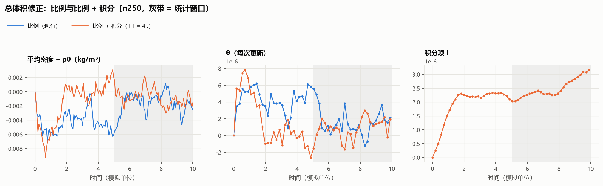

- **偏移变小**：
  - t = 2–10，平均密度偏移从 −0.0025 降到 −0.0004 kg/m³，θ 平均从 2.4e-6 降到 0.5e-6。
  - t = 5–10 从 −0.0016 降到 −0.0008 kg/m³。比例修正那一组在 t ≈ 5.5 以后自己的 θ 也降了下来，这一段两者差得少。
- **积分项的走势**：I 在约 t = 1.7 以前上升到 2.3e-6，之后平稳；t > 8 时又慢慢升到 3.2e-6（那一段 θ 一直为正）。
- **没有振荡**：
  - 带积分项的 θ 在 0 上下来回，t = 2–10 的 43 对相邻更新里变号 15 次。比例修正的 θ 一直为正（变号 2 次）。
  - 没有看到以 2π√(τ T_I) ≈ 12.6 为周期的成片的正负交替。
- **2-D 里噪声与偏移同量级**：θ 的标准差（1.2–1.9e-6，相当于 ±0.0012–0.0019 kg/m³）与要消掉的偏移同一量级。所以 2-D 上只能说偏移减小了，“归零”要看 3-D（24.4）。
- 任务书里比例修正的 −0.007 kg/m³ 是更长的运行（第 17 节，t = 70–100）的值。这里只到 t = 10，同一时间段的对照就是上表的比例修正那一组。

### 24.2 B：基准数据的出处与坐标对应（3.1）

**取到了什么**：

- **原文没有拿到**（Elsevier 收费，作者主页和公开预印本里都没有找到）。
- **用的是公开论文里转录的同一组表**：arXiv:1807.04896（“Mixing in 3-D cavity by moving cavity walls”）附录。
  - 表 A-3：竖线上的 u，标注“Albensoeder [18], Table 5, p. 548, 2005”。
  - 表 A-4：横线上的 v，标注“Albensoeder [17], Table 6, p. 549, 2005”。那篇论文的文献 17 是另一篇（Romanò, Albensoeder, Kuhlmann），但年份、表号、页码都是 Albensoeder & Kuhlmann (2005) 的，我判断是笔误，写在了 CSV 的文件头里。
  - 数值是我从那份 PDF 的文字层逐个录入的，录完又逐个对过一遍。
- **核对 1**：Sailfish 论文（arXiv:1311.2404）图 12 画的就是这两张表的点（Albensoeder 自己居中的坐标，−0.5 到 0.5，动壁在一侧，其中一个分量的符号与此相反）。从图上读的几个点都与录入的值一致：
  - 盖下 0.9766 处 u ≈ 0.59；
  - 0.5 处约 0.01；
  - 0.28 处约 −0.11；
  - 最小值约 −0.27，在 0.10 附近；
  - |v| 的最大值约 0.43，在 0.906 附近；另一侧约 0.24，在 0.094 附近。
- **核对 2**：Oueslati et al.（C. R. Mécanique 339, 2011，表 1，有限体积 48³）给出 Re = 1000 立方腔的 |u_min| = 0.2745（位置 0.122）、|w_min| = 0.4295（位置 0.904）。与转录表格点上的 0.2729（0.1016）、0.4342（0.9063）差 1–2 %，位置也一致（表里的值在 Ghia 的格点上，不是精确的极值点）。
- **Ku, Hirsh & Taylor (1987) 没有拿到**，没有做第三方核对。

**文件**（文件头写明出处、表号、转录来源、核对、坐标、盖子、无量纲化）：

- `experiment/validation/reference/cavity3d_re1000_albensoeder_kuhlmann_2005_u_vertical.csv`：竖线 x = z = 0.5 上的 u(y)，15 个内部点和两端。
- `experiment/validation/reference/cavity3d_re1000_albensoeder_kuhlmann_2005_v_horizontal.csv`：横线 y = z = 0.5 上的 v(x)，15 个内部点和两端。

**坐标对应**：

| | 基准（转录表） | 我们的 3-D 方腔（`cavity3d_1m*`） |
|---|---|---|
| 范围 | x, y, z ∈ [0, 1]，原点在一个角 | 粒子坐标 [−0.5, 0.5]³（流体）；剖面坐标 = (位置 + 0.505) / 1.01 |
| 盖子 | y = 1 的面 | 上方的 y 面（`wall_top`，y = 0.51–0.59） |
| 盖子运动 | +x | +x（`stick_lid` 的初速 [1, 0, 0]） |
| 竖线 | x = z = 0.5，u(y) | 过盒心沿 y，取 x 分量（`u_along_y`） |
| 横线 | y = z = 0.5，v(x) | 过盒心沿 x，取 y 分量（`v_along_x`） |
| 展向 | z，两端无滑移壁 | z，两端是壁（立方腔） |
| 速度 | 除以盖速 U | 盖速 1 |
| Re | U L / ν = 1000 | ν = 1e-3，U = 1 |

- 坐标轴方向、盖子、运动方向都一致，不需要翻转或交换。横线靠下游壁（x → 1）处 v < 0，两边一致。
- **我自己定的归一化**：剖面坐标用 box_run 的取法，以流体盒外扩一个粒子半径（±0.505）为壁，即第 16 节的“mid 帧”：壁在最后一层流体和第一层壁面粒子中间。
  - 按这个壁位置，边长是 1.01，Re 实际是 1010（高 1 %）。
  - 壁位置本身有半个粒子间距（0.5 %）的不确定。
  - 这两点没有修正。
- **剖面的取法**（第 19 节）：101 个点上流体粒子的 Shepard 平均，每 0.48 一条，统计窗口 t = 35–45 内平均。
  - 与基准比较时，把平均剖面线性插值到基准的格点上，只用 15 个内部点。
  - 另给一组只用离壁不小于支撑半径 h 的点（u 线 12 个、v 线 13 个）的误差：贴壁处 Shepard 平均只用一侧的流体，第 19 节说过这一点。

### 24.3 B：已有的运行对基准（3.2）

第 19 节的两个 3-D 运行（1M，到 t = 45，窗口 35–45，各 22 条剖面）：

- crossing：`cavity3d_1m_crossing_long`，完整速度差 + 比例修正；
- simple：`cavity3d_1m_simple_long`。

`cavity3d_reference.py` 的结果见 24.4 的表（同一张表里有本节的新运行）。只看这两个：

- **crossing 离基准很近**。窗口平均剖面在 15 个内部点上 L2 = 0.0052（u(y)）/ 0.0056（v(x)），L∞ = 0.0105 / 0.0129（单位是盖速）。极值：u_min −0.2748（大 0.7 %），v_max +0.2420（小 0.9 %），v_min −0.4235（小 2.5 %）。
- **simple 弱约 15 %**。L2 = 0.038 / 0.034，L∞ = 0.074 / 0.069。三个极值的大小比基准小 14.0 %、15.7 %、15.1 %。
- **crossing 的误差**主要在下壁附近的回流区（竖线 y < 0.11，差 0.008–0.011）和下游壁附近的下行流（横线 x ≈ 0.9，差 0.013）。中段（y ≈ 0.3–0.9）差不超过 0.0023。
- **simple 的误差**：盖下的边界层差得最多（y = 0.9766 处 0.074），两个回流区差 0.04–0.07。中段在 y ≈ 0.3–0.7 只差 0.0003–0.0047，到 y = 0.85 已差 0.012。
- **离定常还有多远**：
  - 从窗口 25–35 到 35–45，三个极值的变化不超过 0.001（不到极值的 0.4 %），剖面已经不怎么变了。
  - 动能在 t ≥ 20 用 K∞ + A exp(−(t − 20)/T) 拟合：crossing 的 T = 10.6，t = 45 时离 K∞ 还差 0.19 %；simple 的 T = 16.0，还差 0.39 %。
  - 这些都比与基准的差别（crossing 的 L2 0.005，simple 的 0.035）小得多。所以 t = 45 的结论不会因为没跑到严格定常而改变。

| 运行 | 极值相对前一个窗口（t = 25–35）的变化：u_min / v_max / v_min | 动能 t ≥ 20 的指数拟合 K∞ + A exp(−(t − 20) / T) |
|---|---|---|
| crossing 完整速度差，比例修正（第 19 节） | +0.0009 / -0.0006 / +0.0009 | K∞ = 24.260，T = 10.6，t = 45 时还差 +0.047（+0.19 %） |
| crossing 完整速度差，比例 + 积分修正（本节） | +0.0011 / -0.0008 / +0.0009 | K∞ = 24.240，T = 10.6，t = 45 时还差 +0.050（+0.20 %） |
| crossing 只取法向，比例 + 积分修正（本节） | +0.0006 / -0.0006 / +0.0002 | K∞ = 23.184，T = 11.1，t = 45 时还差 +0.043（+0.18 %） |
| simple（第 19 节） | -0.0000 / -0.0005 / -0.0002 | K∞ = 19.016，T = 16.0，t = 45 时还差 +0.075（+0.39 %） |

### 24.4 B：新的 3-D 运行（3.3、3.4）

**设置**：

- 1M 3-D 方腔，与第 19 节相同的结束时刻和取样：t = 45（750,000 步），每 0.12 采样一次，每 0.48 一条剖面，窗口 35–45，每 5 个时间单位存一次检查点，停止条件相同。
- 两个运行在两张卡上同时跑，从冻结的检出（`vulkan-demo-wall-crossing-run`，`2f16c8c`）、经 `box_run_supervised.py` 启动。

| 卡 | 运行 | 算例 | 配置 | 记录 |
|---|---|---|---|---|
| GPU 0 | `s24_cavity3d_full_integral` | `cavity3d_1m_crossing_integral_split` | crossing 缺省（完整速度差）+ 总体积修正 + 积分项 | `wc-20261120-052913-c010` |
| GPU 1 | `s24_cavity3d_normal_integral` | `cavity3d_1m_crossing_normal_integral_split` | 同上，`continuity_wall_component: normal` | `wc-20261120-052913-126c` |

- 两个算例都写了 `split_dispatch: true`、`split_order: near_wall_first`（只在这两个算例里写，缺省不变）。
- 因为近壁先调度原来只能用环境变量指定，我加了算例里的键 `numerics.wall_crossing.split_order`，见 24.6。

**运行情况**：

- 试跑几分钟估算总时间约 2.4 小时，不到 5 小时，所以照原计划跑到 t = 45。两个都在一段内跑完（05:29–08:01），没有中断，没有续跑。
- 没有触发停止条件：粒子数始终 1,685,159，越出盒 0。全程最大速度 0.957 和 0.955，都在盖速的 1.05 倍以下；overflow 计数全为 0。
- 每步时间 12.1 ms（82.5 步/秒）。第 19 节的 crossing 是 16.4 ms（61.1 步/秒）：现在打开了分开计算，近壁先调度；当时另一张卡在跑 1000²，两者条件不同，只能大致比较。

**与基准的对比**（与 24.3 的两个已有运行并列）：

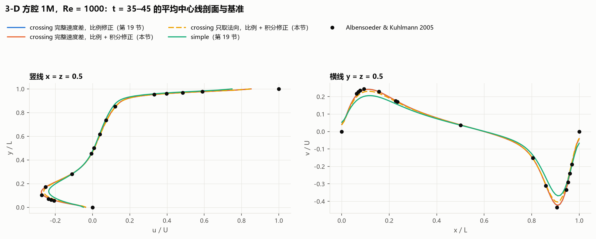

图里“完整速度差，比例修正”（蓝）与“比例 + 积分”（橙）几乎完全重合，蓝线被盖住了。

**极值**（窗口内 22 条剖面的平均；“大小相对基准” = (|ours| − |基准|) / |基准|，正 = 比基准强）：

| 运行 | 窗口内的剖面 | 竖线 u_min（位置 y），大小相对基准 | 横线 v_max（位置 x），大小相对基准 | 横线 v_min（位置 x），大小相对基准 |
|---|---|---|---|---|
| crossing 完整速度差，比例修正（第 19 节） | 35.04–45.00（22 条） | -0.2748（0.13），+0.7 % | +0.2420（0.11），-0.9 % | -0.4235（0.91），-2.5 % |
| crossing 完整速度差，比例 + 积分修正（本节） | 35.04–45.00（22 条） | -0.2745（0.13），+0.6 % | +0.2416（0.11），-1.0 % | -0.4230（0.91），-2.6 % |
| crossing 只取法向，比例 + 积分修正（本节） | 35.04–45.00（22 条） | -0.2620（0.13），-4.0 % | +0.2306（0.11），-5.5 % | -0.4043（0.91），-6.9 % |
| simple（第 19 节） | 35.04–45.00（22 条） | -0.2346（0.13），-14.0 % | +0.2057（0.12），-15.7 % | -0.3686（0.91），-15.1 % |
| 基准（表 5、6 的格点） | — | -0.2729（0.1016） | +0.2441（0.0938） | -0.4342（0.9063） |

**剖面误差**（单位是盖速；15 个内部点，以及离壁不小于 h 的 12 / 13 个点）：

| 运行 | u(y) L2 | u(y) L∞ | u(y) L2，离壁 ≥ h | u(y) L∞，离壁 ≥ h | v(x) L2 | v(x) L∞ | v(x) L2，离壁 ≥ h | v(x) L∞，离壁 ≥ h |
|---|---|---|---|---|---|---|---|---|
| crossing 完整速度差，比例修正（第 19 节） | 0.0052 | 0.0105 | 0.0058 | 0.0105 | 0.0056 | 0.0129 | 0.0060 | 0.0129 |
| crossing 完整速度差，比例 + 积分修正（本节） | 0.0058 | 0.0118 | 0.0064 | 0.0118 | 0.0059 | 0.0134 | 0.0064 | 0.0134 |
| crossing 只取法向，比例 + 积分修正（本节） | 0.0131 | 0.0253 | 0.0146 | 0.0253 | 0.0166 | 0.0311 | 0.0170 | 0.0311 |
| simple（第 19 节） | 0.0383 | 0.0740 | 0.0298 | 0.0498 | 0.0335 | 0.0686 | 0.0359 | 0.0686 |

**逐点数值**：

| 线 | 坐标 | 基准 | crossing 完整速度差，比例修正（第 19 节） | crossing 完整速度差，比例 + 积分修正（本节） | crossing 只取法向，比例 + 积分修正（本节） | simple（第 19 节） |
|---|---|---|---|---|---|---|
| u(y) | 0.0547 | -0.2062 | -0.1957 | -0.1944 | -0.1816 | -0.1659 |
| u(y) | 0.0625 | -0.2228 | -0.2125 | -0.2112 | -0.1976 | -0.1790 |
| u(y) | 0.0703 | -0.2370 | -0.2272 | -0.2259 | -0.2117 | -0.1906 |
| u(y) | 0.1016 | -0.2729 | -0.2652 | -0.2642 | -0.2499 | -0.2231 |
| u(y) | 0.1719 | -0.2516 | -0.2503 | -0.2507 | -0.2434 | -0.2212 |
| u(y) | 0.2813 | -0.1100 | -0.1123 | -0.1125 | -0.1131 | -0.1097 |
| u(y) | 0.4531 | -0.0061 | -0.0061 | -0.0061 | -0.0045 | -0.0069 |
| u(y) | 0.5000 | +0.0080 | +0.0085 | +0.0085 | +0.0104 | +0.0076 |
| u(y) | 0.6172 | +0.0390 | +0.0404 | +0.0405 | +0.0423 | +0.0378 |
| u(y) | 0.7344 | +0.0733 | +0.0753 | +0.0753 | +0.0769 | +0.0686 |
| u(y) | 0.8516 | +0.1218 | +0.1237 | +0.1236 | +0.1248 | +0.1102 |
| u(y) | 0.9531 | +0.3317 | +0.3348 | +0.3342 | +0.3368 | +0.2944 |
| u(y) | 0.9609 | +0.3982 | +0.3990 | +0.3983 | +0.4014 | +0.3502 |
| u(y) | 0.9688 | +0.4844 | +0.4845 | +0.4839 | +0.4873 | +0.4247 |
| u(y) | 0.9766 | +0.5896 | +0.5883 | +0.5881 | +0.5911 | +0.5157 |
| v(x) | 0.0625 | +0.2174 | +0.2088 | +0.2082 | +0.1982 | +0.1772 |
| v(x) | 0.0703 | +0.2275 | +0.2198 | +0.2192 | +0.2088 | +0.1858 |
| v(x) | 0.0781 | +0.2350 | +0.2278 | +0.2272 | +0.2165 | +0.1923 |
| v(x) | 0.0938 | +0.2441 | +0.2380 | +0.2375 | +0.2264 | +0.2011 |
| v(x) | 0.1563 | +0.2292 | +0.2278 | +0.2277 | +0.2184 | +0.1972 |
| v(x) | 0.2266 | +0.1758 | +0.1778 | +0.1778 | +0.1727 | +0.1595 |
| v(x) | 0.2344 | +0.1699 | +0.1721 | +0.1720 | +0.1674 | +0.1548 |
| v(x) | 0.5000 | +0.0367 | +0.0379 | +0.0378 | +0.0377 | +0.0361 |
| v(x) | 0.8047 | -0.1522 | -0.1548 | -0.1548 | -0.1551 | -0.1361 |
| v(x) | 0.8594 | -0.3112 | -0.3080 | -0.3077 | -0.3039 | -0.2653 |
| v(x) | 0.9063 | -0.4342 | -0.4213 | -0.4208 | -0.4031 | -0.3657 |
| v(x) | 0.9453 | -0.3351 | -0.3290 | -0.3284 | -0.3082 | -0.3053 |
| v(x) | 0.9531 | -0.2903 | -0.2874 | -0.2866 | -0.2685 | -0.2733 |
| v(x) | 0.9609 | -0.2409 | -0.2412 | -0.2403 | -0.2249 | -0.2366 |
| v(x) | 0.9688 | -0.1886 | -0.1911 | -0.1902 | -0.1779 | -0.1954 |

**历史**（窗口 35–45；每步时间是 t ≥ 10 各采样点上的累计平均步速的中位数）：

| 运行 | 跑到 t | 窗口内动能平均 | 窗口内动能斜率（每单位时间） | 窗口内平均密度 − ρ0 | 窗口内平均压力（Pa） | 窗口内 θ 平均 | 窗口内 I 平均 | 每步 ms（步 / 秒，t ≥ 10） |
|---|---|---|---|---|---|---|---|---|
| crossing 完整速度差，比例修正（第 19 节） | 45.00 | 24.327 | -0.0062（-0.025 %） | -0.0784 | -782.4 | +7.84e-05 | — | 16.36（61.1） |
| crossing 完整速度差，比例 + 积分修正（本节） | 45.00 | 24.309 | -0.0052（-0.021 %） | +0.0007 | +7.6 | -6.38e-07 | +9.51e-05 | 12.12（82.5） |
| crossing 只取法向，比例 + 积分修正（本节） | 45.00 | 23.249 | -0.0061（-0.026 %） | +0.0101 | +101.8 | -1.01e-05 | -1.88e-04 | 12.08（82.8） |
| simple（第 19 节） | 45.00 | 19.109 | -0.0044（-0.023 %） | -0.0009 | -8.5 | — | — | 10.71（93.4） |

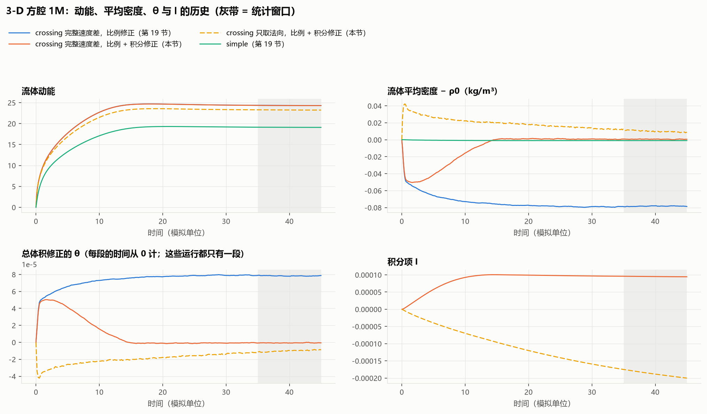

- **积分项在 3-D 里把偏移消掉了**（完整速度差）：
  - θ 在 t ≈ 15 降到 0，之后在 0 附近（窗口内平均 −6.4e-7）。
  - I 升到 1.0e-4 后稳定在 9.5e-5，也就是这个汇的大小：0.095 kg/m³ 每单位时间，与第 23 节 B3 直接量的 0.089 一致。
  - 平均密度从第 19 节的 ρ0 − 0.078 变成 ρ0 + 0.0007，平均压力从 −782 Pa 变成 +7.6 Pa。
  - 在 t ≈ 2–15 平均密度单调回到 ρ0，没有超调，也没有振荡。
- **积分项没有改变流动**：完整速度差的两个运行（只有比例修正 / 比例 + 积分）的剖面、极值、动能几乎相同。L2 差 0.0006 以内，极值差 0.1 个百分点，动能 24.33 对 24.31。压力的整体水平在这里不影响速度场。
- **只取法向时**，这一项是一个**源**，不是汇：
  - 平均密度在 t ≈ 0.5 冲到 ρ0 + 0.04，之后被修正慢慢拉回。
  - 到 t = 45 还在 ρ0 + 0.010，θ 停在约 −1e-5，I 一直在变小（−1.9e-4，末段每单位时间约 −2.5e-6），没有停下来。
  - 按 I 的走势，需要的修正量在缓慢变大。比例 + 积分的控制跟一个缓慢增长的源会留下一个滞后，这可能就是原因（推测，没有验证）。所以这个变体的偏移没有完全消掉。
- **离定常的距离**：两个新运行与第 19 节的两个一样。从窗口 25–35 到 35–45，极值变化不超过 0.0011；动能拟合离 K∞ 还差 0.18–0.20 %。都远小于下面比较的差别。

**结论：3-D 里完整速度差比只取法向离基准更近**：

- 完整速度差（比例 + 积分）：三个极值相差 +0.6 % / −1.0 % / −2.6 %，剖面 L2 为 0.0058 / 0.0059。
- 只取法向：三个极值都弱 4.0–6.9 %，L2 为 0.0131 / 0.0166，误差约是完整速度差的 2.3–2.8 倍。
- 与 2-D 方腔的方向一致（第 9–14 节：只取法向时主涡偏弱）。
- simple 弱约 15 %。

### 24.5 远端 adami（3.3 的可选项）：没有跑

- 用 `ssh -o BatchMode=yes Administrator@10.147.20.1` 试了本机的默认密钥和 `~/.ssh/id_ed25519_gpuserver`（`~/.ssh/config` 里只有实验室 3090 集群 `gpuserver` 一项），都是 `Permission denied (publickey,password,keyboard-interactive)`。
- 以前的几节是用环境变量里的密码登录的，这次没有密码，也不该向用户要来存。
- 按任务书“远端用不了就跳过”，没有做。

### 24.6 改动清单

| 提交 | 内容 |
|---|---|
| `2f16c8c` | `numerics.volume_constraint.integral`（缺省 false）和 `integral_time`（缺省 4 × relaxation_time）：`volume_constraint_v7.py` 的 `_set_rate`、`restore_integral`、记录里的 `integral`；`simulator_v7.py` 的积分项系数、检查点项 `_volume_constraint_integral`、续跑时的读回和警告、打印。`numerics.wall_crossing.split_order`（`interior_first` 缺省 / `near_wall_first`），环境变量 `V7_WALL_CROSSING_SPLIT_ORDER` 只在设了的时候覆盖它。算例 `lid_driven_cavity_2d_n250_xi0p001_eps0p0025_crossing_integral`、`cavity3d_1m_crossing_integral_split`、`cavity3d_1m_crossing_normal_integral_split` |
| `f71642b` | 基准数据 `experiment/validation/reference/cavity3d_re1000_albensoeder_kuhlmann_2005_{u_vertical,v_horizontal}.csv`；`cavity3d_reference.py`（剖面对基准、极值、误差、历史、离定常的距离）；`volume_integral_check.py`（比例与比例 + 积分的对比） |
| 加入本节的提交 | 报告第 24 节、表和图 |

没有改着色器（SPIR-V 全部逐字节不变，不需要重编和改清单），没有改任何缺省值。

### 24.7 我自己做的决定

1. **I 的更新顺序**：每次更新先加 I 再算 rate，所以 rate 的两项都用这次的 θ。Δ 取取整到 defrag 间隔以后实际用的更新间隔。
2. **检查点**：只在积分项打开时存 I。主机读回体积的方式也存（不只 GPU 平均体积的方式）。
3. **新加了 `split_order` 算例键**：任务书要求“近壁版本先调度、只在这两个算例的配置里写”，原来只有调试用的环境变量。缺省仍是内部先，环境变量设了时仍然优先。
4. **基准数据**：用公开论文里的转录并做了两处核对（任务书允许的第二种取法）。另外，arXiv:1807.04896 表 A-4 把出处标成文献 17，我判断是笔误。
5. **我们的剖面坐标用 mid 帧**，与第 16、19 节一致，没有为 Re = 1010 / 1000 的差别和壁位置的不确定做修正。误差只在 15 个内部点上算，另给离壁不小于 h 的一组。极值的基准用表里格点上的极值（表里没有真正的极值点）。
6. **长运行**照第 19 节的做法从冻结的检出、经监督脚本启动。两个运行各占一张卡同时跑。
7. **2-D 的积分项检查**另在 GPU 0 上同时跑了只有比例修正的同一算例到 t = 10，作为同一时段的对照（任务书引用的 −0.007 是更长时间的值）。
8. **开关关闭的逐位核对**：第一次在长运行占着两张卡时做，结果类变多，又在两张卡空闲后重跑了一遍（24.1）。
9. **远端**：没有向用户要密码，按任务书跳过。

### 24.8 没做或没验证的

- 原文没有拿到，基准是二手转录。核对只做了两处：图上读点、另一篇论文的极值。没有和 Ku, Hirsh & Taylor (1987) 核对。
- 远端的 adami 3-D 运行没有跑。
- 积分项的续跑（检查点存取 I）没有实际跑一次续跑来验证。代码路径与第 22 节的 `gpu_mean_volume` 检查点相同，但这次没有测。
- 只取法向变体里 I 没停、θ 留了 −1e-5 的原因只是推测（需要的修正在慢慢变大）。没有更长的运行确认它最终会不会收敛。
- 我们的结果在 Re = 1010 / L = 1.01 的 mid 帧里，与基准 Re = 1000 的差别（约 1 %）没有单独估计。
- 3-D 只比了 1M 一种分辨率，没有做网格收敛。完整速度差与基准差 2.6 % 以内，里面有多少是分辨率误差、多少是方法误差，没有分开。
- 2-D 的积分项只跑到 t = 10，没有跑到第 17 节那样的 t = 100。

## 附录 A：工具与验收的对应

| 工具（`experiment/wall_crossing/`） | 用途 | 验收项 |
|---|---|---|
| `run_log.py`、`logged.py` | runs.jsonl 记录（机器、GPU UUID、提交、算例、命令、起止、状态） | 全部 |
| `bitwise_check.py` | 基点对本分支的逐位比较；`--repeats N` 做结果类 | 6.1、6.7 |
| `pipeline_statistics.py` | 寄存器数；管线配方（模块、spec const、缓冲）比较 | 6.1、6.5、6.6 |
| `kernel_timing.py` | 各配置交替、多轮的逐 kernel 计时 | 6.1、6.5、6.6 |
| `reference.py`、`box_case.py`、`single_step.py` | numpy 参考解、小盒算例、GPU 单步对照 | 6.2、6.6 |
| `hydrostatic.py` | 静水盒：生成算例、运行、出表 | 6.3、6.6 |
| `cavity_run.py`、`cavity_runner_entry.py`、`cavity_tables.py` | 方腔运行与 Marchi 表；运行时另记流体平均密度和压力的历史（第 9 节加的） | 6.4 |
| `box_run.py`、`chain_runner.py` | 任意盒算例的历史与剖面（流水线路径） | 2.5、6.6 |
| `k2_equivalence.py`、`voxel_list_probe.py` | K = 1 对 K = 2 的逐位比较、第一处差异的定位 | 6.7 |
| `seam_audit_run.py` | 仓库的接缝审计 | 6.7 |
| `throughput.py` | K = 2 吞吐 | 6.7 |
| `delta_wall_experiment.py` | 第 6、7 节的表和图（δ 项的诊断开关），第 8 节并入两个对照的那张表 | — |
| `density_budget.py`、`density_rounding.py`、`budget_bitwise.py` | 第 8 节：密度收支的表和图；单步增量与 float32 网格的比较；打开收支前后的结果类 | — |
| `outcome_classes.py`、`normal_default.py` | 第 9 节：一个算例对一组参照转储按结果类比较；第 9 节的表和图 | — |
| `quadratic_accuracy.py`、`quadratic_extension.py` | 第 10 节：二阶延拓的 numpy 精确性核对；二阶的算例、表和图 | — |
| `field_difference.py` | 第 11 节：两次方腔运行的时间平均场之差、分区占比、涨落、被丢掉的切向项 | — |
| `pairwise_reflection.py` | 第 12 节：逐对几何和两个反射的算例、numpy 核对、筛查和静水盒的表；第 13 节（`long-runs`）：两次到 t = 100 的运行的表和图、t = 18 的动能和中心线估计；第 14 节（`full-scheme`）：完整方案的两次运行、各时刻的平均密度、由快照补算的压力涨落；第 15 节（`volume-constraint`）：体积约束的回归、单步、短跑、两档分辨率的方腔、θ 的历史、每步时间、静水盒 | — |
| `cavity_watch.py` | 第 13 节：看着一次方腔运行，只在流体越出盒或最大速度超过线时停掉它 | — |
| `stream_function_check.py` | 第 16 节：后处理的检验（解析场、四条积分路径、涡心），只用已有的快照 | — |
| `continuation_check.py` | 第 17 节：续跑到 t = 200 的三个窗口、动能、约束的目标值和平均密度 | — |
| `default_change.py` | 第 18 节：缺省改为完整方案之后的组合检查、现有测试和本节的表（检查 1 到 3 用 `outcome_classes.py`，检查 4 用 `single_step.py`） | — |
| `long_validation.py` | 第 19 节：长时间验证的表和图（`short`：短检查；`long`：长运行） | — |
| `box_run_supervised.py` | 第 19 节：3-D 长运行的看门狗和断点续跑（`box_run.py --checkpoint-time / --resume`） | — |
| `particle_watch.py`（`canonical_dump.py --watch`） | 第 20 节：逐步只读的监视（越出盒、粒子数变少、非有限值），第一次事件就停并存现场 | — |
| `particle_watch_report.py` | 第 20 节：事件现场的整理（合并状态、邻居清单、轨迹、`.vtp`、切片图） | — |
| `particle_watch_tables.py` | 第 20 节：开关核对、各次运行和逐步记录的表 | — |
| `grid_offset_check.py` | 第 21 节：各算例的粒子层离体素边界最近的距离和网格原点的挪动；`--tables`：测试 3 和 2-D 替代检查的表 | — |
| `split_dispatch.py` | 第 22 节 A：`make-cases`（开关打开的算例）、`near-wall`（近壁体素里的流体占比）、`compare` / `classes`（内部 / 近壁粒子分开的逐位比较和结果类） | — |
| `volume_constraint_check.py` | 第 22 节 B：`make-cases`、`theta`（同一状态下 GPU 规约与主机双精度的 θ）、`logs`（box_run 的约束日志并列） | — |
| `density_drop_3d.py` | 第 22 节 C：3-D 收支按项、按区域（面、棱、角、内部）拆开 | — |
| `dual_timing.py` | 第 22 节：双卡的 phase 时间（chain bench `--anatomy`）和稳态步速，多轮交替 | — |
| `band_difference.py` | 第 23 节 2.5：两组逐步摘要里第一个不同的步；两份转储里不同的行（材料、近壁类、离分界几列） | — |
| `cavity3d_reference.py` | 第 24 节：3-D 方腔的剖面对 Albensoeder & Kuhlmann (2005) 基准：极值、L2 / L∞、历史、离定常的距离 | — |
| `volume_integral_check.py` | 第 24 节：总体积修正只有比例项与加积分项的对比（平均密度、θ、I） | — |
| `report_figures.py`、`report_tables.py` | 本报告的图、表和拼装 | — |

## 附录 B：结果文件的位置

- 运行记录：`logs/wall_crossing/runs.jsonl`（副本 `claude/wall_crossing/runs.jsonl`）。
- 方腔：`logs/wall_crossing/cavity/<运行名>/`（样本、快照、检查点）；表 `claude/wall_crossing/cavity/`。
- 静水盒：`logs/wall_crossing/hydrostatic/<运行名>/`；表 `claude/wall_crossing/hydrostatic/`。
- 单步对照：`logs/wall_crossing/single_step/`。
- 逐位比较：`logs/wall_crossing/bitwise/`。
- 计时与寄存器：`logs/wall_crossing/timing/`、`logs/wall_crossing/statistics/`。
- 3-D 方腔与诊断运行：`logs/wall_crossing/box_run/`。
- K = 2：`logs/wall_crossing/k2_equivalence/`、`logs/wall_crossing/seam_audit/`、`logs/wall_crossing/throughput/`。
- 第 6、7 节：方腔 `logs/wall_crossing/box_run/dw_n250_*/`，静水盒 `logs/wall_crossing/hydrostatic/2d_n250_*_delta_wall_body_force*/` 和 `2d_n250_*_crossing_history/`，检查 `logs/wall_crossing/delta_wall/`；汇总 `claude/wall_crossing/delta_wall/summary.json`。
- 第 8 节：收支运行 `logs/wall_crossing/box_run/budget_n250_*/`（series.csv 里的 `budget_<区域>_<项>` 列是累计量），结果类 `logs/wall_crossing/budget_bitwise/`；汇总 `claude/wall_crossing/density_budget/summary.json`。
- 第 9 节：短跑 `logs/wall_crossing/box_run/nd_n250_crossing_r*/`、`budget_n250_crossing_normal_*/`，静水盒 `logs/wall_crossing/hydrostatic/2d_n250_*_crossing_normal_r*/`，方腔 `logs/wall_crossing/cavity/n250_crossing_normal/`、`n500_crossing_normal/`（其中 `field_history.jsonl` 是密度和压力的历史），结果类 `logs/wall_crossing/outcome_classes/`；汇总 `claude/wall_crossing/normal_default/summary.json`。
- 第 10 节：筛查 `logs/wall_crossing/box_run/budget_n250_crossing_quadratic_*/`，静水盒 `logs/wall_crossing/hydrostatic/2d_n250_*_crossing_quadratic_viscous/`，方腔 `logs/wall_crossing/cavity/n250_quadratic_viscous/`、`n250_crossing_quadratic_viscous/`、`n500_quadratic_viscous/`（`n500_crossing_quadratic_viscous/` 是停掉的那一次），对照 `n250_crossing_normal_rho_minus/`、`n250_crossing_normal_rho_minus_0p45/`，结果类 `logs/wall_crossing/outcome_classes/`，K = 2 `logs/wall_crossing/k2_equivalence/n250_crossing_quadratic_viscous/`，寄存器 `logs/wall_crossing/statistics/quadratic_n250_*.json`；汇总 `claude/wall_crossing/quadratic_extension/summary.json` 和 `accuracy.json`。
- 第 11 节：只用已有的快照 `logs/wall_crossing/cavity/n250_crossing*/snapshots/`；汇总 `claude/wall_crossing/field_difference/summary.json`。
- 第 12 节：筛查短跑 `logs/wall_crossing/box_run/budget_n250_crossing_{reflection,pairwise*}/`，静水盒 `logs/wall_crossing/hydrostatic/2d_n250_*_crossing_reflection/`，停下的长跑 `logs/wall_crossing/cavity/n250_reflection/`；汇总 `claude/wall_crossing/pairwise_reflection/`。
- 第 13 节：`logs/wall_crossing/cavity/n250_reflection/`（续跑）、`n250_reflection_stopped_t18/`（续跑前的副本）、`n250_pairwise_full/`，收支短跑 `logs/wall_crossing/box_run/budget_n250_crossing_pairwise_full/`；汇总 `claude/wall_crossing/pairwise_reflection/long_runs.json`。
- 第 14 节：`logs/wall_crossing/cavity/n250_reflection_full/`、`n250_reflection_full_rho_plus_0p3/`；汇总 `claude/wall_crossing/pairwise_reflection/full_scheme.json`。
- 第 15 节：`logs/wall_crossing/cavity/n250_reflection_full_volume/`、`n500_reflection_full_volume/`（各有 `volume_constraint.jsonl`：每次更新的时间、θ、rate），短跑 `logs/wall_crossing/box_run/short_n250_reflection_full_volume/`，静水盒 `logs/wall_crossing/hydrostatic/2d_n250_*_crossing_reflection_full_volume/`；汇总 `claude/wall_crossing/pairwise_reflection/volume_constraint.json`。
- 第 16 节：只用已有的快照；时间平均的速度网格缓存在 `logs/wall_crossing/stream_function_check/`，汇总 `claude/wall_crossing/stream_function_check/summary.json`。
- 第 17 节：`logs/wall_crossing/cavity/n250_reflection_full_volume_to200/`（原运行目录的副本，从 t = 90.72 续跑；130–150 的快照在 `snapshots_extra/`）；汇总 `claude/wall_crossing/continuation/summary.json`。
- 第 18 节：`logs/wall_crossing/outcome_classes/`（`default_*`、`first_order_explicit_*`、`old_default_at_48d370f_s700`、`simple_against_base_at_*`、`adami_against_base_at_*`），`logs/wall_crossing/single_step_default_complete_scheme/`，`logs/wall_crossing/default_change/`，`logs/wall_crossing/tests/default_complete_scheme_*.log`。
- 第 19 节：`logs/wall_crossing/box_run/`（`k1_*`、`k2_*`、`k2d1_*`、`cavity3d_1m_*`），`logs/wall_crossing/cavity/n1000_complete_volume/`、`n1000_adami/`（远端取回），`logs/wall_crossing/hydrostatic/3d_n48_*_default_volume/`，`logs/wall_crossing/seam_audit/`，`logs/wall_crossing/k2_equivalence/`，`logs/wall_crossing/outcome_classes/restored_*`；汇总 `claude/wall_crossing/long_validation/`。
- 第 20 节：`logs/wall_crossing/particle_watch/`（各次运行的现场目录、`switch_check/`、`smoke/`）；汇总 `claude/wall_crossing/particle_watch/`。
- 第 21 节：`logs/wall_crossing/grid_offset/`（测试 3 的两次运行和 2-D 替代检查的转储）；汇总 `claude/wall_crossing/grid_offset/`。
- 第 22 节：`logs/wall_crossing/section22/classes/`（门槛下调和开关关闭的逐位转储）、`logs/wall_crossing/split_dispatch/`（A 的转储和监视）、`logs/wall_crossing/volume_constraint/` 与 `logs/wall_crossing/box_run/s22_gpu_mean_*`（B）、`logs/wall_crossing/box_run/s22_cavity3d_1m_density_budget/` 与 `logs/wall_crossing/density_drop_3d/`（C）、`logs/wall_crossing/timing/s22_*` 与 `logs/wall_crossing/statistics/s22_*`（计时和寄存器）。
- 第 23 节：`logs/wall_crossing/timing/s23_*`（整步计时、稳态步速、修后计时）、`logs/wall_crossing/section23/`（2.5 的逐步摘要和转储、B2 的监视、位序核对）、`logs/wall_crossing/box_run/s23_b*`（B 的短跑）、`logs/wall_crossing/density_drop_3d/`；Nsight 的报告在本机临时目录，没有入库。
- 第 24 节：`logs/wall_crossing/box_run/s24_*`（2-D 积分项检查和两个 3-D 长运行），`logs/wall_crossing/cavity3d_reference/summary.json`，`logs/wall_crossing/section22/classes/`（开关关闭的逐位转储，标签 `reference_61c490d`、`integral_off*`）；基准数据在 `experiment/validation/reference/`。
- 图：`claude/wall_crossing/figures/`；表：`claude/wall_crossing/tables/`。
