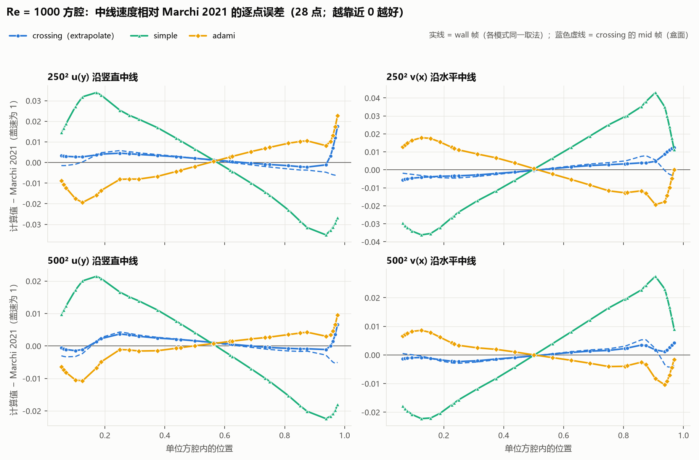
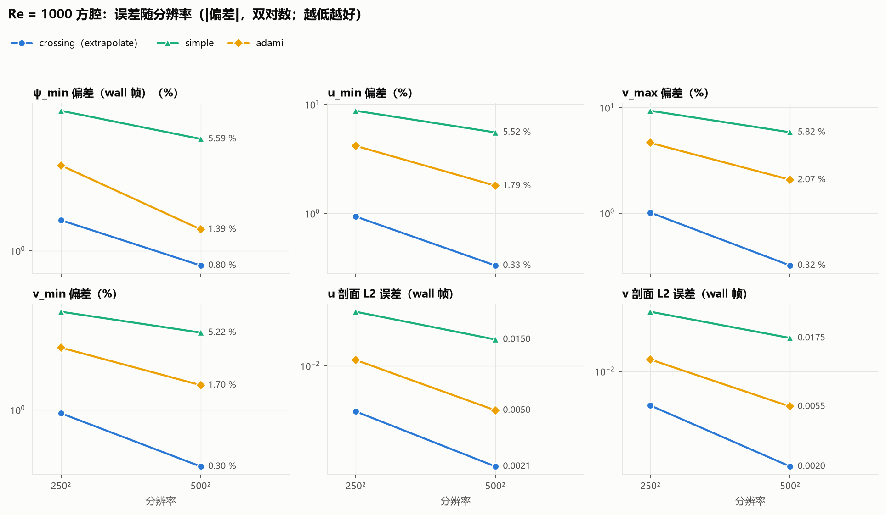
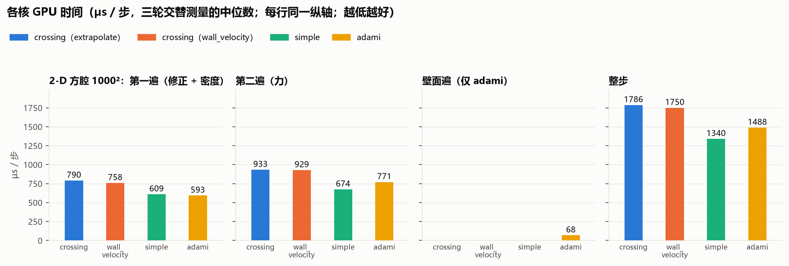
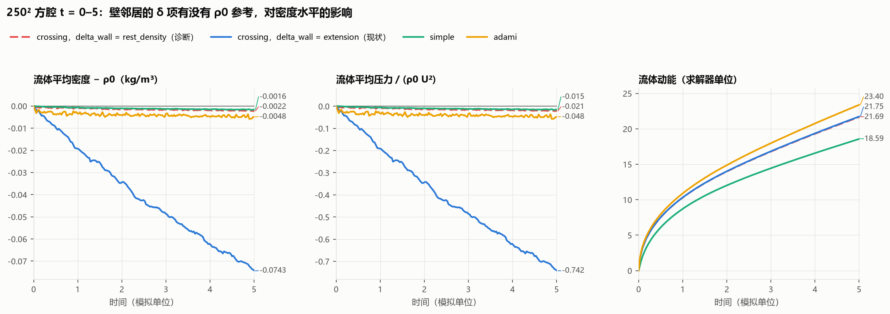
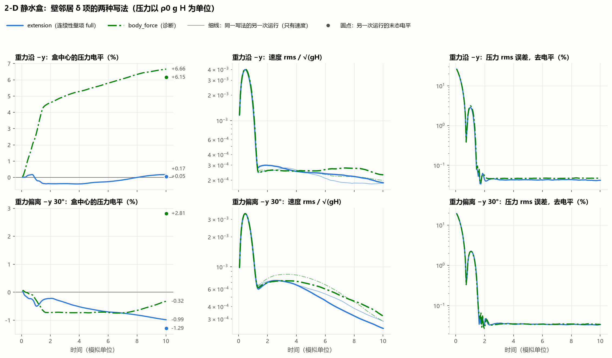
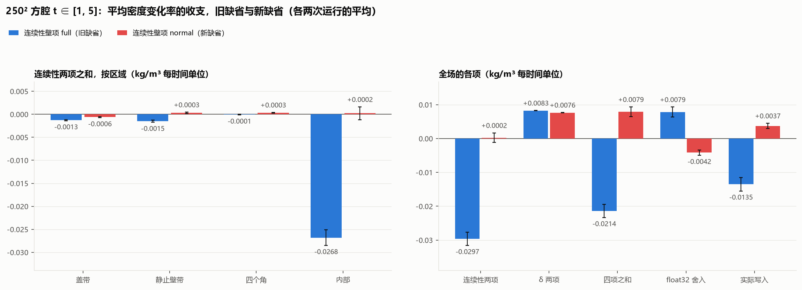
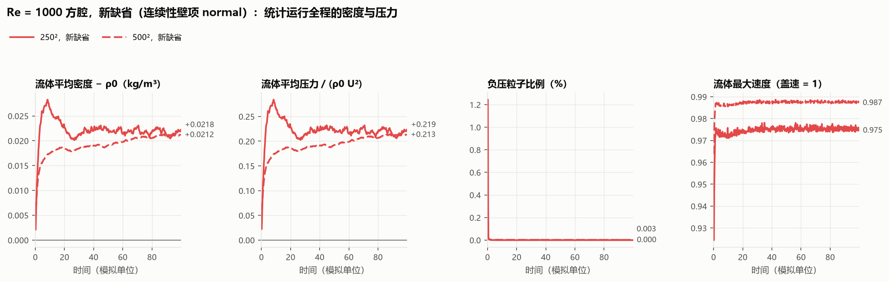

# `wall_boundary: crossing`（穿壁比例壁面）实现与验收报告

- 分支 `v7-wall-crossing`，基点 `origin/bootstrap-density-fix`（eda5b90），只有本地提交，没有 push、合并或标签。
- 工作树 `C:\Users\cchen\PycharmProjects\vulkan-demo-wall-crossing`。
- 本文由 `experiment/wall_crossing/report_tables.py` 从 `claude/wall_crossing/report_source.md` 和各工具写出的表格拼成；表里的数字都是工具从结果文件读出来的，没有手抄。
- 每个数字后面的 `wc-…` 是 `logs/wall_crossing/runs.jsonl` 里的记录号。`logs/` 不入库，所以记录文件另存了一份在 `claude/wall_crossing/runs.jsonl`（本机）和 `claude/wall_crossing/runs_DESKTOP-9IN3NPD.jsonl`（第二台机器）。

> **本报告的状态（2026-11-17 22:35 之后）**：这是一份没有收尾的草稿。用户在 22:35 要求停掉所有长运行，只做第 6 节的机理确认实验，并且不继续原任务里没做完的项目；11-18 又先后要求做第 7 节和第 8 节的诊断，再要求改一个缺省值并重新验证（第 9 节），同样不继续原任务。因此：
> - 第 6、7、8、9 节是完整的。第 9 节（2026-11-18）是最新的内容；第 7 节更正了第 6 节结论里的一句话。
> - **第 9 节改了一个缺省值**：`numerics.wall_crossing.continuity_wall_component` 从 `full` 改成 `normal`。第 1 到 8 节里 crossing 的全部结果都是改之前（`full`）的；各表里标着"旧缺省"或 `full` 的就是它。
> - 第 1–4 节是停止之前写的。其中标着"**未完成**"的地方没有再补：结论摘要、6.4 的文字结论和 1000² 一档、3-D 方腔的互比、3-D 计时、K = 2 吞吐、各阶段的"未验证"清单、下一步建议。
> - 6.4 的表停在 250² 和 500² 两档（500² 的 wall_velocity 在 t = 34.9 失败，表里还没有这一行；1000² 的各次运行都没有跑完）。

## 0. 结论

（**未完成**：这一部分（`summary_text.md`）在长运行按用户要求停止时还没有写或没有数据，之后没有继续；见第 6 节。）

## 1. 通用事项

### 1.1 提交

| 提交 | 标题 |
|---|---|
| `052cfb9` | wall_boundary crossing (stage 1 implementation): crossing-fraction walls of an axis-aligned box, one GPU, fused pass |
| `029313a` | wall_boundary crossing: run tools (cavity launcher, kernel timing, pipeline statistics, logged runs) |
| `5ee25b1` | wall_boundary crossing: validation tools (tables, hydrostatic box, bit-identity, pipeline recipes) + hydrostatic cases |
| `a2149ed` | wall_boundary crossing: slabs with a peer (stage 3 enablement), pipelined drivers, 3-D cavity cases |
| `465d328` | wall_boundary crossing: K = 2 comparison tools (bit comparison + voxel-list probe, seam audit driver), table diagnostics |
| `fac95ac` | wall_boundary crossing: tilted 3-D hydrostatic cases get 64 incoming slots (a lattice in uniform free fall enters a voxel through three faces in one step: 48 arrivals overflowed 32 slots and predict killed the excess); hydrostatic.py names the overflow in a failure |
| `dba0f27` | wall_boundary crossing: single_step judges acceleration and shift against their summed pair terms |
| `ae5f41e` | wall_boundary crossing: report tools (figures, tables with run records, report assembly), outcome classes for longer bit windows |
| `96c9da1` | wall_boundary crossing: K = 2 throughput tool, run records in the cavity tables, a stale file name in a docstring |
| `0e38558` | wall_boundary crossing: report tables (3-D cavity comparison, combined seam audit table, commits, copies of tool summaries and run records) |
| `6a1bada` | wall_boundary crossing: cavity tables list the repeat run and name the convergence quantities without pipe characters |
| `81ae0d9` | wall_boundary crossing: diagnostic switch numerics.wall_crossing.delta_wall (extension / rest_density) |
| `d10e144` | wall_boundary crossing: delta_wall mechanism test (tables, figure) and the report draft with its section 6 |
| `d62e005` | wall_boundary crossing: diagnostic delta_wall gains body_force (wall pair term rho_i g . (r_j - r_i) / c^2) |
| `21b700a` | wall_boundary crossing: hydrostatic.py records the mean density, the pressure level and the level-free pressure error at every sample |
| `e24d16e` | wall_boundary crossing: delta_wall_experiment.py gains the body_force run and the hydrostatic comparison (extension against body_force) |
| `e643008` | wall_boundary crossing: second delta_wall test (body_force) - tables, figures and section 7 of the report |
| `1932d2b` | wall_boundary crossing: density budget diagnostic (V7_DENSITY_BUDGET=1) and diagnostic continuity_wall_component |
| `7b443b7` | wall_boundary crossing: the density budget also records what the stored float32 density actually changed by |
| `0dd6338` | wall_boundary crossing: the density budget in a neighbour traversal of its own for both builds, twelve regions |
| `f25c696` | wall_boundary crossing: density budget tables (repeats, outcome classes), density_rounding.py, the two controls in the drift table |
| `2ed2d09` | wall_boundary crossing: regenerated drift table with the two controls (interim, before the report section) |
| `2351a4d` | wall_boundary crossing: density budget of the 250^2 cavity (tables, figures, section 8 of the report) |
| `44e4e6f` | wall_boundary crossing: continuity_wall_component defaults to normal (was full) |
| `6c8a55a` | wall_crossing reference: simple / adami keep the whole wall velocity difference in the budget comparison |
| `bb7e173` | wall_boundary crossing: analysis of the default change (normal_default.py), earlier tables relabelled |
| `048be28` | wall_boundary crossing: section 9 of the report, first half (default change, regression checks, short runs) |

（加入本报告的那个提交排在这些之后。）

求解器文件（`experiment/v7`、`experiment/validation`、`materials`）在 052cfb9、029313a、5ee25b1 三个提交之间完全相同（`git diff --stat` 为空）；5ee25b1 之后只有 a2149ed 改了 `simulator_v7.py`（放开有 peer 的 slab，单卡路径不变）和一处文档串。所以本报告里在这几个提交上跑的单卡结果用的是同一份求解器代码，可以并列。

### 1.2 机器与 GPU

| 机器 | GPU | Vulkan deviceUUID | 用途 |
|---|---|---|---|
| 本机 DESKTOP-LDQTHT7 | RTX 5090（接显示器，v7 设备 0） | fb83f0dafd9e1d38dc05e7ae643e22a8 | crossing 的 1000² 方腔、双卡的一半、短算例 |
| 本机 DESKTOP-LDQTHT7 | RTX 5090（无显示器，v7 设备 1） | ae137c668a40f5acaab90a83f7cda175 | 计时与寄存器、crossing 的 250² / 500² 方腔、3-D 算例 |
| 第二台 DESKTOP-9IN3NPD（10.147.20.1） | RTX 5090，驱动 610.88 | a85cce699d0fb7294c33d0a5981a4666 | simple / adami 对照组的方腔 |

第二台机器上只动了自己建的 `D:\vulkan-demo-wall-crossing`（代码用 tar 包经 SFTP 传过去，依赖装在该目录的 `.venv`，结果用 SFTP 取回 `logs/wall_crossing/cavity/` 和 `logs/wall_crossing/remote/`）。没有改任何系统设置；机器上另一位用户的进程没有碰。

### 1.3 运行方式

所有命令从工作树根目录用 `C:\Users\cchen\PycharmProjects\vulkan-demo\.venv\Scripts\python.exe` 运行，环境变量 `VK_LOADER_LAYERS_DISABLE=VK_LAYER_KHRONOS_validation`、`OPENBLAS_NUM_THREADS=1`。工具都在 `experiment/wall_crossing/`，各自的文档串里有命令行；附录 A 列出每个工具对应哪项验收。

## 2. 阶段 1：2-D 盒体，单卡

### 2.1 改动清单

**着色器（`experiment/v7/shaders`）**

| 文件 | 改动 |
|---|---|
| `wall_boundary.glsl` | 末尾新增一节（`#ifdef WALL_CROSSING`）：`WALL_BOUNDARY_CROSSING = 2`；spec const 120–127；瞬态缓冲的声明；几何函数 `wall_crossing_distance_to_wall`（φ）、`wall_crossing_depth_behind_wall`（d）、带下限的 φ、系数 1 + d/φ；A_f 的正则化求逆（与修正矩阵同一流程，失败返回 false）；对称矩阵的解包。换一般几何时只替换前两个函数。 |
| `correction_density.comp` | `#ifdef WALL_CROSSING` 内：壁粒子自身提前返回（单位矩阵、零梯度、零核和，scratch 写 ρ0 的存储值和 0 压力）；流体粒子的 φ_i、`fluid_correction_matrix`、只含流体邻居的密度梯度 g_f、壁邻居漂移项的系数、壁邻居扩散项的向量累加；循环后求 A_f⁻¹ 并写入瞬态缓冲、回退计数、密度变化率里的壁面扩散项。 |
| `force.comp` | `#ifdef WALL_CROSSING` 内：`wall_kernel_gradient_sum`、`fluid_pressure_gradient_sum`；壁邻居不做逐对压力项；壁邻居的粘性速度差乘 1 + d/φ；循环后的壁面压力项。 |
| `common.glsl` | 只改注释和一个字段名：状态块第 39 个字段原名 `status_reserved_7`（此前没有任何 kernel 写），改名 `wall_crossing_gradient_fallback_count`。SPIR-V 不带名字，所有旧模块字节不变。 |
| `compile_shaders_v7.py` | `SHADER_VARIANTS` 增加两个变体：`correction_density_wall_crossing`、`force_wall_crossing`（同一源文件加 `-DWALL_CROSSING`）。 |
| `spv/` | 新增 `correction_density_wall_crossing.comp.spv`、`force_wall_crossing.comp.spv`；原有 23 个 `.spv` 重新编译后字节相同；`MANIFEST.txt` 重新生成（25 个文件）。 |
| `README.md` | spec const 表、文件清单。 |

**新增的 spec const**（只编进两个 crossing 变体）

| 编号 | 名字 | 含义 |
|---|---|---|
| 100 | `WALL_BOUNDARY` | 原有；新增取值 2 = crossing |
| 120 | `WALL_CROSSING_CONTINUITY` | 连续性方程里壁邻居的速度差：0 = extrapolate，1 = wall_velocity |
| 121 | `WALL_CROSSING_DISTANCE_FLOOR` | φ_i 的下限，单位米（下限系数 × 粒子间距） |
| 122–124 | `WALL_CROSSING_BOX_LOWER_X/Y/Z` | 盒的下角 |
| 125–127 | `WALL_CROSSING_BOX_UPPER_X/Y/Z` | 盒的上角 |

**新增的缓冲**

`wall_crossing_fluid_inverse`：set 0 binding 12，每粒子 2 个 vec4（32 字节）：`[2 i] = (m00, m11, m22, m01)`，`[2 i + 1] = (m02, m12, 0, 有效标志)`。只在 crossing 的 slab 上创建；同一步内遍历 1 写、遍历 2 读；不在 defrag 和传输的搬运列表里。simple / adami 的缓冲清单不变（见 6.1 的管线配方比较）。

**主机端（`experiment/v7/utils`）**

| 文件 | 改动 |
|---|---|
| `wall_crossing_v7.py`（新） | `WallCrossingSettings`；`numerics.wall_crossing` 的解析；φ、d 的 numpy 版本；缺省盒的推导和加载时的检查；诊断量。 |
| `case_v7.py` | `WALL_BOUNDARY_CHOICES` 增加 `crossing`；`NumericsConstants.wall_crossing`。 |
| `case_loader_v7.py` | 读 `numerics.wall_crossing`；`use_kcg_correction` 关闭或出现流体、壁以外的材料 kind 时报 `ValueError`；确定并打印盒。 |
| `simulator_v7.py` | crossing 时：spec const 100 = 2 并追加 120–127；加载两个变体模块；建瞬态缓冲；不建 wall pipeline；deep-wall skip 解析为关闭；`_check_wall_crossing_supported()` 对不支持的路径报 `ValueError`（非融合路径、未解析的设置；有 peer 时见阶段 3）。 |
| `_test_seam_layout.py` | 把两个新 `.spv` 加进"新增文件"的排除表，把 `wall_crossing` 加进 v7 独有字段表。 |

**算例（都引用基础算例的 OBJ，不复制）**

- `cases/lid_driven_cavity_2d_n{250,500,1000}_xi0p001_eps0p0025_crossing`、`…_crossing_wall_velocity`、`…n250…_crossing_floor0p5`。
- `cases/wall_crossing/hydrostatic_2d_n250_{gy,g30}_{simple,adami,crossing,crossing_wall_velocity}`（由 `hydrostatic.py make-cases` 生成）。

**工具**：`experiment/wall_crossing/`（附录 A）。

### 2.2 与任务文件不一致的代码事实

| 任务文件的说法 | 实际看到的 | 我的调整 |
|---|---|---|
| 仓库里若有 `claude/wall_crossing/`（设计文档、`check.py`、`check2.py`）先读 | 基点上没有这个目录，全库也没有这两个脚本 | numpy 参考实现按任务文件第 2、5 节自己写（`experiment/wall_crossing/reference.py`） |
| SPIR-V 新鲜度检查（`_test_seam_layout.py`）要通过 | 这个测试在基点 eda5b90 上本身就有 858 项失败（都是"钉住的命令流"和分区数值两类，没有一项是 SPIR-V 过期）；SPIR-V 新鲜度那一段是通过的 | 标准改为"失败清单与基点完全相同，且新鲜度段通过"。当前提交上重跑：858 项，与基点逐条相同（wc-20261117-190213-0536；清单在 `claude/wall_crossing/tests/`） |
| 6.1：在两个提交上各跑若干千步，最终状态逐位相同 | 这个求解器同一个构建跑两次，超过一定步数后自己都不逐位相同（体素表按线程到达顺序追加，`canonical_dump.py` 文档串里写明）。250² 上 simple 约到 999 步、adami 约到 200 步之内可以稳定复现 | 分三层回答，见 6.1：canonical 窗口内逐位相同；更长窗口用"结果类"比较；管线配方（模块、spec const、缓冲）逐项相同 |
| 6.7：沿用 E9 的轻量等价检查 | 本分支的树里没有找到这个名字的脚本或文档 | 用 `_run_v7_equivalence.py`（包络检查）、canonical 逐位比较和接缝审计三项代替 |
| 已占用的 spec const：…100–115 附近 | 实际占用到 115，116–127 标为保留 | 用 120–127，116–119 仍空着；已记进 `shaders/README.md` 和 `common.glsl` 的表 |
| 6.5：用 `_run_kernel_breakdown.py` 或现有单卡 bench | `_run_kernel_breakdown.py` 是给 V0 / V5 的 | 用 v7 自带的 `BenchTimer` 写了 `kernel_timing.py`（各配置交替、多轮） |
| A_f⁻¹ 缓冲：对称，6 个浮点 | std430 下 6 个浮点要按 vec4 对齐，而且遍历 2 需要知道遍历 1 是否回退 | 每粒子 2 个 vec4：6 个分量 + 1 个有效标志 + 1 个空位 |

其余"代码事实"（每步顺序、融合 pass 的做法、符号约定、`wall_dummy_velocity` 的先例、`density_gradient_kernel_sum.xyz` 无人读取、寄存器数 2-D 56 / 3-D 64）与代码一致。

### 2.3 我做的决定

1. **用编译变体而不是 spec const 分支。** 任务文件要求新代码放在 `WALL_BOUNDARY == 2` 的分支里。我把新代码放在 `#ifdef WALL_CROSSING` 里，编成两个单独的 `.spv`，其中每条语句再受 `WALL_BOUNDARY == 2` 约束。理由：这样 simple / adami 运行的 SPIR-V 文件与基点字节相同（MANIFEST 可核对），"逐位不变"由构建保证，不依赖驱动对死分支的优化。代价是多两个 `.spv`。
2. **spec const 编号 120–127，缓冲 binding 12。** 全库 grep 确认未用。
3. **回退计数放在状态块的保留字段 [39]。** 不改状态块大小，不动别的字段。
4. **缺省盒 = 流体粒子包围盒各向外扩一个粒子半径**（任务文件的规定），加载时打印。方腔的流体格点正好铺满 [−0.5, 0.5]，所以 250² 的盒是 ±0.502：壁面在最外一排流体和最里一排壁粒子的正中间。这使 crossing 的方腔边长是 1 + dx，而已发表的表格（simple）取的是 1 + 2 dx（最里一排壁粒子的中心线）。6.4 的表两种取法（wall 帧、mid 帧）都给。
5. **加载时检查**：流体粒子有一个在盒外、或壁粒子有一个在盒内，就报 `ValueError` 并写出个数和最坏的距离。
6. **壁粒子自身**在遍历 1 里往 scratch 写 (ρ0 的存储值, 0)，这样它的密度一直是 ρ0、压力一直是 0，流体读到的壁邻居体积是 m_j / ρ0。
7. **deep-wall skip** 在 crossing 下解析为关闭：壁粒子本来就提前返回，不需要它；这样也不会走到它的记录和检查逻辑。
8. **A_f 求逆回退**时写有效标志 0，遍历 2 看到 0 就不加 (A_f⁻¹ − L) g_f 这一项（等价于 G = 0），遍历 1 的壁面扩散项同样取 0；回退次数累计在状态字段里。
9. **下限**用米为单位的 spec const 传给着色器（系数 × 2 × 粒子半径）。
10. **不支持的情况一律在主机端报 `ValueError`**：`use_kcg_correction` 关闭；非融合路径（`V7_FUSED_CORRECTION_DENSITY=0`，或融合被别的开关关掉）；算例里有流体和壁以外的材料 kind；设置没有经加载器解析。
11. **单步对照的判据。** 密度变化率用"超出 ρ 的 1 ulp 的部分"判：GPU 给的是更新后的密度（float32），ρ ≈ 1000 时 1 ulp 是 6.1e-5，一步的变化量经常只有几个 ulp，直接比变化率的相对误差量的是存储的量化。加速度和位移修正用"误差 ÷ 逐对项绝对值之和"判（要求小于容差的十分之一）：这两个量是大量相消的和，个别粒子的结果比它的项小几个数量级，相对误差没有意义。两种相对误差仍然都列在表里。L、A_f⁻¹、核和、g_f 直接用相对误差。
12. **方腔运行的启动器。** `cavity_run.py` 包了一层 `experiment/validation/cavity_runner`（协议、定常判据、平均窗口都是它的），加了看门狗、断点续跑和 runs.jsonl 记录；`cavity_runner_entry.py` 在不改 `cavity_runner.py` 的前提下补两件事：没有 `.git` 时（第二台机器上是 tar 包）从 `COMMIT` 文件取提交号，以及 crossing 运行每 20 000 步记一次回退计数和 φ 的最小值。
13. **长运行用冻结的工作树。** 开发还在继续的时候，长时间的方腔运行从 `vulkan-demo-wall-crossing-run`（5ee25b1 的分离检出）启动，结果仍写回本工作树的 `logs/`。
14. **静水盒和 3-D 算例走流水线路径。** 单卡的逐步提交路径在与别的作业共用 GPU 时只有约 170 步/秒；`chain_runner.py` 用生产用的链路径（K = 1 的链，深度 2）驱动，共用时约 1200–1800 步/秒。物理上是同一个求解器。
15. **第二台机器不配密钥登录。** 配密钥要写 `C:\ProgramData\ssh\administrators_authorized_keys`，在专用工作目录之外，属于 1.2 的边界；所以一直用密码，密码只经环境变量传给本机的 paramiko 脚本，没有写进任何文件、提交、日志或本报告。
16. **对照组放在第二台机器上跑**（simple / adami 的 250²、500²、1000²），crossing 在本机跑。三张卡都是 RTX 5090，求解器代码相同，驱动版本不一定相同；没有做"同一算例在两台机器上各跑一次"的比较。

### 2.4 验收

#### 6.1 simple 和 adami 逐位不变

三层证据：

**(a) 运行的是同一份东西。** 两个新 `.spv` 之外的 23 个 SPIR-V 文件字节相同。`pipeline_statistics.py` 在基点工作树和本分支上各建一次真实的 K = 1 模拟器，逐条比较每个管线的模块 sha256、spec const 条目、缓冲清单和驱动给出的编译统计：250² 和 1000² 的 simple / adami（28 / 30 个管线、24 个缓冲）、3-D 1M 的 simple / adami（30 / 32 个管线、26 个缓冲）全部相同。

**(b) canonical 窗口内逐位相同**（`canonical_dump.py --canonical-lists`，250²；每个版本跑两次，先确认各自能复现自己，再比两个版本）：

| 比较（算例、步数窗口、K、两侧） | 结论 | 比较时本分支的提交 | 记录 |
|---|---|---|---|
| adami_n250_canonical K=1 base_self | BIT-IDENTICAL | 029313a | wc-20261117-171905-2971 |
| adami_n250_canonical K=1 base_vs_this | BIT-IDENTICAL | 029313a | wc-20261117-171905-88f1 |
| adami_n250_canonical K=1 this_self | BIT-IDENTICAL | 029313a | wc-20261117-171905-aed3 |
| adami_n250_canonical K=2 base_self | BIT-IDENTICAL | a2149ed+dirty | wc-20261117-182512-b196 |
| adami_n250_canonical K=2 base_vs_this | BIT-IDENTICAL | a2149ed+dirty | wc-20261117-182512-6148 |
| adami_n250_canonical K=2 this_self | BIT-IDENTICAL | a2149ed+dirty | wc-20261117-182512-aa71 |
| adami_n250_nodefrag_3000 K=1 base_self | NOT bit-identical | 029313a | wc-20261117-172007-7816 |
| adami_n250_nodefrag_3000 K=1 base_vs_this | NOT bit-identical | 029313a | wc-20261117-172007-4fb0 |
| adami_n250_nodefrag_3000 K=1 this_self | NOT bit-identical | 029313a | wc-20261117-172007-1fb8 |
| adami_n250_plain K=1 base_self | NOT bit-identical | 029313a | wc-20261117-171921-d234 |
| adami_n250_plain K=1 base_vs_this | NOT bit-identical | 029313a | wc-20261117-171921-e91f |
| adami_n250_plain K=1 this_self | NOT bit-identical | 029313a | wc-20261117-171921-a87f |
| crossing 700 steps: V7_DENSITY_BUDGET=1 vs 0 | ok | 7b443b7+dirty | wc-20261118-025100-3e6e |
| crossing 999 steps: V7_DENSITY_BUDGET=1 vs 0 | failed: exit code 1 | 7b443b7+dirty | wc-20261118-025101-2207 |
| crossing 999 steps: no budget, two runs | ok | 7b443b7+dirty | wc-20261118-025101-62c7 |
| crossing default: build before the diagnostic switch (a2149ed) vs the build with body_force, K=1 700 steps | ok | d10e144+dirty | wc-20261118-013443-f377 |
| crossing default: build before the diagnostic switch (a2149ed) vs with it, K=1 700 steps | ok | 6a1bada+dirty | wc-20261117-224106-e5d5 |
| crossing default: build before the diagnostic switches (a2149ed) vs the build with the budget variants, K=1 700 steps | ok | e643008+dirty | wc-20261118-021600-3d5c |
| crossing: V7_DENSITY_BUDGET=1 (final build) vs 0, K=1 700 steps | ok | 1932d2b+dirty | wc-20261118-023325-37e2 |
| crossing: V7_DENSITY_BUDGET=1 (twelve regions) vs 0, K=1 700 steps | failed: exit code 1 | 7b443b7+dirty | wc-20261118-024510-f644 |
| crossing: V7_DENSITY_BUDGET=1 vs 0, K=1 700 steps | ok | e643008+dirty | wc-20261118-021637-39a4 |
| simple 700 steps: V7_DENSITY_BUDGET=1 vs 0 | ok | 7b443b7+dirty | wc-20261118-025100-0dc7 |
| simple 999 steps: V7_DENSITY_BUDGET=1 vs 0 | ok | 7b443b7+dirty | wc-20261118-025101-70a2 |
| simple: V7_DENSITY_BUDGET=1 (final build) vs 0, K=1 700 steps | ok | 1932d2b+dirty | wc-20261118-023326-206f |
| simple: V7_DENSITY_BUDGET=1 (own traversal) vs 0, K=1 700 steps | ok | e643008+dirty | wc-20261118-022244-28f8 |
| simple: V7_DENSITY_BUDGET=1 (twelve regions) vs 0, K=1 700 steps | ok | 7b443b7+dirty | wc-20261118-024510-e1ca |
| simple: V7_DENSITY_BUDGET=1 vs 0, K=1 700 steps | failed: exit code 1 | e643008+dirty | wc-20261118-021638-da5d |
| simple_n250_canonical K=1 base_self | BIT-IDENTICAL | 029313a | wc-20261117-171901-3467 |
| simple_n250_canonical K=1 base_vs_this | BIT-IDENTICAL | 029313a | wc-20261117-171901-11cd |
| simple_n250_canonical K=1 this_self | BIT-IDENTICAL | 029313a | wc-20261117-171901-d36c |
| simple_n250_canonical K=2 base_self | BIT-IDENTICAL | a2149ed+dirty | wc-20261117-182501-3690 |
| simple_n250_canonical K=2 base_vs_this | BIT-IDENTICAL | a2149ed+dirty | wc-20261117-182501-0600 |
| simple_n250_canonical K=2 this_self | BIT-IDENTICAL | a2149ed+dirty | wc-20261117-182501-75b2 |
| simple_n250_nodefrag_3000 K=1 base_self | BIT-IDENTICAL | 029313a | wc-20261117-171958-091b |
| simple_n250_nodefrag_3000 K=1 base_vs_this | NOT bit-identical | 029313a | wc-20261117-171959-e3c8 |
| simple_n250_nodefrag_3000 K=1 this_self | NOT bit-identical | 029313a | wc-20261117-171959-0f65 |
| simple_n250_nodefrag_8000 K=1 base_self | NOT bit-identical | 029313a | wc-20261117-172019-d629 |
| simple_n250_nodefrag_8000 K=1 base_vs_this | NOT bit-identical | 029313a | wc-20261117-172020-54c2 |
| simple_n250_nodefrag_8000 K=1 this_self | NOT bit-identical | 029313a | wc-20261117-172019-e756 |
| simple_n250_plain K=1 base_self | NOT bit-identical | 029313a | wc-20261117-171913-01a2 |
| simple_n250_plain K=1 base_vs_this | NOT bit-identical | 029313a | wc-20261117-171913-ad2d |
| simple_n250_plain K=1 this_self | NOT bit-identical | 029313a | wc-20261117-171913-57f0 |

`canonical` 的四组（simple 999 步、adami 200 步，K = 1 和 K = 2）三项比较全部 BIT-IDENTICAL。K = 2 的 simple 即任务 6.7 要求的那一项。`plain`（4000 步，经过 defrag）和 `nodefrag`（3000、8000 步）几组，基点自己跑两次就不相同，所以这些窗口上"两个版本是否相同"单靠一对运行回答不了。

**(c) 更长的窗口：结果类。** 每个版本各跑 6 次，把 12 个最终状态按"逐位相同"分类。同一个版本可能落进不同的类（体素表的到达顺序不同）；只要两个版本落进过同一个类，就说明两者的算术在这个窗口上相同：

| 算例 | K | 步数 | 体素表 | 每个版本的运行次数 | 结果类（base 次数 / 本分支次数） | 两个版本共有的结果类 | 记录 |
|---|---|---|---|---|---|---|---|
| simple_n250_nodefrag_1500 | 1 | 1500 | canonical | 6 | 6 / 6 | 1（共 1 类） | wc-20261117-185159-bde1 … wc-20261117-185223-e50e |
| simple_n250_nodefrag_3000 | 1 | 3000 | canonical | 6 | 1 / 0，1 / 1，0 / 1，1 / 0，1 / 2，2 / 1，0 / 1 | 3（共 7 类） | wc-20261117-185223-6d1a … wc-20261117-185306-1913 |
| adami_n250_nodefrag_400 | 1 | 400 | canonical | 6 | 5 / 5，1 / 1 | 2（共 2 类） | wc-20261117-185306-c1bd … wc-20261117-185325-02fa |
| adami_n250_nodefrag_1000 | 1 | 1000 | canonical | 6 | 1 / 1，3 / 4，1 / 1，1 / 0 | 3（共 4 类） | wc-20261117-185325-bff4 … wc-20261117-185348-615e |

simple 1500 步：12 次全部相同。simple 3000 步、adami 400 和 1000 步：出现多个类，但每一组里基点和本分支都有共同的类（3000 步的 simple 有 3 个共同类）。也就是说，到 3000 步（simple）和 1000 步（adami）为止，本分支能算出与基点逐位相同的状态；不同的运行之间的差别来自求解器本身的到达顺序，两个版本都有。

**(d) 计时与寄存器，前后对比**（1000²，独占无显示器的那张卡；寄存器数来自 `VK_KHR_pipeline_executable_properties`）：

| 算例 | 代码 | 壁面 | 第一遍 correction_density：寄存器（二进制大小） | 第二遍 force | 壁面遍 wall_extrapolate | 记录 |
|---|---|---|---|---|---|---|
| 2-D 方腔 1000² | 基线 eda5b90 | simple | 56（6,144 B） | 63（5,504 B） | — | wc-20261117-170506-4364 |
| 2-D 方腔 1000² | 基线 eda5b90 | adami | 56（6,144 B） | 64（5,888 B） | 34（3,840 B） | wc-20261117-170508-6b03 |
| 2-D 方腔 1000² | 本分支 | simple | 56（6,144 B） | 63（5,504 B） | — | wc-20261117-170502-8279 |
| 2-D 方腔 1000² | 本分支 | adami | 56（6,144 B） | 64（5,888 B） | 34（3,840 B） | wc-20261117-170503-ad67 |
| 2-D 方腔 1000² | 本分支 | crossing | 72（8,960 B） | 78（7,424 B） | — | wc-20261117-170504-1ffc |
| 2-D 方腔 1000² | 本分支 | crossing（wall_velocity） | 68（8,192 B） | 78（7,424 B） | — | wc-20261117-185218-d99e |
| 3-D 方腔 1M | 基线 eda5b90 | simple | 64（7,552 B） | 64（6,016 B） | — | wc-20261117-185211-1c25 |
| 3-D 方腔 1M | 基线 eda5b90 | adami | 64（7,680 B） | 64（6,528 B） | 38（3,968 B） | wc-20261117-185215-0faa |
| 3-D 方腔 1M | 本分支 | simple | 64（7,552 B） | 64（6,016 B） | — | wc-20261117-183313-16f7 |
| 3-D 方腔 1M | 本分支 | adami | 64（7,680 B） | 64（6,528 B） | 38（3,968 B） | wc-20261117-183315-9986 |
| 3-D 方腔 1M | 本分支 | crossing | 80（10,880 B） | 72（8,192 B） | — | wc-20261117-183318-5675 |
| 3-D 方腔 1M | 本分支 | crossing（wall_velocity） | 77（10,112 B） | 72（8,192 B） | — | wc-20261117-183321-1af9 |

每步 GPU 时间（µs）：3 轮交替测量的中位数（最小–最大）；每次 8000 步，前 3000 步不计；设备 ae137c668a40f5acaab90a83f7cda175。“相对 simple” = 整步时间相对本分支 simple。

| 配置 | predict | update_voxel | correction_density | density_copy | wall_extrapolate | force | 整步 | 相对 simple | 记录 |
|---|---|---|---|---|---|---|---|---|---|
| base_simple | 27.7（27.7–27.7） | 20.4（20.4–20.4） | 608.9（606.9–609.1） | 8.2（8.2–8.2） | — | 673.4（670.0–673.9） | 1338.7（1333.2–1339.2） | -0.1 % | wc-20261117-170547-4b82 … a669 |
| branch_simple | 27.7（27.7–27.7） | 20.4（20.3–20.4） | 609.3（607.3–611.0） | 8.2（8.2–8.2） | — | 674.2（671.3–674.8） | 1339.7（1334.9–1342.0） | +0.0 % | wc-20261117-170600-2a3e … e46b |
| base_adami | 28.0（28.0–28.0） | 19.6（19.5–19.6） | 592.3（591.9–593.6） | 8.2（8.2–8.2） | 67.7（67.7–68.0） | 770.8（770.5–771.6） | 1487.4（1486.2–1487.9） | +11.0 % | wc-20261117-170613-d7ef … 2728 |
| branch_adami | 28.0（28.0–28.0） | 19.6（19.6–19.6） | 593.0（592.5–593.4） | 8.2（8.2–8.2） | 68.2（67.8–68.3） | 770.5（770.5–772.7） | 1487.9（1487.1–1489.2） | +11.1 % | wc-20261117-170628-2d8a … c3a8 |
| branch_crossing | 34.1（34.1–34.1） | 20.4（20.4–20.4） | 790.3（790.2–791.1） | 8.2（8.2–8.2） | — | 933.0（933.0–934.4） | 1786.0（1785.8–1788.1） | +33.3 % | wc-20261117-170642-7826 … 4877 |
| branch_crossing_wall_velocity | 34.1（34.1–34.1） | 20.4（20.3–20.4） | 758.5（758.3–758.7） | 8.2（8.2–8.2） | — | 928.9（928.6–929.3） | 1749.9（1749.7–1750.7） | +30.6 % | wc-20261117-170700-26ea … 9f84 |

simple 和 adami 的寄存器数、二进制大小前后相同；整步时间前后差 0.1 % 以内（simple 1338.7 → 1339.7 µs，adami 1487.4 → 1487.9 µs），在各自三轮的最小–最大范围之内。

#### 6.2 单步对照

`experiment/wall_crossing/reference.py` 是任务文件第 5 节公式的 numpy（float64）实现，2-D / 3-D 通用；`single_step.py` 生成一个小盒算例（2-D：50 × 40 个流体粒子，壁 1224 个；3-D：24 × 20 × 16，壁 18 840 个），把位置、速度、密度设成给定的场，让 GPU 走一步，再逐粒子比较。"光滑场"是任务要求的那一项（非平凡的光滑速度和密度场，粒子位置加了扰动，使一部分粒子低于距离下限）；Couette 和静水两种配置是我加的，用来单独看粘性项和压力项。

| 配置 | 流体 / 壁粒子 | A_f 回退（GPU = 参考） | 新密度误差（ulp，最大） | 密度变化率：超出 1 ulp 的相对误差 | 加速度：最大相对误差 / 误差 ÷ 对项绝对值之和 | 位移修正：同左 | L | A_f⁻¹ | 核和 | g_f | 推导恒等式（仅参考解）：压力 / 壁面密度扩散 | 判据值 | 结论 | 记录 |
|---|---|---|---|---|---|---|---|---|---|---|---|---|---|---|
| 2-D 光滑场，extrapolate | 2,000 / 1,224（近壁 731，低于下限 8） | 0 = 0；截断 0 | 1.13 | 7.7e-08 | 5.2e-06 / 4.5e-07 | 8.9e-05 / 1.7e-07 | 7.9e-06 | 3.5e-06 | 5.2e-07 | 5.1e-07 | 3.6e-15 / 1.0e-04 | 7.9e-06（容差 1e-04） | 通过 | wc-20261118-100028-c659 |
| 2-D 光滑场，wall_velocity | 2,000 / 1,224（近壁 731，低于下限 8） | 0 = 0；截断 0 | 1.03 | 1.8e-07 | 6.9e-06 / 4.5e-07 | 9.0e-05 / 1.7e-07 | 8.9e-06 | 3.5e-06 | 5.2e-07 | 5.1e-07 | 3.6e-15 / 4.3e-04 | 8.9e-06（容差 1e-04） | 通过 | wc-20261118-100029-72f0 |
| 2-D Couette，extrapolate | 2,000 / 1,224（近壁 729，低于下限 0） | 0 = 0；截断 0 | 1.18 | 2.7e-07 | 8.0e-07 / 5.5e-07 | 8.0e+00 / 1.3e-07 | 7.5e-06 | 2.9e-06 | 4.3e-07 | 0 | 0 / 0 | 7.5e-06（容差 1e-04） | 通过 | wc-20261118-100030-920e |
| 2-D Couette，wall_velocity | 2,000 / 1,224（近壁 729，低于下限 0） | 0 = 0；截断 0 | 0.54 | 0 | 8.0e-07 / 5.5e-07 | 6.2e+00 / 1.4e-07 | 7.5e-06 | 2.9e-06 | 4.9e-07 | 0 | 0 / 0 | 7.5e-06（容差 1e-04） | 通过 | wc-20261118-100031-c24f |
| 2-D 静水（p > 0），extrapolate | 2,000 / 1,224（近壁 729，低于下限 0） | 0 = 0；截断 0 | 0.00 | 0 | 2.7e-02 / 1.7e-07 | 8.0e+00 / 1.4e-07 | 7.5e-06 | 2.9e-06 | 4.3e-07 | 0 | 3.4e-14 / 0 | 7.5e-06（容差 1e-04） | 通过 | wc-20261118-100032-8b75 |
| 2-D 静水（p < 0），extrapolate | 2,000 / 1,224（近壁 729，低于下限 0） | 0 = 0；截断 0 | 0.00 | 0 | 6.3e-04 / 2.5e-07 | 8.0e+00 / 1.3e-07 | 7.5e-06 | 2.9e-06 | 4.3e-07 | 0 | 1.5e-15 / 0 | 7.5e-06（容差 1e-04） | 通过 | wc-20261118-100033-b0d7 |
| 3-D 光滑场，extrapolate | 7,680 / 18,840（近壁 5,702，低于下限 8） | 0 = 0；截断 2 | 1.76 | 2.2e-06 | 5.6e-06 / 4.9e-07 | 5.4e-05 / 2.9e-07 | 1.1e-05 | 4.7e-06 | 1.1e-06 | 1.1e-06 | 4.8e-03 / 3.3e-04 | 1.1e-05（容差 1e-04） | 通过 | wc-20261118-100034-2751 |
| 3-D 光滑场，wall_velocity | 7,680 / 18,840（近壁 5,702，低于下限 8） | 0 = 0；截断 2 | 1.19 | 6.1e-07 | 6.3e-06 / 5.1e-07 | 3.8e-05 / 2.5e-07 | 1.3e-05 | 5.9e-06 | 1.1e-06 | 1.1e-06 | 4.8e-03 / 9.2e-04 | 1.3e-05（容差 1e-04） | 通过 | wc-20261118-100037-88c2 |
| 3-D Couette，extrapolate | 7,680 / 18,840（近壁 5,691，低于下限 0） | 0 = 0；截断 0 | 1.07 | 1.5e-07 | 1.7e-06 / 1.0e-06 | 1.1e+01 / 1.8e-07 | 1.0e-05 | 6.0e-06 | 1.8e-06 | 0 | 0 / 0 | 1.0e-05（容差 1e-04） | 通过 | wc-20261118-100040-8e4a |
| 3-D Couette，wall_velocity | 7,680 / 18,840（近壁 5,691，低于下限 0） | 0 = 0；截断 0 | 0.62 | 0 | 1.6e-06 / 1.1e-06 | 1.1e+01 / 1.9e-07 | 9.3e-06 | 5.9e-06 | 1.9e-06 | 0 | 0 / 0 | 1.1e-05（容差 1e-04） | 通过 | wc-20261118-100043-f022 |
| 3-D 静水（p > 0），extrapolate | 7,680 / 18,840（近壁 5,691，低于下限 0） | 0 = 0；截断 0 | 0.00 | 0 | 3.5e-02 / 2.7e-07 | 1.2e+01 / 1.6e-07 | 9.3e-06 | 6.0e-06 | 1.9e-06 | 0 | 8.7e-14 / 0 | 9.3e-06（容差 1e-04） | 通过 | wc-20261118-100046-3ba9 |
| 3-D 静水（p < 0），extrapolate | 7,680 / 18,840（近壁 5,691，低于下限 0） | 0 = 0；截断 0 | 0.00 | 0 | 1.3e-03 / 4.8e-07 | 1.2e+01 / 1.8e-07 | 1.1e-05 | 6.4e-06 | 1.8e-06 | 0 | 2.2e-15 / 0 | 1.1e-05（容差 1e-04） | 通过 | wc-20261118-100048-ff57 |

- 两种连续性开关、2-D 和 3-D，全部通过；判据值最大 1.3e-5（容差 1e-4）。
- GPU 的 A_f 回退计数与参考解逐一相同（都是 0）。3-D 光滑场里有 2 个粒子的 A_f⁻¹ 触到 Frobenius 上限，GPU 与参考解一致。
- "推导恒等式"一列只用参考解：把壁邻居的值逐对写出来求和，与任务文件 5.4 化简后的式子比较。压力项在 2-D 里相差 3.6e-15（因为 A_f 对称，化简是恒等的）；3-D 光滑场里相差场的 4.8e-3，来自那 2 个被 Frobenius 上限截断的粒子（截断后 L A ≠ I）。壁面密度扩散项相差场的 1e-4 到 4e-4，是 L A ≈ I 这一步近似的大小。

各壁面模式一步之后的物理残差（同一个盒、同一个场）：

| 维度 | 配置与量 | 壁面 | 全部流体：最大 | 近壁（h 内）：均方根 | 内部：最大 | 记录 |
|---|---|---|---|---|---|---|
| 2-D | Couette：粘性加速度残差 ÷ (ν · 剪切率 / h) | crossing（extrapolate） | 1.3e-05 | 7.8e-06 | — | wc-20261118-100030-920e |
| 2-D | Couette：粘性加速度残差 ÷ (ν · 剪切率 / h) | crossing（wall_velocity） | 1.3e-05 | 7.8e-06 | — | wc-20261118-100031-c24f |
| 2-D | 静水（p > 0）：加速度大小 ÷ 重力大小 | crossing（extrapolate） | 4.3e-03 | 1.2e-03 | 9.3e-04 | wc-20261118-100032-8b75 |
| 2-D | 静水（p < 0）：加速度大小 ÷ 重力大小 | crossing（extrapolate） | 4.3e-03 | 1.2e-03 | 8.9e-04 | wc-20261118-100033-b0d7 |
| 3-D | Couette：粘性加速度残差 ÷ (ν · 剪切率 / h) | crossing（extrapolate） | 1.1e-05 | 4.9e-06 | — | wc-20261118-100040-8e4a |
| 3-D | Couette：粘性加速度残差 ÷ (ν · 剪切率 / h) | crossing（wall_velocity） | 1.1e-05 | 4.9e-06 | — | wc-20261118-100043-f022 |
| 3-D | 静水（p > 0）：加速度大小 ÷ 重力大小 | crossing（extrapolate） | 5.6e-03 | 1.3e-03 | 9.8e-04 | wc-20261118-100046-3ba9 |
| 3-D | 静水（p < 0）：加速度大小 ÷ 重力大小 | crossing（extrapolate） | 5.6e-03 | 1.3e-03 | 9.2e-04 | wc-20261118-100048-ff57 |

- Couette（线性速度剖面，上下板速度相反）：crossing 的粘性加速度残差是 1e-5 量级（舍入水平），即对线性场精确；simple 是 2.1 / 1.8（单位 ν·剪切率/h），adami 是 0.33 / 0.16。
- 静水（线性压力场）：crossing 最大 4.3e-3 g（2-D）、5.6e-3 g（3-D），出现在近壁；内部都是 9e-4 g。内部这 9e-4 是算例本身的量（g H / c0² = 1e-3 的密度分层），三种模式相同。crossing 近壁比 adami（1.0e-3）大，原因是 A_f 求逆时加的正则化 ξ：近壁粒子的 A_f 只有一侧邻居，条件数差，ξ 的影响比对 L 大。simple 是 35 g / 24 g：它的壁粒子压力恒为 0，不承重。

#### 6.3 静水盒（2-D）

250² 方腔的几何，盖子换成静止壁，|g| = 10，H ≈ 1，c0 = 100（g H / c0² = 1e-3），初始静止、密度均匀，跑到 t = 10（334 000 步）。速度以 √(gH) 为单位，压力以 ρ0 g H 为单位。

静水盒：速度以 √(|g| H) 为单位，压力以 ρ₀ |g| H 为单位（H = 盒沿重力方向的尺寸）。“去电平” = 减去全场平均偏差后的误差。

| 运行 | 壁面 | t | \|v\| 最大 / √(gH)（末 1/5 段） | \|v\| rms / √(gH)（末 1/5 段） | 末态 \|v\| 最大 | 压力 rms 误差（去电平） | 压力最大误差（去电平） | 中心电平 | 拟合梯度误差 | 近壁第 1 层 \|v\| rms | 第 2 层 | 第 3 层 | 内部（≥5 dx） | A_f 回退 | φ_min/dx | 记录 |
|---|---|---|---|---|---|---|---|---|---|---|---|---|---|---|---|---|
| 2d_n250_g30_adami | adami | 10.0 | 3.00e-01 | 2.77e-02 | 2.99e-01 | 0.900 % | 49.408 % | -5.057 % | 2.259 % | 1.64e-02 | 1.11e-02 | 1.38e-02 | 2.91e-02 | 0 | -12.492 | wc-20261117-182852-7025 |
| 2d_n250_g30_crossing | crossing (extrapolate) | 10.0 | 3.88e-03 | 3.28e-04 | 3.76e-03 | 0.034 % | 0.839 % | -1.295 % | 0.106 % | 2.50e-04 | 2.96e-04 | 2.81e-04 | 2.85e-04 | 0 | 0.383 | wc-20261117-175922-f0ee |
| 2d_n250_g30_crossing_wall_velocity | crossing (wall_velocity) | 10.0 | 4.20e-03 | 2.84e-04 | 3.97e-03 | 0.020 % | 0.491 % | -18.060 % | 0.066 % | 2.91e-04 | 2.32e-04 | 1.51e-04 | 2.62e-04 | 0 | 0.378 | wc-20261117-180233-27aa |
| 2d_n250_g30_simple（失败：t = 0.18 时粒子数 74,528 / 74,529，以下为该时刻的值） | simple | 0.2 | 3.93e-01 | 4.80e-02 | 3.93e-01 | 2.462 % | 54.928 % | +0.026 % | 5.983 % | 7.12e-02 | 3.31e-02 | 4.49e-02 | 4.76e-02 | 0 | -13.496 | wc-20261117-182848-f4fd |
| 2d_n250_gy_adami | adami | 10.0 | 6.42e-02 | 2.56e-02 | 5.82e-02 | 0.613 % | 4.857 % | -4.898 % | 1.674 % | 1.39e-02 | 1.04e-02 | 1.33e-02 | 2.70e-02 | 0 | 0.186 | wc-20261117-175522-2dd0 |
| 2d_n250_gy_crossing | crossing (extrapolate) | 10.0 | 5.85e-03 | 1.82e-04 | 5.85e-03 | 0.043 % | 1.042 % | +0.053 % | 0.108 % | 5.17e-04 | 4.93e-04 | 3.82e-04 | 1.44e-04 | 0 | 0.349 | wc-20261117-174907-dc68 |
| 2d_n250_gy_crossing_wall_velocity | crossing (wall_velocity) | 10.0 | 7.77e-03 | 4.25e-04 | 5.07e-03 | 0.025 % | 0.590 % | -19.633 % | 0.068 % | 3.77e-04 | 2.83e-04 | 2.06e-04 | 4.02e-04 | 0 | 0.389 | wc-20261117-175216-7233 |
| 2d_n250_gy_simple（失败：t = 0.30 时粒子数 74,521 / 74,529，以下为该时刻的值） | simple | 0.3 | 3.76e-01 | 5.63e-02 | 3.76e-01 | 3.160 % | 56.725 % | -0.617 % | 5.391 % | 8.61e-02 | 3.40e-02 | 5.03e-02 | 5.67e-02 | 0 | -13.906 | wc-20261117-182842-9f65 |
| 3d_n48_gtilt_adami | adami | 10.0 | 2.43e-01 | 1.94e-02 | 2.34e-01 | 0.257 % | 6.301 % | -0.892 % | 0.805 % | 1.18e-02 | 1.29e-02 | 1.53e-02 | 2.32e-02 | 0 | -0.067 | wc-20261117-184428-d0a7 |
| 3d_n48_gtilt_crossing | crossing (extrapolate) | 10.0 | 1.42e-02 | 6.17e-04 | 1.30e-02 | 0.026 % | 0.758 % | -20.958 % | 0.056 % | 8.79e-04 | 8.28e-04 | 7.12e-04 | 4.26e-04 | 0 | 0.301 | wc-20261117-183244-5118 |
| 3d_n48_gtilt_crossing_wall_velocity | crossing (wall_velocity) | 10.0 | 2.60e-02 | 3.50e-04 | 2.43e-02 | 0.010 % | 0.371 % | -33.164 % | 0.037 % | 7.90e-04 | 6.40e-04 | 2.40e-04 | 1.11e-04 | 0 | 0.300 | wc-20261117-183836-ae5e |
| 3d_n48_gtilt_simple（失败：t = 0.12 时粒子数 195,111 / 195,112，以下为该时刻的值） | simple | 0.1 | 7.81e-01 | 6.34e-02 | 7.81e-01 | 2.778 % | 72.733 % | +0.228 % | 4.043 % | 8.00e-02 | 5.98e-02 | 7.35e-02 | 5.72e-02 | 0 | -4.818 | wc-20261117-185013-3fec |
| 3d_n48_gy_adami | adami | 10.0 | 8.52e-02 | 2.29e-02 | 8.07e-02 | 0.335 % | 3.169 % | -0.966 % | 0.587 % | 1.38e-02 | 1.68e-02 | 2.10e-02 | 2.54e-02 | 0 | 0.257 | wc-20261117-181912-de87 |
| 3d_n48_gy_crossing | crossing (extrapolate) | 10.0 | 5.80e-03 | 4.84e-04 | 5.42e-03 | 0.023 % | 0.371 % | -37.904 % | 0.054 % | 6.89e-04 | 6.36e-04 | 5.08e-04 | 3.19e-04 | 0 | 0.300 | wc-20261117-180509-4674 |
| 3d_n48_gy_crossing_wall_velocity | crossing (wall_velocity) | 10.0 | 5.73e-01 | 2.75e-02 | 5.47e-01 | 2.942 % | 21.941 % | +388.327 % | 2.058 % | 1.18e-01 | 7.65e-02 | 3.00e-02 | 1.32e-02 | 0 | 0.199 | wc-20261117-181345-ef11 |
| 3d_n48_gy_simple（失败：t = 0.25 时粒子数 195,108 / 195,112，以下为该时刻的值） | simple | 0.2 | 8.30e-01 | 8.78e-02 | 8.30e-01 | 4.151 % | 63.429 % | -0.450 % | 2.764 % | 1.12e-01 | 8.61e-02 | 1.00e-01 | 7.79e-02 | 0 | -5.671 | wc-20261117-182436-15b7 |

（这张表也包含阶段 2 的 3-D 算例，名字以 `3d_` 开头。`φ_min/dx` 一列对所有模式都是"流体粒子到盒面的最小距离"，负数表示有粒子在盒面之外。）

2-D 的结论：

- **crossing（extrapolate）**：两个重力方向下，末段最大速度 5.9e-3 和 3.9e-3 √(gH)，均方根 1.8e-4 和 3.3e-4；去掉电平后的压力均方根误差 0.04 % 和 0.03 %；近壁三层的速度均方根 2.5e-4 到 5.2e-4，内部 1.4e-4 到 2.9e-4。最大速度不随时间衰减到零，停在 4e-3 到 6e-3（图上的平台）；动能在 t > 1.5 之后持平或缓慢下降。
- **crossing（wall_velocity）**：速度和压力形状与 extrapolate 相当，但压力电平在 10 个时间单位里掉了 18–20 %（ρ0 g H），即平均密度在持续下降（见 2.5）。
- **adami**：重力沿 −y 时最大速度 6e-2、均方根 2.6e-2，动能在缓慢上升；重力偏 30° 时这次运行有一个粒子穿出了壁（`φ_min/dx` = −12.5，最大速度 0.30），同一算例前一次运行在 t = 1.62 丢失一个粒子而停止（wc-20261117-180539-888c）。
- **simple**：两个方向都在 t = 0.2–0.3 丢失粒子而停止（壁不承重，粒子穿壁）。

被同名的后一次运行替换掉的运行（记录仍在 runs.jsonl 里）：

| 运行名 | 提交 | 状态 | 记录 |
|---|---|---|---|
| 2d_n250_g30_adami | a2149ed | failed: RuntimeError: step 54000: alive 74528 of 74529, or a non-finite velocity | wc-20261117-180539-888c |
| 2d_n250_g30_simple | a2149ed | failed: RuntimeError: step 6000: alive 74528 of 74529, or a non-finite velocity | wc-20261117-180617-65ba |
| 2d_n250_gy_crossing | 029313a+dirty | ok | wc-20261117-172406-8cdf |
| 2d_n250_gy_crossing_wall_velocity | 029313a+dirty | ok | wc-20261117-172553-d563 |
| 2d_n250_gy_simple | 5ee25b1+dirty | failed: RuntimeError: step 10000: alive 74522 of 74529, or a non-finite velocity | wc-20261117-175915-69d3 |
| 3d_n48_gtilt_adami | a2149ed+dirty | ok | wc-20261117-182501-c605 |
| 3d_n48_gtilt_crossing | a2149ed+dirty | failed: step 1000: alive 194646 of 195112, or a non-finite velocity | wc-20261117-182446-abe2 |
| 3d_n48_gtilt_crossing_wall_velocity | a2149ed+dirty | failed: step 1000: alive 193983 of 195112, or a non-finite velocity | wc-20261117-182454-b164 |
| 3d_n48_gtilt_simple | fac95ac+dirty | failed: step 1000: alive 195111 of 195112 with no voxel-list overflow (particles left through a wall) | wc-20261117-183031-654d |

其中 `2d_n250_gy_crossing`、`…_wall_velocity` 的前一次是同一算例用单卡逐步提交路径跑的（后来统一改用流水线路径重跑）；`gy_crossing` 那一次的结果相近：最大速度 3.6e-3、均方根 2.3e-4 √(gH)，压力均方根误差 0.041 %。3-D 倾斜算例的前一次失败是算例的体素表容量问题，见阶段 2。

#### 6.4 2-D 方腔 Re = 1000

`cavity_runner --solver v7`，K = 1，跑到统计定常，取最后 20 个时间单位平均，与 Marchi 等 2021 比较。simple / adami 的对照组在第二台机器上用同一份求解器代码重跑（仓库里没有同一提交下的数据）。

数据：`logs/wall_crossing/cavity/<run 目录>`；分析 = experiment/validation/cavity_analysis.analyse_run，最后 20 个时间单位平均。帧的定义见 experiment/wall_crossing/cavity_tables.py 文档串。

**极值与 ψ_min（括号内为相对 Marchi 2021 的偏差，负 = 偏弱）**

参考值：ψ_min -0.11894，u_min -0.38857，v_max 0.37694，v_min -0.52708。

| 运行 | run 目录 | 平均窗口 t | 定常 t_s | ψ_min（wall 帧） | ψ_min（mid 帧） | u_min | v_max | v_min |
|---|---|---|---|---|---|---|---|---|
| 250² simple | n250_simple | 80.0–100.0 | 70.6 | -0.10867 (-8.64 %) | -0.10910 (-8.27 %) | -0.35468 (-8.72 %) | 0.34184 (-9.31 %) | -0.48407 (-8.16 %) |
| 500² simple | n500_simple | 80.0–99.8 | 69.6 | -0.11228 (-5.59 %) | -0.11251 (-5.40 %) | -0.36711 (-5.52 %) | 0.35500 (-5.82 %) | -0.49956 (-5.22 %) |
| 250² adami | n250_adami | 80.6–100.6 | 80.6 | -0.12336 (+3.72 %) | -0.12386 (+4.14 %) | -0.40476 (+4.17 %) | 0.39438 (+4.63 %) | -0.54703 (+3.79 %) |
| 500² adami | n500_adami | 80.0–99.8 | 79.6 | -0.12059 (+1.39 %) | -0.12083 (+1.59 %) | -0.39554 (+1.79 %) | 0.38474 (+2.07 %) | -0.53603 (+1.70 %) |
| 250² crossing（连续性壁项 normal，新缺省） | n250_crossing_normal | 80.0–100.0 | 70.6 | -0.11407 (-4.09 %) | -0.11452 (-3.71 %) | -0.37533 (-3.41 %) | 0.36344 (-3.58 %) | -0.50979 (-3.28 %) |
| 500² crossing（连续性壁项 normal，新缺省） | n500_crossing_normal | 80.0–99.8 | 69.6 | -0.11631 (-2.21 %) | -0.11654 (-2.01 %) | -0.38167 (-1.78 %) | 0.37010 (-1.82 %) | -0.51838 (-1.65 %) |
| 250² crossing (extrapolate；连续性壁项 full，旧缺省) | n250_crossing | 80.6–100.6 | 80.6 | -0.11703 (-1.60 %) | -0.11750 (-1.21 %) | -0.38493 (-0.94 %) | 0.37314 (-1.01 %) | -0.52217 (-0.93 %) |
| 500² crossing (extrapolate；连续性壁项 full，旧缺省) | n500_crossing | 80.0–99.8 | 79.6 | -0.11799 (-0.80 %) | -0.11823 (-0.60 %) | -0.38727 (-0.33 %) | 0.37574 (-0.32 %) | -0.52550 (-0.30 %) |
| 250² crossing (extrapolate；full)，第二次运行 | n250_crossing_r2 | 80.6–100.6 | 80.6 | -0.11703 (-1.61 %) | -0.11749 (-1.21 %) | -0.38490 (-0.94 %) | 0.37315 (-1.01 %) | -0.52216 (-0.93 %) |
| 250² crossing (floor 0.5) | n250_crossing_floor0p5 | 80.0–100.0 | 70.6 | -0.11690 (-1.71 %) | -0.11737 (-1.32 %) | -0.38443 (-1.07 %) | 0.37264 (-1.14 %) | -0.52158 (-1.04 %) |

**中线剖面误差（28 个 Marchi 点；速度以盖速为单位）**

| 运行 | u L2 (wall) | u L∞ (wall) | v L2 (wall) | v L∞ (wall) | u 相对 L2 (wall) | v 相对 L2 (wall) | u L2 (mid) | u L∞ (mid) | v L2 (mid) | v L∞ (mid) | u 相对 L2 (mid) | v 相对 L2 (mid) |
|---|---|---|---|---|---|---|---|---|---|---|---|---|
| 250² simple | 0.0230 | 0.0351 | 0.0271 | 0.0430 | 7.24 % | 8.54 % | 0.0264 | 0.0496 | 0.0262 | 0.0438 | 8.32 % | 8.25 % |
| 500² simple | 0.0150 | 0.0224 | 0.0175 | 0.0275 | 4.72 % | 5.50 % | 0.0167 | 0.0295 | 0.0169 | 0.0278 | 5.26 % | 5.30 % |
| 250² adami | 0.0109 | 0.0227 | 0.0122 | 0.0193 | 3.45 % | 3.83 % | 0.0097 | 0.0219 | 0.0149 | 0.0271 | 3.06 % | 4.69 % |
| 500² adami | 0.0050 | 0.0108 | 0.0055 | 0.0104 | 1.59 % | 1.74 % | 0.0050 | 0.0123 | 0.0074 | 0.0151 | 1.59 % | 2.33 % |
| 250² crossing（连续性壁项 normal，新缺省） | 0.0087 | 0.0162 | 0.0136 | 0.0235 | 2.74 % | 4.29 % | 0.0083 | 0.0134 | 0.0110 | 0.0173 | 2.62 % | 3.45 % |
| 500² crossing（连续性壁项 normal，新缺省） | 0.0042 | 0.0073 | 0.0066 | 0.0097 | 1.33 % | 2.08 % | 0.0049 | 0.0076 | 0.0057 | 0.0096 | 1.55 % | 1.79 % |
| 250² crossing (extrapolate；连续性壁项 full，旧缺省) | 0.0050 | 0.0175 | 0.0056 | 0.0124 | 1.56 % | 1.77 % | 0.0036 | 0.0062 | 0.0038 | 0.0079 | 1.15 % | 1.20 % |
| 500² crossing (extrapolate；连续性壁项 full，旧缺省) | 0.0021 | 0.0066 | 0.0020 | 0.0042 | 0.67 % | 0.64 % | 0.0029 | 0.0054 | 0.0027 | 0.0053 | 0.91 % | 0.86 % |
| 250² crossing (extrapolate；full)，第二次运行 | 0.0049 | 0.0174 | 0.0056 | 0.0123 | 1.55 % | 1.77 % | 0.0037 | 0.0063 | 0.0038 | 0.0078 | 1.16 % | 1.20 % |
| 250² crossing (floor 0.5) | 0.0047 | 0.0160 | 0.0060 | 0.0126 | 1.49 % | 1.88 % | 0.0041 | 0.0074 | 0.0041 | 0.0084 | 1.31 % | 1.29 % |

**极值位置（wall 帧 / mid 帧；括号内为 mid 帧位置减参考位置）**

参考位置：y(u_min) 0.1717，x(v_max) 0.1578，x(v_min) 0.9092，ψ_min (0.5308, 0.5652)。

| 运行 | y(u_min) | x(v_max) | x(v_min) | ψ_min 位置 |
|---|---|---|---|---|
| 250² simple | 0.1735 / 0.1722 (+0.0005) | 0.1618 / 0.1605 (+0.0026) | 0.9094 / 0.9110 (+0.0017) | (0.5334, 0.5643) / (0.5336, 0.5646) |
| 500² simple | 0.1726 / 0.1720 (+0.0003) | 0.1596 / 0.1589 (+0.0010) | 0.9092 / 0.9100 (+0.0008) | (0.5321, 0.5649) / (0.5322, 0.5650) |
| 250² adami | 0.1679 / 0.1665 (-0.0052) | 0.1559 / 0.1545 (-0.0033) | 0.9102 / 0.9119 (+0.0026) | (0.5300, 0.5646) / (0.5301, 0.5649) |
| 500² adami | 0.1684 / 0.1677 (-0.0040) | 0.1559 / 0.1552 (-0.0026) | 0.9104 / 0.9112 (+0.0019) | (0.5302, 0.5644) / (0.5302, 0.5645) |
| 250² crossing（连续性壁项 normal，新缺省） | 0.1725 / 0.1712 (-0.0005) | 0.1591 / 0.1577 (-0.0001) | 0.9078 / 0.9094 (+0.0001) | (0.5309, 0.5641) / (0.5310, 0.5644) |
| 500² crossing（连续性壁项 normal，新缺省） | 0.1708 / 0.1702 (-0.0015) | 0.1576 / 0.1570 (-0.0009) | 0.9090 / 0.9098 (+0.0006) | (0.5306, 0.5643) / (0.5307, 0.5644) |
| 250² crossing (extrapolate；连续性壁项 full，旧缺省) | 0.1709 / 0.1696 (-0.0021) | 0.1583 / 0.1569 (-0.0009) | 0.9087 / 0.9104 (+0.0011) | (0.5307, 0.5639) / (0.5308, 0.5642) |
| 500² crossing (extrapolate；连续性壁项 full，旧缺省) | 0.1699 / 0.1693 (-0.0024) | 0.1572 / 0.1565 (-0.0013) | 0.9096 / 0.9104 (+0.0012) | (0.5305, 0.5641) / (0.5306, 0.5643) |
| 250² crossing (extrapolate；full)，第二次运行 | 0.1710 / 0.1696 (-0.0020) | 0.1583 / 0.1569 (-0.0009) | 0.9087 / 0.9104 (+0.0011) | (0.5307, 0.5639) / (0.5308, 0.5642) |
| 250² crossing (floor 0.5) | 0.1709 / 0.1696 (-0.0021) | 0.1583 / 0.1570 (-0.0009) | 0.9087 / 0.9104 (+0.0011) | (0.5308, 0.5640) / (0.5309, 0.5642) |

**观测收敛阶（p = ln(e₁/e₂)/ln(dx₁/dx₂)；三点时另给最小二乘拟合）**

| 壁面 | 量 | 误差（分辨率由低到高） | 相邻两档的阶 | 拟合阶 |
|---|---|---|---|---|
| simple | u L2 (wall) | 0.02298 → 0.01499 | 0.62 | — |
| simple | u Linf (wall) | 0.03510 → 0.02239 | 0.65 | — |
| simple | v L2 (wall) | 0.02714 → 0.01746 | 0.64 | — |
| simple | v Linf (wall) | 0.04300 → 0.02747 | 0.65 | — |
| simple | u L2 (mid) | 0.02640 → 0.01668 | 0.66 | — |
| simple | u Linf (mid) | 0.04957 → 0.02952 | 0.75 | — |
| simple | v L2 (mid) | 0.02621 → 0.01685 | 0.64 | — |
| simple | v Linf (mid) | 0.04381 → 0.02785 | 0.65 | — |
| simple | u_min 偏差（绝对值） | 0.03389 → 0.02146 | 0.66 | — |
| simple | v_max 偏差（绝对值） | 0.03511 → 0.02195 | 0.68 | — |
| simple | v_min 偏差（绝对值） | 0.04301 → 0.02751 | 0.64 | — |
| simple | ψ_min 偏差（绝对值，wall 帧） | 0.01027 → 0.00665 | 0.63 | — |
| simple | ψ_min 偏差（绝对值，mid 帧） | 0.00984 → 0.00643 | 0.61 | — |
| adami | u L2 (wall) | 0.01094 → 0.00504 | 1.12 | — |
| adami | u Linf (wall) | 0.02275 → 0.01076 | 1.08 | — |
| adami | v L2 (wall) | 0.01218 → 0.00554 | 1.14 | — |
| adami | v Linf (wall) | 0.01933 → 0.01044 | 0.89 | — |
| adami | u L2 (mid) | 0.00971 → 0.00503 | 0.95 | — |
| adami | u Linf (mid) | 0.02193 → 0.01232 | 0.83 | — |
| adami | v L2 (mid) | 0.01489 → 0.00739 | 1.01 | — |
| adami | v Linf (mid) | 0.02709 → 0.01506 | 0.85 | — |
| adami | u_min 偏差（绝对值） | 0.01619 → 0.00697 | 1.22 | — |
| adami | v_max 偏差（绝对值） | 0.01744 → 0.00779 | 1.16 | — |
| adami | v_min 偏差（绝对值） | 0.01996 → 0.00895 | 1.16 | — |
| adami | ψ_min 偏差（绝对值，wall 帧） | 0.00443 → 0.00165 | 1.42 | — |
| adami | ψ_min 偏差（绝对值，mid 帧） | 0.00492 → 0.00189 | 1.38 | — |
| crossing（连续性壁项 normal，新缺省） | u L2 (wall) | 0.00869 → 0.00424 | 1.04 | — |
| crossing（连续性壁项 normal，新缺省） | u Linf (wall) | 0.01620 → 0.00730 | 1.15 | — |
| crossing（连续性壁项 normal，新缺省） | v L2 (wall) | 0.01364 → 0.00662 | 1.04 | — |
| crossing（连续性壁项 normal，新缺省） | v Linf (wall) | 0.02348 → 0.00967 | 1.28 | — |
| crossing（连续性壁项 normal，新缺省） | u L2 (mid) | 0.00831 → 0.00491 | 0.76 | — |
| crossing（连续性壁项 normal，新缺省） | u Linf (mid) | 0.01336 → 0.00763 | 0.81 | — |
| crossing（连续性壁项 normal，新缺省） | v L2 (mid) | 0.01098 → 0.00570 | 0.95 | — |
| crossing（连续性壁项 normal，新缺省） | v Linf (mid) | 0.01734 → 0.00962 | 0.85 | — |
| crossing（连续性壁项 normal，新缺省） | u_min 偏差（绝对值） | 0.01324 → 0.00690 | 0.94 | — |
| crossing（连续性壁项 normal，新缺省） | v_max 偏差（绝对值） | 0.01350 → 0.00684 | 0.98 | — |
| crossing（连续性壁项 normal，新缺省） | v_min 偏差（绝对值） | 0.01729 → 0.00870 | 0.99 | — |
| crossing（连续性壁项 normal，新缺省） | ψ_min 偏差（绝对值，wall 帧） | 0.00487 → 0.00263 | 0.89 | — |
| crossing（连续性壁项 normal，新缺省） | ψ_min 偏差（绝对值，mid 帧） | 0.00441 → 0.00239 | 0.88 | — |
| crossing (extrapolate；连续性壁项 full，旧缺省) | u L2 (wall) | 0.00496 → 0.00212 | 1.22 | — |
| crossing (extrapolate；连续性壁项 full，旧缺省) | u Linf (wall) | 0.01755 → 0.00658 | 1.41 | — |
| crossing (extrapolate；连续性壁项 full，旧缺省) | v L2 (wall) | 0.00563 → 0.00203 | 1.47 | — |
| crossing (extrapolate；连续性壁项 full，旧缺省) | v Linf (wall) | 0.01241 → 0.00420 | 1.56 | — |
| crossing (extrapolate；连续性壁项 full，旧缺省) | u L2 (mid) | 0.00364 → 0.00290 | 0.33 | — |
| crossing (extrapolate；连续性壁项 full，旧缺省) | u Linf (mid) | 0.00615 → 0.00536 | 0.20 | — |
| crossing (extrapolate；连续性壁项 full，旧缺省) | v L2 (mid) | 0.00381 → 0.00273 | 0.48 | — |
| crossing (extrapolate；连续性壁项 full，旧缺省) | v Linf (mid) | 0.00787 → 0.00529 | 0.57 | — |
| crossing (extrapolate；连续性壁项 full，旧缺省) | u_min 偏差（绝对值） | 0.00364 → 0.00130 | 1.49 | — |
| crossing (extrapolate；连续性壁项 full，旧缺省) | v_max 偏差（绝对值） | 0.00381 → 0.00120 | 1.66 | — |
| crossing (extrapolate；连续性壁项 full，旧缺省) | v_min 偏差（绝对值） | 0.00490 → 0.00157 | 1.64 | — |
| crossing (extrapolate；连续性壁项 full，旧缺省) | ψ_min 偏差（绝对值，wall 帧） | 0.00190 → 0.00095 | 1.01 | — |
| crossing (extrapolate；连续性壁项 full，旧缺省) | ψ_min 偏差（绝对值，mid 帧） | 0.00144 → 0.00071 | 1.02 | — |

**密度与壁面诊断（整个运行）**

密度范围取自采样时刻的流体粒子；“中值漂移率” = 运行后半段 (ρ_min + ρ_max) / 2 对时间的线性拟合斜率；“压力电平” = 末样本的 c₀² (ρ_mid − ρ₀) / (ρ₀ U²)；A_f 回退 = 整个运行的累计次数，φ_min 与越界计数来自每 20 000 步一次的位置回读（只有 crossing 运行有这两项；n250_crossing 在加入该记录之前启动，没有）。

| 运行 | 末时刻 t | ρ 范围（首样本） | ρ 范围（末样本） | 中值漂移率 kg/m³ 每时间单位 | 最大密度偏差（kg/m³） | 压力电平 / ρU² | 最大速度 | A_f 回退 | φ_min / dx | 低于下限 / 越出盒（最大粒子数） |
|---|---|---|---|---|---|---|---|---|---|---|
| 250² simple | 100.0 | 999.048 … 1001.227 | 998.935 … 1001.037 | -0.00004 | 1.397 | -0.14 | 0.939 | — | — | — |
| 500² simple | 99.8 | 998.799 … 1001.143 | 998.966 … 1001.118 | -0.00062 | 1.494 | +0.42 | 0.969 | — | — | — |
| 250² adami | 100.6 | 999.637 … 1000.397 | 999.815 … 1000.294 | +0.00001 | 0.508 | +0.55 | 0.982 | — | — | — |
| 500² adami | 99.8 | 999.656 … 1000.422 | 999.580 … 1000.437 | -0.00058 | 0.640 | +0.08 | 0.990 | — | — | — |
| 250² crossing（连续性壁项 normal，新缺省） | 100.0 | 999.979 … 1000.080 | 1000.006 … 1000.131 | +0.00001 | 0.151 | +0.68 | 0.978 | 0 | 0.295 | 0 / 0 |
| 500² crossing（连续性壁项 normal，新缺省） | 99.8 | 999.959 … 1000.119 | 999.986 … 1000.176 | +0.00004 | 0.183 | +0.81 | 0.989 | 0 | 0.287 | 0 / 0 |
| 250² crossing (extrapolate；连续性壁项 full，旧缺省) | 100.6 | 999.909 … 1000.095 | 998.481 … 998.700 | -0.01419 | 1.520 | -14.09 | 0.978 | — | — | — |
| 500² crossing (extrapolate；连续性壁项 full，旧缺省) | 99.8 | 999.858 … 1000.176 | 999.643 … 1000.038 | -0.00176 | 0.372 | -1.60 | 0.989 | 0 | 0.287 | 0 / 0 |
| 250² crossing (extrapolate；full)，第二次运行 | 100.6 | 999.928 … 1000.120 | 998.484 … 998.710 | -0.01465 | 1.521 | -14.03 | 0.978 | 0 | 0.286 | 0 / 0 |
| 250² crossing (wall_velocity)（失败） | 8.6 | 999.166 … 1000.091 | 437.379 … 1000.752 | -18.52841 | 562.621 | -2809.34 | 3.117 | 83206 | -13.787 | 79 / 47 |
| 250² crossing (floor 0.5) | 100.0 | 999.914 … 1000.090 | 998.354 … 998.552 | -0.01542 | 1.646 | -15.47 | 0.976 | 0 | 0.298 | 742 / 0 |

**失败的运行（不变量被破坏，runner 退出码 3）**

| 运行 | run 目录 | 最后样本 t | 错误 | 提交 | GPU UUID | 记录 |
|---|---|---|---|---|---|---|
| 250² crossing (wall_velocity)（失败） | n250_crossing_wall_velocity | 8.61 | InvariantViolation('drift at step 294000: alive 74504 != expected 74529') | 029313a | ae137c668a40f5acaab90a83f7cda175 | wc-20261117-172611-98f0 |

**运行信息**

| 运行 | run 目录 | 提交 | GPU UUID | 墙钟 h | 窗口内样本数 | 窗口平均动能 | 记录 |
|---|---|---|---|---|---|---|---|
| 250² simple | n250_simple | 029313a | a85cce699d0fb7294c33d0a5981a4666 | 0.22 | 96 | 42.9049 | wc-20261117-171621-8135 |
| 500² simple | n500_simple | 029313a | a85cce699d0fb7294c33d0a5981a4666 | 0.87 | 103 | 45.5336 | wc-20261117-174552-849c |
| 250² adami | n250_adami | 029313a | a85cce699d0fb7294c33d0a5981a4666 | 0.28 | 96 | 53.7693 | wc-20261117-172917-37e9 |
| 500² adami | n500_adami | 029313a | a85cce699d0fb7294c33d0a5981a4666 | 1.05 | 103 | 51.7032 | wc-20261117-183802-cfcb |
| 250² crossing（连续性壁项 normal，新缺省） | n250_crossing_normal | 6c8a55a | fb83f0dafd9e1d38dc05e7ae643e22a8 | 0.28 | 96 | 47.8440 | wc-20261118-100324-097b |
| 500² crossing（连续性壁项 normal，新缺省） | n500_crossing_normal | 6c8a55a | ae137c668a40f5acaab90a83f7cda175 | 1.21 | 103 | 48.9382 | wc-20261118-100324-974f |
| 250² crossing (extrapolate；连续性壁项 full，旧缺省) | n250_crossing | 052cfb9 | ae137c668a40f5acaab90a83f7cda175 | 0.26 | 96 | 49.6894 | wc-20261117-171048-8697 |
| 500² crossing (extrapolate；连续性壁项 full，旧缺省) | n500_crossing | 5ee25b1 | ae137c668a40f5acaab90a83f7cda175 | 3.22 | 103 | 50.0152 | wc-20261117-172636-cd05 |
| 250² crossing (extrapolate；full)，第二次运行 | n250_crossing_r2 | 5ee25b1 | ae137c668a40f5acaab90a83f7cda175 | 0.84 | 96 | 49.6867 | wc-20261117-185949-0cdb |
| 250² crossing (floor 0.5) | n250_crossing_floor0p5 | 5ee25b1 | ae137c668a40f5acaab90a83f7cda175 | 0.69 | 96 | 49.5424 | wc-20261117-172829-368f |

（**未完成**：这一部分（`cavity_text.md`）在长运行按用户要求停止时还没有写或没有数据，之后没有继续；见第 6 节。）

#### 6.5 计时（1000²）

数据见 6.1 (d) 的两张表。

- 整步：crossing 1786 µs，比 simple（1340 µs）多 33 %，比 adami（1488 µs）多 20 %；wall_velocity 开关下 1750 µs（+31 %）。
- 第一遍（修正 + 密度融合）：790 µs，simple 609 µs（+30 %）。第二遍（力）：933 µs，simple 674 µs（+38 %），adami 771 µs（+21 %）。predict 从 28 增到 34 µs（原因没有查，predict 的着色器没有改；可能是多了一个缓冲之后的布局效应）。
- 寄存器数：融合 pass 56 → 72，force 63 → 78。
- crossing 没有 adami 那一遍壁面外推（68 µs），但两遍主循环里各多了一次材料查询、一个 3 × 3 累加器和循环后的一次求逆，寄存器数上去了。这是目前实现的代价，没有做任何优化（任务不要求）。

### 2.5 方案本身的性质（如实记录，没有为它调参数）

**(1) 平均密度随时间缓慢下降。**

| 运行 | 到达的 t | 状态 | 平均密度漂移率（后半段，kg/m³ 每时间单位） | 最大密度偏差（kg/m³） | φ_min / dx | 低于下限 / 越出盒（最大粒子数） | A_f 回退 | 体素表溢出 | 步 / 秒（与别的作业共用 GPU） | 提交 | 记录 |
|---|---|---|---|---|---|---|---|---|---|---|---|
| diag_n250_adami | 6.00 | ok | -0.00029 | 0.482 | 0.244 | 0 / 0 | 0 | 0 | 1043 | 5ee25b1+dirty | wc-20261117-175719-b080 |
| diag_n250_crossing | 6.00 | ok | -0.01579 | 0.169 | 0.281 | 0 / 0 | 0 | 0 | 1205 | 5ee25b1+dirty | wc-20261117-174907-ff46 |
| diag_n250_crossing_floor0p1 | 6.00 | ok | -0.01495 | 0.164 | 0.310 | 0 / 0 | 0 | 0 | 1064 | 5ee25b1+dirty | wc-20261117-180331-abf6 |
| diag_n250_crossing_floor0p5 | 6.00 | ok | -0.01486 | 0.185 | 0.304 | 725 / 0 | 0 | 0 | 929 | a2149ed | wc-20261117-180641-16e7 |
| diag_n250_crossing_no_diffusion | 6.00 | ok | -0.03738 | 21.413 | 0.310 | 0 / 0 | 0 | 0 | 1221 | 5ee25b1+dirty | wc-20261117-175202-5ece |
| diag_n250_crossing_no_pst | — | failed: RuntimeError: step 7000: alive 74523 of 74529, or a non-finite velocity | — | — | — | — | — | — | — | 5ee25b1+dirty | wc-20261117-175155-aeea |
| diag_n250_crossing_wall_velocity | 6.00 | ok | -1.86539 | 11.783 | 0.145 | 1 / 0 | 0 | 0 | 1224 | 5ee25b1+dirty | wc-20261117-180032-8e37 |
| diag_n250_crossing_wall_velocity_no_pst | — | failed: RuntimeError: step 7000: alive 11631 of 74529, or a non-finite velocity | — | — | — | — | — | — | — | 5ee25b1+dirty | wc-20261117-180317-9781 |
| diag_n250_simple | 6.00 | ok | -0.00018 | 1.343 | 0.314 | 0 / 0 | 0 | 0 | 1340 | 5ee25b1+dirty | wc-20261117-175448-8989 |
| diag_n250_simple_no_pst | — | failed: RuntimeError: step 7000: alive 74512 of 74529, or a non-finite velocity | — | — | — | — | — | — | — | 5ee25b1+dirty | wc-20261117-180324-4898 |

（上表是 250² 上为定位这件事做的一组 t = 6 的短运行，`no_diffusion` 关掉密度扩散，`floor0p1 / 0p5` 改下限系数，`no_pst` 关掉粒子位移修正。）

- crossing（extrapolate）的方腔里，流体密度的水平以恒定的速率下降：250² 约 −0.014 kg/m³ 每时间单位，到 t = 100 累计 −1.4 kg/m³，折合压力电平约 −14 ρU²。simple 和 adami 没有这个漂移（−0.0002 到 −0.0003）。
- 这不是实现错误：单步对照里连续性方程的每一项都与参考解一致。原因是壁粒子不带状态，没有任何东西把压力电平钉住；连续性方程里壁邻居那部分的离散散度有一个很小的净偏差，逐步累加。
- 关掉密度扩散漂移更快（−0.037），下限系数 0.1 / 0.5 基本不影响（−0.015）。关掉 PST 的三次运行（crossing、wall_velocity、simple）都在 7000 步内丢失粒子，simple 也一样，所以这一组不能说明什么。
- 对结果的影响：电平掉到负值以后，全场压力为负，`force.comp` 里 TIC 的分支全部走"减号"一支（任务文件 5.4 里 s = 0）。也就是说，250² crossing 的定常统计是在"全场负压"的状态下取得的。主涡强度等指标是否因此受影响，本次没有分离出来（未验证）。
- **更正（见第 6 节的测量）**：负压不是 crossing 独有的状态。同一算例在 t = 5 时，simple 和 adami 也有约 98 % 的流体粒子压力为负（98.6 % 和 98.0 %），只是幅度小（平均压力 −0.015 和 −0.048 ρ0U²）；crossing 是 −0.74 ρ0U² 并且继续下降。所以上一条里"TIC 走减号一支"对三种模式的绝大多数粒子都成立，crossing 的不同在于电平的幅度和漂移。
- 漂移的原因在第 6 节做了确认实验。
- extrapolate 开关下的所有运行：A_f 回退计数为 0，φ 的最小值 0.28–0.38 dx，没有流体粒子越出盒（各表中 `低于下限 / 越出盒` 的第二个数）。

**(2) wall_velocity 开关不稳定。**

- 方腔 250²：密度以约 −1.9 kg/m³ 每时间单位下降（是 extrapolate 的 130 倍），t = 8.6 丢失粒子，运行失败（见 6.4 的失败表）。
- 静水盒：2-D 两个方向和 3-D 倾斜方向速度场正常，但电平掉 18–33 %；3-D 重力沿 −y 的一次在 t ≈ 6 之后失稳（最大速度 0.55 √(gH)）。
- 方腔 500²：密度约以 −1.1 kg/m³ 每时间单位下降，第 2 327 000 步（t = 34.9）丢失 4 个粒子，运行失败（wc-20261117-203935-d31a）。1000² 在 t = 4.44 时按用户要求停止（wc-20261117-223709-a251），没有结论。

**(3) 静水盒里最大速度不归零**，停在 4e-3 到 6e-3 √(gH)。动能在下降，均方根速度在 2e-4 到 5e-4。没有进一步查是哪些粒子（未验证）；单步对照显示近壁有 4e-3 g 量级的残余加速度（6.2），量级上对得上。

### 2.6 阶段 1 里没有验证的

（**未完成**：这一部分（`unverified_stage1.md`）在长运行按用户要求停止时还没有写或没有数据，之后没有继续；见第 6 节。）

## 3. 阶段 2：3-D 盒体，单卡

### 3.1 改动清单

阶段 1 的着色器和主机端代码从一开始就按 `DIMENSION` 写成通用的，阶段 2 没有改求解器。新增：

- 算例 `cases/cavity3d_1m_{adami,crossing,crossing_wall_velocity}`（引用 `cases/cavity3d_1m` 的 OBJ）；`cases/wall_crossing/hydrostatic_3d_n48_{gy,gtilt}_{simple,adami,crossing,crossing_wall_velocity}`。
- 工具 `box_run.py`（任意盒算例的历史和中线剖面）、`chain_runner.py`。

### 3.2 与任务文件不一致的代码事实

- 仓库里没有 3-D 方腔的参考数据（`docs/validation/data` 只有 2-D 的 Marchi / Ghia），所以 3-D 方腔只做模式之间的互比。
- 3-D 的寄存器数：融合 pass 64（与任务文件一致），force 64。

### 3.3 我做的决定

1. **3-D 方腔用 `cavity3d_1m`**（103 万流体粒子，现有算例里最小的一个），跑到 t = 20，每 2.5 个时间单位存一次中线剖面。剖面用流体粒子的 Shepard 平均（Wendland C4，半径 h），三种模式用同一种取法。
2. **3-D 静水盒 48³**（流体 110 592 个粒子，含壁 195 112 个），|g| = 10；倾斜方向取 (−3.995, −7.990, 4.494)（同时偏离 x、y、z 三个轴）。
3. **倾斜的 3-D 静水算例把 `max_incoming` 从 32 改成 64。** 初始是整齐的格点，在均匀重力下整体自由下落，一步之内一整面粒子（h/dx = 4 时每个体素面 16 个）同时进入相邻体素；重力偏离两个轴时三个面同时进入，一步 48 个，超过 32 个 incoming 槽位，predict 把多出来的粒子杀掉了（第一次运行在第 1000 步少了 466 个粒子，溢出计数 466）。这是算例容量，不是壁面模式的问题，四种模式的倾斜算例一起改了。重力沿 −y 的算例没有这个问题，保持 32。

### 3.4 验收（6.6）

**单步对照（3-D）**：见 6.2 的两张表里 3-D 的各行，全部通过。

**3-D 静水盒**（数据在 6.3 的表里，`3d_` 开头的各行）：

- **crossing（extrapolate）**：重力沿 −y 时末段最大速度 5.8e-3、均方根 4.8e-4 √(gH)，压力均方根误差 0.023 %；倾斜方向 1.4e-2、6.2e-4，0.026 %。两个方向的压力电平在 10 个时间单位里分别掉了 38 % 和 21 %（ρ0 g H），比 2-D 明显（2-D 是 +0.05 % 和 −1.3 %）。电平下降的原因与 2.5 (1) 相同。
- **crossing（wall_velocity）**：倾斜方向正常（电平 −33 %）；重力沿 −y 的一次在 t ≈ 6 之后失稳。
- **adami**：两个方向都稳定，但最大速度 0.09 和 0.24、均方根 0.02，比 crossing 高一到两个量级。
- **simple**：两个方向都在 t ≤ 0.25 丢失粒子而停止。

**3-D 方腔**（`cavity3d_1m`，到同一时刻）：

| 运行 | 到达的 t | 状态 | 平均密度漂移率（后半段，kg/m³ 每时间单位） | 最大密度偏差（kg/m³） | φ_min / dx | 低于下限 / 越出盒（最大粒子数） | A_f 回退 | 体素表溢出 | 步 / 秒（与别的作业共用 GPU） | 提交 | 记录 |
|---|---|---|---|---|---|---|---|---|---|---|---|
| cavity3d_1m_adami | — | not started: 用户要求停止（排队中，未启动） | — | — | — | — | — | — | — | 6a1bada+dirty | wc-20261117-223709-adb7 |
| cavity3d_1m_crossing | 20.04 | ok | -0.01848 | 0.545 | 0.240 | 2 / 0 | 0 | 0 | 33 | fac95ac+dirty | wc-20261117-183039-caaf |
| cavity3d_1m_crossing_wall_velocity | — | not started: 用户要求停止（排队中，未启动） | — | — | — | — | — | — | — | 6a1bada+dirty | wc-20261117-223709-00bf |
| cavity3d_1m_simple | 13.50 | stopped: 用户要求停止 | -0.00004 | — | — | — | — | — | — | 6a1bada+dirty | wc-20261117-223709-99d2 |

| 壁面 | 剖面时刻 t | 该时刻动能 | u 最小值（竖直中线） | v 最大值（水平中线） | v 最小值（水平中线） | 运行到达的 t | 状态 | 记录 |
|---|---|---|---|---|---|---|---|---|
| simple | 12.60 | 18.2730 | -0.2241（y = 0.23） | 0.1750（x = 0.23） | -0.3482（x = 0.90） | 13.50 | stopped: 用户要求停止 | wc-20261117-223709-99d2 |
| crossing | 12.60 | 23.9217 | -0.2613（y = 0.21） | 0.2136（x = 0.21） | -0.4036（x = 0.90） | 20.04 | ok | wc-20261117-183039-caaf |

| 两种壁面 | u(y) 差的均方根 | u(y) 差的最大值 | v(x) 差的均方根 | v(x) 差的最大值 |
|---|---|---|---|---|
| simple − crossing | 0.0284 | 0.1066 | 0.0244 | 0.0554 |

（**未完成**：这一部分（`cavity3d_text.md`）在长运行按用户要求停止时还没有写或没有数据，之后没有继续；见第 6 节。）

**3-D 计时与寄存器**：

（**未完成**：这一部分（`tables/timing_cavity3d_1m.md`）在长运行按用户要求停止时还没有写或没有数据，之后没有继续；见第 6 节。）

寄存器数见 6.1 (d) 的寄存器表里 3-D 的各行：融合 pass 64 → 80（wall_velocity 开关下 77），force 64 → 72。基点和本分支在 3-D 的 simple / adami 上寄存器数相同、管线配方相同。

（**未完成**：这一部分（`timing3d_text.md`）在长运行按用户要求停止时还没有写或没有数据，之后没有继续；见第 6 节。）

### 3.5 阶段 2 里没有验证的

（**未完成**：这一部分（`unverified_stage2.md`）在长运行按用户要求停止时还没有写或没有数据，之后没有继续；见第 6 节。）

## 4. 阶段 3：双卡（K = 2）

### 4.1 改动清单

只改了 `simulator_v7.py` 里的前提检查（a2149ed）：原来 crossing 遇到有 peer 的 slab 一律报 `ValueError`，现在在发布配置的接缝下放行，其余情况仍然报错并写明原因：

- ghost 层数必须 ≥ 2（发布配置；`V7_GHOST_LAYERS=1` 报错）；
- band 遍历必须是体素分派（`V7_BAND_VOXEL_DISPATCH=1`，`V7_BAND_COMPACT_DISPATCH=0`）；
- 内侧 ghost 列必须由接收方按 self 重算（`V7_DIAG_GHOST_SELF` 含 correction 和 density）。

**没有改传输记录、SoA 布局、ghost 记录格式或 ghost 层数**，没有碰阶段 3 的边界。不需要改的原因：

- 流体粒子穿过壁面延拓的是它自己的场，壁邻居只被读位置、规定速度、ρ0 和材料 kind，这些都在现有的 ghost 记录里；
- A_f⁻¹ 是每个粒子自己在同一步里写、自己读的，不跨卡；
- band 里的粒子在遍历 2 读 ghost 流体邻居的本步压力，这由现有的"内侧 ghost 列按 self 重算"提供，与 simple 相同；
- crossing 没有壁 pass，不需要 adami 那样的第三层 ghost。

新增工具：`k2_equivalence.py`、`voxel_list_probe.py`、`seam_audit_run.py`、`throughput.py`。

### 4.2 与任务文件不一致的代码事实

- "E9 的轻量等价检查"在本分支的树里没有找到（见 2.2）。
- 仓库的接缝审计（`experiment/seam_audit`）给的是比值，不是通过 / 不通过的判定（它的 README 里写明 `seam_excess` 是"一个标题数字，不是 PASS/FAIL"）。所以我对 simple 在同一提交上做了同样的审计当对照，按"crossing 的比值是否落在 simple 的范围里"来读。

### 4.3 我做的决定

1. **等价性用三种办法查**：(a) `_run_v7_equivalence.py` 的包络检查（K = 1 两次、K = 2、K = 3）；(b) canonical 逐位比较，并在出现差异时用二分找到第一步、再比较两种布局的体素表，把原因定位到具体粒子；(c) 仓库的接缝审计，同时给 simple 的对照。
2. **吞吐只报步/秒和 crossing 对 simple 的比值**，不报并行效率。效率需要所有参与的卡同时跑 K = 1 作参考，这不在任务要求里。

### 4.4 验收（6.7）

**(a) 包络检查**：`_run_v7_equivalence.py --configs 1,1,2,3 --steps 2000`，250² crossing，动能、动量、平均密度、最大速度、质心、粒子数全部 PASS（wc-20261117-180150-b0ac）。其中包含 K = 3 的一次。

**(b) 逐位比较**（250²，canonical 体素表；单卡在设备 1，链在设备 0、1）：

算例 `cases/lid_driven_cavity_2d_n250_xi0p001_eps0p0025/case.yaml`，999 步，canonical 体素表；单卡设备 1，链设备 0,1。

- 单卡两次运行逐位相同：是
- 链对单卡逐位相同（体素号除外）：是；切口列 [28]，过切口 {'migration_install_count': [0, 3], 'peak_migration_count': [0, 3], 'peak_departed_count': [1, 0]}

记录：wc-20261117-181232-7d5b … wc-20261117-181235-01f5（共 3 条）

算例 `cases/wall_crossing/hydrostatic_2d_n250_g30_crossing/case.yaml`，999 步，canonical 体素表；单卡设备 1，链设备 0,1。

- 单卡两次运行逐位相同：是
- 链对单卡逐位相同（体素号除外）：是；切口列 [28]，过切口 {'migration_install_count': [0, 0], 'peak_migration_count': [0, 0], 'peak_departed_count': [0, 0]}

记录：wc-20261117-181218-829f … wc-20261117-181223-bd65（共 3 条）

算例 `cases/lid_driven_cavity_2d_n250_xi0p001_eps0p0025_crossing/case.yaml`，700 步，canonical 体素表；单卡设备 1，链设备 0,1。

- 单卡两次运行逐位相同：是
- 链对单卡逐位相同（体素号除外）：否；切口列 [28]，过切口 {'migration_install_count': [0, 2], 'peak_migration_count': [0, 2], 'peak_departed_count': [1, 0]}

**第一处差异：第 520 步（第 519 步仍逐位相同）**

- 不同的行：66，位置 x ∈ [0.4277, 0.4596]，y ∈ [0.4678, 0.5000]；correction_inverse 44 行（最大相对差 3.0e-07）；density_gradient_kernel_sum 26 行（最大相对差 1.2e-07）；density_pressure_scratch 1 行（最大相对差 6.1e-08）；density_pressure 1 行（最大相对差 6.1e-08）；acceleration 50 行（最大相对差 2.8e-07）；shift 58 行（最大相对差 7.0e-04）
- 该步链上过切口计数：{'migration_install_count': [0, 1], 'peak_migration_count': [0, 1], 'peak_departed_count': [1, 0]}
- 体素表（3 × 3 邻域内各体素，单卡 对 链）：(49,52) 成员不同 {"only_single": [], "only_chain": [59482]}；(50,52) 成员不同 {"only_single": [59482], "only_chain": []}
- 粒子 59482（x = 0.443599969, y = 0.48386851，两种布局位置逐位相同）：单卡的体素表把它列在体素 (50,52)，链的体素表列在 (49,52)。它的 (x − origin_x) / h 的精确值距体素列边界 -3.725e-07 个体素，而 x 的 1 ulp 是 1.490e-06 个体素：落在舍入范围内，两种布局各自从自己的 float32 网格原点装箱（numpy 的 float32 复算：单卡商 50，链商 24 + 列偏移；GPU 的除法舍入不必与 numpy 相同）

记录：wc-20261117-181109-d83d … wc-20261117-181213-3eb7（共 24 条）

- simple 的方腔：K = 2 与 K = 1 逐位相同到 999 步（期间 3 个粒子过切口）。
- crossing 的静水盒（没有粒子过切口）：K = 2 与 K = 1 逐位相同到 999 步。
- crossing 的方腔：到第 519 步逐位相同（包括第一次粒子过切口），第 520 步出现第一处差异，66 行，相对差 1e-7 量级，位置在 x ≈ 0.44、y ≈ 0.48，离切口（第 28 列）很远。原因查到了具体粒子：粒子 59482 的 x 坐标离体素列边界只有 3.7e-7 个体素（x 的 1 ulp 是 1.5e-6 个体素），单卡和链各自从自己的 float32 网格原点装箱，把它放进了相邻的两个体素。它因此出现在邻居循环的不同位置，求和顺序变了，结果差在最后一位。位置本身两种布局逐位相同。
- 这是现有的分区方式的性质，与壁面模式无关：simple 在 999 步内只是没有碰到这样的粒子。它不是接缝处的错误。
- 999 步的那一组里，crossing 的单卡自己跑两次也不相同了（见 `tables/k2_n250_crossing_999.md`），所以用 700 步的一组作结论。

**(c) 接缝审计**（`dump_state` + `analyze`，按全局编号配对；比值 = rms|链 − 单卡| ÷ rms|单卡两次之差|，d = 到切口的体素列数）：

| 算例 | 步数 N | 配对粒子 | 加速度 d = 0：(B1, A1) / (B2, A2) / 链自身 (B1, B2) | 密度 d = 0：同左 | 位移修正 d = 0：同左 | 远区最坏（加速度 / 密度 / 位移修正） | 四个运行的不变量（漂移、编号、戳、溢出） | 记录 |
|---|---|---|---|---|---|---|---|---|
| cavity3d_1m_crossing | 300 | 1,030,301 | 0.97 / 1.00 / 0.98 | 0.97 / 0.98 / 0.98 | 1.05 / 1.07 / 1.04 | 1.02 / 1.02 / 1.08 | 全部为 0 | wc-20261117-184806-2f35 … cad4 |
| cavity3d_1m_crossing | 1000 | 1,030,301 | 1.04 / 1.06 / 0.89 | 1.32 / 0.83 / 1.35 | 1.06 / 1.04 / 1.01 | 1.06 / 1.05 / 1.01 | 全部为 0 | wc-20261117-184806-2f35 … cad4 |
| cavity3d_1m_simple | 300 | 1,030,301 | 1.00 / 1.01 / 1.01 | 0.99 / 1.00 / 1.01 | 1.07 / 1.01 / 0.99 | 1.02 / 1.02 / 1.02 | 全部为 0 | wc-20261117-185054-e6db … 8a0f |
| cavity3d_1m_simple | 1000 | 1,030,301 | 1.01 / 0.99 / 0.94 | 1.02 / 1.02 / 0.99 | 0.97 / 0.99 / 0.99 | 1.04 / 1.02 / 1.04 | 全部为 0 | wc-20261117-185054-e6db … 8a0f |
| n250_crossing | 300 | 63,001 | 1.08 / 1.07 / 1.05 | 1.18 / 1.08 / 1.24 | 1.09 / 0.96 / 0.98 | 1.01 / 1.05 / 1.07 | 全部为 0 | wc-20261117-182623-ae49 … 90c8 |
| n250_crossing | 2000 | 63,001 | 0.89 / 0.88 / 1.01 | 0.94 / 0.76 / 0.93 | 1.12 / 1.42 / 1.25 | 1.03 / 1.11 / 1.31 | 全部为 0 | wc-20261117-182623-ae49 … 90c8 |
| n250_simple | 300 | 63,001 | 1.29 / 1.17 / 1.29 | 1.20 / 1.08 / 1.22 | 0.87 / 0.77 / 0.76 | 1.30 / 1.18 / 1.07 | 全部为 0 | wc-20261117-184723-7c77 … 9092 |
| n250_simple | 2000 | 63,001 | 0.96 / 1.02 / 0.92 | 0.95 / 1.04 / 0.93 | 1.19 / 1.17 / 1.11 | 1.03 / 1.04 / 1.34 | 全部为 0 | wc-20261117-184723-7c77 … 9092 |

- 四个算例、每个算例四次运行的不变量全部为 0：粒子数漂移 0，没有丢失或重复的编号，没有戳错误，没有溢出。
- crossing 的比值在 0.76–1.42 之间，simple 对照在 0.76–1.34 之间，范围相同。
- 最大的一项是 3-D crossing 在 N = 1000 时切口处的密度：第一对 (B1, A1) 1.32，第二对 (B2, A2) 0.83，链自己两次之间 1.35。两对一高一低，说明不是系统性的接缝偏差；绝对值是 1.3e-4 kg/m³，约等于 ρ 的 2 个 ulp。2-D simple 在 N = 300 也有同样的形态（1.20 / 1.08 / 1.22）。

**(d) K = 2 的 simple 逐位不变**：见 6.1 (b) 表里 `K=2` 的各行，BIT-IDENTICAL。

**(e) K = 2 吞吐**：

（**未完成**：这一部分（`tables/throughput.md`）在长运行按用户要求停止时还没有写或没有数据，之后没有继续；见第 6 节。）

（**未完成**：这一部分（`throughput_text.md`）在长运行按用户要求停止时还没有写或没有数据，之后没有继续；见第 6 节。）

### 4.5 阶段 3 里没有验证的

（**未完成**：这一部分（`unverified_stage3.md`）在长运行按用户要求停止时还没有写或没有数据，之后没有继续；见第 6 节。）

## 5. 下一步建议

（**未完成**：这一部分（`next_steps.md`）在长运行按用户要求停止时还没有写或没有数据，之后没有继续；见第 6 节。）

## 6. 追加：停止长运行；密度漂移的机理确认实验（2026-11-17 22:35 起）

按用户的追加指令做的三件事：停掉所有长运行；加一个诊断开关做对比实验；顺带一个短跑。本节里的每次运行都在 3 分钟以内，没有再启动长运行。

### 6.1 停掉的运行

| 运行 | 机器 | 状态 | 停止时的进度 | 保留的数据 | 记录 |
|---|---|---|---|---|---|
| n1000_crossing | DESKTOP-LDQTHT7 | 运行中被停止 | t = 63.17 / 100（8,423,000 步） | 样本、快照、日志；最后的检查点 c0007938000.npz (t = 59.535) | wc-20261117-223709-94f6 |
| n1000_crossing_wall_velocity | DESKTOP-LDQTHT7 | 运行中被停止 | t = 4.44 / 100（592,000 步） | 样本、快照、日志；还没有检查点（每 10 个时间单位一个） | wc-20261117-223709-a251 |
| cavity3d_1m_simple | DESKTOP-LDQTHT7 | 运行中被停止 | t = 13.50 / 20（225,000 步） | series.csv 到 t = 13.5（75 个样本），profiles.json 到 t = 12.6；没有 final.npz 和 summary.json | wc-20261117-223709-99d2 |
| cavity3d_1m_adami | DESKTOP-LDQTHT7 | 排队中，未启动 | — | — | wc-20261117-223709-adb7 |
| cavity3d_1m_crossing_wall_velocity | DESKTOP-LDQTHT7 | 排队中，未启动 | — | — | wc-20261117-223709-00bf |
| n1000_adami | DESKTOP-9IN3NPD | 运行中被停止 | t = 47.98 / 100（6,397,000 步） | 最后的检查点 c0005292000.npz (t = 39.69)；留在第二台机器上（D:/vulkan-demo-wall-crossing/logs/wall_crossing/cavity/n1000_adami），没有取回 | wc-20261117-223709-65e7 |
| n1000_simple | DESKTOP-9IN3NPD | 排队中，未启动 | — | — | wc-20261117-223709-1b8b |

- 本机的四个后台任务（1000² crossing、wall_velocity 的队列、3-D 方腔的队列、一个等待用的监视脚本）在 22:35 停止；停止后确认本机没有残留的求解器进程。
- 第二台机器上只结束了我自己启动的那一棵进程树（队列脚本和它的 Python 子进程），别的进程没有动；队列的日志里记了一行停止说明。
- 已产生的数据和检查点都留在原处，没有删除任何东西。启动器是被直接结束的，自己没有写记录，所以上表的 7 条记录是事后补进 `runs.jsonl` 的，状态写的是"用户要求停止"。
- 此前已经跑完的运行不受影响（250² 和 500² 的各次方腔、3-D 方腔的 crossing 一次、全部静水盒）。

### 6.2 假设与诊断开关

**假设**：simple 和 adami 的壁粒子以 ρ0 参与密度扩散项（δ 项），这一项把近壁流体的密度拉向 ρ0，起了压力电平的锚的作用；crossing 的壁贡献是梯度延拓，式子里没有 ρ0，所以平均密度会漂。

**开关**：`numerics.wall_crossing.delta_wall: extension | rest_density`，缺省 `extension`（就是原来的行为）。代码里各处都注明是诊断项。

- `extension`：壁邻居的密度差取 G_i·(r_j − r_i)，循环后加 δ 系数 × G_i·(L_i × 壁向量)（任务文件 5.3 的写法）。
- `rest_density`：壁邻居的 δ 项改回逐对计算，密度差取 ρ0 − ρ_i（壁粒子存的密度就是 ρ0，与 simple 是同一个表达式），循环后的那一项不加。
- 连续性方程的漂移项（extrapolate）、压力延拓、粘性都不变。
- 实现：spec const 116 `WALL_CROSSING_DELTA_WALL`，只编进 crossing 的两个变体；主机端在 `WallCrossingSettings.delta_wall`。提交 81ae0d9，本地，没有 push。

**确认没有影响别的东西**

- simple 和 adami 运行的 23 个 SPIR-V 文件与基点的 MANIFEST 逐个相同；`_test_seam_layout.py` 的失败清单仍与基点相同（858 项，wc-20261117-224035-e6dd）。
- crossing 用缺省值时与加开关之前的构建逐位相同：250²，K = 1，canonical 体素表，700 步，全部字段相同（wc-20261117-224103-51d7 对 wc-20261117-181109-d83d，比较 wc-20261117-224106-e5d5）。
- `rest_density` 的 GPU 结果对 numpy 参考解（`reference.py` 加了同一个选项）：2-D 和 3-D、两种连续性开关全部通过，判据值最大 1.2e-5（wc-20261117-224232-6279、wc-20261117-224233-ad4f、wc-20261117-224234-0a9c、wc-20261117-224238-a7c7）。在这个测试场里两种写法的壁面扩散项相差 8.5 倍（2-D）和 8.9 倍（3-D），所以"通过"说明 GPU 确实走了新的分支。

### 6.3 结果

（表里 `body_force` 一行和图里对应的曲线是第 7 节加的，见 7.2。）

250² 方腔，从静止开始到 t = 5.01（167 000 步）；每个 defrag 边界采样一次（每 1000 步 = 0.03 个时间单位，共 168 个样本，含 t = 0）。平均密度和平均压力是对存活的流体粒子（不含壁）在主机端用 float64 求的平均；密度按存储值加存储偏移换算成真实密度（本配置下偏移为 0，存的就是 ρ）。漂移率 = 平均密度对 t ∈ [1.02, 5.01] 的线性拟合斜率（134 个样本）。压力、负压比例、动能取最后一个样本（t = 5.01）。除标明“新缺省”的行以外，crossing 各行的连续性壁项都是 full（2026-11-18 改缺省之前的缺省值）。

| 运行 | 漂移率（kg/m³ 每时间单位） | t = 5 的平均压力 | 负压粒子比例 | t = 5 的平均密度 − ρ0（kg/m³） | t = 5 的动能 | 备注 | 记录（提交） |
|---|---|---|---|---|---|---|---|
| crossing，delta_wall = extension（连续性壁项 full，旧缺省） | -0.01359 | -741.8 Pa（-0.742 ρ0U²） | 99.99 % | -0.07428 | 21.754 | 任务文件第 5 节的写法；连续性壁项取完整的速度差（full），2026-11-18 之前的缺省 | wc-20261117-224501-32f5（81ae0d9） |
| **crossing，新缺省（连续性壁项 normal），第 1 次** | +0.00330 | +249.9 Pa（+0.250 ρ0U²） | 0.00 % | +0.02487 | 21.144 | 2026-11-18 起的缺省：连续性壁项只取法向分量，其余同上一行 | wc-20261118-102022-0e74（6c8a55a） |
| **crossing，新缺省（连续性壁项 normal），第 2 次** | +0.00377 | +243.7 Pa（+0.244 ρ0U²） | 0.00 % | +0.02425 | 21.147 | 同上，重复 | wc-20261118-102303-1f2b（6c8a55a） |
| crossing，delta_wall = rest_density（诊断） | -0.00028 | -21.2 Pa（-0.021 ρ0U²） | 98.73 % | -0.00221 | 21.685 | 壁邻居的 δ 项逐对取 ρ0 − ρ_i，去掉循环后的 G_i·(L_i × 壁向量) 一项；其余不变 | wc-20261117-224550-a5c0（81ae0d9） |
| crossing，delta_wall = body_force（诊断） | -0.02027 | -1063.8 Pa（-1.064 ρ0U²） | 100.00 % | -0.10650 | 21.752 | 壁邻居的 δ 项逐对取 ρ_i (g − a_wall)·(r_j − r_i) / c²，去掉循环后的一项；方腔没有重力，所以壁邻居对 δ 项的贡献为零；其余不变 | wc-20261118-013702-5995（d62e005） |
| crossing，连续性的壁项只取法向分量（改缺省之前用开关跑的） | +0.00338 | +224.2 Pa（+0.224 ρ0U²） | 0.00 % | +0.02230 | 21.146 | 壁邻居的速度差先投影到壁面法向（壁粒子到盒面最近点的方向），再乘 (1 + d_j/φ_i)，只用在连续性方程里；其余不变。与新缺省是同一种设置 | wc-20261118-022650-256e（1932d2b） |
| crossing，关掉粒子位移修正（`use_pst: false`） | — | — | — | — | — | 不稳定，没有跑到拟合窗口。粒子数守恒的最后一个样本是 t = 0.06（2,000 步）：平均密度 − ρ0 = -0.0029，平均压力 -28.4 Pa，A_f 回退累计 1,182 次，越出盒的流体粒子 5 个。t = 0.03 时最小密度已经是 577 kg/m³、最大速度 1.61。下一个样本 t = 0.09 时存活粒子 11,599 / 74,529（壁粒子 11,528 个都在，流体只剩 71 个） | wc-20261118-022648-e1e9（1932d2b），状态 failed |
| simple | -0.00022 | -15.3 Pa（-0.015 ρ0U²） | 98.55 % | -0.00163 | 18.589 | 对照 | wc-20261117-224639-a58b（81ae0d9） |
| adami | -0.00033 | -47.5 Pa（-0.048 ρ0U²） | 98.00 % | -0.00484 | 23.403 | 对照 | wc-20261117-224722-a4ce（81ae0d9） |

- 基准（extension）的漂移率是 −0.0136 kg/m³ 每时间单位，与此前长运行里量到的 −0.014 一致。
- 改成 `rest_density` 后漂移率是 −0.0003，约为基准的 1/49，与 simple（−0.0002）和 adami（−0.0003）在同一水平。t = 5 的平均压力从 −742 Pa 变成 −21 Pa，也落在 simple（−15 Pa）和 adami（−48 Pa）之间。
- 两次 crossing 运行在 t = 5 的动能是 21.754 和 21.685，相差 0.3 %，流动状态可比。
- 负压粒子比例：adami 98.0 %、simple 98.6 %、rest_density 98.7 %、extension 99.99 %。也就是说 simple 和 adami 在这个时刻同样是绝大多数粒子压力为负，只是幅度小。这一点更正了 2.5 (1) 里的说法。
- 采样间隔说明：指令要求每 0.1 个时间单位采一次。流水线路径只能在 defrag 边界读状态（每 1000 步 = 0.03 个时间单位），0.1 不是它的整数倍，所以改成每个 defrag 边界都采（0.03），比要求的更密；"t = 5"取的是 t = 5.01 的样本。
- 没有做的：只有 250²、只到 t = 5，没有跑定常统计，所以 `rest_density` 对方腔精度指标（ψ_min、速度极值）的影响没有数据。

### 6.4 顺带的短跑：rest_density 加 continuity = wall_velocity

| 量 | crossing，continuity = wall_velocity，delta_wall = rest_density，250² |
|---|---|
| 到达的时刻 | t = 15.00（500,000 步），粒子数 74,529 / 74,529 |
| 最大密度偏差（整个运行） | 0.424 kg/m³ |
| 越出盒的流体粒子（各样本的最大值） | 0 |
| φ 的最小值 | 0.211 dx |
| A_f 回退（累计） | 0 |
| 最大速度（整个运行，盖速 = 1） | 1.315 |
| 漂移率 | t ∈ [1, 5]：-0.00023；t ∈ [1, 15]：-0.00021 kg/m³ 每时间单位 |
| 平均压力 | t = 5：-44.7 Pa；t = 15：-61.3 Pa |
| 负压粒子比例 | t = 5：98.93 %；t = 15：97.30 % |
| 记录（提交） | wc-20261117-224827-978a（81ae0d9），状态 ok |

- 这次跑过了 t = 8.6（原来丢粒子的时刻），一直到 t = 15，粒子数守恒，没有粒子越出盒；最大密度偏差 0.42 kg/m³（原来的 wall_velocity 到 t = 6 时已经是 11.8）；漂移率 −0.0002。
- 但速度不正常：流体的最大速度在 501 个样本中有 480 个超过盖速，最大 1.315，整个运行维持在 1.2–1.3。t ≤ 5 的另外四次运行（extension、rest_density、simple、adami）的最大速度在 0.94 到 0.98 之间，没有一个样本超过盖速。所以这个组合虽然不再丢粒子，流场本身是否正确没有得到确认。

### 6.5 结论

**假设成立**：给壁邻居的 δ 项加上 ρ0 参考（`rest_density`）之后，250² 方腔在 t ∈ [1, 5] 的平均密度漂移率从 −0.0136 降到 −0.0003 kg/m³ 每时间单位，与 simple 和 adami 相同；crossing 的密度漂移来自 δ 项的壁贡献里没有 ρ0 参考。这个结论的范围是 250²、t ≤ 5 的密度水平，不包括它对方腔精度指标的影响。

> **第 7 节之后的更正**：上面"漂移来自 δ 项的壁贡献里没有 ρ0 参考"这句话说过头了。第 6 节的实验只说明了有 ρ0 参考时漂移不出现；第 7 节把壁邻居的 δ 贡献整个拿掉，漂移还在而且更大，所以漂移不是壁邻居的 δ 项（延拓项）产生的。准确的说法是：漂移产生在别处，ρ0 参考的壁项把它压住了，延拓项压不住。

## 7. 追加（二）：漂移的源头是不是延拓项（2026-11-18）

按用户的第二份追加指令：给诊断开关加第三个取值 `body_force`，跑一次 250² 方腔（t = 0 到 5）和两个 2-D 静水盒。本节的每次运行都在 2 分钟以内。

### 7.1 改动

**开关**：`numerics.wall_crossing.delta_wall: extension | rest_density | body_force`，缺省仍是 `extension`。

- `body_force`：壁邻居的 δ 项逐对计算，密度差取 ρ_i (g − a_wall)·(r_j − r_i) / c²；循环后的 G_i·(L_i × 壁向量) 一项不加。没有重力时壁邻居对 δ 项没有贡献。
- g 是算例的重力向量。a_wall 取 0：求解器里没有"壁的加速度"这个量，壁要么静止，要么匀速（方腔的盖），adami 的壁压力外推（`wall_extrapolate.comp`）也是这样取的。
- **c² 的取法（我定的）**：取状态方程在 ρ_i 处的导数，c² = dp/dρ = γB/ρ0 · (ρ_i/ρ0)^(γ−1) = c0² (ρ_i/ρ0)^(γ−1)，不是常数 c0²。理由是这样得到的密度差与静水压力差 ρ_i g·(r_j − r_i) 按求解器自己的状态方程对应。两种取法在 ρ_i = ρ0 时相同；γ = 7 时相差 6 (ρ_i − ρ0)/ρ0，本节的静水盒里 |ρ_i − ρ0| 不超过 0.75 kg/m³，即两种取法相差不到 0.5 %。方腔没有重力，这一项恒为零，与取法无关。
- 连续性方程的漂移项（extrapolate）、压力延拓、粘性都不变。
- 实现：spec const 116 取 2；每个流体粒子在循环前算一次 ρ_i g / c²，壁邻居逐对加进去。提交 d62e005（开关、参考解、算例）、21b700a（静水盒工具每个样本多记平均密度和电平），表格脚本和本节在其后的提交里。都在本地，没有 push。

**确认没有影响别的东西**

- 重新编译后只有 `correction_density_wall_crossing.comp.spv` 一个文件变了；simple 和 adami 运行的 23 个 SPIR-V 文件与基点的 MANIFEST 逐个相同。`_test_seam_layout.py` 的失败清单仍是 858 项，与基点相同（wc-20261118-013412-be5b）。
- crossing 用缺省值时与加开关之前的构建逐位相同：250²，K = 1，canonical 体素表，700 步，10 个字段全部相同（wc-20261118-013442-432b 对 wc-20261117-181109-d83d，比较 wc-20261118-013443-f377）。
- numpy 单步参考解（`reference.py`）加了同一个取值，2-D 和 3-D、两种连续性开关全部通过，判据值最大 8.9e-6（2-D）和 1.25e-5（3-D）（wc-20261118-013452-add9、wc-20261118-013453-e145、wc-20261118-013458-383e、wc-20261118-013501-c70e）。
  - 光滑场配置原来没有重力，`body_force` 在上面恒为零，比较说明不了什么。所以只在这个取值下，光滑场配置加了一个与各壁都不平行的重力（2-D 是 (3.5, −8, 0)，3-D 是 (3.5, −8, 4.5)）。
  - 这样壁邻居的扩散项最大是 299（2-D）和 316（3-D）kg/m³ 每秒，与流体邻居的扩散项（485 和 653）同量级。如果 c² 取成 c0²，这一项会差到 45（约 15 %），远大于容差，所以"通过"说明 GPU 走的是新分支，而且 c² 用的是状态方程的导数。
  - 单步的两个静水配置里密度是均匀的 ρ0（与静水压力不对应），`body_force` 在这种状态下给出非零的密度变化率（最大 25.9 和 27.4 kg/m³ 每秒），GPU 与参考解一致（新密度相差 0.5 ulp 以内）。这是这个配置本身不自洽造成的，记在这里备查。
- 以上三项检查是在提交 d62e005 之前的工作树上跑的，记录里的提交号是 `d10e144+dirty`；被检查的文件此后没有再改，与 d62e005 里的相同。

### 7.2 第 1 项：250² 方腔，`body_force`

（下表就是 6.3 的那张表，多了 `body_force` 一行；测量方法、采样间隔和拟合窗口与第 6 节完全相同。）

250² 方腔，从静止开始到 t = 5.01（167 000 步）；每个 defrag 边界采样一次（每 1000 步 = 0.03 个时间单位，共 168 个样本，含 t = 0）。平均密度和平均压力是对存活的流体粒子（不含壁）在主机端用 float64 求的平均；密度按存储值加存储偏移换算成真实密度（本配置下偏移为 0，存的就是 ρ）。漂移率 = 平均密度对 t ∈ [1.02, 5.01] 的线性拟合斜率（134 个样本）。压力、负压比例、动能取最后一个样本（t = 5.01）。除标明“新缺省”的行以外，crossing 各行的连续性壁项都是 full（2026-11-18 改缺省之前的缺省值）。

| 运行 | 漂移率（kg/m³ 每时间单位） | t = 5 的平均压力 | 负压粒子比例 | t = 5 的平均密度 − ρ0（kg/m³） | t = 5 的动能 | 备注 | 记录（提交） |
|---|---|---|---|---|---|---|---|
| crossing，delta_wall = extension（连续性壁项 full，旧缺省） | -0.01359 | -741.8 Pa（-0.742 ρ0U²） | 99.99 % | -0.07428 | 21.754 | 任务文件第 5 节的写法；连续性壁项取完整的速度差（full），2026-11-18 之前的缺省 | wc-20261117-224501-32f5（81ae0d9） |
| **crossing，新缺省（连续性壁项 normal），第 1 次** | +0.00330 | +249.9 Pa（+0.250 ρ0U²） | 0.00 % | +0.02487 | 21.144 | 2026-11-18 起的缺省：连续性壁项只取法向分量，其余同上一行 | wc-20261118-102022-0e74（6c8a55a） |
| **crossing，新缺省（连续性壁项 normal），第 2 次** | +0.00377 | +243.7 Pa（+0.244 ρ0U²） | 0.00 % | +0.02425 | 21.147 | 同上，重复 | wc-20261118-102303-1f2b（6c8a55a） |
| crossing，delta_wall = rest_density（诊断） | -0.00028 | -21.2 Pa（-0.021 ρ0U²） | 98.73 % | -0.00221 | 21.685 | 壁邻居的 δ 项逐对取 ρ0 − ρ_i，去掉循环后的 G_i·(L_i × 壁向量) 一项；其余不变 | wc-20261117-224550-a5c0（81ae0d9） |
| crossing，delta_wall = body_force（诊断） | -0.02027 | -1063.8 Pa（-1.064 ρ0U²） | 100.00 % | -0.10650 | 21.752 | 壁邻居的 δ 项逐对取 ρ_i (g − a_wall)·(r_j − r_i) / c²，去掉循环后的一项；方腔没有重力，所以壁邻居对 δ 项的贡献为零；其余不变 | wc-20261118-013702-5995（d62e005） |
| crossing，连续性的壁项只取法向分量（改缺省之前用开关跑的） | +0.00338 | +224.2 Pa（+0.224 ρ0U²） | 0.00 % | +0.02230 | 21.146 | 壁邻居的速度差先投影到壁面法向（壁粒子到盒面最近点的方向），再乘 (1 + d_j/φ_i)，只用在连续性方程里；其余不变。与新缺省是同一种设置 | wc-20261118-022650-256e（1932d2b） |
| crossing，关掉粒子位移修正（`use_pst: false`） | — | — | — | — | — | 不稳定，没有跑到拟合窗口。粒子数守恒的最后一个样本是 t = 0.06（2,000 步）：平均密度 − ρ0 = -0.0029，平均压力 -28.4 Pa，A_f 回退累计 1,182 次，越出盒的流体粒子 5 个。t = 0.03 时最小密度已经是 577 kg/m³、最大速度 1.61。下一个样本 t = 0.09 时存活粒子 11,599 / 74,529（壁粒子 11,528 个都在，流体只剩 71 个） | wc-20261118-022648-e1e9（1932d2b），状态 failed |
| simple | -0.00022 | -15.3 Pa（-0.015 ρ0U²） | 98.55 % | -0.00163 | 18.589 | 对照 | wc-20261117-224639-a58b（81ae0d9） |
| adami | -0.00033 | -47.5 Pa（-0.048 ρ0U²） | 98.00 % | -0.00484 | 23.403 | 对照 | wc-20261117-224722-a4ce（81ae0d9） |

- `body_force` 的漂移率是 −0.0203 kg/m³ 每时间单位，绝对值是 `extension`（−0.0136）的 1.5 倍。t = 5 的平均压力 −1064 Pa（`extension` 是 −742 Pa），负压粒子比例 100.00 %。
- 流动状态与 `extension` 相同：t = 5 的动能 21.752 对 21.754，整个运行的最大速度 0.977 对 0.976，粒子数守恒，没有粒子越出盒，A_f 回退 0 次。
- 方腔没有重力，`body_force` 下壁邻居对 δ 项的贡献恒为零。也就是说，把延拓项整个拿掉之后漂移没有消失，反而变大了。

把 δ 项的各部分逐个打开，漂移率依次是：

| 流体邻居的 δ 项 | 壁邻居的 δ 项 | 漂移率，t ∈ [1, 5]（kg/m³ 每时间单位） | 来源 | 记录（提交） |
|---|---|---|---|---|
| 无（`use_density_diffusion: false`） | 无 | -0.03428 | 阶段 1 的诊断运行，已有数据；窗口内 19 个样本（每 0.21 个时间单位一个） | wc-20261117-175202-5ece（5ee25b1+dirty） |
| 有 | 无（`body_force`，方腔没有重力） | -0.02027 | 本节 | wc-20261118-013702-5995（d62e005） |
| 有 | 延拓 G_i·(r_j − r_i)（`extension`） | -0.01359 | 第 6 节 | wc-20261117-224501-32f5（81ae0d9） |
| 有 | ρ0 − ρ_i（`rest_density`） | -0.00028 | 第 6 节 | wc-20261117-224550-a5c0（81ae0d9） |

- 第一行不是新跑的，是阶段 1 的诊断运行（2.5 节的 `no_diffusion`），这里按同一个窗口 [1, 5] 重新拟合；它每 0.21 个时间单位才有一个样本，其余三行每 0.03 一个。
- δ 项全关时漂移最大；加上流体邻居的 δ 项减小约四成；再加上延拓项又减小约三分之一；只有 ρ0 参考的壁项把它降到 simple 和 adami 的水平。每一行只有一次运行。

### 7.3 第 2 项：两个 2-D 静水盒，`body_force` 对 `extension`

指令要的是 `body_force` 的两次运行（下表的"第 1 次"），与此前 `extension` 的结果比较。两次都跑到了与此前相同的 t = 10.02，所以直接比末态。

我另外多跑了四次（每次约 90 秒）：两种写法各重复一次，并让工具在每个样本记下平均密度和电平。原因有两个：

- 只有一次运行时，分不清两种写法之间的差别和同一写法两次运行之间的差别。
- 末态的压力电平差得很多，需要看它随时间怎么变；此前的 `extension` 运行没有记电平的历史。

2-D 静水盒（250² 方腔的几何，盖静止，|g| = 10，c0 = 100，从均匀密度、零速度开始，到 t = 10.02）。速度以 √(|g| H) 为单位，压力以 ρ0 |g| H 为单位（H = 盒沿重力方向的尺寸）。“去电平” = 减去全场平均偏差后的误差；“电平” = 压力减去 ρ0 g·(r − r_中心) 之后对全部流体粒子的平均。每种写法各有两次运行：两次之间的差别就是单次运行的可重复程度。带历史的两次在每个样本都记了平均密度和电平（工具在 21b700a 加的列）。这张表的四次运行都是连续性壁项 full（2026-11-18 改缺省之前）。

**重力沿 −y**

| 量 | extension，此前的运行 | extension，重复（带历史） | body_force，第 1 次 | body_force，第 2 次（带历史） |
|---|---|---|---|---|
| 到达的时刻 | t = 10.02，粒子数守恒 | t = 10.02，粒子数守恒 | t = 10.02，粒子数守恒 | t = 10.02，粒子数守恒 |
| 速度 rms / √(gH)，末 1/5 段平均 | 1.82e-04 | 2.03e-04 | 2.09e-04 | 2.54e-04 |
| 速度最大 / √(gH)，末 1/5 段的最大 | 5.85e-03 | 4.89e-03 | 4.44e-03 | 5.93e-03 |
| 速度 rms / √(gH)，近壁第 1 层（φ < dx），末态 | 5.17e-04 | 4.64e-04 | 5.13e-04 | 4.80e-04 |
| 速度 rms / √(gH)，第 2 层，末态 | 4.93e-04 | 5.33e-04 | 4.88e-04 | 5.26e-04 |
| 速度 rms / √(gH)，第 3 层，末态 | 3.82e-04 | 3.98e-04 | 4.47e-04 | 4.21e-04 |
| 速度 rms / √(gH)，内部（φ ≥ 5 dx），末态 | 1.44e-04 | 1.48e-04 | 1.55e-04 | 2.00e-04 |
| 压力 rms 误差（去电平），末态 | 0.0427 % | 0.0420 % | 0.0438 % | 0.0479 % |
| 压力最大误差（去电平），末态 | 1.042 % | 0.947 % | 0.902 % | 0.979 % |
| 拟合压力梯度的误差 / ρ0 g，末态 | 0.1078 % | 0.1091 % | 0.1157 % | 0.1277 % |
| 盒中心的压力电平，末态 | +0.053 % | +0.173 % | +6.154 % | +6.662 % |
| 压力 rms 误差（不去电平），末态 | 0.068 % | 0.178 % | 6.154 % | 6.662 % |
| 电平在 t = 2.5、5、7.5、10 | —（没有记） | -0.390 % / -0.314 % / -0.080 % / +0.173 % | —（没有记） | +4.815 % / +5.527 % / +6.194 % / +6.662 % |
| 电平的变化率，t ∈ [3, 10]（每时间单位） | —（没有记） | +0.0964 % | —（没有记） | +0.2460 % |
| 平均密度的漂移率，t ∈ [3, 10]（kg/m³ 每时间单位） | —（没有记） | +0.00097 | —（没有记） | +0.00247 |
| 平均密度 − ρ0，末态（kg/m³） | —（没有记） | +0.00138 | —（没有记） | +0.06650 |
| 由密度范围的中点估计的电平（粗略），t = 2.5、5、7.5、10 | -0.09 % / +0.03 % / +0.12 % / +0.03 % | -0.45 % / -0.32 % / -0.07 % / +0.18 % | +3.76 % / +4.44 % / +5.17 % / +6.12 % | +4.81 % / +5.51 % / +6.18 % / +6.69 % |
| 密度范围 − ρ0，末态（kg/m³） | -0.501 … +0.502 | -0.500 … +0.504 | -0.440 … +0.563 | -0.435 … +0.569 |
| φ 的最小值（整个运行） | 0.349 dx | 0.369 dx | 0.384 dx | 0.376 dx |
| A_f 回退（累计） | 0 | 0 | 0 | 0 |
| 记录（提交） | wc-20261117-174907-dc68（5ee25b1+dirty） | wc-20261118-014250-db8f（e24d16e） | wc-20261118-013826-9f27（d62e005） | wc-20261118-014420-5d89（e24d16e+dirty） |

**重力偏离 −y 30°**

| 量 | extension，此前的运行 | extension，重复（带历史） | body_force，第 1 次 | body_force，第 2 次（带历史） |
|---|---|---|---|---|
| 到达的时刻 | t = 10.02，粒子数守恒 | t = 10.02，粒子数守恒 | t = 10.02，粒子数守恒 | t = 10.02，粒子数守恒 |
| 速度 rms / √(gH)，末 1/5 段平均 | 3.28e-04 | 2.78e-04 | 3.55e-04 | 3.89e-04 |
| 速度最大 / √(gH)，末 1/5 段的最大 | 3.88e-03 | 5.21e-03 | 4.34e-03 | 5.88e-03 |
| 速度 rms / √(gH)，近壁第 1 层（φ < dx），末态 | 2.50e-04 | 3.19e-04 | 1.90e-04 | 1.88e-04 |
| 速度 rms / √(gH)，第 2 层，末态 | 2.96e-04 | 4.00e-04 | 3.00e-04 | 2.47e-04 |
| 速度 rms / √(gH)，第 3 层，末态 | 2.81e-04 | 2.95e-04 | 2.56e-04 | 2.69e-04 |
| 速度 rms / √(gH)，内部（φ ≥ 5 dx），末态 | 2.85e-04 | 2.34e-04 | 2.88e-04 | 3.25e-04 |
| 压力 rms 误差（去电平），末态 | 0.0343 % | 0.0339 % | 0.0369 % | 0.0342 % |
| 压力最大误差（去电平），末态 | 0.839 % | 0.637 % | 0.720 % | 0.766 % |
| 拟合压力梯度的误差 / ρ0 g，末态 | 0.1061 % | 0.1069 % | 0.1154 % | 0.1071 % |
| 盒中心的压力电平，末态 | -1.295 % | -0.985 % | +2.815 % | -0.323 % |
| 压力 rms 误差（不去电平），末态 | 1.295 % | 0.986 % | 2.815 % | 0.325 % |
| 电平在 t = 2.5、5、7.5、10 | —（没有记） | -0.289 % / -0.622 % / -0.777 % / -0.985 % | —（没有记） | -0.715 % / -0.722 % / -0.705 % / -0.323 % |
| 电平的变化率，t ∈ [3, 10]（每时间单位） | —（没有记） | -0.0779 % | —（没有记） | +0.0470 % |
| 平均密度的漂移率，t ∈ [3, 10]（kg/m³ 每时间单位） | —（没有记） | -0.00107 | —（没有记） | +0.00064 |
| 平均密度 − ρ0，末态（kg/m³） | —（没有记） | -0.01387 | —（没有记） | -0.00478 |
| 由密度范围的中点估计的电平（粗略），t = 2.5、5、7.5、10 | -1.67 % / -1.94 % / -1.82 % / -1.32 % | -0.44 % / -0.79 % / -0.95 % / -1.15 % | +0.68 % / +1.48 % / +2.16 % / +2.81 % | -0.95 % / -0.95 % / -0.95 % / -0.35 % |
| 密度范围 − ρ0，末态（kg/m³） | -0.703 … +0.667 | -0.699 … +0.667 | -0.646 … +0.724 | -0.690 … +0.680 |
| φ 的最小值（整个运行） | 0.383 dx | 0.380 dx | 0.364 dx | 0.362 dx |
| A_f 回退（累计） | 0 | 0 | 0 | 0 |
| 记录（提交） | wc-20261117-175922-f0ee（5ee25b1+dirty） | wc-20261118-014549-c5ff（e24d16e+dirty） | wc-20261118-013956-820e（d62e005+dirty） | wc-20261118-014719-f185（e24d16e+dirty） |

- **残余速度：同一量级，`body_force` 略高。** 末 1/5 段的速度 rms，重力沿 −y 是 2.09e-4、2.54e-4 对 1.82e-4、2.03e-4；倾斜 30° 是 3.55e-4、3.89e-4 对 3.28e-4、2.78e-4。两次的平均高约 20 %，而同一写法两次运行之间就相差 10–22 %。最大速度和近壁三层的速度看不出系统的差别；内部（φ ≥ 5 dx）`body_force` 略高，与整体的 rms 一致。
- **去电平的压力误差：没有差别。** rms 是 0.034–0.048 % 对 0.034–0.043 %，最大误差 0.72–0.98 % 对 0.64–1.04 %，拟合压力梯度的误差都在 0.11–0.13 %。
- **压力电平：不同，`body_force` 的电平不稳。**
  - 重力沿 −y：`body_force` 在开始的沉降阶段（t < 2）就升到 +4.6 %，之后以每时间单位约 +0.25 % 继续上升，t = 10 时两次是 +6.15 % 和 +6.66 %。`extension` 带历史的那次整个运行在 −0.4 % 到 +0.2 % 之间；两次的末态是 +0.05 % 和 +0.17 %。
  - 倾斜 30°：`body_force` 的两次运行末态是 +2.81 % 和 −0.32 %，相差 3.1 个百分点。带历史的那次，电平从 t = 1.8 到 7.2 停在 −0.73 %，之后开始上升；另一次没有记电平，按密度范围中点的估计（表里"粗略"的一行），它从一开始就在升。`extension` 的两次是 −1.29 % 和 −0.99 %。
  - 因此不去电平的压力 rms 误差：−y 一例是 6.2 %、6.7 % 对 0.07 %、0.18 %；30° 一例是 2.8 %、0.33 % 对 1.30 %、0.99 %。
- `extension` 的电平自己也在缓慢变化：−y 一例每时间单位 +0.10 %，30° 一例 −0.08 %（t ∈ [3, 10]，各一次带历史的运行），折合平均密度每时间单位约 ±0.001 kg/m³。`body_force` 在 −y 一例里是 +0.25 %（平均密度 +0.0025），另有沉降阶段的 +4.6 %。
- 粒子数都守恒，A_f 回退都是 0，φ 的最小值在 0.35–0.38 dx。
- 关于记录里的提交号：标 `+dirty` 的几次运行时，工作树里没提交的只有表格脚本 `delta_wall_experiment.py` 和报告源文件；求解器、着色器和静水盒工具与所标的提交相同。此前的两次 `extension` 运行是 11-17 在加诊断开关之前跑的，缺省行为此后逐位不变（7.1）。

### 7.4 条件步骤：没有执行

指令的条件是第 1 项的漂移率绝对值不超过 5e-4。实测是 0.0203，约为这个界的 40 倍，所以 250² 到 t = 100 的那次运行没有跑，也就没有 `body_force` 的 ψ_min 偏差可以与 −1.60 % 并列。

### 7.5 结论

**漂移的源头不是延拓项**：250² 方腔里把壁邻居的 δ 贡献整个拿掉（`body_force`，无重力）之后，平均密度的漂移率是 −0.0203 kg/m³ 每时间单位，比带延拓项时的 −0.0136 更大；延拓项减小了漂移，没有产生漂移。范围同第 6 节：250²、t ≤ 5、每种写法一次运行。

## 8. 追加（三）：密度漂移的收支诊断（2026-11-18）

按用户的第三份追加指令：只诊断，不修。把 250² 方腔里流体平均密度的变化率按项、按区域拆开，crossing 和 simple 各做一份；另跑两个对照。本节的每次运行都在 2 分钟以内。

### 8.1 做法

**收支诊断**（我选的实现方式：GPU 上的诊断累加器）

- 开关是环境变量 `V7_DENSITY_BUDGET=1`，缺省关。打开后，融合的 correction + density 一遍换成它的 `DENSITY_BUDGET` 构建：对每个流体粒子、每一步，把密度变化率的四项各乘 dt 累加进一个缓冲，同时累加"这一步实际写进去的密度变化"。主机在每个样本把缓冲对全部槽位求和（float64）。
- 所以收支是对每一步的时间积分，不是快照平均，本身没有采样误差。表里的"±"是把窗口切成 8 段、各段平均值的标准误，反映的是这个量在窗口内的变化（流动还在发展）。
- 四项是在单独的一遍邻居遍历里重算的，主循环一行没有改。第一版把累加放在主循环里，结果 simple 的状态在第 400 到 500 步之间开始出现舍入量级的差别（700 步的比较 wc-20261118-021638-da5d）：驱动对主循环里乘加的合并方式变了。
- 缓冲按区域分 12 格：盖带、左带、右带、底带、四个角各一格，内部按到最近壁面的距离分四层。表里合并成指令要的四类，另外给出角和内部各层的细分。"一个核半径"指 h = 5 dx = 0.02。
- 新增两个 SPIR-V 文件，只在打开开关时加载；其余文件不变。工具：`box_run.py --density-budget`、`density_budget.py`。

**连续性壁项只取法向分量**：`numerics.wall_crossing.continuity_wall_component: full | normal`（spec const 117），缺省 `full`，代码里注明是诊断项。`normal` 时壁邻居的速度差先投影到壁面法向，再乘 (1 + d_j/φ_i)；法向取壁粒子到盒面最近点的方向。粘性项不动。

`body_force` 保留为诊断项，本节没有再用。提交 1932d2b、7b443b7、0dd6338、f25c696，都在本地，没有 push。

### 8.2 先查诊断本身

**第一版的四项之和对不上实测**：crossing 是 −0.0205 对 −0.0147，simple 是 +0.0044 对 −0.0002（这一版的结果文件已被后面的重跑覆盖，数字取自当时的输出，记录 wc-20261118-022438-60e0、wc-20261118-022539-e7bb）。按指令先查诊断：

- 四项本身没有错。GPU 累加的四项逐粒子对 numpy 参考解：crossing（两种连续性开关、`normal`、`rest_density`、`body_force`）和 simple，2-D 和 3-D 共 24 个配置全部通过，判据值最大 7.2e-6（2-D）和 1.3e-5（3-D）；四项之和与这一遍存进去的变化率相差不超过一个 ulp（记录在 `logs/wall_crossing/single_step/summary_*_budget.json`，例如 wc-20261118-025539-c065、wc-20261118-025553-f618）。
- **差额来自 float32 存储舍入。** 密度存成 float32，在 1000 kg/m³ 附近的网格是 6.1e-5 kg/m³。每一步写进去的是 float32(ρ + dt × 变化率)；变化率小于 1.02 kg/m³ 每秒时，增量不到半格，这一步密度不变。

收支运行的末态（t = 5.01）上，用 numpy 参考解算出每个流体粒子的密度变化率，在主机上仿照求解器的更新 ρ ← float32(ρ + dt × 变化率)。只是一个时刻，全场平均值随声波起伏；舍入在时间上的累计效果以收支表里的“float32 存储舍入”一行为准。

| 量 | crossing（缺省） | simple |
|---|---|---|
| float32 密度在 1000 kg/m³ 处的网格（kg/m³） | 6.104e-05 | 6.104e-05 |
| 对应半格的变化率 = 网格 / (2 dt)（kg/m³ 每秒） | 1.017 | 1.017 |
| 流体粒子密度变化率的 rms（kg/m³ 每秒） | 0.754 | 0.593 |
| 流体粒子密度变化率绝对值的中位数 | 0.603 | 0.333 |
| 单步增量不到半格（这一步密度不变）的流体粒子 | 84.8 % | 98.1 % |
| 单步增量不到一格的流体粒子 | 99.4 % | 100.0 % |
| 单步增量超过两格的流体粒子 | 0.01 % | 0.02 % |
| 这一时刻全场平均：变化率 / 写入 / 舍入（kg/m³ 每时间单位） | -0.0379 / +0.0426 / +0.0805 ± 0.0025 | +0.0343 / -0.0100 / -0.0443 ± 0.0019 |
| 状态来自的运行（提交） | wc-20261118-025805-ba45（0dd6338） | wc-20261118-025938-e99b（0dd6338） |

- 于是给收支加了第五个累加器：每一步存进去的密度减去这一步开始时的密度（两个相邻 float32 相减，没有误差）。这样舍入成了收支里量得出来的一项：实际写入 = 四项之和 + 存储舍入。
- **加上这一项后收支严格闭合**：实际写入的全场累计与读回的平均密度之差，在窗口内逐样本相比最大 1e-13 kg/m³（见各表下面的"闭合"一行）。
- 之前各节表里的"漂移率"量的都是存储的密度，也就是"实际写入"这一行，里面含舍入。

**打开收支不改变求解器算出的状态**

| 算例 | 步数 | 运行次数（不开 + 开） | 结果类的个数 | 各类里的运行（不开 / 开） | 每一类都两种运行都有 | 记录 |
|---|---|---|---|---|---|---|
| n250_xi0p001_eps0p0025_crossing | 700 | 6 + 6 | 2 | 4 / 6；2 / 0 | 否 | wc-20261118-095351-4541 |
| n250_xi0p001_eps0p0025_crossing | 999 | 12 + 12 | 3 | 6 / 5；5 / 6；1 / 1 | 是 | wc-20261118-025524-0702 |
| n250_xi0p001_eps0p0025_crossing | 700 | 3 + 3 | 2 | 2 / 2；1 / 1 | 是 | wc-20261118-025400-774b |
| n250_xi0p001_eps0p0025_crossing | 999 | 6 + 6 | 2 | 2 / 6；4 / 0 | 否 | wc-20261118-025424-5454 |
| n250_xi0p001_eps0p0025 | 700 | 3 + 3 | 1 | 3 / 3 | 是 | wc-20261118-025408-85a5 |
| n250_xi0p001_eps0p0025 | 999 | 6 + 6 | 1 | 6 / 6 | 是 | wc-20261118-025440-49cc |

- 做法：同一算例收支开、关各跑若干次，每次存 canonical 状态，逐字节相同的归为一个"结果类"。
- simple：700 步和 999 步都只有一个结果类，开和关逐位相同。
- crossing：700 步有 2 个结果类，999 步有 3 个；每个类里都同时有开和关的运行。也就是说这些类是求解器自己的运行间差别（不开收支时两次运行也会落在不同的类里），不是收支造成的。999 步那一行只跑 6 + 6 次的那次，有一个类里恰好只有不开的运行；加到 12 + 12 次后每个类两种都有。
- 收支运行与不打开收支的运行，t = 5 的统计量一致：

| 运行 | 漂移率，打开收支 | 漂移率，不打开（之前的表） | t = 5 的平均压力（Pa），打开 / 不打开 | t = 5 的动能，打开 / 不打开 | 记录，打开 / 不打开 |
|---|---|---|---|---|---|
| crossing，连续性壁项 `full`（2026-11-18 之前的缺省） | -0.01394 | -0.01359 | -742.4 / -741.8 | 21.753 / 21.754 | wc-20261118-025805-ba45 / wc-20261117-224501-32f5 |
| simple | -0.00022 | -0.00022 | -15.2 / -15.3 | 18.597 / 18.589 | wc-20261118-025938-e99b / wc-20261117-224639-a58b |
| crossing，连续性的壁项只取法向分量（改缺省之前用开关跑的） | +0.00382 | +0.00338 | +256.2 / +224.2 | 21.151 / 21.146 | wc-20261118-030109-7974 / wc-20261118-022650-256e |
| crossing，新缺省（连续性壁项 `normal`），第 1 次 | +0.00368 | +0.00330 | +264.0 / +249.9 | 21.140 / 21.144 | wc-20261118-102117-7b54 / wc-20261118-102022-0e74 |
| crossing，新缺省（连续性壁项 `normal`），第 2 次 | +0.00335 | +0.00377 | +236.2 / +243.7 | 21.146 / 21.147 | wc-20261118-102354-4dd5 / wc-20261118-102303-1f2b |

**没有影响别的东西**

- simple 和 adami 运行的 23 个 SPIR-V 文件与基点的 MANIFEST 逐个相同；`_test_seam_layout.py` 的失败清单仍是 858 项，与基点相同（wc-20261118-025730-c08b）。测试里"新增 SPIR-V 文件"的名单加了两个收支构建的文件名。
- crossing 用缺省值时与加诊断开关之前的构建逐位相同：250²，K = 1，700 步，10 个字段（wc-20261118-021554-4e2c 对 wc-20261117-181109-d83d，比较 wc-20261118-021600-3d5c）。
- `normal` 的 GPU 结果对 numpy 参考解在 2-D 和 3-D 都通过；在测试场里它把壁邻居连续性项的全场平均从 −109.5 改成 −116.3（2-D），所以"通过"说明走了新分支。

### 8.3 收支表：crossing

**crossing，连续性壁项 `full`（2026-11-18 之前的缺省）**：各项对流体平均密度变化率的贡献，kg/m³ 每时间单位，t ∈ [1.02, 5.01] 的时间平均（每一步都累加进去，不是样本平均）。每格 = 该区域内粒子的该项之和 ÷ 全部流体粒子数（63,001），所以各区域相加等于“全场”。“实际写入” = 每一步存进去的 float32 密度减去这一步开始时的密度；它等于四项之和加上存储舍入。± 后面是把窗口切成 8 段、各段平均值的标准误（含流动发展带来的慢变化）。

| 项 | 全场 | 盖带 | 静止壁带（左、右、底） | 四个角 | 内部 | 其中：盖的两个角 | 其中：底的两个角 |
|---|---|---|---|---|---|---|---|
| 连续性项，流体邻居 | -0.03999 ± 0.00226 | -0.42280 ± 0.00067 | +0.60507 ± 0.00139 | -0.19583 ± 0.00272 | -0.02643 ± 0.00110 | -0.19582 ± 0.00272 | -0.00002 ± 0.00000 |
| 连续性项，壁邻居 | +0.01067 ± 0.00145 | +0.42148 ± 0.00064 | -0.60654 ± 0.00136 | +0.19573 ± 0.00271 | +0.00000 ± 0.00000 | +0.19573 ± 0.00271 | -0.00000 ± 0.00000 |
| δ 项，流体邻居 | -0.00001 ± 0.00000 | +0.00017 ± 0.00011 | +0.00055 ± 0.00012 | -0.00715 ± 0.00008 | +0.00641 ± 0.00017 | -0.00715 ± 0.00008 | +0.00000 ± 0.00000 |
| δ 项，壁延拓 | +0.00829 ± 0.00003 | +0.00155 ± 0.00000 | -0.00048 ± 0.00001 | +0.00722 ± 0.00002 | +0.00000 ± 0.00000 | +0.00722 ± 0.00002 | -0.00000 ± 0.00000 |
| **四项之和** | -0.02105 ± 0.00121 | +0.00040 ± 0.00003 | -0.00141 ± 0.00007 | -0.00003 ± 0.00001 | -0.02001 ± 0.00117 | -0.00001 ± 0.00001 | -0.00002 ± 0.00000 |
| float32 存储舍入（实际写入 − 四项之和） | +0.00662 ± 0.00140 | -0.00012 ± 0.00003 | +0.00020 ± 0.00012 | +0.00002 ± 0.00000 | +0.00653 ± 0.00130 | +0.00002 ± 0.00000 | +0.00001 ± 0.00000 |
| **实际写入的密度变化** | -0.01443 ± 0.00106 | +0.00028 ± 0.00003 | -0.00121 ± 0.00007 | -0.00001 ± 0.00000 | -0.01349 ± 0.00096 | +0.00000 ± 0.00000 | -0.00001 ± 0.00000 |
| 连续性两项之和 | -0.02933 ± 0.00120 | -0.00132 ± 0.00010 | -0.00147 ± 0.00012 | -0.00011 ± 0.00008 | -0.02643 ± 0.00110 | -0.00009 ± 0.00008 | -0.00002 ± 0.00000 |
| δ 两项之和 | +0.00827 ± 0.00003 | +0.00172 ± 0.00011 | +0.00007 ± 0.00011 | +0.00007 ± 0.00008 | +0.00641 ± 0.00017 | +0.00007 ± 0.00008 | -0.00000 ± 0.00000 |
| 区域内的流体粒子（窗口平均） | 63,001（100.00 %） | 1,184（1.88 %） | 3,566（5.66 %） | 99（0.16 %） | 58,152（92.30 %） | 50（0.08 %） | 49（0.08 %） |

- 闭合：实际写入（全场）-0.014430；同一窗口两端样本读回的平均密度之差 ÷ 时长 -0.014430；两者相差 +2.0e-14。窗口内逐样本相比，累计量与平均密度最大相差 1.0e-13 kg/m³（平均密度在窗口内变化了 -0.05758）。
- 与之前的“漂移率”（平均密度的线性拟合斜率）对应：本次运行的拟合斜率是 -0.01394。对各累计曲线做同样的拟合：四项依次 -0.03871、+0.00993、-0.00001、+0.00830，四项之和 -0.02050，存储舍入 +0.00656，实际写入 -0.01394。
- 前半窗和后半窗（全场）：四项之和 -0.02009、-0.02203；存储舍入 +0.00629、+0.00696；实际写入 -0.01380、-0.01507。
- 记录：wc-20261118-025805-ba45（0dd6338）。

| 项（内部，按到最近壁面的距离） | 内部合计 | h 到 2h | 2h 到 4h | 4h 到 8h | 8h 以外（中心部分） |
|---|---|---|---|---|---|
| 连续性项，流体邻居 | -0.02643 ± 0.00110 | -0.00145 ± 0.00014 | -0.00520 ± 0.00034 | -0.00578 ± 0.00056 | -0.01400 ± 0.00139 |
| δ 项，流体邻居 | +0.00641 ± 0.00017 | +0.00007 ± 0.00012 | +0.00277 ± 0.00028 | +0.00166 ± 0.00048 | +0.00192 ± 0.00061 |
| **四项之和** | -0.02001 ± 0.00117 | -0.00139 ± 0.00010 | -0.00243 ± 0.00018 | -0.00412 ± 0.00030 | -0.01208 ± 0.00092 |
| float32 存储舍入 | +0.00653 ± 0.00130 | +0.00020 ± 0.00017 | +0.00034 ± 0.00029 | +0.00060 ± 0.00039 | +0.00538 ± 0.00078 |
| **实际写入的密度变化** | -0.01349 ± 0.00096 | -0.00119 ± 0.00010 | -0.00208 ± 0.00017 | -0.00352 ± 0.00028 | -0.00670 ± 0.00043 |
| 该层的流体粒子（窗口平均） | 58,152（92.30 %） | 4,787（7.60 %） | 8,841（14.03 %） | 15,283（24.26 %） | 29,241（46.41 %） |
| 连续性项，流体邻居：该层每个粒子的平均（kg/m³ 每时间单位） | -0.0286 ± 0.0012 | -0.0191 ± 0.0019 | -0.0370 ± 0.0024 | -0.0238 ± 0.0023 | -0.0302 ± 0.0030 |
| 四项之和：该层每个粒子的平均 | -0.0217 ± 0.0013 | -0.0182 ± 0.0013 | -0.0173 ± 0.0013 | -0.0170 ± 0.0012 | -0.0260 ± 0.0020 |

| 项（盖的两个角分开） | 盖的左角（上游） | 盖的右角（下游） |
|---|---|---|
| 连续性项，流体邻居 | -1.60903 ± 0.00142 | +1.41321 ± 0.00186 |
| 连续性项，壁邻居 | +1.61510 ± 0.00138 | -1.41937 ± 0.00189 |
| 连续性两项之和 | +0.00607 ± 0.00005 | -0.00616 ± 0.00009 |
| δ 项，流体邻居 | +0.00150 ± 0.00005 | -0.00864 ± 0.00008 |
| δ 项，壁延拓 | -0.00757 ± 0.00001 | +0.01479 ± 0.00002 |
| **四项之和** | -0.00000 ± 0.00000 | -0.00001 ± 0.00001 |

- **净汇在连续性项的流体邻居部分，位置在内部**：内部（离每面壁都超过 h）的连续性项是 −0.0264 ± 0.0011，占连续性项全场合计 −0.0293 的九成。
- **内部的汇不集中在近壁**：按每个粒子算，四层依次是 −0.019、−0.037、−0.024、−0.030，离壁 8h 以外的中心部分也一样。
- **近壁各区的连续性项相互抵消**：流体邻居和壁邻居两部分各自很大（盖带 −0.423 和 +0.421，静止壁带 +0.605 和 −0.607，盖的左角 −1.609 和 +1.615，右角 +1.413 和 −1.419），但每个区里加起来只有 −0.0013、−0.0015、+0.0061、−0.0062，近壁合计 −0.003。
- **δ 项是净源，+0.0083**：大部分来自壁延拓项在盖的两个角上的贡献（+0.0072）；流体邻居的 δ 项在角上是 −0.0072、在内部是 +0.0064，即把它带进了内部。
- **存储舍入是 +0.0066 ± 0.0014**（重复的那次 +0.0091），抵掉四项之和（−0.0211）的三到四成，主要在离壁 8h 以外的中心部分（+0.0054）。
- 合起来：实际写入 −0.0144 ± 0.0011（重复的那次 −0.0126），就是之前量到的漂移。同一算例各次运行的漂移率（拟合斜率）在 −0.0132 到 −0.0150 之间。

### 8.4 收支表：simple

**simple**：各项对流体平均密度变化率的贡献，kg/m³ 每时间单位，t ∈ [1.02, 5.01] 的时间平均（每一步都累加进去，不是样本平均）。每格 = 该区域内粒子的该项之和 ÷ 全部流体粒子数（63,001），所以各区域相加等于“全场”。“实际写入” = 每一步存进去的 float32 密度减去这一步开始时的密度；它等于四项之和加上存储舍入。± 后面是把窗口切成 8 段、各段平均值的标准误（含流动发展带来的慢变化）。

| 项 | 全场 | 盖带 | 静止壁带（左、右、底） | 四个角 | 内部 | 其中：盖的两个角 | 其中：底的两个角 |
|---|---|---|---|---|---|---|---|
| 连续性项，流体邻居 | -0.01261 ± 0.00203 | -0.27540 ± 0.00482 | +0.79268 ± 0.00757 | -0.52551 ± 0.00286 | -0.00438 ± 0.00078 | -0.53489 ± 0.00290 | +0.00938 ± 0.00007 |
| 连续性项，壁邻居 | +0.02833 ± 0.00166 | +0.24905 ± 0.00570 | -0.82798 ± 0.00925 | +0.60725 ± 0.00348 | +0.00000 ± 0.00000 | +0.61836 ± 0.00352 | -0.01111 ± 0.00008 |
| δ 项，流体邻居 | -0.00045 ± 0.00002 | -0.00036 ± 0.00010 | -0.00533 ± 0.00008 | -0.00280 ± 0.00003 | +0.00804 ± 0.00014 | -0.00281 ± 0.00003 | +0.00000 ± 0.00000 |
| δ 项，壁邻居（ρ0） | -0.01132 ± 0.00063 | +0.02735 ± 0.00097 | +0.04044 ± 0.00175 | -0.07911 ± 0.00088 | +0.00000 ± 0.00000 | -0.08085 ± 0.00088 | +0.00174 ± 0.00001 |
| **四项之和** | +0.00394 ± 0.00078 | +0.00064 ± 0.00002 | -0.00019 ± 0.00009 | -0.00017 ± 0.00001 | +0.00366 ± 0.00067 | -0.00018 ± 0.00001 | +0.00001 ± 0.00000 |
| float32 存储舍入（实际写入 − 四项之和） | -0.00415 ± 0.00075 | -0.00025 ± 0.00001 | +0.00008 ± 0.00009 | -0.00001 ± 0.00000 | -0.00397 ± 0.00065 | +0.00001 ± 0.00000 | -0.00001 ± 0.00000 |
| **实际写入的密度变化** | -0.00021 ± 0.00008 | +0.00039 ± 0.00001 | -0.00011 ± 0.00001 | -0.00018 ± 0.00000 | -0.00031 ± 0.00007 | -0.00018 ± 0.00000 | -0.00000 ± 0.00000 |
| 连续性两项之和 | +0.01572 ± 0.00106 | -0.02634 ± 0.00090 | -0.03531 ± 0.00171 | +0.08174 ± 0.00087 | -0.00438 ± 0.00078 | +0.08347 ± 0.00088 | -0.00173 ± 0.00002 |
| δ 两项之和 | -0.01178 ± 0.00064 | +0.02698 ± 0.00088 | +0.03511 ± 0.00179 | -0.08192 ± 0.00088 | +0.00804 ± 0.00014 | -0.08366 ± 0.00088 | +0.00174 ± 0.00001 |
| 区域内的流体粒子（窗口平均） | 63,001（100.00 %） | 1,189（1.89 %） | 3,573（5.67 %） | 100（0.16 %） | 58,139（92.28 %） | 50（0.08 %） | 49（0.08 %） |

- 闭合：实际写入（全场）-0.000208；同一窗口两端样本读回的平均密度之差 ÷ 时长 -0.000208；两者相差 +8.2e-15。窗口内逐样本相比，累计量与平均密度最大相差 1.0e-13 kg/m³（平均密度在窗口内变化了 -0.00083）。
- 与之前的“漂移率”（平均密度的线性拟合斜率）对应：本次运行的拟合斜率是 -0.00022。对各累计曲线做同样的拟合：四项依次 -0.01346、+0.02857、-0.00045、-0.01107，四项之和 +0.00358，存储舍入 -0.00380，实际写入 -0.00022。
- 前半窗和后半窗（全场）：四项之和 +0.00217、+0.00573；存储舍入 -0.00246、-0.00586；实际写入 -0.00029、-0.00012。
- 记录：wc-20261118-025938-e99b（0dd6338）。

| 项（内部，按到最近壁面的距离） | 内部合计 | h 到 2h | 2h 到 4h | 4h 到 8h | 8h 以外（中心部分） |
|---|---|---|---|---|---|
| 连续性项，流体邻居 | -0.00438 ± 0.00078 | -0.00242 ± 0.00015 | -0.00221 ± 0.00040 | -0.00053 ± 0.00061 | +0.00078 ± 0.00049 |
| δ 项，流体邻居 | +0.00804 ± 0.00014 | +0.00212 ± 0.00013 | +0.00279 ± 0.00028 | +0.00166 ± 0.00040 | +0.00148 ± 0.00054 |
| **四项之和** | +0.00366 ± 0.00067 | -0.00030 ± 0.00007 | +0.00058 ± 0.00016 | +0.00113 ± 0.00024 | +0.00226 ± 0.00028 |
| float32 存储舍入 | -0.00397 ± 0.00065 | +0.00024 ± 0.00006 | -0.00064 ± 0.00016 | -0.00117 ± 0.00024 | -0.00239 ± 0.00027 |
| **实际写入的密度变化** | -0.00031 ± 0.00007 | -0.00006 ± 0.00001 | -0.00006 ± 0.00002 | -0.00005 ± 0.00002 | -0.00014 ± 0.00004 |
| 该层的流体粒子（窗口平均） | 58,139（92.28 %） | 4,785（7.59 %） | 8,833（14.02 %） | 15,282（24.26 %） | 29,241（46.41 %） |
| 连续性项，流体邻居：该层每个粒子的平均（kg/m³ 每时间单位） | -0.0047 ± 0.0008 | -0.0319 ± 0.0020 | -0.0158 ± 0.0029 | -0.0022 ± 0.0025 | +0.0017 ± 0.0011 |
| 四项之和：该层每个粒子的平均 | +0.0040 ± 0.0007 | -0.0039 ± 0.0009 | +0.0041 ± 0.0011 | +0.0046 ± 0.0010 | +0.0049 ± 0.0006 |

| 项（盖的两个角分开） | 盖的左角（上游） | 盖的右角（下游） |
|---|---|---|
| 连续性项，流体邻居 | +0.38898 ± 0.00125 | -0.92386 ± 0.00308 |
| 连续性项，壁邻居 | -0.55010 ± 0.00113 | +1.16846 ± 0.00377 |
| 连续性两项之和 | -0.16112 ± 0.00017 | +0.24460 ± 0.00091 |
| δ 项，流体邻居 | -0.00474 ± 0.00008 | +0.00194 ± 0.00008 |
| δ 项，壁邻居（ρ0） | +0.16588 ± 0.00018 | -0.24673 ± 0.00092 |
| **四项之和** | +0.00001 ± 0.00000 | -0.00020 ± 0.00001 |

- **simple 没有同量级的内部净汇**：内部的连续性项是 −0.0044 ± 0.0008，是 crossing 的六分之一，而且只在离壁 4h 以内（每个粒子 −0.032、−0.016，再往里是 −0.002 和 +0.002）。
- **simple 的连续性项全场合计是净源，+0.0157**，不是净汇。它的近壁各区并不抵消：盖带 −0.026，静止壁带 −0.035，盖的两个角 +0.084（左角 −0.161，右角 +0.245）。
- **ρ0 壁的 δ 项逐区抵消的是这些近壁失衡**：δ 两项之和在盖带 +0.027、静止壁带 +0.035、四个角 −0.082，与连续性项在同一个区里大小相等、符号相反。
- 内部：连续性 −0.0044，流体邻居的 δ 项 +0.0080（从近壁区扩散进来），四项之和 +0.0037；存储舍入 −0.0040 把它几乎全部舍掉，实际写入 −0.0003。
- 所以指令里的那个问题——simple 的连续性项是否也有同量级的净汇、只是被 ρ0 壁的 δ 项补上——答案是否定的。

**两次运行的重复性**

| 量（kg/m³ 每时间单位，t ∈ [1, 5]） | crossing，连续性壁项 `full`，第 1 次 | crossing，连续性壁项 `full`，第 2 次 | simple，第 1 次 | simple，第 2 次 |
|---|---|---|---|---|
| 连续性项，流体邻居（全场） | -0.03999 ± 0.00226 | -0.03740 ± 0.00407 | -0.01261 ± 0.00203 | -0.01022 ± 0.00151 |
| 连续性项，壁邻居（全场） | +0.01067 ± 0.00145 | +0.00743 ± 0.00221 | +0.02833 ± 0.00166 | +0.02816 ± 0.00101 |
| δ 项，流体邻居（全场） | -0.00001 ± 0.00000 | -0.00001 ± 0.00000 | -0.00045 ± 0.00002 | -0.00043 ± 0.00002 |
| δ 项，壁邻居（全场） | +0.00829 ± 0.00003 | +0.00825 ± 0.00003 | -0.01132 ± 0.00063 | -0.01349 ± 0.00112 |
| 四项之和（全场） | -0.02105 ± 0.00121 | -0.02173 ± 0.00193 | +0.00394 ± 0.00078 | +0.00403 ± 0.00051 |
| float32 存储舍入（全场） | +0.00662 ± 0.00140 | +0.00911 ± 0.00144 | -0.00415 ± 0.00075 | -0.00424 ± 0.00048 |
| 实际写入的密度变化（全场） | -0.01443 ± 0.00106 | -0.01262 ± 0.00196 | -0.00021 ± 0.00008 | -0.00021 ± 0.00009 |
| 连续性两项之和：盖带 | -0.00132 ± 0.00010 | -0.00126 ± 0.00009 | -0.02634 ± 0.00090 | -0.02624 ± 0.00107 |
| 连续性两项之和：静止壁带 | -0.00147 ± 0.00012 | -0.00152 ± 0.00024 | -0.03531 ± 0.00171 | -0.03486 ± 0.00181 |
| 连续性两项之和：四个角 | -0.00011 ± 0.00008 | -0.00001 ± 0.00006 | +0.08174 ± 0.00087 | +0.08312 ± 0.00085 |
| 连续性两项之和：内部 | -0.02643 ± 0.00110 | -0.02719 ± 0.00169 | -0.00438 ± 0.00078 | -0.00408 ± 0.00056 |
| δ 两项之和：内部 | +0.00641 ± 0.00017 | +0.00659 ± 0.00013 | +0.00804 ± 0.00014 | +0.00789 ± 0.00015 |
| float32 存储舍入：内部 | +0.00653 ± 0.00130 | +0.00876 ± 0.00132 | -0.00397 ± 0.00065 | -0.00412 ± 0.00041 |
| 平均密度的线性拟合斜率（之前各表的“漂移率”） | -0.01394 | -0.01321 | -0.00022 | -0.00022 |
| 记录（提交） | wc-20261118-025805-ba45（0dd6338） | wc-20261118-030608-7d67（2ed2d09） | wc-20261118-025938-e99b（0dd6338） | wc-20261118-030740-fdc7（2ed2d09） |

### 8.5 两个对照

250² 方腔，从静止开始到 t = 5.01（167 000 步）；每个 defrag 边界采样一次（每 1000 步 = 0.03 个时间单位，共 168 个样本，含 t = 0）。平均密度和平均压力是对存活的流体粒子（不含壁）在主机端用 float64 求的平均；密度按存储值加存储偏移换算成真实密度（本配置下偏移为 0，存的就是 ρ）。漂移率 = 平均密度对 t ∈ [1.02, 5.01] 的线性拟合斜率（134 个样本）。压力、负压比例、动能取最后一个样本（t = 5.01）。除标明“新缺省”的行以外，crossing 各行的连续性壁项都是 full（2026-11-18 改缺省之前的缺省值）。

| 运行 | 漂移率（kg/m³ 每时间单位） | t = 5 的平均压力 | 负压粒子比例 | t = 5 的平均密度 − ρ0（kg/m³） | t = 5 的动能 | 备注 | 记录（提交） |
|---|---|---|---|---|---|---|---|
| crossing，delta_wall = extension（连续性壁项 full，旧缺省） | -0.01359 | -741.8 Pa（-0.742 ρ0U²） | 99.99 % | -0.07428 | 21.754 | 任务文件第 5 节的写法；连续性壁项取完整的速度差（full），2026-11-18 之前的缺省 | wc-20261117-224501-32f5（81ae0d9） |
| **crossing，新缺省（连续性壁项 normal），第 1 次** | +0.00330 | +249.9 Pa（+0.250 ρ0U²） | 0.00 % | +0.02487 | 21.144 | 2026-11-18 起的缺省：连续性壁项只取法向分量，其余同上一行 | wc-20261118-102022-0e74（6c8a55a） |
| **crossing，新缺省（连续性壁项 normal），第 2 次** | +0.00377 | +243.7 Pa（+0.244 ρ0U²） | 0.00 % | +0.02425 | 21.147 | 同上，重复 | wc-20261118-102303-1f2b（6c8a55a） |
| crossing，delta_wall = rest_density（诊断） | -0.00028 | -21.2 Pa（-0.021 ρ0U²） | 98.73 % | -0.00221 | 21.685 | 壁邻居的 δ 项逐对取 ρ0 − ρ_i，去掉循环后的 G_i·(L_i × 壁向量) 一项；其余不变 | wc-20261117-224550-a5c0（81ae0d9） |
| crossing，delta_wall = body_force（诊断） | -0.02027 | -1063.8 Pa（-1.064 ρ0U²） | 100.00 % | -0.10650 | 21.752 | 壁邻居的 δ 项逐对取 ρ_i (g − a_wall)·(r_j − r_i) / c²，去掉循环后的一项；方腔没有重力，所以壁邻居对 δ 项的贡献为零；其余不变 | wc-20261118-013702-5995（d62e005） |
| crossing，连续性的壁项只取法向分量（改缺省之前用开关跑的） | +0.00338 | +224.2 Pa（+0.224 ρ0U²） | 0.00 % | +0.02230 | 21.146 | 壁邻居的速度差先投影到壁面法向（壁粒子到盒面最近点的方向），再乘 (1 + d_j/φ_i)，只用在连续性方程里；其余不变。与新缺省是同一种设置 | wc-20261118-022650-256e（1932d2b） |
| crossing，关掉粒子位移修正（`use_pst: false`） | — | — | — | — | — | 不稳定，没有跑到拟合窗口。粒子数守恒的最后一个样本是 t = 0.06（2,000 步）：平均密度 − ρ0 = -0.0029，平均压力 -28.4 Pa，A_f 回退累计 1,182 次，越出盒的流体粒子 5 个。t = 0.03 时最小密度已经是 577 kg/m³、最大速度 1.61。下一个样本 t = 0.09 时存活粒子 11,599 / 74,529（壁粒子 11,528 个都在，流体只剩 71 个） | wc-20261118-022648-e1e9（1932d2b），状态 failed |
| simple | -0.00022 | -15.3 Pa（-0.015 ρ0U²） | 98.55 % | -0.00163 | 18.589 | 对照 | wc-20261117-224639-a58b（81ae0d9） |
| adami | -0.00033 | -47.5 Pa（-0.048 ρ0U²） | 98.00 % | -0.00484 | 23.403 | 对照 | wc-20261117-224722-a4ce（81ae0d9） |

（上表就是 6.3、7.2 的那张表，多了两行对照。）

**对照 1：关掉粒子位移修正。** 不稳定，没有数据可用。t = 0.03 的第一个样本上最小密度已经是 577 kg/m³、最大速度 1.61；t = 0.06 时粒子数还守恒，A_f 回退累计 1182 次；t = 0.09 的样本上流体粒子只剩 71 个。拟合窗口 [1, 5] 没有跑到。这与阶段 1 的记录一致（2.5 节：关掉 PST 的三次运行，包括 simple，都在 7000 步内丢粒子）。

**对照 2：连续性壁项只取法向分量。** 跑完了 t = 5。

- 漂移率从 −0.0136 变成 +0.0034，符号反了。t = 5 的平均压力 +224 Pa，没有负压粒子。动能 21.146（`full` 是 21.754）。
- 它的收支（另跑了一次带收支的，漂移率 +0.0038）：

**crossing，连续性的壁项只取法向分量（改缺省之前用开关跑的）**：各项对流体平均密度变化率的贡献，kg/m³ 每时间单位，t ∈ [1.02, 5.01] 的时间平均（每一步都累加进去，不是样本平均）。每格 = 该区域内粒子的该项之和 ÷ 全部流体粒子数（63,001），所以各区域相加等于“全场”。“实际写入” = 每一步存进去的 float32 密度减去这一步开始时的密度；它等于四项之和加上存储舍入。± 后面是把窗口切成 8 段、各段平均值的标准误（含流动发展带来的慢变化）。

| 项 | 全场 | 盖带 | 静止壁带（左、右、底） | 四个角 | 内部 | 其中：盖的两个角 | 其中：底的两个角 |
|---|---|---|---|---|---|---|---|
| 连续性项，流体邻居 | +0.03938 ± 0.00158 | -0.36132 ± 0.00106 | +0.54167 ± 0.00098 | -0.14147 ± 0.00045 | +0.00050 ± 0.00131 | -0.14106 ± 0.00047 | -0.00041 ± 0.00008 |
| 连续性项，壁邻居 | -0.03893 ± 0.00079 | +0.36065 ± 0.00103 | -0.54130 ± 0.00085 | +0.14172 ± 0.00048 | +0.00000 ± 0.00000 | +0.14136 ± 0.00049 | +0.00036 ± 0.00007 |
| δ 项，流体邻居 | +0.00046 ± 0.00005 | +0.00014 ± 0.00011 | +0.00040 ± 0.00012 | -0.00700 ± 0.00007 | +0.00692 ± 0.00010 | -0.00703 ± 0.00008 | +0.00003 ± 0.00001 |
| δ 项，壁延拓 | +0.00717 ± 0.00012 | +0.00128 ± 0.00002 | -0.00089 ± 0.00010 | +0.00678 ± 0.00002 | +0.00000 ± 0.00000 | +0.00675 ± 0.00002 | +0.00003 ± 0.00000 |
| **四项之和** | +0.00808 ± 0.00146 | +0.00075 ± 0.00001 | -0.00011 ± 0.00009 | +0.00002 ± 0.00000 | +0.00742 ± 0.00137 | +0.00002 ± 0.00000 | +0.00001 ± 0.00000 |
| float32 存储舍入（实际写入 − 四项之和） | -0.00411 ± 0.00073 | -0.00014 ± 0.00001 | -0.00005 ± 0.00005 | +0.00000 ± 0.00000 | -0.00392 ± 0.00069 | +0.00000 ± 0.00000 | -0.00000 ± 0.00000 |
| **实际写入的密度变化** | +0.00397 ± 0.00076 | +0.00060 ± 0.00001 | -0.00016 ± 0.00005 | +0.00003 ± 0.00000 | +0.00350 ± 0.00071 | +0.00002 ± 0.00000 | +0.00000 ± 0.00000 |
| 连续性两项之和 | +0.00045 ± 0.00139 | -0.00067 ± 0.00011 | +0.00037 ± 0.00014 | +0.00024 ± 0.00007 | +0.00050 ± 0.00131 | +0.00029 ± 0.00008 | -0.00005 ± 0.00001 |
| δ 两项之和 | +0.00763 ± 0.00007 | +0.00141 ± 0.00011 | -0.00048 ± 0.00009 | -0.00022 ± 0.00008 | +0.00692 ± 0.00010 | -0.00028 ± 0.00008 | +0.00006 ± 0.00001 |
| 区域内的流体粒子（窗口平均） | 63,001（100.00 %） | 1,187（1.88 %） | 3,568（5.66 %） | 100（0.16 %） | 58,146（92.29 %） | 50（0.08 %） | 50（0.08 %） |

- 闭合：实际写入（全场）+0.003975；同一窗口两端样本读回的平均密度之差 ÷ 时长 +0.003975；两者相差 +3.8e-15。窗口内逐样本相比，累计量与平均密度最大相差 6.3e-14 kg/m³（平均密度在窗口内变化了 +0.01586）。
- 与之前的“漂移率”（平均密度的线性拟合斜率）对应：本次运行的拟合斜率是 +0.00382。对各累计曲线做同样的拟合：四项依次 +0.03867、-0.03862、+0.00047、+0.00716，四项之和 +0.00768，存储舍入 -0.00385，实际写入 +0.00382。
- 前半窗和后半窗（全场）：四项之和 +0.01089、+0.00523；存储舍入 -0.00549、-0.00271；实际写入 +0.00540、+0.00253。
- 记录：wc-20261118-030109-7974（0dd6338）。

| 项（内部，按到最近壁面的距离） | 内部合计 | h 到 2h | 2h 到 4h | 4h 到 8h | 8h 以外（中心部分） |
|---|---|---|---|---|---|
| 连续性项，流体邻居 | +0.00050 ± 0.00131 | +0.00017 ± 0.00017 | -0.00191 ± 0.00013 | +0.00010 ± 0.00018 | +0.00215 ± 0.00126 |
| δ 项，流体邻居 | +0.00692 ± 0.00010 | +0.00028 ± 0.00016 | +0.00289 ± 0.00029 | +0.00181 ± 0.00039 | +0.00194 ± 0.00060 |
| **四项之和** | +0.00742 ± 0.00137 | +0.00046 ± 0.00014 | +0.00097 ± 0.00023 | +0.00190 ± 0.00035 | +0.00409 ± 0.00071 |
| float32 存储舍入 | -0.00392 ± 0.00069 | -0.00024 ± 0.00009 | -0.00047 ± 0.00014 | -0.00094 ± 0.00020 | -0.00228 ± 0.00038 |
| **实际写入的密度变化** | +0.00350 ± 0.00071 | +0.00022 ± 0.00006 | +0.00051 ± 0.00011 | +0.00097 ± 0.00018 | +0.00181 ± 0.00036 |
| 该层的流体粒子（窗口平均） | 58,146（92.29 %） | 4,788（7.60 %） | 8,830（14.02 %） | 15,286（24.26 %） | 29,242（46.42 %） |
| 连续性项，流体邻居：该层每个粒子的平均（kg/m³ 每时间单位） | +0.0005 ± 0.0014 | +0.0023 ± 0.0023 | -0.0137 ± 0.0009 | +0.0004 ± 0.0008 | +0.0046 ± 0.0027 |
| 四项之和：该层每个粒子的平均 | +0.0080 ± 0.0015 | +0.0060 ± 0.0018 | +0.0069 ± 0.0017 | +0.0078 ± 0.0014 | +0.0088 ± 0.0015 |

| 项（盖的两个角分开） | 盖的左角（上游） | 盖的右角（下游） |
|---|---|---|
| 连续性项，流体邻居 | -1.00943 ± 0.00108 | +0.86837 ± 0.00089 |
| 连续性项，壁邻居 | +1.00907 ± 0.00103 | -0.86771 ± 0.00089 |
| 连续性两项之和 | -0.00036 ± 0.00006 | +0.00066 ± 0.00004 |
| δ 项，流体邻居 | +0.00120 ± 0.00007 | -0.00823 ± 0.00003 |
| δ 项，壁延拓 | -0.00083 ± 0.00001 | +0.00758 ± 0.00002 |
| **四项之和** | +0.00001 ± 0.00000 | +0.00001 ± 0.00000 |

- **内部的连续性汇消失了**：内部的连续性项是 +0.0005 ± 0.0013（`full` 是 −0.0264），全场合计 +0.0005。
- δ 项仍是 +0.0076（壁延拓 +0.0072），存储舍入 −0.0041，实际写入 +0.0040。也就是说这时的漂移是 δ 项的净源减去舍入。
- 近壁各区的连续性两部分仍然各自很大并相互抵消，只是数值变了（盖带 −0.361 和 +0.361，静止壁带 +0.542 和 −0.541）。

### 8.6 范围和没有做的

- 只有 250²，窗口 t ∈ [1, 5]，流动还在起转阶段，不是定常统计。
- crossing 和 simple 的收支各有两次运行（8.4 的重复性表）：两次之间，四项之和相差 0.001 以内，内部的连续性项相差 0.001 以内，crossing 的存储舍入相差 0.0025。对照 2 的收支只有一次。
- 没有做 adami 的收支。没有做 3-D。
- 对照 1 没有得到数据，所以粒子位移修正与漂移的关系在这里没有结论。
- 内部连续性汇的成因没有定位到比"项 + 区域"更细的层次。

### 8.7 结论

**净汇出在连续性项的流体邻居部分、内部区域**（离每面壁都超过一个核半径）：−0.0264 ± 0.0011 kg/m³ 每时间单位（重复的那次 −0.0272），占连续性项合计的九成，按每个粒子算在整个内部大致均匀；近壁各区里流体邻居与壁邻居两部分各自很大但相互抵消，合计只有 −0.003。把连续性壁项只取法向分量后，这个内部的汇消失（+0.0005 ± 0.0013）。**simple 没有同样的净汇**：它内部的连续性项只有 −0.0044 ± 0.0008，连续性项全场合计是净源 +0.0157；ρ0 壁的 δ 项抵消的是它近壁各区的连续性失衡，不是内部的汇。另外，四项之和并不等于实测的漂移：float32 存储舍入贡献 +0.007 到 +0.009（crossing）和 −0.004（simple）。

## 9. 追加（四）：连续性壁项改为只取法向分量，并重新验证（2026-11-18）

按用户的第四份追加指令：把 `numerics.wall_crossing.continuity_wall_component` 的缺省值从 `full` 改成 `normal`，然后做回归检查、短跑和方腔统计。只改这一个缺省值。

### 9.1 改动

- **缺省值**：`full` → `normal`。壁邻居的速度差先投影到壁面法向（壁粒子到盒面最近点的方向，上一轮的实现），再乘 (1 + d_j/φ_i)，只用在连续性方程里。
- **没有动的**：粘性项仍用完整的速度差；`delta_wall` 仍是 `extension`；`continuity: wall_velocity` 没有动；`full` 保留为开关，没有删任何开关。
- **改的地方**：
  - 主机端的缺省值在 `experiment/v7/utils/wall_crossing_v7.py`。
  - 着色器里 spec const 117 的缺省值从 0 改成 1（`wall_boundary.glsl`）。主机每次都显式传这个常数，所以改它只是让两边一致。
  - 重跑了 `compile_shaders_v7.py`：变了的只有 crossing 的融合遍和它的收支构建两个 SPIR-V 文件，各差一个常数。
- **跟着缺省值走的工具**：numpy 参考解、测试用的盒算例生成器、单步对比工具的缺省值都改成 `normal`。单步工具的日志名按取值命名：`normal` 带后缀 `_wall_component_normal`，`full` 不带后缀，所以改缺省之前的日志含义不变。
- **新算例**：`cases/lid_driven_cavity_2d_n250_xi0p001_eps0p0025_crossing_continuity_full`，把 `full` 显式写出来，回归检查用。
- **新工具**：
  - `outcome_classes.py`：一个算例对一组参照转储，按结果类比较。
  - `cavity_runner_entry.py` 多记一个文件 `field_history.jsonl`：方腔统计运行的每个样本记流体的平均密度、平均压力、负压粒子比例、最大速度和粒子数。运行器本身没有改。
  - `normal_default.py`：本节的表和图。
- 提交 44e4e6f（改缺省）、6c8a55a（参考解的修正，见 9.2）、bb7e173 及之后（分析和报告），都在本地，没有 push。

### 9.2 回归检查

三项要求都通过；另外多做了一项（缺省与显式写 `normal` 是否相同）。

| 检查 | 结果 | 记录 |
|---|---|---|
| simple 和 adami 用的 SPIR-V 文件与基点相同 | 基点（eda5b90）清单里的 23 个文件，现在 23 个逐字节相同。与改缺省之前（2351a4d）相比，变了的只有 `correction_density_wall_crossing.comp.spv`、`correction_density_wall_crossing_budget.comp.spv`（crossing 的融合遍及其收支构建，各差一个常数：spec const 117 的缺省值） | MANIFEST.txt（sha256） |
| `_test_seam_layout.py` 的失败清单与基点相同 | 858 项，基点 858 项；逐行相同 | wc-20261118-095858-59ec（44e4e6f） |
| 显式设 `full` 时，crossing 与改缺省之前逐位相同（250² 方腔，K = 1，700 步） | 2 个结果类。类 0（289fad61c990）：参照 4 次，本算例 5 次；类 1（aed2170d2bbe）：参照 2 次，本算例 1 次。本算例的每次运行都落在含参照运行的类里：逐位相同 | wc-20261118-095921-6c8b（44e4e6f） |
| 不写这个键（缺省）与显式写 `normal` 逐位相同（同上；额外做的） | 1 个结果类。类 0（ce57192b008e）：参照 4 次，本算例 4 次。本算例的每次运行都落在含参照运行的类里：逐位相同 | wc-20261118-095931-4eaa（44e4e6f） |
| numpy 单步参考解，新缺省（`normal`） | 2-D：6 / 6 个配置通过，光滑场判据值最大 8.9e-06（容差 1e-4）；3-D：6 / 6 个配置通过，光滑场判据值最大 1.3e-05（容差 1e-4） | wc-20261118-095932-af59 … 6785；wc-20261118-095938-6522 … fbd6 |
| 同上，打开收支构建（四项逐粒子对参考解；含 simple） | 2-D：7 / 7 个配置通过，光滑场判据值最大 8.9e-06，收支四项的判据值最大 7.2e-06（容差 1e-4）；3-D：7 / 7 个配置通过，光滑场判据值最大 1.2e-05，收支四项的判据值最大 1.3e-05（容差 1e-4） | wc-20261118-100122-822b … 0589；wc-20261118-100125-1379 … 7962 |
| numpy 单步参考解，显式 `full`（重跑） | 2-D：6 / 6 个配置通过，光滑场判据值最大 8.9e-06（容差 1e-4）；3-D：6 / 6 个配置通过，光滑场判据值最大 1.3e-05（容差 1e-4） | wc-20261118-100028-c659 … b0d7；wc-20261118-100034-2751 … ff57 |

- **"逐位相同"是按结果类比的**。crossing 在 700 步时自己的运行间就有两种结果（8.2 节），所以单比一对运行不够。做法：改缺省之前（2351a4d）先跑 6 次存下转储，改完后把显式写 `full` 的算例再跑 6 次；这 6 次全部落在改之前出现过的两个结果类里。
- **缺省确实变了**：不写这个键的算例与显式写 `normal` 的算例 4 + 4 次运行落在同一个结果类里，它的摘要与 `full` 的两个类都不同。顺带看到，`normal` 在 700 步时只有一个结果类。
- **有一项第一次没有通过，问题在我的参考解**：打开收支构建的单步对比里，simple 的四项对不上参考解（判据值 2.3 和 5.1）。原因是 numpy 参考解给 simple 也套用了新缺省，把它的壁项也投影到了法向。GPU 一侧没有问题：simple 用的 SPIR-V 与基点相同。参考解改成对 simple 和 adami 固定用完整的速度差（6c8a55a）之后重跑，2-D 和 3-D 都通过；表里是重跑的结果。
- 新缺省下逐项的单步对比：

| 配置 | 流体 / 壁粒子 | A_f 回退（GPU = 参考） | 新密度误差（ulp，最大） | 密度变化率：超出 1 ulp 的相对误差 | 加速度：最大相对误差 / 误差 ÷ 对项绝对值之和 | 位移修正：同左 | L | A_f⁻¹ | 核和 | g_f | 推导恒等式（仅参考解）：压力 / 壁面密度扩散 | 判据值 | 结论 | 记录 |
|---|---|---|---|---|---|---|---|---|---|---|---|---|---|---|
| 2-D 光滑场，extrapolate | 2,000 / 1,224（近壁 731，低于下限 8） | 0 = 0；截断 0 | 1.14 | 2.2e-07 | 5.3e-06 / 3.8e-07 | 9.0e-05 / 1.7e-07 | 8.1e-06 | 3.6e-06 | 4.9e-07 | 5.1e-07 | 3.6e-15 / 9.5e-05 | 8.1e-06（容差 1e-04） | 通过 | wc-20261118-095932-af59 |
| 2-D 光滑场，wall_velocity | 2,000 / 1,224（近壁 731，低于下限 8） | 0 = 0；截断 0 | 1.03 | 3.1e-07 | 6.9e-06 / 3.8e-07 | 1.1e-04 / 1.8e-07 | 8.9e-06 | 3.5e-06 | 5.2e-07 | 6.2e-07 | 3.6e-15 / 3.4e-04 | 8.9e-06（容差 1e-04） | 通过 | wc-20261118-095933-6cd9 |
| 2-D Couette，extrapolate | 2,000 / 1,224（近壁 729，低于下限 0） | 0 = 0；截断 0 | 1.40 | 3.1e-07 | 8.7e-07 / 5.5e-07 | 7.7e+00 / 1.4e-07 | 7.5e-06 | 2.6e-06 | 4.3e-07 | 0 | 0 / 0 | 7.5e-06（容差 1e-04） | 通过 | wc-20261118-095934-1d23 |
| 2-D Couette，wall_velocity | 2,000 / 1,224（近壁 729，低于下限 0） | 0 = 0；截断 0 | 0.61 | 0 | 8.0e-07 / 5.5e-07 | 8.0e+00 / 1.3e-07 | 6.8e-06 | 2.9e-06 | 4.3e-07 | 0 | 0 / 0 | 6.8e-06（容差 1e-04） | 通过 | wc-20261118-095935-a8dc |
| 2-D 静水（p > 0），extrapolate | 2,000 / 1,224（近壁 729，低于下限 0） | 0 = 0；截断 0 | 0.00 | 0 | 2.7e-02 / 1.7e-07 | 6.8e+00 / 1.4e-07 | 7.5e-06 | 2.9e-06 | 4.9e-07 | 0 | 3.4e-14 / 0 | 7.5e-06（容差 1e-04） | 通过 | wc-20261118-095936-6419 |
| 2-D 静水（p < 0），extrapolate | 2,000 / 1,224（近壁 729，低于下限 0） | 0 = 0；截断 0 | 0.00 | 0 | 6.3e-04 / 2.5e-07 | 6.5e+00 / 1.5e-07 | 7.5e-06 | 2.9e-06 | 4.3e-07 | 0 | 1.5e-15 / 0 | 7.5e-06（容差 1e-04） | 通过 | wc-20261118-095937-6785 |
| 3-D 光滑场，extrapolate | 7,680 / 18,840（近壁 5,702，低于下限 8） | 0 = 0；截断 2 | 1.75 | 7.7e-07 | 5.9e-06 / 5.2e-07 | 5.5e-05 / 2.7e-07 | 1.1e-05 | 6.0e-06 | 1.2e-06 | 1.1e-06 | 4.8e-03 / 2.5e-04 | 1.1e-05（容差 1e-04） | 通过 | wc-20261118-095938-6522 |
| 3-D 光滑场，wall_velocity | 7,680 / 18,840（近壁 5,702，低于下限 8） | 0 = 0；截断 2 | 1.15 | 9.3e-07 | 5.5e-06 / 5.3e-07 | 4.6e-05 / 2.4e-07 | 1.3e-05 | 4.3e-06 | 1.2e-06 | 1.1e-06 | 4.8e-03 / 7.3e-04 | 1.3e-05（容差 1e-04） | 通过 | wc-20261118-095942-090c |
| 3-D Couette，extrapolate | 7,680 / 18,840（近壁 5,691，低于下限 0） | 0 = 0；截断 0 | 1.41 | 5.4e-07 | 1.7e-06 / 1.1e-06 | 1.4e+01 / 1.8e-07 | 1.0e-05 | 6.9e-06 | 1.8e-06 | 0 | 0 / 0 | 1.1e-05（容差 1e-04） | 通过 | wc-20261118-095945-deee |
| 3-D Couette，wall_velocity | 7,680 / 18,840（近壁 5,691，低于下限 0） | 0 = 0；截断 0 | 0.71 | 0 | 1.6e-06 / 1.1e-06 | 8.8e+00 / 1.6e-07 | 9.6e-06 | 5.9e-06 | 1.8e-06 | 0 | 0 / 0 | 1.1e-05（容差 1e-04） | 通过 | wc-20261118-095948-0296 |
| 3-D 静水（p > 0），extrapolate | 7,680 / 18,840（近壁 5,691，低于下限 0） | 0 = 0；截断 0 | 0.00 | 0 | 3.7e-02 / 2.7e-07 | 1.1e+01 / 1.8e-07 | 9.4e-06 | 6.2e-06 | 1.9e-06 | 0 | 8.7e-14 / 0 | 9.4e-06（容差 1e-04） | 通过 | wc-20261118-095951-f730 |
| 3-D 静水（p < 0），extrapolate | 7,680 / 18,840（近壁 5,691，低于下限 0） | 0 = 0；截断 0 | 0.00 | 0 | 1.3e-03 / 4.9e-07 | 1.1e+01 / 1.7e-07 | 1.1e-05 | 5.4e-06 | 1.8e-06 | 0 | 2.2e-15 / 0 | 1.1e-05（容差 1e-04） | 通过 | wc-20261118-095954-fbd6 |

### 9.3 短跑一：漂移和收支（250² 方腔，t = 0 到 5）

指令要求跑两次。我把缺省管线和收支构建各跑了两次，一共 4 次：漂移率与之前的表同口径（缺省管线），收支表也有两份。每次 1 到 2 分钟。

**漂移率**（之前那张表，加了新缺省的两行）

250² 方腔，从静止开始到 t = 5.01（167 000 步）；每个 defrag 边界采样一次（每 1000 步 = 0.03 个时间单位，共 168 个样本，含 t = 0）。平均密度和平均压力是对存活的流体粒子（不含壁）在主机端用 float64 求的平均；密度按存储值加存储偏移换算成真实密度（本配置下偏移为 0，存的就是 ρ）。漂移率 = 平均密度对 t ∈ [1.02, 5.01] 的线性拟合斜率（134 个样本）。压力、负压比例、动能取最后一个样本（t = 5.01）。除标明“新缺省”的行以外，crossing 各行的连续性壁项都是 full（2026-11-18 改缺省之前的缺省值）。

| 运行 | 漂移率（kg/m³ 每时间单位） | t = 5 的平均压力 | 负压粒子比例 | t = 5 的平均密度 − ρ0（kg/m³） | t = 5 的动能 | 备注 | 记录（提交） |
|---|---|---|---|---|---|---|---|
| crossing，delta_wall = extension（连续性壁项 full，旧缺省） | -0.01359 | -741.8 Pa（-0.742 ρ0U²） | 99.99 % | -0.07428 | 21.754 | 任务文件第 5 节的写法；连续性壁项取完整的速度差（full），2026-11-18 之前的缺省 | wc-20261117-224501-32f5（81ae0d9） |
| **crossing，新缺省（连续性壁项 normal），第 1 次** | +0.00330 | +249.9 Pa（+0.250 ρ0U²） | 0.00 % | +0.02487 | 21.144 | 2026-11-18 起的缺省：连续性壁项只取法向分量，其余同上一行 | wc-20261118-102022-0e74（6c8a55a） |
| **crossing，新缺省（连续性壁项 normal），第 2 次** | +0.00377 | +243.7 Pa（+0.244 ρ0U²） | 0.00 % | +0.02425 | 21.147 | 同上，重复 | wc-20261118-102303-1f2b（6c8a55a） |
| crossing，delta_wall = rest_density（诊断） | -0.00028 | -21.2 Pa（-0.021 ρ0U²） | 98.73 % | -0.00221 | 21.685 | 壁邻居的 δ 项逐对取 ρ0 − ρ_i，去掉循环后的 G_i·(L_i × 壁向量) 一项；其余不变 | wc-20261117-224550-a5c0（81ae0d9） |
| crossing，delta_wall = body_force（诊断） | -0.02027 | -1063.8 Pa（-1.064 ρ0U²） | 100.00 % | -0.10650 | 21.752 | 壁邻居的 δ 项逐对取 ρ_i (g − a_wall)·(r_j − r_i) / c²，去掉循环后的一项；方腔没有重力，所以壁邻居对 δ 项的贡献为零；其余不变 | wc-20261118-013702-5995（d62e005） |
| crossing，连续性的壁项只取法向分量（改缺省之前用开关跑的） | +0.00338 | +224.2 Pa（+0.224 ρ0U²） | 0.00 % | +0.02230 | 21.146 | 壁邻居的速度差先投影到壁面法向（壁粒子到盒面最近点的方向），再乘 (1 + d_j/φ_i)，只用在连续性方程里；其余不变。与新缺省是同一种设置 | wc-20261118-022650-256e（1932d2b） |
| crossing，关掉粒子位移修正（`use_pst: false`） | — | — | — | — | — | 不稳定，没有跑到拟合窗口。粒子数守恒的最后一个样本是 t = 0.06（2,000 步）：平均密度 − ρ0 = -0.0029，平均压力 -28.4 Pa，A_f 回退累计 1,182 次，越出盒的流体粒子 5 个。t = 0.03 时最小密度已经是 577 kg/m³、最大速度 1.61。下一个样本 t = 0.09 时存活粒子 11,599 / 74,529（壁粒子 11,528 个都在，流体只剩 71 个） | wc-20261118-022648-e1e9（1932d2b），状态 failed |
| simple | -0.00022 | -15.3 Pa（-0.015 ρ0U²） | 98.55 % | -0.00163 | 18.589 | 对照 | wc-20261117-224639-a58b（81ae0d9） |
| adami | -0.00033 | -47.5 Pa（-0.048 ρ0U²） | 98.00 % | -0.00484 | 23.403 | 对照 | wc-20261117-224722-a4ce（81ae0d9） |

新缺省和旧缺省的全部运行并列（含收支构建的那几次）：

250² 方腔，从静止到 t = 5.01，每 0.03 个时间单位一个样本。漂移率 = 流体平均密度对 t ∈ [1.02, 5.01] 的线性拟合斜率；其余各列取最后一个样本（t = 5.01），“最大速度”“φ_min”是整个运行的。“缺省管线”与“收支构建”是同一个算例的两种运行（后者多一遍只读的收支累加，算出的状态相同）。

| 运行 | 管线 | 漂移率（kg/m³ 每时间单位） | 平均密度 − ρ0（kg/m³） | 平均压力 | 负压粒子比例 | 动能 | 最大速度 | A_f 回退 | φ_min / dx | 记录（提交） |
|---|---|---|---|---|---|---|---|---|---|---|
| **crossing，新缺省，第 1 次** | 缺省管线 | +0.00330 | +0.02487 | +249.9 Pa（+0.250 ρ0U²） | 0.00 % | 21.144 | 0.978 | 0 | 0.302 | wc-20261118-102022-0e74（6c8a55a） |
| **crossing，新缺省，第 2 次** | 缺省管线 | +0.00377 | +0.02425 | +243.7 Pa（+0.244 ρ0U²） | 0.00 % | 21.147 | 0.977 | 0 | 0.297 | wc-20261118-102303-1f2b（6c8a55a） |
| **crossing，新缺省，第 1 次** | 收支构建 | +0.00368 | +0.02628 | +264.0 Pa（+0.264 ρ0U²） | 0.00 % | 21.140 | 0.977 | 0 | 0.300 | wc-20261118-102117-7b54（6c8a55a） |
| **crossing，新缺省，第 2 次** | 收支构建 | +0.00335 | +0.02349 | +236.2 Pa（+0.236 ρ0U²） | 0.00 % | 21.146 | 0.977 | 0 | 0.274 | wc-20261118-102354-4dd5（6c8a55a） |
| crossing，normal（改缺省之前用开关） | 缺省管线 | +0.00338 | +0.02230 | +224.2 Pa（+0.224 ρ0U²） | 0.00 % | 21.146 | 0.977 | 0 | 0.293 | wc-20261118-022650-256e（1932d2b） |
| crossing，normal（改缺省之前用开关） | 收支构建 | +0.00382 | +0.02549 | +256.2 Pa（+0.256 ρ0U²） | 0.00 % | 21.151 | 0.978 | 0 | 0.301 | wc-20261118-030109-7974（0dd6338） |
| crossing，full（旧缺省） | 缺省管线 | -0.01359 | -0.07428 | -741.8 Pa（-0.742 ρ0U²） | 99.99 % | 21.754 | 0.976 | 0 | 0.297 | wc-20261117-224501-32f5（81ae0d9） |
| crossing，full（旧缺省），第 1 次 | 收支构建 | -0.01394 | -0.07435 | -742.4 Pa（-0.742 ρ0U²） | 99.99 % | 21.753 | 0.977 | 0 | 0.293 | wc-20261118-025805-ba45（0dd6338） |
| crossing，full（旧缺省），第 2 次 | 收支构建 | -0.01321 | -0.06443 | -643.2 Pa（-0.643 ρ0U²） | 99.99 % | 21.749 | 0.977 | 0 | 0.295 | wc-20261118-030608-7d67（2ed2d09） |
| simple | 缺省管线 | -0.00022 | -0.00163 | -15.3 Pa（-0.015 ρ0U²） | 98.55 % | 18.589 | 0.936 | 0 | 0.310 | wc-20261117-224639-a58b（81ae0d9） |
| adami | 缺省管线 | -0.00033 | -0.00484 | -47.5 Pa（-0.048 ρ0U²） | 98.00 % | 23.403 | 0.981 | 0 | 0.241 | wc-20261117-224722-a4ce（81ae0d9） |

新缺省的 4 次运行：漂移率 +0.00330 到 +0.00377，平均 +0.00352，标准差 0.00024。

- **漂移率是 +0.0033 到 +0.0038 kg/m³ 每时间单位**（4 次，平均 +0.0035，标准差 0.0002）；旧缺省是 −0.0136。符号反了，大小是原来的四分之一。
- 与上一轮用开关跑的两次（+0.0034、+0.0038）一致。
- t = 5 时平均压力 +236 到 +264 Pa，没有负压粒子；旧缺省是 −742 Pa，负压粒子 99.99 %。
- t = 5 的动能 21.14 到 21.15；旧缺省 21.75。

**收支表：新缺省，第 1 次**

**crossing，新缺省（连续性壁项 `normal`），第 1 次**：各项对流体平均密度变化率的贡献，kg/m³ 每时间单位，t ∈ [1.02, 5.01] 的时间平均（每一步都累加进去，不是样本平均）。每格 = 该区域内粒子的该项之和 ÷ 全部流体粒子数（63,001），所以各区域相加等于“全场”。“实际写入” = 每一步存进去的 float32 密度减去这一步开始时的密度；它等于四项之和加上存储舍入。± 后面是把窗口切成 8 段、各段平均值的标准误（含流动发展带来的慢变化）。

| 项 | 全场 | 盖带 | 静止壁带（左、右、底） | 四个角 | 内部 | 其中：盖的两个角 | 其中：底的两个角 |
|---|---|---|---|---|---|---|---|
| 连续性项，流体邻居 | +0.03553 ± 0.00121 | -0.36039 ± 0.00136 | +0.54119 ± 0.00207 | -0.14576 ± 0.00246 | +0.00050 ± 0.00113 | -0.14522 ± 0.00251 | -0.00055 ± 0.00013 |
| 连续性项，壁邻居 | -0.03511 ± 0.00071 | +0.35978 ± 0.00135 | -0.54097 ± 0.00198 | +0.14608 ± 0.00244 | +0.00000 ± 0.00000 | +0.14555 ± 0.00248 | +0.00052 ± 0.00012 |
| δ 项，流体邻居 | +0.00048 ± 0.00005 | +0.00009 ± 0.00012 | +0.00049 ± 0.00009 | -0.00702 ± 0.00006 | +0.00692 ± 0.00010 | -0.00704 ± 0.00006 | +0.00002 ± 0.00001 |
| δ 项，壁延拓 | +0.00719 ± 0.00009 | +0.00127 ± 0.00002 | -0.00081 ± 0.00007 | +0.00673 ± 0.00002 | +0.00000 ± 0.00000 | +0.00672 ± 0.00002 | +0.00001 ± 0.00000 |
| **四项之和** | +0.00809 ± 0.00126 | +0.00075 ± 0.00001 | -0.00010 ± 0.00008 | +0.00002 ± 0.00000 | +0.00741 ± 0.00118 | +0.00002 ± 0.00000 | +0.00000 ± 0.00000 |
| float32 存储舍入（实际写入 − 四项之和） | -0.00402 ± 0.00052 | -0.00015 ± 0.00000 | -0.00005 ± 0.00004 | +0.00001 ± 0.00000 | -0.00382 ± 0.00050 | +0.00001 ± 0.00000 | -0.00000 ± 0.00000 |
| **实际写入的密度变化** | +0.00407 ± 0.00077 | +0.00061 ± 0.00001 | -0.00015 ± 0.00005 | +0.00003 ± 0.00000 | +0.00359 ± 0.00071 | +0.00003 ± 0.00000 | +0.00000 ± 0.00000 |
| 连续性两项之和 | +0.00042 ± 0.00123 | -0.00061 ± 0.00011 | +0.00021 ± 0.00012 | +0.00031 ± 0.00004 | +0.00050 ± 0.00113 | +0.00034 ± 0.00005 | -0.00002 ± 0.00001 |
| δ 两项之和 | +0.00767 ± 0.00005 | +0.00136 ± 0.00011 | -0.00032 ± 0.00007 | -0.00029 ± 0.00004 | +0.00692 ± 0.00010 | -0.00032 ± 0.00005 | +0.00003 ± 0.00001 |
| 区域内的流体粒子（窗口平均） | 63,001（100.00 %） | 1,187（1.88 %） | 3,581（5.68 %） | 99（0.16 %） | 58,134（92.27 %） | 50（0.08 %） | 49（0.08 %） |

- 闭合：实际写入（全场）+0.004071；同一窗口两端样本读回的平均密度之差 ÷ 时长 +0.004071；两者相差 +1.6e-14。窗口内逐样本相比，累计量与平均密度最大相差 1.1e-13 kg/m³（平均密度在窗口内变化了 +0.01624）。
- 与之前的“漂移率”（平均密度的线性拟合斜率）对应：本次运行的拟合斜率是 +0.00368。对各累计曲线做同样的拟合：四项依次 +0.03501、-0.03506、+0.00049、+0.00720，四项之和 +0.00764，存储舍入 -0.00397，实际写入 +0.00368。
- 前半窗和后半窗（全场）：四项之和 +0.01020、+0.00594；存储舍入 -0.00475、-0.00327；实际写入 +0.00545、+0.00267。
- 记录：wc-20261118-102117-7b54（6c8a55a）。

| 项（内部，按到最近壁面的距离） | 内部合计 | h 到 2h | 2h 到 4h | 4h 到 8h | 8h 以外（中心部分） |
|---|---|---|---|---|---|
| 连续性项，流体邻居 | +0.00050 ± 0.00113 | +0.00021 ± 0.00022 | -0.00191 ± 0.00014 | +0.00033 ± 0.00029 | +0.00187 ± 0.00119 |
| δ 项，流体邻居 | +0.00692 ± 0.00010 | +0.00028 ± 0.00016 | +0.00296 ± 0.00028 | +0.00166 ± 0.00048 | +0.00202 ± 0.00060 |
| **四项之和** | +0.00741 ± 0.00118 | +0.00049 ± 0.00013 | +0.00105 ± 0.00021 | +0.00198 ± 0.00026 | +0.00389 ± 0.00061 |
| float32 存储舍入 | -0.00382 ± 0.00050 | -0.00026 ± 0.00008 | -0.00053 ± 0.00011 | -0.00099 ± 0.00011 | -0.00205 ± 0.00028 |
| **实际写入的密度变化** | +0.00359 ± 0.00071 | +0.00023 ± 0.00006 | +0.00052 ± 0.00011 | +0.00100 ± 0.00018 | +0.00184 ± 0.00037 |
| 该层的流体粒子（窗口平均） | 58,134（92.27 %） | 4,775（7.58 %） | 8,836（14.02 %） | 15,282（24.26 %） | 29,241（46.41 %） |
| 连续性项，流体邻居：该层每个粒子的平均（kg/m³ 每时间单位） | +0.0005 ± 0.0012 | +0.0027 ± 0.0029 | -0.0136 ± 0.0010 | +0.0013 ± 0.0012 | +0.0040 ± 0.0026 |
| 四项之和：该层每个粒子的平均 | +0.0080 ± 0.0013 | +0.0065 ± 0.0017 | +0.0075 ± 0.0015 | +0.0082 ± 0.0011 | +0.0084 ± 0.0013 |

| 项（盖的两个角分开） | 盖的左角（上游） | 盖的右角（下游） |
|---|---|---|
| 连续性项，流体邻居 | -1.01090 ± 0.00094 | +0.86568 ± 0.00175 |
| 连续性项，壁邻居 | +1.01054 ± 0.00090 | -0.86499 ± 0.00175 |
| 连续性两项之和 | -0.00035 ± 0.00004 | +0.00069 ± 0.00005 |
| δ 项，流体邻居 | +0.00120 ± 0.00004 | -0.00823 ± 0.00006 |
| δ 项，壁延拓 | -0.00083 ± 0.00001 | +0.00755 ± 0.00002 |
| **四项之和** | +0.00001 ± 0.00000 | +0.00001 ± 0.00000 |

**收支表：新缺省，第 2 次**

**crossing，新缺省（连续性壁项 `normal`），第 2 次**：各项对流体平均密度变化率的贡献，kg/m³ 每时间单位，t ∈ [1.02, 5.01] 的时间平均（每一步都累加进去，不是样本平均）。每格 = 该区域内粒子的该项之和 ÷ 全部流体粒子数（63,001），所以各区域相加等于“全场”。“实际写入” = 每一步存进去的 float32 密度减去这一步开始时的密度；它等于四项之和加上存储舍入。± 后面是把窗口切成 8 段、各段平均值的标准误（含流动发展带来的慢变化）。

| 项 | 全场 | 盖带 | 静止壁带（左、右、底） | 四个角 | 内部 | 其中：盖的两个角 | 其中：底的两个角 |
|---|---|---|---|---|---|---|---|
| 连续性项，流体邻居 | +0.03834 ± 0.00107 | -0.36101 ± 0.00100 | +0.54033 ± 0.00080 | -0.14091 ± 0.00075 | -0.00007 ± 0.00139 | -0.14084 ± 0.00074 | -0.00007 ± 0.00003 |
| 连续性项，壁邻居 | -0.03827 ± 0.00079 | +0.36039 ± 0.00094 | -0.53990 ± 0.00080 | +0.14124 ± 0.00072 | +0.00000 ± 0.00000 | +0.14118 ± 0.00070 | +0.00006 ± 0.00004 |
| δ 项，流体邻居 | +0.00044 ± 0.00005 | +0.00009 ± 0.00007 | +0.00030 ± 0.00006 | -0.00706 ± 0.00008 | +0.00712 ± 0.00007 | -0.00708 ± 0.00008 | +0.00001 ± 0.00001 |
| δ 项，壁延拓 | +0.00717 ± 0.00009 | +0.00129 ± 0.00002 | -0.00086 ± 0.00006 | +0.00675 ± 0.00001 | +0.00000 ± 0.00000 | +0.00675 ± 0.00001 | -0.00000 ± 0.00000 |
| **四项之和** | +0.00769 ± 0.00146 | +0.00075 ± 0.00001 | -0.00013 ± 0.00008 | +0.00001 ± 0.00000 | +0.00706 ± 0.00138 | +0.00001 ± 0.00000 | +0.00001 ± 0.00000 |
| float32 存储舍入（实际写入 − 四项之和） | -0.00430 ± 0.00080 | -0.00016 ± 0.00001 | -0.00006 ± 0.00004 | +0.00001 ± 0.00000 | -0.00409 ± 0.00077 | +0.00001 ± 0.00000 | -0.00000 ± 0.00000 |
| **实际写入的密度变化** | +0.00339 ± 0.00068 | +0.00059 ± 0.00001 | -0.00019 ± 0.00005 | +0.00002 ± 0.00000 | +0.00296 ± 0.00063 | +0.00002 ± 0.00000 | +0.00000 ± 0.00000 |
| 连续性两项之和 | +0.00007 ± 0.00143 | -0.00062 ± 0.00008 | +0.00043 ± 0.00009 | +0.00033 ± 0.00008 | -0.00007 ± 0.00139 | +0.00033 ± 0.00008 | -0.00001 ± 0.00001 |
| δ 两项之和 | +0.00762 ± 0.00004 | +0.00137 ± 0.00007 | -0.00056 ± 0.00006 | -0.00032 ± 0.00008 | +0.00712 ± 0.00007 | -0.00033 ± 0.00008 | +0.00001 ± 0.00001 |
| 区域内的流体粒子（窗口平均） | 63,001（100.00 %） | 1,186（1.88 %） | 3,573（5.67 %） | 100（0.16 %） | 58,142（92.29 %） | 50（0.08 %） | 50（0.08 %） |

- 闭合：实际写入（全场）+0.003390；同一窗口两端样本读回的平均密度之差 ÷ 时长 +0.003390；两者相差 -8.1e-15。窗口内逐样本相比，累计量与平均密度最大相差 9.0e-14 kg/m³（平均密度在窗口内变化了 +0.01353）。
- 与之前的“漂移率”（平均密度的线性拟合斜率）对应：本次运行的拟合斜率是 +0.00335。对各累计曲线做同样的拟合：四项依次 +0.03870、-0.03854、+0.00045、+0.00713，四项之和 +0.00775，存储舍入 -0.00440，实际写入 +0.00335。
- 前半窗和后半窗（全场）：四项之和 +0.01106、+0.00427；存储舍入 -0.00606、-0.00251；实际写入 +0.00500、+0.00176。
- 记录：wc-20261118-102354-4dd5（6c8a55a）。

| 项（内部，按到最近壁面的距离） | 内部合计 | h 到 2h | 2h 到 4h | 4h 到 8h | 8h 以外（中心部分） |
|---|---|---|---|---|---|
| 连续性项，流体邻居 | -0.00007 ± 0.00139 | +0.00000 ± 0.00019 | -0.00211 ± 0.00016 | +0.00035 ± 0.00025 | +0.00169 ± 0.00136 |
| δ 项，流体邻居 | +0.00712 ± 0.00007 | +0.00045 ± 0.00013 | +0.00301 ± 0.00025 | +0.00167 ± 0.00044 | +0.00200 ± 0.00061 |
| **四项之和** | +0.00706 ± 0.00138 | +0.00046 ± 0.00012 | +0.00090 ± 0.00023 | +0.00201 ± 0.00031 | +0.00369 ± 0.00079 |
| float32 存储舍入 | -0.00409 ± 0.00077 | -0.00028 ± 0.00007 | -0.00048 ± 0.00014 | -0.00120 ± 0.00017 | -0.00214 ± 0.00047 |
| **实际写入的密度变化** | +0.00296 ± 0.00063 | +0.00017 ± 0.00005 | +0.00042 ± 0.00009 | +0.00082 ± 0.00016 | +0.00155 ± 0.00034 |
| 该层的流体粒子（窗口平均） | 58,142（92.29 %） | 4,773（7.58 %） | 8,849（14.05 %） | 15,275（24.25 %） | 29,245（46.42 %） |
| 连续性项，流体邻居：该层每个粒子的平均（kg/m³ 每时间单位） | -0.0001 ± 0.0015 | +0.0000 ± 0.0025 | -0.0150 ± 0.0011 | +0.0014 ± 0.0010 | +0.0036 ± 0.0029 |
| 四项之和：该层每个粒子的平均 | +0.0076 ± 0.0015 | +0.0060 ± 0.0016 | +0.0064 ± 0.0016 | +0.0083 ± 0.0013 | +0.0080 ± 0.0017 |

| 项（盖的两个角分开） | 盖的左角（上游） | 盖的右角（下游） |
|---|---|---|
| 连续性项，流体邻居 | -1.00983 ± 0.00069 | +0.86898 ± 0.00105 |
| 连续性项，壁邻居 | +1.00950 ± 0.00069 | -0.86833 ± 0.00103 |
| 连续性两项之和 | -0.00032 ± 0.00004 | +0.00066 ± 0.00007 |
| δ 项，流体邻居 | +0.00116 ± 0.00003 | -0.00823 ± 0.00008 |
| δ 项，壁延拓 | -0.00082 ± 0.00001 | +0.00757 ± 0.00001 |
| **四项之和** | +0.00001 ± 0.00000 | -0.00000 ± 0.00000 |

**与旧缺省、与上一轮那一次并列**

250² 方腔，t ∈ [1.02, 5.01] 的时间平均，kg/m³ 每时间单位；每格 = 该区域内粒子的该项之和 ÷ 全部流体粒子数；± 是把窗口切成 8 段、各段平均值的标准误。

| 量 | full（旧缺省），第 1 次 | full（旧缺省），第 2 次 | normal，改缺省之前用开关 | **normal（新缺省），第 1 次** | **normal（新缺省），第 2 次** |
|---|---|---|---|---|---|
| 连续性项，流体邻居（全场） | -0.03999 ± 0.00226 | -0.03740 ± 0.00407 | +0.03938 ± 0.00158 | +0.03553 ± 0.00121 | +0.03834 ± 0.00107 |
| 连续性项，壁邻居（全场） | +0.01067 ± 0.00145 | +0.00743 ± 0.00221 | -0.03893 ± 0.00079 | -0.03511 ± 0.00071 | -0.03827 ± 0.00079 |
| δ 项，流体邻居（全场） | -0.00001 ± 0.00000 | -0.00001 ± 0.00000 | +0.00046 ± 0.00005 | +0.00048 ± 0.00005 | +0.00044 ± 0.00005 |
| δ 项，壁延拓（全场） | +0.00829 ± 0.00003 | +0.00825 ± 0.00003 | +0.00717 ± 0.00012 | +0.00719 ± 0.00009 | +0.00717 ± 0.00009 |
| **四项之和（全场）** | -0.02105 ± 0.00121 | -0.02173 ± 0.00193 | +0.00808 ± 0.00146 | +0.00809 ± 0.00126 | +0.00769 ± 0.00146 |
| float32 存储舍入（全场） | +0.00662 ± 0.00140 | +0.00911 ± 0.00144 | -0.00411 ± 0.00073 | -0.00402 ± 0.00052 | -0.00430 ± 0.00080 |
| **实际写入的密度变化（全场）** | -0.01443 ± 0.00106 | -0.01262 ± 0.00196 | +0.00397 ± 0.00076 | +0.00407 ± 0.00077 | +0.00339 ± 0.00068 |
| 连续性两项之和：全场 | -0.02933 ± 0.00120 | -0.02997 ± 0.00193 | +0.00045 ± 0.00139 | +0.00042 ± 0.00123 | +0.00007 ± 0.00143 |
| 连续性两项之和：盖带 | -0.00132 ± 0.00010 | -0.00126 ± 0.00009 | -0.00067 ± 0.00011 | -0.00061 ± 0.00011 | -0.00062 ± 0.00008 |
| 连续性两项之和：静止壁带 | -0.00147 ± 0.00012 | -0.00152 ± 0.00024 | +0.00037 ± 0.00014 | +0.00021 ± 0.00012 | +0.00043 ± 0.00009 |
| 连续性两项之和：四个角 | -0.00011 ± 0.00008 | -0.00001 ± 0.00006 | +0.00024 ± 0.00007 | +0.00031 ± 0.00004 | +0.00033 ± 0.00008 |
| **连续性两项之和：内部** | -0.02643 ± 0.00110 | -0.02719 ± 0.00169 | +0.00050 ± 0.00131 | +0.00050 ± 0.00113 | -0.00007 ± 0.00139 |
| 连续性（流体邻居）：内部 h 到 2h | -0.00145 ± 0.00014 | -0.00175 ± 0.00021 | +0.00017 ± 0.00017 | +0.00021 ± 0.00022 | +0.00000 ± 0.00019 |
| 连续性（流体邻居）：内部 2h 到 4h | -0.00520 ± 0.00034 | -0.00556 ± 0.00033 | -0.00191 ± 0.00013 | -0.00191 ± 0.00014 | -0.00211 ± 0.00016 |
| 连续性（流体邻居）：内部 4h 到 8h | -0.00578 ± 0.00056 | -0.00617 ± 0.00045 | +0.00010 ± 0.00018 | +0.00033 ± 0.00029 | +0.00035 ± 0.00025 |
| 连续性（流体邻居）：内部 8h 以外 | -0.01400 ± 0.00139 | -0.01370 ± 0.00158 | +0.00215 ± 0.00126 | +0.00187 ± 0.00119 | +0.00169 ± 0.00136 |
| δ 两项之和：全场 | +0.00827 ± 0.00003 | +0.00824 ± 0.00003 | +0.00763 ± 0.00007 | +0.00767 ± 0.00005 | +0.00762 ± 0.00004 |
| δ 两项之和：四个角 | +0.00007 ± 0.00008 | -0.00002 ± 0.00006 | -0.00022 ± 0.00008 | -0.00029 ± 0.00004 | -0.00032 ± 0.00008 |
| δ 两项之和：内部 | +0.00641 ± 0.00017 | +0.00659 ± 0.00013 | +0.00692 ± 0.00010 | +0.00692 ± 0.00010 | +0.00712 ± 0.00007 |
| float32 存储舍入：内部 | +0.00653 ± 0.00130 | +0.00876 ± 0.00132 | -0.00392 ± 0.00069 | -0.00382 ± 0.00050 | -0.00409 ± 0.00077 |
| 四项之和：内部 | -0.02001 ± 0.00117 | -0.02059 ± 0.00178 | +0.00742 ± 0.00137 | +0.00741 ± 0.00118 | +0.00706 ± 0.00138 |
| 实际写入：内部 | -0.01349 ± 0.00096 | -0.01183 ± 0.00181 | +0.00350 ± 0.00071 | +0.00359 ± 0.00071 | +0.00296 ± 0.00063 |
| 平均密度的线性拟合斜率（“漂移率”） | -0.01394 | -0.01321 | +0.00382 | +0.00368 | +0.00335 |
| 闭合：实际写入与读回的平均密度，窗口内最大相差（kg/m³） | 1.0e-13 | 5.9e-14 | 6.3e-14 | 1.1e-13 | 9.0e-14 |
| 记录（提交） | wc-20261118-025805-ba45（0dd6338） | wc-20261118-030608-7d67（2ed2d09） | wc-20261118-030109-7974（0dd6338） | wc-20261118-102117-7b54（6c8a55a） | wc-20261118-102354-4dd5（6c8a55a） |

- **内部的连续性项在零附近，三次都是**：新缺省的两次是 +0.0005 ± 0.0011 和 −0.0001 ± 0.0014，上一轮那一次是 +0.0005 ± 0.0013；旧缺省是 −0.0264 ± 0.0011 和 −0.0272 ± 0.0017。
- **内部分层看并不是处处为零**：离壁 2h 到 4h 的那一层三次都是 −0.0019 到 −0.0021（± 0.0002），离壁 8h 以外的中心部分是 +0.0017 到 +0.0022（± 0.0013），两者相加抵消。
- **近壁各区仍然是两个大数相消**：盖带 −0.360 和 +0.360，静止壁带 +0.541 和 −0.541，盖的左角 −1.011 和 +1.011，右角 +0.866 和 −0.865；每个区合计不超过 0.0007。
- **δ 项是净源，+0.0077**：壁延拓项 +0.0072，几乎全在盖的右角；流体邻居的 δ 项把它带进内部（内部 +0.0069）。旧缺省下这一项是 +0.0083。
- **float32 存储舍入是 −0.0040 和 −0.0043**（旧缺省是 +0.0066 和 +0.0091，符号相反）。
- **合起来**：四项之和 +0.0081 和 +0.0077，加上舍入，实际写入 +0.0041 和 +0.0034，就是量到的漂移。
- **漂移在窗口内已经在变小**：第 1 次运行的实际写入，前半窗是 +0.0055，后半窗是 +0.0027。它之后的走向见 9.7。

### 9.4 短跑二：2-D 静水盒

新缺省在两个重力方向上各跑两次（每次约 1.5 分钟）。`full` 一列是改缺省之前的两次运行。

2-D 静水盒（250² 方腔的几何，盖静止，|g| = 10，c0 = 100，从均匀密度、零速度开始，到 t = 10.02）。速度以 √(|g| H) 为单位，压力以 ρ0 |g| H 为单位（H = 盒沿重力方向的尺寸）。“去电平” = 减去全场平均偏差后的误差；“电平” = 压力减去 ρ0 g·(r − r_中心) 之后对全部流体粒子的平均。两种设置各有两次运行：两次之间的差别就是单次运行的可重复程度。`full` 的两次是之前的运行（改缺省之前），其中第一次没有记电平的历史。

**重力沿 −y**

| 量 | full，此前的运行 | full，重复（带历史） | normal（新缺省），第 1 次 | normal（新缺省），第 2 次 |
|---|---|---|---|---|
| 到达的时刻 | t = 10.02，粒子数守恒 | t = 10.02，粒子数守恒 | t = 10.02，粒子数守恒 | t = 10.02，粒子数守恒 |
| 速度 rms / √(gH)，末 1/5 段平均 | 1.82e-04 | 2.03e-04 | 2.99e-04 | 2.32e-04 |
| 速度最大 / √(gH)，末 1/5 段的最大 | 5.85e-03 | 4.89e-03 | 6.27e-03 | 5.58e-03 |
| 速度 rms / √(gH)，近壁第 1 层（φ < dx），末态 | 5.17e-04 | 4.64e-04 | 4.00e-04 | 4.17e-04 |
| 速度 rms / √(gH)，第 2 层，末态 | 4.93e-04 | 5.33e-04 | 4.63e-04 | 5.16e-04 |
| 速度 rms / √(gH)，第 3 层，末态 | 3.82e-04 | 3.98e-04 | 3.49e-04 | 4.07e-04 |
| 速度 rms / √(gH)，内部（φ ≥ 5 dx），末态 | 1.44e-04 | 1.48e-04 | 3.15e-04 | 1.84e-04 |
| 压力 rms 误差（去电平），末态 | 0.0427 % | 0.0420 % | 0.0456 % | 0.0428 % |
| 压力最大误差（去电平），末态 | 1.042 % | 0.947 % | 0.919 % | 0.973 % |
| 拟合压力梯度的误差 / ρ0 g，末态 | 0.1078 % | 0.1091 % | 0.1142 % | 0.1053 % |
| 盒中心的压力电平，末态 | +0.053 % | +0.173 % | +2.263 % | -0.838 % |
| 压力 rms 误差（不去电平），末态 | 0.068 % | 0.178 % | 2.264 % | 0.839 % |
| 电平在 t = 2.5、5、7.5、10 | —（没有记） | -0.390 % / -0.314 % / -0.080 % / +0.173 % | +0.198 % / +0.536 % / +1.466 % / +2.263 % | -1.208 % / -1.288 % / -1.036 % / -0.838 % |
| 电平的变化率，t ∈ [3, 10]（每时间单位） | —（没有记） | +0.0964 % | +0.3244 % | +0.0756 % |
| 平均密度的漂移率，t ∈ [3, 10]（kg/m³ 每时间单位） | —（没有记） | +0.00097 | +0.00326 | +0.00076 |
| 平均密度 − ρ0，末态（kg/m³） | —（没有记） | +0.00138 | +0.02236 | -0.00878 |
| 由密度范围的中点估计的电平（粗略），t = 2.5、5、7.5、10 | -0.09 % / +0.03 % / +0.12 % / +0.03 % | -0.45 % / -0.32 % / -0.07 % / +0.18 % | +0.16 % / +0.48 % / +1.44 % / +2.26 % | -1.25 % / -1.32 % / -1.07 % / -0.87 % |
| 密度范围 − ρ0，末态（kg/m³） | -0.501 … +0.502 | -0.500 … +0.504 | -0.479 … +0.524 | -0.510 … +0.493 |
| φ 的最小值（整个运行） | 0.349 dx | 0.369 dx | 0.373 dx | 0.369 dx |
| A_f 回退（累计） | 0 | 0 | 0 | 0 |
| 记录（提交） | wc-20261117-174907-dc68（5ee25b1+dirty） | wc-20261118-014250-db8f（e24d16e） | wc-20261118-102533-f4f7（6c8a55a） | wc-20261118-102844-835c（6c8a55a） |

**重力偏离 −y 30°**

| 量 | full，此前的运行 | full，重复（带历史） | normal（新缺省），第 1 次 | normal（新缺省），第 2 次 |
|---|---|---|---|---|
| 到达的时刻 | t = 10.02，粒子数守恒 | t = 10.02，粒子数守恒 | t = 10.02，粒子数守恒 | t = 10.02，粒子数守恒 |
| 速度 rms / √(gH)，末 1/5 段平均 | 3.28e-04 | 2.78e-04 | 4.47e-04 | 3.75e-04 |
| 速度最大 / √(gH)，末 1/5 段的最大 | 3.88e-03 | 5.21e-03 | 6.85e-03 | 5.46e-03 |
| 速度 rms / √(gH)，近壁第 1 层（φ < dx），末态 | 2.50e-04 | 3.19e-04 | 2.61e-04 | 2.83e-04 |
| 速度 rms / √(gH)，第 2 层，末态 | 2.96e-04 | 4.00e-04 | 3.11e-04 | 3.32e-04 |
| 速度 rms / √(gH)，第 3 层，末态 | 2.81e-04 | 2.95e-04 | 2.83e-04 | 2.93e-04 |
| 速度 rms / √(gH)，内部（φ ≥ 5 dx），末态 | 2.85e-04 | 2.34e-04 | 3.90e-04 | 3.17e-04 |
| 压力 rms 误差（去电平），末态 | 0.0343 % | 0.0339 % | 0.0342 % | 0.0342 % |
| 压力最大误差（去电平），末态 | 0.839 % | 0.637 % | 0.839 % | 0.685 % |
| 拟合压力梯度的误差 / ρ0 g，末态 | 0.1061 % | 0.1069 % | 0.1102 % | 0.1082 % |
| 盒中心的压力电平，末态 | -1.295 % | -0.985 % | +0.346 % | -0.569 % |
| 压力 rms 误差（不去电平），末态 | 1.295 % | 0.986 % | 0.348 % | 0.571 % |
| 电平在 t = 2.5、5、7.5、10 | —（没有记） | -0.289 % / -0.622 % / -0.777 % / -0.985 % | -0.824 % / -0.572 % / -0.161 % / +0.346 % | -1.588 % / -1.628 % / -1.322 % / -0.569 % |
| 电平的变化率，t ∈ [3, 10]（每时间单位） | —（没有记） | -0.0779 % | +0.1693 % | +0.1498 % |
| 平均密度的漂移率，t ∈ [3, 10]（kg/m³ 每时间单位） | —（没有记） | -0.00107 | +0.00232 | +0.00205 |
| 平均密度 − ρ0，末态（kg/m³） | —（没有记） | -0.01387 | +0.00440 | -0.00817 |
| 由密度范围的中点估计的电平（粗略），t = 2.5、5、7.5、10 | -1.67 % / -1.94 % / -1.82 % / -1.32 % | -0.44 % / -0.79 % / -0.95 % / -1.15 % | -1.00 % / -0.74 % / -0.32 % / +0.30 % | -1.83 % / -1.86 % / -1.34 % / -0.58 % |
| 密度范围 − ρ0，末态（kg/m³） | -0.703 … +0.667 | -0.699 … +0.667 | -0.680 … +0.688 | -0.693 … +0.677 |
| φ 的最小值（整个运行） | 0.383 dx | 0.380 dx | 0.360 dx | 0.375 dx |
| A_f 回退（累计） | 0 | 0 | 0 | 0 |
| 记录（提交） | wc-20261117-175922-f0ee（5ee25b1+dirty） | wc-20261118-014549-c5ff（e24d16e+dirty） | wc-20261118-102708-5148（6c8a55a） | wc-20261118-103018-490a（6c8a55a） |

- **去电平的压力误差没有变**：沿 −y 是 0.043 % 到 0.046 %（`full` 0.042 % 到 0.043 %），倾斜 30° 是 0.034 %（`full` 0.034 %）。拟合压力梯度的误差也没有变（0.11 %）。
- **残余速度同量级，新缺省平均高三分之一左右**：末 1/5 段的 rms，沿 −y 是 2.3e-4 和 3.0e-4（`full` 1.8e-4 和 2.0e-4），倾斜 30° 是 3.8e-4 和 4.5e-4（`full` 2.8e-4 和 3.3e-4）。同一种设置的两次运行之间相差 10 % 到 30 %，所以这个差别只比单次运行的散布大一点。
- **差别出在内部，不在近壁**：近壁三层的速度与 `full` 持平或略低；内部（φ ≥ 5 dx）是 1.8e-4 到 3.9e-4，`full` 是 1.4e-4 到 2.9e-4。
- **压力电平的历史**：
  - 新缺省的 4 次运行在 t ∈ [3, 10] 上电平都在上升，每时间单位 +0.08 % 到 +0.32 %（对应平均密度 +0.0008 到 +0.0033 kg/m³ 每时间单位）。`full` 带历史的两次是 +0.10 %（沿 −y）和 −0.08 %（倾斜 30°）。
  - 末态（t = 10）的电平：新缺省沿 −y 是 +2.26 % 和 −0.84 %，倾斜 30° 是 +0.35 % 和 −0.57 %；`full` 是 +0.05 %、+0.17 % 和 −1.30 %、−0.99 %。
  - 新缺省沿 −y 的两次运行末态相差 3.1 个百分点，符号都不同。其中 1.4 个百分点在最初的沉降阶段就有了（t = 2.5 时是 +0.20 % 和 −1.21 %），其余来自之后上升得快慢不同（+0.32 % 对 +0.08 % 每时间单位）。`full` 的两次运行末态相差 0.1 个百分点（沿 −y）和 0.3 个百分点（倾斜 30°）。
- 粒子数都守恒，A_f 回退为 0，φ 的最小值 0.36 到 0.38 dx。

### 9.5 短跑三：密度按差值存储

**可以直接用，跑了一次。** 求解器现有的选项是环境变量 `V7_DELTA_DENSITY=1`（评估开关，缺省关）：密度缓冲里存 ρ − ρ_ref 而不是 ρ。没有为它改任何代码。

- **判断"可以直接用"的依据**：crossing 的着色器代码里，用到密度本身的地方都经过求解器原有的换算函数，用到密度差的地方与存储方式无关。单步检查（开着这个开关，2-D 光滑场）：GPU 的加速度、位移修正、L、A_f⁻¹、g_f 和收支四项对参考解都在 1e-5 以内（wc-20261118-100359-2a35）。
- **单步工具里有一项检查在这个开关下不适用**："密度变化率"那一项按绝对的 float32 读回密度，读回时又被舍入到 6.1e-5 的网格上，所以报不通过。这是检查工具的读法，我没有为它改工具。

250² 方腔，新缺省，t ∈ [1.02, 5.01]，kg/m³ 每时间单位；± 是 8 段的标准误。

| 量 | float32 存 ρ（缺省），第 1 次 | float32 存 ρ（缺省），第 2 次 | **float32 存 ρ − ρ_ref（`V7_DELTA_DENSITY=1`）** |
|---|---|---|---|
| 连续性两项之和（全场） | +0.00042 ± 0.00123 | +0.00007 ± 0.00143 | -0.00388 ± 0.00161 |
| δ 两项之和（全场） | +0.00767 ± 0.00005 | +0.00762 ± 0.00004 | +0.00762 ± 0.00004 |
| **四项之和（全场）** | +0.00809 ± 0.00126 | +0.00769 ± 0.00146 | +0.00374 ± 0.00162 |
| **存储舍入（实际写入 − 四项之和，全场）** | -0.00402 ± 0.00052 | -0.00430 ± 0.00080 | +0.00002 ± 0.00000 |
| **实际写入的密度变化（全场）** | +0.00407 ± 0.00077 | +0.00339 ± 0.00068 | +0.00376 ± 0.00162 |
| 连续性两项之和：内部 | +0.00050 ± 0.00113 | -0.00007 ± 0.00139 | -0.00360 ± 0.00142 |
| 存储舍入：内部 | -0.00382 ± 0.00050 | -0.00409 ± 0.00077 | +0.00000 ± 0.00000 |
| **漂移率（平均密度的线性拟合斜率）** | +0.00368 | +0.00335 | +0.00300 |
| t = 5 的平均密度 − ρ0（kg/m³） | +0.02628 | +0.02349 | +0.02904 |
| t = 5 的平均压力（Pa） | +264.0 | +236.2 | +290.4 |
| t = 5 的负压粒子比例 | 0.00 % | 0.00 % | 0.00 % |
| t = 5 的动能 | 21.140 | 21.146 | 21.138 |
| 闭合：实际写入与读回的平均密度，窗口内最大相差（kg/m³） | 1.1e-13 | 9.0e-14 | 6.8e-10 |
| 记录（提交） | wc-20261118-102117-7b54（6c8a55a） | wc-20261118-102354-4dd5（6c8a55a） | wc-20261118-103154-9984（6c8a55a） |

- **舍入那一项消失了**：+0.00002（缺省存储下是 −0.0040 和 −0.0043）。
- **漂移率是 +0.0030**，与缺省存储的 +0.0033 到 +0.0038 差不多，没有变成四项之和原来的 +0.008。
- **变的是连续性项**：全场 −0.0039 ± 0.0016，内部 −0.0036 ± 0.0014；缺省存储下是 +0.0004 和 +0.0001。也就是说两种存储下实际写入的变化率相同（+0.0034 到 +0.0041），只是缺省存储下记在"舍入"里的 −0.004，在差值存储下出现在连续性项里。
- 只有一次运行。闭合差是 6.8e-10 kg/m³（缺省存储下是 1e-13）：收支的累加器是 float32，差值存储下每步的增量不再是网格的整数倍。

### 9.6 方腔统计（Re = 1000，250² 和 500²）

**运行方式**与之前 crossing 的统计运行相同：同一个启动器和协议（从静止开始，每 0.2 个时间单位采样，10 个时间单位一个窗口判定常，跑到 max(100, t_s + 20)，最后 20 个时间单位平均），K = 1。两个运行在两张卡上并行。

**预计时长是开跑前估的**（两张卡并行各试跑 1 分钟量出的速率），实际如下：

| 运行 | 卡 | 试跑速率 | 预计 | 实际 | 定常 t_s | 平均窗口 |
|---|---|---|---|---|---|---|
| 250² | 接显示器的 5090 | 3390 步/秒 | 17 分钟 | 16.6 分钟 | 70.6 | 80.0–100.0 |
| 500² | 无显示器的 5090 | 1590 步/秒 | 70 分钟（低于 90 分钟的上限） | 72.5 分钟 | 69.6 | 80.0–99.8 |

- 之前 `full` 的 250² 运行在 t = 80.6 才判为定常，所以窗口是 80.6–100.6；这次早一个窗口判定常，窗口是 80.0–100.0。协议相同，窗口差 0.6 个时间单位。
- 没有做 1000²。

**指标**

Re = 1000 方腔对 Marchi 2021，K = 1，最后 20 个时间单位平均。括号内 = 相对参考值的偏差（负 = 偏弱）。“wall 帧”把单位方腔放在最内层壁粒子行的中线上（已发表的表用的放法，各模式同样处理）；“mid 帧”放在最内层壁粒子行与最外层流体行的正中（crossing 的盒面）。剖面误差是 28 个 Marchi 点上的 L2 / L∞，速度以盖速为单位。参考值：ψ_min -0.11894，u_min -0.38857，v_max 0.37694，v_min -0.52708。

| 运行 | ψ_min（wall 帧） | ψ_min 偏差（mid 帧） | u_min | v_max | v_min | u 剖面 L2 / L∞（wall 帧） | v 剖面 L2 / L∞（wall 帧） | u 剖面 L2 / L∞（mid 帧） | v 剖面 L2 / L∞（mid 帧） |
|---|---|---|---|---|---|---|---|---|---|
| 250² crossing，normal（新缺省） | -0.11407（-4.09 %） | -3.71 % | -0.37533（-3.41 %） | 0.36344（-3.58 %） | -0.50979（-3.28 %） | 0.0087 / 0.0162 | 0.0136 / 0.0235 | 0.0083 / 0.0134 | 0.0110 / 0.0173 |
| 250² crossing，full（旧缺省） | -0.11703（-1.60 %） | -1.21 % | -0.38493（-0.94 %） | 0.37314（-1.01 %） | -0.52217（-0.93 %） | 0.0050 / 0.0175 | 0.0056 / 0.0124 | 0.0036 / 0.0062 | 0.0038 / 0.0079 |
| 250² crossing，full（旧缺省），第二次运行 | -0.11703（-1.61 %） | -1.21 % | -0.38490（-0.94 %） | 0.37315（-1.01 %） | -0.52216（-0.93 %） | 0.0049 / 0.0174 | 0.0056 / 0.0123 | 0.0037 / 0.0063 | 0.0038 / 0.0078 |
| 250² simple | -0.10867（-8.64 %） | -8.27 % | -0.35468（-8.72 %） | 0.34184（-9.31 %） | -0.48407（-8.16 %） | 0.0230 / 0.0351 | 0.0271 / 0.0430 | 0.0264 / 0.0496 | 0.0262 / 0.0438 |
| 250² adami | -0.12336（+3.72 %） | +4.14 % | -0.40476（+4.17 %） | 0.39438（+4.63 %） | -0.54703（+3.79 %） | 0.0109 / 0.0227 | 0.0122 / 0.0193 | 0.0097 / 0.0219 | 0.0149 / 0.0271 |
| 500² crossing，normal（新缺省） | -0.11631（-2.21 %） | -2.01 % | -0.38167（-1.78 %） | 0.37010（-1.82 %） | -0.51838（-1.65 %） | 0.0042 / 0.0073 | 0.0066 / 0.0097 | 0.0049 / 0.0076 | 0.0057 / 0.0096 |
| 500² crossing，full（旧缺省） | -0.11799（-0.80 %） | -0.60 % | -0.38727（-0.33 %） | 0.37574（-0.32 %） | -0.52550（-0.30 %） | 0.0021 / 0.0066 | 0.0020 / 0.0042 | 0.0029 / 0.0054 | 0.0027 / 0.0053 |
| 500² simple | -0.11228（-5.59 %） | -5.40 % | -0.36711（-5.52 %） | 0.35500（-5.82 %） | -0.49956（-5.22 %） | 0.0150 / 0.0224 | 0.0175 / 0.0275 | 0.0167 / 0.0295 | 0.0169 / 0.0278 |
| 500² adami | -0.12059（+1.39 %） | +1.59 % | -0.39554（+1.79 %） | 0.38474（+2.07 %） | -0.53603（+1.70 %） | 0.0050 / 0.0108 | 0.0055 / 0.0104 | 0.0050 / 0.0123 | 0.0074 / 0.0151 |

极值的位置：wall 帧 / mid 帧（括号内 = mid 帧位置减参考位置）。参考位置：y(u_min) 0.1717，x(v_max) 0.1578，x(v_min) 0.9092，ψ_min (0.5308, 0.5652)。

| 运行 | y(u_min) | x(v_max) | x(v_min) | ψ_min 的位置 | 平均窗口 t | 定常 t_s | 窗口平均动能 | 提交 |
|---|---|---|---|---|---|---|---|---|
| 250² crossing，normal（新缺省） | 0.1725 / 0.1712（-0.0005） | 0.1591 / 0.1577（-0.0001） | 0.9078 / 0.9094（+0.0001） | (0.5309, 0.5641) / (0.5310, 0.5644)（+0.0002, -0.0009） | 80.0–100.0 | 70.6 | 47.8440 | 6c8a55a |
| 250² crossing，full（旧缺省） | 0.1709 / 0.1696（-0.0021） | 0.1583 / 0.1569（-0.0009） | 0.9087 / 0.9104（+0.0011） | (0.5307, 0.5639) / (0.5308, 0.5642)（+0.0000, -0.0011） | 80.6–100.6 | 80.6 | 49.6894 | 052cfb9 |
| 250² crossing，full（旧缺省），第二次运行 | 0.1710 / 0.1696（-0.0020） | 0.1583 / 0.1569（-0.0009） | 0.9087 / 0.9104（+0.0011） | (0.5307, 0.5639) / (0.5308, 0.5642)（-0.0000, -0.0010） | 80.6–100.6 | 80.6 | 49.6867 | 5ee25b1 |
| 250² simple | 0.1735 / 0.1722（+0.0005） | 0.1618 / 0.1605（+0.0026） | 0.9094 / 0.9110（+0.0017） | (0.5334, 0.5643) / (0.5336, 0.5646)（+0.0028, -0.0007） | 80.0–100.0 | 70.6 | 42.9049 | 029313a |
| 250² adami | 0.1679 / 0.1665（-0.0052） | 0.1559 / 0.1545（-0.0033） | 0.9102 / 0.9119（+0.0026） | (0.5300, 0.5646) / (0.5301, 0.5649)（-0.0007, -0.0004） | 80.6–100.6 | 80.6 | 53.7693 | 029313a |
| 500² crossing，normal（新缺省） | 0.1708 / 0.1702（-0.0015） | 0.1576 / 0.1570（-0.0009） | 0.9090 / 0.9098（+0.0006） | (0.5306, 0.5643) / (0.5307, 0.5644)（-0.0001, -0.0008） | 80.0–99.8 | 69.6 | 48.9382 | 6c8a55a |
| 500² crossing，full（旧缺省） | 0.1699 / 0.1693（-0.0024） | 0.1572 / 0.1565（-0.0013） | 0.9096 / 0.9104（+0.0012） | (0.5305, 0.5641) / (0.5306, 0.5643)（-0.0002, -0.0010） | 80.0–99.8 | 79.6 | 50.0152 | 5ee25b1 |
| 500² simple | 0.1726 / 0.1720（+0.0003） | 0.1596 / 0.1589（+0.0010） | 0.9092 / 0.9100（+0.0008） | (0.5321, 0.5649) / (0.5322, 0.5650)（+0.0014, -0.0002） | 80.0–99.8 | 69.6 | 45.5336 | 029313a |
| 500² adami | 0.1684 / 0.1677（-0.0040） | 0.1559 / 0.1552（-0.0026） | 0.9104 / 0.9112（+0.0019） | (0.5302, 0.5644) / (0.5302, 0.5645)（-0.0006, -0.0007） | 80.0–99.8 | 79.6 | 51.7032 | 029313a |

- **两档分辨率上都比旧缺省差**：ψ_min（wall 帧）在 250² 是 −4.09 %（旧缺省 −1.60 %），在 500² 是 −2.21 %（旧缺省 −0.80 %），偏差是旧缺省的 2.6 到 2.8 倍。
- **三个速度极值差得更多**：250² 是 −3.3 % 到 −3.6 %（旧缺省 −0.9 % 到 −1.0 %），500² 是 −1.7 % 到 −1.8 %（旧缺省 −0.3 %），是旧缺省的 3.5 到 5.7 倍。
- **剖面的 L2 误差是旧缺省的 1.8 到 3.3 倍**（wall 帧）：250² 是 u 0.0087、v 0.0136（旧缺省 0.0050、0.0056），500² 是 u 0.0042、v 0.0066（旧缺省 0.0021、0.0020）。u 的 L∞ 两种设置差不多（250² 是 0.0162 对 0.0175，500² 是 0.0073 对 0.0066）。
- **方向都是偏弱**：四个极值都比参考值小。窗口平均动能是 47.84（250²）和 48.94（500²），旧缺省是 49.69 和 50.02。
- **极值的位置没有变差**：mid 帧里三个速度极值的位置偏差，新缺省在两档上都不大于旧缺省（250²：−0.0005、−0.0001、+0.0001 对 −0.0021、−0.0009、+0.0011；500²：−0.0015、−0.0009、+0.0006 对 −0.0024、−0.0013、+0.0012）。
- **与另外两种壁面比**：好于 simple（ψ_min −8.64 % 和 −5.59 %）。ψ_min 的偏差比 adami 大（adami 是 +3.72 % 和 +1.39 %，符号相反）；u 剖面的 L2 比 adami 小，v 剖面的 L2 比 adami 大。
- 每档只有一次运行。`full` 在 250² 上有两次，ψ_min 相差 0.01 个百分点，所以上面的差别远大于运行间的散布。

**收敛阶（250² → 500²）**

观测收敛阶 p = ln(e₂₅₀ / e₅₀₀) / ln 2，e = 该量相对 Marchi 2021 的误差（绝对值），250² → 500²。只有两档分辨率，所以每个 p 只是一对数的比值；误差本身已经很小的量（接近运行间的散布）p 没有意义。

| 量 | crossing，normal（新缺省） | crossing，full（旧缺省） | simple | adami |
|---|---|---|---|---|
| ψ_min 偏差（绝对值，wall 帧） | 0.00487 → 0.00263，p = 0.89 | 0.00190 → 0.00095，p = 1.01 | 0.01027 → 0.00665，p = 0.63 | 0.00443 → 0.00165，p = 1.42 |
| ψ_min 偏差（绝对值，mid 帧） | 0.00441 → 0.00239，p = 0.88 | 0.00144 → 0.00071，p = 1.02 | 0.00984 → 0.00643，p = 0.61 | 0.00492 → 0.00189，p = 1.38 |
| u_min 偏差（绝对值） | 0.01324 → 0.00690，p = 0.94 | 0.00364 → 0.00130，p = 1.49 | 0.03389 → 0.02146，p = 0.66 | 0.01619 → 0.00697，p = 1.22 |
| v_max 偏差（绝对值） | 0.01350 → 0.00684，p = 0.98 | 0.00381 → 0.00120，p = 1.66 | 0.03511 → 0.02195，p = 0.68 | 0.01744 → 0.00779，p = 1.16 |
| v_min 偏差（绝对值） | 0.01729 → 0.00870，p = 0.99 | 0.00490 → 0.00157，p = 1.64 | 0.04301 → 0.02751，p = 0.64 | 0.01996 → 0.00895，p = 1.16 |
| u L2 (wall) | 0.00869 → 0.00424，p = 1.04 | 0.00496 → 0.00212，p = 1.22 | 0.02298 → 0.01499，p = 0.62 | 0.01094 → 0.00504，p = 1.12 |
| u L∞ (wall) | 0.01620 → 0.00730，p = 1.15 | 0.01755 → 0.00658，p = 1.41 | 0.03510 → 0.02239，p = 0.65 | 0.02275 → 0.01076，p = 1.08 |
| v L2 (wall) | 0.01364 → 0.00662，p = 1.04 | 0.00563 → 0.00203，p = 1.47 | 0.02714 → 0.01746，p = 0.64 | 0.01218 → 0.00554，p = 1.14 |
| v L∞ (wall) | 0.02348 → 0.00967，p = 1.28 | 0.01241 → 0.00420，p = 1.56 | 0.04300 → 0.02747，p = 0.65 | 0.01933 → 0.01044，p = 0.89 |
| u L2 (mid) | 0.00831 → 0.00491，p = 0.76 | 0.00364 → 0.00290，p = 0.33 | 0.02640 → 0.01668，p = 0.66 | 0.00971 → 0.00503，p = 0.95 |
| u L∞ (mid) | 0.01336 → 0.00763，p = 0.81 | 0.00615 → 0.00536，p = 0.20 | 0.04957 → 0.02952，p = 0.75 | 0.02193 → 0.01232，p = 0.83 |
| v L2 (mid) | 0.01098 → 0.00570，p = 0.95 | 0.00381 → 0.00273，p = 0.48 | 0.02621 → 0.01685，p = 0.64 | 0.01489 → 0.00739，p = 1.01 |
| v L∞ (mid) | 0.01734 → 0.00962，p = 0.85 | 0.00787 → 0.00529，p = 0.57 | 0.04381 → 0.02785，p = 0.65 | 0.02709 → 0.01506，p = 0.85 |

- **新缺省的观测阶在 0.9 到 1.0 附近**：ψ_min 是 0.89，三个速度极值 0.94 到 0.99，剖面 L2（wall 帧）是 1.04。
- **旧缺省的阶更高**：ψ_min 是 1.01，速度极值 1.49 到 1.66，剖面 L2 是 1.22 和 1.47。
- simple 是 0.6 到 0.7，adami 是 1.1 到 1.4。
- mid 帧的剖面误差上，旧缺省的阶只有 0.2 到 0.6（L2 从 0.0036 降到 0.0029），新缺省是 0.8 到 1.0；500² 上新缺省的 L2 误差仍是旧缺省的 1.7 到 2.1 倍。

### 9.7 长时间运行里的密度和压力电平

两个运行全程在每个样本记了流体的平均密度、平均压力、负压粒子比例、最大速度和粒子数（`field_history.jsonl`）。

| 运行 | 样本数 | 粒子数（含壁） | 流体最大速度（整个运行） | 密度范围 − ρ0（整个运行，kg/m³） | 平均密度变化率，t ∈ [1, 5]（kg/m³ 每时间单位） | 同，t ∈ [20, 末] | 同，最后 20 个时间单位 | 平均压力变化率，最后 20 个时间单位（Pa 每时间单位） | 负压粒子比例的最大值（t ≥ 5） | A_f 回退（累计） | φ_min / dx | 低于下限 / 越出盒（最大粒子数） | 运行器的结论 | 记录（提交） |
|---|---|---|---|---|---|---|---|---|---|---|---|---|---|---|
| 250² | 494，到 t = 99.99 | 74,529，每个样本都相同 | 0.978 | -0.021 … +0.151 | +0.00389 | +0.000001 | -0.000042 | -0.422 | 0.003 % | 0 | 0.295 | 0 / 0 | complete；不变量违反的段：0；定常 t_s = 70.56 | wc-20261118-100324-097b（6c8a55a） |
| 500² | 531，到 t = 99.84 | 273,529，每个样本都相同 | 0.989 | -0.041 … +0.183 | +0.00143 | +0.000044 | +0.000018 | +0.183 | 0.004 % | 0 | 0.287 | 0 / 0 | complete；不变量违反的段：0；定常 t_s = 69.61 | wc-20261118-100324-974f（6c8a55a） |

新缺省的两个方腔统计运行，各时刻的样本（每 0.2 个时间单位一个样本，取最近的一个）：对存活的流体粒子（不含壁）的 float64 平均。

| 运行 | t | 平均密度 − ρ0（kg/m³） | 平均压力 | 压力范围（Pa） | 负压粒子比例 | 流体最大速度 | 粒子数（含壁） |
|---|---|---|---|---|---|---|---|
| 250² | 1.05 | +0.01129 | +114.2 Pa（+0.114 ρ0U²） | -101 … +984 | 0.006 % | 0.971 | 74,529 |
| 250² | 5.04 | +0.02600 | +261.2 Pa（+0.261 ρ0U²） | +63 … +1198 | 0.000 % | 0.972 | 74,529 |
| 250² | 10.08 | +0.02628 | +264.1 Pa（+0.264 ρ0U²） | +66 … +1216 | 0.000 % | 0.971 | 74,529 |
| 250² | 19.95 | +0.02278 | +229.1 Pa（+0.229 ρ0U²） | +19 … +1323 | 0.000 % | 0.974 | 74,529 |
| 250² | 39.90 | +0.02206 | +221.8 Pa（+0.222 ρ0U²） | +10 … +1308 | 0.000 % | 0.975 | 74,529 |
| 250² | 60.06 | +0.02143 | +215.5 Pa（+0.215 ρ0U²） | +62 … +1212 | 0.000 % | 0.974 | 74,529 |
| 250² | 80.01 | +0.02192 | +220.4 Pa（+0.220 ρ0U²） | -62 … +1317 | 0.003 % | 0.975 | 74,529 |
| 250² | 90.72 | +0.02080 | +209.2 Pa（+0.209 ρ0U²） | +40 … +1191 | 0.000 % | 0.976 | 74,529 |
| 250² | 99.33 | +0.02194 | +220.6 Pa（+0.221 ρ0U²） | +63 … +1228 | 0.000 % | 0.976 | 74,529 |
| 250² | 99.99 | +0.02182 | +219.4 Pa（+0.219 ρ0U²） | +49 … +1206 | 0.000 % | 0.975 | 74,529 |
| 500² | 0.97 | +0.00917 | +93.0 Pa（+0.093 ρ0U²） | -401 … +1419 | 0.011 % | 0.984 | 273,529 |
| 500² | 5.07 | +0.01583 | +159.5 Pa（+0.159 ρ0U²） | -244 … +1556 | 0.003 % | 0.986 | 273,529 |
| 500² | 9.95 | +0.01747 | +175.9 Pa（+0.176 ρ0U²） | -247 … +1617 | 0.003 % | 0.986 | 273,529 |
| 500² | 20.09 | +0.01855 | +186.7 Pa（+0.187 ρ0U²） | -212 … +1567 | 0.003 % | 0.987 | 273,529 |
| 500² | 39.98 | +0.01900 | +191.2 Pa（+0.191 ρ0U²） | -173 … +1688 | 0.002 % | 0.988 | 273,529 |
| 500² | 60.06 | +0.01978 | +199.0 Pa（+0.199 ρ0U²） | -138 … +1724 | 0.003 % | 0.987 | 273,529 |
| 500² | 79.95 | +0.02053 | +206.5 Pa（+0.207 ρ0U²） | -222 … +1790 | 0.002 % | 0.988 | 273,529 |
| 500² | 90.67 | +0.02107 | +212.0 Pa（+0.212 ρ0U²） | -184 … +1639 | 0.002 % | 0.987 | 273,529 |
| 500² | 99.45 | +0.02118 | +213.0 Pa（+0.213 ρ0U²） | -190 … +1750 | 0.002 % | 0.988 | 273,529 |
| 500² | 99.84 | +0.02116 | +212.8 Pa（+0.213 ρ0U²） | -140 … +1761 | 0.003 % | 0.987 | 273,529 |

- **t = 100 时的压力电平**：250² 是 +219 Pa（+0.219 ρ0U²），500² 是 +213 Pa（+0.213 ρ0U²）。全场为正：t ≥ 5 之后负压粒子最多占 0.004 %（几个到十来个粒子）。只有启动时多一些：第一个样本（t = 0.2）是 1.2 %（250²）和 0.7 %（500²），到 t = 0.6 已降到 0.02 %。
- **平均密度不再持续漂移**：
  - 250²：在 t ≈ 8 升到 ρ0 + 0.028，回落后从 t ≈ 25 起在 ρ0 + 0.022 附近起伏（± 0.001）。t ∈ [20, 100] 的拟合变化率是 +1e-6 kg/m³ 每时间单位，最后 20 个时间单位是 −4e-5。
  - 500²：一直在缓慢上升，t = 20 时是 ρ0 + 0.0186，t = 100 时是 ρ0 + 0.0212。t ∈ [20, 100] 的变化率是 +4.4e-5，最后 20 个时间单位是 +1.8e-5。
  - 对比：旧缺省在 250² 上是每时间单位 −0.0136，并且一直持续（见下表）。
- **没有不稳定的迹象**：
  - 粒子数在每个样本上都守恒；运行器的不变量（体素表溢出、远迁移、戳、粒子数漂移）全为 0。
  - A_f 回退 0 次；φ 的最小值是 0.295 dx（250²）和 0.287 dx（500²），没有粒子低于距离下限或越出盒。
  - 流体最大速度 0.978 和 0.989（盖速 = 1）；密度范围在 ρ0 − 0.04 到 ρ0 + 0.18 之间。
- 两个运行都在第 7 个窗口判为定常（t = 70.6 和 69.6），比 `full` 早一个窗口。

**与之前各运行的压力电平比较**

之前的运行没有记压力的历史，压力只留在检查点里（每 10 个时间单位一个，只保留最后两个）：250² 的最后一个检查点在 t = 90.72，500² 的在 t = 99.45。新缺省的运行取同一时刻附近的样本。

| 运行 | t | 平均密度 − ρ0（kg/m³） | 平均压力 | 压力范围（Pa） | 负压粒子比例 | 流体最大速度 | 来源 |
|---|---|---|---|---|---|---|---|
| 250² crossing，full（旧缺省） | 90.72 | -1.31754 | -13122.6 Pa（-13.123 ρ0U²） | -13873 … -11633 | 100.00 % | 0.975 | 最后一个检查点 |
| 250² crossing，full，第二次运行 | 90.72 | -1.31632 | -13110.4 Pa（-13.110 ρ0U²） | -13821 … -11540 | 100.00 % | 0.976 | 最后一个检查点 |
| 250² simple | 90.72 | -0.00380 | -37.1 Pa（-0.037 ρ0U²） | -9732 … +10137 | 91.18 % | 0.936 | 最后一个检查点 |
| 250² adami | 90.72 | -0.00799 | -78.9 Pa（-0.079 ρ0U²） | -3006 … +3985 | 98.72 % | 0.979 | 最后一个检查点 |
| 500² crossing，full（旧缺省） | 99.45 | -0.21068 | -2104.5 Pa（-2.105 ρ0U²） | -3715 … +440 | 100.00 % | 0.987 | 最后一个检查点 |
| 500² simple | 99.45 | -0.00411 | -40.2 Pa（-0.040 ρ0U²） | -9860 … +11603 | 93.88 % | 0.968 | 最后一个检查点 |
| 500² adami | 99.45 | -0.00570 | -56.1 Pa（-0.056 ρ0U²） | -4883 … +4329 | 96.82 % | 0.989 | 最后一个检查点 |
| **250² crossing，normal（新缺省）** | 90.72 | +0.02080 | +209.2 Pa（+0.209 ρ0U²） | +40 … +1191 | 0.00 % | 0.976 | 样本历史 |
| **500² crossing，normal（新缺省）** | 99.45 | +0.02118 | +213.0 Pa（+0.213 ρ0U²） | -190 … +1750 | 0.00 % | 0.988 | 样本历史 |

- **旧缺省的压力电平是很大的负值，而且两档分辨率差很多**：250² 在 t = 90.7 是 −13.1 ρ0U²（平均密度 ρ0 − 1.32），500² 在 t = 99.5 是 −2.1 ρ0U²（ρ0 − 0.21）；全部粒子都是负压。
- **新缺省是 +0.21 ρ0U²，两档分辨率几乎相同**，粒子的压力在 −200 到 +1800 Pa 之间。
- simple 和 adami 的平均压力在零附近（−0.04 到 −0.08 ρ0U²），但粒子的压力有正有负，范围是 ±3000 到 ±11600 Pa，负压粒子占 91 % 到 99 %。

### 9.8 范围和没有做的

- 方腔只有 250² 和 500² 两档，每档一次运行；没有做 1000²、3-D 方腔和 K = 2。收敛阶只有一对数。
- 收支仍只有 250²、t ∈ [1, 5]。500² 没有做收支。
- 密度按差值存储只跑了一次 t = 0 到 5，没有用它跑统计运行。
- 静水盒只有 2-D 的两个方向，每种设置两次；3-D 静水盒没有重跑。
- 新缺省下 `continuity: wall_velocity`、`delta_wall` 的另外两个取值、距离下限的变体都没有重跑；第 2 到 8 节里 crossing 的结果都是 `full` 的。
- 新缺省使方腔精度变差的原因没有查。
- 没有做近壁筛选、计时。

### 9.9 结论

1. **内部的净汇确认消失**：新缺省的两次收支运行里，内部的连续性项是 +0.0005 ± 0.0011 和 −0.0001 ± 0.0014 kg/m³ 每时间单位，上一轮那一次是 +0.0005 ± 0.0013；旧缺省是 −0.0264 和 −0.0272。
2. **方腔精度相对旧缺省变差**：ψ_min 的偏差在 250² 从 −1.60 % 变成 −4.09 %，在 500² 从 −0.80 % 变成 −2.21 %；速度极值的偏差是旧缺省的 3.5 到 5.7 倍，剖面 L2 误差是 1.8 到 3.3 倍，观测阶从 1.0–1.7 降到 0.9–1.0；仍好于 simple。
3. **剩余漂移**：250² 在 t ∈ [1, 5] 上是 +0.0035 ± 0.0002 kg/m³ 每时间单位（旧缺省 −0.0136；500² 是 +0.0014），之后基本停住：t ∈ [20, 100] 上 250² 是 +1e-6、500² 是 +4e-5，t = 100 时平均密度是 ρ0 + 0.021 到 0.022，平均压力 +0.21 到 +0.22 ρ0U²，负压粒子不超过 0.004 %。

## 附录 A：工具与验收的对应

| 工具（`experiment/wall_crossing/`） | 用途 | 验收项 |
|---|---|---|
| `run_log.py`、`logged.py` | runs.jsonl 记录（机器、GPU UUID、提交、算例、命令、起止、状态） | 全部 |
| `bitwise_check.py` | 基点对本分支的逐位比较；`--repeats N` 做结果类 | 6.1、6.7 |
| `pipeline_statistics.py` | 寄存器数；管线配方（模块、spec const、缓冲）比较 | 6.1、6.5、6.6 |
| `kernel_timing.py` | 各配置交替、多轮的逐 kernel 计时 | 6.1、6.5、6.6 |
| `reference.py`、`box_case.py`、`single_step.py` | numpy 参考解、小盒算例、GPU 单步对照 | 6.2、6.6 |
| `hydrostatic.py` | 静水盒：生成算例、运行、出表 | 6.3、6.6 |
| `cavity_run.py`、`cavity_runner_entry.py`、`cavity_tables.py` | 方腔运行与 Marchi 表；运行时另记流体平均密度和压力的历史（第 9 节加的） | 6.4 |
| `box_run.py`、`chain_runner.py` | 任意盒算例的历史与剖面（流水线路径） | 2.5、6.6 |
| `k2_equivalence.py`、`voxel_list_probe.py` | K = 1 对 K = 2 的逐位比较、第一处差异的定位 | 6.7 |
| `seam_audit_run.py` | 仓库的接缝审计 | 6.7 |
| `throughput.py` | K = 2 吞吐 | 6.7 |
| `delta_wall_experiment.py` | 第 6、7 节的表和图（δ 项的诊断开关），第 8 节并入两个对照的那张表 | — |
| `density_budget.py`、`density_rounding.py`、`budget_bitwise.py` | 第 8 节：密度收支的表和图；单步增量与 float32 网格的比较；打开收支前后的结果类 | — |
| `outcome_classes.py`、`normal_default.py` | 第 9 节：一个算例对一组参照转储按结果类比较；第 9 节的表和图 | — |
| `report_figures.py`、`report_tables.py` | 本报告的图、表和拼装 | — |

## 附录 B：结果文件的位置

- 运行记录：`logs/wall_crossing/runs.jsonl`（副本 `claude/wall_crossing/runs.jsonl`）。
- 方腔：`logs/wall_crossing/cavity/<运行名>/`（样本、快照、检查点）；表 `claude/wall_crossing/cavity/`。
- 静水盒：`logs/wall_crossing/hydrostatic/<运行名>/`；表 `claude/wall_crossing/hydrostatic/`。
- 单步对照：`logs/wall_crossing/single_step/`。
- 逐位比较：`logs/wall_crossing/bitwise/`。
- 计时与寄存器：`logs/wall_crossing/timing/`、`logs/wall_crossing/statistics/`。
- 3-D 方腔与诊断运行：`logs/wall_crossing/box_run/`。
- K = 2：`logs/wall_crossing/k2_equivalence/`、`logs/wall_crossing/seam_audit/`、`logs/wall_crossing/throughput/`。
- 第 6、7 节：方腔 `logs/wall_crossing/box_run/dw_n250_*/`，静水盒 `logs/wall_crossing/hydrostatic/2d_n250_*_delta_wall_body_force*/` 和 `2d_n250_*_crossing_history/`，检查 `logs/wall_crossing/delta_wall/`；汇总 `claude/wall_crossing/delta_wall/summary.json`。
- 第 8 节：收支运行 `logs/wall_crossing/box_run/budget_n250_*/`（series.csv 里的 `budget_<区域>_<项>` 列是累计量），结果类 `logs/wall_crossing/budget_bitwise/`；汇总 `claude/wall_crossing/density_budget/summary.json`。
- 第 9 节：短跑 `logs/wall_crossing/box_run/nd_n250_crossing_r*/`、`budget_n250_crossing_normal_*/`，静水盒 `logs/wall_crossing/hydrostatic/2d_n250_*_crossing_normal_r*/`，方腔 `logs/wall_crossing/cavity/n250_crossing_normal/`、`n500_crossing_normal/`（其中 `field_history.jsonl` 是密度和压力的历史），结果类 `logs/wall_crossing/outcome_classes/`；汇总 `claude/wall_crossing/normal_default/summary.json`。
- 图：`claude/wall_crossing/figures/`；表：`claude/wall_crossing/tables/`。
