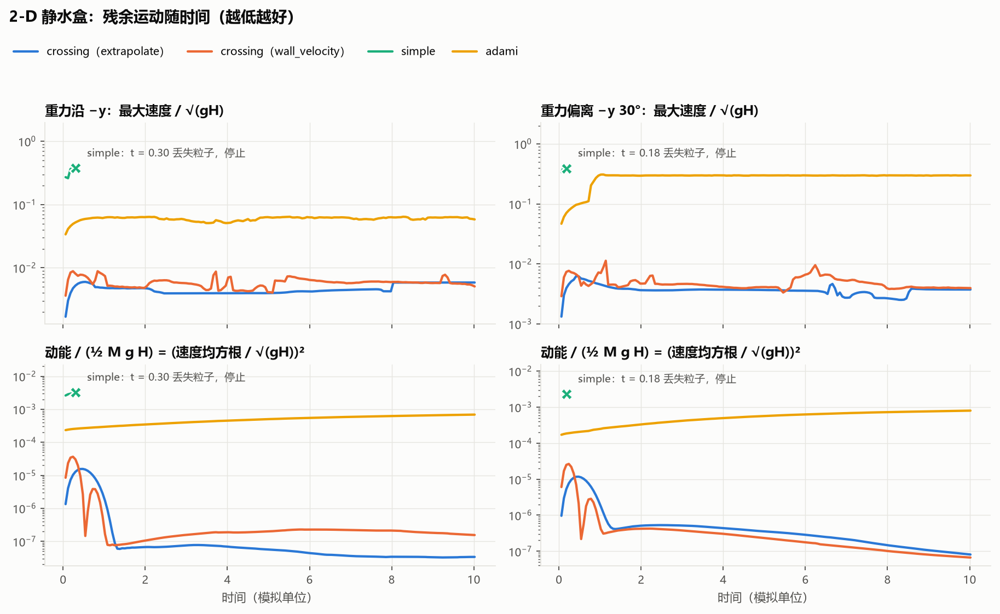
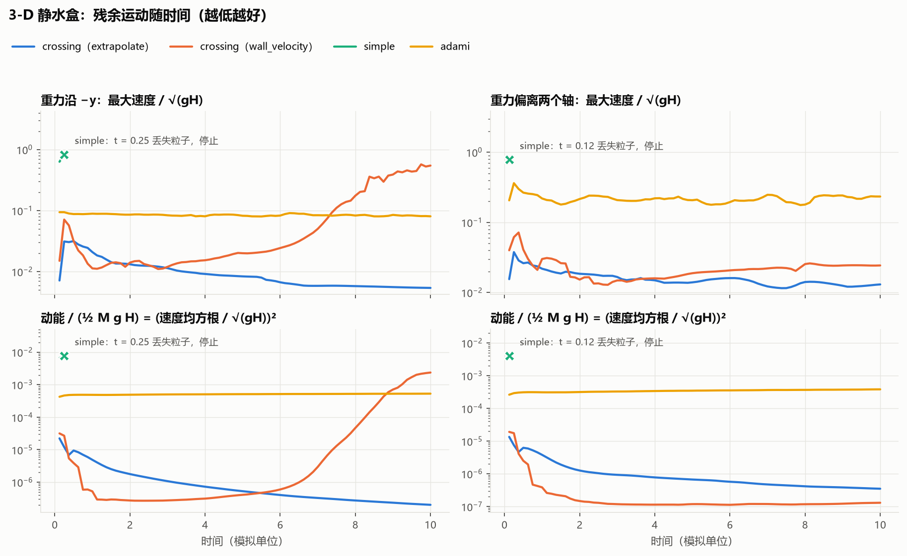

# `wall_boundary: crossing`（穿壁比例壁面）实现与验收报告

- 分支 `v7-wall-crossing`，基点 `origin/bootstrap-density-fix`（eda5b90），只有本地提交，没有 push、合并或标签。
- 工作树 `C:\Users\cchen\PycharmProjects\vulkan-demo-wall-crossing`。
- 本文由 `experiment/wall_crossing/report_tables.py` 从 `claude/wall_crossing/report_source.md` 和各工具写出的表格拼成；表里的数字都是工具从结果文件读出来的，没有手抄。
- 每个数字后面的 `wc-…` 是 `logs/wall_crossing/runs.jsonl` 里的记录号。`logs/` 不入库，所以记录文件另存了一份在 `claude/wall_crossing/runs.jsonl`（本机）和 `claude/wall_crossing/runs_DESKTOP-9IN3NPD.jsonl`（第二台机器）。

> **本报告的状态（2026-11-17 22:35 之后）**：这是一份没有收尾的草稿。用户在 22:35 要求停掉所有长运行，只做第 6 节的机理确认实验，并且不继续原任务里没做完的项目。因此：
> - 第 6 节是完整的，是最新的内容。
> - 第 1–4 节是停止之前写的。其中标着"**未完成**"的地方没有再补：结论摘要、6.4 的文字结论和 1000² 一档、3-D 方腔的互比、3-D 计时、K = 2 吞吐、各阶段的"未验证"清单、下一步建议。
> - 6.4 的表停在 250² 和 500² 两档（500² 的 wall_velocity 在 t = 34.9 失败，表里还没有这一行；1000² 的各次运行都没有跑完）。

## 0. 结论

（**未完成**：这一部分（`summary_text.md`）在长运行按用户要求停止时还没有写或没有数据，之后没有继续；见第 6 节。）

## 1. 通用事项

### 1.1 提交

| 提交 | 标题 |
|---|---|
| `052cfb9` | wall_boundary crossing (stage 1 implementation): crossing-fraction walls of an axis-aligned box, one GPU, fused pass |
| `029313a` | wall_boundary crossing: run tools (cavity launcher, kernel timing, pipeline statistics, logged runs) |
| `5ee25b1` | wall_boundary crossing: validation tools (tables, hydrostatic box, bit-identity, pipeline recipes) + hydrostatic cases |
| `a2149ed` | wall_boundary crossing: slabs with a peer (stage 3 enablement), pipelined drivers, 3-D cavity cases |
| `465d328` | wall_boundary crossing: K = 2 comparison tools (bit comparison + voxel-list probe, seam audit driver), table diagnostics |
| `fac95ac` | wall_boundary crossing: tilted 3-D hydrostatic cases get 64 incoming slots (a lattice in uniform free fall enters a voxel through three faces in one step: 48 arrivals overflowed 32 slots and predict killed the excess); hydrostatic.py names the overflow in a failure |
| `dba0f27` | wall_boundary crossing: single_step judges acceleration and shift against their summed pair terms |
| `ae5f41e` | wall_boundary crossing: report tools (figures, tables with run records, report assembly), outcome classes for longer bit windows |
| `96c9da1` | wall_boundary crossing: K = 2 throughput tool, run records in the cavity tables, a stale file name in a docstring |
| `0e38558` | wall_boundary crossing: report tables (3-D cavity comparison, combined seam audit table, commits, copies of tool summaries and run records) |
| `6a1bada` | wall_boundary crossing: cavity tables list the repeat run and name the convergence quantities without pipe characters |
| `81ae0d9` | wall_boundary crossing: diagnostic switch numerics.wall_crossing.delta_wall (extension / rest_density) |

（加入本报告的那个提交排在这些之后。）

求解器文件（`experiment/v7`、`experiment/validation`、`materials`）在 052cfb9、029313a、5ee25b1 三个提交之间完全相同（`git diff --stat` 为空）；5ee25b1 之后只有 a2149ed 改了 `simulator_v7.py`（放开有 peer 的 slab，单卡路径不变）和一处文档串。所以本报告里在这几个提交上跑的单卡结果用的是同一份求解器代码，可以并列。

### 1.2 机器与 GPU

| 机器 | GPU | Vulkan deviceUUID | 用途 |
|---|---|---|---|
| 本机 DESKTOP-LDQTHT7 | RTX 5090（接显示器，v7 设备 0） | fb83f0dafd9e1d38dc05e7ae643e22a8 | crossing 的 1000² 方腔、双卡的一半、短算例 |
| 本机 DESKTOP-LDQTHT7 | RTX 5090（无显示器，v7 设备 1） | ae137c668a40f5acaab90a83f7cda175 | 计时与寄存器、crossing 的 250² / 500² 方腔、3-D 算例 |
| 第二台 DESKTOP-9IN3NPD（10.147.20.1） | RTX 5090，驱动 610.88 | a85cce699d0fb7294c33d0a5981a4666 | simple / adami 对照组的方腔 |

第二台机器上只动了自己建的 `D:\vulkan-demo-wall-crossing`（代码用 tar 包经 SFTP 传过去，依赖装在该目录的 `.venv`，结果用 SFTP 取回 `logs/wall_crossing/cavity/` 和 `logs/wall_crossing/remote/`）。没有改任何系统设置；机器上另一位用户的进程没有碰。

### 1.3 运行方式

所有命令从工作树根目录用 `C:\Users\cchen\PycharmProjects\vulkan-demo\.venv\Scripts\python.exe` 运行，环境变量 `VK_LOADER_LAYERS_DISABLE=VK_LAYER_KHRONOS_validation`、`OPENBLAS_NUM_THREADS=1`。工具都在 `experiment/wall_crossing/`，各自的文档串里有命令行；附录 A 列出每个工具对应哪项验收。

## 2. 阶段 1：2-D 盒体，单卡

### 2.1 改动清单

**着色器（`experiment/v7/shaders`）**

| 文件 | 改动 |
|---|---|
| `wall_boundary.glsl` | 末尾新增一节（`#ifdef WALL_CROSSING`）：`WALL_BOUNDARY_CROSSING = 2`；spec const 120–127；瞬态缓冲的声明；几何函数 `wall_crossing_distance_to_wall`（φ）、`wall_crossing_depth_behind_wall`（d）、带下限的 φ、系数 1 + d/φ；A_f 的正则化求逆（与修正矩阵同一流程，失败返回 false）；对称矩阵的解包。换一般几何时只替换前两个函数。 |
| `correction_density.comp` | `#ifdef WALL_CROSSING` 内：壁粒子自身提前返回（单位矩阵、零梯度、零核和，scratch 写 ρ0 的存储值和 0 压力）；流体粒子的 φ_i、`fluid_correction_matrix`、只含流体邻居的密度梯度 g_f、壁邻居漂移项的系数、壁邻居扩散项的向量累加；循环后求 A_f⁻¹ 并写入瞬态缓冲、回退计数、密度变化率里的壁面扩散项。 |
| `force.comp` | `#ifdef WALL_CROSSING` 内：`wall_kernel_gradient_sum`、`fluid_pressure_gradient_sum`；壁邻居不做逐对压力项；壁邻居的粘性速度差乘 1 + d/φ；循环后的壁面压力项。 |
| `common.glsl` | 只改注释和一个字段名：状态块第 39 个字段原名 `status_reserved_7`（此前没有任何 kernel 写），改名 `wall_crossing_gradient_fallback_count`。SPIR-V 不带名字，所有旧模块字节不变。 |
| `compile_shaders_v7.py` | `SHADER_VARIANTS` 增加两个变体：`correction_density_wall_crossing`、`force_wall_crossing`（同一源文件加 `-DWALL_CROSSING`）。 |
| `spv/` | 新增 `correction_density_wall_crossing.comp.spv`、`force_wall_crossing.comp.spv`；原有 23 个 `.spv` 重新编译后字节相同；`MANIFEST.txt` 重新生成（25 个文件）。 |
| `README.md` | spec const 表、文件清单。 |

**新增的 spec const**（只编进两个 crossing 变体）

| 编号 | 名字 | 含义 |
|---|---|---|
| 100 | `WALL_BOUNDARY` | 原有；新增取值 2 = crossing |
| 120 | `WALL_CROSSING_CONTINUITY` | 连续性方程里壁邻居的速度差：0 = extrapolate，1 = wall_velocity |
| 121 | `WALL_CROSSING_DISTANCE_FLOOR` | φ_i 的下限，单位米（下限系数 × 粒子间距） |
| 122–124 | `WALL_CROSSING_BOX_LOWER_X/Y/Z` | 盒的下角 |
| 125–127 | `WALL_CROSSING_BOX_UPPER_X/Y/Z` | 盒的上角 |

**新增的缓冲**

`wall_crossing_fluid_inverse`：set 0 binding 12，每粒子 2 个 vec4（32 字节）：`[2 i] = (m00, m11, m22, m01)`，`[2 i + 1] = (m02, m12, 0, 有效标志)`。只在 crossing 的 slab 上创建；同一步内遍历 1 写、遍历 2 读；不在 defrag 和传输的搬运列表里。simple / adami 的缓冲清单不变（见 6.1 的管线配方比较）。

**主机端（`experiment/v7/utils`）**

| 文件 | 改动 |
|---|---|
| `wall_crossing_v7.py`（新） | `WallCrossingSettings`；`numerics.wall_crossing` 的解析；φ、d 的 numpy 版本；缺省盒的推导和加载时的检查；诊断量。 |
| `case_v7.py` | `WALL_BOUNDARY_CHOICES` 增加 `crossing`；`NumericsConstants.wall_crossing`。 |
| `case_loader_v7.py` | 读 `numerics.wall_crossing`；`use_kcg_correction` 关闭或出现流体、壁以外的材料 kind 时报 `ValueError`；确定并打印盒。 |
| `simulator_v7.py` | crossing 时：spec const 100 = 2 并追加 120–127；加载两个变体模块；建瞬态缓冲；不建 wall pipeline；deep-wall skip 解析为关闭；`_check_wall_crossing_supported()` 对不支持的路径报 `ValueError`（非融合路径、未解析的设置；有 peer 时见阶段 3）。 |
| `_test_seam_layout.py` | 把两个新 `.spv` 加进"新增文件"的排除表，把 `wall_crossing` 加进 v7 独有字段表。 |

**算例（都引用基础算例的 OBJ，不复制）**

- `cases/lid_driven_cavity_2d_n{250,500,1000}_xi0p001_eps0p0025_crossing`、`…_crossing_wall_velocity`、`…n250…_crossing_floor0p5`。
- `cases/wall_crossing/hydrostatic_2d_n250_{gy,g30}_{simple,adami,crossing,crossing_wall_velocity}`（由 `hydrostatic.py make-cases` 生成）。

**工具**：`experiment/wall_crossing/`（附录 A）。

### 2.2 与任务文件不一致的代码事实

| 任务文件的说法 | 实际看到的 | 我的调整 |
|---|---|---|
| 仓库里若有 `claude/wall_crossing/`（设计文档、`check.py`、`check2.py`）先读 | 基点上没有这个目录，全库也没有这两个脚本 | numpy 参考实现按任务文件第 2、5 节自己写（`experiment/wall_crossing/reference.py`） |
| SPIR-V 新鲜度检查（`_test_seam_layout.py`）要通过 | 这个测试在基点 eda5b90 上本身就有 858 项失败（都是"钉住的命令流"和分区数值两类，没有一项是 SPIR-V 过期）；SPIR-V 新鲜度那一段是通过的 | 标准改为"失败清单与基点完全相同，且新鲜度段通过"。当前提交上重跑：858 项，与基点逐条相同（wc-20261117-190213-0536；清单在 `claude/wall_crossing/tests/`） |
| 6.1：在两个提交上各跑若干千步，最终状态逐位相同 | 这个求解器同一个构建跑两次，超过一定步数后自己都不逐位相同（体素表按线程到达顺序追加，`canonical_dump.py` 文档串里写明）。250² 上 simple 约到 999 步、adami 约到 200 步之内可以稳定复现 | 分三层回答，见 6.1：canonical 窗口内逐位相同；更长窗口用"结果类"比较；管线配方（模块、spec const、缓冲）逐项相同 |
| 6.7：沿用 E9 的轻量等价检查 | 本分支的树里没有找到这个名字的脚本或文档 | 用 `_run_v7_equivalence.py`（包络检查）、canonical 逐位比较和接缝审计三项代替 |
| 已占用的 spec const：…100–115 附近 | 实际占用到 115，116–127 标为保留 | 用 120–127，116–119 仍空着；已记进 `shaders/README.md` 和 `common.glsl` 的表 |
| 6.5：用 `_run_kernel_breakdown.py` 或现有单卡 bench | `_run_kernel_breakdown.py` 是给 V0 / V5 的 | 用 v7 自带的 `BenchTimer` 写了 `kernel_timing.py`（各配置交替、多轮） |
| A_f⁻¹ 缓冲：对称，6 个浮点 | std430 下 6 个浮点要按 vec4 对齐，而且遍历 2 需要知道遍历 1 是否回退 | 每粒子 2 个 vec4：6 个分量 + 1 个有效标志 + 1 个空位 |

其余"代码事实"（每步顺序、融合 pass 的做法、符号约定、`wall_dummy_velocity` 的先例、`density_gradient_kernel_sum.xyz` 无人读取、寄存器数 2-D 56 / 3-D 64）与代码一致。

### 2.3 我做的决定

1. **用编译变体而不是 spec const 分支。** 任务文件要求新代码放在 `WALL_BOUNDARY == 2` 的分支里。我把新代码放在 `#ifdef WALL_CROSSING` 里，编成两个单独的 `.spv`，其中每条语句再受 `WALL_BOUNDARY == 2` 约束。理由：这样 simple / adami 运行的 SPIR-V 文件与基点字节相同（MANIFEST 可核对），"逐位不变"由构建保证，不依赖驱动对死分支的优化。代价是多两个 `.spv`。
2. **spec const 编号 120–127，缓冲 binding 12。** 全库 grep 确认未用。
3. **回退计数放在状态块的保留字段 [39]。** 不改状态块大小，不动别的字段。
4. **缺省盒 = 流体粒子包围盒各向外扩一个粒子半径**（任务文件的规定），加载时打印。方腔的流体格点正好铺满 [−0.5, 0.5]，所以 250² 的盒是 ±0.502：壁面在最外一排流体和最里一排壁粒子的正中间。这使 crossing 的方腔边长是 1 + dx，而已发表的表格（simple）取的是 1 + 2 dx（最里一排壁粒子的中心线）。6.4 的表两种取法（wall 帧、mid 帧）都给。
5. **加载时检查**：流体粒子有一个在盒外、或壁粒子有一个在盒内，就报 `ValueError` 并写出个数和最坏的距离。
6. **壁粒子自身**在遍历 1 里往 scratch 写 (ρ0 的存储值, 0)，这样它的密度一直是 ρ0、压力一直是 0，流体读到的壁邻居体积是 m_j / ρ0。
7. **deep-wall skip** 在 crossing 下解析为关闭：壁粒子本来就提前返回，不需要它；这样也不会走到它的记录和检查逻辑。
8. **A_f 求逆回退**时写有效标志 0，遍历 2 看到 0 就不加 (A_f⁻¹ − L) g_f 这一项（等价于 G = 0），遍历 1 的壁面扩散项同样取 0；回退次数累计在状态字段里。
9. **下限**用米为单位的 spec const 传给着色器（系数 × 2 × 粒子半径）。
10. **不支持的情况一律在主机端报 `ValueError`**：`use_kcg_correction` 关闭；非融合路径（`V7_FUSED_CORRECTION_DENSITY=0`，或融合被别的开关关掉）；算例里有流体和壁以外的材料 kind；设置没有经加载器解析。
11. **单步对照的判据。** 密度变化率用"超出 ρ 的 1 ulp 的部分"判：GPU 给的是更新后的密度（float32），ρ ≈ 1000 时 1 ulp 是 6.1e-5，一步的变化量经常只有几个 ulp，直接比变化率的相对误差量的是存储的量化。加速度和位移修正用"误差 ÷ 逐对项绝对值之和"判（要求小于容差的十分之一）：这两个量是大量相消的和，个别粒子的结果比它的项小几个数量级，相对误差没有意义。两种相对误差仍然都列在表里。L、A_f⁻¹、核和、g_f 直接用相对误差。
12. **方腔运行的启动器。** `cavity_run.py` 包了一层 `experiment/validation/cavity_runner`（协议、定常判据、平均窗口都是它的），加了看门狗、断点续跑和 runs.jsonl 记录；`cavity_runner_entry.py` 在不改 `cavity_runner.py` 的前提下补两件事：没有 `.git` 时（第二台机器上是 tar 包）从 `COMMIT` 文件取提交号，以及 crossing 运行每 20 000 步记一次回退计数和 φ 的最小值。
13. **长运行用冻结的工作树。** 开发还在继续的时候，长时间的方腔运行从 `vulkan-demo-wall-crossing-run`（5ee25b1 的分离检出）启动，结果仍写回本工作树的 `logs/`。
14. **静水盒和 3-D 算例走流水线路径。** 单卡的逐步提交路径在与别的作业共用 GPU 时只有约 170 步/秒；`chain_runner.py` 用生产用的链路径（K = 1 的链，深度 2）驱动，共用时约 1200–1800 步/秒。物理上是同一个求解器。
15. **第二台机器不配密钥登录。** 配密钥要写 `C:\ProgramData\ssh\administrators_authorized_keys`，在专用工作目录之外，属于 1.2 的边界；所以一直用密码，密码只经环境变量传给本机的 paramiko 脚本，没有写进任何文件、提交、日志或本报告。
16. **对照组放在第二台机器上跑**（simple / adami 的 250²、500²、1000²），crossing 在本机跑。三张卡都是 RTX 5090，求解器代码相同，驱动版本不一定相同；没有做"同一算例在两台机器上各跑一次"的比较。

### 2.4 验收

#### 6.1 simple 和 adami 逐位不变

三层证据：

**(a) 运行的是同一份东西。** 两个新 `.spv` 之外的 23 个 SPIR-V 文件字节相同。`pipeline_statistics.py` 在基点工作树和本分支上各建一次真实的 K = 1 模拟器，逐条比较每个管线的模块 sha256、spec const 条目、缓冲清单和驱动给出的编译统计：250² 和 1000² 的 simple / adami（28 / 30 个管线、24 个缓冲）、3-D 1M 的 simple / adami（30 / 32 个管线、26 个缓冲）全部相同。

**(b) canonical 窗口内逐位相同**（`canonical_dump.py --canonical-lists`，250²；每个版本跑两次，先确认各自能复现自己，再比两个版本）：

| 比较（算例、步数窗口、K、两侧） | 结论 | 比较时本分支的提交 | 记录 |
|---|---|---|---|
| adami_n250_canonical K=1 base_self | BIT-IDENTICAL | 029313a | wc-20261117-171905-2971 |
| adami_n250_canonical K=1 base_vs_this | BIT-IDENTICAL | 029313a | wc-20261117-171905-88f1 |
| adami_n250_canonical K=1 this_self | BIT-IDENTICAL | 029313a | wc-20261117-171905-aed3 |
| adami_n250_canonical K=2 base_self | BIT-IDENTICAL | a2149ed+dirty | wc-20261117-182512-b196 |
| adami_n250_canonical K=2 base_vs_this | BIT-IDENTICAL | a2149ed+dirty | wc-20261117-182512-6148 |
| adami_n250_canonical K=2 this_self | BIT-IDENTICAL | a2149ed+dirty | wc-20261117-182512-aa71 |
| adami_n250_nodefrag_3000 K=1 base_self | NOT bit-identical | 029313a | wc-20261117-172007-7816 |
| adami_n250_nodefrag_3000 K=1 base_vs_this | NOT bit-identical | 029313a | wc-20261117-172007-4fb0 |
| adami_n250_nodefrag_3000 K=1 this_self | NOT bit-identical | 029313a | wc-20261117-172007-1fb8 |
| adami_n250_plain K=1 base_self | NOT bit-identical | 029313a | wc-20261117-171921-d234 |
| adami_n250_plain K=1 base_vs_this | NOT bit-identical | 029313a | wc-20261117-171921-e91f |
| adami_n250_plain K=1 this_self | NOT bit-identical | 029313a | wc-20261117-171921-a87f |
| crossing default: build before the diagnostic switch (a2149ed) vs with it, K=1 700 steps | ok | 6a1bada+dirty | wc-20261117-224106-e5d5 |
| simple_n250_canonical K=1 base_self | BIT-IDENTICAL | 029313a | wc-20261117-171901-3467 |
| simple_n250_canonical K=1 base_vs_this | BIT-IDENTICAL | 029313a | wc-20261117-171901-11cd |
| simple_n250_canonical K=1 this_self | BIT-IDENTICAL | 029313a | wc-20261117-171901-d36c |
| simple_n250_canonical K=2 base_self | BIT-IDENTICAL | a2149ed+dirty | wc-20261117-182501-3690 |
| simple_n250_canonical K=2 base_vs_this | BIT-IDENTICAL | a2149ed+dirty | wc-20261117-182501-0600 |
| simple_n250_canonical K=2 this_self | BIT-IDENTICAL | a2149ed+dirty | wc-20261117-182501-75b2 |
| simple_n250_nodefrag_3000 K=1 base_self | BIT-IDENTICAL | 029313a | wc-20261117-171958-091b |
| simple_n250_nodefrag_3000 K=1 base_vs_this | NOT bit-identical | 029313a | wc-20261117-171959-e3c8 |
| simple_n250_nodefrag_3000 K=1 this_self | NOT bit-identical | 029313a | wc-20261117-171959-0f65 |
| simple_n250_nodefrag_8000 K=1 base_self | NOT bit-identical | 029313a | wc-20261117-172019-d629 |
| simple_n250_nodefrag_8000 K=1 base_vs_this | NOT bit-identical | 029313a | wc-20261117-172020-54c2 |
| simple_n250_nodefrag_8000 K=1 this_self | NOT bit-identical | 029313a | wc-20261117-172019-e756 |
| simple_n250_plain K=1 base_self | NOT bit-identical | 029313a | wc-20261117-171913-01a2 |
| simple_n250_plain K=1 base_vs_this | NOT bit-identical | 029313a | wc-20261117-171913-ad2d |
| simple_n250_plain K=1 this_self | NOT bit-identical | 029313a | wc-20261117-171913-57f0 |

`canonical` 的四组（simple 999 步、adami 200 步，K = 1 和 K = 2）三项比较全部 BIT-IDENTICAL。K = 2 的 simple 即任务 6.7 要求的那一项。`plain`（4000 步，经过 defrag）和 `nodefrag`（3000、8000 步）几组，基点自己跑两次就不相同，所以这些窗口上"两个版本是否相同"单靠一对运行回答不了。

**(c) 更长的窗口：结果类。** 每个版本各跑 6 次，把 12 个最终状态按"逐位相同"分类。同一个版本可能落进不同的类（体素表的到达顺序不同）；只要两个版本落进过同一个类，就说明两者的算术在这个窗口上相同：

| 算例 | K | 步数 | 体素表 | 每个版本的运行次数 | 结果类（base 次数 / 本分支次数） | 两个版本共有的结果类 | 记录 |
|---|---|---|---|---|---|---|---|
| simple_n250_nodefrag_1500 | 1 | 1500 | canonical | 6 | 6 / 6 | 1（共 1 类） | wc-20261117-185159-bde1 … wc-20261117-185223-e50e |
| simple_n250_nodefrag_3000 | 1 | 3000 | canonical | 6 | 1 / 0，1 / 1，0 / 1，1 / 0，1 / 2，2 / 1，0 / 1 | 3（共 7 类） | wc-20261117-185223-6d1a … wc-20261117-185306-1913 |
| adami_n250_nodefrag_400 | 1 | 400 | canonical | 6 | 5 / 5，1 / 1 | 2（共 2 类） | wc-20261117-185306-c1bd … wc-20261117-185325-02fa |
| adami_n250_nodefrag_1000 | 1 | 1000 | canonical | 6 | 1 / 1，3 / 4，1 / 1，1 / 0 | 3（共 4 类） | wc-20261117-185325-bff4 … wc-20261117-185348-615e |

simple 1500 步：12 次全部相同。simple 3000 步、adami 400 和 1000 步：出现多个类，但每一组里基点和本分支都有共同的类（3000 步的 simple 有 3 个共同类）。也就是说，到 3000 步（simple）和 1000 步（adami）为止，本分支能算出与基点逐位相同的状态；不同的运行之间的差别来自求解器本身的到达顺序，两个版本都有。

**(d) 计时与寄存器，前后对比**（1000²，独占无显示器的那张卡；寄存器数来自 `VK_KHR_pipeline_executable_properties`）：

| 算例 | 代码 | 壁面 | 第一遍 correction_density：寄存器（二进制大小） | 第二遍 force | 壁面遍 wall_extrapolate | 记录 |
|---|---|---|---|---|---|---|
| 2-D 方腔 1000² | 基线 eda5b90 | simple | 56（6,144 B） | 63（5,504 B） | — | wc-20261117-170506-4364 |
| 2-D 方腔 1000² | 基线 eda5b90 | adami | 56（6,144 B） | 64（5,888 B） | 34（3,840 B） | wc-20261117-170508-6b03 |
| 2-D 方腔 1000² | 本分支 | simple | 56（6,144 B） | 63（5,504 B） | — | wc-20261117-170502-8279 |
| 2-D 方腔 1000² | 本分支 | adami | 56（6,144 B） | 64（5,888 B） | 34（3,840 B） | wc-20261117-170503-ad67 |
| 2-D 方腔 1000² | 本分支 | crossing | 72（8,960 B） | 78（7,424 B） | — | wc-20261117-170504-1ffc |
| 2-D 方腔 1000² | 本分支 | crossing（wall_velocity） | 68（8,192 B） | 78（7,424 B） | — | wc-20261117-185218-d99e |
| 3-D 方腔 1M | 基线 eda5b90 | simple | 64（7,552 B） | 64（6,016 B） | — | wc-20261117-185211-1c25 |
| 3-D 方腔 1M | 基线 eda5b90 | adami | 64（7,680 B） | 64（6,528 B） | 38（3,968 B） | wc-20261117-185215-0faa |
| 3-D 方腔 1M | 本分支 | simple | 64（7,552 B） | 64（6,016 B） | — | wc-20261117-183313-16f7 |
| 3-D 方腔 1M | 本分支 | adami | 64（7,680 B） | 64（6,528 B） | 38（3,968 B） | wc-20261117-183315-9986 |
| 3-D 方腔 1M | 本分支 | crossing | 80（10,880 B） | 72（8,192 B） | — | wc-20261117-183318-5675 |
| 3-D 方腔 1M | 本分支 | crossing（wall_velocity） | 77（10,112 B） | 72（8,192 B） | — | wc-20261117-183321-1af9 |

每步 GPU 时间（µs）：3 轮交替测量的中位数（最小–最大）；每次 8000 步，前 3000 步不计；设备 ae137c668a40f5acaab90a83f7cda175。“相对 simple” = 整步时间相对本分支 simple。

| 配置 | predict | update_voxel | correction_density | density_copy | wall_extrapolate | force | 整步 | 相对 simple | 记录 |
|---|---|---|---|---|---|---|---|---|---|
| base_simple | 27.7（27.7–27.7） | 20.4（20.4–20.4） | 608.9（606.9–609.1） | 8.2（8.2–8.2） | — | 673.4（670.0–673.9） | 1338.7（1333.2–1339.2） | -0.1 % | wc-20261117-170547-4b82 … a669 |
| branch_simple | 27.7（27.7–27.7） | 20.4（20.3–20.4） | 609.3（607.3–611.0） | 8.2（8.2–8.2） | — | 674.2（671.3–674.8） | 1339.7（1334.9–1342.0） | +0.0 % | wc-20261117-170600-2a3e … e46b |
| base_adami | 28.0（28.0–28.0） | 19.6（19.5–19.6） | 592.3（591.9–593.6） | 8.2（8.2–8.2） | 67.7（67.7–68.0） | 770.8（770.5–771.6） | 1487.4（1486.2–1487.9） | +11.0 % | wc-20261117-170613-d7ef … 2728 |
| branch_adami | 28.0（28.0–28.0） | 19.6（19.6–19.6） | 593.0（592.5–593.4） | 8.2（8.2–8.2） | 68.2（67.8–68.3） | 770.5（770.5–772.7） | 1487.9（1487.1–1489.2） | +11.1 % | wc-20261117-170628-2d8a … c3a8 |
| branch_crossing | 34.1（34.1–34.1） | 20.4（20.4–20.4） | 790.3（790.2–791.1） | 8.2（8.2–8.2） | — | 933.0（933.0–934.4） | 1786.0（1785.8–1788.1） | +33.3 % | wc-20261117-170642-7826 … 4877 |
| branch_crossing_wall_velocity | 34.1（34.1–34.1） | 20.4（20.3–20.4） | 758.5（758.3–758.7） | 8.2（8.2–8.2） | — | 928.9（928.6–929.3） | 1749.9（1749.7–1750.7） | +30.6 % | wc-20261117-170700-26ea … 9f84 |

simple 和 adami 的寄存器数、二进制大小前后相同；整步时间前后差 0.1 % 以内（simple 1338.7 → 1339.7 µs，adami 1487.4 → 1487.9 µs），在各自三轮的最小–最大范围之内。

#### 6.2 单步对照

`experiment/wall_crossing/reference.py` 是任务文件第 5 节公式的 numpy（float64）实现，2-D / 3-D 通用；`single_step.py` 生成一个小盒算例（2-D：50 × 40 个流体粒子，壁 1224 个；3-D：24 × 20 × 16，壁 18 840 个），把位置、速度、密度设成给定的场，让 GPU 走一步，再逐粒子比较。"光滑场"是任务要求的那一项（非平凡的光滑速度和密度场，粒子位置加了扰动，使一部分粒子低于距离下限）；Couette 和静水两种配置是我加的，用来单独看粘性项和压力项。

| 配置 | 流体 / 壁粒子 | A_f 回退（GPU = 参考） | 新密度误差（ulp，最大） | 密度变化率：超出 1 ulp 的相对误差 | 加速度：最大相对误差 / 误差 ÷ 对项绝对值之和 | 位移修正：同左 | L | A_f⁻¹ | 核和 | g_f | 推导恒等式（仅参考解）：压力 / 壁面密度扩散 | 判据值 | 结论 | 记录 |
|---|---|---|---|---|---|---|---|---|---|---|---|---|---|---|
| 2-D 光滑场，extrapolate | 2,000 / 1,224（近壁 731，低于下限 8） | 0 = 0；截断 0 | 1.06 | 7.4e-08 | 7.0e-06 / 3.8e-07 | 1.1e-04 / 1.8e-07 | 8.3e-06 | 3.3e-06 | 6.4e-07 | 4.9e-07 | 3.6e-15 / 1.0e-04 | 8.3e-06（容差 1e-04） | 通过 | wc-20261117-183041-1ede |
| 2-D 光滑场，wall_velocity | 2,000 / 1,224（近壁 731，低于下限 8） | 0 = 0；截断 0 | 1.05 | 1.8e-07 | 8.2e-06 / 3.8e-07 | 9.9e-05 / 1.7e-07 | 8.2e-06 | 3.8e-06 | 6.3e-07 | 7.2e-07 | 3.6e-15 / 4.3e-04 | 8.2e-06（容差 1e-04） | 通过 | wc-20261117-183042-7b76 |
| 2-D Couette，extrapolate | 2,000 / 1,224（近壁 729，低于下限 0） | 0 = 0；截断 0 | 1.18 | 2.7e-07 | 8.7e-07 / 5.5e-07 | 6.7e+00 / 1.2e-07 | 6.9e-06 | 2.9e-06 | 4.3e-07 | 0 | 0 / 0 | 6.9e-06（容差 1e-04） | 通过 | wc-20261117-183043-331c |
| 2-D Couette，wall_velocity | 2,000 / 1,224（近壁 729，低于下限 0） | 0 = 0；截断 0 | 0.54 | 0 | 8.1e-07 / 5.7e-07 | 7.0e+00 / 1.5e-07 | 6.6e-06 | 2.9e-06 | 3.8e-07 | 0 | 0 / 0 | 6.6e-06（容差 1e-04） | 通过 | wc-20261117-183043-b6b3 |
| 2-D 静水（p > 0），extrapolate | 2,000 / 1,224（近壁 729，低于下限 0） | 0 = 0；截断 0 | 0.00 | 0 | 2.9e-02 / 1.9e-07 | 5.5e+00 / 1.3e-07 | 7.5e-06 | 3.2e-06 | 4.3e-07 | 0 | 3.4e-14 / 0 | 7.5e-06（容差 1e-04） | 通过 | wc-20261117-183045-1352 |
| 2-D 静水（p < 0），extrapolate | 2,000 / 1,224（近壁 729，低于下限 0） | 0 = 0；截断 0 | 0.00 | 0 | 5.9e-04 / 2.3e-07 | 8.1e+00 / 1.3e-07 | 6.9e-06 | 2.9e-06 | 4.3e-07 | 0 | 1.5e-15 / 0 | 6.9e-06（容差 1e-04） | 通过 | wc-20261117-183046-59be |
| 3-D 光滑场，extrapolate | 7,680 / 18,840（近壁 5,702，低于下限 8） | 0 = 0；截断 2 | 1.56 | 2.2e-06 | 5.5e-06 / 5.6e-07 | 7.5e-05 / 2.4e-07 | 1.0e-05 | 4.5e-06 | 1.1e-06 | 1.1e-06 | 4.8e-03 / 3.3e-04 | 1.0e-05（容差 1e-04） | 通过 | wc-20261117-183048-c0a7 |
| 3-D 光滑场，wall_velocity | 7,680 / 18,840（近壁 5,702，低于下限 8） | 0 = 0；截断 2 | 1.19 | 4.6e-07 | 5.2e-06 / 5.7e-07 | 4.3e-05 / 2.3e-07 | 1.3e-05 | 4.9e-06 | 1.0e-06 | 1.1e-06 | 4.8e-03 / 9.2e-04 | 1.3e-05（容差 1e-04） | 通过 | wc-20261117-183050-0798 |
| 3-D Couette，extrapolate | 7,680 / 18,840（近壁 5,691，低于下限 0） | 0 = 0；截断 0 | 1.26 | 6.1e-07 | 1.6e-06 / 1.0e-06 | 1.1e+01 / 1.9e-07 | 9.7e-06 | 5.9e-06 | 1.9e-06 | 0 | 0 / 0 | 1.0e-05（容差 1e-04） | 通过 | wc-20261117-183052-8db5 |
| 3-D Couette，wall_velocity | 7,680 / 18,840（近壁 5,691，低于下限 0） | 0 = 0；截断 0 | 0.61 | 0 | 1.6e-06 / 1.1e-06 | 1.2e+01 / 1.6e-07 | 9.4e-06 | 5.4e-06 | 1.9e-06 | 0 | 0 / 0 | 1.1e-05（容差 1e-04） | 通过 | wc-20261117-183055-7ac1 |
| 3-D 静水（p > 0），extrapolate | 7,680 / 18,840（近壁 5,691，低于下限 0） | 0 = 0；截断 0 | 0.00 | 0 | 3.4e-02 / 2.5e-07 | 1.1e+01 / 1.7e-07 | 9.9e-06 | 6.0e-06 | 1.8e-06 | 0 | 8.7e-14 / 0 | 9.9e-06（容差 1e-04） | 通过 | wc-20261117-183058-a3bc |
| 3-D 静水（p < 0），extrapolate | 7,680 / 18,840（近壁 5,691，低于下限 0） | 0 = 0；截断 0 | 0.00 | 0 | 1.4e-03 / 5.3e-07 | 1.6e+01 / 1.6e-07 | 1.1e-05 | 5.6e-06 | 1.8e-06 | 0 | 2.2e-15 / 0 | 1.1e-05（容差 1e-04） | 通过 | wc-20261117-183101-e3ff |

- 两种连续性开关、2-D 和 3-D，全部通过；判据值最大 1.3e-5（容差 1e-4）。
- GPU 的 A_f 回退计数与参考解逐一相同（都是 0）。3-D 光滑场里有 2 个粒子的 A_f⁻¹ 触到 Frobenius 上限，GPU 与参考解一致。
- "推导恒等式"一列只用参考解：把壁邻居的值逐对写出来求和，与任务文件 5.4 化简后的式子比较。压力项在 2-D 里相差 3.6e-15（因为 A_f 对称，化简是恒等的）；3-D 光滑场里相差场的 4.8e-3，来自那 2 个被 Frobenius 上限截断的粒子（截断后 L A ≠ I）。壁面密度扩散项相差场的 1e-4 到 4e-4，是 L A ≈ I 这一步近似的大小。

各壁面模式一步之后的物理残差（同一个盒、同一个场）：

| 维度 | 配置与量 | 壁面 | 全部流体：最大 | 近壁（h 内）：均方根 | 内部：最大 | 记录 |
|---|---|---|---|---|---|---|
| 2-D | Couette：粘性加速度残差 ÷ (ν · 剪切率 / h) | crossing（extrapolate） | 1.3e-05 | 7.8e-06 | — | wc-20261117-183043-331c |
| 2-D | Couette：粘性加速度残差 ÷ (ν · 剪切率 / h) | crossing（wall_velocity） | 1.3e-05 | 7.8e-06 | — | wc-20261117-183043-b6b3 |
| 2-D | Couette：粘性加速度残差 ÷ (ν · 剪切率 / h) | simple | 2.1e+00 | 9.4e-01 | — | wc-20261117-183044-d9b1 |
| 2-D | Couette：粘性加速度残差 ÷ (ν · 剪切率 / h) | adami | 3.3e-01 | 1.6e-01 | — | wc-20261117-183044-79a0 |
| 2-D | 静水（p > 0）：加速度大小 ÷ 重力大小 | crossing（extrapolate） | 4.3e-03 | 1.2e-03 | 9.4e-04 | wc-20261117-183045-1352 |
| 2-D | 静水（p > 0）：加速度大小 ÷ 重力大小 | simple | 3.5e+01 | 1.4e+01 | 9.3e-04 | wc-20261117-183045-e3e9 |
| 2-D | 静水（p > 0）：加速度大小 ÷ 重力大小 | adami | 1.0e-03 | 8.9e-04 | 9.3e-04 | wc-20261117-183045-2335 |
| 2-D | 静水（p < 0）：加速度大小 ÷ 重力大小 | crossing（extrapolate） | 4.3e-03 | 1.2e-03 | 8.9e-04 | wc-20261117-183046-59be |
| 2-D | 静水（p < 0）：加速度大小 ÷ 重力大小 | simple | 3.5e+01 | 1.4e+01 | 8.9e-04 | wc-20261117-183046-f8e2 |
| 2-D | 静水（p < 0）：加速度大小 ÷ 重力大小 | adami | 8.9e-04 | 8.9e-04 | 8.9e-04 | wc-20261117-183047-57e8 |
| 3-D | Couette：粘性加速度残差 ÷ (ν · 剪切率 / h) | crossing（extrapolate） | 1.1e-05 | 4.9e-06 | — | wc-20261117-183052-8db5 |
| 3-D | Couette：粘性加速度残差 ÷ (ν · 剪切率 / h) | crossing（wall_velocity） | 1.1e-05 | 4.9e-06 | — | wc-20261117-183055-7ac1 |
| 3-D | Couette：粘性加速度残差 ÷ (ν · 剪切率 / h) | simple | 1.8e+00 | 8.9e-01 | — | wc-20261117-183057-9610 |
| 3-D | Couette：粘性加速度残差 ÷ (ν · 剪切率 / h) | adami | 1.6e-01 | 8.0e-02 | — | wc-20261117-183057-1fc4 |
| 3-D | 静水（p > 0）：加速度大小 ÷ 重力大小 | crossing（extrapolate） | 5.6e-03 | 1.3e-03 | 9.7e-04 | wc-20261117-183058-a3bc |
| 3-D | 静水（p > 0）：加速度大小 ÷ 重力大小 | simple | 2.4e+01 | 1.1e+01 | 9.6e-04 | wc-20261117-183100-cd66 |
| 3-D | 静水（p > 0）：加速度大小 ÷ 重力大小 | adami | 9.8e-04 | 9.2e-04 | 9.7e-04 | wc-20261117-183101-2b19 |
| 3-D | 静水（p < 0）：加速度大小 ÷ 重力大小 | crossing（extrapolate） | 5.6e-03 | 1.3e-03 | 9.2e-04 | wc-20261117-183101-e3ff |
| 3-D | 静水（p < 0）：加速度大小 ÷ 重力大小 | simple | 2.4e+01 | 1.1e+01 | 9.2e-04 | wc-20261117-183104-c0cf |
| 3-D | 静水（p < 0）：加速度大小 ÷ 重力大小 | adami | 9.3e-04 | 9.2e-04 | 9.2e-04 | wc-20261117-183104-d83a |

- Couette（线性速度剖面，上下板速度相反）：crossing 的粘性加速度残差是 1e-5 量级（舍入水平），即对线性场精确；simple 是 2.1 / 1.8（单位 ν·剪切率/h），adami 是 0.33 / 0.16。
- 静水（线性压力场）：crossing 最大 4.3e-3 g（2-D）、5.6e-3 g（3-D），出现在近壁；内部都是 9e-4 g。内部这 9e-4 是算例本身的量（g H / c0² = 1e-3 的密度分层），三种模式相同。crossing 近壁比 adami（1.0e-3）大，原因是 A_f 求逆时加的正则化 ξ：近壁粒子的 A_f 只有一侧邻居，条件数差，ξ 的影响比对 L 大。simple 是 35 g / 24 g：它的壁粒子压力恒为 0，不承重。

#### 6.3 静水盒（2-D）

250² 方腔的几何，盖子换成静止壁，|g| = 10，H ≈ 1，c0 = 100（g H / c0² = 1e-3），初始静止、密度均匀，跑到 t = 10（334 000 步）。速度以 √(gH) 为单位，压力以 ρ0 g H 为单位。

静水盒：速度以 √(|g| H) 为单位，压力以 ρ₀ |g| H 为单位（H = 盒沿重力方向的尺寸）。“去电平” = 减去全场平均偏差后的误差。

| 运行 | 壁面 | t | \|v\| 最大 / √(gH)（末 1/5 段） | \|v\| rms / √(gH)（末 1/5 段） | 末态 \|v\| 最大 | 压力 rms 误差（去电平） | 压力最大误差（去电平） | 中心电平 | 拟合梯度误差 | 近壁第 1 层 \|v\| rms | 第 2 层 | 第 3 层 | 内部（≥5 dx） | A_f 回退 | φ_min/dx | 记录 |
|---|---|---|---|---|---|---|---|---|---|---|---|---|---|---|---|---|
| 2d_n250_g30_adami | adami | 10.0 | 3.00e-01 | 2.77e-02 | 2.99e-01 | 0.900 % | 49.408 % | -5.057 % | 2.259 % | 1.64e-02 | 1.11e-02 | 1.38e-02 | 2.91e-02 | 0 | -12.492 | wc-20261117-182852-7025 |
| 2d_n250_g30_crossing | crossing (extrapolate) | 10.0 | 3.88e-03 | 3.28e-04 | 3.76e-03 | 0.034 % | 0.839 % | -1.295 % | 0.106 % | 2.50e-04 | 2.96e-04 | 2.81e-04 | 2.85e-04 | 0 | 0.383 | wc-20261117-175922-f0ee |
| 2d_n250_g30_crossing_wall_velocity | crossing (wall_velocity) | 10.0 | 4.20e-03 | 2.84e-04 | 3.97e-03 | 0.020 % | 0.491 % | -18.060 % | 0.066 % | 2.91e-04 | 2.32e-04 | 1.51e-04 | 2.62e-04 | 0 | 0.378 | wc-20261117-180233-27aa |
| 2d_n250_g30_simple（失败：t = 0.18 时粒子数 74,528 / 74,529，以下为该时刻的值） | simple | 0.2 | 3.93e-01 | 4.80e-02 | 3.93e-01 | 2.462 % | 54.928 % | +0.026 % | 5.983 % | 7.12e-02 | 3.31e-02 | 4.49e-02 | 4.76e-02 | 0 | -13.496 | wc-20261117-182848-f4fd |
| 2d_n250_gy_adami | adami | 10.0 | 6.42e-02 | 2.56e-02 | 5.82e-02 | 0.613 % | 4.857 % | -4.898 % | 1.674 % | 1.39e-02 | 1.04e-02 | 1.33e-02 | 2.70e-02 | 0 | 0.186 | wc-20261117-175522-2dd0 |
| 2d_n250_gy_crossing | crossing (extrapolate) | 10.0 | 5.85e-03 | 1.82e-04 | 5.85e-03 | 0.043 % | 1.042 % | +0.053 % | 0.108 % | 5.17e-04 | 4.93e-04 | 3.82e-04 | 1.44e-04 | 0 | 0.349 | wc-20261117-174907-dc68 |
| 2d_n250_gy_crossing_wall_velocity | crossing (wall_velocity) | 10.0 | 7.77e-03 | 4.25e-04 | 5.07e-03 | 0.025 % | 0.590 % | -19.633 % | 0.068 % | 3.77e-04 | 2.83e-04 | 2.06e-04 | 4.02e-04 | 0 | 0.389 | wc-20261117-175216-7233 |
| 2d_n250_gy_simple（失败：t = 0.30 时粒子数 74,521 / 74,529，以下为该时刻的值） | simple | 0.3 | 3.76e-01 | 5.63e-02 | 3.76e-01 | 3.160 % | 56.725 % | -0.617 % | 5.391 % | 8.61e-02 | 3.40e-02 | 5.03e-02 | 5.67e-02 | 0 | -13.906 | wc-20261117-182842-9f65 |
| 3d_n48_gtilt_adami | adami | 10.0 | 2.43e-01 | 1.94e-02 | 2.34e-01 | 0.257 % | 6.301 % | -0.892 % | 0.805 % | 1.18e-02 | 1.29e-02 | 1.53e-02 | 2.32e-02 | 0 | -0.067 | wc-20261117-184428-d0a7 |
| 3d_n48_gtilt_crossing | crossing (extrapolate) | 10.0 | 1.42e-02 | 6.17e-04 | 1.30e-02 | 0.026 % | 0.758 % | -20.958 % | 0.056 % | 8.79e-04 | 8.28e-04 | 7.12e-04 | 4.26e-04 | 0 | 0.301 | wc-20261117-183244-5118 |
| 3d_n48_gtilt_crossing_wall_velocity | crossing (wall_velocity) | 10.0 | 2.60e-02 | 3.50e-04 | 2.43e-02 | 0.010 % | 0.371 % | -33.164 % | 0.037 % | 7.90e-04 | 6.40e-04 | 2.40e-04 | 1.11e-04 | 0 | 0.300 | wc-20261117-183836-ae5e |
| 3d_n48_gtilt_simple（失败：t = 0.12 时粒子数 195,111 / 195,112，以下为该时刻的值） | simple | 0.1 | 7.81e-01 | 6.34e-02 | 7.81e-01 | 2.778 % | 72.733 % | +0.228 % | 4.043 % | 8.00e-02 | 5.98e-02 | 7.35e-02 | 5.72e-02 | 0 | -4.818 | wc-20261117-185013-3fec |
| 3d_n48_gy_adami | adami | 10.0 | 8.52e-02 | 2.29e-02 | 8.07e-02 | 0.335 % | 3.169 % | -0.966 % | 0.587 % | 1.38e-02 | 1.68e-02 | 2.10e-02 | 2.54e-02 | 0 | 0.257 | wc-20261117-181912-de87 |
| 3d_n48_gy_crossing | crossing (extrapolate) | 10.0 | 5.80e-03 | 4.84e-04 | 5.42e-03 | 0.023 % | 0.371 % | -37.904 % | 0.054 % | 6.89e-04 | 6.36e-04 | 5.08e-04 | 3.19e-04 | 0 | 0.300 | wc-20261117-180509-4674 |
| 3d_n48_gy_crossing_wall_velocity | crossing (wall_velocity) | 10.0 | 5.73e-01 | 2.75e-02 | 5.47e-01 | 2.942 % | 21.941 % | +388.327 % | 2.058 % | 1.18e-01 | 7.65e-02 | 3.00e-02 | 1.32e-02 | 0 | 0.199 | wc-20261117-181345-ef11 |
| 3d_n48_gy_simple（失败：t = 0.25 时粒子数 195,108 / 195,112，以下为该时刻的值） | simple | 0.2 | 8.30e-01 | 8.78e-02 | 8.30e-01 | 4.151 % | 63.429 % | -0.450 % | 2.764 % | 1.12e-01 | 8.61e-02 | 1.00e-01 | 7.79e-02 | 0 | -5.671 | wc-20261117-182436-15b7 |

（这张表也包含阶段 2 的 3-D 算例，名字以 `3d_` 开头。`φ_min/dx` 一列对所有模式都是"流体粒子到盒面的最小距离"，负数表示有粒子在盒面之外。）

2-D 的结论：

- **crossing（extrapolate）**：两个重力方向下，末段最大速度 5.9e-3 和 3.9e-3 √(gH)，均方根 1.8e-4 和 3.3e-4；去掉电平后的压力均方根误差 0.04 % 和 0.03 %；近壁三层的速度均方根 2.5e-4 到 5.2e-4，内部 1.4e-4 到 2.9e-4。最大速度不随时间衰减到零，停在 4e-3 到 6e-3（图上的平台）；动能在 t > 1.5 之后持平或缓慢下降。
- **crossing（wall_velocity）**：速度和压力形状与 extrapolate 相当，但压力电平在 10 个时间单位里掉了 18–20 %（ρ0 g H），即平均密度在持续下降（见 2.5）。
- **adami**：重力沿 −y 时最大速度 6e-2、均方根 2.6e-2，动能在缓慢上升；重力偏 30° 时这次运行有一个粒子穿出了壁（`φ_min/dx` = −12.5，最大速度 0.30），同一算例前一次运行在 t = 1.62 丢失一个粒子而停止（wc-20261117-180539-888c）。
- **simple**：两个方向都在 t = 0.2–0.3 丢失粒子而停止（壁不承重，粒子穿壁）。

被同名的后一次运行替换掉的运行（记录仍在 runs.jsonl 里）：

| 运行名 | 提交 | 状态 | 记录 |
|---|---|---|---|
| 2d_n250_g30_adami | a2149ed | failed: RuntimeError: step 54000: alive 74528 of 74529, or a non-finite velocity | wc-20261117-180539-888c |
| 2d_n250_g30_simple | a2149ed | failed: RuntimeError: step 6000: alive 74528 of 74529, or a non-finite velocity | wc-20261117-180617-65ba |
| 2d_n250_gy_crossing | 029313a+dirty | ok | wc-20261117-172406-8cdf |
| 2d_n250_gy_crossing_wall_velocity | 029313a+dirty | ok | wc-20261117-172553-d563 |
| 2d_n250_gy_simple | 5ee25b1+dirty | failed: RuntimeError: step 10000: alive 74522 of 74529, or a non-finite velocity | wc-20261117-175915-69d3 |
| 3d_n48_gtilt_adami | a2149ed+dirty | ok | wc-20261117-182501-c605 |
| 3d_n48_gtilt_crossing | a2149ed+dirty | failed: step 1000: alive 194646 of 195112, or a non-finite velocity | wc-20261117-182446-abe2 |
| 3d_n48_gtilt_crossing_wall_velocity | a2149ed+dirty | failed: step 1000: alive 193983 of 195112, or a non-finite velocity | wc-20261117-182454-b164 |
| 3d_n48_gtilt_simple | fac95ac+dirty | failed: step 1000: alive 195111 of 195112 with no voxel-list overflow (particles left through a wall) | wc-20261117-183031-654d |

其中 `2d_n250_gy_crossing`、`…_wall_velocity` 的前一次是同一算例用单卡逐步提交路径跑的（后来统一改用流水线路径重跑）；`gy_crossing` 那一次的结果相近：最大速度 3.6e-3、均方根 2.3e-4 √(gH)，压力均方根误差 0.041 %。3-D 倾斜算例的前一次失败是算例的体素表容量问题，见阶段 2。

#### 6.4 2-D 方腔 Re = 1000

`cavity_runner --solver v7`，K = 1，跑到统计定常，取最后 20 个时间单位平均，与 Marchi 等 2021 比较。simple / adami 的对照组在第二台机器上用同一份求解器代码重跑（仓库里没有同一提交下的数据）。

数据：`logs/wall_crossing/cavity/<run 目录>`；分析 = experiment/validation/cavity_analysis.analyse_run，最后 20 个时间单位平均。帧的定义见 experiment/wall_crossing/cavity_tables.py 文档串。

**极值与 ψ_min（括号内为相对 Marchi 2021 的偏差，负 = 偏弱）**

参考值：ψ_min -0.11894，u_min -0.38857，v_max 0.37694，v_min -0.52708。

| 运行 | run 目录 | 平均窗口 t | 定常 t_s | ψ_min（wall 帧） | ψ_min（mid 帧） | u_min | v_max | v_min |
|---|---|---|---|---|---|---|---|---|
| 250² simple | n250_simple | 80.0–100.0 | 70.6 | -0.10867 (-8.64 %) | -0.10910 (-8.27 %) | -0.35468 (-8.72 %) | 0.34184 (-9.31 %) | -0.48407 (-8.16 %) |
| 500² simple | n500_simple | 80.0–99.8 | 69.6 | -0.11228 (-5.59 %) | -0.11251 (-5.40 %) | -0.36711 (-5.52 %) | 0.35500 (-5.82 %) | -0.49956 (-5.22 %) |
| 250² adami | n250_adami | 80.6–100.6 | 80.6 | -0.12336 (+3.72 %) | -0.12386 (+4.14 %) | -0.40476 (+4.17 %) | 0.39438 (+4.63 %) | -0.54703 (+3.79 %) |
| 500² adami | n500_adami | 80.0–99.8 | 79.6 | -0.12059 (+1.39 %) | -0.12083 (+1.59 %) | -0.39554 (+1.79 %) | 0.38474 (+2.07 %) | -0.53603 (+1.70 %) |
| 250² crossing (extrapolate) | n250_crossing | 80.6–100.6 | 80.6 | -0.11703 (-1.60 %) | -0.11750 (-1.21 %) | -0.38493 (-0.94 %) | 0.37314 (-1.01 %) | -0.52217 (-0.93 %) |
| 500² crossing (extrapolate) | n500_crossing | 80.0–99.8 | 79.6 | -0.11799 (-0.80 %) | -0.11823 (-0.60 %) | -0.38727 (-0.33 %) | 0.37574 (-0.32 %) | -0.52550 (-0.30 %) |
| 250² crossing (extrapolate)，第二次运行 | n250_crossing_r2 | 80.6–100.6 | 80.6 | -0.11703 (-1.61 %) | -0.11749 (-1.21 %) | -0.38490 (-0.94 %) | 0.37315 (-1.01 %) | -0.52216 (-0.93 %) |
| 250² crossing (floor 0.5) | n250_crossing_floor0p5 | 80.0–100.0 | 70.6 | -0.11690 (-1.71 %) | -0.11737 (-1.32 %) | -0.38443 (-1.07 %) | 0.37264 (-1.14 %) | -0.52158 (-1.04 %) |

**中线剖面误差（28 个 Marchi 点；速度以盖速为单位）**

| 运行 | u L2 (wall) | u L∞ (wall) | v L2 (wall) | v L∞ (wall) | u 相对 L2 (wall) | v 相对 L2 (wall) | u L2 (mid) | u L∞ (mid) | v L2 (mid) | v L∞ (mid) | u 相对 L2 (mid) | v 相对 L2 (mid) |
|---|---|---|---|---|---|---|---|---|---|---|---|---|
| 250² simple | 0.0230 | 0.0351 | 0.0271 | 0.0430 | 7.24 % | 8.54 % | 0.0264 | 0.0496 | 0.0262 | 0.0438 | 8.32 % | 8.25 % |
| 500² simple | 0.0150 | 0.0224 | 0.0175 | 0.0275 | 4.72 % | 5.50 % | 0.0167 | 0.0295 | 0.0169 | 0.0278 | 5.26 % | 5.30 % |
| 250² adami | 0.0109 | 0.0227 | 0.0122 | 0.0193 | 3.45 % | 3.83 % | 0.0097 | 0.0219 | 0.0149 | 0.0271 | 3.06 % | 4.69 % |
| 500² adami | 0.0050 | 0.0108 | 0.0055 | 0.0104 | 1.59 % | 1.74 % | 0.0050 | 0.0123 | 0.0074 | 0.0151 | 1.59 % | 2.33 % |
| 250² crossing (extrapolate) | 0.0050 | 0.0175 | 0.0056 | 0.0124 | 1.56 % | 1.77 % | 0.0036 | 0.0062 | 0.0038 | 0.0079 | 1.15 % | 1.20 % |
| 500² crossing (extrapolate) | 0.0021 | 0.0066 | 0.0020 | 0.0042 | 0.67 % | 0.64 % | 0.0029 | 0.0054 | 0.0027 | 0.0053 | 0.91 % | 0.86 % |
| 250² crossing (extrapolate)，第二次运行 | 0.0049 | 0.0174 | 0.0056 | 0.0123 | 1.55 % | 1.77 % | 0.0037 | 0.0063 | 0.0038 | 0.0078 | 1.16 % | 1.20 % |
| 250² crossing (floor 0.5) | 0.0047 | 0.0160 | 0.0060 | 0.0126 | 1.49 % | 1.88 % | 0.0041 | 0.0074 | 0.0041 | 0.0084 | 1.31 % | 1.29 % |

**极值位置（wall 帧 / mid 帧；括号内为 mid 帧位置减参考位置）**

参考位置：y(u_min) 0.1717，x(v_max) 0.1578，x(v_min) 0.9092，ψ_min (0.5308, 0.5652)。

| 运行 | y(u_min) | x(v_max) | x(v_min) | ψ_min 位置 |
|---|---|---|---|---|
| 250² simple | 0.1735 / 0.1722 (+0.0005) | 0.1618 / 0.1605 (+0.0026) | 0.9094 / 0.9110 (+0.0017) | (0.5334, 0.5643) / (0.5336, 0.5646) |
| 500² simple | 0.1726 / 0.1720 (+0.0003) | 0.1596 / 0.1589 (+0.0010) | 0.9092 / 0.9100 (+0.0008) | (0.5321, 0.5649) / (0.5322, 0.5650) |
| 250² adami | 0.1679 / 0.1665 (-0.0052) | 0.1559 / 0.1545 (-0.0033) | 0.9102 / 0.9119 (+0.0026) | (0.5300, 0.5646) / (0.5301, 0.5649) |
| 500² adami | 0.1684 / 0.1677 (-0.0040) | 0.1559 / 0.1552 (-0.0026) | 0.9104 / 0.9112 (+0.0019) | (0.5302, 0.5644) / (0.5302, 0.5645) |
| 250² crossing (extrapolate) | 0.1709 / 0.1696 (-0.0021) | 0.1583 / 0.1569 (-0.0009) | 0.9087 / 0.9104 (+0.0011) | (0.5307, 0.5639) / (0.5308, 0.5642) |
| 500² crossing (extrapolate) | 0.1699 / 0.1693 (-0.0024) | 0.1572 / 0.1565 (-0.0013) | 0.9096 / 0.9104 (+0.0012) | (0.5305, 0.5641) / (0.5306, 0.5643) |
| 250² crossing (extrapolate)，第二次运行 | 0.1710 / 0.1696 (-0.0020) | 0.1583 / 0.1569 (-0.0009) | 0.9087 / 0.9104 (+0.0011) | (0.5307, 0.5639) / (0.5308, 0.5642) |
| 250² crossing (floor 0.5) | 0.1709 / 0.1696 (-0.0021) | 0.1583 / 0.1570 (-0.0009) | 0.9087 / 0.9104 (+0.0011) | (0.5308, 0.5640) / (0.5309, 0.5642) |

**观测收敛阶（p = ln(e₁/e₂)/ln(dx₁/dx₂)；三点时另给最小二乘拟合）**

| 壁面 | 量 | 误差（分辨率由低到高） | 相邻两档的阶 | 拟合阶 |
|---|---|---|---|---|
| simple | u L2 (wall) | 0.02298 → 0.01499 | 0.62 | — |
| simple | u Linf (wall) | 0.03510 → 0.02239 | 0.65 | — |
| simple | v L2 (wall) | 0.02714 → 0.01746 | 0.64 | — |
| simple | v Linf (wall) | 0.04300 → 0.02747 | 0.65 | — |
| simple | u L2 (mid) | 0.02640 → 0.01668 | 0.66 | — |
| simple | u Linf (mid) | 0.04957 → 0.02952 | 0.75 | — |
| simple | v L2 (mid) | 0.02621 → 0.01685 | 0.64 | — |
| simple | v Linf (mid) | 0.04381 → 0.02785 | 0.65 | — |
| simple | u_min 偏差（绝对值） | 0.03389 → 0.02146 | 0.66 | — |
| simple | v_max 偏差（绝对值） | 0.03511 → 0.02195 | 0.68 | — |
| simple | v_min 偏差（绝对值） | 0.04301 → 0.02751 | 0.64 | — |
| simple | ψ_min 偏差（绝对值，wall 帧） | 0.01027 → 0.00665 | 0.63 | — |
| simple | ψ_min 偏差（绝对值，mid 帧） | 0.00984 → 0.00643 | 0.61 | — |
| adami | u L2 (wall) | 0.01094 → 0.00504 | 1.12 | — |
| adami | u Linf (wall) | 0.02275 → 0.01076 | 1.08 | — |
| adami | v L2 (wall) | 0.01218 → 0.00554 | 1.14 | — |
| adami | v Linf (wall) | 0.01933 → 0.01044 | 0.89 | — |
| adami | u L2 (mid) | 0.00971 → 0.00503 | 0.95 | — |
| adami | u Linf (mid) | 0.02193 → 0.01232 | 0.83 | — |
| adami | v L2 (mid) | 0.01489 → 0.00739 | 1.01 | — |
| adami | v Linf (mid) | 0.02709 → 0.01506 | 0.85 | — |
| adami | u_min 偏差（绝对值） | 0.01619 → 0.00697 | 1.22 | — |
| adami | v_max 偏差（绝对值） | 0.01744 → 0.00779 | 1.16 | — |
| adami | v_min 偏差（绝对值） | 0.01996 → 0.00895 | 1.16 | — |
| adami | ψ_min 偏差（绝对值，wall 帧） | 0.00443 → 0.00165 | 1.42 | — |
| adami | ψ_min 偏差（绝对值，mid 帧） | 0.00492 → 0.00189 | 1.38 | — |
| crossing (extrapolate) | u L2 (wall) | 0.00496 → 0.00212 | 1.22 | — |
| crossing (extrapolate) | u Linf (wall) | 0.01755 → 0.00658 | 1.41 | — |
| crossing (extrapolate) | v L2 (wall) | 0.00563 → 0.00203 | 1.47 | — |
| crossing (extrapolate) | v Linf (wall) | 0.01241 → 0.00420 | 1.56 | — |
| crossing (extrapolate) | u L2 (mid) | 0.00364 → 0.00290 | 0.33 | — |
| crossing (extrapolate) | u Linf (mid) | 0.00615 → 0.00536 | 0.20 | — |
| crossing (extrapolate) | v L2 (mid) | 0.00381 → 0.00273 | 0.48 | — |
| crossing (extrapolate) | v Linf (mid) | 0.00787 → 0.00529 | 0.57 | — |
| crossing (extrapolate) | u_min 偏差（绝对值） | 0.00364 → 0.00130 | 1.49 | — |
| crossing (extrapolate) | v_max 偏差（绝对值） | 0.00381 → 0.00120 | 1.66 | — |
| crossing (extrapolate) | v_min 偏差（绝对值） | 0.00490 → 0.00157 | 1.64 | — |
| crossing (extrapolate) | ψ_min 偏差（绝对值，wall 帧） | 0.00190 → 0.00095 | 1.01 | — |
| crossing (extrapolate) | ψ_min 偏差（绝对值，mid 帧） | 0.00144 → 0.00071 | 1.02 | — |

**密度与壁面诊断（整个运行）**

密度范围取自采样时刻的流体粒子；“中值漂移率” = 运行后半段 (ρ_min + ρ_max) / 2 对时间的线性拟合斜率；“压力电平” = 末样本的 c₀² (ρ_mid − ρ₀) / (ρ₀ U²)；A_f 回退 = 整个运行的累计次数，φ_min 与越界计数来自每 20 000 步一次的位置回读（只有 crossing 运行有这两项；n250_crossing 在加入该记录之前启动，没有）。

| 运行 | 末时刻 t | ρ 范围（首样本） | ρ 范围（末样本） | 中值漂移率 kg/m³ 每时间单位 | 最大密度偏差（kg/m³） | 压力电平 / ρU² | 最大速度 | A_f 回退 | φ_min / dx | 低于下限 / 越出盒（最大粒子数） |
|---|---|---|---|---|---|---|---|---|---|---|
| 250² simple | 100.0 | 999.048 … 1001.227 | 998.935 … 1001.037 | -0.00004 | 1.397 | -0.14 | 0.939 | — | — | — |
| 500² simple | 99.8 | 998.799 … 1001.143 | 998.966 … 1001.118 | -0.00062 | 1.494 | +0.42 | 0.969 | — | — | — |
| 250² adami | 100.6 | 999.637 … 1000.397 | 999.815 … 1000.294 | +0.00001 | 0.508 | +0.55 | 0.982 | — | — | — |
| 500² adami | 99.8 | 999.656 … 1000.422 | 999.580 … 1000.437 | -0.00058 | 0.640 | +0.08 | 0.990 | — | — | — |
| 250² crossing (extrapolate) | 100.6 | 999.909 … 1000.095 | 998.481 … 998.700 | -0.01419 | 1.520 | -14.09 | 0.978 | — | — | — |
| 500² crossing (extrapolate) | 99.8 | 999.858 … 1000.176 | 999.643 … 1000.038 | -0.00176 | 0.372 | -1.60 | 0.989 | 0 | 0.287 | 0 / 0 |
| 250² crossing (extrapolate)，第二次运行 | 100.6 | 999.928 … 1000.120 | 998.484 … 998.710 | -0.01465 | 1.521 | -14.03 | 0.978 | 0 | 0.286 | 0 / 0 |
| 250² crossing (wall_velocity)（失败） | 8.6 | 999.166 … 1000.091 | 437.379 … 1000.752 | -18.52841 | 562.621 | -2809.34 | 3.117 | 83206 | -13.787 | 79 / 47 |
| 250² crossing (floor 0.5) | 100.0 | 999.914 … 1000.090 | 998.354 … 998.552 | -0.01542 | 1.646 | -15.47 | 0.976 | 0 | 0.298 | 742 / 0 |

**失败的运行（不变量被破坏，runner 退出码 3）**

| 运行 | run 目录 | 最后样本 t | 错误 | 提交 | GPU UUID | 记录 |
|---|---|---|---|---|---|---|
| 250² crossing (wall_velocity)（失败） | n250_crossing_wall_velocity | 8.61 | InvariantViolation('drift at step 294000: alive 74504 != expected 74529') | 029313a | ae137c668a40f5acaab90a83f7cda175 | wc-20261117-172611-98f0 |

**运行信息**

| 运行 | run 目录 | 提交 | GPU UUID | 墙钟 h | 窗口内样本数 | 窗口平均动能 | 记录 |
|---|---|---|---|---|---|---|---|
| 250² simple | n250_simple | 029313a | a85cce699d0fb7294c33d0a5981a4666 | 0.22 | 96 | 42.9049 | wc-20261117-171621-8135 |
| 500² simple | n500_simple | 029313a | a85cce699d0fb7294c33d0a5981a4666 | 0.87 | 103 | 45.5336 | wc-20261117-174552-849c |
| 250² adami | n250_adami | 029313a | a85cce699d0fb7294c33d0a5981a4666 | 0.28 | 96 | 53.7693 | wc-20261117-172917-37e9 |
| 500² adami | n500_adami | 029313a | a85cce699d0fb7294c33d0a5981a4666 | 1.05 | 103 | 51.7032 | wc-20261117-183802-cfcb |
| 250² crossing (extrapolate) | n250_crossing | 052cfb9 | ae137c668a40f5acaab90a83f7cda175 | 0.26 | 96 | 49.6894 | wc-20261117-171048-8697 |
| 500² crossing (extrapolate) | n500_crossing | 5ee25b1 | ae137c668a40f5acaab90a83f7cda175 | 3.22 | 103 | 50.0152 | wc-20261117-172636-cd05 |
| 250² crossing (extrapolate)，第二次运行 | n250_crossing_r2 | 5ee25b1 | ae137c668a40f5acaab90a83f7cda175 | 0.84 | 96 | 49.6867 | wc-20261117-185949-0cdb |
| 250² crossing (floor 0.5) | n250_crossing_floor0p5 | 5ee25b1 | ae137c668a40f5acaab90a83f7cda175 | 0.69 | 96 | 49.5424 | wc-20261117-172829-368f |

（**未完成**：这一部分（`cavity_text.md`）在长运行按用户要求停止时还没有写或没有数据，之后没有继续；见第 6 节。）

#### 6.5 计时（1000²）

数据见 6.1 (d) 的两张表。

- 整步：crossing 1786 µs，比 simple（1340 µs）多 33 %，比 adami（1488 µs）多 20 %；wall_velocity 开关下 1750 µs（+31 %）。
- 第一遍（修正 + 密度融合）：790 µs，simple 609 µs（+30 %）。第二遍（力）：933 µs，simple 674 µs（+38 %），adami 771 µs（+21 %）。predict 从 28 增到 34 µs（原因没有查，predict 的着色器没有改；可能是多了一个缓冲之后的布局效应）。
- 寄存器数：融合 pass 56 → 72，force 63 → 78。
- crossing 没有 adami 那一遍壁面外推（68 µs），但两遍主循环里各多了一次材料查询、一个 3 × 3 累加器和循环后的一次求逆，寄存器数上去了。这是目前实现的代价，没有做任何优化（任务不要求）。

### 2.5 方案本身的性质（如实记录，没有为它调参数）

**(1) 平均密度随时间缓慢下降。**

| 运行 | 到达的 t | 状态 | 平均密度漂移率（后半段，kg/m³ 每时间单位） | 最大密度偏差（kg/m³） | φ_min / dx | 低于下限 / 越出盒（最大粒子数） | A_f 回退 | 体素表溢出 | 步 / 秒（与别的作业共用 GPU） | 提交 | 记录 |
|---|---|---|---|---|---|---|---|---|---|---|---|
| diag_n250_adami | 6.00 | ok | -0.00029 | 0.482 | 0.244 | 0 / 0 | 0 | 0 | 1043 | 5ee25b1+dirty | wc-20261117-175719-b080 |
| diag_n250_crossing | 6.00 | ok | -0.01579 | 0.169 | 0.281 | 0 / 0 | 0 | 0 | 1205 | 5ee25b1+dirty | wc-20261117-174907-ff46 |
| diag_n250_crossing_floor0p1 | 6.00 | ok | -0.01495 | 0.164 | 0.310 | 0 / 0 | 0 | 0 | 1064 | 5ee25b1+dirty | wc-20261117-180331-abf6 |
| diag_n250_crossing_floor0p5 | 6.00 | ok | -0.01486 | 0.185 | 0.304 | 725 / 0 | 0 | 0 | 929 | a2149ed | wc-20261117-180641-16e7 |
| diag_n250_crossing_no_diffusion | 6.00 | ok | -0.03738 | 21.413 | 0.310 | 0 / 0 | 0 | 0 | 1221 | 5ee25b1+dirty | wc-20261117-175202-5ece |
| diag_n250_crossing_no_pst | — | failed: RuntimeError: step 7000: alive 74523 of 74529, or a non-finite velocity | — | — | — | — | — | — | — | 5ee25b1+dirty | wc-20261117-175155-aeea |
| diag_n250_crossing_wall_velocity | 6.00 | ok | -1.86539 | 11.783 | 0.145 | 1 / 0 | 0 | 0 | 1224 | 5ee25b1+dirty | wc-20261117-180032-8e37 |
| diag_n250_crossing_wall_velocity_no_pst | — | failed: RuntimeError: step 7000: alive 11631 of 74529, or a non-finite velocity | — | — | — | — | — | — | — | 5ee25b1+dirty | wc-20261117-180317-9781 |
| diag_n250_simple | 6.00 | ok | -0.00018 | 1.343 | 0.314 | 0 / 0 | 0 | 0 | 1340 | 5ee25b1+dirty | wc-20261117-175448-8989 |
| diag_n250_simple_no_pst | — | failed: RuntimeError: step 7000: alive 74512 of 74529, or a non-finite velocity | — | — | — | — | — | — | — | 5ee25b1+dirty | wc-20261117-180324-4898 |

（上表是 250² 上为定位这件事做的一组 t = 6 的短运行，`no_diffusion` 关掉密度扩散，`floor0p1 / 0p5` 改下限系数，`no_pst` 关掉粒子位移修正。）

- crossing（extrapolate）的方腔里，流体密度的水平以恒定的速率下降：250² 约 −0.014 kg/m³ 每时间单位，到 t = 100 累计 −1.4 kg/m³，折合压力电平约 −14 ρU²。simple 和 adami 没有这个漂移（−0.0002 到 −0.0003）。
- 这不是实现错误：单步对照里连续性方程的每一项都与参考解一致。原因是壁粒子不带状态，没有任何东西把压力电平钉住；连续性方程里壁邻居那部分的离散散度有一个很小的净偏差，逐步累加。
- 关掉密度扩散漂移更快（−0.037），下限系数 0.1 / 0.5 基本不影响（−0.015）。关掉 PST 的三次运行（crossing、wall_velocity、simple）都在 7000 步内丢失粒子，simple 也一样，所以这一组不能说明什么。
- 对结果的影响：电平掉到负值以后，全场压力为负，`force.comp` 里 TIC 的分支全部走"减号"一支（任务文件 5.4 里 s = 0）。也就是说，250² crossing 的定常统计是在"全场负压"的状态下取得的。主涡强度等指标是否因此受影响，本次没有分离出来（未验证）。
- **更正（见第 6 节的测量）**：负压不是 crossing 独有的状态。同一算例在 t = 5 时，simple 和 adami 也有约 98 % 的流体粒子压力为负（98.6 % 和 98.0 %），只是幅度小（平均压力 −0.015 和 −0.048 ρ0U²）；crossing 是 −0.74 ρ0U² 并且继续下降。所以上一条里"TIC 走减号一支"对三种模式的绝大多数粒子都成立，crossing 的不同在于电平的幅度和漂移。
- 漂移的原因在第 6 节做了确认实验。
- extrapolate 开关下的所有运行：A_f 回退计数为 0，φ 的最小值 0.28–0.38 dx，没有流体粒子越出盒（各表中 `低于下限 / 越出盒` 的第二个数）。

**(2) wall_velocity 开关不稳定。**

- 方腔 250²：密度以约 −1.9 kg/m³ 每时间单位下降（是 extrapolate 的 130 倍），t = 8.6 丢失粒子，运行失败（见 6.4 的失败表）。
- 静水盒：2-D 两个方向和 3-D 倾斜方向速度场正常，但电平掉 18–33 %；3-D 重力沿 −y 的一次在 t ≈ 6 之后失稳（最大速度 0.55 √(gH)）。
- 方腔 500²：密度约以 −1.1 kg/m³ 每时间单位下降，第 2 327 000 步（t = 34.9）丢失 4 个粒子，运行失败（wc-20261117-203935-d31a）。1000² 在 t = 4.44 时按用户要求停止（wc-20261117-223709-a251），没有结论。

**(3) 静水盒里最大速度不归零**，停在 4e-3 到 6e-3 √(gH)。动能在下降，均方根速度在 2e-4 到 5e-4。没有进一步查是哪些粒子（未验证）；单步对照显示近壁有 4e-3 g 量级的残余加速度（6.2），量级上对得上。

### 2.6 阶段 1 里没有验证的

（**未完成**：这一部分（`unverified_stage1.md`）在长运行按用户要求停止时还没有写或没有数据，之后没有继续；见第 6 节。）

## 3. 阶段 2：3-D 盒体，单卡

### 3.1 改动清单

阶段 1 的着色器和主机端代码从一开始就按 `DIMENSION` 写成通用的，阶段 2 没有改求解器。新增：

- 算例 `cases/cavity3d_1m_{adami,crossing,crossing_wall_velocity}`（引用 `cases/cavity3d_1m` 的 OBJ）；`cases/wall_crossing/hydrostatic_3d_n48_{gy,gtilt}_{simple,adami,crossing,crossing_wall_velocity}`。
- 工具 `box_run.py`（任意盒算例的历史和中线剖面）、`chain_runner.py`。

### 3.2 与任务文件不一致的代码事实

- 仓库里没有 3-D 方腔的参考数据（`docs/validation/data` 只有 2-D 的 Marchi / Ghia），所以 3-D 方腔只做模式之间的互比。
- 3-D 的寄存器数：融合 pass 64（与任务文件一致），force 64。

### 3.3 我做的决定

1. **3-D 方腔用 `cavity3d_1m`**（103 万流体粒子，现有算例里最小的一个），跑到 t = 20，每 2.5 个时间单位存一次中线剖面。剖面用流体粒子的 Shepard 平均（Wendland C4，半径 h），三种模式用同一种取法。
2. **3-D 静水盒 48³**（流体 110 592 个粒子，含壁 195 112 个），|g| = 10；倾斜方向取 (−3.995, −7.990, 4.494)（同时偏离 x、y、z 三个轴）。
3. **倾斜的 3-D 静水算例把 `max_incoming` 从 32 改成 64。** 初始是整齐的格点，在均匀重力下整体自由下落，一步之内一整面粒子（h/dx = 4 时每个体素面 16 个）同时进入相邻体素；重力偏离两个轴时三个面同时进入，一步 48 个，超过 32 个 incoming 槽位，predict 把多出来的粒子杀掉了（第一次运行在第 1000 步少了 466 个粒子，溢出计数 466）。这是算例容量，不是壁面模式的问题，四种模式的倾斜算例一起改了。重力沿 −y 的算例没有这个问题，保持 32。

### 3.4 验收（6.6）

**单步对照（3-D）**：见 6.2 的两张表里 3-D 的各行，全部通过。

**3-D 静水盒**（数据在 6.3 的表里，`3d_` 开头的各行）：

- **crossing（extrapolate）**：重力沿 −y 时末段最大速度 5.8e-3、均方根 4.8e-4 √(gH)，压力均方根误差 0.023 %；倾斜方向 1.4e-2、6.2e-4，0.026 %。两个方向的压力电平在 10 个时间单位里分别掉了 38 % 和 21 %（ρ0 g H），比 2-D 明显（2-D 是 +0.05 % 和 −1.3 %）。电平下降的原因与 2.5 (1) 相同。
- **crossing（wall_velocity）**：倾斜方向正常（电平 −33 %）；重力沿 −y 的一次在 t ≈ 6 之后失稳。
- **adami**：两个方向都稳定，但最大速度 0.09 和 0.24、均方根 0.02，比 crossing 高一到两个量级。
- **simple**：两个方向都在 t ≤ 0.25 丢失粒子而停止。

**3-D 方腔**（`cavity3d_1m`，到同一时刻）：

| 运行 | 到达的 t | 状态 | 平均密度漂移率（后半段，kg/m³ 每时间单位） | 最大密度偏差（kg/m³） | φ_min / dx | 低于下限 / 越出盒（最大粒子数） | A_f 回退 | 体素表溢出 | 步 / 秒（与别的作业共用 GPU） | 提交 | 记录 |
|---|---|---|---|---|---|---|---|---|---|---|---|
| cavity3d_1m_adami | — | not started: 用户要求停止（排队中，未启动） | — | — | — | — | — | — | — | 6a1bada+dirty | wc-20261117-223709-adb7 |
| cavity3d_1m_crossing | 20.04 | ok | -0.01848 | 0.545 | 0.240 | 2 / 0 | 0 | 0 | 33 | fac95ac+dirty | wc-20261117-183039-caaf |
| cavity3d_1m_crossing_wall_velocity | — | not started: 用户要求停止（排队中，未启动） | — | — | — | — | — | — | — | 6a1bada+dirty | wc-20261117-223709-00bf |
| cavity3d_1m_simple | 13.50 | stopped: 用户要求停止 | -0.00004 | — | — | — | — | — | — | 6a1bada+dirty | wc-20261117-223709-99d2 |

| 壁面 | 剖面时刻 t | 该时刻动能 | u 最小值（竖直中线） | v 最大值（水平中线） | v 最小值（水平中线） | 运行到达的 t | 状态 | 记录 |
|---|---|---|---|---|---|---|---|---|
| simple | 12.60 | 18.2730 | -0.2241（y = 0.23） | 0.1750（x = 0.23） | -0.3482（x = 0.90） | 13.50 | stopped: 用户要求停止 | wc-20261117-223709-99d2 |
| crossing | 12.60 | 23.9217 | -0.2613（y = 0.21） | 0.2136（x = 0.21） | -0.4036（x = 0.90） | 20.04 | ok | wc-20261117-183039-caaf |

| 两种壁面 | u(y) 差的均方根 | u(y) 差的最大值 | v(x) 差的均方根 | v(x) 差的最大值 |
|---|---|---|---|---|
| simple − crossing | 0.0284 | 0.1066 | 0.0244 | 0.0554 |

（**未完成**：这一部分（`cavity3d_text.md`）在长运行按用户要求停止时还没有写或没有数据，之后没有继续；见第 6 节。）

**3-D 计时与寄存器**：

（**未完成**：这一部分（`tables/timing_cavity3d_1m.md`）在长运行按用户要求停止时还没有写或没有数据，之后没有继续；见第 6 节。）

寄存器数见 6.1 (d) 的寄存器表里 3-D 的各行：融合 pass 64 → 80（wall_velocity 开关下 77），force 64 → 72。基点和本分支在 3-D 的 simple / adami 上寄存器数相同、管线配方相同。

（**未完成**：这一部分（`timing3d_text.md`）在长运行按用户要求停止时还没有写或没有数据，之后没有继续；见第 6 节。）

### 3.5 阶段 2 里没有验证的

（**未完成**：这一部分（`unverified_stage2.md`）在长运行按用户要求停止时还没有写或没有数据，之后没有继续；见第 6 节。）

## 4. 阶段 3：双卡（K = 2）

### 4.1 改动清单

只改了 `simulator_v7.py` 里的前提检查（a2149ed）：原来 crossing 遇到有 peer 的 slab 一律报 `ValueError`，现在在发布配置的接缝下放行，其余情况仍然报错并写明原因：

- ghost 层数必须 ≥ 2（发布配置；`V7_GHOST_LAYERS=1` 报错）；
- band 遍历必须是体素分派（`V7_BAND_VOXEL_DISPATCH=1`，`V7_BAND_COMPACT_DISPATCH=0`）；
- 内侧 ghost 列必须由接收方按 self 重算（`V7_DIAG_GHOST_SELF` 含 correction 和 density）。

**没有改传输记录、SoA 布局、ghost 记录格式或 ghost 层数**，没有碰阶段 3 的边界。不需要改的原因：

- 流体粒子穿过壁面延拓的是它自己的场，壁邻居只被读位置、规定速度、ρ0 和材料 kind，这些都在现有的 ghost 记录里；
- A_f⁻¹ 是每个粒子自己在同一步里写、自己读的，不跨卡；
- band 里的粒子在遍历 2 读 ghost 流体邻居的本步压力，这由现有的"内侧 ghost 列按 self 重算"提供，与 simple 相同；
- crossing 没有壁 pass，不需要 adami 那样的第三层 ghost。

新增工具：`k2_equivalence.py`、`voxel_list_probe.py`、`seam_audit_run.py`、`throughput.py`。

### 4.2 与任务文件不一致的代码事实

- "E9 的轻量等价检查"在本分支的树里没有找到（见 2.2）。
- 仓库的接缝审计（`experiment/seam_audit`）给的是比值，不是通过 / 不通过的判定（它的 README 里写明 `seam_excess` 是"一个标题数字，不是 PASS/FAIL"）。所以我对 simple 在同一提交上做了同样的审计当对照，按"crossing 的比值是否落在 simple 的范围里"来读。

### 4.3 我做的决定

1. **等价性用三种办法查**：(a) `_run_v7_equivalence.py` 的包络检查（K = 1 两次、K = 2、K = 3）；(b) canonical 逐位比较，并在出现差异时用二分找到第一步、再比较两种布局的体素表，把原因定位到具体粒子；(c) 仓库的接缝审计，同时给 simple 的对照。
2. **吞吐只报步/秒和 crossing 对 simple 的比值**，不报并行效率。效率需要所有参与的卡同时跑 K = 1 作参考，这不在任务要求里。

### 4.4 验收（6.7）

**(a) 包络检查**：`_run_v7_equivalence.py --configs 1,1,2,3 --steps 2000`，250² crossing，动能、动量、平均密度、最大速度、质心、粒子数全部 PASS（wc-20261117-180150-b0ac）。其中包含 K = 3 的一次。

**(b) 逐位比较**（250²，canonical 体素表；单卡在设备 1，链在设备 0、1）：

算例 `cases/lid_driven_cavity_2d_n250_xi0p001_eps0p0025/case.yaml`，999 步，canonical 体素表；单卡设备 1，链设备 0,1。

- 单卡两次运行逐位相同：是
- 链对单卡逐位相同（体素号除外）：是；切口列 [28]，过切口 {'migration_install_count': [0, 3], 'peak_migration_count': [0, 3], 'peak_departed_count': [1, 0]}

记录：wc-20261117-181232-7d5b … wc-20261117-181235-01f5（共 3 条）

算例 `cases/wall_crossing/hydrostatic_2d_n250_g30_crossing/case.yaml`，999 步，canonical 体素表；单卡设备 1，链设备 0,1。

- 单卡两次运行逐位相同：是
- 链对单卡逐位相同（体素号除外）：是；切口列 [28]，过切口 {'migration_install_count': [0, 0], 'peak_migration_count': [0, 0], 'peak_departed_count': [0, 0]}

记录：wc-20261117-181218-829f … wc-20261117-181223-bd65（共 3 条）

算例 `cases/lid_driven_cavity_2d_n250_xi0p001_eps0p0025_crossing/case.yaml`，700 步，canonical 体素表；单卡设备 1，链设备 0,1。

- 单卡两次运行逐位相同：是
- 链对单卡逐位相同（体素号除外）：否；切口列 [28]，过切口 {'migration_install_count': [0, 2], 'peak_migration_count': [0, 2], 'peak_departed_count': [1, 0]}

**第一处差异：第 520 步（第 519 步仍逐位相同）**

- 不同的行：66，位置 x ∈ [0.4277, 0.4596]，y ∈ [0.4678, 0.5000]；correction_inverse 44 行（最大相对差 3.0e-07）；density_gradient_kernel_sum 26 行（最大相对差 1.2e-07）；density_pressure_scratch 1 行（最大相对差 6.1e-08）；density_pressure 1 行（最大相对差 6.1e-08）；acceleration 50 行（最大相对差 2.8e-07）；shift 58 行（最大相对差 7.0e-04）
- 该步链上过切口计数：{'migration_install_count': [0, 1], 'peak_migration_count': [0, 1], 'peak_departed_count': [1, 0]}
- 体素表（3 × 3 邻域内各体素，单卡 对 链）：(49,52) 成员不同 {"only_single": [], "only_chain": [59482]}；(50,52) 成员不同 {"only_single": [59482], "only_chain": []}
- 粒子 59482（x = 0.443599969, y = 0.48386851，两种布局位置逐位相同）：单卡的体素表把它列在体素 (50,52)，链的体素表列在 (49,52)。它的 (x − origin_x) / h 的精确值距体素列边界 -3.725e-07 个体素，而 x 的 1 ulp 是 1.490e-06 个体素：落在舍入范围内，两种布局各自从自己的 float32 网格原点装箱（numpy 的 float32 复算：单卡商 50，链商 24 + 列偏移；GPU 的除法舍入不必与 numpy 相同）

记录：wc-20261117-181109-d83d … wc-20261117-181213-3eb7（共 24 条）

- simple 的方腔：K = 2 与 K = 1 逐位相同到 999 步（期间 3 个粒子过切口）。
- crossing 的静水盒（没有粒子过切口）：K = 2 与 K = 1 逐位相同到 999 步。
- crossing 的方腔：到第 519 步逐位相同（包括第一次粒子过切口），第 520 步出现第一处差异，66 行，相对差 1e-7 量级，位置在 x ≈ 0.44、y ≈ 0.48，离切口（第 28 列）很远。原因查到了具体粒子：粒子 59482 的 x 坐标离体素列边界只有 3.7e-7 个体素（x 的 1 ulp 是 1.5e-6 个体素），单卡和链各自从自己的 float32 网格原点装箱，把它放进了相邻的两个体素。它因此出现在邻居循环的不同位置，求和顺序变了，结果差在最后一位。位置本身两种布局逐位相同。
- 这是现有的分区方式的性质，与壁面模式无关：simple 在 999 步内只是没有碰到这样的粒子。它不是接缝处的错误。
- 999 步的那一组里，crossing 的单卡自己跑两次也不相同了（见 `tables/k2_n250_crossing_999.md`），所以用 700 步的一组作结论。

**(c) 接缝审计**（`dump_state` + `analyze`，按全局编号配对；比值 = rms|链 − 单卡| ÷ rms|单卡两次之差|，d = 到切口的体素列数）：

| 算例 | 步数 N | 配对粒子 | 加速度 d = 0：(B1, A1) / (B2, A2) / 链自身 (B1, B2) | 密度 d = 0：同左 | 位移修正 d = 0：同左 | 远区最坏（加速度 / 密度 / 位移修正） | 四个运行的不变量（漂移、编号、戳、溢出） | 记录 |
|---|---|---|---|---|---|---|---|---|
| cavity3d_1m_crossing | 300 | 1,030,301 | 0.97 / 1.00 / 0.98 | 0.97 / 0.98 / 0.98 | 1.05 / 1.07 / 1.04 | 1.02 / 1.02 / 1.08 | 全部为 0 | wc-20261117-184806-2f35 … cad4 |
| cavity3d_1m_crossing | 1000 | 1,030,301 | 1.04 / 1.06 / 0.89 | 1.32 / 0.83 / 1.35 | 1.06 / 1.04 / 1.01 | 1.06 / 1.05 / 1.01 | 全部为 0 | wc-20261117-184806-2f35 … cad4 |
| cavity3d_1m_simple | 300 | 1,030,301 | 1.00 / 1.01 / 1.01 | 0.99 / 1.00 / 1.01 | 1.07 / 1.01 / 0.99 | 1.02 / 1.02 / 1.02 | 全部为 0 | wc-20261117-185054-e6db … 8a0f |
| cavity3d_1m_simple | 1000 | 1,030,301 | 1.01 / 0.99 / 0.94 | 1.02 / 1.02 / 0.99 | 0.97 / 0.99 / 0.99 | 1.04 / 1.02 / 1.04 | 全部为 0 | wc-20261117-185054-e6db … 8a0f |
| n250_crossing | 300 | 63,001 | 1.08 / 1.07 / 1.05 | 1.18 / 1.08 / 1.24 | 1.09 / 0.96 / 0.98 | 1.01 / 1.05 / 1.07 | 全部为 0 | wc-20261117-182623-ae49 … 90c8 |
| n250_crossing | 2000 | 63,001 | 0.89 / 0.88 / 1.01 | 0.94 / 0.76 / 0.93 | 1.12 / 1.42 / 1.25 | 1.03 / 1.11 / 1.31 | 全部为 0 | wc-20261117-182623-ae49 … 90c8 |
| n250_simple | 300 | 63,001 | 1.29 / 1.17 / 1.29 | 1.20 / 1.08 / 1.22 | 0.87 / 0.77 / 0.76 | 1.30 / 1.18 / 1.07 | 全部为 0 | wc-20261117-184723-7c77 … 9092 |
| n250_simple | 2000 | 63,001 | 0.96 / 1.02 / 0.92 | 0.95 / 1.04 / 0.93 | 1.19 / 1.17 / 1.11 | 1.03 / 1.04 / 1.34 | 全部为 0 | wc-20261117-184723-7c77 … 9092 |

- 四个算例、每个算例四次运行的不变量全部为 0：粒子数漂移 0，没有丢失或重复的编号，没有戳错误，没有溢出。
- crossing 的比值在 0.76–1.42 之间，simple 对照在 0.76–1.34 之间，范围相同。
- 最大的一项是 3-D crossing 在 N = 1000 时切口处的密度：第一对 (B1, A1) 1.32，第二对 (B2, A2) 0.83，链自己两次之间 1.35。两对一高一低，说明不是系统性的接缝偏差；绝对值是 1.3e-4 kg/m³，约等于 ρ 的 2 个 ulp。2-D simple 在 N = 300 也有同样的形态（1.20 / 1.08 / 1.22）。

**(d) K = 2 的 simple 逐位不变**：见 6.1 (b) 表里 `K=2` 的各行，BIT-IDENTICAL。

**(e) K = 2 吞吐**：

（**未完成**：这一部分（`tables/throughput.md`）在长运行按用户要求停止时还没有写或没有数据，之后没有继续；见第 6 节。）

（**未完成**：这一部分（`throughput_text.md`）在长运行按用户要求停止时还没有写或没有数据，之后没有继续；见第 6 节。）

### 4.5 阶段 3 里没有验证的

（**未完成**：这一部分（`unverified_stage3.md`）在长运行按用户要求停止时还没有写或没有数据，之后没有继续；见第 6 节。）

## 5. 下一步建议

（**未完成**：这一部分（`next_steps.md`）在长运行按用户要求停止时还没有写或没有数据，之后没有继续；见第 6 节。）

## 6. 追加：停止长运行；密度漂移的机理确认实验（2026-11-17 22:35 起）

按用户的追加指令做的三件事：停掉所有长运行；加一个诊断开关做对比实验；顺带一个短跑。本节里的每次运行都在 3 分钟以内，没有再启动长运行。

### 6.1 停掉的运行

| 运行 | 机器 | 状态 | 停止时的进度 | 保留的数据 | 记录 |
|---|---|---|---|---|---|
| n1000_crossing | DESKTOP-LDQTHT7 | 运行中被停止 | t = 63.17 / 100（8,423,000 步） | 样本、快照、日志；最后的检查点 c0007938000.npz (t = 59.535) | wc-20261117-223709-94f6 |
| n1000_crossing_wall_velocity | DESKTOP-LDQTHT7 | 运行中被停止 | t = 4.44 / 100（592,000 步） | 样本、快照、日志；还没有检查点（每 10 个时间单位一个） | wc-20261117-223709-a251 |
| cavity3d_1m_simple | DESKTOP-LDQTHT7 | 运行中被停止 | t = 13.50 / 20（225,000 步） | series.csv 到 t = 13.5（75 个样本），profiles.json 到 t = 12.6；没有 final.npz 和 summary.json | wc-20261117-223709-99d2 |
| cavity3d_1m_adami | DESKTOP-LDQTHT7 | 排队中，未启动 | — | — | wc-20261117-223709-adb7 |
| cavity3d_1m_crossing_wall_velocity | DESKTOP-LDQTHT7 | 排队中，未启动 | — | — | wc-20261117-223709-00bf |
| n1000_adami | DESKTOP-9IN3NPD | 运行中被停止 | t = 47.98 / 100（6,397,000 步） | 最后的检查点 c0005292000.npz (t = 39.69)；留在第二台机器上（D:/vulkan-demo-wall-crossing/logs/wall_crossing/cavity/n1000_adami），没有取回 | wc-20261117-223709-65e7 |
| n1000_simple | DESKTOP-9IN3NPD | 排队中，未启动 | — | — | wc-20261117-223709-1b8b |

- 本机的四个后台任务（1000² crossing、wall_velocity 的队列、3-D 方腔的队列、一个等待用的监视脚本）在 22:35 停止；停止后确认本机没有残留的求解器进程。
- 第二台机器上只结束了我自己启动的那一棵进程树（队列脚本和它的 Python 子进程），别的进程没有动；队列的日志里记了一行停止说明。
- 已产生的数据和检查点都留在原处，没有删除任何东西。启动器是被直接结束的，自己没有写记录，所以上表的 7 条记录是事后补进 `runs.jsonl` 的，状态写的是"用户要求停止"。
- 此前已经跑完的运行不受影响（250² 和 500² 的各次方腔、3-D 方腔的 crossing 一次、全部静水盒）。

### 6.2 假设与诊断开关

**假设**：simple 和 adami 的壁粒子以 ρ0 参与密度扩散项（δ 项），这一项把近壁流体的密度拉向 ρ0，起了压力电平的锚的作用；crossing 的壁贡献是梯度延拓，式子里没有 ρ0，所以平均密度会漂。

**开关**：`numerics.wall_crossing.delta_wall: extension | rest_density`，缺省 `extension`（就是原来的行为）。代码里各处都注明是诊断项。

- `extension`：壁邻居的密度差取 G_i·(r_j − r_i)，循环后加 δ 系数 × G_i·(L_i × 壁向量)（任务文件 5.3 的写法）。
- `rest_density`：壁邻居的 δ 项改回逐对计算，密度差取 ρ0 − ρ_i（壁粒子存的密度就是 ρ0，与 simple 是同一个表达式），循环后的那一项不加。
- 连续性方程的漂移项（extrapolate）、压力延拓、粘性都不变。
- 实现：spec const 116 `WALL_CROSSING_DELTA_WALL`，只编进 crossing 的两个变体；主机端在 `WallCrossingSettings.delta_wall`。提交 81ae0d9，本地，没有 push。

**确认没有影响别的东西**

- simple 和 adami 运行的 23 个 SPIR-V 文件与基点的 MANIFEST 逐个相同；`_test_seam_layout.py` 的失败清单仍与基点相同（858 项，wc-20261117-224035-e6dd）。
- crossing 用缺省值时与加开关之前的构建逐位相同：250²，K = 1，canonical 体素表，700 步，全部字段相同（wc-20261117-224103-51d7 对 wc-20261117-181109-d83d，比较 wc-20261117-224106-e5d5）。
- `rest_density` 的 GPU 结果对 numpy 参考解（`reference.py` 加了同一个选项）：2-D 和 3-D、两种连续性开关全部通过，判据值最大 1.2e-5（wc-20261117-224232-6279、wc-20261117-224233-ad4f、wc-20261117-224234-0a9c、wc-20261117-224238-a7c7）。在这个测试场里两种写法的壁面扩散项相差 8.5 倍（2-D）和 8.9 倍（3-D），所以"通过"说明 GPU 确实走了新的分支。

### 6.3 结果

250² 方腔，从静止开始到 t = 5.01（167 000 步）；每个 defrag 边界采样一次（每 1000 步 = 0.03 个时间单位，共 168 个样本，含 t = 0）。平均密度和平均压力是对存活的流体粒子（不含壁）在主机端用 float64 求的平均；密度按存储值加存储偏移换算成真实密度（本配置下偏移为 0，存的就是 ρ）。漂移率 = 平均密度对 t ∈ [1.02, 5.01] 的线性拟合斜率（134 个样本）。压力、负压比例、动能取最后一个样本（t = 5.01）。

| 运行 | 漂移率（kg/m³ 每时间单位） | t = 5 的平均压力 | 负压粒子比例 | t = 5 的平均密度 − ρ0（kg/m³） | t = 5 的动能 | 备注 | 记录（提交） |
|---|---|---|---|---|---|---|---|
| crossing，delta_wall = extension（现状） | -0.01359 | -741.8 Pa（-0.742 ρ0U²） | 99.99 % | -0.07428 | 21.754 | 基准；任务文件第 5 节的写法 | wc-20261117-224501-32f5（81ae0d9） |
| crossing，delta_wall = rest_density（诊断） | -0.00028 | -21.2 Pa（-0.021 ρ0U²） | 98.73 % | -0.00221 | 21.685 | 壁邻居的 δ 项逐对取 ρ0 − ρ_i，去掉循环后的 G_i·(L_i × 壁向量) 一项；其余不变 | wc-20261117-224550-a5c0（81ae0d9） |
| simple | -0.00022 | -15.3 Pa（-0.015 ρ0U²） | 98.55 % | -0.00163 | 18.589 | 对照 | wc-20261117-224639-a58b（81ae0d9） |
| adami | -0.00033 | -47.5 Pa（-0.048 ρ0U²） | 98.00 % | -0.00484 | 23.403 | 对照 | wc-20261117-224722-a4ce（81ae0d9） |

- 基准（extension）的漂移率是 −0.0136 kg/m³ 每时间单位，与此前长运行里量到的 −0.014 一致。
- 改成 `rest_density` 后漂移率是 −0.0003，约为基准的 1/49，与 simple（−0.0002）和 adami（−0.0003）在同一水平。t = 5 的平均压力从 −742 Pa 变成 −21 Pa，也落在 simple（−15 Pa）和 adami（−48 Pa）之间。
- 两次 crossing 运行在 t = 5 的动能是 21.754 和 21.685，相差 0.3 %，流动状态可比。
- 负压粒子比例：adami 98.0 %、simple 98.6 %、rest_density 98.7 %、extension 99.99 %。也就是说 simple 和 adami 在这个时刻同样是绝大多数粒子压力为负，只是幅度小。这一点更正了 2.5 (1) 里的说法。
- 采样间隔说明：指令要求每 0.1 个时间单位采一次。流水线路径只能在 defrag 边界读状态（每 1000 步 = 0.03 个时间单位），0.1 不是它的整数倍，所以改成每个 defrag 边界都采（0.03），比要求的更密；"t = 5"取的是 t = 5.01 的样本。
- 没有做的：只有 250²、只到 t = 5，没有跑定常统计，所以 `rest_density` 对方腔精度指标（ψ_min、速度极值）的影响没有数据。

### 6.4 顺带的短跑：rest_density 加 continuity = wall_velocity

| 量 | crossing，continuity = wall_velocity，delta_wall = rest_density，250² |
|---|---|
| 到达的时刻 | t = 15.00（500,000 步），粒子数 74,529 / 74,529 |
| 最大密度偏差（整个运行） | 0.424 kg/m³ |
| 越出盒的流体粒子（各样本的最大值） | 0 |
| φ 的最小值 | 0.211 dx |
| A_f 回退（累计） | 0 |
| 最大速度（整个运行，盖速 = 1） | 1.315 |
| 漂移率 | t ∈ [1, 5]：-0.00023；t ∈ [1, 15]：-0.00021 kg/m³ 每时间单位 |
| 平均压力 | t = 5：-44.7 Pa；t = 15：-61.3 Pa |
| 负压粒子比例 | t = 5：98.93 %；t = 15：97.30 % |
| 记录（提交） | wc-20261117-224827-978a（81ae0d9），状态 ok |

- 这次跑过了 t = 8.6（原来丢粒子的时刻），一直到 t = 15，粒子数守恒，没有粒子越出盒；最大密度偏差 0.42 kg/m³（原来的 wall_velocity 到 t = 6 时已经是 11.8）；漂移率 −0.0002。
- 但速度不正常：流体的最大速度在 501 个样本中有 480 个超过盖速，最大 1.315，整个运行维持在 1.2–1.3。t ≤ 5 的另外四次运行（extension、rest_density、simple、adami）的最大速度在 0.94 到 0.98 之间，没有一个样本超过盖速。所以这个组合虽然不再丢粒子，流场本身是否正确没有得到确认。

### 6.5 结论

**假设成立**：给壁邻居的 δ 项加上 ρ0 参考（`rest_density`）之后，250² 方腔在 t ∈ [1, 5] 的平均密度漂移率从 −0.0136 降到 −0.0003 kg/m³ 每时间单位，与 simple 和 adami 相同；crossing 的密度漂移来自 δ 项的壁贡献里没有 ρ0 参考。这个结论的范围是 250²、t ≤ 5 的密度水平，不包括它对方腔精度指标的影响。

## 附录 A：工具与验收的对应

| 工具（`experiment/wall_crossing/`） | 用途 | 验收项 |
|---|---|---|
| `run_log.py`、`logged.py` | runs.jsonl 记录（机器、GPU UUID、提交、算例、命令、起止、状态） | 全部 |
| `bitwise_check.py` | 基点对本分支的逐位比较；`--repeats N` 做结果类 | 6.1、6.7 |
| `pipeline_statistics.py` | 寄存器数；管线配方（模块、spec const、缓冲）比较 | 6.1、6.5、6.6 |
| `kernel_timing.py` | 各配置交替、多轮的逐 kernel 计时 | 6.1、6.5、6.6 |
| `reference.py`、`box_case.py`、`single_step.py` | numpy 参考解、小盒算例、GPU 单步对照 | 6.2、6.6 |
| `hydrostatic.py` | 静水盒：生成算例、运行、出表 | 6.3、6.6 |
| `cavity_run.py`、`cavity_runner_entry.py`、`cavity_tables.py` | 方腔运行与 Marchi 表 | 6.4 |
| `box_run.py`、`chain_runner.py` | 任意盒算例的历史与剖面（流水线路径） | 2.5、6.6 |
| `k2_equivalence.py`、`voxel_list_probe.py` | K = 1 对 K = 2 的逐位比较、第一处差异的定位 | 6.7 |
| `seam_audit_run.py` | 仓库的接缝审计 | 6.7 |
| `throughput.py` | K = 2 吞吐 | 6.7 |
| `report_figures.py`、`report_tables.py` | 本报告的图、表和拼装 | — |

## 附录 B：结果文件的位置

- 运行记录：`logs/wall_crossing/runs.jsonl`（副本 `claude/wall_crossing/runs.jsonl`）。
- 方腔：`logs/wall_crossing/cavity/<运行名>/`（样本、快照、检查点）；表 `claude/wall_crossing/cavity/`。
- 静水盒：`logs/wall_crossing/hydrostatic/<运行名>/`；表 `claude/wall_crossing/hydrostatic/`。
- 单步对照：`logs/wall_crossing/single_step/`。
- 逐位比较：`logs/wall_crossing/bitwise/`。
- 计时与寄存器：`logs/wall_crossing/timing/`、`logs/wall_crossing/statistics/`。
- 3-D 方腔与诊断运行：`logs/wall_crossing/box_run/`。
- K = 2：`logs/wall_crossing/k2_equivalence/`、`logs/wall_crossing/seam_audit/`、`logs/wall_crossing/throughput/`。
- 图：`claude/wall_crossing/figures/`；表：`claude/wall_crossing/tables/`。
