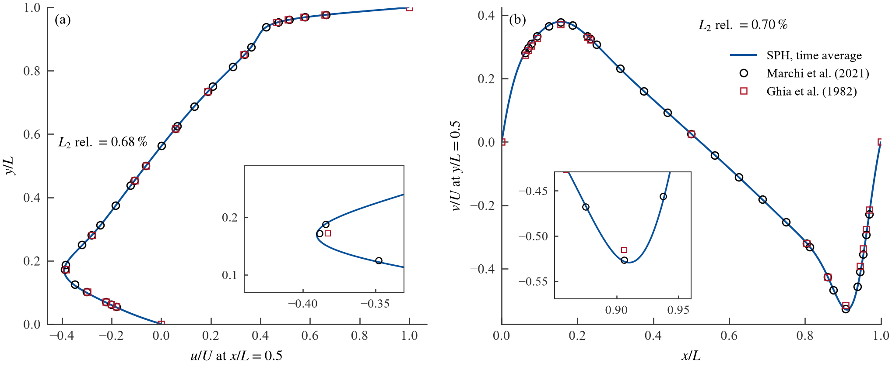
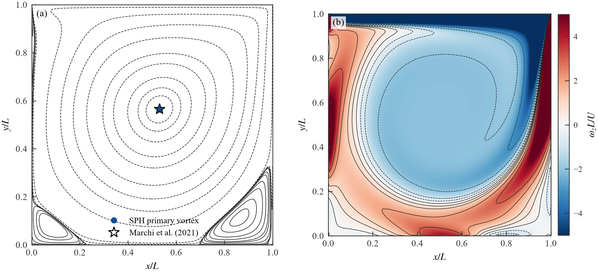
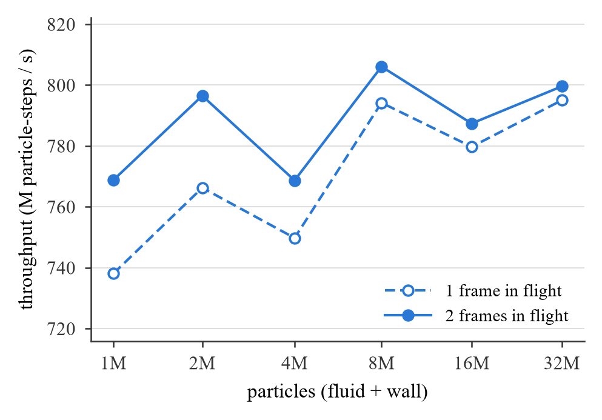

# v7_single:与 v7 同 kernel 的纯单卡构建(2026-10-09 起)

接 [`v7_perf.md`](v7_perf.md)(v7-rc1,附注标签 `v7-rc1` = d0c8dcb)。`experiment/v7_single` 是一个只有单卡 host 代码的求解器:它不复制、不改任何 shader,直接加载 `experiment/v7/shaders/spv` 的 SPIR-V(启动时按 `MANIFEST.txt` 逐文件校验 sha256,不一致就退出),host 侧只做纯单卡该做的事。用途:(1) 论文 §3 的"单卡求解器";(2) 测出 v7 单卡模式(`SphSimulatorV7._record_step_single_cmd`)与 v7 链式 K = 1 相对它的吞吐比(§5.1);(3) 用它跑 1000² 方腔的精度验证(§6)。η 的参照仍是 v7 链式 K = 1,不改;集群脚本不改。本文里的旧 V0 指 `utils/sph`,与 v7_single 无关。

分支 `v7-single`(从 `v7-rc1` 开出,worktree `vulkan-demo-v7-single`),`experiment/v7` 一个文件都没有改。

报告页(本文档 + 全部表与图,`experiment/v7_single/_build_artifact.py` 生成):https://claude.ai/artifact/G45wmgPDKcyeC3aoLcqbbm

## 结论(TL;DR)

- **v7_single 就是 v7 的 kernel 加一个纯单卡的 host**:SPIR-V 从 `experiment/v7/shaders/spv` 读、按 `MANIFEST.txt` 校验;host 侧只有一条 compute 队列、EXCLUSIVE 缓冲、一个 fence 环,没有 ghost / 迁移 / timeline / 阶段 / worker。清单(第 1–11 节)逐项列出 v7 单卡模式多出的东西,每一项都是不执行或不改数据的;spec constant 逐个相同(第 6 节);命令流逐条相同(唯一差别是 v7 defrag 里对 `migration_install_count` 的一次 fill,S 没有这个字段)。
- **验收全部通过**:CPU 命令流 5 算例 × 3 开关一致;GPU 逐位 6 算例 × 2 开关,S ≡ V(v7 单卡模式)≡ C(v7 链式 K = 1),含 no-mask;drift / overflow 全 0;Khronos 验证层 2000 步 0 条消息;独立评审无阻断项,10 条修正已落地。
- **吞吐(一张 RTX 5090,2-D 方腔 1M–32M,3 次配对)**:S 2 在飞 732–790 M 粒子·步 / 秒;V/S 在 depth 2 为 99.8–100.2 %,depth 1 为 99.1–100.1 %(S 略快,V 每步建销一个 fence);CONCURRENT 共享模式 ≤ 0.2 %;链式 K = 1 对 S 在 1M 为 98.55 %、4M 起 99.85–100.02 %;depth-1 损失 1M −4.0 % → 32M −0.3 %。没有任何比值离 1 超过 2 %。
- **逐 kernel(8M,交错计时)**:融合 correction + density 省下步长 23.5 %(2-D)/ 22.7 %(3-D);每候选 2.50 / 2.79 ps(2-D 融合核 / force),2.09 / 2.06 ps(3-D)。
- **精度(1000² 方腔 Re = 1000,adami 壁,生产设置,干净提交 457913c)**:u、v 的相对 L2 = **0.68 % / 0.70 %**(< 1 %),u_min / v_max / v_min 偏差 +0.48 / +0.62 / +0.45 %,ψ_min +0.14 %,位置误差 ≤ 0.0025;t_s = 79.38,平均窗口 (80.0, 99.8],不变量全 0,一段跑完 6.24 h 无续跑。与 E36 的 adami_rho0 1000² 运行(v7-wall-bc 分支)一致(见精度一节)。
- **§3 补测(2026-10-10,提交 f06af58)**:表 2 重测(融合核,第 1001–3000 步连续计时,3 次):2-D 8M 步长 10 502 ± 15 µs(融合核 4530、force 5062),3-D 8M 61 060 ± 43(30 354 / 29 813);每粒子候选 224 / 1649,邻居(r < h,float32)71.0 / 259.5,候选 / 邻居 3.16 / 6.35;每候选 2.48 / 2.78 ps(2-D)、2.02 / 1.98(3-D)。2 在飞时 GPU 空闲 1M 3.4 % → 32M 0.15 %。4M 的凹陷不是候选数(各尺寸都是 224 / 粒子)也不是邻居数;用生成器重做 4M 算例(第 7 项,提交 db85ea3)后凹陷一样深(732.4 对 731.7 M 粒子·步 / 秒,每候选代价同样 +6 %),所以它是这个尺寸(4 182 025 个粒子、410² 网格)本身的效应,原因未定(列步长 ≈ 160 KiB 是一个未验证的候选);内存 350 B / 粒子(2-D)、342(3-D),其中池槽 288 B(SoA 148 + 孪生 140);平台记录在 `platform.md`;Nsight 因驱动不开放性能计数器未做。
- 没有合并;`experiment/v7` 一个文件未改;没有调任何参数。两条只记录不实施的改动(对 v7 和 v7_single 都有利)在"已知限制"。

## 清单:v7 单卡模式相对 v7_single 多出的 host 侧内容

下面"V"= v7-rc1 的单卡模式:`load_case_v7` 给出的退化 slab(没有 peer、ghost 列数 0、ghost pool 0、departed pool 0)直接交给 `SphSimulatorV7`,`bootstrap()` + `prepare_step_single_cmd_buffer()` + `submit_step_single_and_wait()`,即 `experiment/v7/_run_v7_single_bench.py` 和 `_run_single_baseline_bench.py` 走的路径。"S"= `experiment/v7_single`。"C"= v7 链式 K = 1(`compute_chain_partition` 一个 slab + `ChainOrchestratorV7`),只在与 S 有区别的条目里顺带列出,它不是本清单的对象。

数字以 2-D 1M(`cases/lid_driven_cavity_2d_gen`,1 046 529 个粒子,pool_size 1 203 584,网格 206 × 206 × 1 = 42 436 体素,workgroup 128)为例,用 `SphSimulatorV7` 的 `_build_buffer_specs` / `_global_entries` 在 CPU 上算出(`experiment/v7_single/_compare_recordings.py --inventory` 可以重算任何算例)。

### 1. Vulkan 上下文

| 项 | V(`VulkanContextV7.create`) | S(`experiment/v7_single/utils/vulkan_context_single.py`) | 影响结果? |
|---|---|---|---|
| 实例 | apiVersion 1.3;验证层按参数(`create()` 的默认是开,所有 runner 都传 `enable_validation=False` 或 `--validation`) | 同样的实例;验证层默认关,`--validation` 开并计数消息 | 否 |
| 物理设备顺序 | discrete-first 稳定排序 | 同样的排序(同一张卡用同一个 index;测量按 UUID 固定) | 否 |
| 队列 | 3 条:compute 族 1 条 + transfer-only 族 2 条(`V7_SPLIT_TRANSFER_QUEUES` 默认 1;5090 的 transfer 族有 2 条队列),`_find_transfer_queue_family` 选族 | 1 条 compute 队列 | 否(单卡路径从不向 transfer 队列提交) |
| 命令池 | 2 个(compute 族、transfer 族) | 1 个 | 否 |
| 设备特性 | `timelineSemaphore`、`synchronization2`、`vertexPipelineStoresAndAtomics` | `synchronization2`(屏障用 `vkCmdPipelineBarrier2`;没有 timeline、没有渲染) | 否 |
| 设备扩展 | 可选的 calibrated timestamps(step trace) | 无 | 否 |

### 2. 同步对象与提交

| 项 | V | S | 影响结果? |
|---|---|---|---|
| timeline 信号量 | `make_sync_scheme("aggregated")` 建 1 个 timeline 信号量(单卡路径从不等待或发信号) | 无 | 否 |
| 驱动提交锁 | 每张物理卡一个 `threading.Lock`(`V7_SUBMIT_LOCK_SCOPE`),单卡路径不用 | 无 | 否 |
| fast submit | `_fast_submit_prepare` 只在链式路径(`prepare_step_cmd_buffers`)里建 cffi 批 | 无 | 否 |
| 每步的 fence | `ctx.submit_and_wait`:每步 `vkCreateFence` + `vkQueueSubmit` + `vkWaitForFences` + `vkDestroyFence`(1 帧在飞);N 帧在飞由 `_run_single_baseline_bench.py` 的 `FenceRing` 在求解器外面做 | 求解器自带 N 个持久 fence 的环(N = 1 就是每步一个 fence;`vkResetFences` 复用,不再每步创建销毁);N 帧在飞时第 k 步复用第 k − N 步的 fence,其他与 `FenceRing` 相同 | 否(host 侧;depth-1 的提交气泡可能略小,见测量) |
| 线程 | 单卡路径没有 worker 线程(C 有 0 个 worker,但 orchestrator 的 3 批提交 + timeline 等待还在) | 无 | 否 |

### 3. 缓冲:共享模式、大小、内存

V 的 `_allocate_buffers` 把 `_CONCURRENT_BUFFER_NAMES` 里存在的 14 个缓冲建成 `SHARING_MODE_CONCURRENT`(compute + transfer 两个队列族;`V7_CONCURRENT_BUFFERS=0` 是它的诊断开关),其余 `EXCLUSIVE`。S 的每个缓冲都是 `EXCLUSIVE`。缓冲的 set / binding 编号两边相同(SPIR-V 相同,描述符布局必须相同),只有下面标出的 stub 大小不同。

| set.binding | 名字 | V 大小(1M) | V 共享模式 | S | 说明 |
|---|---|---|---|---|---|
| 0.0 | position_voxel_id | 19 257 360 | CONCURRENT | 同大小,EXCLUSIVE | 16 B × (pool_size + 1) |
| 0.1 | density_pressure | 9 628 680 | CONCURRENT | 同,EXCLUSIVE | |
| 0.2 | density_pressure_scratch | 9 628 680 | EXCLUSIVE | 同 | |
| 0.3 | velocity_mass | 19 257 360 | CONCURRENT | 同,EXCLUSIVE | |
| 0.4 | acceleration | 19 257 360 | CONCURRENT | 同,EXCLUSIVE | |
| 0.5 | shift | 19 257 360 | CONCURRENT | 同,EXCLUSIVE | |
| 0.6 | material | 4 814 340 | CONCURRENT | 同,EXCLUSIVE | |
| 0.7 | correction_inverse | 38 514 720 | CONCURRENT | 同,EXCLUSIVE | |
| 0.8 | density_gradient_kernel_sum | 19 257 360 | CONCURRENT | 同,EXCLUSIVE | |
| 0.9 | extension_fields | 19 257 360 | CONCURRENT | 同,EXCLUSIVE | 没有 kernel 读它;canonical_dump 用它存全局 id |
| 0.10 | wall_dummy_velocity | 16(simple)/ 16 B × pool(adami) | EXCLUSIVE | 同 | E37 |
| 1.0 | inside_particle_count | 169 748 | CONCURRENT | 同,EXCLUSIVE | 4 B × (体素数 + 1) |
| 1.1 | incoming_particle_count | 169 748 | EXCLUSIVE | 同 | |
| 1.2 | inside_particle_index | 16 295 808 | CONCURRENT | 同,EXCLUSIVE | |
| 1.3 | incoming_particle_index | 2 715 968 | EXCLUSIVE | 同 | |
| 1.4 | voxel_base_offset | 169 748 | EXCLUSIVE | 同 | 只有 `USE_PREFIX_SUM_DEFRAG`(关)读 |
| 1.5 | ghost_voxel_first_particle_id | 169 748 | CONCURRENT | **4 B stub**,EXCLUSIVE | 只有 ghost_send / expand_ghost_lists 读写,单卡从不派发它们 |
| 1.6 | band_compact_list | 4 | EXCLUSIVE | 4 | compact band 派发(关)专用 |
| 1.7 | ghost_packed_words | 4 | CONCURRENT | 4,EXCLUSIVE | replica_region_size = 0 时 V 也是 4 B |
| 1.8 | deep_wall_voxel_flag | 8 B × (体素数 + 1),只在 B4 开启的 slab 上 | EXCLUSIVE | 同规则 | |
| 3.0 | global_status | 160 | CONCURRENT | 160,EXCLUSIVE | 40 uint,读回 drift 与所有 overflow 计数 |
| 3.1 | pool_health | 16 | EXCLUSIVE | 16 | 只有 install_migrations 写;S 保留(描述符布局);S 的 `readback_pool_health` 只给 canonical_dump 的元数据(恒 0),生产路径不读 |
| 3.7 | material_parameters | 48 B × 材料数 | EXCLUSIVE | 同 | |
| 3.8 | defrag_scratch_counter | 4 | EXCLUSIVE | 同 | |
| 3.9 | band_compact_meta | 128 | EXCLUSIVE | **16 B stub** | 只有 compact band 派发用(indirect) |
| 3.10 | deep_wall_skip_record | 16(不记录)/ 8 B × pool(记录),只在 B4 开启的 slab 上 | EXCLUSIVE | 同规则 | canonical_dump 的记录钩子两边都有 |
| — | 9 个 defrag scratch 孪生(set 0 的 0/1/3/4/5/6/7/8/9) | 160.70 MB | EXCLUSIVE | 同 | defrag 的目标 SoA |
| — | host staging(sender / receiver) | 0 个(没有 peer) | — | 0 个 | |

1M 的 device-local 合计:V 188.66 MB + 160.70 MB 孪生;S 比 V 少 169 744 + 112 B(两个 stub),其余逐字节相同。所以"内存占用"这一项两边实际上相同:V 单卡模式的 pool 里没有 ghost / migrant / departed 区(它们的大小都是 0),也没有为迁移多留的余量——own pool 就是 case.yaml 的 `capacities.pool_size`(1M:1 203 584,比粒子数多 15 %,这是 case 文件的余量,两边一样用)。S 保持同一个 pool_size,因为 `OWN_POOL_SIZE`(spec 53)和逐粒子派发的工作组数(ceil(pool / 128) = 9 403)都由它决定,改了就与 V 的派发数不一致(验收 1)。C 不同:`compute_chain_partition(..., pool_safety=1.2)` 把 own pool 设为 min(ceil(1.2 N) 对齐到 workgroup, pool_size) = 1 203 584(1M 时恰好等于 pool_size,因为 1.2 × 1 046 529 = 1 255 835 > pool_size),其他尺寸可能不同。

缓冲是否可以更小(对 V 和 S 都有利,不实施):pool 按 ceil(N / 128) × 128 = 1 046 656 分配,SoA 和孪生各省 13 %,派发少 13 % 的空线程;voxel_base_offset、pool_health、band_compact_meta 在单卡下可以是 stub。只记进报告。

### 4. pool 布局与网格

| 项 | V | S |
|---|---|---|
| pid 布局 | slot 0 哨兵;[1, pool_size] own;ghost 区 0 个 slot(leading = trailing = 0);departed 0;replica 0 | 相同(S 只有 own) |
| own_first_pid / own_last_pid | 1 / pool_size | 1 / pool_size |
| 网格 | 加载器从 frame.obj 的包围盒算出的网格;扩展网格 = 自有网格(ghost 列数 0),voxel id 1 … 42 436 全是 own | 同一个加载器(`experiment.v7.utils.case_loader_v7.load_case_v7`),同一个网格 |
| 迁移 / 远迁移 / departed | 没有(`_transport_segments` 为空,相应 kernel 不派发) | 没有 |

S 直接复用 v7 的 case 加载器和 `CaseV7` 数据类(`experiment/v7/utils/case_loader_v7.py`、`case_v7.py`,纯 CPU,不读任何 V7_* 开关),这样物理常数、体积校准、网格推导与 V 逐位相同;S 只检查它拿到的是退化 slab。`partition_v7`、`simulator_v7`、`orchestrator_v7`、`vulkan_context_v7`、`bench_v7`、`sync_scheme_v7` 都不导入。

### 5. Shader 模块与流水线

两边的 SPIR-V 来自同一个目录 `experiment/v7/shaders/spv`。V 按 `V7_SPV_DIR` 可以改目录,S 不认这个变量,启动时把 `MANIFEST.txt` 列出的 22 个文件逐个算 sha256 与清单比对,任何一个不一致或缺失就退出。

| | V 加载的模块 | V 建的流水线 | 单卡步骤实际绑定的 | S 加载 / 建 |
|---|---|---|---|---|
| 基本 | bootstrap_half_kick, initialize_voxelization, predict, update_voxel, ghost_send_lanes, install_migrations, correction, density, force, defrag, append_departed, expand_ghost_lists, band_compact(13) | initialize_voxelization, bootstrap_half_kick, predict, update_voxel, append_departed, expand_ghost_lists, ghost_send_lanes_{leading,trailing}, install_migrations_{leading,trailing}, correction_{all,interior,boundary}, density_{all,deep_interior,boundary}, force_{all,deep_interior,boundary}, force_deep_interior_scratch, correction_boundary_band, density_boundary_band, force_boundary_band, defrag(24) | initialize_voxelization, bootstrap_half_kick, predict, update_voxel, force_all, defrag(融合时 correction_all / density_all 也不绑定) | 只加载并建这 6 个 + 下面按开关需要的 |
| B1 融合(默认) | correction_density(+ 深壁变体) | correction_density_{all,interior,boundary,boundary_band}(4) | correction_density_all | correction_density_all(1) |
| B1 关 | — | — | correction_all, density_all | correction, density 模块;correction_all, density_all(2) |
| B9 copy(默认) | density_scratch_copy | density_scratch_copy(1) | density_scratch_copy | 同(1) |
| B4 开(auto:3-D 且候选 ≥ 1 %) | deep_wall_marker, correction_deep_wall_skip, density_deep_wall_skip(, correction_density_deep_wall_skip) | deep_wall_marker_{presence,deep};correction_{all,interior}、density_{all,deep_interior}(或 correction_density_{all,interior})改用跳过变体 | marker ×2;correction_density_all(跳过变体) | marker ×2;correction_density_all(跳过变体)或 correction_all + density_all(跳过变体) |
| adami | wall_extrapolate | wall_extrapolate, wall_extrapolate_scratch(2) | wall_extrapolate | wall_extrapolate(1) |

V 多建的流水线只在启动时多花编译时间,不进入每步的命令流。描述符布局两边相同:4 个 set(set 2 空),每个 set 的 binding 如第 3 节;defrag 另有 set 4(9 个孪生)和 5-set 的流水线布局,S 一样。

### 6. Spec constant(逐个,两边取值)

两边的取值全部相同;S 不读 `V7_LEAN_TRANSPORT`、`V7_BAND_WIDTHS` 这类变量,而是把 V 在默认环境下给出的值写死,理由在最后一列。只列 V 的单卡步骤会绑定的流水线上出现的 id;V 另外建的流水线(ghost_send、install、band、interior / boundary、force_segment …)用到的 90–94、109、110、115 和 47–49 的 1 / 2 两边都不存在于 S。

| id | 名字 | V(1M,默认开关) | S | 来源 / 不同时的理由 |
|---|---|---|---|---|
| 0 | SMOOTHING_LENGTH | 0.005 | 同 | case |
| 1 | SPEED_OF_SOUND | 100 | 同 | case |
| 2 | DELTA_COEFFICIENT | 0.1 | 同 | case |
| 4 | POWER_PARAMETER | 7 | 同 | case |
| 5 | CFL_NUMBER | 0.15 | 同 | case |
| 6 | TIMESTEP | 7.5e-6 | 同 | 加载器 |
| 7 / 8 / 9 | OWN_ORIGIN_X/Y/Z | −0.5141 / −0.5141 / −0.0025 | 同 | 加载器(退化 slab 的网格原点) |
| 10 | STRICT_BIT_EXACT | 0 | 0 | V 写死 0 |
| 11 / 12 / 13 | GRID_DIMENSION_X/Y/Z | 206 / 206 / 1 | 同 | 加载器(扩展网格 = 自有网格) |
| 14 / 15 / 16 | REGULARIZATION_XI / DET / FROBENIUS | 0.001 / 1e-4 / 10 | 同 | case |
| 17 / 18 / 19 | GRAVITY | 0 / 0 / 0 | 同 | case |
| 20 | VOXEL_ORDER | 0 | 0 | 加载器 |
| 21 | MICROPOLAR_THETA | 不设(GLSL 默认 2.0) | 不设 | 两边都不设 |
| 30 / 31 | DIMENSION / NEIGHBOR_Z_RANGE | 2 / 0 | 同 | 加载器 |
| 32 / 33 | KERNEL_COEFFICIENT / GRADIENT | 114591.559… / 22918311.8… | 同 | 加载器 |
| 40 | EPS_H_SQUARED | 6.25e-8 | 同 | case(0.0025 h²) |
| 41 / 42 | PST_MAIN / ANTI | 0.1 / 0.0005 | 同 | case |
| 43 / 44 / 45 / 46 | USE_KCG / DIFFUSION / PST / PREFIX_SUM_DEFRAG | 1 / 1 / 1 / 0 | 同 | case |
| 47 | CORRECTION_MODE | 0(correction_all / correction_density_all) | 0 | 单卡只用 ALL |
| 48 | DENSITY_MODE | 0(density_all) | 0 | 同上 |
| 49 | FORCE_MODE | 0(force_all) | 0 | 同上 |
| 50 / 51 / 52 | MAX_PARTICLES_PER_VOXEL / WORKGROUP_SIZE / MAX_INCOMING | 96 / 128 / 16 | 同 | case |
| 53 | OWN_POOL_SIZE | 1 203 584 | 同 | case 的 pool_size(第 3 节) |
| 54 / 55 | LEADING / TRAILING_GHOST_POOL_SIZE | 0 / 0 | 0 / 0 | 退化 slab |
| 56 | FORCE_DENSITY_SOURCE | 0(force_all;adami 的 wall_extrapolate 也是 0) | 0 | 单卡在拷贝之后读 primary |
| 57 | BAND_VOXEL_DISPATCH | 0(ALL 流水线) | 0 | |
| 58 | BAND_SLOT_LANES | 0(band_dispatch = 0 时) | 0 | |
| 59 | FAKE_BAND_COLUMN | 0(`V7_FAKE_BAND_TEST` 默认 0) | 0 | S 不认该变量 |
| 80 / 81 | LEADING / TRAILING_GHOST_VOXEL_COUNT | 0 / 0 | 0 / 0 | 退化 slab |
| 82 | NEIGHBOR_X_RANGE | correction / correction_density 2,density 2,force 3(`V7_BAND_WIDTHS` 默认 2,2,3);predict 等不设(GLSL 默认 0) | 写死 2 / 2 / 3,同样的流水线集合 | 单卡下 `in_boundary_band` 恒为假(80 / 81 = 0),取值不进入任何分支;写成与 V 相同只是为了 SPIR-V 特化后的代码形状一致。S 不认 `V7_BAND_WIDTHS` |
| 83 | GHOST_LAYERS | 1(加载器 `GhostGridParams` 的默认值;**不是** `configured_ghost_layers()` 的 2,单卡 case 不经过 partition) | 1 | 只在 ghost_send / band kernel 的 ghost 分支里用;C 是 2 |
| 84 | DEPARTED_POOL_SIZE | 0 | 0 | |
| 85 | GHOST_SELF_LAYER | 0 | 0 | |
| 86 | REPLICA_REGION_SIZE | 0 | 0 | |
| 87 | LEAN_TRANSPORT | 1(`V7_LEAN_TRANSPORT` 默认) | 1 写死 | 只有 ghost_send / install 读 |
| 88 | TRANSPORT_EXTENSION | 0 | 0 写死 | 同上 |
| 89 | COMPACT_GHOST_LISTS | 1 | 1 写死 | 只有 ghost_send / install / expand 读 |
| 95 | DELTA_DENSITY | 0(`V7_DELTA_DENSITY` 默认) | 0 写死 | S 不支持 δρ 存储(设了变量就报错);读 helpers.glsl 的密度存取 |
| 96 | REFERENCE_DENSITY | 1000(第一种流体材料的静止密度) | 同 | 同一规则 |
| 97 | INIT_SEAM_CLAMP | 1 | 1 写死 | initialize_voxelization 里只在 ghost 列厚度 > 0 时起作用 |
| 98 | PACKED_REPLICAS | 1(`V7_PACKED_REPLICAS` 未设时 = ghost_layers 开关 2 ∧ compact 1 ∧ density 在 `V7_DIAG_GHOST_SELF` 里 = 真) | 1 写死 | 只有 ghost_send / expand 读;V 单卡模式下也是 1 |
| 99 | DIAG_POISON_G1 | 0 | 0 | |
| 100 | WALL_BOUNDARY | case.yaml numerics.wall_boundary(simple 0 / adami 1) | 同 | case |
| 101–108 | COPY_REGION_r_FIRST / COUNT | (1, 1 203 584), (0, 0), (0, 0), (0, 0) | 同 | own 范围一个区域;派发 ceil(pool / 256) = 4 702 个工作组 |
| 111 | DEEP_WALL_SKIP_BAND_WIDTH | 2(density 的带宽) | 2 | 只在 B4 变体上 |
| 112 | DEEP_WALL_CHECK | 0(`V7_DEEP_WALL_CHECK` 默认) | 0 | S 没有这个调试开关(设了报错) |
| 113 | DEEP_WALL_RECORD | 0;canonical_dump 的钩子置 1 | 同样的钩子 | 只在 B4 变体上 |
| 114 | DEEP_WALL_MARKER_PASS | 0 / 1 | 同 | marker 的两趟 |

### 7. 命令流(逐条)

**时间步**(一次录制,`SIMULTANEOUS_USE`,V 的 `_record_step_single_cmd` 在 `step_single_use_split = False`、`V7_FAKE_BAND_TEST = 0` 下):

1. [bench 复位 + tick `step_start`,只在接了 BenchTimer 时] compute → compute 屏障
2. predict,ceil(pool / 128) 个工作组;[tick];屏障
3. update_voxel,ceil(体素数 / 128);[tick];屏障
4. B4 开启时:marker presence 一趟 + 屏障,marker deep 一趟 + 屏障;[tick]
5. 融合:correction_density_all,ceil(pool / 128);[tick]。不融合:correction_all;[tick];屏障;density_all
6. density 拷贝:B9 = 屏障 + density_scratch_copy(ceil(pool / 256))+ 屏障;B9 关 = compute → transfer 屏障 + `vkCmdCopyBuffer` own 范围 + transfer → compute 屏障
7. [tick `density_end`];屏障(与第 6 步末尾的屏障相邻,V 的录制就是两道)
8. adami:wall_extrapolate,ceil(pool / 128);[tick];屏障
9. force_all,ceil(pool / 128);[tick]

S 的录制逐条相同,包括第 7 步那道多余的相邻屏障(去掉它对 V 和 S 都有利,只记进报告,不实施)。

**bootstrap**:V `bootstrap_init` = 上传初始状态(position / velocity_mass / density_pressure / material / material_parameters 有载荷,其余缓冲与 9 个孪生清零;每个缓冲一次 staging 上传 + fence)+ 一条一次性命令(屏障;initialize_voxelization);它里面按方向循环的 ghost 轮在没有 peer 时一条命令都不录。V `bootstrap_compute` = [adami:屏障 + wall_extrapolate + 屏障] [B4 且无 peer:屏障 + marker 两趟] 融合:correction_density_all / 不融合:correction_all + 屏障 + density_all;density 拷贝;[adami:wall_extrapolate + 屏障];force_all;屏障;bootstrap_half_kick;然后读回 status 打印 alive / overflow。S 两条命令逐条相同。

**defrag**(`SIMULTANEOUS_USE`):V = [bench 复位] 屏障;fill defrag_scratch_counter = 0;fill 9 个孪生 = 0;transfer → compute 屏障;defrag(ceil(体素数 / 128),5-set 布局);compute → transfer 屏障;9 次 `vkCmdCopyBuffer` 孪生 → 主缓冲;copy counter → global_status.alive;**fill global_status.migration_install_count = 0**;transfer → compute 屏障;[tick]。S 去掉加粗那一条 fill(单卡从不写这个字段,它永远是 0),其余逐条相同。这是验收 1 允许的唯一命令差别,比对工具把它列为已知差别。

**restart**(从检查点续跑,方腔验证用):上传 9 个 restart 字段 + material_parameters,其余清零;屏障;initialize_voxelization;屏障;[adami:wall_extrapolate];提交;读回 alive == 行数、overflow_inside = 0、所有 voxel id 在自有范围内。两边相同(S 的自有范围 = 全部体素)。

**周期**:defrag 每 `numerics.defrag_cadence`(1000)步,两边相同;V 的单卡 bench 和 S 都不做 bootstrap 后的 defrag(C 的 `bootstrap_all` 做一次)。

### 8. 读回与状态块

两边都读同一个 160 B 的 `GlobalStatusBuffer`(40 个 uint,`_GLOBAL_STATUS_FIELD_NAMES`):alive_particle_count 给 drift,所有 `overflow_*` 字段(overflow_inside / incoming / ghost / install_tail / install_inside / departed / initialization_outside / deep_wall_skip)给不变量。V 另有 `readback_pool_health`(install 的水位,单卡恒 0);S 保留同名方法只为 canonical_dump 的元数据(恒 0),生产 runner 不调用它。多缓冲批读回(`readback_buffers_batch`)两边同一套实现方式(一次性 staging + 一条命令 + fence)。

### 9. 开关与环境变量

V 在导入 `simulator_v7` / `partition_v7` 时读 20 多个 `V7_*` 变量(每个都有默认值):`V7_SUBMIT_LOCK_SCOPE`、`V7_CASCADE_FORCE`、`V7_BAND_VOXEL_DISPATCH`、`V7_BAND_SLOT_LANES`、`V7_BAND_COMPACT_DISPATCH`、`V7_FAKE_BAND_TEST`、`V7_DIAG_GHOST_SELF`、`V7_FAST_SUBMIT`、`V7_PHASE_A_NO_WAIT`、`V7_DENSITY_COPY_COMPUTE`、`V7_GHOST_SEND_LANES`、`V7_DEEP_WALL_SKIP`、`V7_DEEP_WALL_CHECK`、`V7_FUSED_CORRECTION_DENSITY`、`V7_BAND_OVERLAP`、`V7_CONCURRENT_BUFFERS`、`V7_SPV_DIR`、`V7_RECEIVER_CACHED`、`V7_BENCH_PARITY`、`V7_KEEP_DEPARTED`、`V7_GHOST_LAYERS`、`V7_LEAN_TRANSPORT`、`V7_TRANSPORT_EXTENSION`、`V7_INIT_SEAM_CLAMP`、`V7_COMPACT_GHOST_LISTS`、`V7_PACKED_REPLICAS`、`V7_DIAG_POISON_G1`、`V7_DELTA_DENSITY`、`V7_BAND_WIDTHS`、`V7_GHOST_POOL_FACTOR`、`V7_MIGRANT_POOL_FACTOR`、`V7_DEPARTED_FACE_FRACTION`、`V7_DEPARTED_CAPACITY`、`V7_SPLIT_TRANSFER_QUEUES`、`V7_PER_SIM_PIPELINE`、`V7_LOOP_TRACE`、`V7_WORKER_*`。其中在单卡步骤里真正改变录制或结果的只有 `V7_DENSITY_COPY_COMPUTE`、`V7_FUSED_CORRECTION_DENSITY`、`V7_DEEP_WALL_SKIP`(以及调试用的 `V7_DEEP_WALL_CHECK`、`V7_FAKE_BAND_TEST`、`V7_DELTA_DENSITY`、`V7_BAND_WIDTHS`、`V7_SPV_DIR`、`V7_CONCURRENT_BUFFERS`)。

S 只读这三个:`V7_DENSITY_COPY_COMPUTE`(0 / 1,默认 1)、`V7_FUSED_CORRECTION_DENSITY`(0 / 1,默认 1)、`V7_DEEP_WALL_SKIP`(0 / 1 / auto,默认 auto;auto 的规则与 V 相同:3-D 且初始状态深壁候选 ≥ 1 % 的 slab 开,候选数用同一个公式算),解析器与 v7 的逐字相同(去首尾空白,其余值报错)。进程环境里出现任何其他 `V7_*` 名字,S 在导入时报错退出(包括 `V7_DEEP_WALL_CHECK`、`V7_DELTA_DENSITY`、`V7_SPV_DIR`)。运行表头打印开关表和每个开关在本 slab 上的判定。

### 10. 诊断与计时钩子

| 项 | V | S |
|---|---|---|
| GPU 时间戳 | `bench_v7.BenchTimer` 挂在 `sim.bench` 上,单卡录制在每个 kernel 后 tick(`step_start` 在开头那道屏障之前,`wall_extrapolate_end` 在壁面 kernel 的屏障之前);parity 区域、defrag 区域 | 没有 BenchTimer;录制函数接受一个可选的 tick 回调(`record_step(cmd, tick=...)`),`_run_kernel_breakdown.py` 用它在同一条生产录制里插时间戳(屏障结构因此与生产步相同)。tick 位置与 V 相同,只有 `step_start` 放在开头那道屏障之后(E5 的计时器也是这样放;同步循环里这道屏障前面没有在飞的工作,差别在 1 µs 以内) |
| step trace / phase trace | 链式路径的工具 | 无 |
| `step_single_use_split` / `V7_FAKE_BAND_TEST` | 单卡的验证 / 诊断路径(拆成 interior + boundary 流水线) | 无 |
| 深壁记录钩子 | `simulator_v7._DEEP_WALL_RECORD_DECISIONS` | `simulator_single._DEEP_WALL_RECORD_DECISIONS`,同样的 spec 113 与记录缓冲 |

### 11. 小结:会改变结果的差别

没有。两边的 kernel、spec constant、派发数、屏障顺序、初始数据、bootstrap 与 defrag 的 kernel 序列都相同;S 相对 V 去掉的全是从不执行(transfer 队列、timeline、锁、多余的流水线)或从不改变数据(CONCURRENT 共享、ghost 缓冲的 stub、migration_install_count 的清零)的东西。验收 2 的逐位比较检验这一结论。

## 验收

全部通过(2026-10-09,`experiment/v7_single/_run_acceptance.py all`,日志 `logs/v7_single/acceptance/`,汇总镜像在 `docs/seam_audit/v7_single/acceptance_summary.{json,md}`、`acceptance_cpu_compare.json`、`acceptance_runs.jsonl`)。本机两张 RTX 5090、驱动 576.88,GPU 运行都在无头的那张卡(UUID `ae137c66…`,discrete-first 序号 1)上,验证层关(第 4 项除外)。

### 1. CPU 侧:命令流逐条比对

`experiment/v7_single/_compare_recordings.py`:两边的模拟器在 CPU 上用 `object.__new__` 建起(`_v7_cpu_fake.py`),把模块里的 vkCmd* / vkBegin / vkEnd 换成记录器,`_create_pipeline` 换成返回 (SPIR-V 文件名, spec constant) 的函数,然后各自跑五条录制:时间步、bootstrap 的两条命令、defrag、restart 的体素化。比较的元素:绑定的 SPIR-V 文件及其全部 spec constant、描述符集绑定(布局、first、count、集合)、派发的工作组数、每道屏障的 stage / access 掩码、fill(缓冲、偏移、长度、值)、copy(源、目标、区域)、`vkBeginCommandBuffer` 的标志。另外比较两边的缓冲表(name / set / binding 顺序相同,大小除两个 stub 外相同,9 个 defrag 孪生相同)、初始上传的每个载荷、material_parameters 的 48 B 行、以及一个合成 3 行状态的 restart 载荷,逐字节;v7 一侧再在 canonical_dump 的发布环境(`RELEASE_ENVIRONMENT` 的 `V7_*`)下录一遍,命令流不变。

| 算例 | 默认(融合 + compute 拷贝) | `V7_FUSED_CORRECTION_DENSITY=0` | `V7_DENSITY_COPY_COMPUTE=0` |
|---|---|---|---|
| n250(62k) | 5 条录制逐条相同 | 同 | 同 |
| n250 adami | 同 | 同 | 同 |
| 2-D 1M | 同 | 同 | 同 |
| cavity3d_8m_b4(9.13M,B4 关) | 同 | 同 | 同 |
| cavity3d_1m(1.69M,B4 开:280 231 个候选 = 16.63 %) | 同 | 同 | 同 |

每一格里唯一的差别是 defrag 中 V 多出的 `fill global_status[48] = 0`(migration_install_count,第 7 节),工具把它列为允许项;缓冲表、载荷、发布环境三项在 n250 / n250 adami / cavity3d_1m 上也都相同(`logs/v7_single/acceptance/cpu_compare_small_v2.json`;五算例的完整重跑见测量后的 `cpu_compare.json`)。时间步的派发数:2-D 融合 5 次(predict、update_voxel、correction_density_all、density_scratch_copy、force_all)、6 道屏障;不融合 6 次、7 道;adami 各加 1;3-D B4 开各加 2(marker 两趟)。

### 2–3. GPU 逐位(canonical lists)与不变量

`canonical_dump.py`:`--solver v7_single`(S)、`--solver v7 --v7-mode single`(V,`SphSimulatorV7` 的单命令步)、`--solver v7`(C,链式 K = 1),都用 `--canonical-lists`(初始体素化后按 pid 排序列表、没有 bootstrap defrag),同一张卡,dump 后 `--compare`。每个算例跑默认开关与 `V7_FUSED_CORRECTION_DENSITY=0` 各一次,共 36 个 dump。

| 算例 | 步数 | S 对 V(必须) | S 对 C(只报告) | drift / overflow(S / V / C) |
|---|---|---|---|---|
| n250 | 200 | 逐位(默认、不融合;`--no-mask` 也逐位) | 逐位 | 0 / 0 |
| n250 | 999 | 逐位 | 逐位 | 0 / 0 |
| 2-D 1M | 200 | 逐位 | 逐位 | 0 / 0 |
| cavity3d_8m_b4 | 200 | 逐位 | 逐位 | 0 / 0 |
| cavity3d_1m(B4 开) | 200 | 逐位(含不屏蔽深壁行) | 逐位 | 0 / 0 |
| n250 adami | 200 | 逐位 | 逐位 | 0 / 0 |

10 个场(position_voxel_id、velocity_mass、density_pressure、density_pressure_scratch、acceleration、shift、material、correction_inverse、density_gradient_kernel_sum、extension_fields;adami 另加 wall_dummy_velocity)全部逐位相同,所以 S 对 C 的 ULP 统计没有可报的差别:在这 6 个算例上 v7_single、v7 单卡模式与 v7 链式 K = 1 是同一组比特。每个 dump 的 alive = 粒子数,所有 `overflow_*` 计数、far_migration、stamp 计数都是 0。

### 4. 验证层

v7_single 在 Khronos 验证层(默认设置,实例层 + debug messenger 计数)下各跑 2000 步、2 步在飞:2-D 1M(710.9 fps)与 cavity3d_8m_b4(14.7 fps),层已加载,消息 0 条(ERROR / WARNING / INFO / VERBOSE 都是 0,stderr 也没有一行),drift 0,overflow 0。

### 5. 独立评审

一个只读的子 agent 评审了 host 代码、工具 adapter 与本清单(读 `experiment/v7_single`、改过的 adapter、对照 `simulator_v7.py` / `vulkan_context_v7.py` / `case_loader_v7.py` 与 shader 源码)。结论:**没有 blocker**,找不到让 S 与 V 产生不同比特的路径。它核实的内容:`global_entries()` 与 `_global_entries()` 的每个 id、格式、取值(含 83 = 加载器默认 1、98 在未设 `V7_PACKED_REPLICAS` 时解析为 1);发布环境下这些单卡流水线的常数不变(`V7_BAND_SLOT_LANES=64` 只进 band_dispatch = 1 的流水线);两个 stub 缓冲只被 ghost_send / ghost_send_lanes / expand_ghost_lists 和 `BAND_VOXEL_DISPATCH == 2` 的分支触及,S 绑定的任何流水线都到不了;fence 环的等待关系;两边的队列族都是第一个有 COMPUTE 位的族。它提出的 10 项应改与备注都已处理(提交 24a1886):

- 物理哈希:`cavity_runner.code_hashes` 与 canonical_dump 的代码摘要原来没有覆盖 v7 的 case 加载器(dt、网格、原点、核系数都由它算出),现在把 `experiment/v7/utils/case_loader_v7.py`、`case_v7.py` 纳入。
- CPU 比对工具:补上缓冲表断言、载荷逐字节比较、begin 标志、描述符集身份、发布环境下的 v7 录制(本节第 1 项的表就是补后的结果)。
- 链式 adapter 的稳态窗口:`run_pipelined` 在提交第 warmup 帧时就打开窗口,而 warmup = 1000 正好是 defrag 周期,窗口会比 fence 环的多含一次 defrag;改为从第 warmup + 1 帧提交后打开(窗口 2000 − 1 帧),与环的窗口含同样的 defrag。
- 壁面 kernel 的 tick 放回屏障之前(与 V 的 BenchTimer 一致);`vkQueueSubmit` 失败时重建该槽的 fence;standalone runner 的 `--warmup 0`;验收 4 由脚本强制判定(层未加载或有消息即 FAIL);canonical_dump 的单卡模式在每个 defrag 边界检查 overflow;候选对数计算断言 `voxel_order = 0`。
- 备注(不改):defrag 开头的 compute → compute 屏障后面接 transfer 阶段的 fill,与 v7 相同(v7 自己注明第二作用域形式上不含 TRANSFER;前一次写在 1000 帧之前的 defrag 里,实际无害);S 有两种起点(`SingleRunner.bootstrap_all` 像链一样在 bootstrap 后 defrag 一次,bench 与 canonical_dump 的单卡模式像 V 一样不 defrag),两种起点的 dump 之间不逐位可比,但各自与对应的 V / C 起点一致。

## 测量

通用条件:本机两张 RTX 5090、驱动 576.88;所有运行都在无头的那张卡上(nvidia-smi 序号 1,PCI 03:00.0,Vulkan deviceUUID `ae137c668a40f5acaab90a83f7cda175`;每个 runner 用 UUID 解析 discrete-first 序号,再用 `--expect-gpu "RTX 5090"` 复核);验证层关(`VK_LOADER_LAYERS_DISABLE=VK_LAYER_KHRONOS_validation`);1 Hz 的 nvidia-smi 遥测记 SM 时钟、功耗、温度到各活动目录的 `telemetry.csv`;每次运行前检查本机没有其他求解器进程(nvidia-smi 的利用率在这台 WDDM 机器上不可用:求解器满载时它读 0 %,杀掉进程后反而停在 100 %,所以空闲检查按进程命令行判定)。

### A. 吞吐与开销(§3 图 1、§5.1)

`_run_single_baseline_campaign.py --out logs/v7_single/throughput_r2 --sizes 1m,2m,4m,8m,16m,32m,3d_8m --configs v7_single:1,v7_single:2,v7:1,v7:2,v7x:1,v7x:2,v7_chain:2 --trials 3 --warmup 1000 --idle-check`,汇总 `_summarize_v7_single_campaign.py`。

- 构建:S = `v7_single`;V = `v7`(`SphSimulatorV7` 单卡模式,`_run_single_baseline_bench.py` 的 `V7Adapter`);Vx = `v7x`(V 加 `V7_CONCURRENT_BUFFERS=0`);C = `v7_chain`(`compute_chain_partition` 一个 slab、pool_safety 1.2,`ChainOrchestratorV7.bootstrap_all`(末尾一次 defrag)+ `run_pipelined(depth=2)`,即 `_run_v7_chain_bench.py` K = 1 的生产循环,三批提交)。
- 算例:`lid_driven_cavity_2d_gen`(1M)、`_2m`、`_4m`、`_8m`、`_16m`、`_32m`、`cavity3d_8m_b4`。
- 在飞深度:S、V、Vx 各测 1 与 2;C 只有生产的 depth 2。S 的 N 在飞用它自己的 fence 环(`SphSimulatorSingle.submit_step`,defrag 在周期帧并入同一次提交);V、Vx 的 depth 1 是 `submit_step_single_and_wait`(每步建销一个 fence),depth 2 是 bench 脚本外挂的 `FenceRing`(E5 给 V5 用的同一段代码);C 的 fps 是 orchestrator 的稳态窗口。
- 窗口:预热 1000 步,计时 10000(1M)/ 6000(2M)/ 4000(4M)/ 2000(8M、16M、32M、3-D 8M)步,都是 defrag 周期的整数倍。fence 环的两端都在队列排空时取时间,所以任何在飞深度下都精确;C 的窗口从第 1001 帧提交后打开(第 1000 帧触发的排空 + defrag 已经过去,窗口里的 defrag 次数与环的相同,长度 = 计时步数 − 1 帧)、到最后一次排空关闭,末端含 depth − 1 帧在飞的尾巴(≤ 0.05 %)。
- 重复:3 次试验;每次试验里同一尺寸的 7 个构建紧挨着跑,顺序每次轮换一位;比值按同一试验配对再取均值 ± 标准差。每次运行结束读回 alive(drift 必须 0)和所有 overflow 计数。
- 先验(v5 时代):单卡模式是 V0 的 100.1–102.0 %,链式 K = 1 对单卡模式 99.91 ± 0.59 %,CONCURRENT ≤ 1.2 %。任何比值偏离 1 超过 2 % 先定位原因。

**结果**(2026-10-09,147 次运行全部有效:drift 0、overflow 0;`logs/v7_single/throughput_r2/`;2026-10-10 加上生成器重做的 4M 算例的 9 次运行(§3 补测第 7 项)合并为 `logs/v7_single/throughput_r3/`,镜像 `docs/seam_audit/v7_single/throughput_summary.{md,json,csv}`、`throughput_results.jsonl` 是 r3 的;3 次试验的均值 ± 标准差):

| 算例 | 粒子 | S d1 | S d2 | V d1 | V d2 | Vx d1 | Vx d2 | C d2 |
|---|---|---|---|---|---|---|---|---|
| 1M | 1 046 529 | 705.2 ± 0.2 | 734.6 ± 0.1 | 698.9 ± 1.1 | 733.3 ± 0.3 | 699.9 ± 1.7 | 733.0 ± 0.4 | 723.9 ± 0.8 |
| 2M | 2 064 969 | 363.6 ± 0.2 | 371.9 ± 0.5 | 361.7 ± 0.2 | 371.7 ± 0.2 | 361.1 ± 0.3 | 371.5 ± 0.3 | 368.9 ± 0.4 |
| 4M | 4 182 025 | 172.56 ± 0.02 | 174.97 ± 0.18 | 172.37 ± 0.09 | 175.36 ± 0.03 | 172.40 ± 0.09 | 175.25 ± 0.08 | 174.86 ± 0.13 |
| 4M gen(§3 补测第 7 项,db85ea3) | 4 182 025 | 172.23 ± 0.16 | 175.12 ± 0.22 | – | – | – | – | 174.68 ± 0.21 |
| 8M | 8 128 201 | 93.59 ± 0.08 | 94.44 ± 0.05 | 93.53 ± 0.06 | 94.57 ± 0.07 | 93.59 ± 0.05 | 94.54 ± 0.05 | 94.46 ± 0.12 |
| 16M | 16 184 529 | 47.23 ± 0.01 | 47.47 ± 0.02 | 47.29 ± 0.01 | 47.58 ± 0.02 | 47.28 ± 0.01 | 47.57 ± 0.01 | 47.43 ± 0.01 |
| 32M | 32 251 041 | 24.42 ± 0.00 | 24.50 ± 0.00 | 24.40 ± 0.00 | 24.50 ± 0.01 | 24.41 ± 0.00 | 24.49 ± 0.00 | 24.46 ± 0.01 |
| 3-D 8M | 9 129 329 | 16.30 ± 0.02 | 16.34 ± 0.01 | 16.28 ± 0.01 | 16.33 ± 0.04 | 16.28 ± 0.02 | 16.34 ± 0.02 | 16.32 ± 0.03 |

百万粒子·步 / 秒(S):d1 738 / 751 / 722 / 761 / 764 / 788(1M → 32M),d2 769 / 768 / 732 / 768 / 768 / 790;3-D 8M 148.8 / 149.1;生成器重做的 4M(§3 补测第 7 项)d1 720.3、d2 732.4。逐次配对的比值(均值 ± 标准差,n = 3):

| 算例 | V/S d1 | V/S d2 | Vx/S d1 | Vx/S d2 | C/S | Vx/V d1 | Vx/V d2 |
|---|---|---|---|---|---|---|---|
| 1M | 99.10 ± 0.14 % | 99.82 ± 0.03 % | 99.24 ± 0.21 % | 99.78 ± 0.05 % | 98.55 ± 0.11 % | 100.15 ± 0.14 % | 99.95 ± 0.07 % |
| 2M | 99.48 ± 0.08 % | 99.96 ± 0.11 % | 99.33 ± 0.06 % | 99.89 ± 0.22 % | 99.20 ± 0.16 % | 99.85 ± 0.07 % | 99.93 ± 0.14 % |
| 4M | 99.89 ± 0.04 % | 100.23 ± 0.12 % | 99.91 ± 0.05 % | 100.16 ± 0.08 % | 99.94 ± 0.12 % | 100.02 ± 0.02 % | 99.93 ± 0.05 % |
| 4M gen | – | – | – | – | 99.75 ± 0.08 % | – | – |
| 8M | 99.94 ± 0.06 % | 100.15 ± 0.06 % | 100.00 ± 0.14 % | 100.11 ± 0.08 % | 100.02 ± 0.14 % | 100.06 ± 0.12 % | 99.96 ± 0.12 % |
| 16M | 100.13 ± 0.01 % | 100.23 ± 0.06 % | 100.12 ± 0.01 % | 100.20 ± 0.06 % | 99.91 ± 0.05 % | 99.99 ± 0.03 % | 99.97 ± 0.05 % |
| 32M | 99.91 ± 0.01 % | 99.98 ± 0.03 % | 99.95 ± 0.02 % | 99.97 ± 0.00 % | 99.85 ± 0.02 % | 100.04 ± 0.01 % | 99.99 ± 0.03 % |
| 3-D 8M | 99.86 ± 0.16 % | 99.96 ± 0.25 % | 99.86 ± 0.15 % | 100.01 ± 0.17 % | 99.89 ± 0.16 % | 100.01 ± 0.11 % | 100.05 ± 0.27 % |

depth 1 相对 depth 2 的损失(fps_d1 / fps_d2 − 1):S −4.00 / −2.23 / −1.38 / −0.90 / −0.52 / −0.34 %(1M → 32M),3-D 8M −0.22 %,4M gen −1.65 ± 0.16 %;V −4.70 / −2.70 / −1.71 / −1.10 / −0.61 / −0.40 %;Vx −4.51 / −2.78 / −1.63 / −1.01 / −0.59 / −0.35 %。协变量:每个窗口都在 600 W 功耗墙上,SM 2765–2830 MHz,≤ 70 °C,同一尺寸内各构建的时钟差 ≤ 7 MHz(`throughput_summary.md` 的协变量表)。

读法:

- 没有一个比值离 1 超过 2 %(先验成立),所以没有需要定位的差距。
- V 对 S:depth 1 时 S 快 0.1–0.9 %(1M–2M 最明显),差别来自 V 每步创建并销毁一个 fence(`submit_and_wait`)而 S 复用 fence 环;depth 2 时两者在 1M / 2M / 32M / 3-D 相同(99.8–100.0 %),在 4M / 8M / 16M V 快 0.15–0.23 %(2–4 σ)。后者不是 CONCURRENT(Vx 与 V 在所有点上 99.85–100.15 %,所以共享模式的代价在 0.2 % 以内,与 E5 的 ≤ 1.2 % 一致),kernel 与命令流逐位相同,剩下的候选是缓冲在显存里的摆放(两边分配的缓冲数与顺序不同)或设备创建时的差别(V 多开 2 条 transfer 队列和 timelineSemaphore 特性);量级在 0.2 % 以内,本文记录而不追查(见"结论"里给用户的说明)。
- C 对 S:1M 98.55 %、2M 99.20 %,4M 起 99.85–100.02 %。链式 K = 1 每步三批提交 + timeline 等待的固定开销约 20 µs,在 1M(1.36 ms / 步)占 1.5 %,从 4M 起淹没在步长里;与 E5.3 在 8M 上的 99.91 ± 0.59 % 一致。
- depth 1 的损失就是同步循环暴露的 CPU 提交气泡:S 在 1M 约 57 µs / 步(4 %),32M 约 140 µs / 步(0.3 %);V 的气泡多出 fence 建销的 10–20 µs。
- 3-D 8M(`cavity3d_8m_b4`,9 129 329 个粒子,每步约 61 ms)上所有构建都在 ± 0.25 % 内,depth 的影响 0.2–0.4 %。

### B. 逐 kernel 成本(§3 表 2)

`experiment/v7_single/_run_kernel_breakdown_campaign.py run`(每个单元一个 `_run_kernel_breakdown.py --solver v7_single` 子进程),`summarize` 调 `_summarize_kernel_breakdown.py`。

- 算例 `lid_driven_cavity_2d_8m`(8 128 201 个粒子)与 `cavity3d_8m_b4`(9 129 329);融合(默认)与不融合(`V7_FUSED_CORRECTION_DENSITY=0`)各 3 次,交错(第 1 次的四个单元、第 2 次的四个 …)。
- 计时命令:S 的生产录制函数 `record_step(cmd, tick=...)` 本身在每个阶段末尾调用回调,回调写一个 BOTTOM_OF_PIPE 时间戳,所以计时步的屏障与生产步逐条相同(只多了 `vkCmdWriteTimestamp`);每步一次提交 + fence(1 在飞),预热 1000 + 计时 2000 步,defrag 帧剔除。阶段:融合 = predict、update_voxel、correction_density、density_copy、force;不融合 = predict、update_voxel、correction、density_kernel、density_copy、force(3-D B4 开或 adami 时各加 deep_wall_marker / wall_extrapolate,这两个算例都没有)。`step_start` 在开头那道屏障之后(E5 的计时器也是这样放),`density_copy` 是拷贝 pass 加它前后两道屏障。
- 计时步与生产步的差:预热之后计时帧与生产帧交错(奇数帧提交带时间戳的命令,偶数帧提交生产命令 `step_cmd`,各 2000 帧,窗口 = 第 1001–5000 帧;defrag 帧不计入任何一侧),报告计时步的 GPU 帧长、计时帧的每步墙钟(提交 + 每步新建的 fence)与生产帧的每步墙钟(持久 fence、无时间戳)。先按"先计时 2000 步再生产 2000 步"做过一轮(`logs/v7_single/kernel_breakdown/`),3-D 上生产段读数比计时段慢 7 %;`experiment/v7_single/_probe_loop_variants.py` 查明三种 1 在飞的 host 循环本身等价(排序后 59–64 ms / 步,三者在同一段里相差 < 1 ms),慢的是流动本身:3-D 8M 每步的 GPU 代价随流动发展在 defrag 之间持续上升(第 1100 帧 59.1 ms → 第 2900 帧 63.9 ms,见探针日志),先后两段比的是两个流动状态。所以改为交错,两侧看同一个状态。
- 每候选 ps:仓库里没有找到 E5 对"候选"的定义,这里取邻居循环实际访问的候选数——运行结束时读回体素列表,候选对数 = Σ_v count(v) · Σ_{v' ∈ 3^d 邻域} count(v'),每个 kernel 的 ps/候选 = µs/步 × 10⁶ / 候选对数(2-D 8M 约 218 个候选 / 粒子,与 `docs/sph_v4_summary.md` 里"9 体素 × 25 ≈ 225 候选"的说法一致)。若论文用的是别的定义,改汇总脚本即可,原始数据都在 `results.jsonl`。
- 输出:每个 kernel 的 µs/步、ns/粒子、占比、ps/候选;表 2 的 LaTeX 行(`summary_fused.md`、`summary_unfused.md`)。

**结果**(2026-10-09,`logs/v7_single/kernel_breakdown_v2/`,镜像 `docs/seam_audit/v7_single/kernel_breakdown_{fused,unfused}.md`、`kernel_breakdown_results.jsonl`;3 次运行的均值,p50 在镜像文件里;12 次运行 drift 0、overflow 0;步长总和的 3 次标准差 0.04–0.14 %;SM 2715–2895 MHz,600 W 功耗墙,≤ 70 °C):

| kernel | 派发 | 2-D 8M µs/步 | ns/粒子 | % | ps/候选 | 3-D 8M µs/步 | ns/粒子 | % | ps/候选 |
|---|---|---|---|---|---|---|---|---|---|
| predict | 每粒子 | 497 | 0.06 | 4.7 | – | 498 | 0.05 | 0.8 | – |
| update_voxel | 每体素 | 331 | 0.04 | 3.1 | – | 318 | 0.03 | 0.5 | – |
| correction + density(融合) | 每粒子 | 4565 | 0.56 | 43.2 | 2.50 | 31 410 | 3.44 | 49.6 | 2.09 |
| density 拷贝(scratch → primary) | compute pass | 82 | 0.01 | 0.8 | – | 78 | 0.01 | 0.1 | – |
| force | 每粒子 | 5097 | 0.63 | 48.2 | 2.79 | 31 014 | 3.40 | 49.0 | 2.06 |
| **步长** | | **10 572** | **1.30** | 100 | | **63 319** | **6.94** | 100 | |

不融合(`V7_FUSED_CORRECTION_DENSITY=0`):

| kernel | 2-D 8M µs/步 | ns/粒子 | % | ps/候选 | 3-D 8M µs/步 | ns/粒子 | % | ps/候选 |
|---|---|---|---|---|---|---|---|---|
| predict | 497 | 0.06 | 3.6 | – | 499 | 0.05 | 0.6 | – |
| update_voxel | 332 | 0.04 | 2.4 | – | 318 | 0.03 | 0.4 | – |
| correction | 3859 | 0.47 | 27.9 | 2.12 | 24 159 | 2.65 | 29.5 | 1.60 |
| density(kernel) | 3956 | 0.49 | 28.6 | 2.17 | 25 824 | 2.83 | 31.5 | 1.72 |
| density 拷贝 | 58 | 0.01 | 0.4 | – | 71 | 0.01 | 0.1 | – |
| force | 5115 | 0.63 | 37.0 | 2.80 | 31 004 | 3.40 | 37.9 | 2.06 |
| **步长** | **13 815** | **1.70** | 100 | | **81 875** | **8.97** | 100 | |

- 候选数:2-D 8M 每粒子 224.4(9 个体素 × 24.9 个粒子),3-D 8M 每粒子 1649(27 × 61);候选对数 1.82 × 10⁹ / 1.51 × 10¹⁰ 每步。
- 融合省下的步长:2-D (13 815 − 10 572) / 13 815 = **23.5 %**,3-D (81 875 − 63 319) / 81 875 = **22.7 %**;融合核比 correction + density 两核之和省 2-D 41.6 %、3-D 37.2 %。
- 计时步与生产步:2-D 的 GPU 帧 10 572 µs,计时帧墙钟 10 728(+156 µs:每步新建 fence 的提交往返),生产帧墙钟 10 695(+123 µs = +1.17 %,持久 fence);3-D 63 319 / 63 568(+249)/ 63 502(+183 µs = +0.29 %)。即生产步(1 在飞)比 GPU 帧多出 120–190 µs 的 host 往返,与 A 的 depth-1 损失(8M −0.90 %、3-D −0.22 %)同量级。
- 窗口说明:交错后的窗口是第 1001–5000 帧,而 A 的窗口是第 1001–3000 帧;3-D 8M 的每步代价随流动发展上升(见上),所以这里的 3-D 步长(63.3 ms)比 A 的 d1 墙钟(61.35 ms,窗口 1001–3000)高 3 %,不是测量差异。第一轮(窗口 1001–3000)的 kernel 数字在 `logs/v7_single/kernel_breakdown/`,2-D 相同到 0.5 %,3-D 低 3.5 %。
- 与 E5 的 V0 同窗口(1001–3000)数字相比(2-D 8M:correction 3898、density 3946、拷贝 275、force 5150、步长 14 100 µs):不融合的 v7 kernel 与 V0 的 correction / density / force 各在 1 % 内,拷贝从 275 µs(`vkCmdCopyBuffer`)降到 58 µs(B9 的 compute pass),步长 13 815 对 14 100(−2.0 %);融合后 10 572(−25 %)。

### C. 图

`_plot_single_baseline_paper.py --dir logs/v7_single/throughput_r2 --solver v7_single --figure-a-name single_gpu_throughput --no-figure-b`:用 A 里 S 的数据(1M–32M 二维曲线,1 与 2 在飞)重画 E5 的图 A,输出 `manuscripts/fig/single_gpu_throughput.pdf` 与 `.png`;旧的 `single_gpu_v0_throughput` 不动。

结果:第一版是两面板(上图吞吐 722–790 M 粒子·步 / 秒,下图 fps 对数轴),§3 补测第 4 项改为单面板并把两面板版本改名为 `single_gpu_throughput_two_panel.{pdf,png}`;4M 那个点的吞吐比两边低 4–5 %,E5 的 V0 曲线在 4M 也有同样的凹陷,是算例本身的现象,不是本构建的(§3 补测第 3 项:候选数相同,每候选代价高 6 %,4M 是旧的手工算例)。单面板的图在"§3 补测"一节。

## 精度验证:1000² 方腔 Re = 1000(adami)

只验证精度,不计时,结果不进任何性能表。生产设置:默认开关(融合、compute 拷贝、B4 auto = 2-D 关)、不开计时器、不用 canonical lists;算例 `cases/lid_driven_cavity_2d_n1000_xi0p001_eps0p0025_adami`(`numerics.wall_boundary: adami`,ξ = 0.001、ε² = 0.0025 h²、h = 5 Δx、11 层壁;1 046 529 个粒子;只支持一张卡),Δt = 0.15 h / c0 = 7.5 × 10⁻⁶。

工具与方法沿用 `docs/validation/cavity_re1000.md`:`experiment/validation/cavity_campaign.py run --solver v7_single --runs n1000_k1_float32_xi0p001_eps0p0025_adami`(runner `cavity_runner.py --solver v7_single`,`SingleRunner` 代替链式 orchestrator:depth 2 的 fence 环,排空的 defrag 边界上取样、查不变量、存检查点,每 0.2 个时间单位一个样本,每 10 个时间单位一个检查点,中断后 `--resume` 从最新检查点续跑,段记在 `segments.jsonl`)。稳态判据:相邻两个约 10 个时间单位的窗口,56 个参考点上窗口平均速度的相对 L2 变化 < 10⁻³ 且流体动能相对变化 < 10⁻³;t_s 为第一个满足的窗口终点;停在 t_stop = max(100, t_s + 20),上限 200。时间平均取最后 20 个时间单位,标准误差按积分自相关时间;插值线性 MLS(Wendland C4,支撑半径 h);参考 Marchi et al. 2021 的 T_c(`docs/validation/data/marchi2021_re1000.csv`),Ghia 1982 只画;相对 L2 = √(Σ e_i² / 28) / rms(T_c);ψ_min 及位置按 513 × 513 网格积分(`cavity_analysis.stream_function_minimum`)。报告脚本 `experiment/validation/cavity_v7_single_report.py`(图、CSV、LaTeX 行、英文图注);与 E36 的 adami_rho0 1000² 运行(`v7-wall-bc` 分支,`../vulkan-demo/logs/e36/runs/n1000_k1_v7_adami_rho0`)的交叉检查用 `experiment.validation.e39_compare`。

验收:u 与 v 的相对 L2 都 < 1 %;所有不变量 0;从干净的提交运行,记录提交、physics 哈希、GPU 与驱动。稳态之后误差不随时间下降,所以不为了凑 1 % 延长运行或改参数。

**结果(2026-10-09 22:47 → 10-10 05:02,通过)**

| 项 | 值 |
|---|---|
| 提交 / 工作树 | 457913c,干净(`meta.json` 的 `git.dirty = false`) |
| 哈希 | physics ab13a3dce97ee068,sampling 890a9478e0656200,runner 28e35159378f6feb |
| GPU / 驱动 | 无头 RTX 5090(uuid ae137c668a40f5acaab90a83f7cda175,设备索引 1),驱动 576.88,全程 600 W 功耗墙、2827 MHz、68 °C |
| 步数 / 时长 | 13 334 000 步(Δt = 7.5 × 10⁻⁶),6.24 h,593 步/s,**一段跑完,无中断无续跑** |
| 不变量 | drift 0,overflow 0,far_migration 0,stamp_gpu 0,stamp_host 0;alive 1 046 529 每个样本守恒 |
| 稳态 | 窗口判据在 t = 19.8 / 29.8 / 39.7 / 49.6 / 59.5 / 69.5 / 79.4 的变化:profile 5.7e-1、1.9e-1、3.0e-2、4.8e-3、1.5e-3、7.2e-4、4.1e-4;KE 4.7e-1、1.6e-1、3.3e-2、7.3e-3、2.5e-3、1.1e-3、5.6e-4 → **t_s = 79.38**(滑动重算 71.7),停在 t = 100 |
| 时间平均 | (80.0, 99.8],99 个样本,20 个快照;KE 均值 50.581,积分自相关时间 29 个样本,标准误差 0.0023 |

与 Marchi et al. 2021 T_c 的比较(壁面行坐标系):

| 量 | SPH | Marchi | 偏差 | 标准误差 | 位置 SPH | 位置 Marchi | Δ位置 |
|---|---|---|---|---|---|---|---|
| u_min / U | −0.39042 | −0.38857 | +0.48 % | 1.1e-5 | 0.1692 | 0.1717 | −0.0025 |
| v_max / U | 0.37928 | 0.37694 | +0.62 % | 9.2e-6 | 0.1563 | 0.1578 | −0.0015 |
| v_min / U | −0.52946 | −0.52708 | +0.45 % | 1.2e-5 | 0.9102 | 0.9092 | +0.0009 |
| ψ_min / (UL) | −0.11910 | −0.11894 | +0.14 % | – | (0.5304, 0.5645) | (0.5308, 0.5652) | (−0.0004, −0.0007) |

| 剖面 | 相对 L2 | L2 | L∞ | L∞ 位置 |
|---|---|---|---|---|
| u(0.5, y) | **0.68 %** | 0.00215 | 0.00538 | y = 0.1016 |
| v(x, 0.5) | **0.70 %** | 0.00222 | 0.00513 | x = 0.9375 |

读法:两条剖面都在 1 % 以内,验收通过。三个速度极值都比参考值深 0.45–0.62 %、ψ_min 深 0.14 %,位置误差 ≤ 2.5 Δx;逐点误差(补充图)在 y < 0.2 的下壁区与 x > 0.9 的右壁区最大(5 × 10⁻³),中部 < 1 × 10⁻³,与 E36 对 adami 壁的描述一致(残差来自壁面处理,原因未定)。

与 E36 的交叉检查(`e39_compare`,同一算例的 adami_rho0 运行,`v7-wall-bc` 分支 `V7_WALL_BC=3`,`logs/v7_single/cavity/vs_e36_adami_rho0.{md,json}`):两次运行都在 t_s = 79.38 判定稳态、用同一平均窗口 (79.99, 99.83];每个量的差都在噪声尺度内(|差| / 合成噪声:ψ_min 0.7、u_min 0.4、v_max 1.3、v_min 0.0、u 相对 L2 1.0、v 相对 L2 0.8;56 点剖面距离 4.2 × 10⁻⁵ 对噪声底 6.3 × 10⁻⁵;逐点最大 |Δ| / 合成标准误差 1.8;动能 0.5);相对 L2 为 0.677 / 0.695 %(E36)对 0.679 / 0.697 %(本次);极值与涡心位置差 ≤ 0.02 Δx。即 v7_single 的生产路径复现了 E36 的 adami_rho0 结果(两者 kernel 相同:E37 起发布版的 adami 与 `WALL_BC=3` 逐位相同),差别只是同一流动两次实现之间的噪声。镜像 `docs/seam_audit/v7_single/vs_e36_adami_rho0.{md,json}`。

图(`manuscripts/fig/`,PDF + PNG,双栏宽):

- `cavity_re1000_profiles`:时间平均的 u(0.5, y) 与 v(x, 0.5),1001 点 MLS 实线,Marchi T_c 空心圆,Ghia 空心方,u_min / v_min 附近插图,两条相对 L2 标在图上。
- `cavity_re1000_field`:(a) 时间平均流函数等值线(Ghia 的等值线值),SPH 主涡心实心圆、Marchi 位置空心星;(b) 涡量 ω_z L / U。
- `cavity_re1000_steady`(补充):KE 历史 + 窗口判据;`cavity_re1000_errors`(补充):28 + 28 个参考点的逐点误差 ū − T_c,误差棒 ± 2 标准误差。
- 英文图注草稿在 `docs/validation/data/cavity_re1000_tables_v7single.md`。

数据:`docs/validation/data/profile_n1000_k1_float32_xi0p001_eps0p0025_adami_v7single.csv`(参考点上的时间平均与标准误差)、`dense_..._v7single.csv`(1001 点)、`cavity_re1000_summary_v7single.json`、`cavity_re1000_tables_v7single.md`;运行的 `meta.json`、`result.json`、`steady.json`、`windows.jsonl`、`samples.jsonl`、`run.log`、`case.yaml`、校准镜像在 `docs/seam_audit/v7_single/cavity_run/`。





## §3 补测(2026-10-10,提交 f06af58,工作树干净)

论文 §3.5 重写所需的补充测量。求解器 `experiment/v7_single`、默认开关(融合核);没有改 `experiment/v7` 与 `experiment/v7_single` 的求解器代码,只加了工具;所有 GPU 运行都在无头的 RTX 5090 上(UUID `ae137c66…`,`--expect-gpu "RTX 5090"`),验证层关,运行前按进程做空闲检查,1 Hz 遥测(SM 时钟、功耗、温度、PCIe 链路),每次运行 drift 0、所有 overflow 计数 0;11 次 GPU 运行都从同一个干净提交 f06af58 启动(活动脚本拒绝脏工作树,每条记录带提交号)。活动目录 `logs/v7_single/section3/`(`results.jsonl`、`runs/*.log`、`runs/*_state.npz`、`stats/*.json`、`telemetry.csv`、`campaign.log`),镜像 `docs/seam_audit/v7_single/section3_{summary.json,table2.md,sizes.md,summary.csv,results.jsonl,campaign.log}` 与 `section3_stats/`。

### 0. 文档更正

验收第 1 项的表与测量 B 正文把 `cavity3d_8m_b4` 写成了 10 503 459 / 10.5M,已改为 9 129 329(10 503 459 是 9 层壁的 `cavity3d_8m`);测量 B 的 ns/粒子本来就按 9 129 329 算,数字不变。报告页已重新生成。

### 1. 平台

`experiment/v7_single/_collect_platform.py` → `docs/seam_audit/v7_single/platform.{json,md}`(WMI、注册表、nvidia-smi、vulkaninfo、文件版本、importlib.metadata;负载下的链路状态取自本次活动的遥测)。

| 项 | 值 |
|---|---|
| CPU | AMD Ryzen 9 9950X,16 核 32 线程,WMI MaxClockSpeed 4300 MHz(基频;9950X 的规格加速频率 5.7 GHz,未测),L2 16 MB,L3 64 MB |
| 内存 | 一条 32 GB DDR5(G.Skill F5-6400J3239G32G,DIMM 1),运行在 4800 MT/s(JEDEC,不是套条标称的 6400),系统可用 31.1 GiB;**单通道** |
| 主板 | ASUS ProArt X870E-CREATOR WIFI |
| Windows | Windows 11 Pro 25H2,版本 10.0.26200,build 26200.7171,64 位 |
| GPU 0(接显示器) | NVIDIA GeForce RTX 5090,PCI 01:00.0,uuid fb83f0da…,显存 32 607 MiB,功耗上限 600 W(默认 = 最大 = 600 W),PCIe Gen 5 槽位,链路宽度 x8(x8 / x8 拆分),显示输出 Enabled |
| GPU 1(无头,测量用) | NVIDIA GeForce RTX 5090,PCI 03:00.0,uuid ae137c668a40f5acaab90a83f7cda175,显存 32 607 MiB,功耗上限 600 W,PCIe Gen 5,链路宽度 x8,显示输出 Disabled;负载下遥测 Gen 5 x8(空闲时降到 Gen 1 / 2),SM 2774–2825 MHz,600 W 功耗墙,≤ 70 °C |
| 驱动 | NVIDIA 576.88(CUDA 12.9);vulkaninfo:apiVersion 1.4.303,driverVersion 576.88.0.0,conformanceVersion 1.4.1.0(两张 5090 相同) |
| Vulkan loader / SDK | vulkan-1.dll 1.4.350.0;Vulkan SDK 1.4.350.0(`VULKAN_SDK`);vulkaninfo 实例版本 1.4.350 |
| 编译器 | glslc:shaderc v2026.2,glslang 11.1.0-1412-g5ed4003a,spirv-tools v2026.2(SPIR-V 清单 `experiment/v7/shaders/spv/MANIFEST.txt` 记录的同一编译器) |
| Python | 3.13.9;python-vulkan 1.3.275.1;numpy 2.4.6;scipy 1.17.1;matplotlib 3.11.0;PyYAML 6.0.3 |

论文一句话(英文草稿):*All single-GPU measurements ran on one headless NVIDIA GeForce RTX 5090 (32 GB, 600 W power limit, PCIe 5.0 x8) of a dual-5090 workstation (AMD Ryzen 9 9950X, 32 GB DDR5-4800, Windows 11 Pro 25H2 build 26200.7171), NVIDIA driver 576.88 (Vulkan 1.4.303), Vulkan SDK and loader 1.4.350, shaders compiled with glslc (shaderc v2026.2); the host code is Python 3.13.9 with python-vulkan 1.3.275.1 and numpy 2.4.6.*

### 2. 表 2:逐 kernel 成本(重测,只测融合核)

`experiment/v7_single/_run_section3_campaign.py run`(每次运行一个 `_run_kernel_breakdown.py --solver v7_single --interleave 0 --dump-state …` 子进程),`summarize` 调 `_summarize_section3.py`。

- 算例 `lid_driven_cavity_2d_8m`(8 128 201 个粒子)与 `cavity3d_8m_b4`(9 129 329);每个算例 3 次独立运行,两算例交错(第 1 次的两个、第 2 次的两个、第 3 次的两个)。
- 窗口与图 1 一致:预热 1000 步,第 1001–3000 步连续计时,不与生产步交错;每步一次提交 + fence(1 在飞);时间戳由生产录制 `record_step(cmd, tick=…)` 的回调写在各阶段末尾(BOTTOM_OF_PIPE),所以屏障结构与生产步逐条相同;defrag 帧(第 2000、3000 步)剔除。阶段:predict、update_voxel、correction_density(融合)、density 拷贝(compute pass 加前后两道屏障)、force。
- 运行结束(第 3000 步,刚 defrag 过)读回 alive 与 overflow、体素列表(候选数、每体素粒子数)、位置 / 质量 / 材料(转储为 `runs/*_state.npz`,给 CPU 侧的邻居计数)。
- 候选数的定义同测量 B:粒子所在体素的 3^d 邻域里列出的粒子数,含自身,候选对数 = Σ_v count(v) · Σ_{3^d} count(v′),按全部粒子或按流体粒子平均。邻居数 |{j ≠ i : r_ij < h}|(h = 支持半径 = 体素边长;kernel 里的判定是 `distance >= SMOOTHING_LENGTH` 跳过)在 CPU 上用 scipy cKDTree 算:double 精度下在 h(1 − 10⁻⁵)、h 以下最大的 double、h(1 + 10⁻⁵) 三个半径计数,壳层 (h(1 − 10⁻⁵), h(1 + 10⁻⁵)] 里的对再按 shader 的 float32 算术(读回的 float32 位置、float32 距离、与 float32 的 h 比较)判定——格点上 h / Δx 为整数时有一批对正好落在 r = h 上(2-D h / Δx = 5:5 Δx 内的 80 个格点里 12 个在 r = h,勾股数),它们在 float32 下的去留取决于坐标本身的舍入,float32 的计数就是 kernel 循环实际看到的(差一个 GPU 乘加融合的末位,这类"模糊对"单独计数),两个 double 计数是它的上下界。

**结果**(`docs/seam_audit/v7_single/section3_table2.md`;3 次运行各自均值的平均 ± 3 次的标准差,p50 在镜像里;ns/粒子按全部粒子(含壁);ps/候选 = µs/步 × 10⁶ / 候选对数;6 次运行 drift 0、overflow 0;SM 2780–2798 MHz,600 W,≤ 70 °C):

| kernel | 派发 | 2-D 8M µs/步 | ns/粒子 | % | ps/候选 | 3-D 8M µs/步 | ns/粒子 | % | ps/候选 |
|---|---|---|---|---|---|---|---|---|---|
| predict | 每粒子 | 497 ± 0 | 0.06 | 4.7 | – | 500 ± 0 | 0.05 | 0.8 | – |
| update_voxel | 每体素 | 331 ± 0 | 0.04 | 3.2 | – | 316 ± 0 | 0.03 | 0.5 | – |
| correction + density(融合) | 每粒子 | 4530 ± 9 | 0.56 | 43.1 | 2.48 | 30 354 ± 20 | 3.32 | 49.7 | 2.02 |
| density 拷贝(scratch → primary) | compute pass | 82 ± 0 | 0.01 | 0.8 | – | 78 ± 0 | 0.01 | 0.1 | – |
| force | 每粒子 | 5062 ± 6 | 0.62 | 48.2 | 2.78 | 29 813 ± 23 | 3.27 | 48.8 | 1.98 |
| **步长** | | **10 502 ± 15** | **1.29** | 100 | 5.76 | **61 060 ± 43** | **6.69** | 100 | 4.06 |

第 3000 步结束时的状态(3 次运行的均值;邻居数三次之间相差 < 0.01):

| 项 | 2-D 8M | 3-D 8M |
|---|---|---|
| 粒子数(流体 + 壁) | 8 128 201(流体 8 003 241) | 9 129 329(流体 8 120 601) |
| h / Δx | 4.994(yaml 写 5;Δx 取 2 × particle_radius) | 4.000 |
| 网格 Nx × Ny × Nz | 571 × 571 × 1 | 53 × 53 × 53 |
| 每体素粒子数 均值 / 最大 | 24.9 / 30(326 041 个体素全部占用) | 61.3 / 78(148 877 个全部占用) |
| 每粒子候选数(全部 / 流体 / 壁) | 224.4 / 225.0 / 183.9 | 1648.8 / 1713.2 / – |
| 候选对数 / 步 | 1.82 × 10⁹ | 1.51 × 10¹⁰ |
| 每粒子邻居数 r < h,float32(全部 / 流体 / 壁) | **70.99 / 71.04 / 67.9** | **259.5 / 265.9 / 207.5** |
| 邻居数的 double 区间 [h(1 − 10⁻⁵), h(1 + 10⁻⁵)] | 69.4 – 72.7(模糊对 0.003 / 粒子) | 259.3 – 259.7(0.19 / 粒子) |
| 候选 / 邻居(全部 / 流体) | **3.16 / 3.17** | **6.35 / 6.44** |
| 步长 3 次运行的散布(标准差 / 均值) | 0.14 % | 0.07 % |
| 含 defrag 帧与 defrag 命令摊到每步的 GPU 步长 | 10 526 µs(defrag 命令 23.8 ms / 1000 步,+0.23 %) | 61 090 µs(28.2 ms,+0.05 %) |
| 计时帧墙钟 − GPU 帧(每步新建 fence 的 host 往返) | 247 µs | 289 µs |

读法:

- 两个邻居 kernel 占步长 91.3 %(2-D)/ 98.5 %(3-D);predict + update_voxel + 拷贝共 0.11 ns/粒子(2-D)。候选 / 邻居 = 3.16(2-D)与 6.35(3-D),接近均匀分布下 9 体素 / 圆(9 / π = 2.86)与 27 / 球(27 / (4π/3) = 6.45)的几何值——邻居循环每 3.2(6.4)个候选才有 1 个真邻居。
- 与测量 B(交错,第 1001–5000 步)的差:2-D 步长 10 502 对 10 572 µs(−0.66 %;融合核 −0.76 %、force −0.69 %、predict / update_voxel / 拷贝 ±0.03 %);3-D 61 060 对 63 319(−3.6 %;融合核 −3.4 %、force −3.9 %);两边的候选数相同(224.4 / 1649)。差别是窗口而不是计时方法:3-D 8M 每步的 GPU 代价随流动发展在 defrag 之间上升(测量 B 的说明),1001–3000 的窗口与 A 的 d1 墙钟(61 344 µs)相差 0.5 %;2-D 的窗口效应 0.7 %。
- 邻居数对初始态(§3 补测第 3 项的表)有变化:2-D 8M 初始格点态 74.9,第 3000 步 71.0;3-D 247.3 → 259.5。初始格点上 r = h 的并列对多(2-D 8M 初始态壳层里有 4 对 / 粒子,double 区间 72.5–76.5),流动发展后并列对散开,区间收窄(69.4–72.7),float32 计数与 double 的严格计数一致到 0.01。论文用第 3000 步的数。
- CPU 分箱与 GPU 体素 id 的核对:窗末状态按加载器的原点与 h 在 CPU 上重新分箱,与读回的体素 id 相比 2-D 8M 有 15–17 个粒子不同(8.1M 的 2 × 10⁻⁶,体素边界上的舍入),候选数不受影响;体素列表的计数与粒子体素 id 的直方图逐体素相同(脚本断言)。

### 3. 各尺寸的 GPU 步长与候选数(图 1 的 4M 凹陷)

同一活动里的 7 个算例(测量 A 的 7 个);1M、2M、4M、16M、32M 各 1 次(预热 1000 + 计时 2000,1 在飞,时间戳),8M 与 3-D 8M 取表 2 的 3 次均值。初始态:加载器给出的初始粒子按网格原点与 h 在 CPU 上分箱(float32,`initialize_voxelization` 的公式),不需要 GPU;窗末:第 3000 步结束的 GPU 读回。GPU 空闲比例 = 测量 A 的墙钟步长(1e6 / fps)÷ 摊销 GPU 步长 − 1,1 与 2 在飞各一个;A 与本活动是不同日期的两组运行,同一算例的 GPU 步长在运行间散布约 ±0.3 %(时钟),所以 ≥ 8M 的空闲比例在分辨率边缘。`docs/seam_audit/v7_single/section3_sizes.md`、`section3_summary.csv`。

| 算例 | 粒子 | h/Δx | 网格 | 每体素 均值 / 最大(窗末) | 候选 / 粒子 初始 → 窗末 | 邻居 / 粒子 f32 初始 → 窗末(全部;窗末流体) | 候选 / 邻居 | GPU 步长 µs(摊销) | GPU 侧吞吐 M/s | ps/候选:步 / 融合核 / force | A 墙钟 d1 / d2 µs | 空闲 d1 / d2 |
|---|---|---|---|---|---|---|---|---|---|---|---|---|
| 1M | 1 046 529 | 5.000 | 206 × 206 | 24.7 / 30 | 223.2 → 223.3 | 73.5 → 73.9(74.2) | 3.02 | 1314(1316) | 796.5 | 5.62 / 2.58 / 2.83 | 1418 / 1361 | +7.7 % / +3.4 % |
| 2M | 2 064 969 | 4.994 | 288 × 288 | 24.9 / 30 | 223.8 → 223.8 | 72.7 → 71.5(71.6) | 3.13 | 2599(2605) | 794.6 | 5.62 / 2.51 / 2.81 | 2751 / 2689 | +5.6 % / +3.3 % |
| **4M** | 4 182 025 | 5.000 | 410 × 410 | 24.9 / 30 | 224.1 → 224.1 | 73.9 → 74.3(74.4) | 3.02 | 5664(5676) | **738.4** | **6.04 / 2.69 / 2.94** | 5795 / 5715 | +2.1 % / +0.7 % |
| 8M | 8 128 201 | 4.994 | 571 × 571 | 24.9 / 30 | 224.4 → 224.4 | 74.9 → 71.0(71.0) | 3.16 | 10 502(10 526) | 773.9 | 5.76 / 2.48 / 2.78 | 10 685 / 10 589 | +1.5 % / +0.6 % |
| 16M | 16 184 529 | 5.000 | 806 × 806 | 24.9 / 31 | 224.6 → 224.6 | 75.2 → 75.1(75.2) | 2.99 | 20 962(21 012) | 772.1 | 5.77 / 2.49 / 2.79 | 21 175 / 21 065 | +0.8 % / +0.25 % |
| 32M | 32 251 041 | 5.023 | 1137 × 1137 | 24.9 / 30 | 224.7 → 224.7 | 74.5 → 73.2(73.2) | 3.07 | 40 655(40 753) | 793.3 | 5.61 / 2.41 / 2.71 | 40 952 / 40 815 | +0.5 % / +0.15 % |
| 3-D 8M | 9 129 329 | 4.000 | 53 × 53 × 53 | 61.3 / 78 | 1648.6 → 1648.8 | 247.3 → 259.5(265.9) | 6.35 | 61 060(61 090) | 149.5 | 4.06 / 2.02 / 1.98 | 61 344 / 61 210 | +0.4 % / +0.2 % |

初始态的占用体素数、最大每体素粒子数(都是 25)等在 `section3_summary.csv`;所有 2-D 网格的体素全部占用(网格 = 腔体 bbox 加半个体素边距,没有空体素)。

读法:

- **候选数解释不了 4M 的凹陷。** 2-D 各尺寸的候选数都是 223–225 / 粒子(体素边长 = h,每体素 24.9 个粒子,9 × 24.9 = 224),初始与窗末相同,4M 与 2M / 8M 的均值差 −0.005 %。凹陷在每候选的代价里:4M 整步 6.04 ps / 候选,对 2M / 8M 的均值 5.69 高 **+6.2 %**(融合核 +7.6 %,force +5.4 %;其余尺寸的整步 ps/候选在 5.61–5.77,散布 ±1.5 %,8M 的 3 次运行散布 0.14 %),与图 1 里 4M 低 4.7 %(A,2 在飞)/ GPU 侧低 5.9 % 的量相当。
- 邻居数也解释不了:4M 窗末 74.3 / 粒子,比 2M / 8M(71.5 / 71.0)多 4 %,但 16M 的 75.1、1M 的 73.9 一样多,它们的 ps/候选却与 8M 相同(5.77 / 5.62 对 5.76)。
- **(第 7 项推翻了这一条的结论:用生成器重做的 4M 算例凹陷一样深,见下。)** 4M 与其他算例的差别在算例本身:`cases/lid_driven_cavity_2d_4m` 是旧的手工"V0 4M benchmark"算例(case.yaml 没有生成器的注释块),其余六个由 `utils/geometry/_demo_cavity_case.py` 生成;4M 的壁是 22 层(178 024 个壁粒子 = 4.3 %;生成器算例 11 层,1.5–3.0 %),腔体外缘 ±0.511(其余 ±0.504–0.508),h = 0.0025 使 h / Δx 恰为 5(壁粒子的邻居数 71.3 对 66.6–68.6),网格 410 × 410。E5 的 V0 曲线在同一算例、同一位置有同样的凹陷(`docs/single_gpu_baseline_v0_vs_v5.md`),所以这是算例的性质,不是本构建的:每候选代价高 6–8 % 的直接原因(壁厚、粒子排布、体素列表的内存布局?)没有继续查——按规格只报告可能的原因,不再做实验。如果要去掉这个点的异常,最直接的做法是用生成器重做 4M 算例(未做)。
- GPU 空闲:1 在飞时 1M 7.7 % → 32M 0.5 %(A 的 depth-1 损失同一件事的另一种算法:1M −4.0 % → 32M −0.3 %);2 在飞时 1M 3.4 %、2M 3.3 %、4M 0.7 %、8M 0.6 %、16M 0.25 %、32M 0.15 %、3-D 0.2 %——每步约 50–120 µs 的队列间隙(提交、fence 信号、命令缓冲切换)没有被第二帧盖住,≥ 8M 的数在跨活动的分辨率(±0.3 %)之内。GPU 侧吞吐(N / GPU 步长)738–797 M 粒子·步 / 秒(2-D)、149.5(3-D)。

英文图注草稿(图 1,不含对凹陷的解释——第 3 项没有解释它):*Fig. 1. Throughput of the single-GPU solver on one RTX 5090 for the 2-D lid-driven cavity at 1M–32M particles (fluid + wall), with one and two frames in flight: mean of three interleaved trials, trial-to-trial spread ≤ 0.15 %, 2000 timed steps after 1000 warm-up steps with the defragmentation at its 1000-step cadence inside the window. The 4M point is an older, separately constructed case (22-layer walls, h/Δx exactly 5) whose per-candidate kernel cost is 6–8 % above its neighbours' at identical candidate counts (Sec. 3.5).*

### 4. 图 1 重画

`_plot_single_baseline_paper.py --dir logs/v7_single/throughput_r2 --solver v7_single --figure-a-name single_gpu_throughput --no-figure-b --single-panel --font-size 8`:测量 A 里 S 的 1 与 2 在飞数据,单面板吞吐(M particle-steps/s)对粒子数(对数轴,1M–32M),去掉 fps 面板,无标题;宽 3.5 in(双栏终稿的单栏宽度,bbox 裁切后 3.31 × 2.31 in),字号 8 pt(刻度 7.5、图例 7),按 1 : 1 放入单栏时全部 ≥ 7 pt。输出 `manuscripts/fig/single_gpu_throughput.{pdf,png}`;原来的两面板版本改名为 `single_gpu_throughput_two_panel.{pdf,png}`(git mv)。第 7 项之后 4M 点换成生成器算例,这一版改名 `single_gpu_throughput_old_4m.{pdf,png}`;当前的图在第 7 项。

### 5. 内存

`experiment/v7_single/_memory_inventory.py --case …`(CPU 上用求解器自己的 `_build_buffer_specs` 建缓冲表,与 GPU 运行的分配打印逐一相同:1M 188.50 + 160.70 MB,8M 1462.37 + 1248.02,32M 5801.98 + 4951.88,3-D 8M 1574.41 + 1401.74)→ `docs/seam_audit/v7_single/memory.{json,md}`。

- 每个池槽:SoA 148 B(position_voxel_id 16、density_pressure 8、density_pressure_scratch 8、velocity_mass 16、acceleration 16、shift 16、material 4、correction_inverse 32、density_gradient_kernel_sum 16、extension_fields 16)+ defrag 孪生 140 B(除 density_pressure_scratch 外的 9 个字段)= **288 B / 槽**;池 = 1.15 N(own_pool_size + 槽 0),折合 **331 B / 粒子**。adami 壁另加 wall_dummy_velocity 16 B / 槽(这些算例里是 16 B 的 stub)。
- 体素列表(set 1):2-D 每体素 460 B(inside / incoming 计数 4 + 4,inside 索引 4 × 96,incoming 索引 4 × 16,voxel_base_offset 4),折合 **18.7 / 18.5 / 18.4 B / 粒子**(1M / 8M / 32M);3-D 每体素 652 B(索引 4 × 128 + 4 × 32),折合 **10.6 B / 粒子**。
- 固定缓冲(global_status 160、material_parameters 144、pool_health 16、band_compact_meta 16、计数器与 stub)368 B。
- device-local 合计:**1M 349.2 MiB(349.9 B / 粒子)、8M 2710.4 MiB(349.7)、32M 10 753.9 MiB(349.6)、3-D 8M 2976.2 MiB(341.8)**。两处不是"正文"的开销:孪生缓冲占 46 %(8M:1248 / 2710 MiB),池的 15 % 空槽占 SoA + 孪生的 13 %。

| 算例 | 粒子 | 池 | B / 槽 | SoA | 孪生 | 体素 | 列表 B / 体素 | 列表 B / 粒子 | 合计 | B / 粒子 |
|---|---|---|---|---|---|---|---|---|---|---|
| 1M | 1 046 529 | 1 203 585 | 288 | 169.9 MiB | 160.7 MiB | 42 437 | 460 | 18.7 | 349.2 MiB | 349.9 |
| 8M | 8 128 201 | 9 347 457 | 288 | 1319.3 MiB | 1248.0 MiB | 326 042 | 460 | 18.5 | 2710.4 MiB | 349.7 |
| 32M | 32 251 041 | 37 088 769 | 288 | 5234.8 MiB | 4951.9 MiB | 1 292 770 | 460 | 18.4 | 10 753.9 MiB | 349.6 |
| 3-D 8M | 9 129 329 | 10 498 817 | 288 | 1481.8 MiB | 1401.7 MiB | 148 878 | 652 | 10.6 | 2976.2 MiB | 341.8 |

### 6. Nsight GPU Trace(没做成)

Nsight Graphics 2026.3.1 的命令行 `ngfx.exe --activity "GPU Trace Profiler" --exe python.exe --args "experiment/v7_single/_run_single_bench.py --case cases/lid_driven_cavity_2d_8m/case.yaml --gpu-uuid … --warmup 1000 --measure 200 --in-flight 1" --start-after-submits 1105 --limit-to-submits 1 --architecture "Blackwell GB20x" --metric-set-id 0 --multi-pass-metrics --auto-export` 能注入并识别被测进程(Vulkan,以 submit 为帧),但启动采集时驱动拒绝:`TARGET ERROR: GPU Performance Counters unavailable. Please enable access to GPU performance counters.` 这需要在 NVIDIA 控制面板(开发者 → 管理 GPU 性能计数器)以管理员身份向所有用户开放计数器并重启——系统设置改动,没有自行做。开放后用上面的命令即可(GPU Trace 默认把时钟锁到基频,`--set-gpu-clocks unaltered` 保持加速时钟;Blackwell 只有 Top-Level Triage 一个指标集,含 SM 吞吐、L1 / L2 命中率、DRAM 吞吐,占用率要 `--multi-pass-metrics`)。

### 7. 用生成器重做 4M 算例,补测图 1 的 4M 点(2026-10-10,提交 db85ea3)

第 3 项把凹陷归到旧手工算例上,这一项检验它:用 `utils/geometry/_demo_cavity_case.py --half 1011 --out cases/lid_driven_cavity_2d_4m_gen` 生成与 1M / 2M / 8M / 16M / 32M 同一族的 4M 算例(旧算例 `lid_driven_cavity_2d_4m` 不动,其他文档引用它)。

- 算例:2023² = 4 092 529 流体 + 67 243 壁(11 层)+ 22 253 盖板 = **4 182 025 个粒子**(与旧手工 4M 的总数恰好相同:旧的是 2001² 流体 + 22 层壁),h = 0.002473,Δx = 0.000495(h / Δx = 5.006),pool 4 809 344(ceil(1.15 N / 128) × 128),max_per_voxel 96;`case.yaml` 与 8M 的 diff 只有 h、particle_radius、pool_size 三个值(以及注释里的粒子数)。网格 410 × 410——与旧 4M 相同(22 层 × 0.0005 与 11 层 × 0.000495 的外缘在 h 不同时恰好落在同一个体素数上),168 100 个体素全部占用,每体素 24.9 个粒子,最大 36(h / Δx = 5.006 使个别体素装下 6 × 6 个格点)。
- 测量 A 的协议补测这一点(`_run_single_baseline_campaign.py --out logs/v7_single/throughput_4m_gen --sizes 4m_gen --configs v7_single:1,v7_single:2,v7_chain:2 --trials 3 --warmup 1000 --idle-check`,从干净提交 db85ea3 运行,9 次运行 drift / overflow 全 0,SM 2757–2773 MHz、600 W、68 °C;与 r2 合并为 `logs/v7_single/throughput_r3`(156 次运行),镜像 `throughput_summary.{md,json,csv}`、`throughput_results.jsonl` 已换成 r3 的):

| 算例 | 粒子 | S d1 | S d2 | C d2 | C/S | depth-1 损失 | M 粒子·步 / 秒 S d1 / d2 |
|---|---|---|---|---|---|---|---|
| 4M gen(db85ea3) | 4 182 025 | 172.23 ± 0.16 | 175.12 ± 0.22 | 174.68 ± 0.21 | 99.75 ± 0.08 % | −1.65 ± 0.16 % | 720.3 ± 0.7 / 732.4 ± 0.9 |
| 4M 旧手工(r2) | 4 182 025 | 172.56 ± 0.02 | 174.97 ± 0.18 | 174.86 ± 0.13 | 99.94 ± 0.12 % | −1.38 ± 0.09 % | 721.7 ± 0.1 / 731.7 ± 0.7 |

- §3 补测第 3 项的量(`_run_section3_campaign.py run`,同一提交,1 次运行 + CPU 统计;`section3_sizes.md` 里的 "4M gen" 行):GPU 步长 5662 µs(摊销 5675;旧 5664 / 5676),计时帧墙钟 5791;候选 224.3 / 粒子(流体 225.2,壁 182.8;旧 224.1);邻居(r < h,float32)窗末 78.5 / 粒子(流体 78.7、壁 70.1;double 区间 78.3–78.6;初始 77.4;旧 74.3),候选 / 邻居 2.86;ps/候选 整步 6.04、融合核 2.65、force 2.96(旧 6.04 / 2.69 / 2.94);GPU 空闲 1 在飞 +2.3 %、2 在飞 +0.63 %(旧 +2.1 / +0.7 %);GPU 侧吞吐 738.6 M 粒子·步 / 秒(旧 738.4)。

**判断:4M gen 的 ps/候选与 2M / 8M 不一致——整步 +6.1 %、融合核 +6.2 %、force +6.2 %(对 2M / 8M 的均值),与旧手工算例的 +6.2 / +7.6 / +5.4 % 相同;吞吐也相同(732.4 对 731.7 M 粒子·步 / 秒,差 0.1 %,在 3 次试验的散布内)。** 所以第 3 项"差别在算例本身(壁厚、h / Δx、外缘)"的说法不成立:两个 4M 算例的 h、Δx、壁厚(11 对 22 层)、壁粒子占比(2.1 % 对 4.3 %)、邻居数(78.5 对 74.3)都不同,凹陷一样深。两者相同的只有粒子数 4 182 025 和网格 410 × 410。可能的原因(都没有验证,本项不做新实验):网格的列长 410——按 x 最慢的体素编码,一列 410 个体素 × 24.9 个粒子 × 16 B = 164 000 B ≈ 160 KiB,与 5 × 2¹⁵ 只差 0.1 %,邻居循环同时访问的三列在内存里以近乎"整"的大步长相隔,其他尺寸的列步长分别是 80 / 112 / 223 / 315 / 444 KiB(1M / 2M / 8M / 16M / 32M);或者粒子数本身(dispatch 的波数等)。E5 的 V0 / V5(旧 kernel)在同一个 4M 点低 3–4 %,在 14M(生成器算例)也低 2–3 %,说明这类尺寸相关的起伏在这一族算例上本来就有。要分开"网格列长"和"粒子数"只需再生成一个 h 略不同的 4M 算例(如 `--half 1000` 或 `--half 1022`,网格 406 或 414),未做。

- 图 1 用 r3 重画(`_plot_single_baseline_paper.py --dir logs/v7_single/throughput_r3 … --single-panel --exclude-sizes 4m`):4M 点换成 4M gen,其余点不变;前一版(旧 4M 点)改名 `manuscripts/fig/single_gpu_throughput_old_4m.{pdf,png}`,两面板版仍是 `_two_panel`。两版肉眼无差别。图注草稿改为:*Fig. 1. Throughput of the single-GPU solver on one RTX 5090 for the 2-D lid-driven cavity at 1M–32M particles (fluid + wall), with one and two frames in flight: mean of three interleaved trials, trial-to-trial spread ≤ 0.15 %, 2000–10000 timed steps after 1000 warm-up steps with the defragmentation at its 1000-step cadence inside the window. All cases come from the same generator (11-layer walls, h/Δx = 5). The lower throughput at 4M is a property of that size: a second, independently constructed 4M case (22-layer walls) gives the same value, with identical candidate counts per particle and a 6 % higher per-candidate cost of both neighbour kernels (Sec. 3.5).*



## 论文用数字

- §3.6 吞吐范围(S,一张 RTX 5090,2-D 方腔 1M–32M):2 在飞 732–790 M 粒子·步 / 秒(1 在飞 722–788);fps 734.6(1M)→ 24.50(32M);3-D 8M(`cavity3d_8m_b4`,9.13 M 粒子)149 M 粒子·步 / 秒,16.3 fps。
- §3.6 depth-1 损失(1 在飞相对 2 在飞):1M −4.00 %,32M −0.34 %(2M −2.23、4M −1.65(生成器算例;旧手工 −1.38)、8M −0.90、16M −0.52 %;3-D 8M −0.22 %)。
- §3.6 每候选 ps(融合,默认):correction + density 2.50(2-D 8M)/ 2.09(3-D 8M),force 2.79 / 2.06;不融合:correction 2.12 / 1.60,density 2.17 / 1.72,force 2.80 / 2.06。候选 = 粒子所在体素的 3^d 邻域里列出的粒子数(2-D 224.4 / 粒子,3-D 1649 / 粒子)。
- §3.6 融合省下的步长:23.5 %(2-D 8M:13 815 → 10 572 µs),22.7 %(3-D 8M:81 875 → 63 319 µs)。
- §5.1 链式 K = 1 对纯单卡(C/S,2 在飞,n = 3):1M 98.55 ± 0.11 %,2M 99.20 ± 0.16 %,4M 99.75 ± 0.08 %(生成器算例,§3 补测第 7 项;旧手工 99.94 ± 0.12 %),8M–32M 99.85–100.02 %,3-D 8M 99.89 ± 0.16 %。
- §6.2(1000² adami,v7_single,生产设置,干净提交 457913c):u、v 的相对 L2 = 0.68 % / 0.70 %(L∞ 0.0054 / 0.0051);u_min / v_max / v_min 偏差 +0.48 / +0.62 / +0.45 %,位置误差 −0.0025 / −0.0015 / +0.0009;ψ_min 偏差 +0.14 %,涡心 (0.5304, 0.5645) 对 (0.5308, 0.5652);t_s = 79.38,平均 (80.0, 99.8](99 个样本),不变量全 0,13 334 000 步 6.24 h。
- **§3.5(补测,2026-10-10)**:
  - 平台一句话:见"§3 补测"第 1 项(英文草稿)。
  - 表 2 图注要用的事实:2-D 8M `lid_driven_cavity_2d_8m` 8 128 201 个粒子(流体 8 003 241),h / Δx = 5(精确 4.994),每粒子候选 224(流体 225)、邻居 71.0(流体 71.0);3-D 8M `cavity3d_8m_b4` 9 129 329(流体 8 120 601),h / Δx = 4,候选 1649(流体 1713)、邻居 259(流体 266);3 次运行,步长散布 0.14 % / 0.07 %。
  - 2-D 吞吐范围(图 1 的六个点,4M 为生成器算例):S 2 在飞 732–790 M 粒子·步 / 秒(1M–32M;1 在飞 720–788),3 次试验的散布 ≤ 0.14 %(fps 标准差 / 均值;1 在飞 ≤ 0.10 %);GPU 侧(时间戳,N / GPU 步长)739–797。3-D 8M:149.1(2 在飞)/ 148.8(1 在飞)M 粒子·步 / 秒,GPU 侧 149.5。
  - 1 在飞的损失:−4.00 %(1M)、−2.23、−1.65(4M 生成器算例)、−0.90、−0.52、−0.34 %(32M),3-D −0.22 %(A);GPU 空闲比例 1 在飞 7.7 / 5.6 / 2.3 / 1.5 / 0.8 / 0.5 %,3-D 0.4 %。
  - 2 在飞时 GPU 的空闲比例:1M 3.4 %、2M 3.3 %、4M 0.63 %(生成器算例;旧手工 0.69 %)、8M 0.6 %、16M 0.25 %、32M 0.15 %、3-D 8M 0.2 %(≥ 4M 在 ±0.3 % 的分辨率内)。
  - ps/候选(融合核 / force / 整步):2-D 8M 2.48 / 2.78 / 5.76;3-D 8M 2.02 / 1.98 / 4.06;2-D 各尺寸整步 5.61–5.77(4M 6.04)。
  - 每粒子内存(device-local):2-D 350 B(1M 349.9、8M 349.7、32M 349.6),3-D 342 B;池槽 288 B(SoA 148 + defrag 孪生 140)× 1.15 = 331 B / 粒子,体素列表 18.5 B / 粒子(2-D)、10.6(3-D)。
  - 4M 凹陷:候选数不能解释(各尺寸 223–225 / 粒子),邻居数也不能(16M 的邻居数一样多而代价不高);用生成器重做的 4M 算例(第 7 项)凹陷一样深——每候选代价比 2M / 8M 高 6.1 %(融合核 6.2 %、force 6.2 %;旧手工算例 6.2 / 7.6 / 5.4 %),吞吐 732.4 对 731.7 M 粒子·步 / 秒。它是这个尺寸本身的效应(两个算例只有粒子数 4 182 025 与网格 410² 相同),原因未定;E5 的 V0 / V5 在 4M(与 14M)也低 2–4 %。
- 表 2 的 LaTeX 行(§3 补测,融合核,第 1001–3000 步连续计时,3 次;`docs/seam_audit/v7_single/section3_table2.md`):

```latex
% columns: kernel & dispatch & 2-D $\mu$s/step & 2-D ns/particle & 2-D \% & 3-D $\mu$s/step & 3-D ns/particle & 3-D \% \\
% 2-D 8M: 8,128,201 particles (8,003,241 fluid), h/dx = 5, 224 candidates and 71.0 neighbours per particle; 3-D 8M: 9,129,329 particles (8,120,601 fluid), h/dx = 4, 1649 candidates and 259.4 neighbours per particle
% one RTX 5090, 3 runs each, frames 1001-3000 timed (1 frame in flight, production barriers), defrag frames excluded; step spread over runs 0.14 % / 0.07 %
predict & per particle & 497 & 0.06 & 4.7 & 500 & 0.05 & 0.8 \\
update\_voxel & per voxel & 331 & 0.04 & 3.2 & 316 & 0.03 & 0.5 \\
correction + density (fused) & per particle & 4530 & 0.56 & 43.1 & 30354 & 3.32 & 49.7 \\
density (scratch$\to$primary copy) & buffer copy & 82 & 0.01 & 0.8 & 78 & 0.01 & 0.1 \\
force & per particle & 5062 & 0.62 & 48.2 & 29813 & 3.27 & 48.8 \\
\midrule
\textbf{step total} &  & 10502 & 1.29 & 100.0 & 61060 & 6.69 & 100.0 \\
% ps per candidate: 2-D correction_density 2.48, force 2.78; 3-D correction_density 2.02, force 1.98
```

- 表 2 的旧版 LaTeX 行(测量 B,交错窗口第 1001–5000 步,仅作比较;`docs/seam_audit/v7_single/kernel_breakdown_fused.md`,不融合的在 `_unfused.md`):

```latex
% columns: kernel & dispatch & 2-D $\mu$s/step & 2-D ns/particle & 2-D \% & 3-D $\mu$s/step & 3-D ns/particle & 3-D \% \\
% 2-D: 8,128,201 particles; 3-D: 9,129,329 particles
predict & per particle & 497 & 0.06 & 4.7 & 498 & 0.05 & 0.8 \\
update\_voxel & per voxel & 331 & 0.04 & 3.1 & 318 & 0.03 & 0.5 \\
correction + density (fused) & per particle & 4565 & 0.56 & 43.2 & 31410 & 3.44 & 49.6 \\
density (scratch$\to$primary copy) & buffer copy & 82 & 0.01 & 0.8 & 78 & 0.01 & 0.1 \\
force & per particle & 5097 & 0.63 & 48.2 & 31014 & 3.40 & 49.0 \\
\midrule
\textbf{step total} &  & 10572 & 1.30 & 100.0 & 63319 & 6.94 & 100.0 \\
```

- 方腔表的 LaTeX 行(`docs/validation/data/cavity_re1000_tables_v7single.md`):

```latex
% v7_single, Re = 1000, 1000^2, adami walls: extrema and errors against Marchi et al. 2021 Tc (wall-row frame)
% columns: quantity & SPH & Marchi 2021 & deviation (%) & std. error & position SPH & position Marchi & dx \\
$u_{\min}/U$ & -0.39042 & -0.38857 & +0.48 & 1.1e-05 & 0.1692 & 0.1717 & -0.0025 \\
$v_{\max}/U$ & 0.37928 & 0.37694 & +0.62 & 9.2e-06 & 0.1563 & 0.1578 & -0.0015 \\
$v_{\min}/U$ & -0.52946 & -0.52708 & +0.45 & 1.2e-05 & 0.9102 & 0.9092 & +0.0009 \\
$\psi_{\min}/(UL)$ & -0.11910 & -0.11894 & +0.14 & -- & (0.5304, 0.5645) & (0.5308, 0.5652) & (-0.0004, -0.0007) \\
% errors: line & rel. L2 (%) & L2 & Linf & at \\
$u(0.5, y)$ & 0.68 & 0.00215 & 0.00538 & $y = 0.1016$ \\
$v(x, 0.5)$ & 0.70 & 0.00222 & 0.00513 & $x = 0.9375$ \\
% steady state t_s = 79.38 (sliding 71.685), average window (79.99, 99.83], 99 samples, 20 snapshots; invariants drift 0 overflow 0 far_migration 0 stamp 0/0; 1 segment(s), 6.24 h
```

## 已知限制

- S 相对 V 省掉的都是不执行或不改数据的东西(清单第 11 节),所以 S 与 V 的吞吐差只能来自 host 侧(每步的 fence 建销、CONCURRENT 共享模式、未用的队列与对象);两者的 kernel 时间相同。
- defrag 开头的 compute → compute 屏障后面接 transfer 阶段的 fill,与 v7 相同(形式上第二作用域不含 TRANSFER;这些缓冲的前一次写在 1000 帧之前的 defrag 里)。去掉时间步里拷贝之后那道相邻的多余屏障、把 pool 缩到 ceil(N / 128) × 128、把 voxel_base_offset / pool_health / band_compact_meta 做成 stub,对 V 和 S 都有利,都没有实施(规格:不调参,只记录)。
- S 的两种起点:`SingleRunner.bootstrap_all`(方腔 runner)像链一样在 bootstrap 后 defrag 一次;bench 与 canonical_dump 的单卡模式像 V 一样不 defrag。两种起点各自与对应的参照一致,互相之间不逐位可比。
- `V7_DELTA_DENSITY`、`V7_DEEP_WALL_CHECK`、`V7_SPV_DIR`、`V7_BAND_WIDTHS` 等在 S 里没有对应物,设了就退出;S 没有渲染、没有 step trace、没有 `step_single_use_split` 这类验证路径。
- 每候选 ps 的"候选"定义是本文自己定的(测量 B),E5 的定义没有在仓库里找到。
- 图 1 在 4M 处低 4.6 % 的原因未定:两个独立构造的 4M 算例(旧手工与生成器)给出相同的吞吐与相同的每候选代价(+6 %),候选数、邻居数都排除;共同点只有粒子数与 410² 网格(§3 补测第 7 项)。
- adami K = 1 在 999 步上本来就不能自复现(`v7_perf.md`),所以逐位门只做 200 步;1000² 的精度运行是生产路径(原子追加的列表顺序),同一设置重跑是同一流动的另一个实现。

## 复现

在 worktree 根目录执行;`python` = `vulkan-demo/.venv/Scripts/python.exe`;每次运行前确认无头卡空闲。

```bash
# CPU 测试与命令流比对(不碰 GPU)
python experiment/v7_single/_test_single_cpu.py
python experiment/v7_single/_compare_recordings.py --inventory --out logs/v7_single/acceptance/cpu_compare.json \
    --case cases/lid_driven_cavity_2d_n250_xi0p001_eps0p0025/case.yaml --case cases/lid_driven_cavity_2d_n250_xi0p001_eps0p0025_adami/case.yaml \
    --case cases/lid_driven_cavity_2d_gen/case.yaml --case cases/cavity3d_8m_b4/case.yaml --case cases/cavity3d_1m/case.yaml

# 验收全套(GPU 逐位 36 个 dump + 验证层 2 次 + CPU 比对),约 40 min
python experiment/v7_single/_run_acceptance.py all --out logs/v7_single/acceptance --device 1
# 单个逐位比较
python experiment/seam_audit/canonical_dump.py --solver v7_single --case cases/lid_driven_cavity_2d_n250_xi0p001_eps0p0025/case.yaml --device-map 1 --steps 200 --canonical-lists --out S.npz
python experiment/seam_audit/canonical_dump.py --solver v7 --v7-mode single --case ... --device-map 1 --steps 200 --canonical-lists --out V.npz
python -m experiment.seam_audit.canonical_dump --compare S.npz V.npz [--no-mask]

# 吞吐 runner 与测量 A / B / C
python experiment/v7_single/_run_single_bench.py --case cases/lid_driven_cavity_2d_gen/case.yaml --gpu-uuid ae137c668a40f5acaab90a83f7cda175 --warmup 1000 --measure 10000 --in-flight 2
python _run_single_baseline_campaign.py --out logs/v7_single/throughput_r2 --sizes 1m,2m,4m,8m,16m,32m,3d_8m \
    --configs v7_single:1,v7_single:2,v7:1,v7:2,v7x:1,v7x:2,v7_chain:2 --trials 3 --warmup 1000 --idle-check
python _summarize_v7_single_campaign.py --dir logs/v7_single/throughput_r2
python experiment/v7_single/_run_kernel_breakdown_campaign.py run --out logs/v7_single/kernel_breakdown
python experiment/v7_single/_run_kernel_breakdown_campaign.py summarize --out logs/v7_single/kernel_breakdown
python _plot_single_baseline_paper.py --dir logs/v7_single/throughput_r2 --solver v7_single --figure-a-name single_gpu_throughput --no-figure-b

# 1000^2 adami 精度运行(约 6-11 h)与报告
python -m experiment.validation.cavity_campaign calibrate --solver v7_single --runs n1000_k1_float32_xi0p001_eps0p0025_adami
python -m experiment.validation.cavity_campaign run --solver v7_single --runs n1000_k1_float32_xi0p001_eps0p0025_adami
python -m experiment.validation.cavity_v7_single_report --run-root logs/validation/cavity_re1000_v7_single \
    --run n1000_k1_float32_xi0p001_eps0p0025_adami --id-suffix _v7single --prefix cavity_re1000
python -m experiment.validation.e39_compare --v7 logs/validation/cavity_re1000_v7_single/n1000_k1_float32_xi0p001_eps0p0025_adami \
    --v6 ../vulkan-demo/logs/e36/runs/n1000_k1_v7_adami_rho0 --out logs/v7_single/cavity/vs_e36_adami_rho0

# §3 补测(平台、内存清单不碰 GPU;活动 run = GPU 运行 + CPU 统计,约 35 + 20 min)
python experiment/v7_single/_collect_platform.py --out docs/seam_audit/v7_single/platform.json --out-md docs/seam_audit/v7_single/platform.md
python experiment/v7_single/_memory_inventory.py --case cases/lid_driven_cavity_2d_gen/case.yaml --case cases/lid_driven_cavity_2d_8m/case.yaml \
    --case cases/lid_driven_cavity_2d_32m/case.yaml --case cases/cavity3d_8m_b4/case.yaml --out docs/seam_audit/v7_single/memory.json --out-md docs/seam_audit/v7_single/memory.md
python experiment/v7_single/_run_section3_campaign.py run --out logs/v7_single/section3        # 拒绝脏工作树
python experiment/v7_single/_run_section3_campaign.py summarize --out logs/v7_single/section3
python experiment/v7_single/_neighbor_stats.py --case cases/lid_driven_cavity_2d_8m/case.yaml --out initial.json   # 单个状态
python _plot_single_baseline_paper.py --dir logs/v7_single/throughput_r2 --solver v7_single --figure-a-name single_gpu_throughput --no-figure-b --single-panel --font-size 8
python experiment/v7_single/_build_artifact.py --out logs/v7_single/report/v7_single_report.html

# 生成器重做 4M(§3 补测第 7 项):算例、测量 A 的补测、合并、§3 第 3 项、图 1
python utils/geometry/_demo_cavity_case.py --half 1011 --out cases/lid_driven_cavity_2d_4m_gen
python _run_single_baseline_campaign.py --out logs/v7_single/throughput_4m_gen --sizes 4m_gen --configs v7_single:1,v7_single:2,v7_chain:2 --trials 3 --warmup 1000 --idle-check
mkdir -p logs/v7_single/throughput_r3 && cat logs/v7_single/throughput_r2/results.jsonl logs/v7_single/throughput_4m_gen/results.jsonl > logs/v7_single/throughput_r3/results.jsonl \
    && cat logs/v7_single/throughput_r2/telemetry.csv logs/v7_single/throughput_4m_gen/telemetry.csv > logs/v7_single/throughput_r3/telemetry.csv
python _summarize_v7_single_campaign.py --dir logs/v7_single/throughput_r3
python experiment/v7_single/_run_section3_campaign.py run --out logs/v7_single/section3          # 只补 4m_gen(其余已做)
python experiment/v7_single/_summarize_section3.py --dir logs/v7_single/section3 --throughput-summary logs/v7_single/throughput_r3/summary.json
python _plot_single_baseline_paper.py --dir logs/v7_single/throughput_r3 --solver v7_single --figure-a-name single_gpu_throughput --no-figure-b --single-panel --font-size 8 --exclude-sizes 4m
```

## 提交(分支 `v7-single`,从 `v7-rc1` = d0c8dcb 开出)

| 提交 | 内容 |
|---|---|
| 9218f15 | 清单(本文档第一版) |
| d1cc2e0 | 脚手架:单队列上下文、SPIR-V 清单校验、纯单卡模拟器(录制、fence 环、读回)、运行循环、吞吐 runner |
| 77d48f5 | 开关:三个 kernel 开关按 v7 的解析器读取,其余 `V7_*` 拒绝;CPU 测试 |
| 70ac490 | 验收工具 adapter:`canonical_dump --solver v7_single / --v7-mode single`,CPU 命令流比对,v7 加载器的 OBJ 缓存 |
| 8f2e59f | 测量与验证工具 adapter:基线 bench 的 v7 / v7x / v7_single / v7_chain 构建、campaign 的 3-D 算例与空闲检查、汇总、逐 kernel 计时、吞吐图、cavity_runner / campaign 的 `--solver v7_single` |
| 3e9769f | 验收:CPU 命令流、GPU 逐位、不变量、验证层 |
| 24a1886 | 评审修正(验收 5)+ 方腔报告脚本 |
| 65f4b49 | 文档:验收一节,清单更正 |
| 6278655 | campaign 空闲检查忽略自身的启动器 / 解释器 |
| f0c0e3a | 逐 kernel 计时活动脚本(测量 B 的驱动) |
| e77744a | 文档:测量与精度验证的方法、已知限制、复现命令 |
| 8e5ae46 | 测量 A(吞吐与开销)与图 C |
| 1c0f57a | 逐 kernel 计时与生产步交错,循环探针 |
| 457913c | 测量 B(逐 kernel 成本,融合 / 不融合);1000² adami 精度运行从这个提交启动 |
| 425588d | 文档:提交表、论文用数字(§3.6 / §5.1、表 2 LaTeX 行);报告构建脚本读交错的 B 结果 |
| 3aafe6d | 精度验证结果:4 张图(PDF + PNG)、剖面 / 稠密 CSV、汇总 JSON、LaTeX 行与图注、运行镜像;`field` 图例移到底部中央 |
| 48399c5 | 文档:结论、精度一节、§6.2 数字、方腔表 LaTeX 行、与 E36 的交叉检查;报告页构建脚本(页面契约、结论卡、判定标签) |
| 5174642 | 报告页链接、提交表 |
| f06af58 | §3 补测的工具(连续计时模式、邻居 / 候选统计、各尺寸活动、内存清单、平台记录、单面板图)、文档更正(cavity3d_8m_b4 粒子数)、`platform.{json,md}`、`memory.{json,md}`;**§3 补测的 11 次 GPU 运行从这个提交启动** |
| 4dd6ceb | §3 补测的测量镜像(`section3_*`、`section3_stats/`)、图 1 单面板与两面板改名、报告页构建脚本 |
| 51f2eae | 文档:"§3 补测"一节、§3.5 用数、复现命令;报告页重新生成 |
| db85ea3 | 生成器重做的 4M 算例 `cases/lid_driven_cavity_2d_4m_gen`(case.yaml、预览图)与补测工具改动;**4M 补测的 10 次 GPU 运行从这个提交启动** |
| f3c647a | 4M 补测的数据镜像(测量 A 的 r3 汇总、§3 第 3 项的 4M gen 行)、图 1 重画(旧版改名 `_old_4m`)、报告页构建脚本 |
| (本提交) | 文档:"§3 补测"第 7 项、测量 A 表与 §3.5 / §5.1 用数的 4M 行、复现命令;报告页重新生成 |
