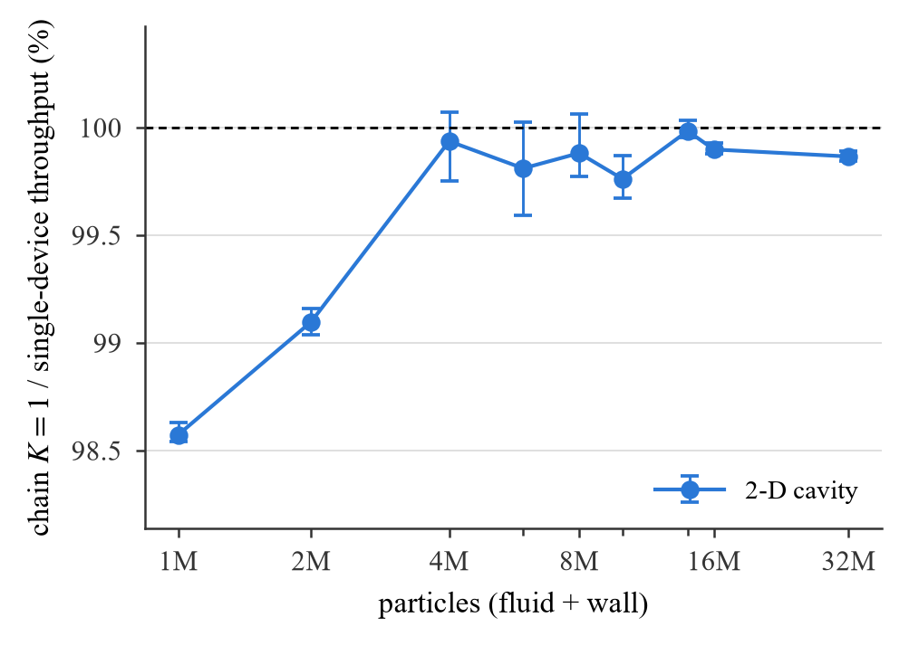

# §5.1 图:链式代码 K = 1 相对纯单卡求解器的吞吐比(2026-10-12)

**三行结论**

- 最差比值 chain/single = **98.57 %**(三次试验 98.54–98.63 %),出现在 N = 1 046 529(1M,最小算例)。
- 比值随 N 上升:1M 98.57,2M 99.10,4M 99.94,6M 99.81,8M 99.88,10M 99.76,14M 99.98,16M 99.90,32M 99.87 %。
- 4M 以上最差 **99.76 %**(99.67–99.87 %),在 N = 10 144 225(10M);4M–32M 全部在 99.76–99.98 %。



`manuscripts/fig/reference_ratio.{pdf,png}`:比值(%)对 N(对数轴),误差棒 = 三次试验逐次比值的最小 / 最大值,虚线 100 %;样式同 `single_gpu_throughput`。

## 设置

- 算例:fig:baseline(§3.5)的全部 2-D 方腔,同一生成器(`utils/geometry/_demo_cavity_case.py`),h/dx = 5:1M(`lid_driven_cavity_2d_gen`)、2M、4M(`_4m_gen`)、6M、8M、10M、14M、16M、32M。
- 求解器:single = `experiment/v7_single`(S);chain = `experiment/v7` 链式 K = 1(`compute_chain_partition` 一个 slab、pool_safety 1.2、`ChainOrchestratorV7.bootstrap_all` + `run_pipelined(depth=2)`,即 `_run_v7_chain_bench.py` 的生产循环)。两者同一份 SPIR-V(v7 MANIFEST)。
- 协议:两步在飞;1000 步预热后计时 2000–10000 步(与 fig:baseline 相同:1M 10000、2M 6000、4M 4000、6M 3000、8M–32M 2000),窗口内每 1000 步一次 defrag;每算例三次试验,两求解器交替(试验顺序 S C / C S / S C);每次运行独立进程;运行前进程级空闲检查;nvidia-smi 1 Hz 遥测;headless RTX 5090(UUID ae137c66…),validation 层关。
- 逐位检查:按你的指示跳过(v7_single 验收已证明 S = C 逐位;本活动第一轮里 1M 又做了一次 100 步规范体素表的检查,BIT-IDENTICAL)。
- 54 次运行(9 算例 × 2 求解器 × 3 次)drift 0、overflow 0;工具提交 a4bfc97(驱动 + 汇总)、35638ef(--skip-check)、8b1ffd6(内层活动的空闲检查忽略外层驱动,之前两者互等造成 GPU 空转);实测从 8b1ffd6 的干净树运行;数据 `logs/v7_single/reference_ratio/`(results.jsonl、telemetry.csv、runs/*.log),镜像 `docs/seam_audit/v7_single/reference_ratio.csv`、`manuscripts/bench/reference_ratio.csv`(每行一次试验:solver, dim, N, trial, steps, mean_step_ms, throughput_Mps)。
- 比值定义:chain/single 为三次试验平均吞吐之比;误差棒为逐次试验(同序号)比值的最小 / 最大。

## 结果

| 算例 | N | single(M 粒子·步/s) | chain | chain/single %(均值) | min | max |
|---|---|---|---|---|---|---|
| 1M | 1 046 529 | 769.4 ± 0.8 | 758.4 ± 0.6 | 98.57 | 98.54 | 98.63 |
| 2M | 2 064 969 | 768.4 ± 0.4 | 761.5 ± 0.7 | 99.10 | 99.04 | 99.16 |
| 4M | 4 182 025 | 731.7 ± 0.5 | 731.2 ± 0.8 | 99.94 | 99.75 | 100.07 |
| 6M | 6 105 841 | 772.5 ± 1.2 | 771.1 ± 0.4 | 99.81 | 99.59 | 100.02 |
| 8M | 8 128 201 | 768.0 ± 0.9 | 767.1 ± 0.4 | 99.88 | 99.77 | 100.06 |
| 10M | 10 144 225 | 790.9 ± 0.7 | 789.0 ± 0.5 | 99.76 | 99.67 | 99.87 |
| 14M | 14 160 169 | 747.7 ± 0.1 | 747.6 ± 0.1 | 99.98 | 99.96 | 100.03 |
| 16M | 16 184 529 | 768.6 ± 0.1 | 767.8 ± 0.1 | 99.90 | 99.88 | 99.93 |
| 32M | 32 251 041 | 790.5 ± 0.1 | 789.4 ± 0.2 | 99.87 | 99.85 | 99.89 |

与测量 A(§3,2026-10-10,S/V/Vx/C 七个配置轮转)的 C/S 一致:1M 98.55、2M 99.20、4M 99.75、8M 100.02、16M 99.91、32M 99.85 %;本次差别 ≤ 0.2 个百分点,在试验间散布之内。

3-D(按你的指示不进图,记录在案):cavity3d_1m(1 685 159 粒子,含墙)三次 99.64 %(99.49–99.88);cavity3d_8m_b4 只跑完一对就停了(99.98 %,单次)。

## 遥测(headless 5090,计时窗内的运行均值)

| 算例 | SM MHz(各运行均值的 min–max) | 功率 W | 最高 °C | 运行数 |
|---|---|---|---|---|
| 1m | 2798–2811 | 600–600 | 68 | 6 |
| 2m | 2765–2774 | 600–600 | 68 | 6 |
| 4m_gen | 2755–2756 | 600–600 | 68 | 6 |
| 6m | 2761–2769 | 600–600 | 68 | 6 |
| 8m | 2762–2768 | 600–600 | 69 | 6 |
| 10m | 2767–2770 | 600–600 | 68 | 6 |
| 14m | 2761–2763 | 600–600 | 68 | 6 |
| 16m | 2767–2771 | 600–600 | 69 | 6 |
| 32m | 2769–2772 | 599–600 | 69 | 6 |

全部 54 次运行:SM 2755–2811 MHz(功率上限 600 W 下的 boost),功率 599–600 W,温度 ≤ 69 °C;无降频。

## 解释

- 1M–2M 的 1.4 / 0.9 % 差距是链式代码每步的固定开销(三批提交、相位信号量、status 读回)相对短步长(1.3 ms)的占比;4M 起步长 > 5 ms,开销淹没在噪声里,比值 99.8–100 %。这与 §3 的 depth-1 损失曲线和 §5.1 原有的结论相同。
- 10M 的 99.76 %(min 99.67)是 4M 以上的最低点,但其试验间散布(±0.1 %)与 6M、8M 相当,不是系统性的。

## 复现

```
python experiment/v7_single/_run_reference_ratio_campaign.py --out logs/v7_single/reference_ratio --skip-check
python experiment/v7_single/_summarize_reference_ratio.py --runs logs/v7_single/reference_ratio --dims 2 \
    --csv manuscripts/bench/reference_ratio.csv --figure manuscripts/fig/reference_ratio \
    --summary docs/seam_audit/v7_single/reference_ratio_summary.md
```
