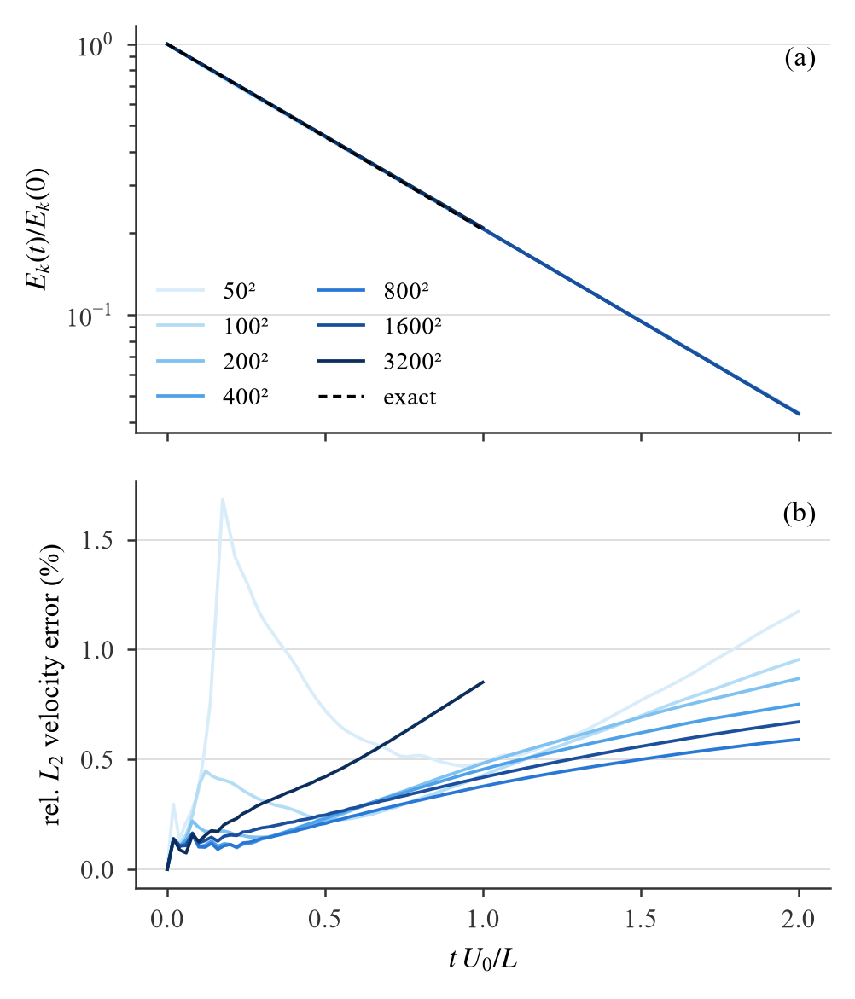
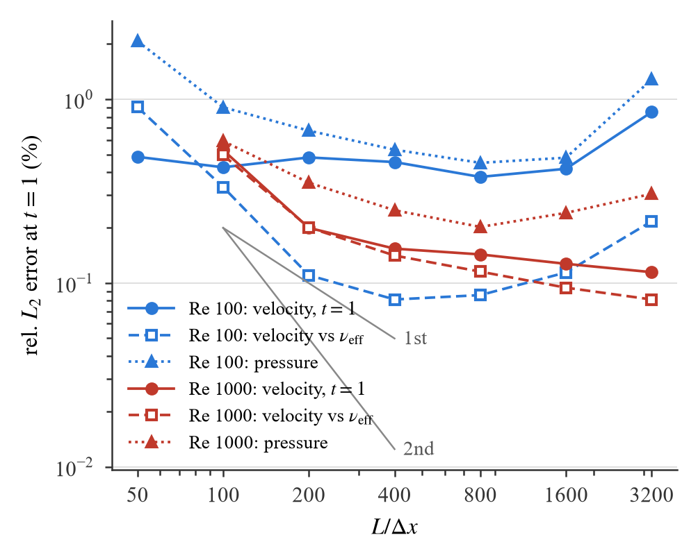

# v8 Taylor–Green:进度(2026-10-11 21:00,全部完成)

工作树 `vulkan-demo-v8`,分支 `v8-tgv`(从 v7-single 5897fd2 分出,未合并)。全部运行在 headless RTX 5090,drift / overflow / KCG fallback 全 0。
正式报告 `docs/tgv/v8_tgv.md`(报告页 HYSZ5AMQcPBEy8hJu6oqd9)已含全部结果:第一轮、ε² 扫描、§6 高分辨率序列(v2 / v3)与 float32 边界。

## 状态一览

| 阶段 | 状态 | 要点 |
|---|---|---|
| v8 周期域(v7 kernel + spec 116–119) | 完成,验收 PASS | 核和 GPU = CPU 最小镜像和(7e-7);方腔 250² 999 步 v7_single ≡ v8 逐位 |
| 第一轮活动(ε² = 0.0025 h²,24 个运行) | 完成 | ν_eff/ν ≈ 0.976 与分辨率无关 = ε² 正则项;形状误差一阶收敛;消融 / Mach / h/dx / 重复性 |
| ε² 扫描(200²,7 个值) | 完成 | 亏损 ≈ 0.0055 + 7.8 ε²/h²;**v8 默认改为 1e-4 h²** |
| v2(ε² 1e-4,无 delta density) | 50²–1600² 完成 | 1600² 反而比 800² 差 → 每步密度增量低于 float32 ULP |
| delta density(存 ρ − ρ₀,v7 kernel 自带开关) | 已接入 v8 | 1600² 的衰减率 / 压力 / 密度漂移恢复 |
| v3(ε² 1e-4 + delta,Re 100 50²–3200²,Re 1000 100²–3200²) | 完成(3200² Re 100 到 t = 1,98 分钟) | 见下表 |
| 1600² 居中箱诊断(位置 ULP 减半) | 完成 | 误差回到 800² 水平 → 1600² 的残余退化 = 位置 float32 舍入 |
| 分析 / §6 / 报告页 / 提交 | 完成 | 图 `tgv_*_eps1e-4_delta`,数据 `docs/tgv/data_eps1e-4{,_delta}` |

## 1. 第一轮结论(ε² = 0.0025 h²,详见正式报告)

- Re 100、h/dx 5、Ma 0.1、50²–800²:ν_eff/ν 0.970–0.978 与分辨率无关;原始速度误差 ~1.9 %(t = 1)不收敛;扣除 ν_eff 后形状误差 0.87 % → 0.08 %(阶 0.86)。
- 亏损来源 = 粘性项分母 r² + ε² 的正则项(ε² → 0:0.9945;0.01 h²:0.925)。
- 消融:无 PST 崩溃(27 %);无 δ 压力误差 ×4.6;无 KCG ν_eff/ν = 1.103。
- 800² Re 100 在声学 CFL 下爆掉:显式粘性稳定阈值 0.020–0.024 h²/ν,生成器按 dt ≤ 0.0125 h²/ν 自动降 CFL。

## 2. ε² 扫描与新默认值

| ε² / h² | 1e-8 | 1e-5 | 1e-4 | 4e-4 | 1e-3 | 2.5e-3 | 1e-2 |
|---|---|---|---|---|---|---|---|
| ν_eff/ν | 0.9945 | 0.9944 | 0.9937 | 0.9913 | 0.9869 | 0.9756 | 0.9253 |
| 速度误差 t = 1 | 0.43 % | 0.43 % | 0.49 % | 0.67 % | 1.03 % | 1.94 % | 6.1 % |
| 压力误差 t = 1 | 0.63 % | 0.62 % | 0.68 % | 0.86 % | 1.21 % | 2.12 % | 6.5 % |

取 1e-4 h²(ε = 0.05 dx):与 0 的差 0.07 %,仍保留 r → 0 的保护。v7 的方腔算例不动(仍 0.0025 h²)。

## 3. 高分辨率(v3:ε² 1e-4 h² + delta density)

Re 100:

| N | 粒子 | 步数 | ν_eff/ν | 速度误差 t=1 | t=2 | 形状误差 t=1 | 压力误差 t=1 | 核和 t=1 | steps/s |
|---|---|---|---|---|---|---|---|---|---|
| 50² | 2.5 k | 1 333 | 0.9882 | 0.49 % | 1.17 % | 0.91 % | 2.07 % | [0.994, 1.004] | 2210 |
| 100² | 10 k | 2 667 | 0.9919 | 0.43 % | 0.95 % | 0.33 % | 0.90 % | [0.995, 1.003] | 1937 |
| 200² | 40 k | 5 333 | 0.9938 | 0.48 % | 0.87 % | 0.110 % | 0.67 % | [0.994, 1.003] | 1499 |
| 400² | 160 k | 10 667 | 0.9949 | 0.46 % | 0.75 % | 0.081 % | 0.53 % | [0.995, 1.003] | 759 |
| 800² | 640 k | 40 960 | 0.9961 | 0.38 % | 0.59 % | 0.086 % | 0.45 % | [0.995, 1.004] | 482 |
| 1600² | 2.56 M | 163 840 | 0.9960 | 0.42 % | 0.67 % | 0.114 % | 0.48 % | [0.993, 1.009] | 188 |
| 1600² 居中箱 | 2.56 M | 163 840 | 0.9967 | 0.37 % | 0.55 % | 0.121 % | 0.38 % | [0.994, 1.006] | 184 |
| 3200²(到 t = 1) | 10.24 M | 327 679 | 0.9897 | 0.85 % | — | 0.216 % | 1.28 % | [0.938, 1.036] | 55.7 |

Re 1000:

| N | 粒子 | 步数 | ν_eff/ν | 速度误差 t=1 | t=2 | 形状误差 t=1 | 压力误差 t=1 | steps/s |
|---|---|---|---|---|---|---|---|---|
| 100² | 10 k | 2 667 | 1.017 | 0.53 % | 0.70 % | 0.50 % | 0.59 % | 2011 |
| 200² | 40 k | 5 333 | 0.9986 | 0.20 % | 0.26 % | 0.20 % | 0.35 % | 1383 |
| 400² | 160 k | 10 667 | 0.992 | 0.154 % | 0.209 % | 0.141 % | 0.25 % | 698 |
| 800² | 640 k | 21 333 | 0.9912 | 0.143 % | 0.201 % | 0.115 % | 0.20 % | 325 |
| 1600² | 2.56 M | 42 667 | 0.9922 | 0.127 % | 0.177 % | 0.094 % | 0.24 % | 117 |
| 3200² | 10.24 M | 85 333 | 0.9935 | 0.114 % | 0.158 % | 0.081 % | 0.31 % | 38.9 |

读法:

- ε² 改小后 Re 100 的速度误差 t = 1 从 1.84 % 降到 0.38 %(800²),ν_eff/ν 升到 0.996;形状误差地板 ~0.08 %(400² 起);Re 1000 单调收敛到 0.114 %(3200²)。
- **float32 边界**:粘性步长限制下 dt ∝ dx²。1600² 时每步密度增量 ~2e-8 < ρ₀ = 1 的 ULP 1.2e-7 → delta density 解决;位置 ULP(x ≈ 1 处 6e-8)已是每步位移的 ~1 %、PST 位移的 ~20 %,
  居中箱(ULP 减半)就把 1600² 拉回 800² 的水平;3200² Re 100(328 k 步)PST 位移 ≈ 1 ULP → 核和 ±5 %、误差 0.85 %,而同样 3200² 的 Re 1000 走声学 dt(85 k 步)正常。
  这是单精度 + 粘性 dt 的精度边界,不是算法收敛边界;越过它要相对体素原点存位置(kernel 改动,未做)。

## 4. 待你决定

- 方腔(v7)的 ε² 是否跟进 1e-4 h²(需重验壁面 / 角点稳定性)。
- 位置精度:是否在后续版本里相对体素原点存位置(方腔的 10⁶ 步长程运行可能也受影响,未量化)。
- 论文用图:v3 的 `tgv_energy_eps1e-4_delta` 与 `tgv_convergence_eps1e-4_delta`;Re 100 的 3200² 点保留并注明,或截到 1600²。
