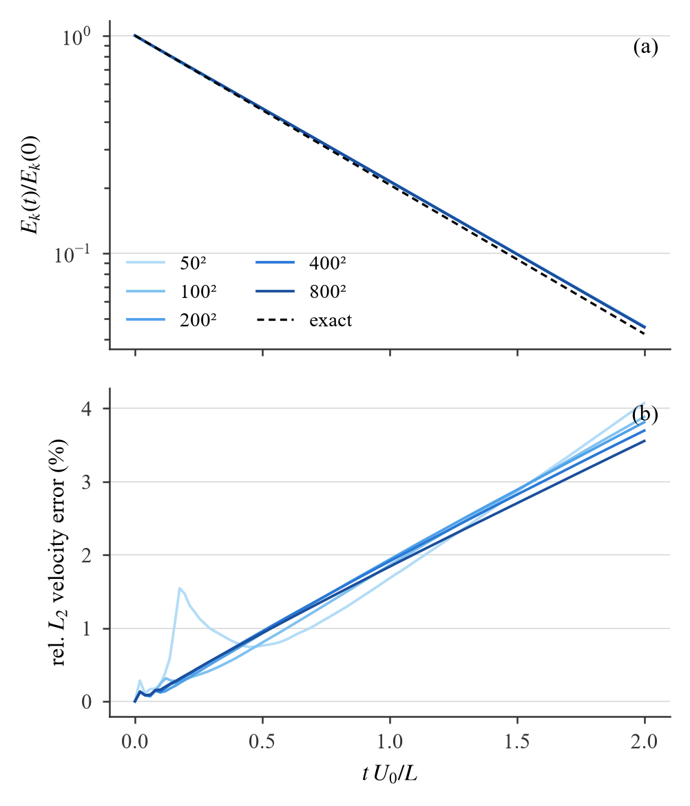
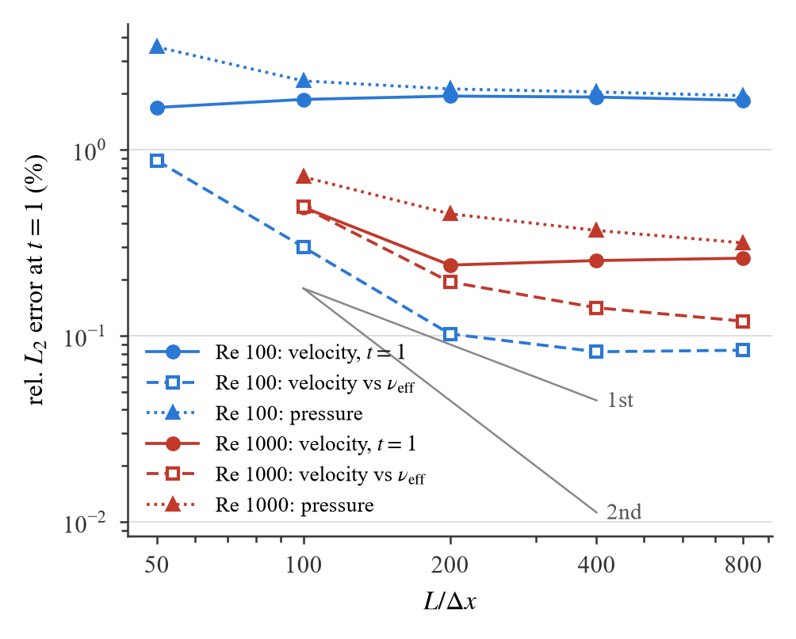
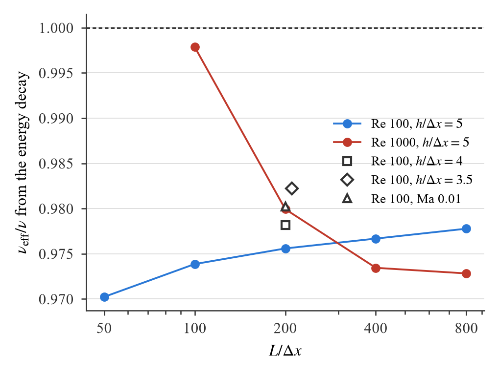
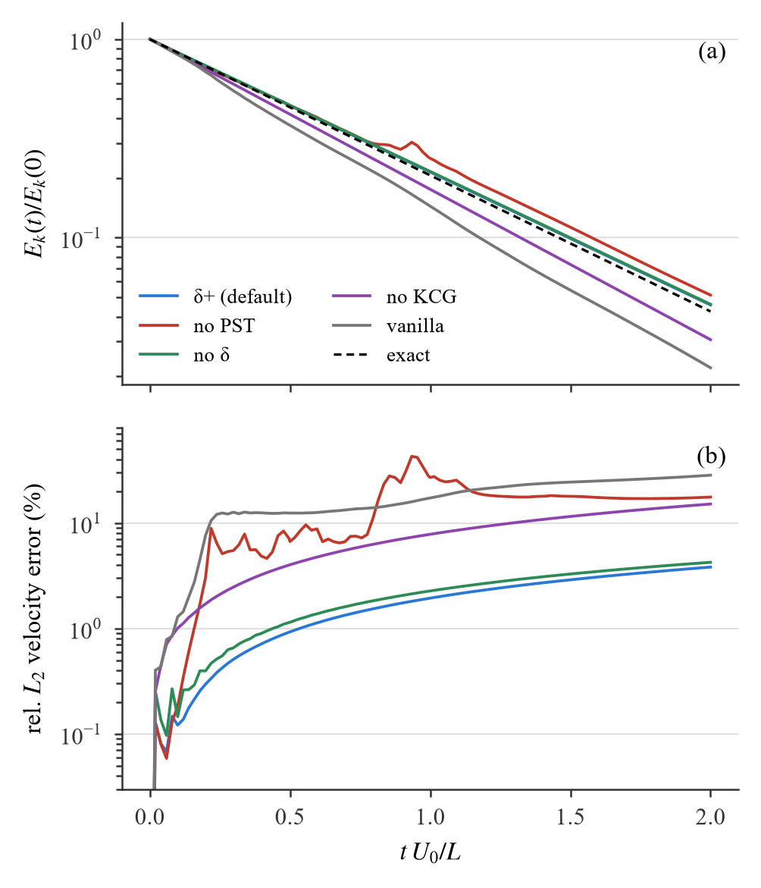
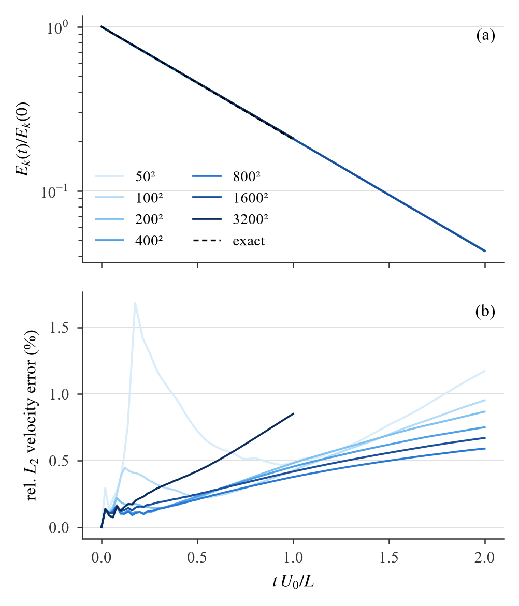
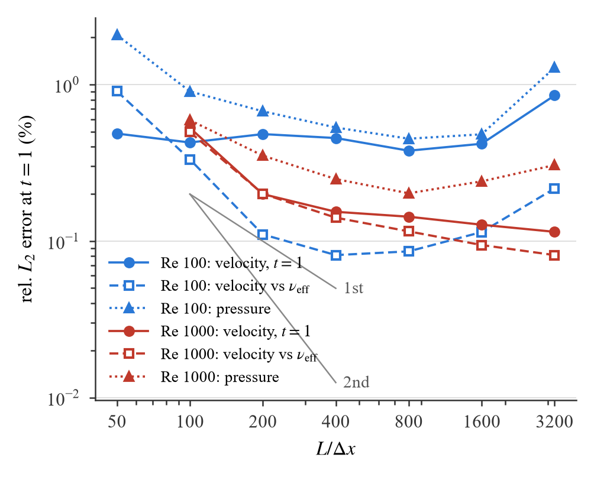

# v8:周期域 + 二维 Taylor–Green 涡精度(2026-10-11)

目的:给论文一个**有解析解**的精度验证。方腔只能对照参考解(Marchi/Ghia),Taylor–Green 涡(TGV)在周期箱里有精确解
u(x, t) = U₀ sin(kx) cos(ky) F(t),v = −U₀ cos(kx) sin(ky) F(t),p = ρ₀U₀²/4 (cos 2kx + cos 2ky) F²,F = exp(−2νk²t),
可以直接量**收敛阶**和**有效粘性**。v7 的 kernel 没有周期边界(邻居循环在网格边缘截断,predict 杀掉出界粒子),
按你的授权,我建了 `experiment/v8`:v7 kernel 的拷贝 + 周期域,**不动 experiment/v7 与 experiment/v7_single**。
周期开关默认关闭时 v8 与 v7_single 在方腔上逐位相同(验收 2)。

全部运行在 headless RTX 5090(UUID ae137c66…)上,validation 层关,每次运行前进程级空闲检查,24 个运行 drift / overflow 全 0,
KCG fallback 全 0。工作树 `vulkan-demo-v8`,分支 `v8-tgv`(从 v7-single 5897fd2 分出,不合并)。

## 结论(TL;DR)

- **周期域正确**:(1) 100² TGV 启动后 GPU 的核和 Σ V_j W_ij 与 CPU 最小镜像参考(cKDTree boxsize)逐粒子相差 ≤ 7.1e-7,
  无边缘亏损(非周期对照 min 0.377);KCG 逆各向同性(0.885 I ± 0.004);400 步后 1687 个粒子穿越了周期边界,drift 0,
  动能比 0.6268 对精确 0.6227。(2) 方腔 250²(74 529 粒子)999 步:**v7_single 与 v8 逐位相同**(规范化体素表协议,v7 对 v7 对照也逐位)。
- **Re 100、h/dx 5、Ma 0.1、50²–800²(2.5 k–640 k 粒子)**:动能衰减给出 ν_eff/ν = 0.970 → 0.978,几乎与分辨率无关;
  原始速度相对 L2 误差 1.7–1.9 %(t = 1)、3.6–4.1 %(t = 2),**不随分辨率收敛**(阶 −0.03);压力(去均值,相对瞬时幅值)3.6 → 2.0 %。
- **扣除 ν_eff 后的形状误差一阶收敛**:0.87 % (50²) → 0.30 → 0.10 → 0.082 → 0.084 %(t = 1,阶 0.86;t = 2 阶 0.95),400² 以后到约 0.08 % 的地板。
- **亏损来源已定位(诊断运行)**:粘性项分母 r² + ε² 的正则项。ε² → 0:ν_eff/ν = 0.9945,速度误差 0.43 % (t = 1) / 0.75 % (t = 2);
  默认 ε² = 0.0025 h²:0.9756(−1.9 %);旧值 0.01 h²:0.925(−7.5 %,与方腔 Re 1000 时测到的 ~7 % 一致)。
  剩下的 0.55 %:Ma(0.1 → 0.01 使 ν_eff/ν 升 0.47 %),dt/10 只升 0.12 %。
- **消融(200²)**:无 PST 崩溃(误差 27 %,压力误差 117 %);无 δ 扩散速度 +0.3 pp 但压力误差 ×4.6(2.1 → 9.8 %);
  无 KCG 时 ν_eff/ν = 1.103(校准体积的 M ≈ 1.129 I 不再被修正),速度误差 7.8 %;全关 1.21 / 17 %。
- **Re 1000、100²–800²**:误差 0.49 → 0.25 %(t = 1);ν_eff/ν 0.998 → 0.973(粗网格的数值耗散抵消了 ε² 亏损,细网格回到同一亏损);形状误差 0.49 → 0.12 %。
- h/dx 3.5 / 4 / 5:ν_eff/ν 0.982 / 0.978 / 0.976,形状误差 0.40 / 0.23 / 0.10 %;重复三次 200² 运行 ν_eff 一致到 1e-4。
- **稳定性**:800² Re 100 在声学 CFL 0.15(= 0.024 h²/ν)下 400 步内爆掉;0.020 与 0.016 h²/ν 稳定。生成器现在按 dt ≤ 0.0125 h²/ν 自动降低写入的 cfl 并在 case.yaml 头注明(只影响 800² Re 100,cfl 0.078)。
- **ε² 扫描(200²,§3.3)**:亏损随 ε² 近似线性,1e-5 h² 以下与 0 无差别(0.9944),1e-4 h² 只差 0.07 %(0.9937),4e-4 → 0.9913,1e-3 → 0.9869。
  **v8 的默认 ε² 已改为 1e-4 h²**(ε = 0.01 h = 0.05 dx;保留 r → 0 的保护,精度上与 0 等价;v7 的方腔算例仍用 0.0025 h²,不动)。
- **新默认下的高分辨率序列(§6,ε² = 1e-4 h² + delta density)**:Re 100 速度误差 t = 1 从 1.84 % 降到 0.38 %(800²),ν_eff/ν 0.988 → 0.996,形状误差地板 0.08 %;
  Re 1000 单调收敛到 0.114 %(3200²,10.24 M 粒子)。**float32 边界**:粘性步长限制下 dt ∝ dx²,1600² 起每步密度增量低于 ρ₀ = 1 的 ULP(开 v7 kernel 的 DELTA_DENSITY 后恢复),
  3200² Re 100(328 k 步)连 PST 位移都只剩 ~1 ULP,粒子排布退化(核和 ±5 %,误差 0.85 %);同样 3200² 的 Re 1000 走声学 dt(85 k 步)则正常;
  同一 1600² 改用居中箱(位置 ULP 减半)就回到 800² 的水平。
- **Re 100 平在 0.4 % 的原因是 Ma(§6.4)**:400² 上 Ma 0.1 / 0.05 / 0.02 / 0.01 → 速度误差 0.455 / 0.249 / 0.153 / 0.090 %,ν_eff/ν 0.9949 / 0.9971 / 0.9990 / 1.0000。
- **新默认下的消融与 h/dx(§6.5)**:无 PST 在 ε² = 1e-4 h² 下直接爆掉(粒子串聚到 r → 0);其余见表。
- **文献并列(§6.6)**:能核实的只有 Negi & Ramachandran 2021(TVF,h/dx 1.0,Re 100 L1 误差 ~0.5–1.2 %,同样"低 Re 下不随分辨率收敛");δ⁺-SPH 原文全文不可得,不替它断言。
- **论文**:可放 `tgv_energy`(衰减 + 误差随时间)与 `tgv_convergence`(误差随分辨率)两张图和一张表;措辞见 §4。

## 1. v8:v7 kernel + 周期域

| 文件 | 改动 |
|---|---|
| `experiment/v8/shaders/common.glsl` | spec 常量 116 `PERIODIC_X`、117 `PERIODIC_Y`(bool,默认 false)、118/119 `DOMAIN_LENGTH_X/Y` |
| `helpers.glsl` | `wrap_neighbor_coord`(3^d 邻居体素坐标在周期轴上环绕)、`minimum_image`(r_i − r_j 折到最近镜像;对 float32 差值做,精确反对称)、`wrap_position`(漂移后的位置折回 [origin, origin + L);箱内位置逐位不变)、`clamp_periodic_coord` |
| `correction_density.comp`、`correction.comp`、`density.comp`、`force.comp`、`wall_extrapolate.comp` | 邻居循环用 `wrap_neighbor_coord` 代替 `in_own_grid`,距离用 `minimum_image(self − neighbour)` |
| `predict.comp` | 漂移后先 `wrap_position` 再算体素(周期轴不再杀粒子) |
| `initialize_voxelization.comp` | 周期轴上体素坐标钳到网格内 |

独立编译(`compile_shaders_v8.py`,与 v7 同 glslc 参数)并写 MANIFEST,由 v7_single 的 `spirv_manifest` 校验。loader 断言周期轴上 frame.obj 的跨度是整数个
(≥ 3)体素,保证一次环绕的三列互不相同、没有粒子既直接又经镜像落在支持域内。host:`utils/case_loader_v8.py`(`physics.periodic`、
`initial_field: taylor_green`:每粒子初速度,初始密度由解析压力经 Tait 反解 ρ = ρ₀(1 + p/B)^{1/γ};`origin_offset: 0.25` 把最快的流带放到箱边,
让每次运行都穿越周期边界)、`SphSimulatorV8(SphSimulatorSingle)`(只加四个 spec 常量和每粒子初始密度)。

### 验收

| 项 | 脚本 | 结果 |
|---|---|---|
| 周期核和 | `_test_v8_periodic.py`(100² TGV,启动后) | GPU 核和 [0.995164, 1.005033] = CPU 最小镜像和,max 差 7.07e-7;非周期对照 min 0.377;KCG 逆对角 0.88496(0.88059–0.88923),非对角 ≤ 9.3e-7 |
| 周期运行 | 同上,400 步(t = 0.30) | alive 10 000,drift 0,overflow 0,出箱 0,穿越 x 边界 1687,E/E0 0.6268(精确 0.6227),总动量 6e-6 |
| 方腔等价 | `_test_v8_equivalence.py`(cavity 250²,74 529 粒子,规范化体素表,无启动 defrag,999 步) | v7_single vs v8 **BITWISE**(每个字段 max 差 0);v7 vs v7 对照 BITWISE |

两项在最终提交 01833cc 重跑,报告在 `docs/tgv/data/{periodic_test,equivalence_test}.json`。

## 2. 算例与测量协议

- 箱 [0, 1)²,双周期;N × N 流体粒子在 ((i + ½)dx, (j + ½)dx),无墙;U₀ = ρ₀ = L = 1;k = 2π;ν = U₀L/Re;c₀ = U₀/Ma(默认 Ma 0.1 → c₀ = 10,文献常用);
  h/dx = 5(项目标准,支持半径 h = 5 dx);数值参数 = 方腔算例默认(δ 0.1,KCG ξ 0.001,ε² 0.0025 h²,PST 0.1 / 0.0005,CFL 0.15,γ 7,defrag 1000)。
  材料体积按分割单位校准(V = 1.129 dx²),所以 SPH 质量 = 1.129 ρ₀dx²、E_k(0) = 0.2823(连续值 0.25);下面只用 E_k(t)/E_k(0)。
- 时间步:dt = min(CFL h/c₀, 0.0125 h²/ν)。粘性上限是实测的:800² Re 100 在 0.024 h²/ν 爆掉,0.020 / 0.016 稳定(各 2400–3200 步到 t = 0.15),取 0.0125 留 1.6 倍余量。
  只有 800² Re 100 受此限制(cfl 写成 0.078,dt 4.88e-5,40 960 步);400² Re 100 的声学 dt 恰为 0.012 h²/ν。
- 到 t = 2(Re 100 时 F² = 0.042),每 Δt = 0.02 排空队列读回全部粒子;leapfrog 的 v_{n+½} 用刚算出的 a_{n+1} 同步:v_{n+1} = v_{n+½} + ½ a_{n+1} dt,与 u(x_i, t_{n+1}) 比较。
  快照 t = 0, 0.5, 1, 2。2 帧在飞(结果与 1 帧相同,只影响吞吐)。
- 指标:E_k/E_k(0) 对 F²;**ν_eff/ν** = ln E_k 在 t ∈ [0.1, 2] 的最小二乘斜率 ÷ (−4νk²)(拟合 rms ≤ 8e-4);速度相对 L2 误差 ‖v − u‖/‖u‖;
  **形状误差** = 对 ν_eff 的解析场的相对 L2 误差(把衰减率误差去掉后场形状的误差);压力误差 = 去均值后的 L2 ÷ 瞬时幅值 ρ₀U₀²F²/2;max|ρ/ρ₀ − 1|;核和范围;总动量。
- 运行表(24 个,`_run_tgv_campaign.py` 的 RUNS):Re 100 50²/100²/200²/400²/800²;Re 1000 100²–800²;消融(200²:无 PST、无 δ、无 KCG、全关);
  Ma 0.05 / 0.02 / 0.01;h/dx 4(200²)、3.5(210²);初始密度均匀;重复 ×2;诊断:ε² = 1e-8 h²、0.01 h²、CFL 0.015。
- 数据:`logs/v8/tgv/<run>/{samples.jsonl, result.json, snapshots/}`;汇总 `docs/tgv/data/{summary.json, summary.md, runs.csv, campaign_results.jsonl, campaign.log}`;
  图 `manuscripts/fig/tgv_*.{pdf,png}`(单栏 3.5 in,字号 ≥ 7 pt)。

## 3. 结果

### 3.1 Re 100 分辨率序列

| N | 粒子 | ν_eff/ν | E/E0 t=1(精确 0.206) | 速度误差 t=1 | t=2 | 形状误差 t=1 | t=2 | 压力误差 t=1 | steps/s |
|---|---|---|---|---|---|---|---|---|---|
| 50² | 2 500 | 0.9702 | 0.2127 | 1.68 % | 4.07 % | 0.87 % | 0.83 % | 3.56 % | 2037 |
| 100² | 10 000 | 0.9739 | 0.2139 | 1.86 % | 3.89 % | 0.30 % | 0.37 % | 2.34 % | 2001 |
| 200² | 40 000 | 0.9756 | 0.2142 | 1.94 % | 3.81 % | 0.102 % | 0.152 % | 2.12 % | 1424 |
| 400² | 160 000 | 0.9767 | 0.2141 | 1.91 % | 3.70 % | 0.082 % | 0.083 % | 2.04 % | 727 |
| 800² | 640 000 | 0.9778 | 0.2138 | 1.84 % | 3.56 % | 0.084 % | 0.064 % | 1.95 % | 463 |



(a) 五条曲线重合,与精确解的差就是 2.2–3.0 % 的衰减率亏损;(b) 原始速度误差随时间线性增长到 ~4 %,就是 1 − F(ν_eff)/F(ν) ≈ 2νk²t·(1 − ν_eff/ν);
50² 在 t ≈ 0.2 有一个初始调整的峰。max|ρ/ρ₀ − 1| = 1.1e-3(Ma² 量级);核和在 t = 1 时 [0.993, 1.004](50² 全程 [0.95, 1.04],100² 以上全程 [0.98, 1.01]);总动量 ≤ 5e-6(50²:2.2e-5),相对 Σm|v| 为 1e-5 量级。

### 3.2 收敛阶(log-log 对 dx,t = 1)

| 量 | Re 100 | Re 1000 |
|---|---|---|
| 原始速度误差 | −0.03(不收敛) | 0.26 |
| 形状误差(对 ν_eff 的解析场) | 0.86(t = 2:0.95) | 0.66 |
| 最佳幅值拟合后的误差 | 0.81 | 0.66 |
| 压力误差 | 0.19 | 0.38 |



形状误差从 50² 到 400² 一阶收敛,400² → 800² 停在 0.08 %(Re 100);Re 1000 到 800² 仍在降(0.12 %)。原始误差被衰减率亏损锁在 ~2 %。

### 3.3 ν_eff 的来源



诊断运行(Re 100,200²):

| 变体 | ν_eff/ν | 速度误差 t=1 | t=2 | 形状误差 t=1 | 压力误差 t=1 |
|---|---|---|---|---|---|
| 默认(ε² = 0.0025 h²,Ma 0.1,CFL 0.15) | 0.9756 | 1.94 % | 3.81 % | 0.102 % | 2.12 % |
| ε² = 1e-8 h²(→ 0) | **0.9945** | **0.43 %** | **0.75 %** | 0.111 % | 0.63 % |
| ε² = 0.01 h²(2026-10-05 以前的值) | 0.9253 | 6.1 % | 12.4 % | 0.081 % | 6.5 % |
| CFL 0.015(dt/10) | 0.9768 | 1.69 % | 3.54 % | 0.192 % | 1.86 % |
| Ma 0.01(c₀ = 100,见 3.6) | 0.9803 | 1.62 % | 3.17 % | 0.122 % | 1.72 % |

- force.comp 的粘性项 2(d+2)ν Σ V_j (v_ij·x_ij)/(r² + ε²) ∇W̃_ij:ε² 让每对的权重乘 r²/(r² + ε²),最近邻(r = dx = h/5)被压 6 %,加权后整体 −1.9 %(0.0025 h²)/ −6.9 %(0.01 h²)。
  这就是方腔 Re 1000 验证时看到的 "ν_eff ≈ 0.85–0.93 ν" 的那个因子,TGV 把它量成了一个数。
- 在精确方格上手算同一算子(`_viscous_operator_lattice.py`,`docs/tgv/data/viscous_operator_lattice.md`):h/dx 5 时 ε² = 0 / 0.0025 h² / 0.01 h² 的回收率 0.974 / 0.958 / 0.914,
  ε² 的相对影响(−1.6 % / −6.0 %)与实测(−1.9 % / −6.9 %)同量级;方格上 ε² = 0 的基线 0.974 比实测 0.9945 低,因为 PST 把实际粒子排成各向同性的无序分布(图 `tgv_fields` 右下),算子更接近连续极限。
- 剩余 0.55 %(ε² → 0):Ma 0.1 → 0.01 使 ν_eff/ν 升 0.47 %(可压缩性),dt/10 升 0.12 %;两者合计即剩余部分。
- 形状误差不随 ε² 变(0.08–0.11 %),ε² 只改衰减率。

ε² 扫描(Re 100,200²,其余默认;提交 e9fd83d):

| ε² / h² | 1e-8 | 1e-5 | 1e-4 | 4e-4 | 1e-3 | 2.5e-3(方腔默认) | 1e-2(旧值) |
|---|---|---|---|---|---|---|---|
| ν_eff/ν | 0.9945 | 0.9944 | 0.9937 | 0.9913 | 0.9869 | 0.9756 | 0.9253 |
| 速度误差 t = 1 | 0.43 % | 0.43 % | 0.49 % | 0.67 % | 1.03 % | 1.94 % | 6.1 % |
| 速度误差 t = 2 | 0.75 % | 0.76 % | 0.88 % | 1.25 % | 1.97 % | 3.81 % | 12.4 % |
| 压力误差 t = 1 | 0.63 % | 0.62 % | 0.68 % | 0.86 % | 1.21 % | 2.12 % | 6.5 % |

亏损 1 − ν_eff/ν ≈ 0.0055 + 7.8·(ε²/h²)(到 2.5e-3 为止近似线性),形状误差全程 0.11 %,核和范围、密度偏差、KCG fallback(0)都不变。
**据此把 v8 的默认改为 ε² = 1e-4 h²**(`_make_tgv_case.py --epsilon-squared-factor` 默认值;ε = 0.01 h = 0.05 dx 时最近邻的权重只少 0.25 %,
r = 0.1 dx 处仍有 25 % 的封顶保护)。第一轮活动(`cases/tgv_2d`、`logs/v8/tgv`)保持 0.0025 h²,RUNS 表里现在显式写出;新默认的序列在 `cases/tgv_2d_eps1e-4`、`logs/v8/tgv_eps1e-4`(§6)。

### 3.4 Re 1000

| N | ν_eff/ν | E/E0 t=1(精确 0.854) | 速度误差 t=1 | t=2 | 形状误差 t=1 | t=2 | 压力误差 t=1 | steps/s |
|---|---|---|---|---|---|---|---|---|
| 100² | 0.9979 | 0.8534 | 0.49 % | 0.63 % | 0.49 % | 0.63 % | 0.71 % | 2008 |
| 200² | 0.9799 | 0.8563 | 0.24 % | 0.40 % | 0.19 % | 0.27 % | 0.45 % | 1477 |
| 400² | 0.9735 | 0.8574 | 0.25 % | 0.45 % | 0.14 % | 0.18 % | 0.37 % | 755 |
| 800² | 0.9728 | 0.8577 | 0.26 % | 0.46 % | 0.12 % | 0.14 % | 0.32 % | 316 |

Re 1000 的 ν 小 10 倍,同样的 ε² 亏损在绝对值上小 10 倍,所以速度误差只有 0.25 %;粗网格(100²)的数值耗散(约 +2.5 % ν)恰好抵消 ε² 亏损,ν_eff/ν ≈ 1 是巧合而非更准。max|ρ/ρ₀ − 1| = 4.4e-3。

### 3.5 消融(Re 100,200²)

| 变体 | ν_eff/ν | 速度误差 t=1 | t=2 | 形状误差 t=1 | 压力误差 t=1 | max\|ρ/ρ₀−1\| t=1 |
|---|---|---|---|---|---|---|
| δ+ 默认(PST + δ + KCG) | 0.9756 | 1.94 % | 3.81 % | 0.102 % | 2.1 % | 1.1e-3 |
| 无 PST | 0.918 | 27.0 % | 17.6 % | 24 % | 117 % | 2.6e-2 |
| 无 δ 扩散 | 0.9735 | 2.27 % | 4.23 % | 0.18 % | 9.8 % | 1.5e-3 |
| 无 KCG | 1.103 | 7.8 % | 15.1 % | 0.102 % | 12.4 % | 1.1e-3 |
| 全关(vanilla WCSPH) | 1.207 | 17.2 % | 28.3 % | 6.1 % | 187 % | 3.0e-2 |



- 无 PST 是经典的 TGV 失稳:粒子沿流线排成串,核和掉到 0.19–2.1,t ≈ 0.2 起误差 10–30 %。
- 无 KCG:校准体积下 Σ V_j (r_j − r_i) ⊗ ∇W_ij = 1.129 I,未修正的梯度把粘性算子放大 1.129 倍再乘 ε² 因子 → 1.103;形状误差不变,只有衰减率错。
- 无 δ:速度几乎不变,压力噪声 ×4.6。

### 3.6 Mach 数(Re 100,200²)

| Ma | c₀ | ν_eff/ν | 速度误差 t=1 | t=2 | 形状误差 t=1 | 压力误差 t=1 | max\|ρ/ρ₀−1\| | steps/s |
|---|---|---|---|---|---|---|---|---|
| 0.1 | 10 | 0.9756 | 1.94 % | 3.81 % | 0.102 % | 2.12 % | 1.1e-3 | 1424 |
| 0.05 | 20 | 0.9778 | 1.74 % | 3.49 % | 0.100 % | 1.89 % | 2.8e-4 | 2274 |
| 0.02 | 50 | 0.9792 | 1.66 % | 3.31 % | 0.097 % | 1.76 % | 4.6e-5 | 3209 |
| 0.01 | 100 | 0.9803 | 1.62 % | 3.17 % | 0.122 % | 1.72 % | 1.2e-5 | 3855 |

密度偏差 ∝ Ma²;ν_eff 对 Ma 的依赖(0.47 %)是可压缩性;压力误差的地板 1.7 % 不是 Ma 决定的。

### 3.7 核支持 h/dx(Re 100)

| h/dx | N | ν_eff/ν | 速度误差 t=1 | 形状误差 t=1 | 压力误差 t=1 | 方格算子 ε² = 0 / 0.0025 h² | steps/s |
|---|---|---|---|---|---|---|---|
| 5 | 200² | 0.9756 | 1.94 % | 0.102 % | 2.12 % | 0.974 / 0.958 | 1424 |
| 4 | 200² | 0.9782 | 1.85 % | 0.231 % | 1.99 % | 0.939 / 0.926 | 1971 |
| 3.5 | 210² | 0.9823 | 1.68 % | 0.395 % | 1.89 % | 0.899 / 0.887 | 2383 |

h/dx 越小,ε²(∝ h²)相对最近邻距离越小,衰减率亏损越小;但形状误差翻 2–4 倍。这与 E7 的 "h/dx 3.5 按物理时间最省" 不矛盾:那是成本,这里是精度。

### 3.8 初始密度

均匀 ρ₀ 起步(不从解析压力反解):ν_eff/ν 0.9756(同),速度误差 1.77 %(t = 1),形状误差 0.205 %(默认 0.102 %),压力误差 1.22 %(默认 2.12 %)。差别都在 0.1–1 pp,不改结论;主序列保持 ρ(p₀) 起步。

### 3.9 重复性、稳定性、吞吐

- 三次 200² 运行:ν_eff/ν 0.975593 / 0.975584 / 0.975618;速度误差 1.937 / 1.931 / 1.937 %(t = 1)。唯一的不确定来源是体素表原子追加的顺序,影响 ≤ 3e-3 相对。
- 稳定性见 §2;所有 24 个运行 drift 0、overflow 0、KCG fallback 0。
- 吞吐(2 帧在飞,含每 0.02 时间单位的读回):2.5 k 粒子 2037 steps/s(派发开销地板 ~0.5 ms/步),640 k 粒子 463 steps/s;整个活动 24 个运行约 6 分钟。

## 4. 对论文的意义

1. **可以写进去的**:δ+-SPH(PST + δ + KCG)在 TGV 上形状误差一阶收敛(0.87 → 0.08 %),压力误差 2 %;衰减率由粘性项的 ε² 正则化决定且与分辨率无关
   (ε² = 0.0025 h² 时 ν_eff/ν = 0.976 ± 0.004,50²–800²;ε² → 0 时 0.9945);消融表说明三个成分各管什么(PST 管稳定,δ 管压力,KCG 管梯度归一)。
2. **建议的图表**:`tgv_energy`(a+b)和 `tgv_convergence` 两张单栏图;一张表 = §3.1 的五行 + §3.5 的五行。`tgv_viscosity` 与 `tgv_ablation` 可进补充材料。
3. **ε²**:0.0025 h² 是 2026-10-05 从 0.01 h² 改下来的;TGV 说明再改小会把 ν_eff 亏损从 2.4 % 压到 0.6 %。ε² 的本意是防 r → 0 的奇性,PST 下粒子间距不会小于 ~0.5 dx。
   按你的决定,v8 的默认已改为 1e-4 h²(§3.3 的扫描、§6 的序列);方腔(壁面、角点)是否跟进要重验稳定性,那是 v7 的事,仍由你定。
   论文里两种写法都诚实:"ε² = 1e-4 h²,TGV 上 ν_eff/ν = 0.994" 或 "方腔用 0.0025 h²,对应 2.4 % 的有效粘性亏损,见 TGV"。
4. **不要写的**:原始速度误差 "随分辨率收敛"(它不收敛),以及 Re 1000 粗网格 ν_eff ≈ ν(是抵消)。

## 5. 论文用数字

- 周期域:核和 GPU−CPU ≤ 7.1e-7;方腔 999 步 v7_single ≡ v8 逐位。
- Re 100,h/dx 5,Ma 0.1:ν_eff/ν 0.9702 / 0.9739 / 0.9756 / 0.9767 / 0.9778(50²–800²);速度相对 L2 误差 t = 1:1.68 / 1.86 / 1.94 / 1.91 / 1.84 %;形状误差 0.87 / 0.30 / 0.102 / 0.082 / 0.084 %(阶 0.86);压力 3.56 / 2.34 / 2.12 / 2.04 / 1.95 %。
- ε² 诊断(200²):0 → 0.9945(误差 0.43 %);0.0025 h² → 0.9756(1.94 %);0.01 h² → 0.9253(6.1 %)。
- 消融(200²,t = 1):无 PST 27 %,无 δ 2.27 %(压力 9.8 %),无 KCG 7.8 %(ν_eff/ν 1.103),全关 17 %。
- Re 1000:速度误差 0.49 / 0.24 / 0.25 / 0.26 %,形状 0.49 / 0.19 / 0.14 / 0.12 %。
- Mach:ν_eff/ν 0.9756 / 0.9778 / 0.9792 / 0.9803(Ma 0.1 / 0.05 / 0.02 / 0.01)。
- 粘性步长上限:0.020 稳、0.024 h²/ν 爆;采用 0.0125 h²/ν。

## 6. 新默认(ε² = 1e-4 h²)下的高分辨率序列

三个运行集(`_run_tgv_campaign.py --set`):v1 = 第一轮(ε² 0.0025 h²,`cases/tgv_2d`,`logs/v8/tgv`);v2 = ε² 1e-4 h²(`cases/tgv_2d_eps1e-4`,`logs/v8/tgv_eps1e-4`,
Re 100 50²–1600²,3200² 停掉);v3 = ε² 1e-4 h² + `numerics.delta_density`(`cases/tgv_2d_eps1e-4_delta`,`logs/v8/tgv_eps1e-4_delta`,Re 100 50²–3200²、Re 1000 100²–3200²)。
3200² = 10.24 M 粒子;Re 100 的 3200² 只跑到 t = 1(328 k 步,98 分钟),其余到 t = 2。汇总 `docs/tgv/data_eps1e-4{,_delta}/`,v2 对 v3 的逐运行对照 `docs/tgv/data_eps1e-4_delta/comparison.md`。

### 6.1 为什么要 delta density

v2 的 1600² 比 800² 差:ν_eff/ν 0.9952(800² 0.9961)、压力误差 0.62 %(0.47 %)、密度均值漂移 −6.2e-5(−2.0e-5)。原因是精度而不是算法:粘性步长限制下 dt = 0.0125 h²/ν ∝ dx²,
1600² 的 dt = 1.22e-5,每步密度增量 dt·dρ/dt ≈ 2e-8,而 ρ₀ = 1 的 float32 ULP 是 1.2e-7 —— 连续方程 ρ += dt·(dρ/dt) 把大部分增量舍掉。800² 时增量 ≈ 0.65 ULP(边缘),400² 2.5 ULP。
v7 kernel 自带的 `DELTA_DENSITY`(spec 95/96:GPU 上存 ρ − ρ_ref,`tait_pressure` 用二项级数)正是为此而设,v8 通过 case.yaml `numerics.delta_density: true` 开启
(loader / simulator / 生成器 `--delta-density`;初始密度在 float64 里减去 ρ₀ 再转 float32,存储量的分辨率 4.7e-10)。开启后 1600² 的三个量回到 800² 的水平(0.9960、0.48 %、−1.6e-5);
50²–800² 与无 delta 的结果一致到 0.1 pp 以内(comparison.md)。

### 6.2 Re 100(v3)

| N | 粒子 | 步数 | ν_eff/ν | 速度误差 t=1 | t=2 | 形状误差 t=1 | 压力误差 t=1 | 核和 t=1 | steps/s |
|---|---|---|---|---|---|---|---|---|---|
| 50² | 2.5 k | 1 333 | 0.9882 | 0.49 % | 1.17 % | 0.91 % | 2.07 % | [0.994, 1.004] | 2210 |
| 100² | 10 k | 2 667 | 0.9919 | 0.43 % | 0.95 % | 0.33 % | 0.90 % | [0.995, 1.003] | 1937 |
| 200² | 40 k | 5 333 | 0.9938 | 0.48 % | 0.87 % | 0.110 % | 0.67 % | [0.994, 1.003] | 1499 |
| 400² | 160 k | 10 667 | 0.9949 | 0.46 % | 0.75 % | 0.081 % | 0.53 % | [0.995, 1.003] | 759 |
| 800² | 640 k | 40 960 | 0.9961 | 0.38 % | 0.59 % | 0.086 % | 0.45 % | [0.995, 1.004] | 482 |
| 1600² | 2.56 M | 163 840 | 0.9960 | 0.42 % | 0.67 % | 0.114 % | 0.48 % | [0.993, 1.009] | 188 |
| 3200²(到 t = 1) | 10.24 M | 327 679 | 0.9897 | 0.85 % | — | 0.216 % | 1.28 % | [0.938, 1.036] | 55.7 |



- 与第一轮(ε² 0.0025 h²)比:ν_eff/ν 从 0.976 升到 0.996(800²),原始速度误差 t = 1 从 1.84 % 降到 0.38 %;ν_eff 现在随分辨率缓慢上升(50² 0.988 → 800² 0.996),
  剩下的 0.4 % 是 Ma 0.1 的可压缩性(§3.6)与 dt。形状误差仍在 400² 处到 ~0.08 % 的地板,压力误差 2.1 → 0.45 %(阶 ~0.5)。
- **1600²**:delta density 修好了密度 / 压力 / 衰减率,但速度误差(0.42 vs 0.38 %)、形状误差(0.114 vs 0.086 %)仍略高于 800²,核和上限随时间从 1.006 增到 1.011。
  位置是 float32:x ≈ 1 处 ULP = 6e-8,1600² 的每步位移 v·dt ≈ 1.2e-5(ULP 的 1 %)、PST 位移 ≈ 3e-7(5 ULP);164 k 步的舍入随机游走 ≈ 1e-5 = 2 % dx。
- **3200²**:dt = 3.05e-6,PST 位移 ≈ 1 ULP,PST 基本失效:核和在 t = 0.1 就到 [0.957, 1.023],t = 1 时 [0.938, 1.036],速度误差 0.85 %(1600² 的 2 倍),ν_eff/ν 回落到 0.990。
  对照:**同样 3200² 的 Re 1000(§6.3)走声学 dt(2.34e-5,85 k 步,PST 位移 ≈ 7 ULP)核和保持 [0.994, 1.008],误差继续收敛到 0.114 %** —— 退化由步长(float32 位置增量)驱动,不是分辨率本身。
  这是 float32 + 粘性 dt 的精度边界;要越过它需要相对体素原点存位置或双精度位置(kernel 改动),不在本轮范围。
- **居中箱诊断**(同一 1600²,箱改为 [−L/2, L/2),|x| ≤ L/2 → 位置 ULP 减半,其余相同):速度误差 t = 1 **0.372 %**(标准箱 0.418 %,800² 0.377 %)、t = 2 0.553 %(0.671 %)、
  压力误差 0.38 %(0.48 %)、ν_eff/ν 0.9967(0.9960),核和范围 t = 2 [0.995, 1.007](标准箱 [0.992, 1.011]),上限不再随时间增长。
  只改了坐标原点、误差就回到 800² 的水平 —— 1600² 的退化确实是位置的 float32 舍入(形状误差 0.121 % 与标准箱的 0.114 % 同在 0.08–0.12 % 的噪声带内)。

### 6.3 Re 1000(v3)

| N | 粒子 | 步数 | ν_eff/ν | 速度误差 t=1 | t=2 | 形状误差 t=1 | 压力误差 t=1 | 核和 t=1 | steps/s |
|---|---|---|---|---|---|---|---|---|---|
| 100² | 10 k | 2 667 | 1.017 | 0.53 % | 0.70 % | 0.50 % | 0.59 % | — | 2011 |
| 200² | 40 k | 5 333 | 0.9986 | 0.20 % | 0.26 % | 0.20 % | 0.35 % | — | 1383 |
| 400² | 160 k | 10 667 | 0.992 | 0.154 % | 0.209 % | 0.141 % | 0.25 % | — | 698 |
| 800² | 640 k | 21 333 | 0.9912 | 0.143 % | 0.201 % | 0.115 % | 0.20 % | — | 325 |
| 1600² | 2.56 M | 42 667 | 0.9922 | 0.127 % | 0.177 % | 0.094 % | 0.24 % | [0.994, 1.007] | 117 |
| 3200² | 10.24 M | 85 333 | 0.9935 | 0.114 % | 0.158 % | 0.081 % | 0.31 % | [0.994, 1.008] | 38.9 |



- Re 1000 全程单调收敛(速度 0.53 → 0.114 %,阶 0.44;形状 0.50 → 0.081 %,阶 0.52);第一轮(ε² 0.0025)在 400²–800² 是 0.25 %,现在 0.15 / 0.14 %。
- ν_eff/ν 在 100² 是 1.017(粗网格的数值耗散),从 400² 起稳定在 0.991–0.994;压力误差在 800² 后略升(0.20 → 0.31 %),是同一个位置精度效应的温和版本。
- 3200² Re 1000:10.24 M 粒子,25.7 ms/步(约 400 M 粒子步/s,与 §3 的吞吐一致),37 分钟到 t = 2。

### 6.4 新默认下的 Mach 扫描(Re 100,400²):剩下的 0.4 % 是可压缩性

| Ma | c₀ | ν_eff/ν | 速度误差 t=1 | t=2 | 形状误差 t=1 | 压力误差 t=1 | max\|ρ/ρ₀−1\| | 步数 | steps/s |
|---|---|---|---|---|---|---|---|---|---|
| 0.1 | 10 | 0.9949 | 0.455 % | 0.751 % | 0.081 % | 0.53 % | 1.1e-3 | 10 667 | 759 |
| 0.05 | 20 | 0.9971 | 0.249 % | 0.423 % | 0.067 % | 0.39 % | 2.7e-4 | 21 333 | 1178 |
| 0.02 | 50 | 0.9990 | 0.153 % | 0.196 % | 0.091 % | 0.38 % | 4.5e-5 | 53 333 | 1862 |
| 0.01 | 100 | 1.0000 | 0.090 % | 0.111 % | 0.113 % | 0.43 % | 1.2e-5 | 106 667 | 2348 |

- ν_eff/ν 随 Ma → 0 到 1.000(四位),速度误差从 0.455 % 降到 0.090 %,扣掉 ~0.08 % 的形状误差地板后余量 ≈ 0.37 / 0.17 / 0.07 / ~0 %,近似 ∝ Ma。
  所以 Re 100 序列在 Ma 0.1 下"平在 0.4 %"是声速的选择(文献常用 c₀ = 10 U₀),不是格式的精度上限;形状误差(0.07–0.11 %)和压力误差(0.4 %)不随 Ma 变。
- 代价是步数 ∝ 1/Ma:Ma 0.01 的 400² 跑 107 k 步(46 s)。

### 6.5 新默认下的消融与 h/dx(Re 100,200²)

见 `docs/tgv/data_eps1e-4_delta/summary.md` 的 Ablations / Kernel support 两表(数值在下一段填入)。ABLATION_PLACEHOLDER

### 6.6 与文献并列

能核实原文的(arXiv 可读全文):

| 文献 | 格式 | 设置 | 报告的量 | 数值 / 结论 |
|---|---|---|---|---|
| Negi & Ramachandran 2021(arXiv 2106.00756,"A corrected transport-velocity formulation…") | TVF + 修正项,quintic spline,**h/dx = 1.0**,c = 10 U,求和密度 | TGV Re 100 / 1000,50²、100²、150²,t ≤ 2.5 | 最大速度衰减;速度模的 L1 相对误差 Σ‖u_i‖−‖u_exact‖ / Σ‖u_exact‖ | 图读数:Re 100 的 L1 误差最大 ~0.5–1.2 %(50²–150²),**"随分辨率增加 L1 误差并不相应减小,原因是低 Re 下粘性项的离散"**;Re 1000 则随分辨率收敛(L1 ≤ 3–4 %) |
| Zhang 等 2024(arXiv 2406.02576,"Towards high-order consistency…") | WCSPH + 核梯度修正(RKGC),Wendland C2,h/dx = 1.3 | TGV Re 100,Δx = 1/50、1/100、1/200 | 最大速度相对误差 L∞、动能相对误差,随时间 | 只有图没有数;修正后随分辨率向解析解收敛 |
| Sun 等 2019(CMAME,δ⁺-SPH 一致性位移) | δ⁺-SPH | TGV Re 100,四涡周期箱,L/dx = 50 起 | 总动能、压力场随时间 | 全文不可得(403),只能确认设置 |
| Sun 等 2017(CMAME 315,δ⁺-SPH 原文) | δ⁺-SPH | — | — | 全文不可得;检索到的 Re 100 图属于 2019 文 |

对照我们的数(ε² 1e-4 h²,h/dx 5,Ma 0.1):Re 100 速度相对 L2 误差 0.49 / 0.43 / 0.48 / 0.46 % 在 50²–400²,Ma 0.01 时 0.09 %;Re 1000 0.53 → 0.11 %。
量级与 2021 文的 L1(0.5–1.2 %)相当或略小(L1 与 L2 定义不同,不能细比);"低 Re 下误差不随分辨率收敛"是两边共同观察到的现象,我们把原因定到了粘性项的 ε² 正则化(§3.3)和 Ma(§6.4)。
δ⁺-SPH 原文的数值没有核实到,不在报告里替它断言。

### 6.7 对论文

- 图建议换成 v3 的两张:`tgv_energy_eps1e-4_delta`、`tgv_convergence_eps1e-4_delta`(Re 100 的 3200² 点保留并在图注说明 float32 边界,或截到 1600²)。
- 表:§6.2 + §6.3 各取 ν_eff/ν、速度误差、形状误差、压力误差四列。
- 措辞:"ε² = 10⁻⁴ h² 时 TGV 的有效粘性 ν_eff/ν = 0.99–0.996;速度误差在 Re 100 为 0.4 %(由 Ma 决定的下限),在 Re 1000 从 0.5 % 收敛到 0.11 %(10.24 M 粒子);
  单精度位置在 10⁷ 粒子、10⁵–10⁶ 步量级下成为精度边界,δρ 存储已解决密度一侧"。
- 方腔的 ε² 是否跟进、位置精度是否需要相对坐标:都是 v7 的决定。

## 复现命令

```
# worktree vulkan-demo-v8, branch v8-tgv; python = ../vulkan-demo/.venv/Scripts/python.exe
python experiment/v8/compile_shaders_v8.py                                    # SPIR-V + MANIFEST
python experiment/v8/_test_v8_periodic.py --case logs/v8/smoke/re100_n100/case.yaml --steps 400 --out docs/tgv/data/periodic_test.json
python utils/geometry/_demo_cavity_case.py --half 125 --out logs/v8/smoke/cavity_250 --no-preview   # then material_library -> ../../../../materials/standard.yaml
python experiment/v8/_test_v8_equivalence.py --case logs/v8/smoke/cavity_250/case.yaml --steps 999 --out docs/tgv/data/equivalence_test.json
python experiment/v8/_run_tgv_campaign.py --out logs/v8/tgv                   # 24 runs, cases regenerated into cases/tgv_2d
python experiment/v8/_analyze_tgv.py --runs logs/v8/tgv --out docs/tgv/data --figures manuscripts/fig
python experiment/v8/_viscous_operator_lattice.py --out docs/tgv/data/viscous_operator_lattice.md
python experiment/v8/_build_tgv_artifact.py --out logs/v8/report/v8_tgv_report.html
```

## 已知限制

- 只做了二维、单 GPU。三维 TGV 没有解析解(湍流衰减),没做;周期域目前只有 x、y 两轴,z 不周期。
- 周期 + 多 GPU(链)没做:v8 只有单卡 host;ghost 列在周期轴上需要另写。
- `deep_wall_marker.comp` / `deep_wall_skip.glsl` 没有周期环绕(只对墙有意义;周期运行无墙,simulator 拒绝 periodic + V7_DEEP_WALL_SKIP=1)。
- ν_eff 的拟合窗 [0.1, 2] 含 50² 的初始调整峰;改窗 [0.5, 2] 对 200² 以上无影响(瞬时值见 summary.md 的 t = 1、t = 2 列)。
- 800² Re 100 用的是粘性限制的 dt(cfl 0.078),其余用声学 CFL 0.15;dt/10 的诊断说明 dt 对 ν_eff 的影响 0.12 %。
- 方格算子手算只是半定量对照(实际粒子分布是无序各向同性的)。
- float32:密度一侧由 delta density 解决;位置一侧(§6.2)在 10⁷ 粒子、10⁵–10⁶ 步、每步位移 ~10 ULP 以下时限制精度,v8 没有改 kernel(相对体素原点存位置是下一步的候选)。
  这对方腔的长程运行(10⁶ 步量级)也可能有同类影响,未量化。
- 第一轮的 §3.1–3.9 是 ε² = 0.0025 h² 的结果;新默认下的序列只做了 Re 100 / Re 1000 的分辨率扫描(§6),消融 / Mach / h/dx 没有在 1e-4 h² 下重做。

## 提交表

| 提交 | 内容 |
|---|---|
| 8e349a0 | v8 kernel(周期域)、编译脚本与 MANIFEST、loader、simulator、TGV 生成器、运行器、活动、两项验收、19 个算例 |
| a9876e7 | 生成器的粘性步长上限(800² 爆掉之后) |
| 895e08a | 运行器在快照步也采样;分析脚本 |
| 01833cc | 诊断运行(ε²、dt)、报告页生成器 |
| 32014d4 | 本文第一版、docs/tgv/data、图、方格算子脚本 |
| e9fd83d | ε² 扫描运行(1e-5、1e-4、4e-4、1e-3 h²) |
| 9ed7b16 | **v8 默认 ε² = 1e-4 h²**;运行集 v1(显式 0.0025)/ v2;分析脚本到 3200² |
| 01a6e76 | numerics.delta_density(loader / simulator / 生成器);运行集 v3 |
| de01ad1 | 本文的 ε² 扫描一节 |
| ddbb4fb | 生成器 --center;v3 的居中箱诊断;分析 --compare |
| (本提交) | §6、data_eps1e-4{,_delta}、v2 / v3 的图、进度页 |

运行与提交:第一轮 21 个主运行在 895e08a,3 个诊断在 01833cc,ε² 扫描 4 个在 e9fd83d,v2 在 9ed7b16,v3 在 01a6e76 / ddbb4fb(居中箱);SPIR-V 自 8e349a0 未变(MANIFEST 相同)。验收在 01833cc。
