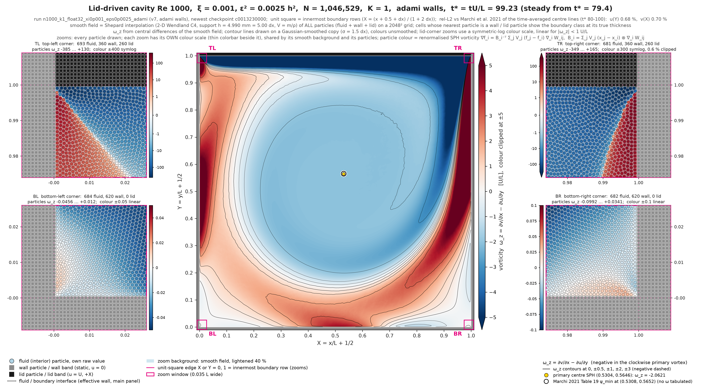
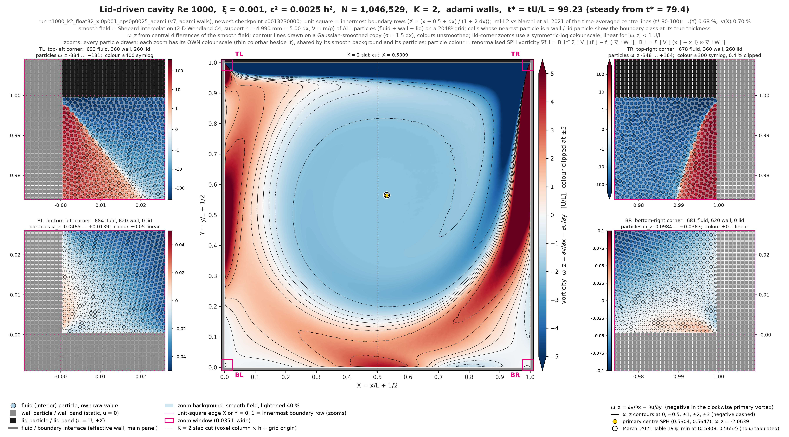
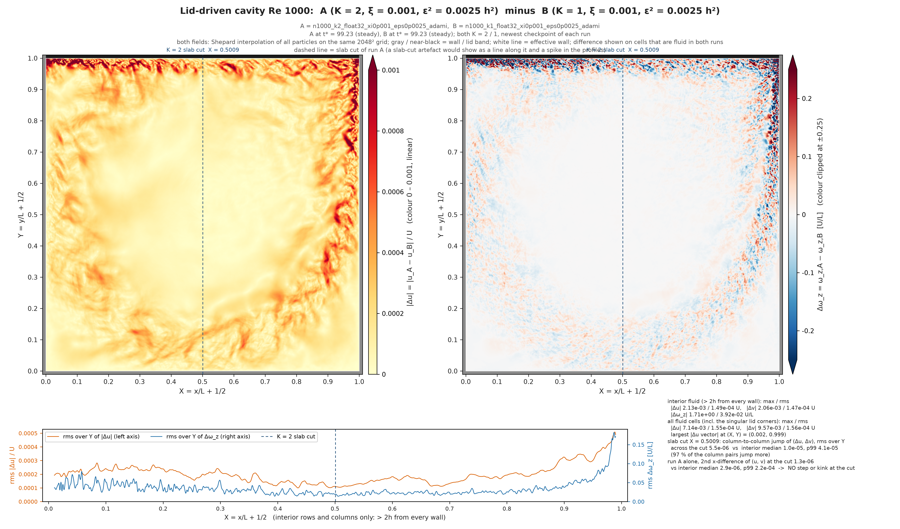

# Adami 壁面 1000² 方腔:K = 1 与 K = 2(v7-rc3,E40)

算例 `lid_driven_cavity_2d_n1000_xi0p001_eps0p0025_adami`(Re = 1000,ξ = 0.001,ε² = 0.0025 h²,`wall_boundary: adami`),求解器 experiment/v7 在 tag v7-rc3 = 64eecf0(运行记录的提交:K = 1 1f3fb48、K = 2 64eecf0,树均干净;1f3fb48 = tag + 两个只加本报告脚本的提交,求解器未变;两次运行记录的求解器代码哈希相同),默认开关,`cavity_runner --solver v7 --expect release`。K = 1:无头的 GPU 1;K = 2:GPU 0 + 1,等权重,切口在全局第 103 列(x = 0.0009 m,壁面行框架 X = 0.5009)。方法、稳态判据、取样与参考解沿用 `docs/validation/cavity_re1000.md`(Marchi et al. 2021 为误差参考,Ghia et al. 1982 只画在图里);时间平均取每个 run 最后 20 个时间单位。只报结果。

## 图 1(K = 1)与图 2(K = 2)

(a) u(0.5, y) 与 (b) v(x, 0.5):时间平均的 MLS 中线剖面(壁面行框架)对 Marchi 2021(圆圈)与 Ghia 1982(方块);(c) 流体的加速度大小 |a| L/U²,末尾检查点(t = 99.2 / 99.2)的 Shepard 插值,1024² 网格,两图同一色标(上限 = 两个场 99 百分位的较大者 1.45);图 2 的竖虚线 = 切口。矢量 PDF:`docs/validation/figures/adami_fig1_k1.pdf`、`adami_fig2_k2.pdf`。

## 表:误差、极值、主涡

| run | L2 u | L∞ u | L2 v | L∞ v | rel L2 u | rel L2 v | u_min | y(u_min) | v_max | x(v_max) | v_min | x(v_min) | ψ_min | x(ψ_min) | y(ψ_min) | 窗口起 | 窗口止 | 样本数 |
|---|---|---|---|---|---|---|---|---|---|---|---|---|---|---|---|---|---|---|
| Marchi2021 | – | – | – | – | – | – | -0.3886 | 0.1717 | 0.3769 | 0.1578 | -0.5271 | 0.9092 | -0.1189 | 0.5308 | 0.5652 | – | – |  |
| K1 | 0.0021 | 0.0054 | 0.0022 | 0.0051 | 0.0068 | 0.0070 | -0.3904 | 0.1692 | 0.3793 | 0.1563 | -0.5295 | 0.9102 | -0.1191 | 0.5304 | 0.5645 | 79.99 | 99.83 | 99 |
| K2 | 0.0021 | 0.0054 | 0.0022 | 0.0051 | 0.0068 | 0.0070 | -0.3904 | 0.1692 | 0.3793 | 0.1563 | -0.5294 | 0.9102 | -0.1191 | 0.5304 | 0.5645 | 79.99 | 99.83 | 99 |

L2 = √(Σ e_i² / 28)、L∞ = max |e_i|(绝对值,U 为单位),rel L2 = L2 / rms(T_c);极值位置为壁面行框架;ψ_min 与主涡中心来自平均窗口内每个时间单位一个快照的 MLS 网格平均(513²)。数据:`data/adami_k1_k2_summary.csv`、`data/profile_<run>.csv`、`data/dense_<run>.csv`。

稳态时刻(窗口判据 / 滑动重算):K1 79.38 / 71.28;K2 79.38 / 71.69

## K = 2 减 K = 1:56 个参考点

Δ = ū_K2 − ū_K1(时间平均的 MLS 速度),各自的标准误差 s.e. = std·√(τ_int/n)(样本间隔 0.2 时间单位),σ = √(s.e._K1² + s.e._K2²)。56 点汇总:max |Δ| = 3.64e-05,rms Δ = 1.25e-05,max |Δ|/σ = 1.86,|Δ|/σ > 2 的点 0 个,> 3 的点 0 个(共 56)。

| 线 | 坐标 | T_c | ū_K1 ± s.e. | ū_K2 ± s.e. | Δ | Δ/σ |
|---|---|---|---|---|---|---|
| u | 0.05469 | -0.18125 | -0.18487 ± 1.5e-05 | -0.18486 ± 1.2e-05 | +9.35e-06 | +0.48 |
| u | 0.06250 | -0.20233 | -0.20637 ± 1.5e-05 | -0.20637 ± 1.3e-05 | -5.38e-06 | -0.27 |
| u | 0.07031 | -0.22293 | -0.22734 ± 1.4e-05 | -0.22736 ± 1.6e-05 | -1.91e-05 | -0.87 |
| u | 0.10156 | -0.30037 | -0.30572 ± 1.3e-05 | -0.30576 ± 1.4e-05 | -3.59e-05 | -1.86 |
| u | 0.12500 | -0.34784 | -0.35292 ± 1.1e-05 | -0.35293 ± 1.2e-05 | -7.15e-06 | -0.45 |
| u | 0.17188 | -0.38857 | -0.39029 ± 9.7e-06 | -0.39029 ± 1.1e-05 | +1.87e-06 | +0.12 |
| u | 0.18750 | -0.38441 | -0.38480 ± 1.1e-05 | -0.38480 ± 1.3e-05 | +1.76e-06 | +0.10 |
| u | 0.25000 | -0.31895 | -0.31687 ± 1.3e-05 | -0.31688 ± 1.1e-05 | -1.05e-05 | -0.60 |
| u | 0.28125 | -0.28043 | -0.27860 ± 1.7e-05 | -0.27861 ± 1.6e-05 | -5.94e-06 | -0.25 |
| u | 0.31250 | -0.24569 | -0.24431 ± 1.6e-05 | -0.24431 ± 1.7e-05 | -3.90e-06 | -0.17 |
| u | 0.37500 | -0.18373 | -0.18278 ± 1.4e-05 | -0.18278 ± 1.4e-05 | +1.23e-06 | +0.06 |
| u | 0.43750 | -0.12341 | -0.12251 ± 1.4e-05 | -0.12251 ± 8.3e-06 | +2.94e-06 | +0.18 |
| u | 0.45312 | -0.10818 | -0.10729 ± 1.4e-05 | -0.10728 ± 7.1e-06 | +2.84e-06 | +0.18 |
| u | 0.50000 | -0.06206 | -0.06124 ± 6.4e-06 | -0.06124 ± 6.3e-06 | -9.62e-07 | -0.11 |
| u | 0.56250 | 0.00056 | 0.00124 ± 2.2e-06 | 0.00123 ± 5.2e-06 | -4.33e-06 | -0.77 |
| u | 0.61719 | 0.05700 | 0.05754 ± 4.3e-06 | 0.05754 ± 4.6e-06 | -5.47e-06 | -0.87 |
| u | 0.62500 | 0.06525 | 0.06577 ± 5.4e-06 | 0.06576 ± 5.1e-06 | -5.19e-06 | -0.70 |
| u | 0.68750 | 0.13357 | 0.13393 ± 1.2e-05 | 0.13392 ± 1.2e-05 | -4.02e-06 | -0.24 |
| u | 0.73438 | 0.18864 | 0.18887 ± 1.3e-05 | 0.18887 ± 1.5e-05 | -9.19e-07 | -0.05 |
| u | 0.75000 | 0.20791 | 0.20811 ± 1.3e-05 | 0.20810 ± 1.6e-05 | -1.59e-06 | -0.08 |
| u | 0.81250 | 0.28844 | 0.28872 ± 1.4e-05 | 0.28873 ± 1.9e-05 | +1.70e-06 | +0.07 |
| u | 0.85156 | 0.33718 | 0.33768 ± 1.3e-05 | 0.33769 ± 1.2e-05 | +7.38e-06 | +0.43 |
| u | 0.87500 | 0.36255 | 0.36322 ± 1.5e-05 | 0.36323 ± 1.3e-05 | +1.09e-05 | +0.54 |
| u | 0.93750 | 0.42293 | 0.42286 ± 1.3e-05 | 0.42287 ± 1.3e-05 | +3.56e-06 | +0.20 |
| u | 0.95312 | 0.47245 | 0.47202 ± 1.5e-05 | 0.47202 ± 1.7e-05 | +1.36e-06 | +0.06 |
| u | 0.96094 | 0.51718 | 0.51707 ± 2.0e-05 | 0.51708 ± 2.1e-05 | +8.92e-06 | +0.31 |
| u | 0.96875 | 0.58037 | 0.58128 ± 2.2e-05 | 0.58124 ± 2.6e-05 | -3.64e-05 | -1.07 |
| u | 0.97656 | 0.66397 | 0.66659 ± 2.1e-05 | 0.66655 ± 2.3e-05 | -3.27e-05 | -1.04 |
| v | 0.06250 | 0.28071 | 0.28329 ± 1.5e-05 | 0.28331 ± 2.2e-05 | +1.81e-05 | +0.68 |
| v | 0.07031 | 0.29629 | 0.29906 ± 1.6e-05 | 0.29907 ± 2.2e-05 | +1.78e-05 | +0.64 |
| v | 0.07812 | 0.30995 | 0.31285 ± 1.4e-05 | 0.31287 ± 2.0e-05 | +1.69e-05 | +0.71 |
| v | 0.09375 | 0.33298 | 0.33610 ± 1.2e-05 | 0.33610 ± 1.6e-05 | +6.03e-06 | +0.30 |
| v | 0.12500 | 0.36504 | 0.36815 ± 1.0e-05 | 0.36816 ± 1.0e-05 | +8.84e-06 | +0.61 |
| v | 0.15625 | 0.37692 | 0.37927 ± 8.9e-06 | 0.37927 ± 7.6e-06 | -3.62e-06 | -0.31 |
| v | 0.18750 | 0.36785 | 0.36904 ± 9.5e-06 | 0.36904 ± 9.1e-06 | -2.68e-06 | -0.20 |
| v | 0.22656 | 0.33403 | 0.33399 ± 9.1e-06 | 0.33399 ± 8.3e-06 | +8.99e-07 | +0.07 |
| v | 0.23438 | 0.32539 | 0.32517 ± 8.8e-06 | 0.32517 ± 8.1e-06 | +2.15e-06 | +0.18 |
| v | 0.25000 | 0.30710 | 0.30663 ± 8.4e-06 | 0.30664 ± 1.1e-05 | +4.54e-06 | +0.33 |
| v | 0.31250 | 0.23127 | 0.23070 ± 1.3e-05 | 0.23070 ± 1.2e-05 | +2.84e-07 | +0.02 |
| v | 0.37500 | 0.16056 | 0.16026 ± 1.2e-05 | 0.16025 ± 1.1e-05 | -3.11e-06 | -0.19 |
| v | 0.43750 | 0.09297 | 0.09273 ± 8.3e-06 | 0.09273 ± 6.0e-06 | +6.69e-07 | +0.07 |
| v | 0.50000 | 0.02580 | 0.02560 ± 2.2e-06 | 0.02560 ± 5.8e-06 | -1.42e-06 | -0.23 |
| v | 0.56250 | -0.04184 | -0.04196 ± 6.3e-06 | -0.04196 ± 6.2e-06 | -1.95e-08 | -0.00 |
| v | 0.62500 | -0.11080 | -0.11083 ± 1.3e-05 | -0.11084 ± 5.1e-06 | -2.20e-06 | -0.16 |
| v | 0.68750 | -0.18168 | -0.18173 ± 1.4e-05 | -0.18173 ± 1.1e-05 | -5.55e-06 | -0.31 |
| v | 0.75000 | -0.25338 | -0.25355 ± 1.6e-05 | -0.25356 ± 1.4e-05 | -7.46e-06 | -0.35 |
| v | 0.80469 | -0.32020 | -0.31979 ± 1.0e-05 | -0.31979 ± 7.4e-06 | +3.96e-08 | +0.00 |
| v | 0.81250 | -0.33157 | -0.33093 ± 1.1e-05 | -0.33094 ± 1.3e-05 | -3.64e-06 | -0.22 |
| v | 0.85938 | -0.42639 | -0.42446 ± 1.3e-05 | -0.42447 ± 9.6e-06 | -4.80e-06 | -0.30 |
| v | 0.87500 | -0.46778 | -0.46625 ± 1.0e-05 | -0.46625 ± 1.0e-05 | -1.62e-06 | -0.11 |
| v | 0.90625 | -0.52642 | -0.52829 ± 1.9e-05 | -0.52825 ± 1.3e-05 | +3.58e-05 | +1.57 |
| v | 0.93750 | -0.45615 | -0.46128 ± 1.9e-05 | -0.46127 ± 2.1e-05 | +9.28e-06 | +0.33 |
| v | 0.94531 | -0.41029 | -0.41516 ± 2.2e-05 | -0.41515 ± 2.2e-05 | +9.01e-06 | +0.29 |
| v | 0.95312 | -0.35513 | -0.35920 ± 2.2e-05 | -0.35918 ± 2.3e-05 | +1.58e-05 | +0.49 |
| v | 0.96094 | -0.29338 | -0.29622 ± 2.4e-05 | -0.29622 ± 2.5e-05 | +1.00e-06 | +0.03 |
| v | 0.96875 | -0.22834 | -0.22975 ± 2.6e-05 | -0.22978 ± 2.4e-05 | -3.15e-05 | -0.89 |

数据:`data/adami_k2_minus_k1_points.csv`。

## K = 2 减 K = 1:接缝两侧各 3 个支撑半径

平均窗口内的快照(每个时间单位一个,每个 run 20 个)在条带 |x − x_seam| ≤ 3h 上的 MLS 速度时间平均,点列每 h/2 一列(列中心离切口 ±0.25h … ±2.75h,负号 = slab 0 一侧),每行 h/2;|Δu| = 两个 run 时间平均速度之差的模;s.e. = 各 run 在该点的快照标准差 / √n(未作自相关修正)。对照条带:同样的点列,中心在切口左侧 0.25 m。

| 条带 | 离切口 (h) | 点数 | rms |Δu| | max |Δu| | rms s.e. K1 | rms s.e. K2 | 平均速度 K1 |
|---|---|---|---|---|---|---|---|
| seam | -2.75 | 397 | 3.196e-05 | 1.638e-04 | 2.466e-05 | 2.263e-05 | 0.2404 |
| seam | -2.25 | 397 | 3.248e-05 | 1.828e-04 | 2.448e-05 | 2.247e-05 | 0.2400 |
| seam | -1.75 | 397 | 3.320e-05 | 1.901e-04 | 2.430e-05 | 2.236e-05 | 0.2397 |
| seam | -1.25 | 397 | 3.413e-05 | 2.256e-04 | 2.415e-05 | 2.235e-05 | 0.2393 |
| seam | -0.75 | 397 | 3.620e-05 | 2.661e-04 | 2.426e-05 | 2.242e-05 | 0.2390 |
| seam | -0.25 | 397 | 3.730e-05 | 2.784e-04 | 2.430e-05 | 2.258e-05 | 0.2387 |
| seam | +0.25 | 397 | 3.791e-05 | 2.762e-04 | 2.437e-05 | 2.279e-05 | 0.2384 |
| seam | +0.75 | 397 | 3.760e-05 | 2.426e-04 | 2.430e-05 | 2.315e-05 | 0.2381 |
| seam | +1.25 | 397 | 3.760e-05 | 2.364e-04 | 2.426e-05 | 2.362e-05 | 0.2379 |
| seam | +1.75 | 397 | 3.851e-05 | 2.488e-04 | 2.437e-05 | 2.408e-05 | 0.2376 |
| seam | +2.25 | 397 | 3.772e-05 | 2.189e-04 | 2.444e-05 | 2.406e-05 | 0.2374 |
| seam | +2.75 | 397 | 3.457e-05 | 1.625e-04 | 2.446e-05 | 2.374e-05 | 0.2372 |
| control | -2.75 | 397 | 3.839e-05 | 2.792e-04 | 3.372e-05 | 3.512e-05 | 0.2839 |
| control | -2.25 | 397 | 3.827e-05 | 3.494e-04 | 3.369e-05 | 3.472e-05 | 0.2840 |
| control | -1.75 | 397 | 3.977e-05 | 3.163e-04 | 3.349e-05 | 3.430e-05 | 0.2839 |
| control | -1.25 | 397 | 4.202e-05 | 2.348e-04 | 3.316e-05 | 3.423e-05 | 0.2839 |
| control | -0.75 | 397 | 4.400e-05 | 2.260e-04 | 3.314e-05 | 3.435e-05 | 0.2838 |
| control | -0.25 | 397 | 4.368e-05 | 2.042e-04 | 3.318e-05 | 3.390e-05 | 0.2837 |
| control | +0.25 | 397 | 4.187e-05 | 1.798e-04 | 3.295e-05 | 3.320e-05 | 0.2836 |
| control | +0.75 | 397 | 4.064e-05 | 1.563e-04 | 3.284e-05 | 3.276e-05 | 0.2834 |
| control | +1.25 | 397 | 3.803e-05 | 1.578e-04 | 3.300e-05 | 3.266e-05 | 0.2833 |
| control | +1.75 | 397 | 3.833e-05 | 2.112e-04 | 3.290e-05 | 3.265e-05 | 0.2831 |
| control | +2.25 | 397 | 3.933e-05 | 2.121e-04 | 3.302e-05 | 3.257e-05 | 0.2829 |
| control | +2.75 | 397 | 4.077e-05 | 2.163e-04 | 3.325e-05 | 3.228e-05 | 0.2826 |

整条带:seam:rms |Δu| 3.58e-05,max 2.78e-04,rms s.e. K1 / K2 2.44e-05 / 2.30e-05;control:rms |Δu| 4.05e-05,max 3.49e-04,rms s.e. K1 / K2 3.32e-05 / 3.36e-05

数据:`data/adami_k2_minus_k1_seam.csv`(逐点)、`data/adami_k2_minus_k1_seam_bins.csv`(按列)。

## 不变量

| run | 粒子数(期望) | 存活(每个样本 min–max) | overflow 合计 | far_migration | 帧戳错误 GPU / 主机 | drift | 段数(完成 / 违反) | 墙钟 h | 样本数 | MLS 回退合计 | 最少邻居数 | 状态 |
|---|---|---|---|---|---|---|---|---|---|---|---|---|
| K1 | 1046529 | 1046529–1046529 | 0 | 0 | 0 / 0 | 0 | 1(1 / 0) | 6.31 | 493 | 0 | 71 | complete |
| K2 | 1046529 | 1046529–1046529 | 0 | 0 | 0 / 0 | 0 | 1(1 / 0) | 4.29 | 493 | 0 | 71 | complete |

每个样本(每 0.2 时间单位)与每个 defrag 边界都检查:存活粒子总数 = 初始总数、每张卡的全部 `overflow_*` 计数、far_migration、GPU 与主机帧戳错误;任一违反即作废(退出码 3)。overflow 合计 = 两段结束时所有 slab 所有 `overflow_*` 之和。数据:`data/adami_k1_k2_invariants.csv`。

墙钟(提交前的校准估算 → 实际):K1 5.90 h(校准 627.5 步/s,2026-10-13 07:03:12) → 6.31 h(运行中样本间吞吐中位数 586.7 步/s);K2 4.19 h(校准 884.5 步/s,2026-10-13 02:45:12) → 4.29 h(运行中样本间吞吐中位数 869.2 步/s)

## 场图(每个 run 最新的检查点)

`experiment/validation/cavity_fields.py`(2026-10-02 批准的场图版式):全部粒子(流体 + 壁 + 盖)的 Shepard 插值到 2048² 网格,边界带按真实厚度,四角放大图逐粒子画出(各自色标),ω_z 为平滑场的中心差分,流线来自 Poisson ψ;主涡参考 = Marchi 2021 表 19。图 K = 2 里的点线 = 切口。

| run | 检查点 | 主涡 (X, Y) | ψ | ω_z | 到参考的距离 |
|---|---|---|---|---|---|
| K1 | c013230000(t = 99.23) | (0.5304, 0.5646) | -0.11914 | -2.0621 | 0.0007 L |
| K2 | c013230000(t = 99.23) | (0.5304, 0.5647) | -0.11914 | -2.0639 | 0.0007 L |
| Marchi 2021 | – | (0.5308, 0.5652) | -0.11894 | – | – |

K2 − K1(同一检查点步 13,230,000,两个 run 都是流体的格点,离壁 > 2h 的内部):max |Δu| 2.13e-03、rms Δu 1.49e-04、max |Δv| 2.06e-03、rms Δv 1.47e-04(U);max |Δω_z| 1.71、rms Δω_z 0.039(U/L)。
切口 X = 0.5009:差值场的列间跳变在切口处 5.5e-06,内部中位数 1.0e-05(p99 4.1e-05),97 % 的列对跳变更大;K = 2 自身速度在切口附近的二阶 x 差分最大 1.3e-06,内部中位数 2.9e-06(p99 2.2e-04);切口处的 |Δu| 对邻域中位数 0.75,Δω_z 的 0.80。

数字:`docs/validation/fields/fields_check.md`、`difference_n1000_k2_float32_xi0p001_eps0p0025_adami_minus_n1000_k1_float32_xi0p001_eps0p0025_adami.json`;速度场图 `<run>_velocity.png`,逐像素图 `<run>_{velocity,vorticity}_full.png`。

## 文件

- 图:`docs/validation/figures/adami_fig1_k1.pdf`(.png)、`adami_fig2_k2.pdf`(.png)
- 数据:`docs/validation/data/adami_k1_k2_summary.csv`、`adami_k2_minus_k1_points.csv`、`adami_k2_minus_k1_seam.csv`、`adami_k2_minus_k1_seam_bins.csv`、`adami_k1_k2_invariants.csv`、`profile_n1000_k1_float32_xi0p001_eps0p0025_adami.csv`、`profile_n1000_k2_float32_xi0p001_eps0p0025_adami.csv`、`dense_<run>.csv`
- 运行目录(不入库):`C:\Users\cchen\PycharmProjects\vulkan-demo-v7-rc3\logs\validation\cavity_re1000_v7\n1000_k1_float32_xi0p001_eps0p0025_adami`、`C:\Users\cchen\PycharmProjects\vulkan-demo-v7-rc3\logs\validation\cavity_re1000_v7\n1000_k2_float32_xi0p001_eps0p0025_adami`
- 生成:`.venv/Scripts/python.exe -m experiment.validation.adami_chain_report`
