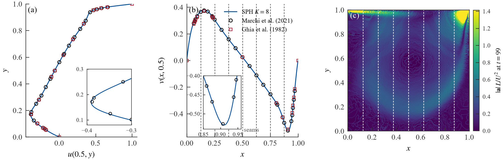
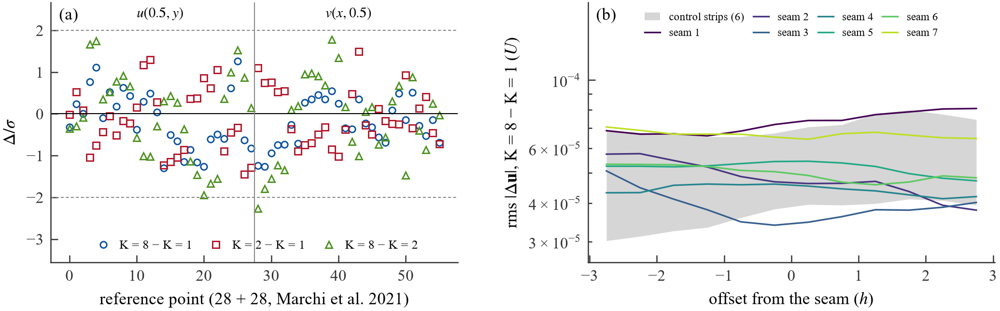

# Adami 壁面 1000² 方腔:K = 8 续算(6.2 节补充,2026-10-21)

算例 `lid_driven_cavity_2d_n1000_xi0p001_eps0p0025_adami`(Re = 1000,ξ = 0.001,ε² = 0.0025 h²,`wall_boundary: adami`),求解器 experiment/v7 = tag v7-rc3。K = 8 运行在 N56 集群一整台节点(8 × RTX 5090,SLURM 作业 1719093,节点 wqd10nbj02g1,部署 `~/run/vulkan-demo-v7rc3` = 提交 076220a),`cavity_runner --solver v7 --slabs 8 --start-from` 从 K = 1 运行的检查点 `c0011907000.npz`(步 11,907,000,t = 89.3025,sha256 db77ef290e10…)启动,全局步号延续,等权重按状态的流体直方图切成 8 个 slab,推进到步 13,334,000(t = 100.005,与 K = 1 / K = 2 的停止步相同)。K = 1、K = 2 为 docs/validation/adami_k1_k2.md 的两次运行(本地 5090 / 5090 + 7900 XTX)。三者在**同一组取样步**上比较:t ≥ 89.505 的 52 个样本(每 0.2 时间单位)与 11 个快照(每 ~1 时间单位,步号相同)。方法、稳态判据、取样与参考解沿用 `docs/validation/cavity_re1000.md`。只报结果。

物理代码哈希:K = 8 的 meta.json 记的是 Linux 部署树(LF 换行)的哈希,与 K = 1 / K = 2(Windows 检出,CRLF)不同;逐文件比较(41 个文件:experiment/v7/utils/*.py、SPIR-V、算例、材料库,CRLF→LF 归一化后)完全一致,部署树的 git tree hash = tag v7-rc3 的 experiment/v7。

## 图

图 1(K = 8):(a) u(0.5, y) 与 (b) v(x, 0.5) 的时间平均 MLS 中线剖面(壁面行框架)对 Marchi 2021(圆圈)与 Ghia 1982(方块),(b) 中的 7 条竖虚线 = 切口;(c) 流体加速度大小 |a| L/U²,末尾检查点(t = 99.2)的 Shepard 插值,1024² 网格,色标上限 = 99 百分位 1.41,白色虚线 = 切口。

图 2:(a) 56 个参考点上两次运行时间平均速度之差除以 σ(各自标准误差的平方和开方);(b) 每条接缝条带上 K = 8 − K = 1 的 rms |Δu| 按离切口的 h/2 列,灰带 = 6 条对照条带(相邻切口中点)的最小–最大范围。

## 表 A:误差、极值、主涡(公共窗口)

| run | L2 u | L∞ u | L2 v | L∞ v | rel L2 u | rel L2 v | u_min | y(u_min) | v_max | x(v_max) | v_min | x(v_min) | ψ_min | x(ψ_min) | y(ψ_min) | 窗口起 | 窗口止 | 样本数 |
|---|---|---|---|---|---|---|---|---|---|---|---|---|---|---|---|---|---|---|
| Marchi2021 | – | – | – | – | – | – | -0.3886 | 0.1717 | 0.3769 | 0.1578 | -0.5271 | 0.9092 | -0.1189 | 0.5308 | 0.5652 | – | – |  |
| K1 | 0.0021 | 0.0054 | 0.0022 | 0.0051 | 0.0068 | 0.0070 | -0.3904 | 0.1692 | 0.3793 | 0.1563 | -0.5295 | 0.9102 | -0.1191 | 0.5304 | 0.5645 | 89.50 | 99.83 | 52 |
| K2 | 0.0021 | 0.0054 | 0.0022 | 0.0051 | 0.0068 | 0.0070 | -0.3904 | 0.1692 | 0.3793 | 0.1563 | -0.5295 | 0.9102 | -0.1191 | 0.5304 | 0.5645 | 89.50 | 99.83 | 52 |
| K8 | 0.0021 | 0.0054 | 0.0022 | 0.0051 | 0.0068 | 0.0069 | -0.3904 | 0.1692 | 0.3793 | 0.1563 | -0.5295 | 0.9102 | -0.1191 | 0.5304 | 0.5645 | 89.50 | 99.83 | 52 |
| K1 (E40 full window) | 0.0021 | 0.0054 | 0.0022 | 0.0051 | 0.0068 | 0.0070 | -0.3904 | 0.1692 | 0.3793 | 0.1563 | -0.5295 | 0.9102 | -0.1191 | 0.5304 | 0.5645 | 79.99 | 99.83 | 99 |
| K2 (E40 full window) | 0.0021 | 0.0054 | 0.0022 | 0.0051 | 0.0068 | 0.0070 | -0.3904 | 0.1692 | 0.3793 | 0.1563 | -0.5294 | 0.9102 | -0.1191 | 0.5304 | 0.5645 | 79.99 | 99.83 | 99 |

L2 = √(Σ e_i² / 28)、L∞ = max |e_i|(绝对值,U 为单位),rel L2 = L2 / rms(T_c);极值位置为壁面行框架;ψ_min 与主涡中心来自窗口内快照的 MLS 网格平均(513²)。“E40 full window” 两行是 adami_k1_k2.md 的原值(各自最后 20 个时间单位)。数据:`data/adami_k8_summary.csv`、`data/profile_n1000_k8_float32_xi0p001_eps0p0025_adami.csv`。

## 表 B:56 个参考点上的差

| 对 | max |Δ| | rms Δ | max |Δ|/σ | |Δ|/σ > 2 | |Δ|/σ > 3 |
|---|---|---|---|---|---|
| K8 − K1 | 4.52e-05 | 1.53e-05 | 1.29 | 0 | 0 |
| K2 − K1 | 7.01e-05 | 1.71e-05 | 1.50 | 0 | 0 |
| K8 − K2 | 6.38e-05 | 2.26e-05 | 2.26 | 1 | 0 |

Δ = 时间平均 MLS 速度之差,s.e. = std·√(τ_int/n)(n = 52,样本间隔 0.2 时间单位),σ = √(s.e.₁² + s.e.₂²)。数据:`data/adami_k8_point_differences.csv`。

## 表 C:7 条接缝与条带差

| 接缝 | 全局列 | x (m) | X 壁面框架 | 左 slab 粒子 | 右 slab 粒子 |
|---|---|---|---|---|---|
| 1 | 28 | -0.3741 | 0.1266 | 140,688 | 127,953 |
| 2 | 53 | -0.2491 | 0.2514 | 127,953 | 127,917 |
| 3 | 78 | -0.1241 | 0.3761 | 127,917 | 127,919 |
| 4 | 103 | +0.0009 | 0.5009 | 127,919 | 127,865 |
| 5 | 128 | +0.1259 | 0.6256 | 127,865 | 127,832 |
| 6 | 153 | +0.2509 | 0.7504 | 127,832 | 127,767 |
| 7 | 178 | +0.3759 | 0.8751 | 127,767 | 138,588 |

切口 = 全局体素列边界(列宽 h = 0.005 m),按启动状态的流体直方图等权切分(切口列 28, 53, 78, 103, 128, 153, 178;K = 2 的切口为第 103 列 = 这里的第 4 条接缝)。

| 条带 | 中心 x (m) | 点数 | rms |Δu| | max |Δu| | rms |Δu| (±0.5h) | max |Δu| (±0.5h) | rms s.e. K1 | rms s.e. K8 | 平均速度 K1 |
|---|---|---|---|---|---|---|---|---|---|
| seam1 | -0.3741 | 4764 | 7.30e-05 | 5.86e-04 | 7.28e-05 | 3.13e-04 | 5.12e-05 | 5.08e-05 | 0.235 |
| seam2 | -0.2491 | 4764 | 4.86e-05 | 3.35e-04 | 4.65e-05 | 3.11e-04 | 4.22e-05 | 4.48e-05 | 0.284 |
| seam3 | -0.1241 | 4764 | 3.94e-05 | 3.09e-04 | 3.43e-05 | 1.43e-04 | 3.28e-05 | 3.40e-05 | 0.262 |
| seam4 | +0.0009 | 4764 | 4.41e-05 | 2.70e-04 | 4.57e-05 | 1.94e-04 | 3.32e-05 | 3.25e-05 | 0.239 |
| seam5 | +0.1259 | 4764 | 5.21e-05 | 2.88e-04 | 5.45e-05 | 2.86e-04 | 3.26e-05 | 3.24e-05 | 0.253 |
| seam6 | +0.2509 | 4764 | 5.00e-05 | 2.97e-04 | 4.98e-05 | 2.47e-04 | 3.87e-05 | 3.99e-05 | 0.280 |
| seam7 | +0.3759 | 4764 | 6.67e-05 | 3.40e-04 | 6.48e-05 | 2.52e-04 | 5.46e-05 | 5.01e-05 | 0.297 |
| control1 | -0.3116 | 4764 | 7.13e-05 | 4.61e-04 | 6.89e-05 | 3.59e-04 | 5.05e-05 | 4.94e-05 | 0.275 |
| control2 | -0.1866 | 4764 | 4.76e-05 | 4.03e-04 | 4.95e-05 | 3.14e-04 | 3.96e-05 | 3.88e-05 | 0.275 |
| control3 | -0.0616 | 4764 | 3.89e-05 | 2.53e-04 | 4.01e-05 | 2.06e-04 | 3.21e-05 | 2.96e-05 | 0.249 |
| control4 | +0.0634 | 4764 | 3.70e-05 | 1.94e-04 | 3.89e-05 | 1.60e-04 | 3.18e-05 | 3.19e-05 | 0.240 |
| control5 | +0.1884 | 4764 | 4.08e-05 | 2.04e-04 | 4.12e-05 | 1.50e-04 | 3.32e-05 | 3.61e-05 | 0.267 |
| control6 | +0.3134 | 4764 | 5.73e-05 | 2.46e-04 | 6.05e-05 | 2.45e-04 | 4.46e-05 | 4.53e-05 | 0.288 |

K = 8 − K = 1 的时间平均 MLS 速度(窗口内 11 个快照)在条带 |x − x_c| ≤ 3h 上,点列每 h/2 一列、每行 h/2;接缝条带 rms |Δu| 3.94e-05–7.30e-05,对照条带 3.70e-05–7.13e-05;E40 的 K = 2 − K = 1 在其切口条带 rms 3.58e-05、对照 4.05e-05。 快照 MLS 回退:K1 0、K8 0。数据:`data/adami_k8_seams.csv`、`adami_k8_strips.csv`、`adami_k8_strip_bins.csv`。

## 表 D:不变量、吞吐、墙钟

| run | K | 设备 | 粒子数(期望) | 存活(窗口样本 min–max) | overflow | far_migration | 帧戳错误 GPU / 主机 | drift | 段(完成 / 违反) | 窗口步数 | 窗口墙钟 s | 步/s(窗口中位数) | MLS 回退 | 最少邻居 | 状态 |
|---|---|---|---|---|---|---|---|---|---|---|---|---|---|---|---|
| K8 | 8 | [0, 1, 2, 3, 4, 5, 6, 7] | 1,046,529 | 1,046,529–1,046,529 | 0 | 0 | 0 / 0 | 0 | 1(1 / 0) | 1,377,000 | 2772 | 498.5 | 0 | 72 | complete |
| K1 | 1 | [1] | 1,046,529 | 1,046,529–1,046,529 | 0 | 0 | 0 / 0 | 0 | 1(1 / 0) | 1,377,000 | 2358 | 586.3 | 0 | 71 | complete |
| K2 | 2 | [0, 1] | 1,046,529 | 1,046,529–1,046,529 | 0 | 0 | 0 / 0 | 0 | 1(1 / 0) | 1,377,000 | 1593 | 869.0 | 0 | 72 | complete |

每个样本(每 0.2 时间单位)与每个 defrag 边界都检查:存活粒子总数 = 初始总数、每张卡的全部 `overflow_*` 计数、far_migration、GPU 与主机帧戳错误;任一违反即作废。K = 1 / K = 2 的段合计为整次运行(E40),存活 / 回退 / 邻居为公共窗口的样本;窗口墙钟 = 窗口首末样本之间的墙钟(不含启动),步/s = 窗口内逐样本吞吐的中位数。

K = 8 作业:2026-10-20T21:50:11 CST 提交,排队 10 h 23 min (PENDING Resources: no whole node free, every partition at 0 free GPUs most of the night),2026-10-21T08:12:58 CST 在 wqd10nbj02g1 开始,2026-10-21T09:05:03 CST 结束,占用 00:52:05(8 卡,时限 02:30:00):27,000 步的 K = 8 冒烟段 174 s(含启动;不变量全 0),正式段 2876 s 完成 1,427,000 步(≈ 496 步/s 含约 1 min 启动;提交前估算 375 步/s → 1.2 h),其余为环境解包、checkpoint 校验与分区检查。

## 文件

- 图:`docs/validation/figures/adami_k8_fig1_k8.pdf`(.png)、`adami_k8_fig2_differences.pdf`(.png)
- 论文 6.2 的两张图(2026-10-21 拆分,`experiment/validation/cavity_re1000_figure.py`,所有时间平均取共同窗口 t = 89.505–99.8325):`docs/validation/figures/cavity_re1000.pdf`((a)(b) K = 1 中心线对 Marchi 2021 / Ghia 1982,(c) K = 8 时间平均 |v|/U + 流线 + 7 条接缝;旧的三面板版本另存为 `cavity_re1000_v1.pdf`)、`cavity_seams.pdf`((a) 56 点上的 (K = 2 − K = 1)/σ 与 (K = 8 − K = 1)/σ,(b) K = 8 − K = 1 在 7 条接缝条带上的 rms |Δv| 随到最近接缝距离(h)的变化,6 条对照条带的最小–最大为灰带;数据来自 `adami_k8_point_differences.csv` / `adami_k8_strip_bins.csv`,接缝两侧按点数合并);K = 1 的中心线数据 `data/dense_n1000_k1_float32_xi0p001_eps0p0025_adami_common_window.csv`
- 数据:`docs/validation/data/adami_k8_summary.csv`、`adami_k8_point_differences.csv`、`adami_k8_seams.csv`、`adami_k8_strips.csv`、`adami_k8_strip_bins.csv`、`adami_k8_invariants.csv`、`profile_n1000_k8_float32_xi0p001_eps0p0025_adami.csv`、`adami_k8_report.json`
- 运行目录(不入库):`C:\Users\cchen\PycharmProjects\vulkan-demo-v7-rc3\logs\validation\cavity_re1000_v7\n1000_k8_float32_xi0p001_eps0p0025_adami`(集群归档 `~/run/logs/cavity_k8_1719093`,本地镜像 `logs/n56/2026-10-20/02_cav_k8_1719093`)
- 生成:`.venv/Scripts/python.exe -m experiment.validation.adami_k8_report`
