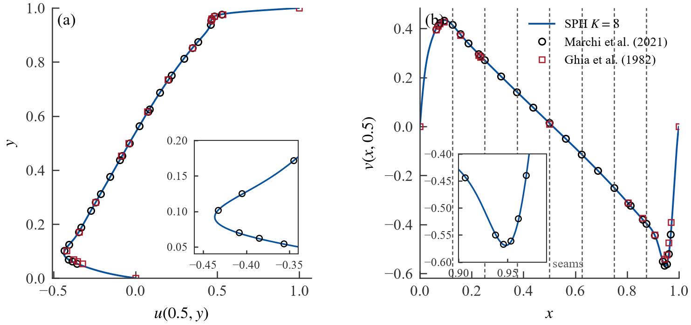
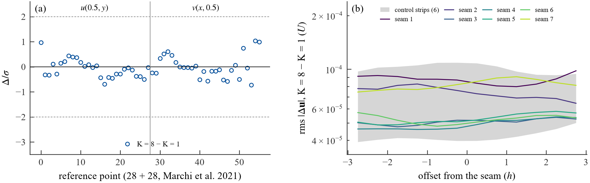

# Adami 壁面 2000² 方腔(Re = 3200):K = 8 续算(6.2 节补充,2026-10-23)

算例 `lid_driven_cavity_2d_n2000_re3200_adami`(Re = 3200,ξ = 0.001,ε² = 0.0025 h²,`wall_boundary: adami`),求解器 experiment/v7 = tag v7-rc3。K = 8 运行在 N56 集群一整台节点(8 × RTX 5090,SLURM 作业 1724841,节点 wqd10nbj04g5,部署 `~/run/vulkan-demo-v7rc3` = 提交 3f2537d),`cavity_runner --solver v7 --slabs 8 --start-from` 从 K = 1 运行的检查点 `c0021200000.npz`(步 21,200,000,t = 79.5000,sha256 d9f53ee10adf…)启动,全局步号延续,等权重按状态的流体直方图切成 8 个 slab,推进到步 22,550,000(t = 84.562,K = 1 运行继续到步 23,884,000,t = 89.565)。K = 1 为本地 5090 上的 2000² 运行(从 1000² Re = 3200 运行的终态暖启动,--t-end 40 --t-max 200 --average-span 20,于 t 69.56 判稳、停于 t 89.56);K = 8 续算按约 1 小时节点时间的预算只取 --average-span 15,停于 t 84.5625(5.0625 个时间单位)。K = 1 自身的平均窗口与 1000² K = 1 运行的窗口值作为对照行。两者在**同一组取样步**上比较:t ≥ 79.699 的 25 个样本(每 0.2 时间单位)与 5 个快照(每 ~1 时间单位,步号相同)。方法、稳态判据、取样与参考解沿用 `docs/validation/cavity_re1000.md`。只报结果。

物理代码哈希:K = 8 的 meta.json 记的是 Linux 部署树(LF 换行)的哈希,与 K = 1(Windows 检出,CRLF)不同;逐文件比较(46 个文件:experiment/v7/utils/*.py、SPIR-V、算例及其 materials_re3200.yaml、材料库、取样 / 参考代码与 runner,CRLF→LF 归一化后)完全一致,两侧 meta.json 的三组哈希都由各自的检出树复现(K = 1 的 sampling 哈希对应其启动时提交 18a9491 的 cavity_reference.py,之后 3f2537d 只给 ghia1982() 加了 reynolds 参数,仅用于画图);部署树的 git tree hash = tag v7-rc3 的 experiment/v7。

## 图

图 1(K = 8):(a) u(0.5, y) 与 (b) v(x, 0.5) 的时间平均 MLS 中线剖面(壁面行框架)对 Marchi 2021(圆圈)与 Ghia 1982(方块),(b) 中的 7 条竖虚线 = 切口;(c) 流体加速度大小 |a| L/U²,末尾检查点(无检查点时省略)。

图 2:(a) 56 个参考点上两次运行时间平均速度之差除以 σ(各自标准误差的平方和开方);(b) 每条接缝条带上 K = 8 − K = 1 的 rms |Δu| 按离切口的 h/2 列,灰带 = 6 条对照条带(相邻切口中点)的最小–最大范围。

## 表 A:误差、极值、主涡(公共窗口)

| run | L2 u | L∞ u | L2 v | L∞ v | rel L2 u | rel L2 v | u_min | y(u_min) | v_max | x(v_max) | v_min | x(v_min) | ψ_min | x(ψ_min) | y(ψ_min) | 窗口起 | 窗口止 | 样本数 |
|---|---|---|---|---|---|---|---|---|---|---|---|---|---|---|---|---|---|---|
| Marchi2021 | – | – | – | – | – | – | – | – | – | – | – | – | – | – | – | – | – |  |
| K1 | 0.0011 | 0.0035 | 0.0014 | 0.0043 | 0.0036 | 0.0038 | -0.4366 | 0.0921 | 0.4337 | 0.0960 | -0.5693 | 0.9482 | -0.1218 | 0.5178 | 0.5401 | 79.70 | 84.47 | 25 |
| K8 | 0.0011 | 0.0034 | 0.0014 | 0.0042 | 0.0036 | 0.0038 | -0.4366 | 0.0920 | 0.4337 | 0.0960 | -0.5693 | 0.9482 | -0.1218 | 0.5177 | 0.5401 | 79.70 | 84.47 | 25 |
| 2000² K1 (full window) | 0.0011 | 0.0034 | 0.0014 | 0.0043 | 0.0035 | 0.0038 | -0.4366 | 0.0921 | 0.4337 | 0.0960 | -0.5693 | 0.9482 | -0.1218 | 0.5178 | 0.5401 | 69.56 | 89.44 | 101 |
| 1000² K1 (full window) | 0.0036 | 0.0088 | 0.0045 | 0.0095 | 0.0112 | 0.0125 | -0.4414 | 0.0916 | 0.4389 | 0.0957 | -0.5753 | 0.9483 | -0.1229 | 0.5177 | 0.5401 | 208.37 | 228.22 | 99 |

L2 = √(Σ e_i² / 28)、L∞ = max |e_i|(绝对值,U 为单位),rel L2 = L2 / rms(T_c);极值位置为壁面行框架;ψ_min 与主涡中心来自窗口内快照的 MLS 网格平均(513²)。“(full window)” 行是相应运行自己的平均窗口(各自最后 20 个时间单位)。数据:`data/adami_k8_re3200_summary.csv`、`data/profile_n2000_k8_float32_xi0p001_eps0p0025_adami_re3200.csv`。

## 表 B:56 个参考点上的差

| 对 | max |Δ| | rms Δ | max |Δ|/σ | |Δ|/σ > 2 | |Δ|/σ > 3 |
|---|---|---|---|---|---|
| K8 − K1 | 8.31e-05 | 1.81e-05 | 1.03 | 0 | 0 |

Δ = 时间平均 MLS 速度之差,s.e. = std·√(τ_int/n)(n = 25,样本间隔 0.2 时间单位),σ = √(s.e.₁² + s.e.₂²)。数据:`data/adami_k8_re3200_point_differences.csv`。

## 表 C:7 条接缝与条带差

| 接缝 | 全局列 | x (m) | X 壁面框架 | 左 slab 粒子 | 右 slab 粒子 |
|---|---|---|---|---|---|
| 1 | 53 | -0.3745 | 0.1258 | 530,268 | 505,554 |
| 2 | 103 | -0.2495 | 0.2507 | 505,554 | 506,211 |
| 3 | 153 | -0.1245 | 0.3756 | 506,211 | 506,434 |
| 4 | 203 | +0.0005 | 0.5004 | 506,434 | 506,371 |
| 5 | 253 | +0.1255 | 0.6253 | 506,371 | 505,970 |
| 6 | 303 | +0.2505 | 0.7502 | 505,970 | 505,374 |
| 7 | 353 | +0.3755 | 0.8751 | 505,374 | 526,347 |

切口 = 全局体素列边界(列宽 h = 0.0025 m),按启动状态的流体直方图等权切分(切口列 53, 103, 153, 203, 253, 303, 353)。

| 条带 | 中心 x (m) | 点数 | rms |Δu| | max |Δu| | rms |Δu| (±0.5h) | max |Δu| (±0.5h) | rms s.e. K1 | rms s.e. K8 | 平均速度 K1 |
|---|---|---|---|---|---|---|---|---|---|
| seam1 | -0.3745 | 9564 | 8.76e-05 | 7.35e-04 | 8.51e-05 | 6.00e-04 | 8.38e-05 | 8.10e-05 | 0.286 |
| seam2 | -0.2495 | 9564 | 7.42e-05 | 9.75e-04 | 7.44e-05 | 9.75e-04 | 6.31e-05 | 6.16e-05 | 0.293 |
| seam3 | -0.1245 | 9564 | 5.08e-05 | 4.21e-04 | 5.17e-05 | 3.37e-04 | 4.91e-05 | 4.87e-05 | 0.266 |
| seam4 | +0.0005 | 9564 | 4.92e-05 | 4.00e-04 | 4.78e-05 | 3.89e-04 | 4.16e-05 | 3.63e-05 | 0.244 |
| seam5 | +0.1255 | 9564 | 5.29e-05 | 3.42e-04 | 5.13e-05 | 2.37e-04 | 4.56e-05 | 5.16e-05 | 0.261 |
| seam6 | +0.2505 | 9564 | 5.24e-05 | 3.38e-04 | 4.97e-05 | 3.38e-04 | 6.93e-05 | 6.52e-05 | 0.291 |
| seam7 | +0.3755 | 9564 | 8.21e-05 | 4.60e-04 | 8.36e-05 | 4.60e-04 | 6.39e-05 | 6.29e-05 | 0.297 |
| control1 | -0.3120 | 9564 | 1.01e-04 | 1.12e-03 | 1.08e-04 | 1.11e-03 | 7.63e-05 | 6.71e-05 | 0.301 |
| control2 | -0.1870 | 9564 | 5.85e-05 | 6.08e-04 | 5.77e-05 | 3.75e-04 | 5.39e-05 | 4.95e-05 | 0.280 |
| control3 | -0.0620 | 9564 | 5.53e-05 | 6.00e-04 | 6.02e-05 | 5.78e-04 | 4.55e-05 | 4.25e-05 | 0.253 |
| control4 | +0.0630 | 9564 | 5.29e-05 | 4.47e-04 | 5.39e-05 | 4.30e-04 | 4.32e-05 | 4.09e-05 | 0.248 |
| control5 | +0.1880 | 9564 | 4.21e-05 | 3.24e-04 | 3.96e-05 | 1.91e-04 | 5.10e-05 | 5.39e-05 | 0.277 |
| control6 | +0.3130 | 9564 | 7.18e-05 | 4.44e-04 | 6.95e-05 | 3.29e-04 | 5.68e-05 | 5.50e-05 | 0.299 |

K = 8 − K = 1 的时间平均 MLS 速度(窗口内 5 个快照)在条带 |x − x_c| ≤ 3h 上,点列每 h/2 一列、每行 h/2;接缝条带 rms |Δu| 4.92e-05–8.76e-05,对照条带 4.21e-05–1.01e-04。 快照 MLS 回退:K1 0、K8 0。数据:`data/adami_k8_re3200_seams.csv`、`adami_k8_re3200_strips.csv`、`adami_k8_re3200_strip_bins.csv`。

## 表 D:不变量、吞吐、墙钟

| run | K | 设备 | 粒子数(期望) | 存活(窗口样本 min–max) | overflow | far_migration | 帧戳错误 GPU / 主机 | drift | 段(完成 / 违反) | 窗口步数 | 窗口墙钟 s | 步/s(窗口中位数) | MLS 回退 | 最少邻居 | 状态 |
|---|---|---|---|---|---|---|---|---|---|---|---|---|---|---|---|
| K8 | 8 | [0, 1, 2, 3, 4, 5, 6, 7] | 4,092,529 | 4,092,529–4,092,529 | 0 | 0 | 0 / 0 | 0 | 1(1 / 0) | 1,272,000 | 2755 | 465.7 | 0 | 73 | complete |
| K1 | 1 | [0] | 4,092,529 | 4,092,529–4,092,529 | 0 | 0 | 0 / 0 | 0 | 1(1 / 0) | 1,272,000 | 8549 | 149.0 | 0 | 72 | complete |

每个样本(每 0.2 时间单位)与每个 defrag 边界都检查:存活粒子总数 = 初始总数、每张卡的全部 `overflow_*` 计数、far_migration、GPU 与主机帧戳错误;任一违反即作废。K = 1 的段合计为整次运行,存活 / 回退 / 邻居为公共窗口的样本;窗口墙钟 = 窗口首末样本之间的墙钟(不含启动),步/s = 窗口内逐样本吞吐的中位数。

K = 8 作业:2026-10-23T09:49:33 CST 提交,排队 0 h 53 min,2026-10-23T10:43:16 CST 在 wqd10nbj04g5 开始,2026-10-23T11:38:20 CST 结束,占用 00:55:04(8 卡,时限 01:45:00):27,000 步的 K = 8 冒烟段 291 s(含启动;不变量全 0),正式段 2926 s 完成 1,350,000 步(≈ 461 步/s 含约 1 min 启动;提交前估算 400.0 步/s → 1.04 h),其余为环境解包、checkpoint 校验与分区检查。

## 文件

- 图:`docs/validation/figures/adami_k8_re3200_fig1_k8.pdf`(.png)、`adami_k8_re3200_fig2_differences.pdf`(.png)
- 数据:`docs/validation/data/adami_k8_re3200_summary.csv`、`adami_k8_re3200_point_differences.csv`、`adami_k8_re3200_seams.csv`、`adami_k8_re3200_strips.csv`、`adami_k8_re3200_strip_bins.csv`、`adami_k8_re3200_invariants.csv`、`profile_n2000_k8_float32_xi0p001_eps0p0025_adami_re3200.csv`、`adami_k8_re3200_report.json`
- 运行目录(不入库):`C:\Users\cchen\PycharmProjects\vulkan-demo-v7-rc3\logs\validation\cavity_re3200_v7\n2000_k8_float32_xi0p001_eps0p0025_adami_re3200`(集群归档 `~/run/logs/cavity_k8_1724841`,本地镜像 `logs/n56/2026-10-23/09_cav_k8_re3200_1724841`)
- 生成:`.venv/Scripts/python.exe -m experiment.validation.adami_k8_report --reynolds 3200 --runs-root logs/validation/cavity_re3200_v7 --k1 n2000_k1_float32_xi0p001_eps0p0025_adami_re3200_warm --k2 none --k8 n2000_k8_float32_xi0p001_eps0p0025_adami_re3200 --context-runs n2000_k1_float32_xi0p001_eps0p0025_adami_re3200_warm,n1000_k1_float32_xi0p001_eps0p0025_adami_re3200 --out-prefix adami_k8_re3200 --mirror logs/n56/2026-10-23/09_cav_k8_re3200_1724841 --title # Adami 壁面 2000² 方腔(Re = 3200):K = 8 续算(6.2 节补充,2026-10-23) --k1-note K = 1 为本地 5090 上的 2000² 运行(从 1000² Re = 3200 运行的终态暖启动,--t-end 40 --t-max 200 --average-span 20,于 t 69.56 判稳、停于 t 89.56);K = 8 续算按约 1 小时节点时间的预算只取 --average-span 15,停于 t 84.5625(5.0625 个时间单位)。K = 1 自身的平均窗口与 1000² K = 1 运行的窗口值作为对照行。 --hashes-note 物理代码哈希:K = 8 的 meta.json 记的是 Linux 部署树(LF 换行)的哈希,与 K = 1(Windows 检出,CRLF)不同;逐文件比较(46 个文件:experiment/v7/utils/*.py、SPIR-V、算例及其 materials_re3200.yaml、材料库、取样 / 参考代码与 runner,CRLF→LF 归一化后)完全一致,两侧 meta.json 的三组哈希都由各自的检出树复现(K = 1 的 sampling 哈希对应其启动时提交 18a9491 的 cavity_reference.py,之后 3f2537d 只给 ghia1982() 加了 reynolds 参数,仅用于画图);部署树的 git tree hash = tag v7-rc3 的 experiment/v7。`
